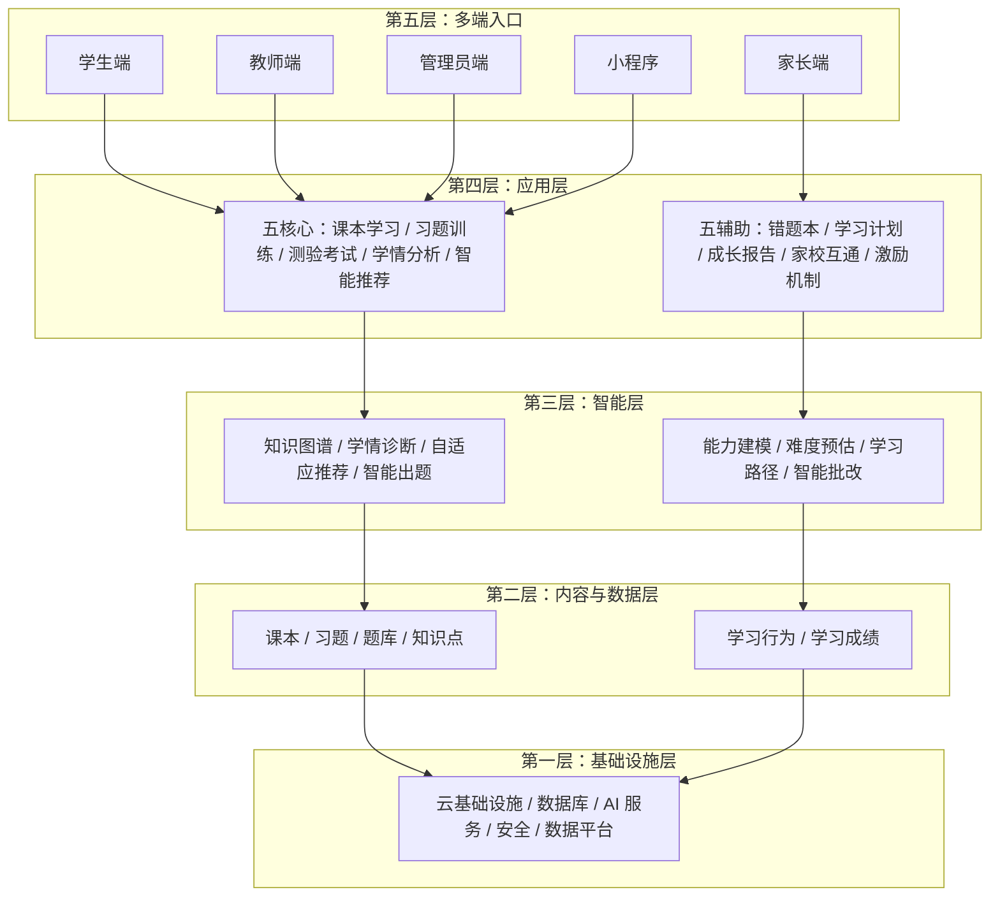
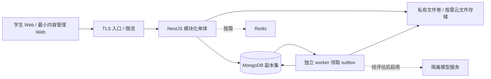

# 知阶 KnowLadder 技术架构方案

> 状态：现行技术契约、已确认设计与历史实施证据的合并入口；不将本地完成解释为生产上线或采购批准。品牌理念：知阶而上，智达未来。
> 2026-10-02新增：[教学培训与AI扩展技术设计](#ai-training-architecture)含首期设计及[本地实现](#training-local-implementation)；历史验收与部署边界继续保留。
> 核心文档：[开发计划与文档导航](开发计划.md#document-map) · [项目方案](项目方案.md) · [交互及 UI/UX](UIUX设计方案.md)

> 开发交接入口：[开发计划](开发计划.md)。当前阶段、完成清单、下一步稳定任务编号及文档同步要求统一维护于该文件；更新本方案时必须同步计划。历史阶段记录不覆盖最新状态。

<a id="architecture-reading-map"></a>

### 阅读目录与证据边界

| 阅读目的 | 入口 |
| --- | --- |
| 接手当前任务、检查授权和剩余限制 | [开发计划](开发计划.md)，不从历史验收段推断当前状态 |
| 逻辑分层、领域模型、接口与安全原则 | 第1—15节；其中愿景、[INFERENCE]建议与现行实现需分别阅读 |
| 已确认的分阶段技术合同及历史验收 | 第17—19节；历史UUID、v1—v9和当时“待实施”表述不作为当前执行步骤 |
| 运行真实系统、PM2与扫描安全前提 | [第20节](#local-runtime) |
| MongoDB副本集/standalone能力与风险 | [第21节](#mongo-topology-design) |
| ObjectId现行契约、v10初始化与未实施的存量保留路线 | [第22节](#object-id-design)，当前正式入口优先读[22.1](#object-id-implementation) |
| 教学培训/官网/AI新范围的技术边界 | [第24节](#ai-training-architecture)，候选模型与API不当作现行实现 |
| IAM分级授权、API、故障恢复与后台产品契约 | [第23节](#administration-design)，专业后台设计见[23.11](#professional-console-redesign) |
| 身份加载、跳转、邮箱邀请/注册/找回与隐私恢复扩展 | [第25节](#auth-experience-email-design)，完整18项设计已确认实施，进度以开发计划为准 |

本文中的历史测试结果只说明当次环境和范围，不是本轮重新运行。原始规划/相对工期不构成交付承诺；效果示例不构成学习收益，容量目标不构成实测SLA。真实版权、隐私准入、TLS/MFA、生产容量/RPO/RTO、全量视觉/WCAG验收及部署采购仍按开发计划的授权与限制执行。

## 1. 背景、目标与边界

### 1.1 当前实现与问题分析

当前仓库包含独立 `prototype/` 内存演示、`server/` NestJS API、`web/` 真实前端和 `ops/` 运维工具。阶段一至五、教师最小端及IAM统一控制台已有约定范围内的本地实现与历史验收；源码已注册认证、内容、文件、练测评分、学情/阅读/推荐、隐私、教师、管理和平台业务入口。当前数据库契约为ObjectId v10，正式迁移仅接受空库初始化或同版本/校验和续接；UUID存量保留迁移未实现。开发库清空重建、治理账号/HTTP登录及随后各角色初始化分别见开发计划修订62/63/65；账号存在不代表首次改密、真实独立人员交付、附加权限或教学关系已完成。Windows宿主EICAR历史失败、两项感染暂缓和standalone非原子限制继续保留；原型不作为真实数据兜底或学习效果证据，尚无生产上线批准。

现行目标扩展为融合AI的教学培训平台，课程/班级/任务/作业与官网设计见第24节。原教育场景目标保留为覆盖小学至大学的多端学习系统，形成“课本学习 → 习题训练 / 测验考试 → 学情分析 → 智能推荐 → 后续学习”的闭环。五个核心应用为课本学习（Textbook）、习题训练（Practice）、测验考试（Quiz）、学情分析（Analyze）、智能推荐（AI Rec）；五个辅助应用为错题本、学习计划、成长报告、家校互通、激励机制。

### 1.2 设计目标与非目标

- 原学习系统首期聚焦初中数学、学生Web与最小内容管理；这是历史范围。新增培训机构/成人职业培训及四项AI的建议顺序见第24节和项目方案第14节，不能从旧范围排除新文档规划或推定新实现授权。
- [INFERENCE] V1 家长协作、教师业务深化与V2知识图谱/高级模型/更多终端仍属产品路线；教师最小端已另获授权实施，不应从原V1规划反推“教师尚未实现”。首期保留身份和数据边界，不等于建设全部业务界面。
- 保证每次成绩可还原到题目版本、作答、评分规则及批改修订；每次推荐能够说明依据和数据新鲜度。
- 阶段一至五及教师/IAM约定本地范围已有实施与分批证据，剩余任务、环境限制和真实准入统一见开发计划。生产部署及云采购未获授权；不保证全学段覆盖，不把原型评分视为真实后端，也不承诺AI监考或自动主观题评分。
- 第17—19节保留原阶段技术合同及当时执行/失败/未覆盖证据；第20—23节为运行和专项现行入口。生产容量、预算、法规及采购仍需确认，暂无现网SLA或真实学习收益数据。

2026-09-19 选型调整：**API 使用 NestJS，主数据库使用 MongoDB**，这是用户已明确的技术约束；文件存储及是否引入图数据库仍按本文建议评审。该选型调整不代表部署拓扑或云产品已获采购授权；随后获授权实现的 Vue 原型不包含上述生产服务。

## 2. 技术选型及权衡

| 范围 | [INFERENCE] 建议 | 理由、代价与替代边界 |
| --- | --- | --- |
| Web | Vue 3 + TypeScript + Vite | 学生端与管理端共享基础组件但分开路由与权限；先做响应式 Web，不因此承诺小程序直接复用 DOM 组件 |
| API | **NestJS + TypeScript 模块化单体（已确定）** | 以 Module / Controller / Provider 划分业务；API 处理鉴权与编排，批量评分交独立 worker；不因后续 Python 模型生态而采用第二套业务 API |
| 持久化 | **MongoDB（已确定）**，通过 `@nestjs/mongoose` 建立连接、driver collection访问并经显式ObjectId适配边界 | 文档承载题型与快照；复合唯一索引、CAS及副本集事务保障提交一致性；无外键，引用和租户一致性由领域服务负责。生产必须支持事务；显式standalone仅开发并保留非原子限制，见第21节 |
| 文件 | [INFERENCE] 私有持久文件卷起步，按部署条件改用共享文件系统或 OSS/COS 原生接口 | 教材、图片、导出与数据库元数据分离；不强制 S3 协议；具体方案及取舍见 2.2 |
| 异步 | [INFERENCE] 独立 NestJS worker + MongoDB outbox | 业务与事件同事务写入；条件更新领取租约，量大后可接消息系统，outbox 仍保留 |
| 缓存 | Redis 按需引入 | 仅在限流、热点或队列吞吐有证据时使用；数据库仍是成绩和提交的权威来源 |
| 算法 | 规则推荐 + 可解释掌握度 | 数据少时可追踪；BKT/DKT、协同过滤、强化学习按离线与受控验证结果决定，不预设全部有效 |
| AI / RAG | 独立适配接口，按需模型服务 | 不绑定供应商；先评估授权、质量、成本和未成年人数据出境风险，再决定是否启用 |

NestJS、Vue、MongoDB驱动等已在仓库实现并锁定依赖；Redis、图数据库和模型/云服务仍为按需演进，不据此声称已采购或部署。运行版本与源码落点见第20节，许可证、漏洞和生产规格需在各次发布核查。

### 2.1 NestJS 落地约定

- 当前后端、真实 Web 与独立原型统一限定 Node.js 22.19.0（`engines.node: "22.19.0"`），后端使用 NestJS 12 与默认 Express 适配器；生产发布仍须核查支持周期和实际部署版本，不为选型额外切换 HTTP 适配器。
- Controller 只负责 HTTP 契约；Provider 实现领域规则；Repository 封装带组织范围的 MongoDB 访问。模块只导出业务服务，不允许其他模块绕过服务直接写集合。
- 当前使用Mongoose建立连接（`autoIndex:false`、`autoCreate:false`），driver访问集合；数据库validator与索引由正式迁移定义和校验，不依赖Mongoose隐式转换或启动自动建索引。v10的显式ObjectId边界见第22节。
- 全局 `ValidationPipe` 拒绝未声明字段，DTO 对嵌套题型做显式验证，不将客户端 JSON 当 MongoDB 过滤器或更新表达式。统一异常过滤器把参数错误映射为本文约定的 `422`，业务冲突为 `409`，不沿用框架默认错误形状。
- Guard 建立身份与组织上下文，领域服务再次执行资源关系授权；Interceptor 统一 `request_id` 和响应封装。以 `@nestjs/swagger` 生成并校验 OpenAPI；请求、学生响应和评分内部 DTO 分离。
- 会话使用持久化共享存储（首期 MongoDB），不使用进程内默认 session store；TTL 仅用于清理，认证时仍检查有效期和撤销状态。Redis 引入前不能假定跨实例内存会话有效。
- worker 以 NestJS application context 独立运行，不开放业务 HTTP 端口；CPU 密集评分不得阻塞 API 事件循环。后续 Python 仅用于隔离的模型训练/推理服务，通过版本化接口接入，不接管业务事务。

<a id="node22-regression"></a>
#### 2.1.1 Node22定向回归修复与二期复验（2026-10-03，修订85）

Windows实际解释器E:/nvm/nodejs/node.exe、Node.js22.19.0，MongoDB8.0.17一次性真实副本集及独立standalone；测试只使用kl_test_*及隔离恢复/控制库，不连接业务库。沿用修订82版本配置，未改lockfile、真实.env、账号或PM2。

修复：AuthService.authorize在管理隔离检查和数据库查询前验证组织标识为小写24hex，非法X-Org-Id明确403 FORBIDDEN，避免ObjectId边界异常被映射成503。Origin/CSRF、当前有效成员、能力与管理隔离保护不变；真实服务故障仍保留503。认证测试对齐实际v10初始化marker及租约错误，使用合法ObjectId验证数据库121拒绝异常文档；environment_id和maintenance_token仍是UUID，不能把所有标识统一改成ObjectId。文件配置测试显式开启扫描配置验证，避免继承运行器false；在可信父目录新建临时私有根并用异步realpath规范Windows长路径。没有放宽正式路径/ACL/磁盘/符号链接规则。

server下显式Node22执行 test/object-id-runtime.cjs test/auth.integration.test.cjs test/assessment-worker.integration.test.cjs test/files.config.test.cjs：38通过0失败0跳过，136.72秒、退出0；包括四种非法组织标识、跨组织/角色替换/禁用、会话与CSRF/共享限流、维护及隐私屏障、真实评分事务回滚、租约恢复/checksum漂移、目录ACL及路径替换拒绝。见[最终日志](../ops/artifacts/training-validation/revision85-node22-final.log)。

同一解释器执行 test/training-supplement-runner.cjs test/training-phase2.integration.test.cjs test/training-phase2-quiz.integration.test.cjs test/training-phase2-privacy.integration.test.cjs test/training-reports.integration.test.cjs：8通过0失败0跳过，79.56秒、退出0；覆盖排课/独立审核/路径草稿编辑/补课资格/证书状态/通知、真实测验发布及重批、v15旧完整加密备份结合最新擦除账本恢复、报告有效事实。见[二期日志](../ops/artifacts/training-validation/revision85-node22-phase2.log)。两轮分别计数，不相加为一次全套。

后端tsc、Web与原型各自vue-tsc/Vite检查退出0，dist仅由构建生成。API结构与UI没有本轮变化，未重新生成OpenAPI或重跑浏览器/真实模型/ClamAV感染验收；配置测试不代表实际扫描成功。限定Review与修复后复审PASS，本范围未发现未解决Critical/High。最终两个runner均退出0并完成各自finally清理；未启停真实服务。

历史保留：修订82的32通过6失败不改写；本轮首次node_repl启动的子进程退出1且没有完整TAP，仅作中断记录。第一轮修复后35通过3失败、131.87秒、退出1：维护环境UUID被本轮夹具误改与父例失败、Windows短路径不匹配；恢复UUID并规范可信目录后最终38项通过。日志revision85-node22-initial.log及revision85-node22-reviewed.log保留。Linux-only可选依赖较高Node要求、Linux安装/构建、迁移故障/多版本组合、完整竞争与unknown浏览器、容量/跨进程证书限流、真实模型质量及生产准入仍未覆盖。

### 2.2 文件存储替代方案

[INFERENCE] 首期建议教材附件、图片和报告导出使用私有持久文件卷，MongoDB 仅保存独立文件元数据文档（资源 ID、`org_id`、内容版本、服务端存储键、大小、MIME、校验和、状态及留存期限），不把文件二进制或无限增长的文件数组塞入业务文档。NestJS API 与独立 worker 在单机部署时共享挂载持久卷，不能使用容器临时盘；磁盘与宿主机仍是单点故障，需异机备份。出现多机部署、容量/吞吐瓶颈或更高可用性要求时，改为各实例均可访问的共享文件系统或云对象存储，不能假设单机卷天然跨主机共享。

| [INFERENCE] 方案 | 适用边界与代价 |
| --- | --- |
| 本地持久卷 / NAS 共享文件系统 | 单机低运维成本起步；多机可选具备访问控制的 NAS，但需验证并发、原子发布语义、备份和高可用性，NAS 本身不等于无单点 |
| OSS / COS 原生 SDK | 容量、带宽、可用性或托管运维需求上升时的云替代；私有桶、地域、费用、版本与生命周期能力需确认，不要求 S3 协议兼容 |
| MongoDB GridFS | 仅在明确需要数据库统一管理文件且容量/恢复成本可接受时评估；分块可突破普通 BSON 文档大小限制，但增加数据库 I/O、复制及备份负担，不是首期默认，也不提供文件与业务元数据的原子事务保证 |

[INFERENCE] 文件采用 `pending → quarantined → ready → deleting` 生命周期：先登记上传意图，在不可下载的隔离区临时写入，限制大小并校验内容类型、校验和与恶意内容；通过后以服务端生成的不可变键发布，再以条件更新转为 `ready`。文件系统发布使用同一文件系统内的原子重命名，并确认所选文件系统的持久化语义；云存储由适配器在完整上传确认后发布，不假定拥有 POSIX 重命名能力。文件写入与 MongoDB 更新不在同一事务内，失败通过幂等重试、补偿删除和周期对账修复孤儿文件、缺失文件及滞留状态；缺失或未就绪文件拒绝下载。删除先标记 `deleting` 停止访问，再删除实际文件并保留最小删除记录，重试不得误删其他版本。

[INFERENCE] 客户端只提交资源 ID，不指定服务端路径或存储键；服务端限定存储根目录并拒绝路径穿越、符号链接逃逸。教材、图片与报告均经资源级鉴权下载；敏感报告每次下载及 Range 请求实时检查当前权限，以 API 流式传输或内部受控文件服务交付，不暴露绕过鉴权的静态目录或裸签名 URL。已发送的数据无法追回；其他允许短期签名分发的资源也不能承诺链接即时撤销。

## 3. 五层系统架构

下图展示完整产品愿景的逻辑分层，不表示每层都独立部署，也不表示首期全部启用。



智能层依赖的是受授权的数据访问接口，不应让模型直接连接生产数据库。应用编排可直接调用内容服务，不必为普通教材读取强制经过模型。

### 3.1 首期部署及演进



[INFERENCE] 首期 API 与 NestJS worker 使用同一代码库、同一领域模型但不同进程；worker 可单独扩容，数据库 schema/索引变更由一次性发布任务执行。模块通过公开服务接口协作，不相互直接改集合。MongoDB 开发与集成环境也使用副本集以验证事务；生产采用跨故障域的副本集或提供同等能力的托管服务，单节点开发配置不代表生产高可用。未来根据实际瓶颈先拆分模型推理或异步计算，再考虑内容检索等独立服务；拆分前保留事件 schema、幂等和所有权，不按架构图机械拆成微服务。

## 4. 模块所有权、依赖与端到端数据流

| 模块 | 拥有的数据与职责 | 允许依赖 |
| --- | --- | --- |
| 身份与授权 | 用户、组织、角色、班级成员、监护关系、同意记录 | 不依赖学习业务；提供上下文与授权判定 |
| 内容中心 | 学段学科、教材版本、章节、知识点、先修边、题目版本、内容授权 | 身份与授权 |
| 学习与测评 | 训练策略、测验、试卷、会话、作答、提交 | 授权、内容只读接口；冻结题目和规则 |
| 评分 | 批改结果、评分修订、人工复核 | 测评冻结快照、受保护答案；发布评分事件 |
| 学情 | 掌握度证据、学习画像、报告投影、错题视图 | 评分事件、合法行为；不得反写分数 |
| 推荐与计划 | 推荐批次、解释、计划进度 | 学情快照、先修图、可用内容；不得修改成绩 |
| 协作与激励 | 家校消息、受众关系、激励记录 | 授权及已发布学习事件；不得把积分当能力证据 |
| 平台运维 | outbox、消费记录、审计、导出与删除作业 | 通用接口；运维权限不自动获得学生明细 |

### 4.1 完整学习闭环

1. 学生选择学段、学科、教材版本，服务器检查组织、内容授权期限及资源可见性，返回已发布章节，不返回受保护题目答案。
2. 课本阅读产生最小行为事件；阅读完成只能作为进度，不直接证明掌握。
3. 训练根据知识点提供已发布题目；考试从冻结试卷生成会话。两者共用题库，使用不同的服务端模式策略。
4. 会话保存答案，终结提交后生成不可变提交记录及 outbox；评分读取会话快照而不是题目的最新版本。
5. 客观题确定性批改；主观题进入人工复核。只有有效且符合发布策略的评分结果驱动学情证据。
6. worker 更新掌握度及报告投影，推荐读取标有证据版本的学情快照和内容授权，给出下一知识点、题组或课本章节及理由。
7. 学生继续学习，推荐接受/跳过形成行为事件；这些行为用于评估推荐，不等同答对证据。

### 4.2 训练与考试规则隔离

| 规则 | 习题训练 `practice` | 测验考试 `quiz` |
| --- | --- | --- |
| 题目来源 | 经授权的已发布题目 | 发布前冻结的试卷修订 |
| 提示与解析 | 可按训练策略展示，记录提示使用 | 考试期间不返回答案、解析或正确性信号 |
| 重试 | 可开启新会话重练；区分独立作答与看答案后重练 | 按测验允许次数和开放区间，服务端原子计数 |
| 时间 | 可不设截止时间 | 服务端保存 `deadline_at`，由测验关闭时间与时长取较早值 |
| 成绩发布 | 确定性评分完成后可即时展示 | 遵循 `release_at` 和人工复核完成状态；不保证交卷即出分 |
| 学情影响 | 提示、重复题权重受规则控制 | 仅有效考试及最终评分版本；无效或撤销结果不累计 |

浏览器切屏等信号只能作为风险提示，不自动判定作弊或扣分。身份核验、随机题序、开放窗口、人工复核等是可选控制；无法保证远程考试不作弊。

## 5. 前后端接口契约

### 5.1 通用约定

现行API前缀为 `/api/v1`，JSON字段采用 `snake_case`；资源ID在HTTP/业务DTO为小写24位hex（`^[0-9a-f]{24}$`），数据库主键及真实引用为BSON ObjectId，详见第22节。`request_id`、幂等键、认证令牌和附件存储键保持各自语义，不统一改为ObjectId；历史UUID示例及v1—v9证据仅供追溯。时间采用UTC ISO 8601，显示时转换时区。金额不在首期范围；分数为十进制定点语义，接口用字符串如 `"4.00"`避免浮点歧义。列表使用受限 `limit`与不透明 `cursor`，不接受无限导出。

- [INFERENCE] 首期同源 Web 使用服务端会话、`HttpOnly` / `Secure` / 合理 `SameSite` Cookie；写操作验证 CSRF token，并校验 Origin。未来小程序通过独立认证适配引入短期令牌，不复用浏览器 Cookie 假设。
- 客户端可发送组织选择头 `X-Org-Id`，服务端必须从已认证用户的有效成员关系验证；头部、资源 ID 或前端路由都不是授权证据。
- 所有写操作执行资源级授权；登录成功不等于可访问班级或学生。响应携带 `request_id`，日志不记答案正文或令牌。
- 会话答案修改要求 `expected_revision`；不匹配返回 `409 REVISION_CONFLICT`，客户端拉取新状态并让用户处理，不盲目覆盖。
- 创建会话、终结提交、重批等操作使用 `Idempotency-Key`；相同用户、组织、操作、资源、key 与规范化请求哈希匹配时返回原结果，不匹配时 `409 IDEMPOTENCY_CONFLICT`。终结提交唯一约束长期防重，不能只依赖短期缓存。
- 成功返回 `data` 与 `request_id`，错误返回 `error.code`、安全的 `message`、可选字段错误及 `request_id`。客户端按错误码决策，不解析中文提示。
- 版本化 OpenAPI 作为实施后的前后端契约；内容写入、学生展示及评分内部 DTO 分开，避免通过“去掉部分字段”方式意外泄露答案。

前端页面与状态反馈见[交互及UI/UX方案](UIUX设计方案.md#interactive-prototype)。第5.2节为早期领域接口总览，具体路径、DTO和已实现范围以各阶段合同、现行OpenAPI及源码为准；不能将原型候选流程视为真实API。演示模式不得进入生产构建，服务故障不能回退示例数据。

### 5.2 核心 API 清单

| 方法及路径（省略 `/api/v1`） | 用途与主要权限 |
| --- | --- |
| `GET /me` | 当前身份、可选组织及能力集合 |
| `GET /textbook-editions`、`GET /chapters/{id}` | 查询有授权的教材版本与章节 |
| `GET /knowledge-points/{id}` | 可见知识点与先修关系 |
| `POST /practice-sessions` | 学生创建训练，传教材版本与知识点范围；服务端选题 |
| `GET /quizzes/{id}` | 获取所属班级或显式受众可见的考试元信息 |
| `POST /quizzes/{id}/sessions` | 在次数、时间与受众限制内创建考试会话 |
| `GET /sessions/{id}` | 本人会话与题目展示 DTO；无答案及私有评分规则 |
| `PUT /sessions/{id}/answers/{session_item_id}` | 本人提交前保存单题答案与预期修订 |
| `POST /sessions/{id}/submissions` | 原子保存最终答案并终结提交 |
| `GET /submissions/{id}` | 查询批改进度；成绩和解析遵循发布策略 |
| `GET /me/mastery`、`GET /me/reports` | 本人学情与报告，返回数据水位及生成状态 |
| `GET /me/recommendations` | 解释、依据版本、候选内容及失效时间 |
| `POST /behavior-events` | 允许列表内的最小行为事件，事件 ID 去重、限流 |
| `GET /me/mistakes`、`GET /me/learning-plan` | 按有效评分及本人推荐构建辅助视图 |
| `POST /admin/question-versions` | 有内容编辑权限者创建草稿，不直接发布 |
| `POST /admin/question-versions/{id}/publish` | 经审核及版权检查后发布；编辑与审核职责分离 |
| `POST /admin/knowledge-edges` | 携带图范围及预期修订；同图修订文档 CAS 与有界防环校验，超限转完整快照离线拓扑校验后 CAS 发布（见 8.1） |
| `POST /quizzes`、`POST /quizzes/{id}/publish` | 有受众班级授课权限者编排并冻结试卷；首期可限授权内容管理员 |
| `POST /submissions/{id}/regrades` | 受授权审核者发起有原因的评分修订，不覆写旧成绩 |
| `POST /guardian-links`、`POST /guardian-links/{id}/confirm` | V1 绑定申请与独立确认，申请不立即赋予访问权 |
| `GET /students/{id}/reports` | V1 教师按当前班级及学科、家长按有效绑定访问 |
| `POST /privacy/deletion-requests` | 提交撤回/删除申请，鉴权后异步处理并反馈状态 |

### 5.3 终结提交示例

下列 ID 和内容仅为示例。`session_item_id` 指会话冻结题项，不是全局题目 ID；客户端不传分数、用户 ID、模式或题目答案标准。

```http
POST /api/v1/sessions/11111111-1111-4111-8111-111111111111/submissions
Content-Type: application/json
Idempotency-Key: 02c8b983-3ec3-4d79-bef4-9bb6fa270052
X-CSRF-Token: <csrf-token>
```

```json
{
  "expected_revision": 7,
  "answers": [
    {
      "session_item_id": "22222222-2222-4222-8222-222222222222",
      "answer": { "selected_option_ids": ["B"] }
    }
  ]
}
```

`answers` 是需要在终结事务内覆盖的最终答案集合，未列出的题项沿用已保存答案，从未保存的题项视为未作答；重复题项或不属于该会话的题项直接拒绝。前端提交前展示未答提示，不静默清空已保存作答。

```http
HTTP/1.1 202 Accepted
```

```json
{
  "data": {
    "submission_id": "33333333-3333-4333-8333-333333333333",
    "session_id": "11111111-1111-4111-8111-111111111111",
    "session_status": "submitted",
    "revision": 8,
    "submitted_at": "2026-09-18T10:00:00Z",
    "grading_status": "pending",
    "report_status": "pending"
  },
  "request_id": "req_example_001"
}
```

`202` 只表示提交已持久化，不代表成绩或报告已生成。相同幂等请求重试返回原受理结果；查询接口返回最新状态。考试成绩未到发布时间时只返回 `grading_status` / `release_status`，不得通过总分、逐题结果、报告或推荐解释旁路泄露考试答案。

## 6. MongoDB 文档与集合模型

### 6.1 公共约束

> 现行契约：项目集合主键及真实引用统一为BSON ObjectId，API资源ID为小写24位hex；显式MongoDB持久边界负责查询/写入/结果转换，validator要求v10。自然字符串键移到独立唯一字段；追踪/幂等/认证秘密/lease/epoch/generation/storage_key保留原语义。下文UUID数据模型为历史设计，现行依据为[ObjectId契约及历史验收](#object-id-implementation)。未实施存量保留迁移；当前库、账号及服务状态统一见开发计划，不在本节复制进度。

[历史模型] 下表保留早期概念及v9之前UUID类型，不是当前数据库类型或“全部待实施”的现状。当前driver访问、validator/索引及ObjectId适配以第20/22节为准；早期业务文档使用UUID字符串 `_id`（API `id` 映射该字段）、BSON Date 类型的 `created_at/updated_at`，历史记录追加写而不覆盖。组织数据必须含非空 UUID 字符串 `org_id`；查询、更新、聚合入口和关联读取均显式带组织范围。全局用户、基础目录与平台公共内容使用显式类型和授权路径，不能通过缺失租户的通配查询开放。个人学习使用独立个人空间组织。

- 下表 `*_id` 均为引用 ID，不存在数据库外键或级联删除。NestJS 领域服务按允许的引用类型验证存在性、同组织或显式跨组织授权、状态和版本，不能相信客户端 ID。需与授权撤销严格互斥的写操作和撤销操作共同条件更新授权修订文档，不能仅依赖快照读取；删除策略须保留历史证据所需引用。
- 使用集合级 schema validators（`$jsonSchema`，必要时结合 `$expr`）验证必填、BSON 类型、状态枚举、模式条件、同文档范围和时间关系；Mongoose 校验不能替代数据库校验。跨文档约束由受控服务入口和事务保障。所有未确认的集合及索引细节均为 [INFERENCE] 建议。
- `_id` 默认唯一；下表 `U(...)` 为复合唯一索引、`I(...)` 为查询索引，组织业务键包含 `org_id`。有效关系采用 `partialFilterExpression: {status: "active"}` 的部分唯一索引；有效期在服务端判定，到期任务结束 active 状态，不依赖索引随时间变化。可选唯一字段采用只匹配合法类型的部分索引，不能假定缺失值自动绕开唯一约束。索引由迁移显式建立，不依赖生产启动自动建索引；其余索引按访问路径和执行计划确定。
- 分数、满分、正确度及精确权重存为 `Decimal128`，API 使用十进制字符串，服务端使用十进制库计算，禁止经 JavaScript `number` 往返；同文档数值范围由 validator 校验，跨文档满分与权重和由评分/发布服务验证。
- 有界且同生命周期的小结构可嵌入；成员、题项、答案、边、证据、事件及大报告明细使用独立集合，不无限嵌套。每份 BSON 文档必须小于 16 MiB，并设置更小的题干、答案、快照数组和报告限额；需要完整分页结果时使用独立明细及版本清单，不能静默截断。文件正文不存业务文档，元数据与引用按第 2.2 节处理。
- 多集合不变量使用 MongoDB 副本集事务，开发验证环境也需启用副本集；单节点副本集不提供生产高可用。使用同一 `ClientSession` 并显式传入全部 Mongoose 查询、聚合和写入，采用 `readConcern: snapshot`、提交 `writeConcern: majority`、主节点读取。事务内顺序执行数据库操作，不并行使用同一 session，不调用外部模型或文件服务。快照隔离不自动防止跨文档写偏差，必须通过共享修订文档的条件写制造冲突，见第 7 节与第 8.1 节。

### 6.2 身份、组织与授权

| 集合 | 关键字段、引用与约束 |
| --- | --- |
| `users` | `_id`、最小登录标识、显示名、`status(active/disabled/deleting/deleted)`；登录标识规范化后唯一，可选登录方式采用类型限定部分唯一索引；不默认采集真实姓名、生日和定位 |
| `organizations` | `_id`、`kind(school/personal/platform)`、名称、`status` |
| `roles` | `_id`、`code`，`U(code)`；学生、教师、家长、内容编辑、审核、组织管理、平台运维分开 |
| `organization_members` | `user_id`、`org_id`、`status`；`U(org_id,user_id)`；引用有效用户和组织 |
| `member_roles` | `member_id`、`role_id`；`U(org_id,member_id,role_id)`；验证成员同组织、角色在允许目录内 |
| `classes` | `org_id`、名称、学年、`status`；教师身份本身不赋予全校班级访问权 |
| `class_members` | `class_id`、`member_id`、`kind(student/teacher)`、`status`、有效区间；active 部分 `U(org_id,class_id,member_id,kind)`；`I(org_id,member_id,status)`；班级及成员同组织 |
| `teaching_assignments` | `class_id`、教师 `member_id`、`subject_id`、有效区间；验证同组织班级、教师角色及学科；限定教师可见班级及学科 |
| `guardian_links` | `guardian_user_id`、学生 `member_id`、`status(pending/active/revoked/rejected)`、独立确认者、确认依据与时间；active 部分 `U(org_id,guardian_user_id,member_id)`；`I(org_id,guardian_user_id,status)`；验证学生成员及监护用户 |
| `consent_records` | 用户/监护人、组织、用途、政策版本、取得依据、`granted_at/withdrawn_at`；审计撤回不覆盖原同意；依法确定是否需要及由谁同意 |
| `content_grants` | 资源所有者组织、资源类型及资源 ID、受授权组织、允许用途、地域/期限、`status`、授权修订；资源类型采用枚举及资源解析器注册表，服务验证资源存在、所有权及受授权组织，不接受任意集合名；`I(grantee_org_id,status,expires_at)` |

### 6.3 内容与知识体系

| 集合 | 关键字段、引用与约束 |
| --- | --- |
| `education_stages` | `code`、名称，`U(code)`；小学、初中、高中、大学是目录能力，不代表已有内容 |
| `subjects` | `code`、名称，`U(code)` |
| `textbooks` | 所有者组织、`stage_id`、`subject_id`、出版社/来源与版权依据；验证学段及学科目录 |
| `textbook_editions` | `textbook_id`、版本标识、`status(draft/review/published/retired)`、授权元数据；`U(org_id,textbook_id,edition_code)`；已发布版本不可原地替换正文 |
| `chapters` | `textbook_edition_id`、`parent_id`、顺序、内容引用；父章节必须同组织、同教材版本且不形成层级环；根节点统一 `parent_id: null`；`U(org_id,textbook_edition_id,parent_id,position)`；结构更新共写教材版本修订文档并验证层级 |
| `knowledge_points` | 所有者组织、学段、学科、`code`、名称、`status`；`U(org_id,subject_id,code)`；`org_id` 即所有者组织 |
| `chapter_knowledge_points` | `chapter_id`、`knowledge_point_id`；`U(org_id,chapter_id,knowledge_point_id)`；记录教材章节与通用知识点映射，跨所有者引用须验证内容授权 |
| `knowledge_graphs` | 所有者组织、`subject_id`、`scope_code`、`write_revision`、`published_revision`；`U(org_id,subject_id,scope_code)`；同图写入共同条件更新此文档以制造写冲突，发布指针仅指向完整验证的不可变修订 |
| `knowledge_edges` | `graph_id`、`graph_revision`、`prerequisite_id`、`successor_id`；`U(org_id,graph_id,graph_revision,prerequisite_id,successor_id)`；validator 拒绝自环；分别以 `org_id,graph_id,graph_revision` 加起点/终点建双向遍历索引；端点范围及防环按第 8.1 节验证 |
| `questions` | 所有者组织、学科、稳定业务 `_id`、`status`；代表题目身份，不直接承载可变评分标准 |
| `question_versions` | `question_id`、`version_no`、题型、展示正文/选项、受保护答案与评分规则引用、难度及估计来源、`status(draft/review/published/retired)`、审核者；`U(org_id,question_id,version_no)` |
| `question_knowledge_points` | `question_version_id`、`knowledge_point_id`、Decimal128 权重；`U(org_id,question_version_id,knowledge_point_id)`；validator 校验权重范围，发布服务在固定版本上校验权重和及知识范围 |

发布题目版本不可修改题干、答案或映射；勘误创建新版本，旧会话仍保留原始快照。授权过期阻止新使用，历史证据能否继续保存和展示由授权合同及隐私政策决定，不默认无限保留教材全文。

### 6.4 测评、评分与学情

| 集合 | 关键字段、引用与约束 |
| --- | --- |
| `quizzes` | `org_id`、学科、受众策略、`opens_at/closes_at/release_at`、`duration_seconds`、`max_attempts`、`status(draft/published/closed/archived)`；validator 校验时间先后、正整数时长及次数 |
| `quiz_audiences` | `quiz_id`、`class_id`；`U(org_id,quiz_id,class_id)`；引用均同组织 |
| `papers` | `quiz_id`、`revision`、`status(draft/frozen)`；`U(org_id,quiz_id,revision)`；发布测验引用固定试卷修订 |
| `paper_items` | `paper_id`、`position`、`question_version_id`、Decimal128 `max_score`；`U(org_id,paper_id,position)`；分数非负，引用已发布且有权使用的题目版本 |
| `attempt_counters` | `quiz_id`、学生 `member_id`、已分配次数；`U(org_id,quiz_id,member_id)`；创建考试会话时同事务条件递增（已分配次数小于考试上限）并创建会话；初始化唯一键冲突重试，不先读后无条件写 |
| `sessions` | 学生 `member_id`、`mode(practice/quiz)`、可空 `paper_id`、`status(in_progress/submitted/expired/cancelled)`、`started_at/deadline_at`、`revision`、规则版本；validator 保证 quiz 必有 paper、practice 的 paper 为空；`I(org_id,member_id,created_at)`；答案写入和终结均条件更新会话修订 |
| `session_items` | `session_id`、顺序、`question_version_id`、展示快照、受保护评分快照、题知识点与 Decimal128 权重快照、Decimal128 `max_score`；`U(org_id,session_id,position)`；引用同组织会话，冻结后不可改，快照数组有数量上限 |
| `answers` | `session_id`、`session_item_id`、有大小限制的答案 JSON、保存时间；`U(org_id,session_id,session_item_id)`；服务验证题项属于该会话，写入与会话 revision 条件递增同事务；终结后冻结 |
| `submissions` | `session_id`、原因 `manual/deadline`、服务器受理时间、最终答案摘要、`grading_status(pending/running/needs_review/completed/failed)`、当前有效评分修订、`revision`；`U(org_id,session_id)`；提交主体与会话学生一致 |
| `grading_runs` | `submission_id`、`revision`、评分规则/代码/模型版本、原因、`status`、创建/确认者；`U(org_id,submission_id,revision)`；在提交修订条件更新事务内分配评分修订，旧修订保留 |
| `grading_results` | `grading_run_id`、`session_item_id`、Decimal128 得分、判定、人工复核状态；`U(org_id,grading_run_id,session_item_id)`；服务验证题项与提交同会话，得分不超过冻结满分 |
| `mastery_evidence` | 学生、知识点、`submission_id`、`grading_revision`、会话题项、Decimal128 正确度、提示/重复标记、Decimal128 权重、证据时间；`U(org_id,member_id,submission_id,grading_revision,session_item_id,knowledge_point_id)` |
| `student_projection_states` | 学生 `member_id`、`projection_revision`、目标/已应用输入水位、重算状态；`U(org_id,member_id)`；评分生效和投影更新均条件递增此共享文档；各提交输入有效版本存独立明细，不嵌入无限数组 |
| `mastery_snapshots` | 学生、知识点、算法版本、值（可空）、有效证据数、证据水位、生成时间；`U(org_id,member_id,knowledge_point_id,algorithm_version)`；无证据时值为空而非零分 |
| `report_snapshots` | 学生、报告周期、输入水位/依赖版本、计算版本、`status`、有界报告摘要及独立明细引用、生成时间；保留新鲜度与“更新中”状态 |
| `recommendations` | 学生、规则/模型版本、学情快照版本、图修订、教材版本、有界候选内容、解释、`expires_at/status`；`I(org_id,member_id,created_at)`；展示时再次校验授权 |
| `behavior_events` | `event_id`、组织及用户、允许列表内事件类型、目标资源、服务端接收时间、可选客户端时间；`U(org_id,event_id)`；按留存策略分批删除或对获准删除记录设置 TTL，TTL 不是准时执行器；客户端时间不作考试截止依据 |
| `outbox_events` | UUID `_id` 作为 `event_id`、`aggregate_type/id/version`、`event_type/schema_version`、最小载荷、`status`、`lease_owner/lease_token/lease_until`、重试次数、`available_at/processed_at`；`U(org_id,aggregate_type,aggregate_id,aggregate_version,event_type)`；pending 部分索引覆盖到期查询，running 部分索引覆盖过期租约查询 |
| `consumer_receipts` | `org_id`、`consumer_name/event_id`；`U(org_id,consumer_name,event_id)`，与消费业务写入同事务；实现至少一次投递下的去重 |
| `idempotency_records` | 用户、组织、操作、资源、key、请求哈希、响应引用/状态；`U(org_id,user_id,operation,resource_id,key)`；敏感响应不长期明文存放，保留期覆盖重试窗口及待决任务 |
| `audit_events` | 操作者、组织、动作、资源、原因、时间、request_id；追加写、受控留存，不复制完整答案和教材 |

`mastery_evidence` 保留不同评分修订供追溯，但当前计算只读取每个提交的当前有效修订。错题本由有效逐题结果投影，不维护另一套独立正确性真相。学习计划、家校消息、激励等 V1 详细集合结构另行评审，不以本清单暗示已实现。

## 7. 提交、批改与最终一致性

### 7.1 终结提交事务

[INFERENCE] 以下为 NestJS 领域服务及 MongoDB 事务的候选实施契约，不是已运行代码。

1. 验证登录、组织、会话所有权、CSRF、题型结构及请求大小，计算规范化请求哈希；开启短事务，全部数据库操作显式传同一个 `ClientSession`，按完整作用域读取幂等记录。同 key 换正文返回冲突，重试仍重新鉴权。
2. 同 key 已成功则结束只读事务并返回原受理结果；已有提交而 key 不同则返回已有提交引用且不再评分；否则在当前事务继续以下步骤。
3. 对 `sessions` 执行 `findOneAndUpdate`，条件包含 `_id/org_id/member_id/status=in_progress/revision=expected_revision`，并在数据库端以 `$expr` 和 `$$NOW` 判断 `deadline_at > $$NOW`（无截止的 practice 走明确分支）；更新状态、递增修订并用更新管道记录 `accepted_at: $$NOW`。成功受理点是最终成功提交的事务中该条件更新执行时刻，不是客户端点击时刻或事务返回时刻；所有服务节点不得自行替换成客户端时间。
4. 校验最终答案题项属于同一冻结会话，保存答案、创建唯一 `submissions`、`SubmissionAccepted` outbox 和幂等结果，与第 3 步同事务提交。只有确认提交成功才返回 `202`。会话字段、答案、提交和事件要么全部生效，要么全部回滚。
5. CAS 未命中时终止该事务并重新读取，按终结、截止、修订冲突分类，不盲目覆盖新修订。截止返回 `409 SESSION_DEADLINE_PASSED`，不接收补交答案；截止 worker 使用同一 CAS，数据库端判断 `deadline_at <= $$NOW`，仅以截止前保存答案创建 `reason=deadline` 提交并置 `expired`。唯一提交索引阻止重复终结。已存在提交时沿用第 2 步结果恢复语义。

自动保存也必须在事务中以会话 `status/revision/deadline_at` 条件更新并递增 revision，然后写答案；手动和截止终结写同一会话文档，形成写冲突及 CAS 顺序，而非“最后请求覆盖”。网络丢失响应通过原幂等键恢复；整个事务重试必须重新判断截止时间，不能复用前次未提交的受理时刻。

### 7.2 outbox、worker 与评分修订

- [INFERENCE] 独立 NestJS worker 用原子的 `findOneAndUpdate` 领取 `available_at` 已到的 pending 任务或 `lease_until` 已过的 running 任务，写 `lease_owner`、新的随机 UUID `lease_token` 和租约截止时间；领取、续租、过期判定均使用数据库端时间。续租必须匹配当前 token 且租约未过期；不持有长事务进行计算。
- 完成时开启短事务，先条件更新同一 outbox 文档，匹配 `status=running`、owner、token 及未过期租约，再写业务结果、消费记录和后续 outbox，并原子标记完成；未匹配则整个事务回滚。任务被重新领取后旧 token 不可能提交，即使旧 worker 计算晚返回也不能覆盖新结果。租约 token 防旧 worker，业务唯一索引及 `consumer_receipts` 防重复落结果，两者不能互相替代。
- 对象/数值/选择题使用发布时冻结的确定性规则。公式等复杂题型必须先定义规范化、误差范围和等价性规则；无法可靠判定即进入复核，不能静默判错。
- 主观题与模型辅助评分只产生建议及依据，教师/审核者确认后才形成有效最终修订。模型失败不得生成虚构分数。
- `grading_runs.revision` 单调递增；最终确认以 `submissions.revision` 和当前有效评分修订作 CAS，校验整次评分完整且已获必要复核，再在同事务切换有效修订、递增学生投影状态并写 `GradeFinalized`。旧任务不能覆盖更高有效修订；其历史结果仅在有效租约及对应评分修订内追加。
- 重批必须记录原因、发起者、规则版本以及复核；读取原提交快照，若是题目勘误，显式记录修正评分依据。不得把最新题干偷换到历史会话。
- 学情消费者在事务内首先条件递增同学生 `student_projection_states`，评分生效入口也写该文档，由写冲突串行化相同学生的有效输入和投影；随后读取提交当前有效修订、写证据和快照、推进水位及写 `consumer_receipts`。重复消费遇到唯一键冲突应回滚并确认原消费结果；旧版本事件只恢复当前有效输入，不回退水位。
- 重批不是“再加一次正确题数”：替换该提交的有效证据并从有效证据重算受影响知识点。规则模型可按确定顺序重算；BKT/DKT 对历史顺序敏感，须按证据时间与稳定 ID 排序重放，不能简单加减概率。
- 报告与推荐是最终一致投影。返回 `source_watermark`、`generated_at`、`status`；落后时显示“更新中”，旧报告明确标注时间，不伪装为已涵盖最新考试。
- 跨多个会话的水位由学生投影修订及各输入有效版本构成，不直接拿不同提交的评分修订号比较大小。检查点推进与投影写入同事务。
- 大量历史重算不占用长事务：在固定不可变输入清单/水位上离线构建独立版本，最终以学生目标水位及修订 CAS 发布；输入变化则重算或保持“更新中”，不能发布已过期计算。分块写入使用版本/分块唯一键，只有完整检查点才能切换对外指针。

### 7.3 重试、恢复与对账

[INFERENCE] 使用 MongoDB 驱动的事务重试机制并设总时限及退避预算：`TransientTransactionError` 重跑整个事务、重新读状态和检查截止；`UnknownTransactionCommitResult` 优先对同一 session/事务重试 `commitTransaction`，不能直接重做业务。预算耗尽而提交结果仍未知时，不声称失败或成功、不另建提交；通过原幂等键查询并持续对账，向客户端提供可重试的待确认结果。普通业务校验失败和 CAS 失配按业务冲突处理；重复键冲突回滚后按对应唯一键读取结果，不能一律无限重试。事务回调可能执行多次，禁止外部副作用，文件/模型/通知通过提交后的 outbox 处理。

任务可重试错误使用有上限的指数退避和抖动，超预算进入失败队列/人工处理；仅持有当前有效租约 token 的 worker 能更新重试状态。永久校验错误直接终止并给出可操作状态。周期对账核查“有提交无评分任务”“有效评分与学情水位不符”“租约过期任务”，通过原聚合事件键补发。消费记录保留期覆盖事件重放窗口，业务唯一约束长期保留；不承诺外部副作用恰好一次。模型调用采用超时、熔断及并发上限，失败只回退推荐，不虚构批改结果。

## 8. 智能能力与内容治理

### 8.1 规则推荐与可解释掌握度

[INFERENCE] 首期掌握度采用可解释的加权正确率：对当前有效、独立作答证据按知识点映射权重汇总，展示有效证据数和最近时间。提示后作答、答案曝光后重练需降权或排除，规则经教研确认并版本化。证据不足返回“待诊断”，不把没有作答当作不会；缺少覆盖时推荐短诊断而非声称已定位薄弱点。

推荐按“当前教材与授权范围 → 先修条件 → 有足够证据的薄弱点或待诊断点 → 适宜难度 → 去重与负荷限制”筛选。解释例如“最近独立作答中分式运算证据不足，建议先完成诊断”，必须引用真实证据，不能给出不存在的次数或分数。没有合格候选时明确返回空集合及原因。

[INFERENCE] 首期在 MongoDB 保存先修 DAG，图边不需独立数据库。图范围固定为 `(org_id, subject_id, graph_id)`；每次校验和读取都绑定 `graph_revision`，端点需属于登记的知识范围及允许学段，跨所有者引用须先授权。已发布修订不可修改，推荐记录实际使用的图修订；其他内容关系不能混入先修边。

- 小图编辑：同一短事务先以预期 `write_revision` 条件递增 `knowledge_graphs`，全部边和节点成员修改入口必须共写该文档；基于固定基线构造有明确大小上限的完整候选修订，从新边终点查到起点的可达性并拒绝成环，再保存不可变修订、切换发布指针并写 outbox。并发事务在同一图文档发生写冲突，重试时必须重读图并重验，不能假定 snapshot 隔离会自动防止两条边分别通过却共同成环的写偏差。一次含多条变更时在全部候选边上校验，不能分别对旧图验每一条边。
- 遍历始终限定组织、图和修订，可用索引驱动的服务端迭代或受限 `$graphLookup`；限定访问节点数、深度、时间和结果大小。必须遍历完待搜索可达集合才能判定无环；触达任何上限或无法确认完整性就拒绝在线发布并转离线校验，绝不将截断结果视为无环。
- 大图/批量发布：从固定完整修订创建独立不可变候选快照，分批写入并以清单、计数/校验摘要确认节点与边齐全，冻结后做全量拓扑校验及跨学段、孤立点检查；不能分页读取持续变化的工作图冒充完整快照。最后在短事务按基线 `write_revision/published_revision` 做 CAS，核验候选完整且通过校验后切换发布指针并写 outbox；期间任何图变更导致 CAS 失败，须基于新版本重新构建及验证，不能强行发布。大图不在事务中复制全量边，不要求一次聚合把图装入单个 BSON 文档。

### 8.2 模型逐步验证路线

| 能力 | 前提数据 | 验证要求与启用门槛 |
| --- | --- | --- |
| BKT | 稳定知识点映射、按时间排序的独立作答序列 | 与规则基线比较 log loss、Brier、校准及分群误差；参数可解释性与冷启动检查 |
| DKT | 足量、去泄漏的长期序列 | 按学生与时间隔离训练/验证/测试，报告 AUC 之外的校准、学习效果和资源开销；跨教材漂移评估 |
| 协同过滤 | 合规的学习交互与曝光记录 | 评估覆盖率、冷启动、流行度偏差；不能把“被推荐更多”误认为“教学价值更高” |
| 强化学习 | 稳定行为策略、可定义长期收益、安全动作空间 | 先离线评估、限制探索、人工审查与停用开关；未成年人场景不直接在线无约束试错 |
| 难度估计/路径 | 稳定题版本、群体样本与先修图 | 与教研难度对照、分群校准、路径可达性；数据不足保留专家标注及来源 |

启用前定义最低样本和指标阈值，由教研、隐私与技术共同评审；不在无数据时杜撰达标数字。训练集只含目的授权范围内数据，保存数据集版本、代码版本、特征定义和模型版本；排除未来成绩、答案泄露、同题版本跨集合污染。线上受控实验以真实学习提升、合理负担和公平性为主，不只追求点击率。推理超时、输入缺失、模型异常或质量回退时使用同版本确定性规则；没有学情数据时只做待诊断推荐。

### 8.3 智能出题与 RAG

- 模型生成题目、解析或课本摘要先进入草稿，经过答案正确性、难度、学段适配、版权及安全审核，再形成已发布版本；不可直接作为正式考试评分标准。
- RAG 仅检索有合法授权且教材版本受控的内容，索引保存资源版本、授权范围与状态；查询前过滤并在读取原文/返回引用前再授权。授权撤销时下线索引及缓存。
- 学生讲解检索库与答案、评分规则存储分隔。考试会话内禁用可能泄露当前试卷答案的检索和解释路径；仅隐藏前端按钮不构成防护。
- 教材、用户输入和检索文本都视为不可信数据；提示词不能授予权限，模型不能调用任意数据库查询或更新、网络或管理工具。工具允许列表、参数校验和最小权限在模型外执行。
- 输出保留出处及版本，缺少依据就说明无法回答；数学结论要有可验证步骤。外部模型默认不接收可识别学生数据，供应商留存、训练使用和地域条款未核实前不得发送真实数据。

### 8.4 图数据库评估与可选演进

[INFERENCE] 不把 Neo4j 作为首期依赖。首期知识点、先修边、教材映射及版本都由 MongoDB 管理；有界多跳查询、索引和按修订缓存先满足规则推荐。仅在真实图规模和查询压测证明复杂多跳、路径搜索成为瓶颈，且收益覆盖额外运维、同步与授权成本后，再评估 Neo4j 作为只读派生查询投影；无实测数据时不预设切换规模阈值。

- MongoDB 始终是唯一业务事实源和发布入口。图发布事务写 outbox，消费者按组织/图/修订幂等投影节点、边及删除；避免应用请求同步双写两库。Neo4j 版本不可变或先构建独立候选，完整校验后才推进投影发布指针；记录源修订、投影修订、水位和完成状态，忽略迟到旧事件，缺口则补放或从 MongoDB 完整快照重建。
- 两库之间没有原子事务：在 Neo4j 中提交投影及事件处理标记后才确认源事件；若确认前崩溃，重放依据 Neo4j 的处理标记/修订幂等去重。MongoDB `consumer_receipts` 不能单独证明另一数据库已写成功。投影可整体删除重建，不承载唯一的成绩、证据、权限或图编辑结果。
- 查询要求与请求图修订一致且完成的投影；同步滞后、查询超时或 Neo4j 故障时回退到同修订 MongoDB 有界规则查询。若完整查询仍无法在限制内完成，明确返回暂不可用/待更新或无图依赖的已验证规则候选，不混用不同修订、不把未知先修条件当作满足。结果返回源修订和新鲜度，权限仍由 NestJS 基于 MongoDB 授权数据校验；无须因此增加 Redis 或其他必选依赖。

## 9. 权限、安全、隐私与版权

### 9.1 资源级权限边界

[INFERENCE] 使用角色能力 + 资源关系 + 组织范围组合授权，默认拒绝。每次 API、后台任务、导出和缓存命中都执行对应边界。

- 学生只能访问本人会话、成绩和授权内容；用户 ID 从认证上下文派生，不能由请求正文冒名。
- 教师必须是资源所在组织的有效成员，并在目标班级及学科有有效授课关系；跨校任教需分别授权，不能因拥有 `teacher` 角色查询全平台学生。
- 家长绑定从 `pending` 开始，需有可信独立确认流程及学生/监护人身份依据；不能输入学生手机号或 ID 就获取报告。防枚举、一次性短期验证码、尝试限额与异常告警；关系争议支持冻结和人工处理。
- 绑定撤销、退班、离校和授权到期应使后续查询及导出下载失效；会话和缓存需短时失效或按授权版本校验。家长不自动看到班级其他学生或教师内部备注。
- 内容编辑不自动获得学生隐私；评分审核按职责限定。平台运维用脱敏指标排障，访问明细需临时授权、原因和完整审计。
- 题库答案仅评分服务和授权审核接口可读，不进入学生 DTO、客户端包、源映射、行为日志或开放 CDN。答案展示需按题项与会话发布策略控制。

### 9.2 未成年人数据治理

- 以实际运营地域和适用法规确认未成年人年龄规则、监护人同意及合法处理基础，必要时法律评审；不宣称本方案自动满足所有法规。
- 最小采集，默认不启用人脸、麦克风、摄像头、精确位置和通讯录。不为训练模型默认复用学习记录；用途变更需要另行评估及授权。
- 明示数据用途、保存周期、第三方及撤回路径；同意撤回后停止对应可选处理，学习必需处理与依法必须留存部分分别说明。
- 删除作业覆盖数据库、对象、检索索引、缓存、导出、特征与未来训练数据集，并保留不包含被删除明细的完成证明；已训练模型的处理按可行性和合规要求评估，不能承诺一次数据库删除即可完成模型遗忘。
- [INFERENCE] 建议行为明细 90 天、可选导出 7 天、备份 30 天作为待确认留存起点；成绩、审计和版权证据的期限另行按合同与法规确定，不无限保存。上线前将所有类别补齐到留存矩阵。
- 删除墓碑防止恢复备份后数据复活；备份按期限自然过期且严格限制访问，恢复后先重放删除清单再开放服务。法律保全时隔离保存并向用户说明例外。

### 9.3 平台防护与版权

TLS 传输加密，数据库、私有文件卷及云对象存储静态加密，密钥置专用秘密管理设施并定期轮换，不入 Git 和镜像。实施查询字段/操作符白名单与类型校验，拒绝把客户端对象直接作为 MongoDB 查询条件；配合 XSS 输出编码、上传类型与大小限制、隔离扫描、路径穿越防护、登录及昂贵接口限流、依赖扫描与审计告警。文件交付遵循 2.2 的实时权限检查，不以签名链接尚未到期替代当前授权。

教材和题库入库前核验复制、展示、改编、生成、模型训练及跨地域传播权利，记录来源、合同及期限；项目根目录的代码 `LICENSE` 不等于取得教材或题目授权。授权撤回时停止新增分发，追踪缓存、RAG、导出及衍生内容，历史成绩保留范围遵循合同与法律。

## 10. 非功能目标、性能与运行保障

### 10.1 待确认的验收/压测目标

下列均为 [INFERENCE] 候选目标，不是实测容量或 SLA；最终需按部署规格、成本、题型与真实并发确认。

| 指标 | 建议目标及测量边界 |
| --- | --- |
| 首期压测规模 | 100 个同时活跃学生、10 分钟窗口内 1,000 次交卷；指定题量/请求体/连接池后再测 |
| 普通查询 | 热点授权读取服务端 p95 ≤ 300ms，不含公网与大文件传输 |
| 提交受理 | p95 ≤ 500ms，仅至数据库提交，不含异步评分 |
| 客观题评分与报告 | 目标 95% 在受理后 10 秒内完成，前提是限定题量且无人工复核；排队积压明确可见 |
| 可用性 | 候选月度 99.5%，上线前定义维护窗口、统计口径和降级能力 |
| 恢复 | 候选 RPO ≤ 15 分钟、RTO ≤ 4 小时，需要备份配置和恢复演练证明 |

### 10.2 性能与缓存

教材中确认可公开分发的静态资源可经 CDN；私有资源通过鉴权交付，敏感报告不使用裸签名 URL 或公共缓存，并返回禁止缓存的响应策略。Range 请求同样逐次鉴权，流式读取配合范围、并发与带宽限制，避免大文件完整载入 API 内存。教材/题目缓存键包含内容版本及可见范围，学情和推荐键包含用户、组织、授权版本与输入水位。授权撤销走主动失效并设置短 TTL；不能仅等长缓存到期，也不能依靠缓存失效追回已下载数据。

按学生与组织分页读取；批量查询避免 N+1。答案保存合并/节流但提交必须等待最终事务确认。限制最大题数、单题答案尺寸和批量操作范围；重批及报告重算使用后台任务并限并发。未达到数据库瓶颈不提前分片；行为量大后再评估按留存窗口归档、TTL 与分片策略。缓存失败回源需有并发保护，不能改变授权或成绩语义。

### 10.3 CI/CD、监控与恢复

[INFERENCE] 建议容器化部署，开发、预发布、生产隔离 MongoDB 数据库、私有文件卷及可选云对象桶；生产数据不直接复制到开发环境。API 与 worker 按职责挂载持久卷并授予最小读写权限，多机部署前必须准备共享文件系统或云存储，不能依赖容器临时盘或某台主机的本地路径。CI 包含依赖/秘密扫描、类型与契约检查、适用测试及迁移检查；通过后生成不可变镜像，预发布验证再灰度发布。数据库帐号按 API、worker、迁移与运维职责最小授权。

观测覆盖请求时延/错误率、提交冲突率、outbox 最老积压、worker 重试/失败、评分耗时、人工待审量、报告水位延迟、模型回退率、授权拒绝、数据库连接饱和，以及文件容量、I/O 延迟、下载带宽、扫描积压与文件/元数据对账异常。结构化日志用 `request_id/event_id` 关联，不记录答案与敏感原文。告警附处理手册：先确认持久化状态再重放任务，禁止通过手工伪造完成状态“消警”。

执行 MongoDB 元数据与实际文件的加密备份、可用时的时间点恢复和定期恢复演练；副本集提供冗余与故障切换，不等于备份。记录数据库恢复点与文件快照/对象版本清单，按校验和、内容版本和生命周期状态核验可恢复性，不假设两类备份天然原子一致。恢复后先重放删除墓碑，再对账文件缺失/孤儿、提交/评分/投影并重放 outbox；对账和授权检查完成前不开放下载。RPO/RTO 同时覆盖文件与数据库，备份成功日志不等于恢复可用证明。

## 11. 异常分类与用户体验

| 类别 | HTTP / 状态 | 处理策略 |
| --- | --- | --- |
| 未认证/无权限 | `401` / `403`；敏感资源可统一 `404` | 重新认证或明确拒绝，不暴露其他学生存在性 |
| 参数/题型不合法 | `422 VALIDATION_ERROR` | 指明可修正字段，禁止原文回显敏感输入 |
| 幂等正文冲突 | `409 IDEMPOTENCY_CONFLICT` | 更正客户端请求流程，不新建重复成绩 |
| 答案修订冲突 | `409 REVISION_CONFLICT` | 获取最新修订并提示多设备冲突 |
| 截止/次数耗尽 | `409 SESSION_DEADLINE_PASSED` / `ATTEMPT_LIMIT_REACHED` | 不接受新答案，查询服务器最终状态 |
| 资源下线/授权到期 | `404` 或 `403 CONTENT_UNAVAILABLE` | 停止分发，推荐换题须显式创建新会话而非修改历史 |
| 限流 | `429` + `Retry-After` | 有界退避；考试自动保存需可见失败提示 |
| 临时数据库故障 | `503` | 不宣称已受理；同 key 重试，数据库确认后才显示成功 |
| 批改不可自动确定 | `needs_review` | 显示待复核，保留作答，不产生虚假最终分数 |
| worker 失败 | `failed` 或可重试 `pending` | 后台退避与人工告警，学生可查询，不要求重新交卷 |
| 报告落后 | `report_status=pending` | 显示水位及更新时间，不用旧报告冒充最新结论 |
| 模型/检索不可用 | 推荐降级或空结果 | 确定规则回退；无证据则待诊断，解释不可用原因 |

## 12. 兼容、迁移、灰度与回滚

当前v10正式入口只接受获授权空库初始化或同版本/校验和续接，拒绝隐式转换旧UUID库；实际开发库已清空重建，不存在可承诺的原数据回滚路径。完整契约及未实施的存量保留路线见第22节。以下通用演进原则不授权执行旧v8/v9迁移，也不允许把示例学生或模拟分数当生产初始数据。

[INFERENCE] 后续遵循 expand → migrate → contract：先增加兼容字段/集合，支持新旧读取，分批回填校验，再切换写入并清理旧路径。MongoDB 文档记录 `schema_version`；收紧 validator 或创建唯一索引前先扫描并修复不合规记录，不假定文档数据库无需迁移。API 破坏性变更升主版本；事件 `schema_version` 与业务 `aggregate_version` 分开，消费者在升级窗口内兼容事件 schema，不忽略未知结构。题型与答案 JSON 也需 schema 版本。

灰度按组织或显式试点名单启用，不随机把同一场考试的学生放入不同评分规则。新推荐模型可影子运行并与规则基线比较，正式启用可立即切回规则；所有分数计算规则变更需明确版本，不能像推荐一样无记录切换。

回滚优先回应用和特性开关，不做不可逆数据库降级；已写入新结构时保证旧版可读或停止回滚并前向修复。内容撤回只停止新使用，不删正在评分所需快照；模型回滚保留历史版本。迁移、回滚和恢复都要在脱敏预发布数据上演练。

## 13. 后续测试策略与关键验收场景

以下保留早期测试策略与持续验收基线，不是“真实后端尚未实施”的现状。阶段一至五及教师/IAM的实跑、失败、skip与未覆盖项分别见历史记录和开发计划；本轮文档归并不重新运行构建或业务测试。[原型验证](UIUX设计方案.md#interactive-prototype)不能替代数据库、权限或故障恢复证据。

| 层次 | 必须保护的可观察契约 |
| --- | --- |
| 单元 | 题型规范化、评分边界、状态机、权限策略、规则推荐、无证据不下诊断、DAG 防环 |
| 集成 | MongoDB 真实副本集上的复合唯一/部分索引、validator、租户引用校验、事务回滚与重试、outbox 租约和去重；文件发布补偿与授权；图并发变更 |
| API 契约 | NestJS ValidationPipe/异常过滤器与OpenAPI的请求响应schema、`422`错误映射、成绩未发布字段不可见、分页上限、幂等语义；现行24hex/ObjectId与Decimal128分数字符串序列化，历史UUID升级输入仍保留覆盖 |
| 端到端 | 授权教材 → 训练/考试 → 保存与提交 → 批改 → 学情 → 推荐 → 再学习；教师复核与家长撤销 |
| 边界/故障 | 双击提交、不同 key 并发、自动保存竞态、截止条件更新竞争、受理后断网、事务提交结果未知、副本集主节点切换、过期租约 worker 迟到写入、重复/乱序事件、重批重算 |
| 安全 | 跨组织 IDOR、教师跨班/跨学科、家长未确认/已撤销、答案通过响应/缓存/RAG 泄露、CSRF、NoSQL 操作符注入、上传路径穿越、提示词注入 |
| 性能/恢复 | 同时交卷、慢评分积压、缓存雪崩、数据库恢复、文件及元数据恢复对账、删除墓碑重放与水位收敛；多实例共享存储；文档大小与图遍历上限 |
| 模型 | 时间/学生隔离、泄漏检查、校准与分群表现、冷启动、规则回退、模型失败不编造分数 |

关键验收基线：同一会话的十个并发终结请求最终只能有一个提交；旧评分事件不能覆盖重批；事件重放不能重复增加掌握度；过期家长绑定不能通过旧链接下载新报告；考试未发布时训练接口与推荐解释不能泄露该考试答案；教材升级后历史评分仍可追溯原版本。逐项是否已验证及其拓扑/阶段边界须查实跑记录，不能由本表推断全部通过。

## 14. 分期落地与评审门槛

| 阶段 | [INFERENCE] 建议工程范围 | 进入下一阶段的验收门槛 |
| --- | --- | --- |
| 方案评审 | 确认首期学科教材、版权、角色、留存、评分规则和目标预算 | 用户确认设计可执行；不是文档生成后自动开发 |
| 首期闭环 | 初中数学、学生/最小内容管理 Web、发布内容、训练考试隔离、客观题、outbox、规则掌握度与推荐 | 端到端闭环、重试不重计、越权拒绝、无答案泄露、备份恢复可演练 |
| V1 协作 | 教师与家长端、监护确认、学习计划/错题/成长报告深化、家校互通、激励 | 班级/学科权限与绑定撤销验证，人工评分流程完整，隐私申请可完成 |
| V2 智能扩展 | 知识图谱应用深化、多端扩展、经评估的 BKT/DKT/协同过滤/强化学习、受控生成与 RAG | 逐项优于已定义基线或有明确教学收益，通过安全与数据评审，可停用回退 |

用户原方案中的时间阶段是规划表达，不是本文对人力、日期或全部功能同时上线的承诺；执行排期应在内容供给、团队能力与评审后另定。先修关系的基础无环约束可在首期准备，但不等于首期已有完整知识图谱智能应用。

五阶段工程实施是“首期闭环”的内部交付顺序，不替代产品 MVP/V1/V2 路线图。具体设计见第17—18节；每阶段均包含对应真实前端联调与测试，不能全部推迟至最后阶段。

## 15. 风险与开放问题

| 风险/待确认项 | 影响与建议处理 |
| --- | --- |
| 首期教材版本与授权来源 | 未确认前不能真实上架；明确出版社、区域、期限及 AI 使用范围 |
| 教研标签与评分标准质量 | 直接影响掌握度可信性；双人审核、勘误与有记录重批 |
| 学生归属、多校任教及个人空间关系 | 确认跨空间历史是否迁移、谁可见；默认不跨组织合并画像 |
| 监护关系确认与争议处理 | 明确合适证明、确认主体及审核职责，不默认学生一次点击足够 |
| 主观题范围与成绩发布政策 | 决定人工工作量和报告时延；首期只保证已定义客观题自动化 |
| 内容授权过期与历史快照冲突 | 合同明确历史证据保留和可见范围，避免为审计无限复制教材 |
| 模型样本、偏差与供应商条款 | 未有数据不承诺算法收益；确定训练合法性、推理地域及退出方案 |
| 隐私留存、删除、备份和监管适用范围 | 上线前形成获确认的留存矩阵与用户权利流程 |
| 并发、可用性和预算 | 目前无容量证据；以约定场景压测和恢复演练调整目标 |
| MongoDB 事务与运维 | 副本集/托管服务、备份、连接池和事务重试需纳入预算；不能以 standalone 配置上线依赖事务的提交链路 |
| 文件存储部署 | 确认单机起步或多实例共享、容量、带宽、地域与备份；本地文件卷并非天然高可用，云产品选择另行评审 |
| 独立图数据库 | 首期非必需；复杂路径场景、压测收益和运维成本明确后再评估 Neo4j，不将知识图谱能力等同于必须部署图数据库 |
| 激励与推荐对学生负担的影响 | 避免公开排名或过量训练默认开启，教研确认健康使用规则 |

## 16. 本次文件影响与交付边界

> 本节为阶段一交付时的历史文件边界，不代表本轮文档归并变更了源码。

本轮新增 `server/`、`web/`、`ops/`阶段一源码、依赖锁文件、真实副本集集成测试及配置示例，同步现有文档；`prototype/`源码保持不变。`server/dist/`、`web/dist/`只通过构建生成，不手工编辑。真实秘密和MongoDB数据位于仓库外或受忽略的本地配置，不提供默认账号。

阶段一执行不代表完整学习系统或生产部署已完成；后续业务和上线按第18节分阶段推进。未commit或push，两者仍需明确授权。

## 17. 五阶段实施计划与阶段一详细设计

### 17.1 授权状态、目标及范围

本节保留阶段一的历史设计与授权，其实现和运行证据见第19节；阶段二至五及教师最小端后来各自获授权实施，不能把此处的阶段一时点反推当前进度。当前任务、验收和授权统一以[开发计划](开发计划.md)为入口，生产开放仍未获准。

当前缺口：原型的身份切换、内存保存、示例评分无法承担真实用户和学习记录；第5节尚未完整定义登录、凭据恢复、内容审核及会话恢复接口。目标是在不推翻既有品牌、页面和领域规则的前提下建立真实闭环。首期仍限学生及最小内容管理端、单选/多选/数值填空；不开发家长/教师完整端，不引入支付、主观题自动评分、Neo4j、Redis、RAG或高级学习模型作为前提。

| 工程阶段 | 输入依赖 | 本阶段可使用的真实能力 | 完成后的验证门槛 |
| --- | --- | --- | --- |
| 一：基础与权限 | 本节获确认、本地事务副本集可用 | NestJS、账号、Cookie会话、组织授权、真实Web登录与账号页 | 重启后账号和有效会话可用；退出/禁用立即拒绝后续请求；跨组织拒绝 |
| 二：内容与文件 | 阶段一身份/组织上下文 | 教材题库版本、审核发布、私有文件、学生阅读 | 已授权ready内容可读取；未发布/隔离资源不可分发 |
| 三：练测与评分 | 已发布版本及内容授权 | 作答保存、权威计时、幂等终结、评分worker | 并发只产生一次提交；故障可恢复、历史评分可追溯 |
| 四：学情与推荐 | 有效评分事件及发布策略 | 错题、规则学情、可解释下一步 | 证据水位收敛；重批不重复计数；无证据不编造结论 |
| 五：联调与上线保障 | 前四阶段分别通过真实链路验证 | 全闭环回归、发布流程、监控及恢复演练 | 授权/隐私/内容准入和运维验收通过后，才申请生产上线 |

不承诺未经评估的工期。阶段一可以用原创内容与隔离测试账号验证，但真实未成年人试点必须先满足第9节治理要求。阶段二至五先固定接口与不变量，不提前创建无人使用的队列、空模块或模型适配器。

### 17.2 代码边界、模块与运行拓扑

[INFERENCE] 采用独立目录 `server/`（NestJS业务API，后续同仓worker）、`web/`（真实Vue应用）、`ops/`（副本集开发环境及后续部署）。保留 `prototype/` 独立演示，不将其整体搬迁或删除；它的模拟身份、答案和故障开关不得被 `web/` 导入。暂不引入根级monorepo编排工具，仅按需共享经过审查的纯展示组件；正式应用以OpenAPI生成类型，不复制演示服务的业务真相。

- `ConfigModule`：启动验证配置，缺密钥、非法Origin、不可用数据库直接失败；不静默切内存库。
- `DatabaseModule`：MongoDB连接与事务入口，显式传ClientSession；数据库schema/索引由一次性迁移命令创建。
- `AuthModule`：凭据、预认证/认证会话、CSRF、登录与撤销；不存完整角色快照作为永久授权依据。
- `IdentityModule`：用户、组织、成员、角色查询；与第6.2节同一数据模型，不再造第二套用户集合。
- `AuthorizationModule`：认证Guard建立用户身份，组织Guard校验X-Org-Id，领域服务执行能力和资源关系授权；默认拒绝。
- `AuditModule`：追加关键账号/授权操作记录，不复制密码、Cookie、答案及CSRF token。
- `HealthModule`：只返回最小存活/就绪状态；不暴露连接串、拓扑和内部错误栈。

流向：浏览器 → 同源 `/api/v1` → DTO校验/认证/CSRF/组织上下文 → 领域服务 → MongoDB。阶段一不开worker空进程；阶段二出现扫描任务时、阶段三出现评分任务时再启用相应worker。API和worker不得通过模块边界直接改他人集合。

建议新服务使用实施时仍受支持的Node.js LTS（优先评估Node.js 24 LTS），锁定与之兼容的NestJS/Mongoose版本；现有原型曾在Node20.10验证，不等于新后端默认沿用该版本。版本与许可证核查、干净安装及运行验证是阶段一任务，本轮不声明已兼容。

原基础阶段本地以副本集为首选、生产以多节点事务能力为门槛；后续[本地Mongo双模式设计](#mongo-topology-design)及[分级授权设计](#administration-design)已在隔离合成数据上验证显式standalone路径。其事务shim**没有跨文档原子性**，管理失败保留guard并要求人工恢复，安全账本和全业务备份仍仅支持副本集；不得将本地opt-in解释为生产放行。真实Web通过开发代理访问同源API，生产需TLS入口、`/console/*` SPA深链回退及真实API代理；不启用任意来源的带凭据CORS。

### 17.3 账号准入、凭据与初始化

[INFERENCE] 首期采用**受控分配的用户名 + 密码**，不开放公开自注册，不强制收集手机号、邮箱、真实姓名或生日。这样先验证业务闭环，不依赖短信/邮件采购；之后如增加自注册或SSO，需要单独评审验证与未成年人准入流程。

- 登录名限定ASCII字母、数字、下划线、短横线，3—64字符；trim后小写形成 `login_key` 并建立唯一索引。显示名与登录标识分开。
- 密码6—128字符，不做trim或隐式Unicode归一化；限制UTF-8字节长度和HTTP正文大小，允许粘贴、密码管理器。使用Argon2id、独立随机盐及参数编码，不保存可逆密码；候选起点19 MiB内存、2次迭代、并行度1，必须在目标规格上校准成本并限制并发，不能把该起点当压测结论。
- 初始化由受控运维CLI交互执行：创建组织、首次组织管理员，再为首期学生/编辑/审核员分配账号与成员关系。CLI不接受命令行明文密码、不写仓库、不输出到日志；短期高权限数据库凭据与应用账号分离，操作留审计。初始化无默认管理员密码、无开放bootstrap HTTP端点，多次执行不能产生重复账号或静默提权。
- 运维创建/重置账号发放一次性临时密码（高熵随机、短有效期、通过独立可信渠道交付），标记 `must_change_password`；首次登录只能改密、查看本人基本身份或退出，不能访问学习/管理资源。CLI重置需记录操作者及原因，撤销现有会话；公网自助找回/邮件验证码不在阶段一范围。
- 改密需旧密码+CSRF；成功后递增 `credential_version` 并撤销全部现有会话，清Cookie，要求重新登录，避免产生新旧Cookie竞争。忘记密码走上述受控恢复，不提供安全问题等弱验证。
- 阶段一只有受审计CLI进行账号禁用、成员停用与角色调整；IAM本地扩展已增加网页日常控制台，CLI保留首次治理引导/少量应急/显式恢复。CLI仍须角色白名单、同组织或精确授权、操作guard与审计，不允许按任意输入写Mongo表达式。真实材料/人员使用前仍需独立隐私与账号发放依据。

[统一管理控制台与分级授权设计](#administration-design)已于2026-09-29确认完整本地实施，开发计划修订44记录v9迁移/备份隐私/两拓扑故障、真实HTTP与浏览器分批结果。5174现有统一控制台支持网页全局/本组织账号、普通委派/独立敏感审批、精确元组跨组织内容/考试/只读报告；最高治理不含默认业务权。新`content_reviewer`审核角色有显式期限，历史v8角色不自动提权。上述为修订44历史范围：当时v9只在独立`kl_test_`环境执行，远程业务v8未迁移且未启停目标后端；当前开发库后来已按第22节清空重建v10并恢复服务，不以该旧交接覆盖最新事实，不存在生产准入或commit/push授权。standalone仅合成数据显式opt-in且失败恢复非原子，不替代副本集。

### 17.4 认证会话、CSRF与撤销一致性

1. `GET /auth/csrf` 建立或读取短期预认证会话，返回随机同步CSRF token，响应 `Cache-Control: no-store`；它只能供本站脚本读取，不返回用户是否存在的信息。预认证会话不能访问任何业务资源。
2. 登录必须携带预认证Cookie、`X-CSRF-Token`，并验证Origin为配置的同源Origin。成功时用至少32随机字节生成新会话secret，废除预认证会话，轮换CSRF token；客户端随后重新获取token。不得将预认证ID升级复用，避免会话固定。
3. secret只在Cookie中传输，数据库保存其SHA-256摘要；Cookie生产使用 `__Host-kl_session`、HttpOnly、Secure、SameSite=Lax、Path=/、不设Domain。本机HTTP可单独使用 `kl_dev_session`，仅显式开发配置允许，生产启动不得接受降级设置。
4. [INFERENCE] 候选预认证有效期10分钟；认证会话闲置30分钟、绝对8小时，均可配置。每次请求按数据库时间检查到期、撤销、用户状态和 `credential_version`；TTL仅清理，不承担鉴权。活动续期用条件更新且不得越过绝对到期或撤销状态；在一分钟内合并touch降低写放大，实际闲置判定以最近持久化touch为准并在策略中说明。GET读取也不能恢复已撤销会话。
5. `POST /auth/refresh` 只延长有效会话的闲置窗口，不改变secret、不突破绝对到期，也不签发JWT；需CSRF。所有写接口包括登录、退出、改密均验证CSRF及Origin；缺失Origin的浏览器写请求拒绝，运维CLI不是绕过鉴权的HTTP客户端。
6. 退出在数据库条件写 `revoked_at`，确认写入后清Cookie；不存在/已退出可返回幂等204，但有有效会话的退出仍须CSRF。数据库不可确认时返回503，不能声称服务端已退出，前端清敏感视图并提示待确认。
7. 密码验证耗时在事务外执行；登录落会话时必须在短事务条件写用户的身份修订，确认密码版本/启用状态仍与验证时一致，再写会话与审计。并发改密/禁用也写同一修订，冲突后重新校验，不能让旧密码的迟到登录绕过撤销。
8. 后续请求逐次验证当前用户、成员、组织及角色，不以进程内缓存赋权。需要与权限撤销严格互斥的业务写入，必须在业务事务中条件更新同一成员/用户授权修订文档，撤销入口亦更新它；认证Guard检查不能替代这个提交时约束。已开始且已获权的响应无法追回应明确说明。

多标签页在登录、退出、改密后重新查询身份/CSRF；收到401清除本地敏感视图，不无限刷新登录。组织选择存前端上下文，每次请求发送X-Org-Id；服务端会话不维护全局“当前组织”，避免一个标签页切换影响另一个。切换组织取消在途请求并丢弃旧上下文响应，清空组织缓存。

### 17.5 阶段一MongoDB模型及索引

沿用第6节UUID、BSON Date、validator、非空org_id与不可变审计约定。下表为新增/细化，不重命名学习用 `sessions`；认证集合使用 **`auth_sessions`**。

| 集合 | 字段与约束 |
| --- | --- |
| `users`补充 | `login_key`唯一；`password_hash`、`credential_version`、`identity_revision`、`must_change_password`、`temporary_password_expires_at`、`password_changed_at`；只经服务写，绝不进入/me响应 |
| `auth_sessions`新增 | `_id`、`token_hash`唯一、`kind(preauth/authenticated)`、可空user_id、登录时credential_version、`csrf_token`（只供服务端校验）、`created_at/last_seen_at/idle_expires_at/absolute_expires_at`、可空revoked_at、`expires_at`；token为随机值不含业务信息；索引 `(user_id,revoked_at)` 及单字段expires_at TTL |
| `organization_members`补充 | `authorization_revision`；既有 `U(org_id,user_id)` 保留。成员/角色变更事务递增修订，使后续领域写可以与撤销互斥 |
| `auth_rate_limits`新增 | `_id`为服务端生成的限流窗口键（IP或登录名的密钥HMAC摘要），`count/window_start/expires_at`；唯一键+原子递增、TTL清理；不明文记录尝试登录名 |
| `schema_migrations`新增 | 迁移版本唯一、校验摘要、状态、租约token、时间；并行发布只允许一个迁移执行者，失败不写完成 |
| `audit_events`沿用 | 成功登录/退出、失败登录安全摘要、改密、账号/角色管理；拒绝事件有界写入，不记录凭据、Cookie或CSRF值 |

预认证文档不含用户引用，authenticated必须含user_id及credential_version；validator校验枚举、字段组合和时间顺序。应用数据库账号无绕过validator、建索引或任意集合管理权限。可选字段的唯一语义采用明确部分索引，不能依赖missing自动放行。

会话及鉴权敏感读走primary，关键凭据/撤销/会话创建以majority确认。无副本集、未完成迁移、唯一索引缺失时readiness不通过，API不得降级运行。不存在真实旧库需迁移；禁止将prototype示例用户、示例分数作为生产初始化数据。

### 17.6 阶段一API与错误契约

路径均省略 `/api/v1`，沿用第5节统一响应、snake_case、UUID、UTC。204无响应正文，仍带 `X-Request-Id`；JSON响应含request_id。以下是拟实现OpenAPI，不是已可调用接口。

| 方法/路径 | 请求与前置条件 | 成功响应及失败 |
| --- | --- | --- |
| `GET /auth/csrf` | 同源；可匿名，受IP限流 | 200 `{csrf_token,expires_at}`；建立预认证Cookie或返回当前会话token；503时不伪造可用会话 |
| `POST /auth/login` | `{login_name,password}` + Cookie/CSRF/Origin | 200 `{user_id,must_change_password,session_expires_at}`及新Cookie；未知用户、错密码、禁用、临时凭据过期统一401 `INVALID_CREDENTIALS`；限流429 |
| `POST /auth/refresh` | 已认证 + CSRF；空正文 | 200 `{session_expires_at}`；到期/撤销401 `SESSION_EXPIRED`，不自动重登 |
| `POST /auth/logout` | 有效Cookie时需CSRF/Origin；已退出可幂等 | 204，服务端撤销且清Cookie；数据库未知503 `AUTH_STATE_UNCONFIRMED` |
| `POST /auth/change-password` | `{current_password,new_password}` + 认证/CSRF | 204，撤销会话后重新登录；422结构错误、401旧密码不匹配、429限流 |
| `GET /me` | 已认证；无X-Org-Id返回身份及可选组织，有头则验证有效成员 | 200安全用户信息、组织列表、选中组织能力、must_change_password；不返密码/会话secret；未知或无权组织统一403 |
| `GET /health/live` | 不依赖数据库 | 200最小进程存活状态；不是业务可用证明 |
| `GET /health/ready` | 内部探针优先，输出无敏感诊断 | 数据库/副本集/迁移状态通过200，否则503；不得每次探针执行高成本索引扫描 |

用户身份信息示意：`data.user={id,display_name}`；`data.organizations=[{id,name,kind}]`；指定且获权时 `data.context={org_id,capabilities}`，未指定时context为空。临时密码会话的 `/me` 仅返回本人最小信息与必须改密标志，组织/能力为空；其他业务返回403 `PASSWORD_CHANGE_REQUIRED`。

- 候选限流：登录IP 5分钟30次、规范登录名5分钟10次；预认证IP 5分钟60次；改密每用户5分钟5次。返回Retry-After，参数待目标环境压测校准；不做永久锁号，避免匿名攻击使账号长期不可用。
- 共享限流存MongoDB，原子窗口写与每请求过期检查；未知用户名仍使用固定合法hash执行等成本密码验证，避免明显的账号存在性时间差。不承诺完全消除时间侧信道。代理IP只信任明确反向代理跳数，不能直接信任任意X-Forwarded-For。
- DTO采用字段白名单，拒绝未知字段及对象型登录名；参数422、认证401、授权/CSRF403、并发revision409、限流429、依赖不可用503。错误不带栈、hash或数据库细节。
- 登录与改密不能由通用客户端自动重放；响应未知先查询/me或明确重新认证，避免盲目重发凭据和Cookie竞争。读请求可有界重试，写操作按各自幂等契约处理。

### 17.7 授权矩阵与真实Web首阶段

| 身份/能力 | 阶段一 | 后续资源约束 |
| --- | --- | --- |
| student | 本人/me、改密、退出、合法组织选择 | 只能操作本人会话/作答及已授权内容，不能传user_id冒名 |
| content_editor | 同上，身份能力可查看 | 所在组织内容草稿编辑/送审，不因角色可看学生成绩 |
| content_reviewer | 同上 | 审核组织内指定版本；即使同时有编辑能力也不能审核本人创建的版本 |
| org_admin | 组织身份，账号/角色本期由受控CLI管理 | 不默认拥有答案、审核或学生明细能力 |
| platform_ops | 运维权限与业务身份分离 | 不授予跨组织内容/学习读取的隐式超级权限 |

正式web阶段一只交付登录、强制改密、账号信息、退出和组织选择；展示真实API状态及错误。没有内容接口前不提供可点击的伪学习页，也不导入演示数据装满首页。匿名访问业务路由引导登录；重启后通过/me恢复身份，Cookie不由JS读取，密码/CSRF不写localStorage。

临时密码登录只能进入改密页；成功后回登录页说明会话已撤销。组织列表仅来自/me，选中组织不存在或被撤销时清上下文并提示重新选择。业务授权仍在后端，路由守卫只是用户体验。

### 17.8 阶段一文件计划、配置与交付顺序

| 待新增路径 | 用途/执行边界 |
| --- | --- |
| `server/package.json`、lockfile、TypeScript/Nest配置 | 独立可安装构建的服务，版本实施时锁定 |
| `server/src/{config,database,auth,identity,authorization,audit,health}/` | 上述模块；不预建无功能内容/评分模块 |
| `server/src/main.ts`、应用模块、通用DTO/错误处理 | 受限正文、Cookie、安全头、OpenAPI及请求关联 |
| `server/migrations/`、受控账号CLI | validators/索引/角色目录初始化，审计账号创建、重置、禁用及角色分配 |
| `server/test/` | 单元、真实MongoDB副本集集成、HTTP授权与会话测试 |
| `web/` | 真实Vue入口、HTTP客户端、登录/改密/账号/组织页及独立依赖；不包含场景开关 |
| `ops/compose.dev.yml`、配置示例 | 本地副本集初始化与健康检查，数据库只绑定本机；示例配置无真实密钥 |

建议配置项：`NODE_ENV`、`PORT`、`MONGODB_URI`、`APP_ORIGIN`、`TRUST_PROXY`、会话/限流时限、`AUTH_RATE_LIMIT_KEY`。秘密从安全环境注入，禁止提交真实.env；生产禁用自动建索引、开放Swagger调试及默认凭据，开发与测试库分开。

实施顺序：运行时与副本集 → 迁移与集合约束 → 凭据/会话/CSRF → 组织与权限 → 受控CLI → 真实Web → 集成回归及重启演练。每段实现后验证，不将所有测试留到阶段五。迁移失败readiness阻断，修复后可重试，不能标记成功掩盖错误。

### 17.9 阶段一验收、安全与性能证明

下表为持续验收契约；本轮已执行阶段一真实集成与浏览器验证，具体覆盖、结果与限制见第19节，不代表生产认证/性能审计已经完成。

| 编号 | 场景 | 必须观察到的结果 |
| --- | --- | --- |
| F01 | 干净安装、启动副本集、执行迁移两次 | 版本/索引/角色无重复；未迁移或standalone服务不就绪；无内存回退 |
| F02 | CLI创建学生/编辑/审核及两个组织 | 不存在默认密码；重复登录名拒绝；无跨组织成员串联 |
| F03 | 获取CSRF、登录、首次改密、重新登录 | 登录轮换session；旧临时密码失效；改密前业务拒绝；新会话能读取本人身份 |
| F04 | 重启API及数据库后访问/me | 在有效期内账号/会话可恢复；失效Cookie不恢复；绝不重新生成示例账号 |
| F05 | 退出、禁用、重置密码、撤销组织角色 | 后续请求立即按新状态拒绝；并发旧密码登录不能复活身份；已发出的响应不承诺追回 |
| F06 | 跨站登录/写请求、缺CSRF、伪Origin、伪组织头 | 403或安全拒绝；允许的同源请求成功，不因前端隐藏按钮判定通过 |
| F07 | 未知账号/错密、注入对象、超长输入、突发尝试 | 统一认证错误，无敏感回显；429及Retry-After正确；Mongo共享限流多实例一致 |
| F08 | TTL延迟删除、绝对到期、refresh/退出并发 | 到期记录虽仍在库也不可用；续期不能越过绝对时间或复活已撤销会话 |
| F09 | 两标签页切不同组织、响应乱序 | 请求各自携带组织；旧上下文响应不渲染；数据不混入另一个组织 |
| F10 | 日志、构建产物、退出及故障检查 | 无密码/Cookie/token泄露；web包不含演示服务与预置答案；503不展示假成功 |

单元覆盖登录名规范化、权限矩阵、到期边界及DTO；集成必须使用真实副本集验证事务/唯一约束/撤销竞态，不能用内存Mongo替代；浏览器覆盖登录、改密、401/403/503、跨组织切换及离页。使用注入时钟或短测试时限验证过期，避免不确定的长时间sleep。

性能测量至少记录密码hash耗时/内存、登录限流前后行为、/me时延、数据库连接池及session-touch写量；结果带环境与并发，按第10节候选目标评审，不因本地一次成功宣称SLA达标。正式开放前审查CSP/安全头、TLS、依赖漏洞、账号恢复运营与隐私授权，生产密钥不能复用开发配置。

### 17.10 兼容、回滚及待确认决策

- 兼容：prototype独立不受影响；正式API按/api/v1和schema_version演进。无旧生产数据要导入，不把演示成绩迁移为真实记录。
- 回滚：只回滚兼容应用版本，保留凭据、撤销和审计数据；不降低validator/删唯一索引以让旧版本运行。认证安全缺陷应暂停登录/撤销受影响会话并前向修复，不退回演示认证。
- 数据备份：阶段一即验证加密备份和恢复账号/索引/审计；恢复环境默认关闭登录及业务访问，先失效所有备份认证会话，再核对独立受控安全变更记录，重放备份后的凭据重置、账号禁用、组织/角色/内容授权撤销。不能完整证明安全状态时，相关账号保持禁止登录及无业务授权，经逐账号身份/授权核验并重新设置凭据后才启用；不将RPO窗口内旧密码或撤销权限复活视为可接受回退。安全变更记录只存最小标识、版本和动作，不备份明文密码；未知凭据内容通过强制重置恢复。RPO/RTO在阶段五连同文件与业务证据统一演练。
- 已采用的阶段一选择：受控用户名密码、临时密码强制改密、生产业务与演示独立目录、Cookie会话及Mongo共享限流、运维CLI管理账号恢复与授权。生产前仍需根据部署规格校准时限、hash成本和限流参数。
- 生产前外部条件：目标地区/未成年人政策、真实组织及首批账号核验人、部署域名/TLS、MongoDB托管或自管预算、运维秘密及恢复责任人。这些缺失不阻止隔离环境开发，但阻止未经授权的真实学生试点。

阶段一已交付可运行真实Web及API，并以F01—F10记录验证；不是只生成目录。第二至五阶段仍按第18节逐段验收，生产上线和范围扩展另行确认。

## 18. 阶段二至五的实施边界与验收

本节保留阶段二至五及后续专项的已确认技术合同和历史验收，各记录只对应原日期/环境/授权，不表示本轮重跑或全部跨平台/生产获批。路径统一省略 `/api/v1`；现行业务接口继承认证、组织作用域、CSRF、24hex/ObjectId、分页、错误封装与资源授权。各历史UUID、旧schema版本及待实施表述只供追溯，不改变第22节v10正式入口。新增写操作使用 `expected_revision`控制资源并发；创建及状态转换使用 `Idempotency-Key`，同key不允许变更正文。教材与题目使用分别校验的DTO，不建设可接受任意集合名的通用内容写接口。

[INFERENCE] 每阶段均包含自己的真实 API、MongoDB 副本集集成、真实 `web/` 浏览器联调和安全/失败路径验收；阶段五不是替前四阶段补测试。`prototype/` 继续独立演示，正式 `web/` 按阶段替换界面与数据来源，尚未实现的入口隐藏或明确不可用，任何阶段的服务异常都不得回退演示身份、题目、分数或学情。

### 18.1 阶段二：教材、题库与私有文件

**依赖、目标与非目标**

- [INFERENCE] 依赖阶段一真实身份、组织成员关系、内容编辑/审核能力与审计入口；实施前确认首批教材版权及来源、三题型教研规范、编辑与审核人员。目录/知识点基础数据由受审计初始化或导入提供，不为本阶段增加完整教研平台。
- [INFERENCE] 目标是管理端真实创建、保存、送审、退回和发布教材/题目，学生读取合法已发布章节；教材章树与文件生命周期可追溯。非目标是批量 OCR、AI 出题、完整图编辑器、教材市场与对象存储采购。测评入口到阶段三才启用。

**最小待实现接口**

| [INFERENCE] 接口：沿用或新增 | 权限与必要请求/响应字段 |
| --- | --- |
| 沿用 `GET /textbook-editions`、`GET /chapters/{id}`、`GET /knowledge-points/{id}` | 有当前内容授权的成员；章节返回 `textbook_edition_id`、`title`、正文/资源引用、知识关联及内容修订，不返回题库答案 |
| 新增 `GET /textbook-editions/{id}/chapters` | 有该已发布教材阅读权者；按固定教材版本分页返回 `id/parent_id/position/title`、`edition_revision` 与 `next_cursor`，前端完整组装章树；未读完不能将缺失节点当作完整目录 |
| 新增 `GET /admin/textbook-editions`、`GET /admin/textbook-editions/{id}` | 同组织内容编辑或审核能力且可访问该资源；筛选 `status/textbook_id`，详情提供管理 DTO、`revision`、作者与审核记录引用 |
| 新增 `POST /admin/textbook-editions`、`PATCH /admin/textbook-editions/{id}` | 内容编辑；已有教材传 `textbook_id/edition_code`，新教材可传受限 `textbook={title,stage_id,subject_id,source}` 由服务同事务创建教材身份与首版，两种方式互斥；均含来源/授权，可传 `source_edition_id` 派生新版本；修改仅草稿、含expected_revision，不允许改所有者 |
| 新增 `PUT /admin/textbook-editions/{id}/chapters` | 对该草稿有编辑权；`expected_revision` 与有上限的完整 `chapters` 列表，每项含稳定 `id/parent_id/position/title`、正文或 `resource_ids`、`knowledge_point_ids`；事务内整体校验并替换章树，返回新修订；超限拒绝而非截断保存 |
| 沿用 `POST /admin/question-versions`；新增 `GET /admin/question-versions`、`GET /admin/question-versions/{id}`、`PATCH /admin/question-versions/{id}` | 同组织编辑/审核者按资源权限读取，编辑者写草稿；含 `question_id`（新题可由服务创建）、题型、题干/选项、受保护答案及确定评分规则、知识点权重、难度依据、来源与资源 ID；更新含 `expected_revision`，管理答案 DTO 不复用学生 DTO |
| 新增 `POST /admin/textbook-editions/{id}/submit-review`、`POST /admin/question-versions/{id}/submit-review` | 该草稿编辑者；`expected_revision`，校验完整性后由 `draft` 转 `review`，冻结内容；返回状态及修订 |
| 新增 `POST /admin/textbook-editions/{id}/return`、`POST /admin/question-versions/{id}/return` | 独立审核者；`expected_revision/reason` 必填，将 `review` 退回 `draft` 并追加审核记录 |
| 新增 `POST /admin/textbook-editions/{id}/publish`；沿用 `POST /admin/question-versions/{id}/publish` | 独立审核者；`expected_revision` 与审核意见，重新检查版权、章树/题型规则、资源 `ready` 后由 `review` 发布；同一动作原子记录批准与发布，不增加可绕过审核的第二路径 |
| 新增 `GET /admin/audit-events` | 有审计读取能力者；必须限定允许的 `resource_type/resource_id`，返回分页动作、操作者、原因、时间与修订，不暴露其他组织记录或原文答案 |
| 新增 `POST /admin/files`、`PUT /admin/files/{id}/content`、`GET /admin/files/{id}` | 有目标草稿编辑权者登记/上传，有该草稿管理读取权者查状态；登记含 `owner_type/owner_version_id`、声明大小/MIME/校验和；上传为受限二进制流，服务端复算大小、类型及校验和；状态响应含 `status/scan_status` 与安全失败原因，不返回存储路径 |
| 新增 `GET /files/{id}/content` | 当前资源阅读权者；仅交付 `ready` 且归属版本当前可见的文件，支持受限 Range；管理草稿预览另核管理权限，同样不得下载隔离文件；响应为鉴权流而非 JSON 包装，不暴露静态目录 |

**模型补充与正常/失败数据流**

1. [INFERENCE] 在第 6.3 节版本文档补充 `revision/created_by/submitted_by/submitted_at/published_by/published_at`；`created_by` 不随转交编辑或退回而改变。审核入口拒绝原作者和本次送审前参与实质编辑者自审，即使其拥有审核角色；编辑者集合有明确上限或使用独立版本贡献记录，不无限嵌入。退回原因追加 `audit_events`；不增加与既有 `draft/review/published/retired` 冲突的状态。
2. [INFERENCE] 教材草稿先建版本再保存章树；章树更新共写教材版本修订，验证同版本父节点、根节点、顺序唯一、无环、完整知识关联与同组织/显式授权引用。送审后禁止正文、章树、答案、文件绑定等实质修改；退回才可编辑，修改后须重新送审。发布时重验当前授权且与授权撤销共写授权修订，已发布版只允许派生新草稿，不覆写历史内容。
3. [INFERENCE] 将第 2.2 节独立文件元数据落为 `file_resources`：`org_id/owner_type/owner_version_id/created_by/storage_key/size/mime/checksum/status/scan_status/scan_attempt/retention_until`。`status` 仍沿用 `pending/quarantined/ready/deleting`；扫描中、拒绝、运行失败由 `scan_status` 区分，恶意或扫描失败文件保持隔离，绝不因超时自动转 `ready`。按组织和归属版本查询，存储键唯一且由服务生成；用户文件名只是经过净化的展示值。
4. [INFERENCE] 上传意图登记 → API 限流式写隔离区 → worker 隔离扫描 → 同文件系统原子发布 → 条件更新 `ready`。扫描工具不可用、文件伪装/超限/校验和不符、磁盘满均拒绝交付；暂时扫描失败有界重试，恶意内容不盲目重试。中途断流清理临时文件，重复上传不得覆写已完成文件；内容变更新建资源 ID。文件成功而元数据失败通过对账恢复或清理，不能假装两者同事务。
5. [INFERENCE] 审核固定资源类型、版本和修订；原作者自审、版本冲突、授权到期、任一资源未 `ready` 都拒绝发布并保留可修正原因。扫描引擎和签名更新方式尚待评估，不承诺采购服务；未具备实际隔离扫描能力不得开放真实上传。

**真实 Web、验收与退出**

- [INFERENCE] 在 `web/` 接通 A01–A04 内容工作台、教材/题目草稿表单、章树、审核和实际上传状态；S02–S03 接通合法目录/阅读。阶段二阅读只表示内容可读，不将停留时间作为学习证据；阅读进度持久化待阶段四。失权时清空敏感页面，服务端返回什么状态就显示什么状态。
- [INFERENCE] 本阶段单元检查章树和题型发布校验、状态转换；真实副本集集成检查并发章树 CAS、防自审、跨组织引用、授权撤销与发布竞争；文件故障检查断流、扫描拒绝/不可用、孤儿文件及 Range 越权。浏览器以两个不同真实账号完成“保存→送审→退回→修改→再送审→发布→学生可读”，核对未发布和未就绪内容不可读；教材与题目分别验收，不能只通过一类证明另一类。
- [INFERENCE] 退出条件是上述证据与版权记录可追溯，刷新/重启仍保持内容和状态。失败时关闭新增上传/发布入口、保留草稿与审计，对已发布错误内容停止新使用；按兼容版本回滚 API/Web，不删除历史版本，不开启假上传或演示目录。
- [INFERENCE] 阶段进入前待确认：版权允许的地区/期限/历史保留、扫描引擎、文件类型和大小、章树上限、审核职责和内容发布撤回操作主体。

### 18.1.1 阶段二续作详细设计与实施记录（2026-09-21，本地实施及必要验证完成）

**状态与授权边界**：用户先确认“先补齐现有设计”，随后已授权继续实施本节续作；本轮本地实施及必要验证已完成，最终 WSL2 实际运行72项全部通过，包括真实落盘 EICAR 经 ClamAV 识别和隔离。Windows 宿主抢先隔离样本的失败仍作为该环境限制保留，不将 Linux 通过改写为 Windows 感染识别通过。第18.1节仍为整体契约；本节保留设计和历史基线，最新事实见“十四、本轮实施与运行记录”。没有获得 commit、push、生产部署、真实第三方材料使用或生产数据清理授权；具备受控清理能力不等于允许清理真实数据。

#### 一、背景、目标与非目标

已有代码能表达版本草稿、送审、独立审核、学生阅读、隔离上传与扫描，但不能据此宣布阶段二完成。续作目标是补全第18.1节明确契约、文件异常恢复及发布后的停止使用机制，并用真实服务和浏览器证明教材、题目两条工作流。

非目标保持不变：不实现练测会话或评分执行、学情、OCR、AI出题、教材市场、跨组织内容销售、云采购或生产上线。不导入未经授权教材；验证内容使用明确标注的原创测试材料。目录初始化沿用受审计 CLI，不扩建目录管理平台。

#### 二、续作开始时的实现与验证基线（历史记录）

| 源码位置 | 已观察到的实现与缺口 |
| --- | --- |
| `server/src/content/content.service.ts`、`content.controller.ts`、`access.ts` | 创建/保存/章树替换/三种审核动作、组织隔离、CAS、幂等；尚无已发布内容撤回入口，章节发布完整性及查询响应与18.1节不完全一致 |
| `server/src/content/contracts.ts`、`dto.ts` | 版本、章节、三题型、嵌入授权字段；缺知识点权重、显式评分规则、难度依据及访问撤销元数据 |
| `server/src/files/` | 私有目录、类型/大小/校验和检查、ClamAV worker、Range鉴权及孤儿对账；有元数据文件的留存清理与上传恢复未闭环 |
| `server/src/migrations/content-schema.ts`、`schema.ts` | 内容schema v2、校验器及索引；续作使用新迁移，不重写已完成迁移的checksum |
| `web/src/content/ContentWorkspace.vue`、`FileUpload.vue`、`web/src/session.ts` | 真实内容工作台与上传；上传响应丢失/刷新恢复、审计续页及后续新接口需要接通 |
| `server/test/content.integration.test.cjs` | C01—C08现有集成用例；不等于已覆盖18.1节全部失败路径 |

2026-09-21续作基线的实测证据：使用 Node.js 24.14.1，后端 `tsc -p tsconfig.json` 与前端 `vue-tsc --noEmit` 均通过。启动真实本地三节点 MongoDB 副本集，使用隔离 `kl_test_*` 数据库运行内容测试；7个子用例通过，C07在文件上传请求等待期间触发30秒超时，尚未走到扫描、感染隔离及Range断言。node:test 汇总为9项、7通过、2失败（失败包含父用例），没有跳过。真实 ClamAV 1.4.6及main/daily/bytecode库文件存在，但这不证明本次扫描流程成功。未在本次执行浏览器验收、全套认证回归或生产验证。

以下为实施前保留的任务与判断：实施第一步须复现C07并定位请求流、落盘、授权事务及目录安全检查的阻塞位置；当时根因未知。不得用假扫描、放宽目录权限或单纯延长测试超时替代修复。本轮结果见第十四小节，不能将上述历史失败当作当前结果。

#### 三、架构与数据所有权

继续使用现有 NestJS 内容服务、文件服务、MongoDB事务和独立worker，不引入消息中间件或新存储服务。文件二进制只进入仓库外私有持久目录；文件元数据、版本、状态转换及审计留在MongoDB。文件系统与数据库不是同一事务，保留隔离、租约、幂等对账与恢复设计。

当前目录CLI导入的学段、学科和知识点按受控平台公共目录处理；组织不能经内容写接口修改目录。不把无 `org_id` 自动解释为任意组织内容可见。教材、题目、文件必须显式同组织同归属版本；跨组织授权导入不在本轮开放。若需组织自有知识点，另行设计所有权迁移，不隐式改变现有目录含义。

#### 四、模型补充与不变量

1. **版本访问控制元数据**：教材/题目版本补充 `access_revision`（非负整数）、`access_revoked_at/by/reason`、`retired_at/by/reason`。新增版本均未撤销；撤销只改变访问元数据，不覆写已发布正文、答案、来源或版权期限。内容 `revision` 供编辑CAS，访问 `access_revision` 供授权fence；两个修订含义分离。
2. **授权谓词**：学生目录、章节、知识点关联及学生附件/Range下载必须同时满足同组织可读能力、版本 `published`、授权来源非空、`license.granted=true`、期限未到、访问未撤销。管理附件/Range预览单独检查同组织目标版本管理读取权，允许 `draft/review/published/retired`，不要求先发布；同样必须授权有效、访问未撤销且文件 `ready + clean`。学生下载也必须 `ready + clean`。管理者可以读取同组织版本元数据及审计，但不得下载已撤销授权的附件；这不是永久保留原文的法律授权。被撤销的正文和答案管理读取亦关闭，仅返回安全元数据、状态及审计入口。
3. **题目契约**：保留三题型 `single/multiple/numeric`，增加 `scoring_rule`、`knowledge_weights`、`difficulty_basis`。权重使用整数基点 `weight_bps`，知识点集合须与 `knowledge_point_ids` 完全相等、无重复、每项大于0且总和10000。难度依据为有界非空文本，不伪造教研结论。
4. **规则边界**：`scoring_rule` 含 `version=1`、`strategy`、正十进制字符串 `max_score`（至多2位小数，最大100）。策略分别为 `single_exact`、`multiple_exact_set`、`numeric_exact_decimal`；本阶段不做部分分、容差或公式等价。数值答案接受有界十进制文本，精确规范化比较的执行留给阶段三；禁止以JS浮点转换后相等作为评分定义。输入最大100字符、指数绝对值不超过100，拒绝NaN/Infinity。答案仍只在管理DTO或未来内部评分DTO出现。
5. **文件留存**：`file_resources` 增加 `retention_until: Date|null`、`legal_hold:boolean`、`deletion_requested_at/by/reason`、`deleted_at:Date|null`及删除租约字段。`retention_until=null`表示未获删除安排，不代表无限合法保存。保留 `pending/quarantined/ready/deleting` 枚举；物理删除完成后保留不可下载的 `deleting + deleted_at` 墓碑，不复用ID。扫描与删除租约分开，避免一个worker持有过期扫描租约将文件复活。
6. **审计**：新增事件统一写 `resource_type/resource_id`、归属版本类型/ID、操作前后内容修订和访问修订、操作者、原因、时间、request_id。文件事件归属可追溯，响应不包含原文答案、绝对存储路径、令牌或原始扫描输出。旧事件缺修订显示“历史未记录”，不能伪造。

#### 五、发布、授权撤销与撤回

草稿可保存不完整内容；送审和发布共用完整性校验，发布时再次读取并验证全部关联。教材须有1—100个章节，ID及同父顺序唯一、同版本父节点、无环；每章至少一个有效且同学科知识点，且正文非空或至少一个归属正确且ready的附件。版本和章级全部引用附件均须通过扫描。题目须通过三题型、答案、权重、评分规则、难度依据、知识点及资源校验。原作者和参与实质编辑者禁止自审，退回理由必填。

推荐职责：新增 `content:retire`、`content:revoke`，仅受控运维可分配，现有角色不自动获得。撤回是安全停止使用，不替代独立审核发布：有相应能力者可停止自己参与编辑的内容，但必须给出原因并留痕，不能借此发布。

| 新接口（前缀 `/api/v1`） | 请求及语义 |
| --- | --- |
| `POST /admin/textbook-editions/{id}/retire`、`POST /admin/question-versions/{id}/retire` | `expected_revision/reason`及Idempotency-Key；仅 `published → retired`，同时推进内容/访问修订；拒绝普通编辑/审核能力越权 |
| `POST /admin/textbook-editions/{id}/revoke-access`、`POST /admin/question-versions/{id}/revoke-access` | `expected_access_revision/reason`及Idempotency-Key；可对draft/review/published/retired撤销，重复同key返回原结果；禁止撤销后送审、发布及原文/文件读取 |

上述状态和审计同事务提交。发布、文件绑定/登记/上传最终确认、清理领取与撤销必须在事务中条件更新同一版本的访问fence；发布必须重新检查未撤销及当时授权期限。不得只在事务开始读授权后就认定没有竞争。失败的事务不留下发布状态、引用或审核成功事件。撤回也使用同一fence，与发布、下载授权建立可解释的先后顺序。

读取在取得字节流之前实时判权；撤销提交后新发起的完整或Range请求失败。已获准且已发送字节无法追回，不承诺撤销中断已在途数据。过期或撤销均不自动重新开放；不新增复活接口。需要重新授权时创建新版本、录入独立授权并重新审核，禁止从被撤销原文直接复制。

#### 六、查询、派生与学生DTO

管理教材列表补齐 `textbook_id` 筛选；游标绑定组织、用户、资源类型及全部筛选，不允许跨范围复用。章树接口按 `(parent_id,position,id)` 固定排序，返回 `items/edition_revision/next_cursor`，默认20、上限50；后续页带冻结 `edition_revision`，不一致返回409。前端拉完所有页才展示完整目录，授权失败立即丢弃已拉取部分。

`GET /chapters/{id}` 返回 `textbook_edition_id/edition_revision` 与章节白名单DTO。新旧前端响应在同次发布切换，删除现有 `edition_id` 别名和旧全量章树读取路径，不保留两套契约。学生DTO独立定义，不对管理文档做少数字段删除后返回。

教材创建允许 `textbook` 与 `textbook_id` 二选一；已有身份验证同组织，未提供源版本可建空草稿。题目已有身份同理。提供 `source_edition_id/source_version_id` 时才复制，来源必须当前合法已发布；教材章ID重新生成、父子关系重映射、所有附件清空并提示重新上传。新题版本号由同事务根文档计数器分配；教材版本唯一索引保持不变。派生不继承审批结果或编造缺失的难度依据。

#### 七、上传恢复、扫描与文件交付

保留现有大小上限10MiB、PDF/PNG/JPEG/UTF-8文本白名单、服务端魔数与checksum验证；文档类型不意味着无恶意内容。使用真实ClamAV扫描，扫描不可用、签名库失效或超时均禁止ready。配置路径、私有ACL和祖先路径校验不得削弱。签名更新由运维管理，记录可核验的引擎/库版本及更新时间；上线前确定病毒库新鲜度门槛，缺该配置则关闭真实上传，不影响无附件内容读取。

登记和上传使用分别固定的幂等键，前端请求失败不得静默更换。同key不同声明或内容返回409；登记已提交但响应丢失时以原key原正文恢复。登记授权检查仍先于幂等回放，失权不能取回敏感结果。

补充 `GET /admin/files?owner_type=&owner_version_id=&cursor=&limit=`，只列有管理读取权版本的安全元数据。详情页刷新从此接口恢复未绑定附件及扫描状态，不依赖localStorage保存敏感内容。未送达服务端的本地文件需重新选择，核对名称/大小/checksum后才能继续，浏览器不能自动重新读取本地磁盘。

上传无分片续传：失败的传输清理临时文件并允许以原资源ID从头重传；同资源同一时刻仅一个上传租约，已完成的资源不可覆盖。上传完成响应丢失时先查状态，若服务端已queued/scanning/ready则不重新传输。准备上传时核对最新owner revision；CAS冲突保留本地草稿，要求重新读取，不能自动覆盖。

worker仅在仍持有有效扫描租约、归属版本允许该动作、文件未deleting的条件下提交ready。rename成功但数据库提交失败通过对账恢复并重新扫描，不从所在目录推断clean。管理员和学生均不得下载未ready、感染、失败或删除中的文件。下载统一attachment、nosniff、sandbox、private/no-store；单Range逐次鉴权，多Range拒绝416，流异常关闭句柄并记录脱敏关联信息。

#### 八、留存与安全清理

不默认设定教材版权历史保留期限，也不以“过期”自动删除可追溯记录。建议本阶段仅开放显式、受控的文件清理申请：新增 `file:delete` 能力，通过 `POST /admin/files/{id}/schedule-deletion` 提交 `expected_owner_revision/retention_until/reason`及幂等键。默认不授予此能力，普通编辑不能删除文件。

仅允许未被版本/章节引用且没有legal_hold的文件安排删除；已发布或retired版本引用资源不得在本阶段物理删除。被撤销版权材料的强制删除可能涉及合法保全，需要单独获批流程，不利用此接口绕过引用限制。未来练测快照引用必须接入同一个清理阻断检查后才能开放阶段三。

到期worker以事务CAS同时检查无引用、hold、租约与归属版本fence，标记deleting后再删临时/隔离/ready文件；状态先禁止新绑定、上传、扫描和下载。文件不存在视为可重试删除成功，其他I/O失败保留墓碑及安全错误，稍后重试。只有所有路径成功清理才写deleted_at；元数据及审计不随物理文件删除。hold变更与删除领取使用同一fence；进入物理删除后不能承诺撤销申请恢复文件。

无元数据孤儿保留现有至少24小时缓冲，但删除前须确认没有有效上传/扫描租约及正在进行的登记；不得只凭mtime删除活跃临时文件。拒绝/失败但仍有元数据的文件不被当作孤儿；可由受控申请清理。该选择牺牲部分磁盘空间换取不擅自删除，需提供数量/字节使用的运维查询，磁盘阈值不足时停止新上传并明确失败。

#### 九、Web交互与错误恢复

内容工作台分别展示教材/题目审核、修订、版权状态、完整资源引用和分页审计；文件事件通过归属版本范围展示。审核前固定版本与revision，409要求重载，不在旧预览上重试批准。题目表单补齐规则/权重/难度依据，保存草稿与送审校验分开。撤回、撤销、清理只对相应能力显示，操作前说明影响、必填原因、二次确认；未配置能力不展示伪可用按钮。

上传显示“登记/传输/扫描/可绑定/已绑定”，不将ready说成正文已保存。刷新能发现已上传未绑定资源；绑定必须保存成功才显示完成。未知结果保持可恢复提示，不承诺失败已回滚。401或组织切换清空敏感内容和旧异步响应，403/404不得透露其他组织资源存在，422定位字段，429遵守Retry-After；学习入口仍不开放尚未实现的练测。

#### 十、文件影响与接口生成

| 文件 | 预计变更 |
| --- | --- |
| `server/src/content/{contracts,dto,access,content.service,content.controller}.ts` | 新字段/严格校验/授权fence、分页白名单DTO、派生及两种停止使用操作、审计 |
| `server/src/files/{files.service,files.controller,stream,config,scanner,worker}.ts` | 修复上传超时根因，上传租约与恢复、文件列表/清理、签名健康检查及对账竞争 |
| `server/src/migrations/`、`server/src/database/` | 新版本迁移、validator/index、访问与清理能力目录；保持旧迁移校验和稳定 |
| `server/src/app.ts`、`server/.env.example`、`server/package.json` | OpenAPI请求/响应、受控配置说明、明确worker启动脚本 |
| `web/src/content/`、`web/src/session.ts`、`web/src/api/schema.d.ts` | 新交互、请求恢复/失权清理；schema仅由真实OpenAPI重新生成，不手改 |
| `server/test/content.integration.test.cjs`及已有测试辅助 | 新行为与失败路径验证，沿用真实隔离副本集，不扩大清理范围 |
| `docs/技术架构方案.md`、`docs/README.md`、既有产品/UI/原型文档 | 实施验收后同步实际状态、运行配置和证据；不新建重复设计文件 |

只改实际需要的文件；实施时先检查导出符号引用。不得手工修改 `dist/`，不得顺手重构阶段一或原型。修改前记录现有未提交内容并保留，不能将当前目录整体视为可重建脚手架。

#### 十一、迁移、性能、发布与回滚

新增schema v3，幂等迁移访问元数据和文件安全默认值；旧v1/v2标记及checksum保持稳定。旧题目缺规则/权重/依据不得伪造为已教研批准：标注待补充，阻断新送审/发布及未来练测使用；已发布题正文不原地补写，派生新草稿补齐重审。旧事件保留。迁移前提供只读受影响统计，发现异常类型/引用则停止，不删除marker重跑掩盖问题。

索引按组织/归属版本/状态/分页键及清理到期领取建立；范围查询均有页上限。章树上限100允许事务内整体验证；资源与知识点批量读取，避免逐条重复查询和重复完整哈希。扫描与上传流式处理、有界并发；浏览器最多一次持有10MiB计算校验和，接口不接受无限JSON或文件流。安全目录优化只能复用已验证的安全上下文，不缓存会掩盖路径替换的结论。

本地验证先迁移副本，再发布匹配的API/worker/Web。生产仍需独立批准和包含内容/文件的一致性备份恢复演练；现有auth-backup只覆盖账号集合，不能用作本阶段回滚保障。回滚不得启用不识别撤销、deleting或新规则的旧二进制；应停写/停上传并使用认识新schema的兼容修复版，保留版本、审计、隔离文件和墓碑，禁止破坏性降级。

#### 十二、测试与可观察验收

1. **基线修复**：C07真实上传超时复现→定位→修复→原测试通过；clean与EICAR都必须实际经ClamAV扫描，不mock成功。
2. **内容完整性**：缺知识点送审失败；合法附件且空正文可送审；编辑者在draft、独立审核者在review均可预览真实ready附件，学生在这两种状态下载仍被拒绝，授权撤销后管理预览也被拒绝；发布重验章树/知识点/授权/附件；非法输入失败不推进revision或留下半更新。三题型、精确数值边界、权重和规则版本分别验证。
3. **状态与竞争**：作者/贡献者自审拒绝、退回再编辑、CAS并发、同key同正文重放/异正文冲突；发布与撤销竞争、清理与绑定竞争、旧扫描租约不得ready；只允许符合事务先后关系的结果。
4. **权限与泄露**：跨组织对象和游标拒绝、能力撤销实时生效；学生在撤回/过期/授权撤销后目录、章节、关联知识点及完整/Range下载不可用；管理预览在过期或授权撤销后不可用，单纯retired且授权有效、文件ready+clean仍可预览。学生DTO不得出现答案、规则、版权证据原文或路径。
5. **分页与派生**：多页完整章树、游标筛选绑定、revision不一致明确冲突；已有身份无来源新建、合法来源复制重建章ID/清空附件；审计和附件列表能续页。
6. **文件故障**：断流、声明大小/类型/checksum不符、扫描器不可用/超时/感染、磁盘写失败、rename后数据库失败、租约过期、孤儿对账、缺失/损坏ready文件；所有异常均不得交付未确认clean的字节。可注入真实I/O失败，不能以假成功扫描代替clean/EICAR基线。
7. **清理**：缺权限、未到期、仍引用、hold、重复请求、unlink失败及进程中断分别验证；删除成功后墓碑仍可审计、不复用资源ID；临时活跃文件不被孤儿清理误删。
8. **浏览器**：两个不同真实管理账号分别完成教材和题目的“保存→送审→退回→修改→再送审→发布”，另以真实学生账号验证阅读。实际上传、刷新恢复未绑定附件、幂等恢复、完整审计、撤回/撤销及失权清空均走真实Web，不只调用测试HTTP助手。
9. **持久化与回归**：重启API/worker/Mongo后状态、资源、审计可恢复；重新生成OpenAPI类型，后端构建、前端构建及现有认证/内容集成通过。记录命令、结果和未覆盖项，不以单一类型通过替代教材/题目分别验收。

#### 十三、风险与执行前确认

确认本设计可执行即采纳以下本地实施选择：沿用ClamAV和10MiB四类白名单、100章上限；新增独立撤回/撤销/清理能力且不自动授权；授权撤销不可原地恢复；不自动删除有元数据文件，仅实现无引用/无hold的显式到期清理；公共目录不扩成组织知识图谱。

仍须由有权主体提供、不能由技术测试代替的输入：首批真实材料版权来源、地域/期限/历史保留限制，受控操作人名单，生产病毒库更新与新鲜度门槛，文件/数据库一致性备份及运维责任。缺这些信息时只使用原创验收内容和隔离环境；不得宣布真实教材或生产服务获准开放。

**退出门槛**：用户确认设计可执行；上述必要实现、代码审查、真实测试与浏览器验收完成；运行文档反映实际结果；未解决Critical/High为零。本轮本地实施及必要验证已完成，真实落盘 EICAR 验收已在 WSL2 隔离环境闭环；此结论不表示生产准入、全部跨平台场景或真实第三方材料授权已完成。

#### 十四、本轮实施与运行记录（2026-09-21）

**实现范围与边界**

- 已实施 schema v3、受控撤回/授权撤销/文件清理能力、版本访问 fence、题目规则/知识点权重/难度依据、完整性校验、章树和审计分页、合法来源派生、学生白名单 DTO。三题型内容契约不等于已实现阶段三评分执行。
- 文件链路已补上传租约和幂等恢复、版本附件列表、扫描租约、异常对账、到期删除及墓碑；Web 已接通内容编辑审核、上传恢复、审计、受控操作和失权清空。会话续期失权清空、审计跨导航状态以及恢复成功后旧错误残留也已修复。
- 仅使用原创验收材料、隔离账号和本地环境；没有生产开放或真实第三方材料授权。`ops/auth-backup.cjs` 仍只覆盖认证集合，不覆盖教材、题目、审计及文件二进制的一致性备份，不能作为阶段二生产回滚方案。

**运行方法（不是生产部署批准）**

沿用第19节 Node.js 24、真实 MongoDB 副本集、账号发放及 API/Web 启动方法。先配置 `server/.env`，以下命令均在仓库根目录执行；预检与迁移必须指向经批准的隔离数据库或备份副本：

```sh
npm --prefix server run build
npm --prefix server run migrate -- --inspect
npm --prefix server run migrate
npm --prefix server run start
```

`--inspect` 是只读迁移影响统计；检查异常类型、引用及待补充旧题目后再执行迁移。异常不得通过删除迁移 marker、改写旧 checksum 或自动伪造版权/教研字段绕过；v3 不重写既有 v1/v2 历史标记。匹配 API 已启动后，从真实 OpenAPI 生成前端契约，禁止手改生成类型：

```sh
npm --prefix web run generate:api
npm --prefix web run build
npm --prefix web run dev
```

生成脚本默认读取 `http://127.0.0.1:3000/api/openapi.json`，其他隔离端口使用 `OPENAPI_URL`。扫描与运维命令如下；运行前须完成迁移并配置同一数据库和私有存储：

| 命令 | 当前行为与限制 |
| --- | --- |
| `npm --prefix server run files:worker` | 独立持续 worker，真实扫描、周期对账，并处理已显式安排且到期的删除；不是只扫描，绝不默认删除所有隔离文件 |
| `npm --prefix server run files:scan` | 单轮对账、到期删除领取与扫描处理；不是对所有文件强制重扫 |
| `npm --prefix server run files:reconcile` | 执行恢复/孤儿对账，可能修改状态及按安全缓冲规则清理孤儿，不是只读预检 |
| `npm --prefix server run files:cleanup` | 处理受控申请且满足到期、无引用、无 hold、租约与 fence 条件的文件；物理删除后保留元数据墓碑与审计 |
| `npm --prefix server run files:usage` | 输出磁盘总量/可用字节、各存储区数量/字节和按元数据状态汇总；不执行文件删除 |

独立能力默认不授予任何角色。受审计 CLI 的 `capability-set` 要求操作者、原因和成员修订，例如：

```sh
npm --prefix server run admin -- capability-set --member-id MEMBER_UUID --org-id ORG_UUID --capability content:retire --granted true --expected-revision CURRENT_REVISION --actor APPROVED_OPERATOR --reason APPROVED_REASON
```

`content:revoke`、`file:delete` 分别独立审批授予；占位参数不得直接用于真实操作。`membership-set` 与恢复锁定会清除独立能力，须重新审批分配。清理申请还须经文件接口提供归属修订、留存期限、原因和幂等键；能力赋予不替代版权保全或数据删除授权。

**扫描配置与私有目录要求**

- `FILE_STORAGE_ROOT`、`CLAMSCAN_PATH`、`CLAMAV_DATABASE` 使用仓库及 Web 根之外的绝对路径。病毒库由 freshclam/运维维护，服务不代为下载；缺少扫描配置或新鲜度政策时关闭上传，不伪造扫描成功，无附件内容不因此禁用。
- `SCAN_DATABASE_MAX_AGE_HOURS` 必须显式配置；本次隔离验收使用 `168`，**仅为该次测试值，不是生产政策或批准**。`SCAN_TIMEOUT_MS` 示例为60000，`FILE_MIN_FREE_BYTES` 示例为104857600；生产需独立确认容量及病毒库更新责任。保留10MiB、PDF/PNG/JPEG/UTF-8文本白名单及大小、魔数、checksum验证。
- 用户目录解包 ClamAV 1.5+ 时，还需安装该版本发行的官方 CVD 信任根，并用 `CVD_CERTS_DIR` 指向只含可信 CA 的证书目录；本次 Linux 工具使用 [ClamAV 1.5.4 官方根证书](https://github.com/Cisco-Talos/clamav/blob/clamav-1.5.4/certs/clamav.crt)。保留 `--official-db-only=yes`，不关闭验签，不删除 `.sign` 来触发旧验证路径。系统完整安装的默认目录与用户目录解包配置不能混为一谈。
- Windows 私有根要求受保护的私有 DACL；根及实际使用的子目录仅允许可信主体访问，子目录可以继承安全根的 ACL。祖先必须阻止非可信主体替换路径，拒绝 junction/reparse point；不能只检查根目录后信任已有子目录。
- POSIX 要求安全父目录链：祖先由 root/当前用户所有，任何一层均不得 group/other 可写；即使有 sticky bit 的 `/tmp` 也不接受。`TEST_FILE_STORAGE_PARENT` 同样必须放在满足该边界的父目录，不能为通过测试放宽权限。POSIX 安全目录及负例已在 Ubuntu 22.04 WSL2 实测通过；这不扩大为所有 Linux 发行版、文件系统或跨平台场景保证。

**已观察证据、历史限制与最终结果**

- Node.js 24.14.1 下后端 `tsc` 成功，真实 OpenAPI 生成前端 schema，`vue-tsc` 与 Vite 构建成功；本地 MongoDB 8.0.17 三个真实节点。早先 Windows 扫描环境为 ClamAV 1.4.6，病毒库版本28129、更新时间2026-09-20；版本存在不替代感染识别成功证据，最终 Linux 环境和成功结果另列如下。
- Windows 最新全套在 `server/` 下使用 Node.js 24 执行 `node --test --test-concurrency=1 test/*.test.cjs`，实际结果为72项、68通过、4失败、0跳过；原 C07 clean 文件真实上传、ClamAV 扫描、草稿管理预览、学生未发布拒绝、单 Range、多 Range 拒绝、损坏 ready 文件拒绝及派生路径已通过，认证、内容、v3迁移及 worker 删除租约/墓碑等其余回归通过。
- Windows 全套未通过项是 C16 EICAR 上传返回503、scanner 落盘 EICAR 返回 `failed` 而非应有的 `infected`，以及这两个子用例对应的两个父用例。Windows Defender `Get-MpThreatDetection` 明确记录 `ActionSuccess=True`，并列出对应上传临时文件与扫描隔离文件；宿主已隔离测试样本，不能将此解释为 ClamAV 感染识别验收通过。没有停用防护、mock 扫描成功或放宽断言。
- scanner 拆分后的早先独立运行结果为7项、5通过、2失败：健康 clean、缺失文件、过期库、缺配置、伪造库检查真实通过，严格落盘 EICAR 及父用例失败；后续又增加不存在引擎路径的确定性失败关闭用例，已纳入上述72项实跑结果。不跨次合并推算全套计数。
- Windows EICAR stdin 诊断亦返回退出码2，不构成感染识别通过证据；最终验收采用下述 WSL2 真实落盘路径，不以 stdin 尝试替代落盘感染识别验收。
- 另在 Windows 实际设置 `SCAN_TIMEOUT_MS=1000` 调用真实引擎健康检查，1053ms 后拒绝并报告无法真实加载签名库；这是该机故障实验，不把依赖机器性能的耗时断言写入永久测试。
- 真实浏览器已由两个不同管理账号分别完成教材、数值题的“创建保存→送审→退回→修改→再送审→发布”；真实 student 读取正文，附件返回200及 `private, no-store`。通过 CDP 丢弃真实教材章树保存 PUT 响应后重试，只观察到1次 PUT、无 PATCH；刷新恢复未绑定 ready 附件成功。数值题浏览器证据不替代其他题型浏览器验收。
- 实际停止 API/worker、重启三个 MongoDB 节点，再启动 API/worker 后，原学生浏览器 session 存续，重新选择组织可读原教材正文及下载同一附件（200），证明该路径 MongoDB/API 持久化恢复。随后独立管理浏览器从已发布题目派生新草稿并上传原创附件，重启后的 worker 实际将该新文件扫描为 ready，另行证明其处理新任务，而非仅确认进程启动。
- 独立管理浏览器对教材执行 retire 后，原学生附件下载404且页面正文被清空；retired 状态管理附件预览仍为200。再执行 revoke 后管理正文消失。仅记录该教材路径，不据此推断全部题型或全部失权组合的浏览器覆盖。
- 上述题目原创附件登记 POST 已提交后，通过 CDP 丢弃响应并恢复，两次 POST 使用完全相同的 `Idempotency-Key`，成功进入 queued 且旧错误提示清空。真实22次题目草稿编辑后审计由首屏20条续页到26条；延迟旧版本审计续页响应后跳转教材，新教材首审计页正常加载，不受旧响应污染。
- 在真实题目答案页，通过受审计操作把隔离编辑账号降为 student，点击“续期会话”后题干、答案、规则与旧解析视图被清空；验收后恢复该隔离账号原能力。浏览器对本次新建、未绑定附件提交到期清理申请，重启后的真实 worker 完成删除，界面显示“已清理（审计墓碑保留）”；没有操作既有业务材料。
- 截图已保存，但 vision 不可用，**不声明截图视觉审查通过**。Review 曾发现 Windows 子目录 ACL 与 POSIX 祖先权限两项 High，已修复并复审，复审无剩余已知 Critical/High；最终 WSL2 实测包括 POSIX 安全负例。代码审查和本地验收均不代表生产安全审计通过。未 commit、未 push。
- **最终 WSL2 全套实跑：72项、72通过、0失败、0跳过。** C07 clean 上传、扫描与 Range，C16 真实落盘 EICAR 上传后 ClamAV `infected/quarantined`、管理预览与学生下载拒绝均通过；scanner 8项全部通过，POSIX 目录安全负例通过。没有停用 Windows 防护、伪造扫描结果或放宽断言；这些是另一真实环境的实跑结果，不是将 Windows 失败项从统计中删除或跨次拼接计数。
- 最终环境为 Ubuntu 22.04 WSL2、官方 Node.js 24.14.1 tar 包（SHA256 与官方校验一致）、MongoDB 8.0.17 独立三节点（27517—27519）及用于拒绝非副本集验证的 standalone（27617）；ClamAV 1.5.4 的 Ubuntu 22 包在用户目录解包，官方库28129，官方1.5.4 `certs/clamav.crt` 通过 `CVD_CERTS_DIR` 配置。运行副本的 `src/`、`test/` 与原工作目录通过 `tar --diff` 核对完全一致，不是为通过验收另改测试或源码；未安装系统服务。

**WSL2 可重现环境设置与目录边界**

本次以普通用户 `hc`（uid 1000）运行，验收根目录为 `/home/hc/knowladder-stage2-verify-20260921`。下例 `ROOT` 仅表达本次隔离布局，不是生产默认；在其他机器应选当前用户的安全 HOME 子目录。`$ROOT/repo` 是源码运行副本，`$ROOT/tools` 是用户级工具，`$ROOT/files`、`$ROOT/database`、`$ROOT/certs`、`$ROOT/mongo`、`$ROOT/mongo-standalone` 均在源码/Web根之外；私有文件父目录及祖先仍须满足上述权限要求，不使用共享 `/tmp` 或绕过校验的目录。

先准备与当前源码一致的副本及依赖、构建产物，再使用官方 Node.js 24.14.1 linux-x64 tar 包（校验官方 SHA256）。ClamAV 使用 Ubuntu HTTPS archive 的 `clamav`、`libclamav12`、`clamav-base` 版本 `1.5.4+dfsg-0ubuntu0.22.04.1` 和 `libmspack0` 版本 `0.10.1-2build2`，仅以 `dpkg-deb -x` 解包到 `$ROOT/tools/clamav-root`，不安装系统包、不执行维护脚本、不安装系统服务。官方病毒库复制到 `$ROOT/database`，官方1.5.4 CA 放入 `$ROOT/certs`。完整安装的默认 `/etc/clamav/certs` 不适用于这种用户目录解包方式。

以下为本次测试环境设置；端口、库名和168小时仅用于隔离验收。运行前确认端口无冲突，工具及目录已按上述要求准备：

```sh
export ROOT=/home/hc/knowladder-stage2-verify-20260921
export PATH="$ROOT/tools/node-v24.14.1-linux-x64/bin:/usr/bin:/bin"
export LD_LIBRARY_PATH="$ROOT/tools/clamav-root/usr/lib/x86_64-linux-gnu"
export CVD_CERTS_DIR="$ROOT/certs"
export TEST_MONGODB_URI='mongodb://127.0.0.1:27517,127.0.0.1:27518,127.0.0.1:27519/kl_test_stage2_linux?replicaSet=kl-local'
export TEST_STANDALONE_MONGODB_URI='mongodb://127.0.0.1:27617/kl_test_stage2_standalone'
export TEST_FILE_STORAGE_PARENT="$ROOT/files"
export CLAMSCAN_PATH="$ROOT/tools/clamav-root/usr/bin/clamscan"
export TEST_CLAMSCAN_PATH="$CLAMSCAN_PATH"
export CLAMAV_DATABASE="$ROOT/database"
export TEST_CLAMAV_DATABASE="$CLAMAV_DATABASE"
export SCAN_DATABASE_MAX_AGE_HOURS=168
export MONGOMS_DOWNLOAD_DIR="$ROOT/tools/mongo-binaries"
```

使用原有 `ops/mongo-local.cjs`，从 `$ROOT/repo` 在两个独立受监督终端启动真实 WiredTiger 进程：

```sh
env KL_MONGO_DATA="$ROOT/mongo" KL_MONGO_PORT=27517 node ops/mongo-local.cjs
env KL_MONGO_DATA="$ROOT/mongo-standalone" KL_MONGO_PORT=27617 KL_MONGO_STANDALONE=true node ops/mongo-local.cjs
```

前一命令启动三节点副本集，后一命令只用于验证 standalone 被拒绝，不是服务部署建议。待实际就绪后，从 `$ROOT/repo/server` 使用上述环境执行本次完整测试命令：

```sh
node --test --test-concurrency=1 test/auth.integration.test.cjs test/content-contracts.test.cjs test/content.integration.test.cjs test/files-worker.integration.test.cjs test/files.config.test.cjs test/files.scanner.test.cjs test/files.stream.test.cjs test/migration-v3.integration.test.cjs
```

初次 Linux 全套曾为72项、66通过、6失败，真实 CLI 排查指出用户目录解包缺少默认 CVD 证书目录；配置官方 CA 的 `CVD_CERTS_DIR` 后，在未修改源码或绕过验签的情况下重跑，最终72项全部通过（约269.829秒）。本次保留 `--official-db-only=yes`，真实引擎拒绝伪造 CVD。源副本使用包含 `server/src`、`server/test`、`server/package.json`、lockfile、tsconfig及 `ops/mongo-local.cjs` 的归档与原工作目录 `tar --diff` 比对，退出码0。

验收后 Linux 临时服务经 CTRL_C 优雅退出（exit 0），Windows 验收服务亦已停止。测试 fixture 数据库由原有受 `kl_test_` 前缀保护的 teardown 清理；本次原创浏览器 fixture、工具和数据目录保留在仓库外，未删除既有业务材料。后续复现须重新启动服务，不将保留的路径、账号或测试库作为生产配置。

<a id="optional-file-scanning-design"></a>

### 18.1.2 文件扫描启用开关设计与实施（2026-09-29，已确认；本地关闭范围完成）

#### 一、背景

实施前 API 已可在缺少 ClamAV 时运行，但附件登记/上传通过 `FilesService.configured()` 要求扫描配置；根 PM2 配置无条件包含 files worker，直接启动全部进程会报错。用户先选择「关闭扫描，同时暂停新附件上传」「先补设计再实施」，随后明确确认本节执行；实施证据与未覆盖项见第二十节。

#### 二、目标

显式关闭时忽略扫描程序、病毒库及新鲜度配置，不执行扫描、不开放新附件登记/上传；开启后恢复原有真实扫描及失败关闭策略。当前环境在实施获确认后设置关闭，API、评分、学情继续运行。

#### 三、非目标

不允许未扫描附件直接交付，不伪造 `clean` 或扫描证据；不关闭私有目录/ACL、类型、大小、checksum、授权或删除屏障检查。不新增数据库迁移、公开文件目录、前端设置页、动态热切换或生产开放授权。

#### 四、实施前实现

- `server/src/files/config.ts`：`fileConfig()` 无条件要求 ClamAV 两个路径、新鲜度及私有根；`storageRoot()` 独立执行仓库外目录、可信路径与 ACL 检查。
- `files.service.ts`：登记和上传要求扫描配置；上传调用真实 `assertScanner()`，新字节进入隔离区。
- `files/worker.ts`：`run/once` 初始化真实引擎后处理扫描、对账与删除；另有 `reconcile/cleanup/usage` 显式入口。
- 下载、内容发布及评估附件复用 `ready + clean` 准入；PM2 配置无条件列出 files，helper 按配置起停。

#### 五、问题分析与决定

开关控制「是否接受新扫描业务」，不是「是否假定附件安全」。关闭后仅可访问既有真实扫描通过且当前获授权的附件；未完成附件保持隔离，无法发布或作为合法新引用。这样无需改状态模型，也不会因启用切换重写既有扫描证据。

#### 六、配置契约

新增 `FILE_SCAN_ENABLED`：仅接受字符串 `true` / `false`；未设置默认为 `true`，保持旧部署及现有测试语义，非法值明确配置错误。`.env.example` 显式给出 `false` 并说明新附件暂停；实施时将当前 `.env` 显式设为 `false`，不更改其他已有配置。

关闭时不读取或校验 `CLAMSCAN_PATH`、`CLAMAV_DATABASE`、`SCAN_DATABASE_MAX_AGE_HOURS`、`SCAN_TIMEOUT_MS`；这些值为空或无效均不阻塞非扫描业务。`FILE_STORAGE_ROOT` 不是病毒扫描配置：关闭时无附件操作无需填写；读取既有附件、显式对账/清理/用量仍须合法私有根及权限。开启时上述扫描配置按原规则完整校验，并真实验证引擎、官方库加载与新鲜度。

#### 七、架构与模块边界

在现有 files 配置模块提供无副作用的开关解析，服务和扫描入口共用；扫描配置只在启用扫描的路径加载，纯文件存储操作不依赖 ClamAV。PM2 必须使用与后端相同的配置值及优先级：显式进程环境优先于 `server/.env`；由配置的 Node.js 22.19.0 子进程读取 `.env` 并调用已构建的纯开关解析入口，不依赖 PM2 守护进程自身的 Node 版本。不加载完整业务服务，不输出 `.env` 内容。

扫描关闭门控同时覆盖内部 `processOne` 与扫描工具调用入口，在领取扫描租约或调用引擎前判断；不能只在 CLI 启动处判断，让其他调用方仍能扫描。关闭不消耗扫描尝试次数、不改 queued 状态；错误或关闭结果不得经过「clean成功」分支。

#### 八、运行行为矩阵

| 路径 | 关闭 | 开启 |
| --- | --- | --- |
| API 与 live/ready | 不检查 ClamAV，仍检查数据库/schema/维护闸门 | 保持现有 API 就绪语义；不把高成本引擎探测添加到每次 ready |
| 新附件登记/上传（包括旧登记后的续传） | 返回503 `FILE_SCAN_DISABLED`；不写字节、文件元数据、版本修订或幂等回执 | 配置不足返回现有 `SCANNER_NOT_CONFIGURED`；真实引擎未就绪拒绝上传；正常路径保持原协议 |
| 查询附件列表/状态 | 按原权限返回真实状态 | 不变 |
| 管理预览、教材/评估/会话下载 | 仅现有 `ready + clean` 可交付，继续校验授权、存储权限与完整性 | 不变 |
| 内容发布、评估引用 | 未ready或未clean仍拒绝；已clean文件按原规则使用 | 不变 |
| `files:worker` / `files:scan`（run/once） | 不访问存储/数据库/引擎，明确输出关闭提示并成功退出；无假处理成功结果 | 原有真实扫描/租约/重试/对账/删除流程 |
| 显式 `files:reconcile/cleanup/usage` | 保持原有权限、私有存储和数据库检查；不要求 ClamAV，不扫描或把未知扫描结果变为clean | 不变 |
| 根 `pm2 start ecosystem.config.js` | 不包含 files 应用，另外三个应用正常列入 | 包含 files；缺扫描环境仍明确失败，不能静默跳过 |

关闭 run 连带暂停其周期性对账/删除是明确边界；需要维护时通过原有显式 CLI 执行，不新增自动清理调度。

#### 九、PM2 起停与切换

PM2 只会新增/重启列出的应用，配置里移除 files **不会**自动停止已存在的 files 进程。切换必须先停止本项目写进程、等待在途上传和扫描结束，再更新配置、启动；关闭时明确停止已注册 files，保持 stopped，不删除其他应用。helper 的 stop/delete 必须按本项目固定应用名处理，不能只依赖过滤后的 ecosystem 丢失旧 files。关闭时 helper 不要求 files worker 构建入口存在；API/assessment/learning 构建入口仍必需。直接 PM2 用户须按文档先停项目四个应用再启动，不承诺热更新环境变量或自动清理既有进程。

#### 十、文件影响范围

| 范围 | 变更 |
| --- | --- |
| `server/src/files/config.ts`、`scanner.ts`、`worker.ts` | 开关解析、延迟扫描校验、关闭后不执行扫描，维护入口不依赖 ClamAV |
| `server/src/files/files.service.ts` | 登记/上传关闭门控，保留下载与权限契约 |
| `server/.env.example`、当前未跟踪 `.env` | 示例与本轮环境显式关闭；保留其他值，不提交凭据 |
| `ecosystem.config.js`、`ops/pm2-backend.cjs` | 根据同一开关选择 files，处理既有进程及条件前置检查 |
| 现有 files 配置/HTTP/worker 测试、OpenAPI 描述 | 必要行为回归、503错误说明；生成物仅经正式流程更新 |
| `docs/README.md`、本节、开发计划 | 操作命令、行为边界与验收交接 |

不为本开关重构业务事务、内容/评估准入或新增独立进度文档；若源码核对发现其他扫描入口，则仅补齐同一门控。

#### 十一、API 与接口

HTTP 路径、成功响应和文件状态 DTO 不变，仅在登记/上传503响应说明中增加 `FILE_SCAN_DISABLED`。客户端按现有错误处理展示功能关闭，不假装上传成功；此轮不新增配置查询 API，前端上传按钮可以仍保留但请求明确拒绝。更新实际 OpenAPI 描述，若生成类型因该契约变化受影响则通过真实生成流程同步，不手改类型。

#### 十二、数据模型与状态

无新集合、字段、索引或schema版本。关闭不改 `pending/quarantined/ready/deleting` 或 `scan_status`，不增加 skipped→clean 转换。已有 queued/failed/scanning 记录保留；启用后按现有对账、租约恢复及有界重试继续处理，不能重置感染状态、失败预算或删除/hold保护。

#### 十三、错误与恢复

关闭返回固定安全错误码，不泄露路径/密钥，不以配置缺失错误代替明确关闭。开关非法值拒绝启动而不是当false；开启但缺工具/官方库/新鲜度继续失败关闭。关闭期间未知上传结果仍可查询真实状态；关闭后的原key重试写请求同样拒绝，重新启用后沿用原key恢复，不创建替代key或假回执。

#### 十四、兼容性

未设置开关的既有部署仍启用；新示例及本轮本地环境显式关闭。已授权、已扫描附件不因关闭开关而被伪撤销；版权撤销、删除、保密及维护限制继续生效。生产关闭扫描仅表示不接受新附件，绝不允许不经扫描交付；本地验证不等于生产批准。

#### 十五、安全

隔离和交付谓词保持原状；开关不提供用户可写的 HTTP 绕过入口。停启必须保证旧 files 进程不继续扫描，旧 API 不继续接受上传；以部署停写避免跨进程配置不一致，不引入未授权分布式热切换。文件维护照常保留 ACL、引用/hold/删除屏障，不因扫描关闭放宽。

#### 十六、性能

关闭不启动扫描子进程，不加载病毒库，不调用高成本引擎健康检查；配置在启动边界解析，不在附件读取时反复解析 `.env`。开启保留原有限额、超时及扫描租约，不追加轮询或自动下载工具。

#### 十七、测试与可观察验收

1. 配置边界：缺省、true、false、非法值；false时空/无效扫描路径和新鲜度不阻塞；true时仍拒绝缺配置。
2. HTTP：有合法权限的登记/续传返回503 `FILE_SCAN_DISABLED`，确认无文件/owner revision/幂等回执变更；无附件内容和live/ready正常。使用隔离库，不将生产或用户远程业务库用于写入负例。
3. 文件状态：关闭时未clean附件仍拒绝下载/发布/引用，已有clean附件保持鉴权交付；重新启用后排队文件只有真实扫描通过才ready；感染与失败状态不因切换变clean。
4. CLI真实冒烟：false且无扫描/存储配置执行run/once明确关闭并退出0，不尝试连接无效Mongo；显式维护命令仍检查所需私有存储，不意外执行扫描。
5. PM2实际表面：false下启动仅三个应用；曾注册的files被明确停下，无退出重启循环；helper stop覆盖既有files。true时恢复files入口，缺配置失败结果不计业务成功。
6. 开启路径：保留现有真实ClamAV clean/故障回归。当前无引擎，完整真实启用/感染验证须有可用隔离扫描环境；缺环境标未覆盖，不mock成功、不冒用历史通过。仅新增可捕获用户可见回归的永久测试，不测试源码文本或简单转发。

#### 十八、实施与回滚

获本节执行确认后：实现最小开关/服务/CLI/PM2变更 → Node.js 22.19.0构建（不手改dist）→ 隔离行为回归和实际CLI/PM2冒烟 → Review → 同步文档与当前`.env` → 停止项目旧进程并以关闭配置恢复非files后端、验live/ready。无需迁移数据库。再次开启需先准备私有存储/官方引擎及库，停写后设置true并真实验扫描。回滚应用前先停项目进程；保留显式false但旧代码不理解时必须继续不启动files、不开放上传。验收证据与遗留风险记录到开发计划。

#### 十九、风险、任务与确认门槛

主要风险是PM2遗留进程、配置优先级不一致、关闭后仍校验ClamAV、以及把未扫描文件错误放行；第七至九节和验收负例分别约束。用户已明确确认本节执行；FSC-01已完成设计确认，FSC-02、FSC-03已完成本地关闭范围实现、验证与交接。真实开启后的clean/感染路径缺当前扫描环境，未覆盖，不将历史结果当本轮重跑。不commit/push，不批准生产。

#### 二十、本轮实施与验证记录

- 实现：`files/config.ts` 统一纯开关解析及扫描拒绝；`FilesService.configured()` 先明确503关闭再校验启用配置；`scanner.ts` 与 `worker.processOne` 在实际扫描/领租约前拒绝关闭；worker全命令先严格解析开关，run/once关闭成功退出；API启动拒绝非法值。既有下载/发布/评估clean门控未修改，无schema迁移。
- PM2：配置的Node24读取`.env`及纯解析函数，显式进程环境优先；解析结果写入每个应用环境，关闭过滤files。helper按固定四名称停旧进程，关闭启动保留旧files stopped，stop移除四名，不使用过滤配置作为完整停机清单。当前`.env`已设`FILE_SCAN_ENABLED=false`；其他既有配置保留。
- 环境：Windows Node24.14.0；测试使用本轮新建仓库外根`C:/kl_test_fsc_20260929_29317`及29317—29319真实Mongo8.0.17 `kl-local`副本集，显式`kl_test_fsc`派生随机库；私有测试根有受保护ACL。本轮未迁移用户远程数据库，也未恢复本地Mongo业务保活。
- 构建：Node24 `node_modules/typescript/bin/tsc -p tsconfig.json`通过；真实3000 API生成OpenAPI类型，Web `vue-tsc --noEmit`通过；dist和类型仅正式流程生成。没有UI布局修改，未跑浏览器/视觉验收。
- 最终四文件：server下Node24 `--test --test-reporter=tap --test-concurrency=1 "--test-skip-pattern=C07 私有文件|C16 独立真实EICAR" test/files.config.test.cjs test/files.stream.test.cjs test/content.integration.test.cjs test/files-worker.integration.test.cjs`，**27通过、0失败、0统计skip，162.12秒**。C07真实clean/Range及C16感染子例是过滤未执行，不列入通过；没有真实ClamAV安装环境，不宣称完整开启路径通过。
- HTTP回归：合法编辑者在关闭时登记/旧附件续传503 `FILE_SCAN_DISABLED`；前后owner、文件、文件数与幂等回执一致；排队文件不领租约且未扫描预览409；无附件业务和live/ready正常。开启但配置缺失仍503 `SCANNER_NOT_CONFIGURED`。排队状态夹具用于拒绝路径，不冒充真实上传或扫描成功。
- 实际CLI冒烟：关闭且扫描/存储配置缺失、Mongo地址不可连接时run/once均退出0；显式usage无存储时失败。合法隔离存储/数据库、关闭且无ClamAV时usage/reconcile/cleanup均成功（空库零处理，不代表清理负载）；开启但缺配置once退出1。非法值五命令均在存储/数据库访问前拒绝。
- 实际PM2冒烟：根默认start关闭时仅启动3应用；helper start保留既有files stopped，helper stop精确移除包括files的项目四应用，随后根start恢复3应用。开关true/false配置分别列4/3应用，非法值拒绝加载；未在缺ClamAV情况下假装启用扫描worker成功。最终后端健康及稳定状态以开发计划修订39交接为准。
- 历史失败保留：首轮内容/维护组合22通过2失败，C01和父例因旧「角色整表不变」快照遗漏v8 teacher；删除角色整表与硬编码版本列表这类实现快照，保留账户/v1标记保全、当前assertSchema及所有marker完成/时间/checksum/lease校验。Review发现维护CLI漏非法值校验、配置注释按过滤后的ecosystem停机遗漏旧files，均修复复审PASS；新增非法值CLI回归旧构建0通过1失败，修复构建后纳入最终27通过。早先默认GBK输出捕获/父测试名称筛选错误及120秒捕获超时不作为业务通过证据。
- 清理：正常夹具自动drop；显式维护smoke库已清除，隔离Mongo进程树已停止，私有临时根已删除；Mongo数据/日志根留在仓库外。无新增临时脚本、账号/凭据文档或commit/push。


### 18.2 阶段三：练习、测验与确定性评分

**依赖、目标与非目标**

- [INFERENCE] 依赖阶段二已审核且可使用的三题型内容、真实副本集事务、worker/outbox 基础设施与阶段一账号权限。目标是创建/恢复练测、保存、终结、确定评分和按策略查结果；非目标是主观题、公式等价判断、AI 评分、教师完整工作台与反作弊监控。

**实施前衔接检查（历史背景，开发计划 S3-01/S3-02）**：阶段二交付时只有文件扫描/清理worker，评分outbox及消费者尚不存在。阶段三已按第18.2.1节统一有界指数/精确分数及中途授权语义，并实现评分worker、试卷/会话引用与文件双端fence；源码存在不替代验收，当前分项结果见开发计划。下文保留早期候选设计，与第18.2.1节冲突时以后者为准。

**最小待实现接口**

| [INFERENCE] 接口：沿用或新增 | 权限与必要请求/响应字段 |
| --- | --- |
| 新增 `GET /practice-options` | 学生在当前组织；查询 `textbook_edition_id/chapter_id`，返回可选知识点、难度、题型、允许题量及可用状态；只给授权范围，不给答案，不承诺查询后一定有题 |
| 新增 `GET /quizzes` | 当前学生，仅当前受众可见考试；分页返回 `id/title/opens_at/closes_at/duration_seconds/release_at`、服务器计算的可参加状态及剩余次数 |
| 新增 `GET /me/sessions` | 本人；按 `mode/status` 分页返回 `session_id/quiz_id/status/revision/deadline_at/submission_id` 和 `server_time`，提供恢复入口，不创建新会话或占用次数 |
| 沿用 `POST /practice-sessions`、`GET /quizzes/{id}`、`POST /quizzes/{id}/sessions` | 学生；练习请求包含明确范围/难度/题型/题量，服务端重新验证并选题，无题不偷偷扩范围；考试创建从固定试卷取题；创建操作带幂等键，返回会话 ID、规则摘要、`server_time/deadline_at/revision` |
| 沿用 `GET /sessions/{id}`、`PUT /sessions/{id}/answers/{session_item_id}` | 本人；读含展示题项、已保存答案、`revision/server_time/deadline_at/status/submission_id`；写为题型答案及 `expected_revision`，返回新修订和服务器保存时间，不接收分数 |
| 沿用 `POST /sessions/{id}/submissions`、`GET /submissions/{id}` | 本人；提交完整沿用 5.3 与第 7 节；查询含 `grading_status/release_status/report_status`，只有发布策略允许才返回分数/逐题结果/解析 |
| 新增 `GET /me/idempotency-requests` | 本人及当前组织；查询 `operation/resource_id/key`，operation 为创建练习、创建考试会话、终结提交的允许枚举，返回 `resolution_status(pending/resolved/unknown)` 与授权后的 `session_id/submission_id` 引用；不返回敏感请求正文，`unknown` 包括尚未观测到记录 |
| 沿用 `POST /quizzes`、`POST /quizzes/{id}/publish` | 首期限定具备受众授权的内容管理员；创建提交标题、学科、允许班级/受众、开放/关闭/发布时刻、时长、次数及有界题目版本/满分清单；发布含 `expected_revision` 并冻结试卷，审计记录受众与规则版本 |
| 沿用 `POST /submissions/{id}/regrades` | 对该测评有授权的独立审核者；`expected_revision/reason`、明确的评分规则修订/勘误依据与幂等键；服务端基于原快照创建修订，不能由客户端直接传最终分数 |

**模型补充、评分与失败数据流**

1. [INFERENCE] 复用 6.4 全部会话、答案、提交、评分与幂等集合，不另建前端成绩真相。补足题型 `answer_schema_version/scoring_rule_version`、提交确认所需幂等记录状态与请求摘要；查询未命中只表明暂未观测到，不构成“原事务不会再生效”的证明。`server_time` 由后端提供用于界面校准，真正截止判定仍使用第 7 节数据库时间。
2. [INFERENCE] 三题型首期建议：单选匹配一个有效选项 ID；多选按无重复 ID 集合完全相等计满分，否则零分，不设未确认的部分分；数值填空仅支持明确十进制字符串，空白和符号规范化、允许精度由冻结规则定义，使用十进制运算精确匹配，默认不接收表达式/单位/分数或科学计数法。未作答零分；非法结构在保存/提交时给字段错误，不将解析异常判为错误答案。若需容差、单位转换或部分分，须先经教研确认并形成新规则版本；未知规则导致 `needs_review` 或失败，不生成虚假最终成绩。
3. [INFERENCE] 创建时检查受众、窗口、次数与版权，冻结题面/评分/知识映射并事务分配次数；恢复只读取原会话。考试截止取时长结束与关闭时间较早者；标签页恢复、重新登录或设备切换重新同步服务器时钟，不重置计时。自动保存与手动/截止提交采用第 7 节同一 CAS；交卷前冻结请求、等待在途保存结果并解决修订冲突。
4. [INFERENCE] 受理后 worker 以租约 token 处理评分，完整评分结果与当前有效修订原子生效；只在成绩发布策略允许时返回答案。首期练习采用终结后展示解析，不提供逐题即时评分；考试未发布时报告/推荐入口也不得透露本次证据。重批保留原评分与原因，原会话快照不变。
5. [INFERENCE] 丢失响应或事务提交未知时，Web 保持“正在确认”，保存原 key 和不可变正文，在当前身份/组织内查询恢复或重放同一请求。`unknown`、一次 `in_progress`、查询 404 或短期查不到幂等记录，均不能允许换 key/变正文。只有服务端确认旧请求已终止且不可能迟到生效才允许新操作；首期若无这种可靠终止证明，则持续同 key 恢复或人工对账，不实现推测性“重新交卷”。重新登录可按本人会话列表恢复；不把含答案的请求持久化到不受控浏览器存储。

**真实 Web、验收与退出**

- [INFERENCE] S01 的继续入口及 S04–S08 接真实练测列表、服务端规则、会话/草稿恢复、提交确认和结果查询。结果界面仅据 `release_status` 展示服务端允许字段；尚未接入的学情不以示例图填空。管理端仅补足最小编排/发布考试和有原因的重批操作，不提前扩充教师端。
- [INFERENCE] 本阶段评分单元覆盖三题型边界、未作答、非法数值及定点分数；副本集集成覆盖次数争抢、十个并发终结只产生一个提交、保存/截止竞争、提交结果未知、主节点切换、重复/迟到 worker 与重批 CAS。API 契约检查未发布分数/答案全路径不可见。真实浏览器跑创建→保存→刷新恢复→交卷→评分→等待发布→结果，另跑丢响应、断网、双设备冲突、客户端改时钟和 worker 停止恢复，不能把状态模拟按钮当故障证据。
- [INFERENCE] 退出条件是重启后会话/成绩不丢、次数不重复扣、未知受理不重复提交、原始评分可追溯。异常时暂停新建考试/练习并保留查询及安全恢复；已受理任务排队或通过兼容 worker 恢复，不能要求学生重新交卷；错误成绩须以审计重批修正，回滚应用不覆写评分历史。
- [INFERENCE] 阶段进入前待确认：三题型评分细则、练习范围和题量、考试次数/窗口、受众维护来源、出分/解析政策、授权中途撤销对进行中考试的处理及重批审批主体。

### 18.2.1 阶段三详细设计（2026-09-22确认执行，已按调整范围本地完成）

**授权与状态**：用户已确认本节执行。阶段三S3-01至S3-08已完成（本地，按用户调整后的验收范围）：修订11明确暂缓两项EICAR感染验收及WSL恢复，其余17文件单次串行181项通过、0失败。暂缓项不计入通过，不关闭或放宽扫描安全机制，不宣称原全套通过。完整阶段Review及浏览器等历史证据保留原轮次边界；不包含生产开放、第三方材料使用、既有业务数据删除、commit或push授权。命令和证据以开发计划为准。

本节的首期行为、参数上限与政策已随本次设计确认成为执行约定；不代表代码已经实现或生产政策获批。“当前事实”与历史验证另列，第18.2节的早期候选建议与本节不一致时按本节明确取舍执行。

#### 一、背景、目标与非目标

目标是把阶段二的合法已发布教材/题目用于真实练习和考试，完成“创建/恢复→保存→终结→确定性评分→按政策展示→受审计重批”。重点保护次数、截止、答案不泄漏、评分可追溯及故障恢复，不用前端评分或原型数据补空缺。

非目标：主观题、公式等价/容差、部分分、AI批改、随机化作弊结论、班级/教师完整业务、学情与推荐执行器、OCR、云采购和生产部署。阶段四接口不在此时提供空实现；`report_status` 在阶段三明确为 `not_available`，不沿用第5.3节示例中的 `pending` 暗示已有报告任务。

#### 二、真实实现基线与差距

| 已核对位置 | 当前事实 | 阶段三衔接 |
| --- | --- | --- |
| `content/contracts.ts`、`dto.ts` | 答案存字符串；规则版本1；三策略；满分为正十进制文本；知识权重为整数基点；数值答案允许受限指数 | 新评分器承接此契约；缺规则/权重/依据的历史已发布题仍不得使用 |
| `content/access.ts`、`content.service.ts` | 管理DTO含答案；`fenceOwner`要求管理能力；学生现有投影只有教材/章节 | 不给学生内容管理能力；新增内部取题/引用fence与学生题项白名单 |
| `auth.service.ts`、`database/`、`cli/` | 有真实用户/组织成员、实时能力与授权fence；无班级/考试受众；独立能力目前只有撤回/撤销/文件清理 | 复用认证原语，新增受控考试能力和显式成员受众，不虚构现成班级接口 |
| `migrations/` | 当前schema v3；实际幂等集合是`content_idempotency`，不是规划中的`idempotency_records`；旧checksum包含角色/schema定义 | 新增v4和评估领域幂等集合；不得往旧严格validator任意塞字段或改历史角色种子 |
| `files/` | 只有扫描、删除、对账worker；引用检查覆盖教材/题目/章节 | 评分outbox尚不存在；快照引用必须接入清理申请和worker领取两侧 |
| `app.ts`、`web/src/session.ts` | 普通JSON上限64KiB；生成OpenAPI需真实API；业务请求有身份generation/abort但`ApiError`不保留业务code | 新请求保持64KiB限制，独立题项/结果DTO；最小扩展错误code及练测状态机 |
| `server/test/`、`ops/` | 有真实副本集fixture、认证/内容/文件测试；未有评分故障平台；认证备份不覆盖内容/文件/评分 | 新增行为测试和隔离故障注入；不能把已有72项当阶段三通过 |

本轮是源码/文档核对，**未重跑业务测试**。阶段二WSL72/72与Windows68/72继续作为历史基线；不会因本设计存在而提高完成阶段。

#### 三、待确认的首期业务选择

| 决策 | 推荐方案 | 代价/明确边界 |
| --- | --- | --- |
| 练习范围 | 一个已发布教材版本、可选其中一个章节，知识点必须来自所选合法范围；同组织、同学科、已发布且规则完整的题目；难度沿用基础/提升/挑战 | 不跨组织取题，不暗中扩大知识范围；题目不足返回明确错误 |
| 练习题量/时间 | 默认5题，可选1—20题；同一次不重复题目身份；不设截止，不提供逐题即时正确性/答案反馈 | 终结后评分再展示；不新增提示或复杂组卷策略 |
| 考试最小编排 | 1—50题，显式有序题目版本；时长60—7200秒，次数默认1、上限3；必须指定`opens_at < closes_at <= release_at` | 都是可校验的本地实施上限，不是产品/SLA或生产容量承诺 |
| 受众 | `quiz_audiences`首期记录同组织显式`member_id`，每份考试1—200名有效学习成员；发布后冻结 | 修订第6.4节尚未实现的`class_id`建议；班级管理后续另行设计，不创建假班级 |
| 出分 | 练习完成评分后可见；考试仅到`release_at`且完整有效评分存在时可见，发布时点不得早于关场 | 重批期间不显示被质疑的旧分数；未出分不返回总分/判定/解析 |
| 计次 | 首次成功创建考试会话即占用一次；重试/恢复不重复扣次；截止、离线、授权变化不自动退次 | 单一考试同一学生同时最多一份`in_progress`会话；用已确认政策调整后续考试，不手改计数补偿 |
| 管理能力 | 新增`assessment:manage`与`assessment:review`独立受控能力，默认不授予现有角色 | manage负责自己的考试编排与受众；review负责独立发布/重批及该组织评估审计，不由内容编辑角色自动获得学生成绩 |
| 中途授权 | 单纯`retired`停止新使用，已冻结且许可有效的会话可继续；过期/撤销阻止原文/附件、新答案及手动交卷 | 已受理提交保留，不自动重新交卷；后文给出截止保全与暂停评分语义 |

有内容编辑/审核、评估管理/审核能力的账号不得作为本阶段正式考试学生；发布/开始还排除该考试及卷内题目已记录的作者、贡献者和审核人，即使其之后更换了角色。审核者不得发布自己创建或实质编辑的考试。这里只阻断系统已知职责冲突，不宣称能识别外部背题、相似题、未记录的历史知情或所有作弊；受众仍须由获准管理者核实。

#### 四、三题型、精确分数与权重

1. 统一题型为`single/multiple/numeric`，使用已发布`scoring_rule.version=1`及对应`single_exact/multiple_exact_set/numeric_exact_decimal`。未知版本、策略不匹配或旧题缺规则/权重/难度依据拒绝入卷，不生成默认规则。
2. 学生答案JSON：单选/多选为`{selected_option_ids:string[]}`，数值为`{value:string}`；`answer:null`表示清空/未作答。数组无重复、选项必须在冻结题项中；单选最多1项，多选可选任意合法子集；空数组/空白数值视为未作答。结构错误422并整体回滚，不把非法格式判为答错。
3. 标准答案仍使用阶段二字符串：单选一个ID，多选逗号拆分为集合。单选/多选均全对给满分，否则0，不给部分分；多选比较集合而非提交顺序。
4. 数值标准答案与学生输入使用同一有界十进制语法：trim后最多100字符，允许符号、小数和科学计数法，指数绝对值不超过100；不接受NaN/Infinity、单位、分数或表达式。**本决策明确替代第18.2节早期“不接收科学计数法”的建议**，保持阶段二合法内容可评分。
5. 规范化为符号、十进制整数系数字符串和十进制指数：去无意义前导/尾随零，零统一正零；用字符串或有界BigInt精确比较，不经`Number`或浮点运算。`1`、`1.00`、`1e0`相等，`0.10000000000000001`与`0.1`不同；验证输入界限后再解析，不展开无界指数。
6. 金额式分值统一精确到百分之一分。规则满分与试卷题项满分都满足`0 < max_score <= 100`、最多两位小数；内部计算用整数百分之一分，持久化得分/满分采用`Decimal128`，API固定两位小数字符串。练习用题目规则满分；考试可在草稿显式设置题项满分，未设置时取题目满分，发布后冻结且优先于题目规则默认满分。合计由服务端计算，不接受客户端总分。
7. 题项快照保留`knowledge_weights[{knowledge_point_id,weight_bps}]`，各项正整数、合计10000；阶段三不另造Decimal128知识权重集合或转浮点。第6.4节概念性权重快照以此已实现的基点表示细化，阶段四再据此精确分配证据。

#### 五、架构、模块与数据所有权

新增`server/src/assessment/`中的Controller、Service、Access、DTO/OpenAPI、确定性`scoring.ts`与独立`worker.ts`。沿用现有Nest注册方式、Mongo原生driver的事务和AuthService，不重构项目为新框架或引入Redis/消息中间件。

- HTTP入口复用`AuthService.identify/authorize`、组织头、CSRF和现有user/member/organization授权fence；控制器不从正文接受学生身份。后台任务使用受控内部上下文，只操作事件绑定的组织/提交，不伪造HTTP用户或把任务ID当授权。
- 内容模块提供**新增的内部职责**：在调用者同一session内读取可使用题目、校验发布完整性、条件更新源版本`access_revision`、生成内部快照。不调用管理HTTP详情，不把`ContentAccess.fenceOwner`的管理能力要求绕过，也不嵌套独立事务。任何内部能力都必须由评估入口先验证相应学生/管理/worker操作；新增评估事务中的许可到期判定使用数据库`$$NOW`，源日期转换失败即拒绝，不把现有应用时间`licensed()`直接当作考试授权裁决，也不为此无关重写阶段二全部入口。
- 评估模块只拥有练测集合；文件模块拥有二进制/元数据，内容模块拥有版本。通过内部服务建立快照引用和下载授权，不能由评估Controller直接拼路径或改文件状态。
- 新建`idempotency_records`仅承担评估操作，保留`content_idempotency`及阶段二调用不变；不是两套同业务别名。可复用规范化哈希等纯算法，但不复制第二套认证规则。
- 评分worker只领取评分目标事件，并处理数据库时间驱动的考试截止和幂等对账；文件worker仍独立。两者使用各自集合/租约，不把文件扫描任务改名为评分任务。

#### 六、schema v4与不变量

所有集合沿用UUID、非空`org_id`、UTC BSON Date、严格validator、组织范围及有界查询；下列均为**拟新增或扩展**。`U`表示唯一索引；除纯公共目录外不因缺org_id而视为共享。

| 集合/变更 | 关键字段与约束 |
| --- | --- |
| `quizzes` | 学科、创建者/有界贡献者、`status(draft/published/closed/archived)`、`revision`、三个时间、时长、次数、`published_paper_id`、审核原因/操作者；`closed`由数据库时间关场推进，不覆盖已冻结配置 |
| `quiz_audiences` | `quiz_id/member_id`，U(org,quiz,member)；最多200条，同组织有效学习成员；随发布冻结，不从任意班级ID推导资格 |
| `papers/paper_items` | 卷修订与有序题目版本、有效满分、展示/评分/知识快照及附件引用；U(org,quiz,revision)、U(org,paper,position)；发布原子置frozen；题干/答案/规则快照不可原地改 |
| `attempt_counters` | U(org,quiz,member)，`allocated`和revision；创建会话同事务条件递增，不因重试/取消/重启回退 |
| `sessions` | 本人member、mode、quiz/paper或practice教材/知识范围、`status(in_progress/submitted/expired/cancelled)`、`revision`、started/deadline、提交引用；考试单份活动会话部分唯一索引；deadline/status索引支持分批终结；cancelled为既有枚举保留，本轮不新增退次取消接口 |
| `session_items/answers` | U(org,session,position)、U(org,session,item)；每项引用唯一题目身份及不可变展示/评分快照；答案有schema版本、规范化值、saved_at；答案变更共写session revision |
| `submissions` | U(org,session)，受理时间/原因、答案摘要、`grading_status`、`revision`、`effective_grading_revision`、`requested_grading_revision`、安全失败码；最终答案与提交一起冻结 |
| `grading_runs/grading_results` | U(org,submission,revision)、U(org,run,item)；规则/代码版本、原或修正评分依据、发起人/原因、状态；每题得分不超冻结满分，全部题项齐全才能生效 |
| `outbox_events/consumer_receipts` | 沿第6.4/7节聚合事件唯一键和U(org,consumer,event)；增加明确`target_consumer`，状态pending/running/processed/failed；数据库时间领取、token和lease；不含完整答案/题干 |
| `idempotency_records` | U(org,user,operation,resource,key)，规范化请求hash、稳定响应码和安全引用结果、created_at；业务成功同事务插入，**无占坑即成功、无随意TTL**；查询未命中只能unknown |
| `assessment_resource_references` | U(org,reference_type,reference_id,file_id)，reference_type为paper_item/session_item；记录源owner/version；文件ID反查索引；已冻结引用不因到期/撤销/提交完成自动删除 |
| `assessment_question_states` | U(org,question_version)，`revision`、当前`embargo_quiz_id`、单调`answer_disclosed`；考试发布、练习取题及答案展示共同更新，防从练习/历史结果旁路获考试答案 |
| `student_projection_states`最小写入侧 | U(org,member)，单调`projection_revision`；仅在有效评分/可见性输入变化时推进并写事件，不生成掌握度/报告，不开启阶段四消费者 |
| 扩展现有validator | `audit_events`允许quiz/session/submission/grading_run评估资源，保持旧事件字段/语义；独立能力目录加入assessment:manage/review，旧角色能力种子不变 |

索引同时覆盖本人会话分页、考试受众/状态、待评分/到期/过期租约及资源引用反查；分页默认20、最大50，游标绑定用户、组织、资源及全部筛选。试卷/快照单次最多50题，总序列化快照预算4MiB，单个题项快照不超过128KiB；超限在提交前拒绝，不截断题干/资源。结果按题项分页，答案/分数不放列表摘要。

#### 七、精简API与DTO契约

均使用`/api/v1`、现有统一响应/错误封装；所有写操作验证Origin/CSRF，业务变更带`Idempotency-Key`，编辑带`expected_revision`。API总请求体维持64KiB；题数/答案大小和JSON实际字节双重校验，超限413，未知字段422。以下补足第18.2节而非列出已存在接口。

| 接口 | 请求/响应及权限 |
| --- | --- |
| `GET /practice-options` | learning:self；教材/可选章节过滤，返回合法知识点/难度和可选题量，不返回题目答案或精确保密题单 |
| `POST /practice-sessions` | 教材版本、可选章节、知识点ID、难度和count；重新判权与选题，返回session_id/revision/server_time；不足拒绝而非缩题量 |
| `GET /quizzes`、`GET /quizzes/{id}` | 本人在冻结受众内且仍有学习资格；只返回标题、规则、窗口、剩余次数及本人活动会话引用，不提前返回试卷题目 |
| `GET /me/sessions` | 本人/组织/mode/status分页，返回可恢复会话安全元数据及submission_id；访问阻断不返回题干 |
| `POST /quizzes/{id}/sessions` | 只传允许的启动信息，不传学生ID/题单/成绩；服务端在窗口内分配次数，已有活动会话409并给本人原会话引用 |
| `GET /sessions/{id}`、`GET /sessions/{id}/items` | 本人；前者返回状态/时间/修订/规则摘要，后者冻结修订分页返回学生题项和本人已保存答案；白名单无标准答案、解析、内部规则与知识权重 |
| `PUT /sessions/{id}/answers/{session_item_id}` | `{expected_revision,answer}`；返回新revision/saved_at；错误不推进revision；客户端不能指定得分或正确性 |
| `POST /sessions/{id}/submissions` | 沿第5.3节`expected_revision/answers`最终补丁；未列出题项沿用保存值；成功202只表示受理，稳定返回submission_id/session_status/submitted_at/grading_status和report_status=not_available |
| `GET /submissions/{id}`、`GET /submissions/{id}/items` | 本人；前者返回当前批改/发布状态，允许发布后才有总分；后者只有允许发布且内容许可有效时才返回判定、标准答案/解析和本人作答；按结果修订分页，修订变化409 |
| `GET /me/idempotency-requests` | 仅允许本人的practice.create/quiz.start/answer.save/session.submit操作与对应resource/key；命中返回resolved和稳定安全引用，未命中unknown；不泄漏请求正文/答案hash；当前授权先于回放 |
| `GET /admin/quizzes`、`GET /admin/quizzes/{id}`、`POST /quizzes`、`PATCH /quizzes/{id}` | 管理列表/详情与学生读路径区分；manage仅创建/编辑自己草稿，review可读取待审核卷；完整有界题单/满分/成员名单同事务替换 |
| `POST /quizzes/{id}/publish` | assessment:review且非作者/贡献者；expected_revision/reason，重验全部规则、源授权、附件、受众与保密状态，原子冻结试卷和受众 |
| `GET /admin/assessment-members` | assessment:manage；仅当前组织可参试成员的ID/显示名分页，用于明确选择受众，不返回凭据或其他组织人员 |
| `GET /admin/assessment-questions`、`GET /admin/assessment-questions/{version_id}` | assessment:manage或review；同组织/学科、当前许可有效的候选题分页与独立评估管理DTO，用于编排及选择已发布勘误版本；可按question_id筛选。列表只给安全元数据，详情显式列出题面/标准答案/规则/依据等被授予职责所需字段，不复用内容管理DTO、不返回版权证据原文；不授予content:*能力 |
| `GET /admin/assessment-questions/{version_id}/files/{file_id}/content` | 上述独立评估能力、同组织且文件确为该版本引用，版本须published或retired且当前许可有效、文件ready+clean；管理候选/审核/历史预览复用鉴权下载管线，撤销或过期禁止，不能读取任意草稿/任意file_id |
| `GET /admin/submissions`、`GET /admin/submissions/{id}` | assessment:review；限定同组织quiz或submission范围，按职责展示评分证据，未获该独立能力的内容编辑者不得查询学生成绩 |
| `POST /submissions/{id}/regrades` | assessment:review；expected_revision/reason、可选correction_source_version_id；返回新run引用202，不能直接传最终分数 |
| `GET /sessions/{id}/items/{item_id}/files/{file_id}/content` | 本人且文件属于该冻结题项；当前许可及ready+clean检查后复用文件交付管线，Range逐次授权；不得把会话权限当通用file_id下载权限 |
| `GET /admin/audit-events`扩展评估资源 | 独立manage仅自己考试的编排记录，review可读授权评估记录；仍限定资源类型/ID、组织和分页，不记录答案正文 |

澄清：`GET /quizzes`始终是学生列表，管理列表只使用`/admin/quizzes`；管理读取与学生投影不通过同一个DTO做“删字段”切换。最小考试UI提供新建、草稿列表/编辑、独立审核发布和结果复核入口，不能只做创建POST而没有可操作的管理端。

#### 八、创建、保存、交卷与截止状态机

1. **建立引用**：在同一事务中完成实时身份/组织资格、源内容准入、考试受众/窗口及保密检查；通过内容内部接口共写各源版本access fence，检查文件无删除申请、未deleting、ready+clean，再写不可变快照及资源引用。按稳定ID顺序处理多个fence，任何失败全部回滚。
2. **考试启动**：对quiz与attempt_counter做条件更新，使用数据库`$$NOW`验证`opens_at <= now < closes_at`及allocated<max_attempts；新会话通过更新管道写started_at，deadline取started_at+duration与closes_at较早值。计数、会话、题项与幂等receipt同事务；同key回放不重新计次，唯一冲突回滚后按对应作用域恢复，不统一映射为内容重复。
3. **练习选题**：按合法知识范围、学科和难度选已发布完整题；排除考试保密题；同一question_id只选一个合法版本。只在服务端随机选题，最终题单一次冻结；查询超时/容量上限明确失败，不截断后声称供给不足。练习没有deadline但仍受保存revision和当前授权约束。
4. **保存**：在事务内条件更新本人session的in_progress/revision及考试`deadline_at > $$NOW`，递增revision并记录数据库时间，然后upsert该题答案和幂等结果。多标签页只有一个相同revision写入成功，失败409要求拉取并由用户处理，不做后到请求覆盖。
5. **手动交卷**：鉴权→规范化/哈希→查同keyreceipt→查唯一submission→当前源授权/保密检查→CAS会话→校验/覆盖最终答案补丁→冻结最终答案摘要→插入唯一submission、首个grading_run、SubmissionAccepted事件及幂等结果，一次提交。只有确认commit成功才返回202，不等待评分。
6. **截止终结**：worker分批查询到期in_progress考试；同一事务以`deadline_at <= $$NOW`和revision终结为expired，只读取截止前已成功保存的答案，建立reason=deadline唯一提交与评分事件。与手动/保存共写同session；迟到补丁不接收。没有持有学生登录凭据，也不以worker本地时间作裁决。
7. **状态含义**：submitted是手动受理，expired是按时限自动受理；两者都可能待评分，不等于失败或零分。失败事务不留下答案、计数、提交或事件半成品。既有submission使其他终结请求恢复原引用而不是生成第二份成绩；权限无效时仍拒绝对外返回。
8. **受理时点**：按第7.1节，以最终成功事务中数据库CAS时刻裁决，不以浏览器点击或网络返回时刻。事务重试重新判截止和授权；deadline相等即不可再保存/手动补交。系统时间改变不重置deadline。

#### 九、幂等、未知结果与Web恢复

幂等key为8—128字符，作用域含组织、用户、操作及资源；规范化必须与题型语义一致，多选先检查重复再按ID排序。仅存request_hash及安全引用结果，不把答案正文/原文写入receipt或日志；不用幂等回放绕过失权。不同正文同key为409，同正文同key返回原受理元数据，最新进度另查资源。

数据库驱动的TransientTransactionError可重跑整事务；UnknownTransactionCommitResult优先对原事务确认commit。请求/重试须有总时限；时限耗尽而结果未明返回503 `COMMIT_OUTCOME_UNKNOWN`及request_id，不返回假失败/假成功，不把待定事务当已回滚。并发同key的receipt唯一索引与业务唯一键保证最多一次；有界重试后仍无法判定则保持原key查询/重试，不能改body另起一次。

Web复用`businessRequest`的组织头/CSRF/AbortController/generation；扩展`ApiError.code`保存服务端稳定错误码，不解析中文文案。组件另有session/item请求序列，切题与旧响应不能覆盖当前答案。

- 自动保存串行化；用户的新输入保留本地dirty，只有已确认响应才更新saved基线。409展示服务端修订与本地草稿供选择，不静默合并；422定位字段，429遵守Retry-After。
- Web交卷先冻结编辑并确认所有必要自动保存，再发送`answers:[]`与最后确认revision。这仍符合第5.3节补丁语义，并使跨刷新恢复不必存答案正文。
- 标签页`sessionStorage`只保留本人/组织/operation/resource/key/expected_revision等恢复元数据，不保存密码、Cookie、题目、答案或评分规则。刷新后按原key查询，必要时重放相同的空补丁终结请求；切身份/退出清理本地恢复元数据。其他设备通过本人会话列表找到已受理提交。
- 未被服务端确认、又因刷新丢失的作答不能声称已恢复；读取服务端保存值并明确提示。外部客户端若用了非空最终补丁且丢失原正文，不允许凭查询unknown重建新正文/换key，需持续查询原结果或受控对账。
- 未确认创建请求刷新后若无法重建原正文，只能查原key；未知不允许自动再次扣次。无receipt表示unknown，不代表旧请求以后不可能到达。
- 401/身份组织变化清空敏感视图并拒收旧异步结果；本人资源被撤销时仅保留安全状态提示。评分worker不可用显示排队/失败状态，不要求学生重新交卷；阶段四尚未实现，不显示模拟学情。

#### 十、考试答案隔离与当前授权

仅“考试接口不返回答案”不够：同一题目可能从练习结果、历史成绩或附件旁路暴露。新增`assessment_question_states`用于必要的源版本保密fence，而非作弊监控：

1. 发布考试在每个题目状态文档CAS占用`embargo_quiz_id`，从发布到该考试release_at禁止学生通过练习选题、练习答案、其他考试历史结果获得该版本标准答案/解析及任何可推导正确性的反馈。存在其他未到release_at的占用时拒绝发布；已发生学生答案相关反馈展示（answer_disclosed=true）的版本不得再用于新考试。
2. 任一学生标准答案、解析、逐题判定/分数、正确数量或聚合总分输出前，在同一判权事务中检查所有相关题目版本的保密占用及数据库时间，条件更新状态并单调置answer_disclosed=true。总分也必须检查整份答卷的全部版本，不因没有展开题项就跳过；发布与展示写同一状态，保证先展示则后发布失败、先发布则展示受限。勘误同时检查原/修正版本。回放receipt、导出和未来学情入口不能绕过；仅返回处理状态或学生本人未判定作答不置此标志。
3. 新练习排除被占用版本；已经建立的练习含被占用题时，阻止该练习的题目/答案/结果交付及新的保存/手动交卷，返回安全保密状态，保留会话与已确认答案，release后可恢复；不替换原题。考试自身只向符合受众且已合法启动的本人会话交付题面，仍不交付标准答案。题目相似性/线下已知答案不在本次检测范围。
4. 学生题项DTO不返回标准答案、解析、scoring_rule、knowledge_weights或内部存储路径；结果仅在所有发布/授权/保密条件满足时返回。冻结revision分页与no-store避免旧缓存混页；未到release_at只返回处理/发布状态，不包含总分、正确数量或逐题对错。
5. 内容`retired`阻止新增试卷/会话引用；已冻结引用在许可仍有效时可以继续。会话附件逐次确认本人/题项精确文件关联、当前源许可、所属练习/考试的保密状态及ready+clean，复用安全打开、单Range/416、attachment、nosniff、sandbox、private/no-store。**当前普通`GET /files/{id}/content`还可交付published题目附件，v4必须收紧为仅教材学生交付；question owner不再从此路径交付给学生，统一走新的session-scoped路由。** 同步移除学生调用方的旧题目下载路径，不保留可绕过embargo的别名；现有教材路由继续要求published。管理预览使用独立管理能力和相应上下文，不能借学生参数提升权限。
6. 内容过期或revoke立即阻止后续原文、附件、保存及手动补丁交卷；已有提交的评分若仍需读取受限内容，置needs_review/安全原因并暂停，不把权限问题算错题或0分。已到截止的会话仍可仅保全此前确认答案生成expired提交，但标needs_review、不展开受限题面评分。既有成绩/快照原记录保留，对外结果整体withheld_access且不显示分数/原文；没有自动“恢复授权”接口。
7. 用户/成员禁用只阻止对外请求，不抹除已受理提交；后台在内容许可仍有效的前提下可以完成已受理任务，结果继续受当前身份控制。保留期、强制删除及恢复展示必须由有权主体确认，不因为存在快照推定永久版权许可。撤销提交后新请求不得成功；已获准并已发出的字节不可追回。

#### 十一、评分worker、发布和重批

事件最低包含org、event_id、aggregate类型/ID/revision、event_type/schema_version、target_consumer及安全run引用。SubmissionAccepted和RegradeRequested由评分消费者处理；GradeFinalized与AssessmentVisibilityChanged为后续投影保留，不由评分worker伪装消费。阶段四未启用前无报告消费者，无假成功消费记录。

1. Mongo原子领取pending到期或running租约过期事件，使用`$$NOW`写lease_owner/token/until与attempt；租约建议30秒，10秒内续租，所有比较数据库时间。解析/评分在事务外进行，计算输入仅来自冻结快照与最终答案，不读最新可变题干。
2. 最终短事务先校验当前未过期lease token、目标run及requested_grading_revision，重新验证必要内容授权；写全部题项结果、总分、run完成、submission有效评分指针、学生projection_revision及GradeFinalized，插入consumer_receipt并标事件processed。任何条件失配全部回滚，旧worker不能把文件式计算结果直接覆盖新run。
3. 数值/选项按第四节确定性算法；未答0分，非法/未知冻结规则为needs_review，不能当学生答错。永久不支持数据停止重试；基础设施异常有界退避（建议最多5次，1秒起、上限60秒并抖动），耗尽标failed并保留原因/事件。失败不是可见成绩。
   错误终态也需持有效lease token，并匹配submission.requested_grading_revision、目标run及读到的submission revision，同事务落库：未知规则/内容许可阻断使当前run和submission为needs_review，事件为failed并保留安全原因；基础设施重试未耗尽时事件回pending，耗尽时当前run/submission/event均为failed。过期目标即使仍持合法租约，也只能结束自身run/event并记安全原因，不能覆盖新目标的submission状态、有效成绩或可见性。以上均不切有效成绩指针、不写GradeFinalized或成功consumer_receipt、不留下半份grading_results；旧结果是否可见仍按复核隐藏规则。后续由受控重批创建新run/事件，不盲目把失败事件改成功，也不通过对账反复重排永久错误。
4. 阶段三只创建学生投影输入修订和事件，不创建空学情快照。成绩release_at到期时幂等推进可见性修订并发事件；读取始终用数据库当前时间/规则兜底，任务延迟不能提前出分。没有已完成有效评分时不能把“到发布时间”当成绩已生成。
5. 重批由assessment:review、非该答卷学生发起；要求expected_revision、原因及已终结提交。当前目标run（含首次评分）仍pending/running时拒绝再次发起，保证每份提交同时最多一个待执行目标run；重复key恢复同run。新run单调分配修订、隐藏正被复核的旧对外结果，保留旧历史但不相加；success与error回写均受当前目标修订fence约束。
6. 代码修复型重批沿原标准；题目勘误必须引用同question身份、同类型、已独立审核发布的correction_source_version_id，展示题干/选项/附件及知识映射摘要须与原题一致，只允许可追溯的答案/解析或同策略规则修正；原卷满分不随新版本变化。题面或选项变了不能套用新答案改历史分数。发起者不得是修正版本作者/贡献者，仍记录原/修正依据与评分代码版本。
   显式勘误其他题目时，以当前已终结目标批次的勘误集合为基线，保留其他题项的冻结修正依据；同一题再次勘误仅替换该题依据。继承依据也重新核验当前许可及发起者职责分离，不静默退回已纠正题目的原错误标准。未传`correction_source_version_id`的代码修复型重批仍沿原卷标准重算，不隐式继承勘误；历史批次和结果不覆写。
   重批读取修正依据也通过内容内部授权与access fence；结果访问检查原版本与修正版本各自当前许可。展示摘要按规范化题干、选项、知识映射及有序附件的checksum/MIME/大小计算，不用资源UUID判等。修正版本仍须按阶段二规则重新上传并扫描合法附件；内容完全相同可匹配摘要，不复用其他版本文件ID。重批仅引用修正答案/解析等冻结依据，历史会话仍使用原附件及其保留引用。
7. 有效结果替换通过submission revision/CAS与run目标检查完成；消费去重与租约fence各自存在，不能互相替代。重批完成后下游读取当前有效修订，而不是重新加一份证据。
8. 定期对账到期未终结会话、已有提交但缺事件、过期租约和结果完整性；按原聚合键补发/恢复，不新建提交，不重扣次数。建议新增`assessment:worker`、`assessment:once`和默认只读`assessment:reconcile`命令；执行修复须显式`--apply --actor --reason`并审计，不提供公网worker控制入口。

#### 十二、快照引用与文件清理并发

新增引用与文件清理必须共享源版本access fence：建立paper/session引用的事务先验当前内容许可、归属和ready+clean，且`deletion_requested_at=null`、非deleting、无deleted_at，再共写源owner并写`assessment_resource_references`。同一纸卷/会话重复引用由唯一键去重。

`FilesService.scheduleDeletion`和worker领取前的`referenced`均加入评估引用查询；整理为双方一致调用的内部引用检查职责，不能只在HTTP申请端拦截。worker对异常跨组织引用继续保守阻断，不因源版本retired/过期/revoked而忽略保留引用。删文件事务共写同owner，绑定先提交则清理失败；清理先提交则新引用失败，不会把deleting资源复活。

本阶段不自动移除冻结引用、不给考试结束附送物理删除，也不实现法律保全解除接口。未来隐私/保留删除先完成有授权的快照处置及共同fence，再可释放引用；仅数据库TTL或仅维护一张引用表都不能作为销毁历史证据的依据。

#### 十三、错误、限额、安全与性能

- 沿用401/403/404及request_id；跨组织/非本人对象不可枚举。本人已知会话的安全业务错误可用409 `REVISION_CONFLICT/SESSION_DEADLINE_PASSED/ATTEMPT_LIMIT_REACHED/CONTENT_UNAVAILABLE/QUESTION_EMBARGOED`；同key异正文为`IDEMPOTENCY_CONFLICT`；非法输入422、体积413、共享限流429、基础设施/未知提交503。OpenAPI逐项固定code，不靠文案分流。
- 分数总计由服务器冻结题项计算；拒绝客户端student_id/score/correct/remaining_attempts/deadline等权威字段。学习成员身份、考试受众、当前能力在请求事务内重验；管理能力与学习权限不得互相冒充。
- 以组织/成员/操作的持久限流和请求上限限制创建、发布及轮询，不扩成新缓存系统；批量取题/附件/知识点，避免逐题重复完整哈希和N+1。50题/4MiB总快照及64KiB答案请求在实际副本集事务时长验收前不得宣称可扩大。
- 不将题目、答案、评分依据输出到日志、幂等查询、错误细节或前端包；审计只记资源、动作、前后修订、原因、操作者和request_id。数据库/文件访问均通过固定集合、DTO白名单及服务边界。
- Worker有界并发、短事务、数据库时间与关闭信号处理；外部副作用不放事务重试回调。请求停止等待不等于事务已取消，客户端超时不能触发第二次提交。

#### 十四、文件影响、兼容迁移与发布顺序

| 拟变更位置 | 目的 |
| --- | --- |
| `server/src/assessment/` | 新练测模型/服务/控制器、学生/管理/内部DTO、精确评分、outbox与截止worker、OpenAPI描述 |
| `server/src/migrations/assessment-v4.ts`与`schema.ts` | 新集合/索引/validator及只读影响检查，升级审计/能力validator，按已完成迁移选择有效schema |
| `server/src/content/`、`files/` | 必需的内部题目fence/快照读取、评估文件引用检查和受限交付入口，不重写已有内容业务 |
| `database/contracts.ts`、`auth.service.ts`、`cli/`、`app.ts`、`server/package.json` | 独立评估能力、注册及审计、显式评分worker命令；保持历史ROLE_CAPABILITIES不变 |
| `web/src/assessment/`、`App.vue`、`session.ts` | 练测/管理/结果UI、独立dirty/未知结果导航状态、ApiError.code；生成`api/schema.d.ts`只走真实OpenAPI |
| `server/test/`及必要隔离验证工具 | 评分、v4迁移、并发/截止/outbox/泄漏/文件引用、真实故障和浏览器验收 |
| 现有技术/UI文档与开发计划 | 逐项同步实际实现与证据，不另建重复进度表，不把设计勾成已完成 |

v4必须保留v1/v2/v3 schema/default/role种子及checksum原值。现有各版本assert与effective-schema选择存在v3硬编码，须一并设计升级中/升级后兼容检查：已完成旧迁移不得重新collMod回退新validator；DDL分步续租、可中断恢复，最终marker在租约fence后完成。当前v3从运行CONTROLLED_CAPABILITIES构造validator，扩展运行目录前必须冻结v3历史能力字面值，不能令新能力连带改变旧checksum；v1角色种子也保持不变，不自动给旧角色授权。

迁移前`--inspect`只读统计已有标记/索引、旧题缺项、非法引用及预计新增集合；旧已发布不完整题列为不可准入而不自动补答案/规则，不修改原题正文。发现异常结构/引用先停止处理，不能删除marker重跑掩盖问题。新增评估集合空建，无演示题目/学生/成绩种子。

本地顺序：确认设计→构建→停止旧API及旧文件worker→隔离副本预检/迁移→启动匹配API与worker→真实OpenAPI生成→Web构建/联调。旧二进制不认识新快照引用与题目附件保密约束，**v4业务启用前必须完成API/文件worker共同切换，不能混跑旧题目下载或旧清理入口**；回滚不得重新启用忽略评估引用/embargo的旧程序。数据库升级不做破坏性降级；出问题先停新建/新发布，保留受理记录与安全查询，以兼容修复版恢复。

现有auth-backup仍不覆盖练测/评分/文件，不据此声明生产可恢复；生产一致性备份、删除重放和RPO/RTO仍属阶段五独立门槛。

#### 十五、实施顺序与可观察验收

| 顺序 / 计划任务 | 必须交付的行为证据 |
| --- | --- |
| S3-01 设计确认 | 本节政策/范围由用户确认；方案矛盾有明确取舍，不能仅因文档生成便开始写代码 |
| S3-02 模型与引用 | v1—v4升级/中断恢复/重复迁移；旧checksum不漂移；旧题不伪造；新快照引用同时阻断申请和worker删除；两种并发顺序只出现合法结果 |
| S3-03 创建与冻结 | 跨组织/非受众/作者贡献者/双职责账号拒绝；同key原结果、异正文冲突；并发计次和活动会话唯一；题目不足/授权撤销/文件不可用回滚；发布与答案展示竞争不泄漏 |
| S3-04 保存与时间 | 三题型合法/非法/清空；不变式与revision整体回滚；两个设备CAS；数据库边界前/等于/后；客户端改时钟与API重启不改截止 |
| S3-05 终结与恢复 | 十并发手动/截止只一submission和一次计次；最终补丁语义；真实丢响应后同key恢复；UnknownTransactionCommitResult与主节点切换不重复受理；刷新后空补丁恢复无答案落入浏览器持久存储 |
| S3-06 评分与重批 | 三策略精确边界、指数/负零/大系数、满分覆盖/合计、未答与非法规则区别；重复/迟到/过期worker、领取后终止进程、重启恢复、完整结果原子生效及审计重批；未发布成绩不经历史/练习/附件旁路泄漏 |
| S3-07 真实Web | 学生创建→保存→刷新恢复→交卷→评分→等待发布→结果；两个管理账号编排/独立发布及重批；429/422/409、断网、unknown和身份变化有可恢复且真实的界面 |
| S3-08 回归与Review | 认证/内容/文件既有测试重新运行；真实Mongo副本集/真实ClamAV引用场景；浏览器上述链路；所有Critical/High修复后复审；计划逐项记录命令、环境与未覆盖范围 |

测试沿用`server/test/helpers.cjs`的独立`kl_test_`副本集fixture和串行环境还原；新增评分测试必须使用正式v4 validator/index，不用手工空集合绕过迁移。Mongo failpoint/stepDown或连接故障仅对新建隔离服务开放，不能对用户开发库/生产启用；如需test-only启动开关，默认关闭且与应用运行配置隔离。未知提交测试要观察真实commit歧义和最终库状态，不以单纯fetch超时替代全部数据库语义。UI故障可丢弃真实已提交响应，不返回伪成功服务数据。

**本设计表不是业务测试通过声明。** 既有72项是阶段二基线；阶段三实施期间的迁移、附件、真实HTTP及浏览器结果按轮次记录在开发计划第5节，不把历史结果冒充本轮重跑。

2026-09-22设计轮实际验证限于文档：源码契约核对、23个本地链接/锚点、16个设计小节及S3-01至S3-08映射检查通过。设计审查发现并修正旧题目附件旁路、总分反馈保密遗漏、独立评估账号选题入口缺失及错误回写目标修订fence；修订后流程与安全两项设计复审通过，无剩余已知阻断项。此历史结论不是业务实现验收；后续实施与验证以开发计划按轮次记录为准。

#### 十六、风险与需要用户确认的决定

主要风险：多题fence与鉴权共写可能造成冲突/事务重试；大快照必须受界限；考试保密会暂时影响含同题版本的旧练习结果；授权中断可能使学生已保存但不能继续提交；显式成员受众不是完整班级系统；重批与未来学情水位必须用有效修订而非累加；旧文件worker回滚可能误删新快照资源。

确认执行本节，即确认本地首期使用上述精确三题型（含有界指数）、满分优先级、练习/考试上限、显式成员受众、默认计次和出分政策、独立管理/审核能力、保密fence、中途授权处理及快照保全策略。不同选择（如按班级管理、即时反馈/部分分、授权失效后继续考试、自动退次、生产留存周期）须先调整设计，而不是实现中临时决定。

仍不能由模型代为提供的输入：真实教材/题目使用与保存授权、真实学生隐私依据、生产试点/运维责任及全业务恢复准入。缺这些输入时只用原创材料与隔离账号完成开发验收，不代表允许真实业务上线。

**当前交接点（2026-09-24）**：阶段三按用户调整范围完成本地收尾。修订11后端/前端构建通过，17文件单次串行181项通过、0失败；两项EICAR感染用例经用户批准过滤未执行，暂缓感染验收与WSL恢复，不再作为本地业务推进的前置。历史完整Review/浏览器证据保留，不冒充本轮重跑；不将暂缓记为通过、关闭扫描防线或推定生产准入获批。下一项S4-01需先确认阶段四详细设计与首期业务政策，当前没有阶段四实现完成声明。详细记录维护在开发计划。

#### 十七、阶段三附件验收环境排障（2026-09-23）

本轮接续开发计划S3-02的真实附件验证。Windows TEMP的8.3短路径与异步realpath不一致；规范路径后又发现TEMP祖先允许非可信主体替换路径。两者均被现有存储安全检查拒绝，不能通过放宽ACL白名单解决。管理员用户目录的快速权限探针虽通过，但完整链路仍有间歇性权限失败；因此继续选择不经过用户目录、通过可信祖先探针的独立随机私有目录。不修改既有目录ACL，不把单例通过等同环境已稳定。

Windows PowerShell 5.1子进程需使用其系统模块路径，避免继承PowerShell 7模块目录导致Set-Acl加载失败。本次仅测试进程配置PSModulePath为系统WindowsPowerShell/v1.0/Modules。TEST_FILE_STORAGE_PARENT必须指向探针验证的安全父目录；测试自身生成随机子目录、设置私密DACL并在结束时清理。server/test/assessment-files.integration.test.cjs先规范父目录，再在建立数据库fixture和启动ClamAV前调用正式assertWindowsPrivateDirectory，目录不安全时立即失败。

实际工具为Windows Node.js 24.14.0、MongoDB 8.0.17独立三节点27717—27719、ClamAV 1.4.6及官方库28129。测试库限定kl_test_，与业务库隔离；本轮不注入数据库故障，不与其他故障测试并行。SCAN_DATABASE_MAX_AGE_HOURS=168只用于隔离验收，不代表生产政策。

单例诊断证明四次实际引擎加载/扫描各约8—9秒，单个session_item引用保护用例共48.76秒；长耗时主要来自真实扫描。最终实跑结果与任务状态统一记录在开发计划；排障中的全文件失败、单例成功和新环境重跑分别保留，不跨次拼接全套通过。

复现时先设置上述模块路径、安全父目录，以及TEST_MONGODB_URI、TEST_CLAMSCAN_PATH、TEST_CLAMAV_DATABASE。在server目录显式用Node24执行：

```powershell
& 'C:/Program Files/nodejs/node.exe' --test --test-reporter=tap --test-concurrency=1 test/assessment-files.integration.test.cjs
```

### 18.3 阶段四：有效学情、错题与规则推荐

**本地状态**：S4-01至S4-05已按既定感染暂缓范围验收完成，证据见开发计划修订17。下方第18.3节早期候选接口/字段保留为规划背景；实际契约、上限、无DAG政策及v6运行方式以第18.3.1节、源码和真实OpenAPI为准，不把历史候选字段当现行API。

**依赖、目标与非目标**

- [INFERENCE] 依赖阶段三当前有效评分及发布策略、知识映射快照、受控内容与可靠 outbox。目标是可解释掌握度、报告、错题及合法下一步推荐；非目标是 BKT/DKT、强化学习、RAG、Neo4j、Redis 必选依赖、家长/教师报告端与复杂学习计划。

**最小待实现接口与模型补充**

| [INFERENCE] 接口：沿用或新增 | 权限与必要请求/响应字段 |
| --- | --- |
| 沿用 `GET /me/mastery`、`GET /me/reports` | 本人、当前组织；按允许的教材/知识点或报告周期筛选，返回 `status/source_watermark/generated_at`、规则版本、有效证据数及最近证据时间；无证据值为 `null`，不暴露未发布考试输入 |
| 沿用 `GET /me/mistakes` | 本人；按有效且可见评分分页返回错题引用、原提交/评分修订、可见题面与授权状态；失权内容不返回原文，重练创建新会话，不覆写旧作答 |
| 沿用 `GET /me/recommendations` | 本人；返回规则版本、学情水位、教材/图修订、`expires_at`、真实依据、候选 `target_type/target_id` 及无候选原因；跳转仍实时鉴权 |
| 沿用 `POST /behavior-events` | 当前成员；仅允许阅读进度等已批准事件类型，含 `event_id/event_type/resource_id` 和有界载荷；阅读进度不进入掌握度正确率，重复事件不重复累计 |
| 新增 `GET /me/reading-progress` | 本人；必需 `textbook_edition_id`，分页返回 `chapter_id/last_position/completed/updated_at`；版本变化不默认复用定位，未产生事件返回空进度而非示例值 |

- [INFERENCE] 沿用 `mastery_evidence/student_projection_states/mastery_snapshots/report_snapshots/recommendations`；补充独立输入版本明细，保存 `submission_id/effective_grading_revision/visibility_policy_revision` 与纳入状态，分别追踪内部目标和本人可见投影水位，不对外泄露不可见输入明细。可见性策略、成绩发布和撤销都构成投影输入变更，而不只是评分变更。
- [INFERENCE] 阅读进度为独立 `reading_progress` 派生集合，唯一键 `U(org_id,member_id,chapter_id)`，保存定位、完成标记与服务端更新时间；行为事件去重后按服务端处理顺序更新。它不是学情证据，学生声明“完成阅读”也不等于已掌握。事件保留与进度保留分别按隐私矩阵控制。

**正常与失败数据流**

1. [INFERENCE] 有效评分产生事件 → 投影消费者依据第 7.2 节共写学生投影修订 → 选择当前有效且按该学生发布策略可见的输入 → 生成知识点证据/掌握度与错题 → 报告与推荐基于一致水位生成。证据真实来源、独立/重复作答标记与规则版本可追溯；阅读、过期评分、未确认复核和未发布考试不能混入对外结果。
2. [INFERENCE] 成绩到达发布时间后，发布任务幂等推进可见性修订并产生重算事件；每次读取仍检查当前发布策略，任务延迟只允许显示更新中，不提前展示。策略撤回或访问权变化须立即抑制受影响旧结果，不能以“旧快照”继续暴露。无受影响隐私风险的旧报告可明确标注旧时间和更新中，不能伪装包含最新评分。
3. [INFERENCE] 重批生效替换该提交的有效证据并重算，不追加一份正确题数；乱序事件重新读取当前有效修订，不能回退水位。离线重算按固定输入清单生成完整新版本，最终按目标水位 CAS 发布；输入期间变化则重算，失败保留更新状态及可操作原因，不发布半份报告。
4. [INFERENCE] 无足够证据时显示“待诊断”，不以零分或假样本宣称薄弱；推荐只可给合法短诊断或已授权章节。按第 8.1 节做教材授权、先修、难度、重复与负荷过滤，无候选明确空集合和原因；内容到期或目标失效时解释并重新取推荐，不偷偷更换已存在会话题目。先修查询无法完整确认时返回不可用或使用明确不依赖该图的已验证规则，不把未知当满足。

**真实 Web、验收与退出**

- [INFERENCE] S01 学情摘要、S03 阅读恢复、S09 学情/推荐和 S10 错题改用真实接口，展示证据不足、更新时间、报告更新中及推荐失效。不新增复杂计划入口；`GET /me/learning-plan` 仍属于后续深化，不拿静态计划冒充本阶段实现。
- [INFERENCE] 本阶段单元验证有效证据筛选、无证据、重复曝光降权/排除、推荐候选与解释；真实副本集集成验证重复/乱序事件、重批替换、可见性发布/撤回、水位 CAS 与失败重算。浏览器跑“真实作答→有效评分→学情更新→合法推荐→新练习”，另以未出分考试确认所有学情/错题/解释均不泄漏，修改有效评分后核对证据数不翻倍；无作答账号必须真实返回待诊断。
- [INFERENCE] 退出条件是证据与显示值可复算、水位可追踪、未发布信息不旁路暴露。异常时关闭推荐或显示更新中，保留 MongoDB 原始提交/评分并重建投影；算法回滚生成受版本控制的新投影，不回滚成绩、不改写历史事实、不展示示例诊断。
- [INFERENCE] 阶段进入前待确认：最低证据量、时间窗口、重复/提示后作答权重、推荐负荷、报告周期、阅读事件与进度留存，以及成绩撤回后的学情可见政策。

### 18.3.1 阶段四详细设计（2026-09-24，已确认执行、本地验收完成）

**授权边界**：设计已获用户本地执行确认，S4-01至S4-05已完成（本地，沿用两项感染验收暂缓范围），包括后端投影/九条API、v6、真实Web及最终分批回归/Review。证据见开发计划修订17；30测试文件均有最终通过记录，不宣称单次长全套、原感染全套、全部容量形状或生产准入通过。视觉图片审查限制保留，阶段五未启动，无commit/push授权。

#### 一、背景、目标与非目标

- 将真实、当前有效且允许该学生查看的评分转换为可解释的知识点掌握度、错题、学习报告及规则推荐，并持久化阅读位置。原始提交/评分仍是事实源，派生数据可重算，不形成第二套成绩真相。
- 完成“真实作答→评分发布→学情/错题→合法推荐或重练→新会话”的学生闭环，以及跨刷新/设备阅读恢复。无证据返回待诊断，不能展示模拟分数或原型学情。
- 不引入AI出题、BKT/DKT、模型服务、Neo4j、Redis、教师/家长端、完整学习计划、排行榜、附件/PDF阅读定位或生产学生准入。本阶段也不以恢复WSL或感染样本验收为前置。

#### 二、设计时源码事实与待补边界（历史基线，非当前实现状态）

| 定位 | 已有事实 | 阶段四必须新增或明确的部分 |
| --- | --- | --- |
| `server/src/assessment/contracts.ts` | 冻结`QuestionSnapshot`含题身份/版本、subject、知识点及整数基点权重；`GradingResult`含score/max_score/verdict | 无持久化correctness；须连接有效run和原题项，不能从事件payload直接算学情 |
| `assessment/submission.ts`、`worker.ts` | 评分完成、重批及可见性状态变化推进成员`projection_revision`；保留`GradeFinalized/AssessmentVisibilityChanged`给`learning_projection_v1` | 消费者尚未实现；grading revision、visibility revision、成员输入revision是三条不同序列 |
| `assessment/assessment.service.ts`、`content/assessment-sources.ts` | 学生成绩实时检查本人、发布、原/修正来源及保密；反馈会设置全局题版本`answer_disclosed` | 没有个人曝光历史；不能拿管理结果接口或全局披露位充当学生可见性/独立作答证明 |
| `assessment/contracts.ts:AssessmentSession` | practice可有关联教材；quiz会话的教材可为null，题快照有subject | 学情主分区选`org/member/subject`，不能要求所有考试成绩都有textbook_edition_id |
| `web/src/content/ContentWorkspace.vue`、`content/dto.ts` | 阅读为单个纯文本正文；章无独立revision，返回父`edition_revision`；派生教材重建章节UUID | 增加与原始正文UTF-16字符位置绑定的进度，不把章树position、access_revision或屏幕scrollY当正文版本/位置 |
| `migrations/assessment-v4.ts`、`app.ts` | v4严格validator/index及评估服务已注册，学生投影状态只有输入revision | 尚无学情、错题、推荐、阅读进度模块/集合/API；字段和能力变更需要新迁移，不改v1—v4历史checksum |

现有practice仅要求`learning:self`，不等于所有练习都已排除兼任管理者；现有考试另排除四类冲突能力。内容管理者可阅读预览，但预览不应产生学生学情或阅读进度。以下规则是新阶段明确的取舍，不倒写为已有能力。

#### 三、首期执行政策（已随本节确认）

| 决策 | 推荐执行值/规则 | 代价与边界 |
| --- | --- | --- |
| 学情范围 | 本人当前组织，按subject；教材过滤只限定当前可读版本中的知识点集合 | 同知识点的合法已发布考试证据可贡献，不把考试强绑某教材 |
| 证据窗口 | 最近90天，按数据库时间及原`submitted_at`；区间`(as_of-90天, as_of]` | 重批不刷新证据时间；90天是计算窗口，不是原始成绩删除期限 |
| 最低证据 | 每知识点至少5个不同question_id的合格首次作答 | 不足时`mastery=null/status=insufficient_evidence`，保留真实有效题数，不判薄弱 |
| 掌握指标 | 知识点映射加权正确率；每题等地位，不再乘试卷满分 | 这是可解释的练习指标，不宣称心理测量概率；显示分母与规则版本 |
| 分类阈值 | 有足够证据后：低于60%为薄弱；60%至不足80%为巩固中；80%及以上为已掌握 | 按精确分数比较边界，展示四舍五入不能改变分类 |
| 重复/提示/曝光 | 跨练习、考试及题版本按question_id识别；仅首次可追踪作答有权重，重复或提交前已披露答案者为0；首期不做0.5等任意降权 | 重练可更新错题状态，但不能靠背同题提高掌握度；未实现提示功能，不伪造提示记录 |
| 未作答 | 当前有效评分`unanswered`在合格首次作答中计0，并纳入错题 | 因无效规则/许可而needs_review、failed不计错也不计0 |
| 错题生命周期 | 最近90天当前可见的错误/未答题；同question_id以最新可见有效作答决定active/resolved，支持筛选 | 重批替换原作答；重练答对只解决该错题，不新增独立掌握证据 |
| 报告 | 固定滚动7天或30天活动摘要，掌握度区明确仍用90天窗口 | 不生成没有历史快照支持的趋势曲线，不冒充考试成绩单 |
| 推荐 | 每次最多3张卡；短练习默认5题，冷启动基础题；同类**练习卡成功创建会话后**24小时不重复推荐；阅读卡仅合法章节导航 | 不是每日作答硬限制；阅读卡不记接受/曝光统计，也不承诺24小时去重，不改变自主练习上限/考试次数 |
| 先修依赖 | 本阶段明确选**无先修图依赖的基础诊断/薄弱知识巩固/关联章节阅读规则**，响应`prerequisite_policy=not_used_v1`、`graph_revision=null` | 替代第8.1节首期必须使用DAG的候选顺序，不声称已满足先修或生成最优学习路径；先修图另行设计 |
| 失权/重批/延迟 | 受影响的旧学情值不再交付；等待安全重算后显示剔除失效输入的结果；无关且可核实未变的投影可继续显示 | 不仅隐藏题干，也禁止旧分数、错误数或推荐解释泄漏 |
| 数据准入与留存 | 本地仅原创材料/合成账号；原始阅读事件90天，阅读位置180天未更新后清空；见第十四节的去重/墓碑规则 | 不据此批准真实未成年人数据、无限留存或生产清理策略 |

#### 四、证据、首次作答与精确计算

1. 学情输入依次定位同组织本人submission→当前`effective_grading_revision`对应已completed run→完整`grading_results`→session_items。要求`effective=requested`、当前学生发布状态released、原/修正题及practice教材许可有效、保密门控通过；整卷任一依赖受阻即整次提交不作为可见输入，沿用现有成绩展示边界。
2. 题身份/知识映射取原冻结快照；当前run的corrections只替换已获准的评分依据，保持原题面映射与题项满分。校验结果条数、唯一session_item_id、score/max_score及verdict一致，不静默忽略孤儿或缺行。错误数据使该投影保持不可用并留安全诊断，不能生成假零分。
3. 首次作答按个人题身份账本`learning_question_states`控制，唯一键`(org_id,user_id,question_id)`，避免成员退出重建后刷首次。创建冻结题项时同事务预占first_session_item_id；重复出现仍可按阶段三规则练习，但标记repeated。预占不因取消、未答、窗口过期而释放，同题新版本或勘误不重新获得首次资格。
4. 新建题项在snapshot之外保存`learning_context`：规则/启用epoch、first/repeated/unknown资格及服务器原因。终结提交时共写个人账本、检查first引用及提交前feedback标记，冻结最终资格；以事务串行顺序而非相等毫秒猜测先后。题项、账本与提交同事务；回滚不占首次，原key恢复不重复登记。提交后反馈不追溯取消已经封存的首次资格。
5. **全部曝光入口接入**：学生提交详情/总分、逐题解析、错题详情和报告/掌握度中能推断答案的反馈，以及同账号管理题目答案读取/预览/复制、创建和审核，均按相关question_id共写账本。总分页也属于反馈，不能只覆盖逐题解析。来源及保密检查全部成功后才登记/交付；真实HTTP与异步重试共用锁顺序。背景投影仅计算不登记“学生已看过”。全局题版本`answer_disclosed`仍按既有考试保密语义维护，个人账本不取代它。
6. 历史输入不伪造曝光日志：v5切换前题项统一unknown；现有合法成绩仍可供错题/报告活动摘要，但不直接算独立掌握证据。对cutover前已存在的账号与题身份组合，曝光无法证明完整时保持unknown；cutover后新账号或新题身份、且账本入口完整可追踪时才可获得首次资格。账本还检查已知作者/贡献者/审核历史；身份变更不清除历史。这会使老账号需要新的可追踪题目积累指标，应在UI明确说明，不用旧正确率冒充新口径。
7. 对知识点k，每个合格首次题i的整数权重为`w_ik=weight_bps`，正确为`c_i=1`，错误/未答为0。`N_k=distinct(question_id)`；`S_k=Σ(w_ik*c_i)`，`W_k=Σw_ik`；`N_k>=5 && W_k>0`时掌握率为`S_k/W_k`。使用有界BigInt整数累加，分子分母存十进制整数文本，API百分数字符串保留2位小数、half-up；阈值用交叉相乘，不能经浮点舍入判级。例：5题各权重10000且4题正确，为80.00%；只有4题全对仍待诊断。
8. 教材知识点过滤不重新归一化每题权重；跨知识点的报告总指标同样记录分子分母，不把知识点百分比简单平均。无分母返回null，不出现NaN/Infinity。错题与报告活动统计可包含重复题，但字段明确区分`attempt_count`与`independent_question_count`。

#### 五、统一可见性与权限契约

- 提取单一内部`StudentAssessmentEvidence`职责，输入事务ctx、submission引用和用途`projection_check/feedback_delivery`；验证org/user/member归属、有效run完整性、release_at、原/修正题、practice教材与embargo，返回内部安全状态/证据引用。当前API和评分worker的两处visibility实现全部迁移到同一领域判定，不保留旧旁路；管理审核读取仍为独立能力路径，不能给学情调用。
- 学情/阅读写入要求本人active member、active user、`learning:self`，不接收客户端member_id/user_id/org归属正文。学情、错题及推荐额外排除`content:edit/content:review/assessment:manage/assessment:review`四类冲突能力；管理预览不记学生进度。不额外把所有组织管理能力都等同这四项，也不无声禁止已有自主practice接口。
- 后台使用独立内部`system:learning`及精确`learning:projection-worker`能力组合，只允许经本人归属的证据门控访问；扩展受控内部授权，不冒充`system:assessment`或把worker能力授给HTTP角色。成员失效阻止对外读取；后台不以学生cookie运行。新增内部能力须同步validator/迁移及HTTP拒绝检查，不改变历史角色默认能力。
- `projection_check`调用现有`guard('visibility')`不披露；**向学生交付掌握率、报告正确数、错题或解释属于feedback_delivery**，须对实际贡献题和全部修正版本原子执行`guard('feedback')`及个人账本登记，防统计旁路泄漏保密题。仅返回空状态不披露。请求失败/后项保密不能留下前项“已反馈”的半提交。
- `source_watermark`只返回可见投影的随机generation标识与rule_version，不暴露成员内部`projection_revision`、未发布考试版本/数量/时间/差分。隐藏评分事件到达而可见输入未变时，不改变外部generation、generated_at或状态。报告/推荐解释也不输出被排除输入的IDs、次数或原因。

#### 六、并发fence、水位与时间变化

1. 保留`student_projection_states.projection_revision`为内部输入修订，新增独立`publication_fence`及成员投影租约字段；消费者共写publication_fence与评分生产者对同文档的写产生冲突，**不通过递增输入revision使自己永久落后**。这是第7.2节候选“消费者共写学生状态”的具体实现。
2. 新增`learning_scope_states`唯一`(org_id,subject_id)`，区分实际内容/保密变更的`eligibility_revision/catalog_revision`与纯并发`access_fence`。所有会影响候选/可见性的题/教材许可变更、revoke/retire、章节知识映射、题发布及考试embargo建立/解除入口在原事务中更新该scope；跨subject禁止或同时锁定旧/新scope。不能把日常读取会递增的owner.access_revision当内容摘要版本。
3. 学情读取和最终发布先共写学生状态与subject scope，再按稳定题/教材ID执行现有来源/保密fence；个人账本按question_id排序、最后写派生头/回执。新增入口统一此锁序；碰到现有写序冲突应调整必要调用方或整事务重试，不 catch 后继续提交部分数据。不能仅依赖eventual的processVisibility通知隐藏旧结果。
4. worker在固定水位下读取候选manifest；其结构明确包含每个可见submission的effective/requested修订、原始submitted_at、当前run/结果、冻结题映射、个人资格、当前授权/保密的**语义摘要**和规则版本，并记录每个输入是否落在7d/30d报告窗口内。不同聚合的revision各自保存，不比较其大小或取max；语义摘要含报告窗口成员关系，不只包含90天提交集合。单纯as_of向前而所有窗口成员及可见输出未变可复用旧generation，仍展示真实生成时间。
5. license.expires_at、quiz.release_at及7d/30d/90天窗口到期没有写事件。内部`next_check_at/valid_until`取需重验的最近边界，涵盖可见submitted_at+7/30/90天；读取/发布仍用数据库`$$NOW`检查许可、发布和每个窗口。7d/30d成员变化即使90天集合未变，也必须安全重算并发布新generation。内部边界不把隐藏考试将来release时间暴露给学生；事务重试重新取时，不延长有效期以凑成功。
6. 对外读取在事务内重新核实当前可见manifest与已发布generation的语义摘要。仅内部水位变化但可见清单未变，可继续交付；可见清单变化、授权撤回、重批或窗口过期则不返回旧数值，返回安全`updating`并登记去重重建请求。可见清单为空且已核实完整时可直接返回`insufficient_evidence`；不能以尚未扫描或worker故障当“没有作答”。
7. 整卷撤回导致失效输入从当前投影排除；安全重算后其他合法输入可恢复展示。旧generation只用于受控追溯，不经列表、计数、游标、详情、推荐或浏览器缓存继续泄漏。读请求提交的fence时点为放行边界，已经合法发送的字节不可追回。

#### 七、数据模型与索引（v5后端与后续接口集合）

沿用org_id/_id/created_at/updated_at、严格additionalProperties及正式迁移。下表`U`为唯一索引；租约日期与业务日期均为BSON Date，分数沿用Decimal128，权重和修订为有界整数。任何数组/文档均有小于16MiB的应用上限。

| 集合/变更 | 核心字段与约束 |
| --- | --- |
| `student_projection_states`扩展 | 保留U(org,member)与projection_revision；新增publication_fence、lease_owner/token/until；不保存无界subjects数组 |
| `learning_scope_states` | U(org,subject)，eligibility_revision、catalog_revision、access_fence；不可从客户端写 |
| `learning_question_states` | U(org,user,question_id)，epoch、first_session_item_id、first_seen_at、feedback_seen、sealed_submission_id、revision及legacy_unknown；无题面/答案副本 |
| `session_items.learning_context`、提交资格明细 | 独立于不可变snapshot，记录首见资格；终结时按题项唯一冻结到独立`learning_attempt_contexts`，U(org,submission,session_item)；旧行unknown，不覆写旧快照 |
| `learning_projection_heads` | U(org,member,subject,rule_version)，active_generation、内部已应用输入revision/摘要、next_check_at、rebuild_requested及安全错误；空指针不代表已完成 |
| `learning_projection_builds` | generation、subject、rule_version、as_of、目标水位、manifest_digest、expected/actual各类行数、status=building/complete/abandoned；完整后不可改，索引支持过期构建清理 |
| `learning_projection_inputs` | U(org,generation,submission)，当前输入各版本和可见性依赖的内部清单；受限诊断不进入学生DTO |
| `mastery_evidence` | U(org,generation,session_item)，question_id、submission/run修订、submitted_at、qualification、verdict、知识点权重；仅必要引用/标量，不复制正文答案 |
| `mastery_snapshots` | U(org,generation,knowledge_point)，N/S/W、classification、last_evidence_at；无证据null，不存伪造0 |
| `mistake_entries` | U(org,generation,question_id)，latest_visible_item/submission/run、active/resolved、last_attempt_at；历史从原始评分追溯，不累加多份错题 |
| `report_snapshots` | U(org,generation,period)，period仅7d/30d，活动数量与独立证据口径分栏；所有数据来自同generation |
| `recommendations` | U(org,member,request_key,rank)，每行一张卡、每批≤3行；generation、教材/目录修订、rule_version、expires_at、reason_code/安全参数；练习卡另存signature、accepted_at、created_session_id。索引(org,member,signature,accepted_at)支持24小时去重；无答案 |
| `behavior_events`及既有`idempotency_records` | 事件U(org,member,event_id)，仅reading_progress_set；request_hash、chapter/edition/revision、位置/完成值、server_received_at和结果revision。另复用幂等记录保存最小hash/结果回执，清理事件正文不清理该回执；不是任意载荷日志 |
| `reading_progress` | U(org,member,chapter_id)，edition_id/edition_revision、position、completed、独立revision、updated_at、cleared_at；清空后保留最小revision墓碑防旧写复活 |

每个新集合均有按org/member/subject或chapter的读取索引；build子表以generation分页。原始评分不TTL；consumer_receipts沿用U(org,consumer,event_id)，不因换generation重复记一份成绩。实现时以真实explain与边界数据确认索引命中，不另写无用冗余索引。

实施顺序说明（修订13）：v5实际建立本轮S4-02账本、scope、投影及`learning_projection_retirements`集合，新增`learning_tracking_config`用于原子启用epoch；不提前建立尚无API行为的recommendations/behavior_events/reading_progress空壳。后三类集合在S4-03实现时通过**后续新迁移**落地，保持已完成v5 checksum不变；上表仍为阶段四完整目标模型，不表示所有集合本轮已存在。head增加持久failure_attempts及失败输入/scope/时间边界签名，event与due共享同水位最多5次预算，新事实/真实时间边界或受审计reconcile才可恢复，防定时调度绕过事件重试上限。

#### 八、投影worker、完整发布与重建

2026-10-13修正定期检查与发布有效期的混用：`currentLearningManifest.next`仍用于周期检查；新增内部`publicationValidUntil`仅取来源许可、考试释放及7/30/90天窗口的真实未来边界。worker最终事务仍重读完整语义摘要、身份/来源及租约，并在最终数据库时间验证两次manifest的真实边界；不因构建超过60秒周期而拒绝仍有效的证据，也不延长真实许可或报告窗口。成功发布后的`next_check_at`从发布时刻加60秒，并取真实边界较早者，避免慢构建立即再次到期。无schema/API DTO变更；读端现有交付有效性检查保留。已耗尽预算的线上事件仍需部署后沿正式受审计reconcile恢复，不手工改成功或自动无限重试。

1. 新独立`learning:worker/learning:once/learning:reconcile`；正式领取只接受`target_consumer=learning_projection_v1`的已定义两种事件/schema。事件路由和payload归属先验证，不把任意submission交给别人成员。评分worker继续只消费grading_v1，不改成同一混合循环。
2. 事件租约及成员租约均使用数据库时间、随机token、30秒租期、10秒内续租；同成员只允许一个有效投影任务，其他事件保持可重试，不提前processed。有限重试5次、指数退避上限60秒；旧租约无权更新失败状态、指针或回执。调度/对账也使用同一成员租约与发布协议，不另设无fence捷径。
3. 固定输入阶段在短事务共写学生/scope，读取当前完整有界manifest及当前数据库as_of；分块构建在事务外按固定引用读取不可变评分/题项，写generation下证据/掌握/错题/报告及计数摘要。任何失效引用、数量不符或不完整分页都失败，不靠截断凑结果。
4. 最终短事务验证事件与成员租约token/未到期、学生输入revision、scope语义revision、规则版本、时间有效边界，以及全部当前可见输入版本；数据完整才把build置complete并切换head。与consumer_receipt和事件processed同事务完成。若只是内部隐藏输入导致目标变化，重读确认可见manifest相同后可确认事件而不重发外部generation；不能因payload旧版本直接丢弃当前变化。
5. 重批、乱序和重复事件总是恢复**当前**有效输入；新run替换同一次提交的证据，不增加作答次数。失败保留原事实与未发布构建，读端安全门控决定旧投影能否返回。只有当前可见语义摘要（包括7d/30d窗口成员和90天输入）完全相同，才只更新内部检查点/回执而不改外部generated_at；窗口成员改变须新generation，不能永久沿用过期报告。
6. 一次事件可触发该submission subject重算；scope变更由reconcile分页找相关heads，按(next_check_at,head_id)处理到期/落后请求，不向每个学生同步大扇出写事务。每次读取也能登记单头重建请求，worker离线返回明确updating/unavailable，不在GET中假装完成后台任务。
7. 首期建议单subject/member最多500个90天内提交、5000题项、500个来源版本、500个知识点；在5000题级验收内确认事务和内存上限。超限返回安全`unavailable/INPUT_LIMIT_EXCEEDED`并记录诊断，不取最新N条冒充完整窗口、不偷偷缩短窗口；增大上限必须实测，不通过增加无限数组实现。
8. reconcile默认只读列出缺失事件/水位、过期租约、完整性错误；`--apply --actor --reason`受审计补发既有安全引用/请求，不改写评分结果或把永久失败事件直接改成功。清理仅删除无active head引用、无有效租约的abandoned/过期旧generation，不释放阶段三文件快照引用。

#### 九、学生API与幂等/分页契约

下列九条接口已由S4-03实现；真实HTTP、迁移及Review证据统一记录于开发计划修订15，不等于S4-04页面或完整阶段四已交付。统一使用已有认证、`X-Org-Id`、CSRF、businessRequest、DTO白名单、request_id及Mongo事务/限流模式，不另建认证客户端。只读响应no-store；页大小默认20/最大50，游标签名绑定org/member/subject、筛选、generation及规则，输入变化返回409 `PROJECTION_CHANGED`要求从首页重读。

| 路由 | 请求与响应/语义 |
| --- | --- |
| `GET /me/mastery` | 必须subject_id；可选合法textbook_edition_id/knowledge_point_id，返回status、可见source_watermark、rule_version、generated_at、items中的真实证据数/分子分母/可空百分比；未知或跨组织资源404 |
| `GET /me/reports` | subject_id、period=7d或30d，固定期摘要及90天掌握区分栏，same-generation；不允许任意回看已失权旧generation |
| `GET /me/mistakes` | subject_id、status=active/resolved/all、游标；仅当前可见条目、安全题目摘要和结果引用；总数只计算可见集合 |
| `GET /me/mistakes/{id}` | generation绑定的条目引用；重新判本人、当前run和feedback权限后才返回原题面、作答、当前纠错后的答案/解析；generation失效409，不按旧URL读取旧内容 |
| `POST /me/mistakes/{id}/practice-sessions` | 原Idempotency-Key，空正文；选择同question身份的当前合法published版本、排除embargo，建立1题新practice；不能复用retired旧快照绕过新引用准入；无候选409 `PRACTICE_SOURCE_UNAVAILABLE` |
| `GET /me/recommendations` | 必须textbook_edition_id，subject由教材确定；返回≤3项、rule_version、source_watermark、catalog revision、expires_at、reason_code及真实理由；不返回候选题ID清单/标准答案 |
| `POST /me/recommendations/{id}/practice-sessions` | 原Idempotency-Key、空正文；按记录的合法知识范围、题量和当前可用候选再次验证，调用同一内部practice创建事务；过期/失权/候选不足明确409，不换题数凑成功 |
| `GET /me/reading-progress` | 必须textbook_edition_id、可选chapter_id；分页返回edition_revision、position、completed、progress_revision、updated_at；从未记录为null/未开始，不返回示例位置 |
| `POST /behavior-events` | 单条reading_progress_set，event_id/expected_revision/textbook_edition_id/chapter_id/edition_revision/position/completed；身份由ctx派生。成功返回event_id、progress_revision、server_received_at；同id同正文重放原结果，异正文409，所有写入同事务 |

所有学习反馈必须走第五节门控。没有可见证据的已认证学生仍可收到真实待诊断及合法基础练习推荐；不能用管理角色获取别人的学习接口。新practice入口复用阶段三冻结/来源/文件fence、次数与幂等契约，不能复制一份简化创建服务。幂等重放仍重新判当前访问权；原创建已经成功时恢复原会话，推荐过期本身不能重复建会话或否认原key受理。

#### 十、错题与报告的可观察语义

- 错题分组按question_id，不按版本拆成多个计数。排序使用原submitted_at及稳定submission/session_item ID；同一提交重批不改变排序。最新可见记录incorrect/unanswered为active，correct为resolved；没有历史错误的纯正确题不进入错题列表。过期或失权的最新记录被安全排除后，从剩余可见历史重新计算，而不是猜测已解决。
- 返回的错误题面仍取该次原冻结快照；标准答案/解析与得分取该次**当前有效run**和修正依据。旧修订仅管理审计可按现有能力读取，学生不能传run_id切回已撤回旧成绩。附件继续走本人session-item鉴权下载，不新增公开文件URL或解除引用保护。
- 推荐重练与错题重练都创建新session。当前合法新版题若题面已改变，UI标明“使用当前版本练习”，不改历史错误题；若无当前合法版本则禁用重练并说明不可用，不继续使用退役/撤销内容。
- 报告的作答次数/正确错误/未答数都基于窗口内可见有效提交，可包含重复；独立证据列单独排除重复/unknown。7d/30d由同generation的as_of定义，边界`(as_of-period,as_of]`；定时失效与读取门控共同保证不显示已滑出窗口的假最新汇总。首期无排名、趋势折线或“进步百分比”。

#### 十一、推荐候选、理由与过期

1. 先核验当前published教材、章树/知识点完整性和许可，建立绑定教材revision的知识集合；题目候选按既有合法新建practice来源筛选，排除当前考试保密、题作者/贡献者/审核历史冲突及个人已见题。学情的首次资格代理不等于具备生产教研效度，理由用“首次记录作答”等准确措辞。
2. 冷启动/证据不足优先基础难度5题诊断；证据足够时按精确掌握率升序选薄弱知识点，等分按knowledge_point_id稳定排序，再用当前合法章关联给阅读卡。没有薄弱点时允许巩固中知识点的基础/提升短练习，但不默认挑战题或宣称先修满足。
3. 候选不足5个不同题身份，不发该练习卡；可退为确有当前关联章的阅读卡，或返回空集合`NO_ELIGIBLE_CONTENT`。过滤embargo后的数量只用于内部决策，不披露保密考试题存在/数量；理由不列被排除题目。no-evidence不是基础设施错误，查询失败不能伪装无候选。
4. 每批生成键request_key由服务端以org/member/教材/可见generation/catalog revision/rule_version及15分钟数据库时间桶计算，不接收客户端任意键；同批rank稳定，唯一键解决并发GET重复建卡。缓存至时间桶结束且不得超过贡献内容许可期限，每次读取/接受重验；generation或catalog变化就过期。**24小时去重仅适用于成功创建新会话的练习卡**：签名为教材+知识点集合+难度，受理事务共写成员状态以串行化同签名检查，CAS写accepted_at/created_session_id并与新session及原key回执一起提交。原key重放先恢复已受理会话，即使卡已过期/清理也不重建；不同key重复接受返回409 `RECOMMENDATION_ALREADY_ACCEPTED`。已接受记录至少保留24小时，GET过滤已接受/冷却期卡；阅读卡直接导航现有合法章节，不记录接受或承诺24小时去重，不统计未经实现的曝光点击率。
5. 建议响应理由采用固定模板+真实数值，例如“该知识点有3道合格首次题，尚不足5道；建议基础诊断”；用户未知的考试不得成为模板参数。提供rule_version、graph_revision=null和prerequisite_policy，不调用模型编造讲解。

#### 十二、阅读位置、事件与跨设备冲突

- position为`{kind:'text_offset',offset_utf16:n}`，基于原始chapter.body的UTF-16 code unit；0≤n≤body.length，不允许落在代理对中间。绑定chapter_id、edition_id和edition_revision，不保存正文摘录、DOM选择器或滚动像素。派生教材章节ID已重建，绝不按标题/序号自动迁移旧进度。
- Web用正文Text节点/Range确定视口首个可见字符，防抖2秒且最多5秒合并一次；恢复时定位同版本文字，缩放/移动布局不依赖旧像素。无法取得合法字符位置时只保留本次已确认位置或章节起点并提示，不伪造精确定位。首期附件阅读不登记正文进度。
- completed必须由“标记已读/取消已读”的明确操作提交，不从滚动到底推断，不进入掌握度或correctness。允许位置向后移动，不能简单取max(offset)；跨设备用独立progress_revision CAS，首次expected_revision=0，唯一插入冲突转409。
- 同事务重新检查本人learning权限、当前published教材/许可、edition_revision、章节归属，并与内容撤销共写owner fence；写behavior_event、reading_progress及独立最小幂等回执整体提交。event_id为UUID，复用idempotency_records，operation=learning.reading_progress_set、resource_id=member_id、key=event_id，规范正文hash包含chapter/edition/expected_revision/位置/完成值；结果仅保存原progress_revision和server_received_at，不复制位置正文。只允许一种event_type、单次≤2KiB，不接受客户端权威时间。
- 409后停止自动保存，保留内存本页位置并拉取服务器进度，由用户选择采用服务器位置或明确覆盖；不可自动拿新revision重放旧位置。响应丢失以相同event_id和不可变正文重放确认，期间队列不并发发新event。刷新后从服务端恢复最后确认位置，明确未确认本地位置可能丢失，不持久化题目/阅读内容到浏览器。
- 重放先当前鉴权与来源检查，再查最小幂等回执：同id同正文返回原revision，异正文409，不因behavior_events已清理而重新应用或重建事件；另GET确认最新进度。若原操作从未成功、无回执，仍按当前head/墓碑revision CAS，旧expected_revision必须冲突。清理进度也递增revision并保留墓碑，不复位为0；成员/组织最终隐私删除的epoch失效按第十四节处理。

#### 十三、真实Web交互与失权清理

- 在现有`App.vue`身份/组织/formEpoch隔离和`businessRequest`基础上新增LearningWorkspace的“学情、错题、推荐”视图；报告作为学情内切换，教材选择复用真实目录，不挂演示数据或无后端学习计划入口。当前能力冲突时隐藏新学习入口，服务端同样拒绝。
- mastery卡明确90天窗口、有效首次题数、最后证据时间；不足5题显示待诊断而非0%。updating/unavailable显示无敏感旧值的状态及手动重试；source_watermark变化使分页重新开始，不合并不同generation的数据。
- 错题详情提供真实原作答/有效解析，重练成功转现有AssessmentSession；重复练习影响错题解决状态但不刷掌握度的说明应可见。推荐接受过程中按钮禁用、原key确认，429按Retry-After，409按稳定错误码刷新候选；失败不显示假完成。
- 阅读页面串行队列负责位置/已读标记，章节切换先有界等待在途确认，无法确认则提示，不在卸载后把旧位置写入新上下文。401/403/404、退出、切组织或formEpoch变化时清空学情/错题/推荐/阅读本地状态、取消请求和定时器；迟到响应不能回填。管理预览不启用进度事件。
- 浏览器验收需桌面/窄屏真实字符定位、双标签revision冲突、刷新/断网/丢响应和失权清空；无障碍采用有名称按钮、状态提示和键盘操作，不把截图或原型点击等同真实接口成功。

#### 十四、留存、隐私与安全上限

1. 本节推荐值只用于原创/合成数据本地验收：原始behavior_events在server_received_at后90天可由受控清理删除，但包含event_id/hash/原结果revision的最小幂等回执不随之删除；reading_progress连续180天未更新清空位置/完成标记并递增revision，保留无正文的最小墓碑。不能直接TTL删head再允许expected_revision=0。
2. 个人首见/反馈账本、提交资格、阅读最小幂等回执及revision墓碑必须覆盖所有允许重放的生命周期；首期本地保留至整个隔离数据集受控销毁，不自动TTL，不因此批准生产无限留存。新成员ID不删除同org/user/question账本；删除/重建用户或组织必须使旧身份/事件epoch不可再访问，生产删除与备份墓碑由阶段五确认。
3. 非active旧generation完整保留7天后可受控清理，abandoned构建24小时后清理；当前head及仍被有效worker引用的数据不能删。consumer_receipts覆盖outbox全部可重放期，首期本地不单独TTL回执。recommendations过期不可首次接受；已接受练习卡的签名/时间至少保留24小时，原key成功回执按原会话生命周期保留，卡清理不妨碍按本人会话恢复。
4. 这些期限不删除原始session/submission/grading结果、版权证据、审计或文件保留引用，不将90天学情窗口理解为销毁原始成绩。源撤销先立即隐藏，物理删除须已有明确安排/保全检查；不为学情新复制教材正文、答案或附件。
5. 学情读取初始建议按成员每分钟60次、阅读事件每分钟60次并复用Mongo持久限流；worker并发默认1、每批≤50行、请求/游标/知识筛选有界。错误及日志只含安全原因/ID/request_id，不含答案正文、Cookie、绝对私有路径或完整输入清单。
6. 本阶段不接入真实学生或外部分析/模型供应商；生产前需确认法律依据、真实留存期限、退出/删除、同意撤回与备份恢复。此门槛不阻塞本地设计和原创合成数据实现，也不因用户暂缓感染验收而取消。

#### 十五、错误、失败恢复与兼容性

- 保留401/403/404、422/413/429及503语义。新增409 `PROJECTION_CHANGED/READING_REVISION_CONFLICT/READING_CONTENT_CHANGED/RECOMMENDATION_EXPIRED/PRACTICE_SOURCE_UNAVAILABLE/IDEMPOTENCY_CONFLICT`。投影`status=ready/insufficient_evidence/updating/unavailable`独立于HTTP错误；基础设施不可读、完整性失败不能返回ready空集合。
- 未知事务提交继续使用`COMMIT_OUTCOME_UNKNOWN`与原key/event_id重试，不能因为页面停止等待而换key；内部只有确认原事务结果后才确认消费。所有来源/个人账本/指针/回执写入具有同事务回滚及真实数据库故障验收。
- 有效运行中保留旧的不可变generation不等于允许显示旧数据；每次读取经过当前门控。重建失败不回滚评分，不返回模型模拟结果；修正规则需新的rule_version及新generation，不能覆写历史来伪造一致。
- v5采用一次明确切换：API/worker必须识别新schema再启动，不提供“v4照常写、v5再猜曝光”的兼容窗口。外部既有练测API保持原字段/语义；必要新字段由正式OpenAPI重新生成，类型和dist不得手工改。

#### 十六、文件范围与架构落点

| 文件/范围（新增者为拟议路径） | 工作 |
| --- | --- |
| `server/src/learning/` | contracts/dto/service/controller、投影计算、独立worker及规则推荐；模块只消费已授权评估证据 |
| `server/src/assessment/` | 统一学生证据可见性职责、首见/终结资格/反馈账本接入、复用practice创建领域方法及报告入口状态；保留评分事实和独立管理审核边界 |
| `server/src/content/`、必要`files/`入口 | subject scope/来源fence、管理曝光入口、阅读进度合法性；不重写内容工作台，不改文件扫描策略 |
| `server/src/migrations/learning-v5.ts`、`schema.ts`、`database/` | 新集合、严格validator/index、内部能力及迁移/预检；旧marker/checksum不变 |
| `server/src/app.ts`、CLI、`server/package.json` | 注册新真实路由、worker/once/reconcile及受控清理入口；不暴露公网worker控制接口 |
| `web/src/learning/`、`App.vue`、`content/ContentWorkspace.vue` | 新学习视图、真实错题/推荐跳转和阅读字符定位/队列；复用session.ts认证和现有练测组件 |
| 现有OpenAPI生成流程、`server/test/`与浏览器验证 | schema/API/数据库竞争及真实交互验收；不新增独立假数据服务 |
| 本技术架构、`docs/README.md`、开发计划 | 技术细节留本节，任务/证据留计划，导航只链接，不复制第二份进度真相 |

#### 十七、迁移、启用与回滚次序

1. 先取得本节执行确认及第三节政策确认。迁移前使用正式只读inspect统计现有投影事件、提交归属/知识映射异常、历史账号/题规模和索引冲突；异常只报告，不自动修复成绩或编造旧曝光。
2. 隔离本地环境中暂停相关写入口与评分/可见性worker，确认不存在仍可提交的v4写事务后迁移v5：新集合/index/validator、旧投影状态安全默认、启用epoch和历史unknown/首见保护记录。中断恢复沿用受控租约和DDL幂等；不更改v1—v4源码/checksum或默认角色。
3. 全部新API及worker装载v5后再开放写入；每个首次/反馈入口与账本均已覆盖，才设置tracking_ready。旧已开始会话一律unknown，不用开始前不存在的记录推断独立性；迁移不改其时间、次数、答案或评分。历史评分回填错题/报告，独立掌握证据按第四节严格排除unknown。
4. 启动learning worker，对历史pending的learning_projection_v1事件按最新事实消费，对无事件但有可见成绩的scope由受审计reconcile申请重建。先确认接口/旧评分回归，再真实OpenAPI生成/前端构建并浏览器验收，不把迁移成功当学习闭环完成。
5. 回滚先关闭新学习/进度入口、停新worker并保留全部原始成绩与诊断；只允许回到理解v5且保留账本/fence写入的兼容业务版本。不得恢复不会记录曝光的旧v4写进程，也不靠回退schema删除新数据。规则回滚生成新rule_version投影，依旧重新授权。

#### 十八、S4-01至S4-05实施与验收

| 任务 | 实现及可观察完成标准 |
| --- | --- |
| S4-01 | 本节设计完成、独立Review及修复复审，用户明确确认第三节政策与本节可执行；只有设计不标功能完成 |
| S4-02 | v5迁移及旧checksum/中断恢复；真实租约/重复乱序/重批/完整发布/崩溃恢复；旧事件不能回退水位或翻倍计数；只读预检不写业务数据 |
| S4-03 | mastery/reports/mistakes/recommendations/reading API真实权限与数据；已发布且合格5题边界、精确60/80阈值、90天相等边界、未答/无证据/unknown、无未来成绩旁路；阅读CAS/原event恢复 |
| S4-04 | 真实Web学情/错题/推荐与阅读恢复；合成账号真实作答→发布→学习结果→接受推荐/错题重练；新题身份和重复题的掌握指标差异，桌面/窄屏字符位置及双设备冲突 |
| S4-05 | 全部业务回归、完整阶段Review/修复复审及计划同步；感染样本仍按用户既定暂缓口径单列，不重新把其当本地推进前置；生产准入独立 |

必须验证的竞争与负例：

- worker领取后终止/过期、两个消费者、分块中断、最终事务故障、受理未知及真实切主；无半份generation或虚假receipt，重建可从原事实恢复。
- 未发布考试评分增减/完成/重批，学情内容/数量/watermark/generated_at不透露其变化；release相等时才纳入。无任何新事件而提交分别滑出7d、30d及90d边界时，报告/掌握指标均须重算，语义变化发布新generation，不返回旧值；许可过期同样即时门控。
- 内容revoke/retire、practice教材撤销、纠错版本失权、考试新embargo与投影构建/GET/报告/错题/推荐接受并发；只有合法串行结果，旧游标/缓存无旁路。
- 首次预占/取消/重复版本、同题并发两会话、反馈与终结竞争、总分或管理员预览曝光、成员退出重建、legacy unknown；最多一份合格首次证据，重复题不能刷指标。
- 权重分子/分母精确可复算，4/5题边界、全部未答、同提交重批前后题数不变、错题active/resolved重算、历史题无合法新版时不创建会话。
- 阅读断网/丢响应/双标签409、合法回读、代理对边界、正文版本冲突/派生章ID、事件正文清理后同id原正文仍恢复原回执/异正文仍409、head清空后旧event不得复活、退出失权后旧定时器不得写新身份。
- 限额超界明确失败，无静默缩题/截断输入；空推荐是真实过滤结果而非吞异常，合法题不足不伪造候选，拒绝跨组织/本人越权及客户端权威字段。
- 推荐并发GET稳定去重；同签名练习卡并发接受最多创建一个会话并记录一次24小时冷却，原key在卡过期/清理后仍恢复原会话；阅读卡仅真实鉴权导航，不测试不存在的阅读接受/点击统计。

#### 十九、已确认政策与执行边界

本地首期执行约定：90天窗口/每知识点5道首次题/60%与80%阈值；重复和曝光题0权重、历史unknown不填补独立证据；7d/30d报告；最多3张推荐、5题短练习、无DAG依赖规则；阅读字符定位+显式已读+CAS；本地留存/墓碑与新schema切换规则。

取舍重点：首次资格严格会让旧账号短期显示待诊断，换来不把重复/未知曝光当可靠证据；无DAG推荐能推进核心闭环，但不宣称先修路径；全量可见输入门控与scope fence增加读写成本，必须实测上限，不能为速度放宽授权。生产真实数据与更复杂算法仍另行确认。

上述政策已随本节确认；后续调整先修订设计再实施。设计轮仅文档交付的历史证据见计划修订12；实施、真实验证及剩余任务以开发计划最新修订为准，不把历史181项当作阶段四测试通过。

#### 二十、S4-02后端运行与验证入口

- 当前代码入口：`server/src/migrations/learning-v5.ts`、`learning/tracking.ts`、`learning/projection.ts`、`learning/worker.ts`、`assessment/student-evidence.ts`。正式学生结果与评分可见性共用证据门控；题目内容管理和两类管理附件预览均登记个人曝光。附件先做ready/安全打开/hash/Range预检，再在授权事务内记曝光，commit后持同一文件描述符交付，416不误记反馈。
- schema迁移沿用受控`migrate -- --inspect`预检后显式执行，须先暂停旧版本写入口/worker；旧v4 API/worker不能与启用后的v5并行写。`tracking_ready`和v5 completed marker同事务发布，历史无学习上下文的题项保持unknown；不得手改旧migration或填补历史曝光。
- 构建后运行独立`npm --prefix server run learning:worker`；单轮为`learning:once`。`learning:reconcile`默认只读，修复必须显式`-- --apply --actor <运维标识> --reason <原因>`并产生安全审计；沿用现有受控本地CLI授权边界，不是公网管理API。`learning:cleanup`只按保留期限清理非active且无有效租约的旧generation，不删除原始评分或解除文件引用。
- 新验证入口包括`migration-v5.integration.test.cjs`、`learning-tracking.integration.test.cjs`、`student-evidence.integration.test.cjs`、`learning-projection.test.cjs`、`learning-projection-worker.test.cjs`、`learning-process.integration.test.cjs`。进程用例真实终止worker并等数据库自然租约到期后执行CLI恢复，不把代理抛错当进程终止证明。
- 容量实验`learning-capacity.integration.test.cjs`要求显式`TEST_LEARNING_CAPACITY=true`；从真实HTTP/评分模板构造合法合成负载，500提交/5000题完整投影及501提交/5001题安全拒绝已实跑。该结果是投影容量，不是500并发HTTP或生产容量承诺；未开启时的skip不得计为通过。具体用时、初跑失败、恢复回归与环境限制统一维护在开发计划修订13。
- S4-02历史交付不含`/me/mastery`等学生学习API、推荐接受或阅读持久接口。后续S4-03入口见下节；S4-04接真实Web，S4-05执行完整阶段验收，不能直接公开后台集合或以生成类型代替页面。

#### 二十一、S4-03 API与v6运行入口

- 实现入口：`learning/access.ts`、`view.ts`与`manifest.ts`共享读取门控；`learning.service.ts`提供掌握度/报告/错题，`recommendations.service.ts`提供规则推荐与受理，`reading.service.ts`提供进度与事件。新推荐/错题重练复用`AssessmentService`的冻结创建和原key恢复，不另建简化会话路径。以上路径均相对`server/src/`。
- 当前API要求schema **v6**：先停旧API/worker写入，通过正式`migrate -- --inspect`只读预检，再在明确授权数据库执行迁移和启动。`migrations/learning-api-v6.ts`只新增`recommendations/behavior_events/reading_progress`集合及严格约束/索引，不重写v1—v5定义、默认角色或学习epoch；v5阶段运行说明保留为历史切换边界，不代表最新API可停在v5。
- `POST /behavior-events`以`event_id`作为防重放键，不额外要求`Idempotency-Key`；仍要求会话、组织、Origin/CSRF和不超过2KiB的白名单正文。阅读不会产生掌握证据。原事件确认后通过GET读取最新head，不把原回执revision当最新位置；90/180天清理保留最小回执及递增revision墓碑。
- 本地留存入口`npm --prefix server run reading:cleanup`默认只读；显式`-- --apply`只允许`kl_test_`隔离库，production拒绝运行，每批最多500条。该限制不是生产留存授权。学习投影仍需独立`learning:worker`。
- 运行中API通过`/api/openapi.json`提供九条真实契约；使用`OPENAPI_URL`指定该地址后执行Web的`generate:api`，不得手工修改`web/src/api/schema.d.ts`。S4-03生成类型已包括新API；后续S4-04已复用该契约接入真实Web，入口见下节。
- 精确验证入口：`migration-v6.integration.test.cjs`、`learning-api.integration.test.cjs`、`learning-recommendations.integration.test.cjs`、`reading-progress.integration.test.cjs`、`learning-openapi.integration.test.cjs`（均相对`server/test/`）。读取/反馈回滚、同签名接受、CAS/留存、权限/保密及真实HTTP契约结果见开发计划；受控fixture时间/故障注入不冒充自然等待90天或真实网络断连。

#### 二十二、S4-04真实Web与阅读运行入口

- `web/src/learning/LearningWorkspace.vue`提供学情/7d与30d报告、错题、推荐三视图；`types.ts`只引用生成OpenAPI类型。按真实教材practice-options及可见考试选择学科；当前API缺完整历史学科枚举，支持已知真实编号，不猜测名称。掌握度明确90天、5道首次门槛及分子分母，报告活动次数可含重复，不把错题重练等同新增首次证据。
- 推荐接受/错题重练复用真实POST及`AssessmentSession`。`learning-recovery:USER:ORG`只存operation/resource/key，无答案或题目；网络未知与跨刷新原key空正文恢复，不因未查到响应而新建。首次确定来源失效才释放恢复锁并刷新候选；未知后的重放仍保留原键。身份/组织切换及退出沿用App原安全清理策略，formEpoch隔离实例。
- `web/src/content/ReadingProgress.vue`只在学生阅读且有`learning:self`时挂载；正文Text/Range以UTF-16定位，2秒防抖、最大5秒合并，resize按字符恢复。显式已读不由滚动推断；未确认位置/正文不存浏览器。单在途冻结事件恢复后GET最新head；409停止自动保存，明确采用服务器或覆盖，正文版本改变则要求重新加载。
- `ContentWorkspace.vue`真实分页查找外部推荐教材，再重验目录revision/章节归属；管理预览不启用进度。App及章/教材切换经`beforeLeave`最多等待5秒，未确认必须提示后明确离开；unmount取消请求/定时器，401/403/404清空敏感状态，迟到响应不回填新身份。
- 本轮无需新增后端迁移或生成契约。运行前准备v6数据库、API与两个正式评分/学习worker，再启动现有Web5174；数据必须来自真实服务。浏览器验收、构建命令、修复Review、工具/视觉限制与资源清理统一记录在开发计划修订16，不用原型或旧后端测试代替页面证据。

#### 二十三、S4-05最终修复与验收入口

- 推荐作者历史排除在`learning/recommendations.service.ts`以数据库按question_id聚合去重并设置5秒查询上限；保留所有历史状态、作者/贡献者/审核/送审参与字段，不截断历史行以凑候选。返回规模受已检查候选题身份数约束。
- `learning/manifest.ts`对当前released且qualification=first的证据按原冻结knowledge_weights去重检查500知识点上限，和计算器同口径；501点即时安全unavailable，不等worker耗尽预算后长期updating。隐藏、重复、unknown或exposed记录不占首次点数；恢复相同合法manifest可复用原完整generation，不因历史错误永久锁死。
- 阅读`CONTENT_UNAVAILABLE`与普通CAS冲突分离：`ReadingProgress.vue`终止请求/队列/计时器、清位置状态并通知`ContentWorkspace.vue`清正文；只有`READING_REVISION_CONFLICT`提供明确人工合并，正文版本变化要求重新加载。结果页不再显示旧阶段三“无报告”说明。
- 新`server/test/learning-faults.integration.test.cjs`对最终投影发布运行真实数据库update错误、commit未知确认和主节点stepDown；`learning-tracking.integration.test.cjs`新增真实曝光/终结两种commit顺序；`learning-capacity.integration.test.cjs`新增合法500/501知识点读取/反馈边界。真实故障只用于受显式guard保护的隔离三节点，不对业务库执行。
- `server/test/http-listen.cjs`统一测试HTTP监听：动态私有端口49152—65535，仅地址占用最多20次重选，避免系统port0分配Fetch禁止端口；所有业务HTTP异常照常失败，不引入通用网络重试。生产固定端口与权限机制不变。
- 最终全部30测试文件的分批命令、环境、初跑失败/复现/复测、两项感染过滤、浏览器证据与清理统一记录于开发计划修订17。后续S5-01先确认版权与隐私/地域/留存/试点边界，生产与一致性备份恢复不由本地通过自动授权。


### 18.4 阶段五：全链路联调、隐私准入与受控上线

**依赖、目标与非目标**

- [INFERENCE] 依赖前四阶段各自验收通过、业务政策获得确认、合法内容和真实数据处理基础明确。目标是跨阶段回归、发布/恢复演练与受控试点准入，不在此阶段首次补认证/评分/权限，也不增加新 AI、家校协作或采购承诺。

**最小接口与运行模型补充**

| [INFERENCE] 接口：沿用或新增 | 权限与必要字段 |
| --- | --- |
| 沿用 `POST /privacy/deletion-requests` | 本人；含 `scope/reason`、确认信息与幂等键，作用域只能为允许目录，返回申请 ID、状态和服务端受理时间；不代表立即物理删除所有审计/备份 |
| 新增 `GET /privacy/deletion-requests/{id}` | 仅申请人或经显式授权的隐私处理人员；返回 `status/submitted_at/updated_at`、可公开的处理说明、保留例外及完成范围，不显示内部敏感调查信息 |
| 沿用阶段一 `GET /health/live`、`GET /health/ready` | 继承第17.6节最小状态及无敏感诊断规则，部署入口限制为内部探针；阶段五扩展ready检查实际依赖，不新增同名接口；worker用进程状态、心跳与积压观测，不新增业务HTTP服务 |

- [INFERENCE] 隐私申请补充 `privacy_requests`：`org_id/requester_id/scope/status/submitted_at/updated_at`、处理依据与最小审计引用；状态转换及处理由授权运维流程驱动，不提供未经设计的管理删除通用 API。删除任务、保留例外与不可逆动作需审计；拒绝/延迟须给依据，不能让申请无限显示处理中。
- [INFERENCE] 恢复使用独立最小删除墓碑/删除清单，记录必须继续生效的匿名化或删除范围及完成时间；不得因恢复旧备份而复活已删除账号、文件或授权。备份版本、数据库恢复点、文件清单与校验和、部署镜像/迁移版本构成恢复证据，保存在受控运维位置，不复制学生答案到日志。

**部署、恢复与失败数据流**

1. [INFERENCE] `ops/` 沿用阶段一本地副本集配置，补充隔离生产配置、API/worker最小权限和私有持久卷挂载、反向代理/TLS、备份恢复入口；`server/` 与 `web/` 独立构建发布，不重构根workspace。单节点副本集只用于本地开发验证，预发布故障演练及生产采用多节点或具备同等事务/冗余能力的托管拓扑，不以单节点配置宣称高可用；地域、容量与预算在部署前确认。
2. [INFERENCE] 在脱敏或明确授权的预发布数据上以不可变构建部署，检查迁移和事件 schema 兼容后按组织试点启用。版本升级期间保留已受理提交的 worker 消费能力；数据库/扫描不可用则对应入口拒绝或等待，不绕过授权和扫描。监控/告警覆盖第 10.3 节指标，并用真实故障验证负责人能定位、确认持久化状态与恢复，而非只配置仪表盘。
3. [INFERENCE] 备份加密且与工作卷故障域隔离；隔离恢复环境同时恢复MongoDB和文件，记录故障时刻、可恢复点及全链路可用时刻。先按17.10失效备份会话、核验凭据/禁用/授权撤销并重放删除墓碑，再校验文件版本/校验和/权限，随后对账提交、评分、outbox与投影；未确认的账号或资源继续拒绝访问，最后才开放已核验范围的登录、下载和写入。
4. [INFERENCE] RPO 按数据库与文件中较差的可恢复点计，RTO 计入部署、数据恢复、删除重放、对账和可用验证全过程；对照第 10.1 节候选 RPO ≤ 15 分钟、RTO ≤ 4 小时给出实测记录。仅有备份日志不算通过，若实际部署达不到则调整方案或由用户重新确认目标，不能在文档中宣称达标。
5. [INFERENCE] 上线前形成经确认的隐私准入清单：最小采集与用途、未成年人及监护同意/其他合法基础、政策版本与取得依据、数据地域、各集合/文件/日志/备份留存、访问与删除申请负责人和处理时限、法定保留例外、第三方处理边界。缺必要同意或合法基础时阻止真实学生准入；不因为登录成功就默认获得学习画像或模型训练许可。

**真实 Web、验收与退出**

- [INFERENCE] 完成账号设置中的隐私说明、申请与处理状态入口，验证生产 `web/` 没有演示身份、场景控制和假结果兜底；`prototype/` 仍是独立带标识的演示，不作为真实流量应急入口。错误、维护、账号失效和恢复路径均保留真实状态。
- [INFERENCE] 本阶段全链路浏览器回归覆盖真实账号→授权教材→练测→成绩发布→学情/推荐→再学习，以及作者/审核者职责分离；运行第 13 节适用安全、并发、故障与性能场景。测试资料记录环境规格、题量/文件量、请求与样本范围、结果及缺陷，不用原型截图代替后端证据。前阶段已有结果随版本回归，不延后其首次验证。
- [INFERENCE] 上线退出条件：隐私/版权准入确认，关键安全与数据一致性问题清零，候选容量和恢复指标获得实测证明或经用户明确重新确认，恢复后已删除数据不复活，应用回滚/前向修复和事件重放可执行，负责人及告警处置流程明确。未满足则停在预发布，不以试点名义绕过门槛。
- [INFERENCE] 故障时先关闭受影响写入/新会话，保留受理记录、查询和可安全运行的 worker；按第 12 节回滚兼容镜像/配置，数据不可兼容则停止回滚并前向修复。全量恢复仅按已演练流程及授权执行，不能用旧备份覆盖已确认的新提交来伪装恢复，也不能向真实用户切回演示数据。
- [INFERENCE] 上线前最终待确认：部署地域/拓扑及成本、域名与运维责任、容量/SLA 与实测接受标准、RPO/RTO、法定处理依据及留存矩阵、隐私工单处理时限、首批组织名单与停用条件。上述待确认项是执行门槛，不表示本轮设计已完成业务审批或任何生产验证。

### 18.4.1 阶段五详细设计（2026-09-25，已确认本地执行，本地实施与验收完成）

**授权与状态**：用户已确认本节作为阶段五本地隔离实施依据，全程使用原创材料与合成账号。本地实施与验收已完成（见本节二十及开发计划修订19/20），不构成真实数据准入、生产部署或commit/push授权。前四阶段本地验收不授予真实学生、第三方教材或生产删除权限。

#### 一、背景、目标与非目标

- 补齐真实隐私申请/处置、恢复防复活、MongoDB与私有文件的一致性备份恢复，以及本地部署安全检查；继续使用NestJS、MongoDB副本集、Vue和本地私有文件，不新增队列、云服务、模型或另一业务事实库。
- 本轮设计之后的本地实施只允许明确登记的合成环境。生产版数据地域、保留依据、处置责任人、RPO/RTO、拓扑与预算仍需有权主体另行决定；不将当地文件路径、时区或中文界面当作法律地域。
- 不提供公开自注册、真实监护认证、教师/家长端、生产在线不停机备份、跨云自动灾备或任意数据删除接口。开发目标是完整可执行的本地演练，不把模拟归档/空恢复当备份成功。

#### 二、当前源码事实与差距

| 定位 | 已有能力 | 阶段五缺口 |
| --- | --- | --- |
| `server/src/auth.service.ts`、`cli/admin-operations.ts` | 身份/成员fence、撤销会话、受审计状态/授权/改密、恢复锁定 | 用户仅active/disabled；disabled可重新启用，不是不可逆删除；没有隐私申请或执行状态机 |
| `assessment/`、`learning/`、`content/`、`files/` | 当前来源/证据/保密、首见、幂等、租约及文件引用保护 | 主体遍布多组织与快照；单删用户或投影会悬空引用或被worker重建 |
| `ops/auth-backup.cjs` | 六个认证相关集合的snapshot、32MiB内存上限、AES-256-GCM、隔离锁定恢复 | 不含全业务/文件/例外授权；旧审计校验只接受早期字段，不能据备份输出成功推断当前业务库可恢复 |
| `files.service.ts/worker.ts`与私有目录校验 | tmp/quarantine/ready、真实扫描、I/O后事务、no-junction/ACL | rename/unlink与Mongo事务不原子；只备份ready或只做Mongo snapshot不构成一致备份 |
| `ops/compose.dev.yml/mongo-local.cjs`、`config.ts/main.ts` | 回环本地副本集、Secure cookie/Origin、schema就绪检查 | 现有Mongo无生产auth/TLS；HTTPS配置字符串不是TLS终止；ready不证明文件/worker/恢复门槛 |

上表路径除显式前缀外相对`server/src/`。阶段五使用新迁移，绝不修改v1—v6定义或假写completed marker。

#### 三、首期建议执行范围与准入清单

| 决策 | 本地建议（待本节执行确认） | 不能自动扩大为 |
| --- | --- | --- |
| 数据范围 | 仅登记的原创教材/题目、合成账号，库名`kl_test_`；恢复目标`kl_restore_`且新空库 | 真实未成年人、第三方资料或现有业务库 |
| 隐私申请范围 | 全局本人账号及个人学习资料，跨所有所属组织；不是“退出当前组织” | 由org_admin代删其他组织或其他人 |
| 删除交付口径 | 销毁可登录身份与可删除画像；逐项列出必要最小墓碑及受保全证据，存在保留项只能标“部分删除/保留证据” | 完全匿名、模型遗忘或满足真实法定删除义务 |
| 备份策略 | 短暂停写维护窗口、数据库snapshot逻辑导出与冻结文件集合，流式加密 | 不停机在线文件快照或复制运行中的WiredTiger目录 |
| 本地上限 | 数据库逻辑明文≤256MiB、文件≤1GiB/1000个、单文件沿用10MiB；数据库snapshot阶段≤45秒、维护窗口≤30分钟 | 生产容量/SLA，超限必须失败而非截断 |
| 本地留存 | 原阅读90天/位置180天规则不变；合成隐私证据与墓碑保留至整个登记数据集受控销毁；备份不自动TTL | 生产无限保留或默认30天备份政策 |
| 运行与验证 | 同机隔离副本集及回环HTTP可演练功能；TLS/数据库认证单列可选隔离环境验证 | 同机三进程等于高可用、外网安全或生产TLS已验收 |

真实准入清单必须逐项记录`未满足/待核验/已批准`、证据位置、批准主体与适用版本：参与场景/年龄范围、教材权利范围/地域/期限、处理用途与依据、监护规则、主存/备份地域、分类留存/保全、隐私与内容/运维责任人、首批组织/规模及停用条件。当前全部真实准入项保留未满足，不填写推测的负责人、合同或期限。

#### 四、架构及责任边界

- 新增`server/src/privacy/`负责本人申请、只读状态与受控处置领域逻辑；HTTP不执行破坏性批处理。独立本地CLI负责inspect、批准、执行、重试和证明，沿用actor/reason审计，不默认授予任何HTTP角色跨主体删除权。
- 新增`ops/system-backup.cjs`负责全业务格式与恢复流程，复用现有私有目录与密码学原则，不复用认证包为全业务包。`auth-backup.cjs`保持显式旧格式入口；新旧包魔数不同、交叉拒绝，旧认证工具在新删除模型启用后必须拒绝绕过删除/恢复门槛。
- 增加环境运行登记/维护与恢复闸门；由本地运维控制器管理全部写进程。删除/撤销的权威抑制记录与普通业务备份分离，不能从待恢复的旧包推导“当前没有删除”。不引入对外新服务或云控制面。

#### 五、隐私API及Web契约

| 拟新增路由 | 权限与请求 | 响应/边界 |
| --- | --- | --- |
| `POST /api/v1/privacy/deletion-requests` | 当前已认证本人、Origin/CSRF、Idempotency-Key；`scope=account`、`policy_revision`、`current_password`，无客户端user/org_id | 202表示申请已登记而非删除成功；返回id/status/revision/created_at/公开保留政策摘要 |
| `GET /api/v1/privacy/deletion-requests` | 本人、签名游标，默认20/最多50 | 仅本人申请；不返回其他组织名称、执行路径、审核人敏感信息 |
| `GET /api/v1/privacy/deletion-requests/{id}` | 本人；跨本人统一404 | 公开状态、已处置/保留类别与安全原因码，不含原始资料或内部日志 |

这是全局账号动作，不要求选择当前组织，不复用只能代表单组织的`AssessmentAccess`授权；复用AuthService identify/fenceUser及统一错误封装。首次提交再次验证当前密码并独立持久限流；密码只用于验证，不进入request_hash、幂等回执、审计或日志。规范hash只含scope/policy_revision；同key不同规范请求409，已登记同key返回原安全回执，重试仍须当前身份验证。未知字段422、正文上限2KiB、no-store；不接受任意自由文本或删除表名。

Web账号设置展示本地合成环境标识、全局跨组织范围、不可逆阶段与保留说明；请求中禁用按钮，未知结果保留原key，不显示“已删除”。申请执行冻结身份后旧会话立即退出；没有为了查进度保留可登录后门，也不新增匿名回执查询token。最终证明由本地CLI交给有权操作者；未来真实用户完成通知渠道须另行设计，不在本轮接入邮箱或个人联系方式。

#### 六、隐私状态机与审批

`requested → reviewing → rejected | approved → blocking → erasing → completed | completed_with_retention`；执行异常保留`failed`及最后安全检查点，可由原请求重试，不回退身份。审核拒绝必须有枚举原因；用户HTTP无批准/执行权限。

批准CLI必须显式request_id、expected_revision、已核对policy_revision、actor/reason，并确认inspect输出的处置清单hash；来源、保全或关联修订变化使计划失效，409后重新inspect，不盲用旧hash。执行前再次检查登记的合成环境及隔离URI；默认inspect不写。进入blocking后不得取消或重新启用；应用不以机器时间猜测执行完成。

处置结果必须记录`deleted_categories/retained_categories/retention_basis/remaining_actions`及计数摘要。只要保留可关联证据或保全项，就使用`completed_with_retention`并明确“部分删除”；不能因禁止登录就宣称数据已全部删除。保留项缺明确本地依据时申请保持待审核/失败，不暗设法律保全。

#### 七、主体屏障与跨模块处置矩阵

- 新增用户`privacy_state=active|erasing|erased`与不可复活主体墓碑，默认历史账号active。按第十一节先登记外部pending安全意图，再由blocking事务共写原fence，递增credential/identity及全部成员authorization修订、禁用全部成员、撤销全部会话、移除角色/例外授权并关联原operation_id；用户/成员规模超出单事务安全上限时先冻结用户，后分页成员清理，任何路径均不得漏过用户屏障。
- login/identify/refresh、管理CLI启用/改密/授权、内容/评分/投影/reconcile、阅读事件与幂等重放均检查主体屏障。服务不得把erased改回disabled并重新开通；相同登录名新账号是不同UUID，不继承旧成员、题首见或墓碑，不能复用旧UUID。

| 数据类别 | 本地处置 | 必须保持的不变量 |
| --- | --- | --- |
| 登录标识/显示名/密码/会话 | 删除或替换为不可登录的每主体独立墓碑标识；凭据失效，无可用默认密码 | 旧cookie、密码重置、恢复CLI不能复活；稳定UUID仍属假名化不是匿名 |
| 阅读raw/head、推荐、个人投影各generation | 有界清除正文位置和画像；保留必要最小防重放/主体删除证明 | 旧event/key、outbox与reconcile不能重建；不把revision重置0 |
| 会话/作答/提交/评分事实与attempt context | 全关系链inspect；无保全者作为完整主体数据集清除，有明确本地证据保全者隔离并列入retained | 不只删除提交头留下answers/results；不把不同主体并成同一匿名作者 |
| 内容作者/审核、历史快照来源与审计 | 最小不可登录主体引用保留以维护职责分离，审计reason等自由文本需单独核对/处置 | 不改题面/评分事实伪造历史；不得把UUID保留宣称彻底去标识 |
| 上传及快照附件 | 按owner/所有引用/hold/retention决定，不按created_by粗暴级联 | 复用双端引用fence与删除租约，未获准不unlink，不能先删owner致无法取得fence |
| 备份 | 不原地改写既有认证密文；权威删除/撤销账本使恢复先抑制，留存期限另列 | 缺最新账本禁止恢复开放；不能从旧包清空墓碑 |

erasing按稳定_id游标每批最多100个关联根、Mongo短事务和持久步骤回执推进；不能用skip分页导致漏删。文件删除走既有幂等worker并在确认墓碑后记完成，失败不写假成功。未完成评估事件先终止其继续生成数据的资格，再按正式validator允许的终态/回执处理，不直接全部改processed。具体每集合映射在实现前按schema登记，发现未知个人集合则inspect失败，不静默忽略。

#### 八、schema v7与索引草案

本地实施拟新增v7（若确认实施前已有更新版本，则使用下一未占用版本），保留v1—v6源定义/checksum。所有新文档严格validator、UUID、BSON Date、有限枚举及有界文本，无任意payload。

| 模型 | 最小字段/索引 |
| --- | --- |
| `privacy_requests` | user_id、scope、policy_revision、status、revision、plan_hash、公开结果摘要、时间；本人分页索引与单主体进行中请求部分唯一索引 |
| `privacy_operation_receipts` | 主体/operation/key唯一，request_hash与安全结果引用；不保存密码/原资料 |
| `privacy_subject_tombstones` | user_id唯一、删除epoch、request_id、state、ledger_sequence；无TTL |
| `privacy_execution_steps` | request_id/step/批次唯一、游标、计数摘要、state/租约token/until；恢复只接续未完成步骤 |
| `operational_state`及写进程登记 | 环境UUID、mode、revision、受控owner/租约与restore_id；不能复用schema marker或learning epoch |
| `backup_restore_runs` | backup_id/restore_id、源环境UUID、清单摘要、状态/修订/验证结果/冻结时间及引用；无密钥/URI |

独立运维控制库保存环境身份、单调安全账本高水位及已签清单索引，不计入普通业务恢复覆盖范围；只由本地受控CLI访问，不暴露HTTP。隔离工具只接受显式登记的源/目标库和控制库，不以字符串前缀作为唯一授权。每类索引须在inspect/迁移就绪及恢复校验中核实。

#### 九、维护窗口与写进程冻结

不尝试边运行边复制文件。所有支持的API、files run/once/reconcile/cleanup、assessment run/once/reconcile、learning run/once/reconcile/cleanup、reading cleanup、admin/catalogue/migrate以及新隐私执行CLI，在启动时向同一登记控制器取得运行许可；登记与进入maintenance的CAS互斥。未登记或旧版写进程存在时拒绝开始，不以“只挡POST”代替停止认证GET的touch/限流写。

本地控制器只管理本轮启动且以随机启动token标识的进程树，不能按端口/PID猜测并杀用户服务。进入draining后拒绝新写进程许可，停API接入、等待在途事务/上传，发送正常停机并确认所有writer与扫描子进程真正退出；超时取消本次备份，不带着活writer继续。控制器崩溃后闸门保持关闭，不靠租约自然过期自动重新开放。原始数据库凭据持有人绕过工具写入不在此本地信任边界内，生产须以专属身份/网络/审计限制，不能宣称能抵抗DB管理员。

Mongo自身TTL可能继续清理认证会话/限流集合，明确不恢复这两类瞬态集合；其他业务集合在同一snapshot中读取。文件冻结持续到整个备份批完整校验发布，不能DB导出完就重启文件worker。若发现未登记文件变化、未知集合、源路径替换或清单不一致，整批失败，不发布可恢复标记。

#### 十、全业务备份格式与一致性

- 新魔数/format_version，不接受认证包冒充；包清单包含backup_id、源环境UUID、schema/checksum摘要、snapshot时间、应用构建标识、集合registry版本、每集合计数/摘要、三文件区每路径/大小/SHA256、安全账本引用高水位及排除项。
- 由当前正式schema的显式集合registry枚举全业务集合，包括学习账本/回执/墓碑/任务、审计与内容/评估引用；roles及授权事实也备份，但恢复不得自动重新授权。`auth_sessions/auth_rate_limits`明确排除并在证明中标记；未知集合必须先纳入设计/registry或拒绝，不做隐式忽略。
- writer停稳后开始单一Mongo snapshot事务，流式读取BSON保真数据并加密输出，累计≤256MiB且≤45秒；不能为绕开事务上限分成多个不一致时间点。超界失败，后续若要扩容须设计并验证新策略，不手调上限凑通过。文件清单来自该snapshot中的全部资源/上传键，同时只读清点tmp/quarantine/ready实际平铺UUID文件；缺失/多余字节均要分类，不跳过未clean隔离资料。
- DB snapshot结束后，保持所有文件writer停止，逐文件安全打开同一descriptor、验证可信路径/常规单链接/大小/hash，再加密复制；记录与元数据不符时拒绝发布或明确归为不可交付异常证据，绝不能把目录ready解释为clean。未登记孤儿保留在独立异常清单，不自动清理。
- 建议分帧AES-256-GCM流式包，每帧最多4MiB，独立随机nonce、AAD绑定format/backup_id/帧序号/类型；结尾经认证的总manifest绑定帧数/顺序/hash，防截断/重排/拼包。独立32字节备份密钥、key_id不含密钥本身，不入仓库/日志/包；读取后清理环境副本。采用现有受信目录校验、随机wx临时密文、fsync与不覆盖发布，禁止在磁盘写未加密正文。
- 一致性证明定位到维护期间snapshot时间，不声称覆盖之后新事务。备份完成必须再次核实gate仍关闭及文件未变，输出已认证清单才算成功；任何中断只留下不可用临时密文，不能注册completed。

#### 十一、删除/撤销安全账本与防复活

普通旧备份无法知道之后的删除或保全，故使用独立控制库的单调sequence、不可回退安全事件及外部加密签名日志/检查点；其密钥和存放位置与业务包分离，至少保留另一受控副本。事件只含source_environment_id、主体/资源UUID、删除epoch/访问修订或保全修订、动作、sequence及必要时间/摘要，不含原文/密码。账本覆盖主体删除、不可逆访问撤销、文件删除墓碑，以及新增hold/延长retention等禁止破坏性操作的事实；不能仅同步删除而漏掉旧包之后新增的保全。

跨存储操作必须**先在独立控制库预留持久sequence并写fail-closed pending安全意图**，完成外部副本fsync/认证检查后，才允许源库进入不可取消blocking或提交不可逆撤销/破坏性动作；不能先改源库再寄望之后补账本。源事务与外部pending不是原子提交，故恢复将pending与committed同样视为访问抑制/禁止物理删除的安全约束，未对账pending阻止解封。源提交后再以原operation_id确认账本，崩溃重试不分配第二份逻辑动作；源结果不可证明时保持隔离，不取消pending。只有证实源未执行且不存在旧在途写者时，受审计对账才能将纯预留置aborted，已进入blocking/已撤销主体绝不回退。现有revoke-access、hold/retention写入口及文件删除完成证明均纳入此协议，不能只给新隐私CLI记账；普通retire/用户禁用仍要求恢复后逐项人工复核而非自动active。

restore须从包之外取得与源环境匹配的权威最新sequence及经认证连续账本，至少不低于包内检查点；账本缺失、断链、低于权威高水位、key错误或源环境不符，一律保持quarantined。若控制库及其独立检查点都丢失/可能回滚，工具不能证明最新性，禁止解封，等待有权主体恢复可信证据；不能由操作者输入任意序号或“忽略缺口”跳过。生产外部账本高可用、留存与删除规则另行准入，本地演练必须实际覆盖旧包+更新账本。

#### 十二、隔离恢复状态机与认证闸门

`created → verifying → importing → suppressing → validating → quarantined → released_local`，失败记检查点但绝不自动released。首期只接受同schema版本/受支持registry的包，未知或未来版本拒绝；目标库必须新空`kl_restore_`、新空仓库外私有文件根，确认源目标不同，禁止覆盖现有库/目录。

先完整验证所有GCM帧与最终manifest、数量/大小/路径/版本上限，再开始导入；采用两遍读取同一只读descriptor，第二遍逐帧再验签，不在验证前把明文灌入可访问库。解密数据只进入有界内存或隔离数据库，不生成明文导出文件；中途失败目标保持不可运行，首期重试使用新的空目标，旧失败目标由显式清理命令处置。

恢复schema由正式版本化初始化路径建立validator/index后导入，不先运行会生成新业务epoch/marker的普通migrate再覆盖；精确导入并校验原marker，未完成迁移状态拒绝恢复。禁止手工修改历史validator迁就数据。导入时认证会话/限流不恢复，所有用户和成员锁定，凭据/身份/授权修订递增、强制改密、角色与例外授权不重新授予；erasing/erased主体保持更强状态，不被旧`lock-restored-auth`降级。

依次应用外部最新主体/内容抑制及保全账本（含pending）→核实保全/引用→继续允许的未完成处置→文件内容/ACL/扫描策略核验→任务租约转换→全关系/索引/只读账本校验。任何补删必须在最新hold/retention叠加之后；恢复取保守更强约束，新增hold/延长期限生效，不能从旧包或尚未核准的hold-release缩短保全。各步有独立可重入回执，保留已processed及consumer/idempotency回执，不盲目把所有outbox改pending。恢复完成仍无HTTP/worker自动启动；`release-local`需actor/reason、验证清单hash、权威最新账本sequence、无未对账pending、环境UUID CAS及显式逐主体重新授权，已删除主体不可解封。

#### 十三、文件/任务恢复及未完成状态

| 对象 | 恢复规则（必须符合正式validator） |
| --- | --- |
| ready+clean文件 | 复核真实字节/hash/大小/ACL及扫描政策；不符保持不可交付，不能改checksum凑通过 |
| tmp/quarantine、未完成上传/扫描 | 原事实及不完整字节保留为隔离资料；旧租约失效，显式受控reconcile重新扫描后才能ready |
| 删除申请、hold、retention、deleted_at | 原样保留且先叠加外部最新保全/删除事实；hold真值及更长保留期优先，未对账pending禁止unlink；原文件已物理删除时后来的hold不能虚构字节已保全，必须报告缺失并保持隔离 |
| pending/running评分或投影事件 | 抑制主体事件不得重建；其他任务在恢复闸门内用正式状态迁移撤销旧租约，再由独立worker重放 |
| building投影/成员租约 | 未完成generation不得成为active；保留token/诊断到合法abandoned状态，再重建；不能把必填UUID任意置null |
| 已处理事件、有效评分、首见账本 | 保留唯一回执、已封存资格、有效修订及源引用，不重置为“首次”，不重复评分/计次 |

只读verify与写入reconcile分开；恢复校验前不调用当前具有孤儿清理副作用的files reconcile。所有状态转换要新增受恢复闸门保护的领域方法/测试，不在ops脚本中散写无校验update。

#### 十四、本地部署加固与观测

- 本地默认回环地址、`TRUST_PROXY=0`，仅合成环境可显式允许HTTP；不把`APP_ORIGIN=https`当TLS已经终止。若后续确认进行TLS演练，必须配置真实受信证书及受控反代，验证Secure Cookie/Origin/CSRF、伪造Forwarded头及绕过反代直连拒绝；自签名演练不等于生产证书审批。
- 数据库/私有根/备份根/账本根不得公开映射或放仓库内，分别最小权限、可信祖先与Windows ACL/POSIX验证；密钥分离、无默认可用凭据。生产Mongo认证/TLS/keyFile及外部秘密管理未在现有工具完成，不直接把compose.dev公开部署。
- readiness增加明确maintenance/restore-quarantined拒绝；liveness不依赖业务队列，不能故障时假死重启导致反复删除。单独报告存储/扫描健康、worker存活与积压/最老年龄、备份最近成功及恢复状态；只含安全标量与request_id，不记录个人答案/正文/路径/URI/密钥。
- 演练记录恢复点对应的数据时间与实际RTO；候选RPO≤15分钟/RTO≤4小时仅作测量对照，本地手动停写备份不提供RPO承诺，未达标如实记录，不以本地完成倒推生产SLA。

#### 十五、错误、限额与失败恢复

沿用401/403/404、422、413、429/Retry-After、503；新增稳定错误码拟为`PRIVACY_REVISION_CONFLICT/PRIVACY_PLAN_CHANGED/SUBJECT_ERASURE_BLOCKED/MAINTENANCE_ACTIVE/RESTORE_QUARANTINED/BACKUP_LIMIT_EXCEEDED/BACKUP_INTEGRITY_FAILED/SUPPRESSION_LEDGER_REQUIRED`，对应状态在OpenAPI中固定。错误不得回显密码、用户清单、文件路径或加密材料。

申请未知提交用原key恢复；CLI计划/批次/恢复run重试必须使用持久原id，不以随机新id重复处置。DB/文件/账本三者无法单事务时以封闭访问→持久意图→可重入步骤推进，未证实副作用完成就不发成功证明。查不到数据与依赖失败必须区分，任何超限不得截断“成功”。

#### 十六、文件范围、迁移与兼容回滚

| 预计修改/新增 | 目的 |
| --- | --- |
| `server/src/privacy/`、`app.ts`、OpenAPI | 真实申请/本人状态、领域处置与隐私DTO，无公网执行接口 |
| `database/contracts.ts`、新v7迁移、`schema.ts` | 删除屏障、申请/步骤、运行/恢复闸门与索引；只读inspect和就绪 |
| `auth.service.ts`、`cli/`、content/files/assessment/learning必要入口 | 统一不可复活与停写准入，当前恢复CLI不得覆盖更强状态 |
| `ops/system-backup.cjs`及必要共享模块 | 新全业务包、维护窗口、外部账本和隔离verify/restore/release；不改旧格式冒充全业务 |
| `ops/auth-backup.cjs` | 明确历史包兼容边界，新删除模型启用后不得提供绕过闸门恢复；保留原包可受控读取而不伪造升级 |
| `web/src/App.vue`及隐私视图、生成API类型 | 申请/范围/状态/保留说明与失权退出；只从真实OpenAPI生成 |
| `server/test/`、ops验证入口、现有三份项目文档 | 并发、故障、恢复、浏览器和运行说明，计划仍为唯一进度入口 |

实施顺序为先只读盘点及旧marker基线→实现/验证新迁移与所有屏障→登记隔离环境并停旧writer→启用新版本→本地真实演练。迁移inspect统计主体关联、未知集合、孤儿引用、活动任务、旧审计结构及文件不一致，只报告不补造事实。失败保持维护/恢复隔离。回滚仅允许理解删除屏障/新schema的兼容版本；不能退回可启用erased账号的旧CLI/API，不能删除墓碑或还原旧授权来“回滚成功”。

#### 十七、验证与可观察验收

1. **申请与主体**：真实本人/跨本人、无组织、多组织、错密码/限流、CSRF/白名单、同key异正文及未知确认；申请202不删除，执行前审批hash改变拒绝。冻结后旧会话/改密/授权/原event/旧worker与并发写均不能复活，两个执行者至多一个有效租约。
2. **处置与保全**：有界批次中断/重启幂等，个人画像无重新生成；有/无保全的整套评估引用闭环；删除上传者不删共享教材/题目/附件；无依据不能写completed，保留UUID/证据明确显示部分删除。日志/回执不含原始敏感信息。
3. **备份完整性**：真实Mongo+真实clean文件，维护前有上传/扫描/删除在途时不开始复制；等待退出后完整包恢复字节一致。覆盖tmp/quarantine/ready、缺失/孤儿/hold/引用、TTL瞬态排除、未知集合/超限/磁盘满/超时；任何异常无completed包。
4. **密码学与路径**：错误密钥、单帧篡改、截断、重排/拼包、schema不支持、路径穿越/junction/硬链接、目标非空/源目标相同均在开放前拒绝；不写明文临时文件，不覆盖备份或现有目标。
5. **恢复防复活**：先备份→在源上删除主体及撤销内容→用旧包加最新独立账本恢复；旧账号、学习画像和来源访问均不可复活，旧角色/会话不可用。逐点注入“外部pending已落盘而源未提交”“源blocking/撤销已提交而外部尚未confirm”“外部副本写失败”崩溃：恢复必须看到pending并抑制/禁止解封，不能因日志连续就遗漏源动作。另测备份后新增hold/延长retention，恢复不得补删该文件；无字节不可假称保全成功。缺/旧/错环境/断链账本必须quarantined；注入导入/抑制/租约重建/解封中断，重跑不跳门槛。
6. **恢复后完整业务**：受控重新启用允许的合成主体，经真实API/worker/浏览器验证内容文件、练测评分、学情/推荐、阅读及隐私状态；授权保留与撤销分别验收，记录RPO/RTO和数据规模，不合计重复用例假装全套。
7. **部署与回归**：所有运行入口登记/维护竞争、旧写进程拒绝、readiness、密钥/日志边界；如执行TLS演练则实际握手/代理绕过负例。前四阶段回归、阶段五完整Review及修复复审。感染样本仍按已定本地范围单列；生产准入前另完成真实感染与视觉/容量等缺项。

#### 十八、稳定任务映射与退出条件

| 任务 | 本节落点 | 本地完成条件与真实准入边界 |
| --- | --- | --- |
| S5-01 | 三、六、十一、十四、十九 | 有已确认本地执行政策及真实准入缺口清单；真实审批无证据则保持未满足，不能标真实准入完成 |
| S5-02 | 五—八、十一、十五—十七 | 申请/处置/屏障/保留说明真实运行，旧事件及恢复不能复活；不是仅建空集合 |
| S5-03 | 四、九、十二—十四 | 登记停启、维护与恢复闸门、私有存储/秘密/观测真实演练；TLS/认证环境未运行不得算通过 |
| S5-04 | 十—十三、十七 | 同一批DB+文件完整包真实恢复，旧包+最新抑制账本拒绝复活，RPO/RTO有实际记录 |
| S5-05 | 十七及开发计划 | 全链路与故障回归/完整Review/清理完成；只验收本地范围，真实试点及上线另行授权 |

实现可按S5-02屏障与schema→S5-03维护控制→S5-04备份恢复→S5-02最终删除恢复闭环→S5-05验收推进；表中任务编号不强迫忽略实际依赖。真实S5-01审批未满足时只允许确认过的本地合成演练，不接入真实材料或人员。

#### 十九、执行前需用户确认的取舍

1. 本轮只有设计授权；是否接受本节作为下一轮**本地隔离实施**依据，仍不允许真实学生/第三方教材/生产或commit/push？
2. 是否接受全局本人账号申请、受审计CLI批准执行、无公开管理员删除，以及存在证据保留时明确“部分删除”而非假称完全匿名/全部删除？真实留存与责任主体仍待审批。
3. 是否接受首期停写维护窗口及256MiB DB/1GiB文件/45秒snapshot上限，超限失败；不承诺不停机或生产RPO/RTO？
4. 是否接受恢复默认全身份锁定、独立最新删除/撤销账本为必需、缺证据绝不解封；仅恢复到新空隔离库/文件根？
5. 是否先沿用本机回环环境完成上述功能演练，将真实TLS/数据库认证、视觉、感染和生产容量留作单列准入门槛，或另明确可用的隔离TLS设施后纳入下一轮？不请求密码、密钥或真实学生名单。

在这些取舍获确认前，不新增业务路由/集合/删除工具，不修改运行数据。后续生产准入材料须由有权主体提供，本方案和本地测试都不能替代法律/版权审批。


#### 二十、本地实施与验收记录（2026-09-27/28）

**实现入口**：schema v7 见 `server/src/migrations/`；主体屏障贯穿 auth/assessment/learning/files；隐私 API 见 `server/src/privacy/`（HTTP 申请/查询 + 受控 CLI 批准/执行）；维护/恢复闸门与观测见 `server/src/operations/`；独立安全账本（加密文件双写 + 控制库头）见 `server/src/operations/ledger.ts`；全业务流式加密备份/隔离恢复见 `ops/system-backup.cjs` 与 `ops/system-backup-archive.cjs`；旧认证备份工具 `ops/auth-backup.cjs` 仅补只读 inspect/verify 与 CLI guard，原快照未改。Web 隐私页 `web/src/privacy/PrivacyWorkspace.vue`。

**运行环境**：Windows，显式 Node.js 24.14.0，MongoDB 8.0.17。源副本集 `kl-test-faults`（29017—29019，enableTestCommands=1，数据根 `C:/kl_test_s5_29017_20260925`），独立账本/恢复目标副本集 `kl-local`（29117—29119，`C:/kl_test_s5_target_29117_20260925`），standalone 29220（`C:/kl_test_s5_standalone_29220_20260925`），ClamAV 1.4.6/官方库28132/168小时本地新鲜度。测试库均为 `kl_test_`/`kl_restore_` 随机派生，不迁移业务库。

**验收证据**（分批口径，禁止合计冒充单次全套；完整记录见开发计划修订19/20）：v7迁移/隐私HTTP/运维控制/隐私执行/安全账本/全业务备份组合本轮56/56；认证与迁移v3—v7 94/94（含真实standalone拒绝）；练测HTTP/边界/worker/来源安全40/40与冻结附件5/5（真实ClamAV clean/Range/引用阻断）；真实故障（commit未知/断连/切主/worker终止/租约）13/13；学习API/推荐/进程恢复20/20；学情追踪/证据门控9/9；同一最终构建上另有内容/文件/投影/契约62+扫描7/7、容量5/5、截止17/17的分批记录。两项EICAR感染用例按修订11既定范围继续过滤未执行。

**浏览器验收**：真实API+Vite下隐私申请202、列表/详情、确定性409释放恢复记录、网络中断保留原key均实测；数据库实读唯一申请/回执。截图视觉审查因vision不可用未宣称通过。

**已知边界**：本轮两次mongod内存耗尽中断（修订19一次、批次C前一次），改为批间重启隔离实例后通过；Windows附件fixture需独立干净ACL父目录（`TEST_FILE_STORAGE_PARENT`），Temp及临时根的不可信修改ACE会导致私密目录核验失败关闭。TLS/生产认证、真实感染、生产容量/地域/留存与视觉审查仍未覆盖；S5-01真实准入未满足。

<a id="production-deployment-design"></a>
### 18.5 生产部署与上线验收设计（方向已确认，实施受准入/授权约束）

#### 一、背景、授权、目标与非目标

本节设计方向已在交付后获用户回复“继续”确认；该回复不提供S5-01审批、生产变更或真实数据使用授权。S5-01真实版权、未成年人隐私、地域、留存、责任主体及试点边界均无已批准证据；不得使用真实学生、第三方教材或现有业务库作演练数据。目标是在上述准入成立之后，给出可实施、可拒绝上线的部署/恢复方案；本轮不创建生产资源、不更改业务代码、不部署或迁移。非目标：公开自注册、监护身份系统、教师/家长端、跨云灾备、在线不停写备份和以本地合成结果承诺SLA。

#### 二、源码现状与必须消除的生产差距

| 入口 | 已有能力 | 生产差距与禁止的捷径 |
| --- | --- | --- |
| `server/src/config.ts`、`main.ts`、`web/vite.config.ts` | HTTPS Origin校验、Secure Cookie选择；开发代理及本地监听 | `main.ts`生产监听`0.0.0.0`，Vite代理只供开发；没有实际TLS入口、受信代理边界和生产静态资源发布。不能只设`APP_ORIGIN=https`便认为TLS成立 |
| `ops/compose.dev.yml`、`server/.env.example` | 本地单节点副本集、显式开发HTTP、可选合成环境 | 无生产Mongo认证/TLS、独立故障域和秘密分发；不得把开发compose公开映射或复用开发密钥 |
| `server/src/operations/contracts.ts`、`control.ts`、`ledger.ts` | v7 writer/drain、独立账本、维护/恢复隔离和多点失败关闭 | `assertLocalEnvironment`拒绝`NODE_ENV=production`、非`kl_test_`/`kl_restore_`及非回环；账本来源集合validator也限定`kl_test_`。不能通过改环境变量、改库名、跳过登记或关校验让生产“跑起来” |
| `server/src/privacy/privacy.service.ts`、`execution.ts`及`ops/system-backup.cjs` | 本地隐私申请/受控处置、停写流式密文全业务包与恢复防复活 | HTTP/执行/CLI/备份URI、包manifest及恢复库名均限制本地；256MiB数据库、1GiB文件、45秒snapshot/30分钟维护窗口是本地上限，不是生产备份计划 |
| `server/src/operations/health.ts`及各worker | 隔离环境就绪、账本/备份摘要、队列观测 | 缺目标环境的探针访问控制、报警路由/值班人、真实容量和跨故障域恢复证据 |

#### 三、先决条件与部署架构

1. S5-01准入表逐项记录`未满足/待核验/已批准`、证据位置、批准主体与版本：参与年龄/场景、教材权利与期限/地域、处理用途/合法依据与监护规则、主存/备份/日志地域、逐类留存/保全、隐私及安全/运维责任人、首批组织/规模和停用条件。仅有证据且适用当前版本才可将对应项标为已批准；生产实施授权还须单独确认。
2. [INFERENCE] 拓扑候选：受信TLS反代统一Web/API同源；API仅可由反代访问，扫描、评分、学习及阅读worker不暴露HTTP；具事务能力的多节点MongoDB、副本集专用认证/TLS与独立运维身份；私有文件存储须由所有必要worker一致访问且满足现有安全目录/路径语义；独立控制数据库、双账本存储和加密备份放不同故障域。目标地域、供应商、持久卷/对象存储能力、预算和故障域须确认后选型，不能假定本机私有目录直接可跨节点共享。
3. [INFERENCE] 发布链使用Node.js 24兼容性核对、锁文件、依赖/秘密扫描、后端及Web构建与真实OpenAPI生成；不可变构建产物从隔离预发布晋级。迁移采用只读inspect→停止旧写进程并核对writer退出→授权迁移→核对schema/索引及独立账本→启动匹配版本；不混跑不认识v7屏障的旧版本，不修改v1—v7迁移checksum或伪造marker。

#### 四、生产信任边界和接口/数据契约

1. 先定义独立于`NODE_ENV`、库名和回环判定的**显式环境登记与信任策略**：环境ID绑定数据库身份（含副本集身份）、文件根、独立控制库和账本根；登记需受审计运维主体、双人审批或等效既定制度及可验证目标；拒绝未知环境、普通未登记库和复制来的旧环境ID。保留本地`kl_test_`/`kl_restore_`限制原样有效。现有`assertOperationalAccess`对unregistered放行一般业务，生产模式必须在所有API和worker入口改为未登记即拒绝，避免绕过保护以普通业务继续写入；URI可连通不代表获得隐私删除/备份/恢复权限。失去独立账本/控制库、身份不匹配或待决pending时锁定破坏性动作及解封。
2. 生产隐私处置保持“本人申请→受控批准→独立安全账本pending先于源效果→处置/保留说明→提交证明”的顺序，恢复时先核对可信最新账本与保全约束，再补删并验证不可复活；不能仅放宽`assertLocalEnvironment`。普通公开HTTP API仍限本人申请/查询，无通用管理员删除端点；运维能力从外部受控身份与审计授权，而非CLI中的`--actor`字符串本身取得。生产准入政策未确认时拒绝新申请/处置的“已合规”承诺。
3. 新增生产信任策略/存储适配契约须明确schema validator、控制库来源身份和备份包的格式版本及读取兼容矩阵；如更改持久schema应新增迁移版本，不回写v7。包保留数据库/文件同批次清单、完整认证、环境/来源绑定、删除账本序列及上限；旧本地包不得因新模式自动解封到生产。生产恢复目标先隔离且默认所有旧会话/权限锁定，逐项重授权后才启用；拒绝缺包、错key、跨环境/重放或有未对账安全意图的释放。
4. [INFERENCE] TLS入口应验证证书链、严格同源Origin/CSRF、`__Host-` Secure Cookie、反代清洗并重建Forwarded头、API直连不可达、私有文件不经Web静态目录；MongoDB/控制库分别用认证+TLS及最小权限主体。秘密由专用设施注入而非`.env`提交/镜像构建参数；独立轮换演练含旧密文包解密留存、撤销与恢复权交接。

#### 五、备份、一致性、容量与失败处理

1. 现有停写逻辑快照仅证明本地小数据集一致性。依据实测数据量、写入峰值、文件一致性原语和允许停写窗口选择生产方案；若候选RPO≤15分钟与现有30分钟维护窗口/45秒snapshot或目标容量冲突，先证明可达的短周期一致备份/版本化文件快照方案，**否则不批准上线**，由用户明确重定目标后再设计。不得把副本集冗余、单纯Mongo时间点恢复或扫描通过计作全业务备份。
2. 备份频率、加密与钥匙托管、异地/异故障域保留、访问审计、法定保全和到期销毁与S5-01留存矩阵一并审批。完成证明必须包含数据库时间、文件清单hash/状态、账本序列、受控维护状态及实际可恢复点；登记失败不宣告成功，恢复目标要阻断旧登录/下载并逐项验证安全账本、文件字节及引用、提交/评分/投影outbox。
3. [INFERENCE] 限额按已批准目标环境配置并在超限时失败关闭；CPU/内存、Mongo事务窗口、扫描资源、文件量和并发压测以组织规模/题量/文件量记录。Windows本地多次Mongo内存退出与扫描瞬态503为历史事实，不能推定生产吞吐或稳定性；若所选部署无法达标，缩小经批准试点范围或调整设计，而非放宽一致性门槛。
4. 故障分级：入口/TLS、数据库或账本不可用时拒绝相关读写或进入隔离维护状态；扫描不确定时文件不可ready；恢复包/文件/删除证明不一致时隔离且不解封。记录request_id与安全标量，不输出答案、密码、URI、文件原文或key。重试只能凭幂等键、事务状态和权威回执，不靠手工改完成标记消除告警。

#### 六、实施影响范围、顺序与兼容/回滚

**候选修改**（须设计获执行确认后再确定增删）：`server/src/config.ts`、`main.ts`、`operations/{contracts,control,ledger,health}.ts`、`privacy/{privacy.service,execution,cli}.ts`、`files/`受管路径、`ops/system-backup*.cjs`、`server/.env.example`及目标环境专用部署/运维配置、相关集成测试与运行文档；`web/src/`仅在TLS入口或隐私准入文案真实契约变化时修改。不得手改`dist/`或生成OpenAPI类型；是否需要新迁移取决于经确认的持久格式差异，尚不预设迁移文件。

顺序为：(a) 审批S5-01及目标拓扑/恢复目标；(b) 在合成预发布环境实现生产信任策略和TLS/认证，保留本地模式负例；(c) 证明全业务备份、跨故障域账本与隔离恢复满足指标；(d) 安全/容量/感染/视觉等缺项验收及独立Review；(e) 获真实试点和生产变更授权后再灰度发布。未通过任一步即不推进下一步。代码回滚只允许与当前schema/账本协议兼容的构建；不删除最新安全意图、降validator或把生产恢复包导回本地旁路。数据不兼容则隔离并前向修复。

#### 七、测试矩阵、退出标准与待决问题

| 证据 | 必须观察到的结果 |
| --- | --- |
| 入口/权限 | 可信TLS/证书及Cookie/Origin/CSRF成功；伪造Forwarded、直连API、匿名/未授权运维、生产unregistered普通读写、错环境ID/控制库和本地包生产恢复均拒绝；本地模式继续失败关闭 |
| 数据一致性 | 未登记/缺账本不准执行删除或解封；备份前后删除、hold/retention及独立账本故障/真实切主交错仍无复活；跨故障域恢复后文件字节、权限、成绩及投影可核对 |
| 容量与可用性 | 以目标规模、配置、负载、失败率和恢复演练时间记录实测p95/积压、RPO及包含重新授权的RTO；候选指标不达标则不写“达标” |
| 运行与回归 | 真实扫描感染隔离在获准受控环境完成（不得关闭宿主防护），浏览器视觉/可访问性按目标环境核验；全部受影响测试、迁移/回滚预检、安全审查、依赖扫描及告警演练留记录 |

上线门槛：S5-01准入项全部获适用版本批准；生产部署/密钥/操作人及目标指标有明确授权；无未解决Critical/High；备份、删除防复活和全链路可恢复性在目标环境实测；隐私处理时限、告警值班及停用条件已确认。任一缺失即维持隔离/预发布，不能借“试点”绕过。

**待用户/有权主体决定**：实际地域和教材授权范围；未成年人合法处理/监护/留存与删除例外；生产拓扑、共享私有存储及故障域预算；域名/证书与秘密设施；操作者及审批机制；首批组织/并发容量与候选SLA、RPO/RTO是否接受；扫描库更新策略与受控感染验收环境。设计方向确认不替代这些输入或生产操作许可；实施启动先满足S5-01及目标环境前提，实施完成也不自动获得真实试点、生产发布、commit或push授权。

<a id="teacher-minimal-design"></a>
### 18.6 教师最小端详细设计（2026-09-28，已确认执行，本地实施完成待浏览器补验）

**授权与状态**：用户已确认执行（采纳推荐默认）。TCH-02—06 已在本地合成范围实现并通过定向测试与代码复审；完整浏览器联调/全业务回归未在本轮重跑。仍不授予真实学生数据、S5-01、生产或 push。

#### 一、背景

以下为教师最小端实施前背景（历史）：五阶段本地隔离范围当时已验收，学生阅读/练测/学情、内容考试受控管理、隐私及全业务备份恢复已存在；产品V1规划教师业务，阶段三明确首期不建班级且考试受众为显式member_id（1–200）。教师实施前没有teacher角色/班级模型，学情仅本人入口；这些缺口随后由本节合同实施，不能当作当前源码事实。授课班级/学科边界不能以“管理端选成员”替代。

#### 二、目标

在**本地合成环境**交付可验收的教师最小闭环：

1. 组织内可维护班级与学生名册；教师仅见**有效授课关系**覆盖的班级与学科。
2. 教师可在授课范围内将班级名册展开为考试受众，复用现有草稿/独立发布/冻结试卷链路。
3. 教师可读取授课范围内的**班级聚合学情**与**单个学生报告**（只读），不得越权到未授课班级/学科或其他组织。
4. 保持现有职责分离：内容编辑/审核、考试 manage/review、学生本人学情互不自动打通。

#### 三、非目标

- 家长端、监护绑定、家校消息、同意书工作流。
- 完整学习计划、作业批注聊天、排行榜、激励机制。
- 主观题、AI 出题/批改、BKT/DKT、Neo4j/RAG。
- 以 `class_id` 作为考试运行时授权源（发布后动态跟班进退）。
- 教师自动获得 `content:*` 或全校学生检索；跨组织任教。
- 真实学生/第三方教材、生产部署、S5-01 解锁、commit/push。
- 改写 v1–v7 迁移 checksum，或削弱隐私删除屏障 / 安全账本。

#### 四、当前实现

| 入口 | 事实 |
| --- | --- |
| `database/contracts.ts` | `RoleCode`：`student` / `content_editor` / `content_reviewer` / `org_admin` / `platform_ops`；无 `teacher` |
| `CONTROLLED_CAPABILITIES` | `assessment:manage` / `assessment:review` 等仅 CLI 显式授予 |
| `assessment/management.ts` | `POST/PATCH /quizzes`、`POST /quizzes/:id/publish`；`quiz_audiences(quiz_id,member_id)`；受众须纯学习成员且无管理冲突；上限 200 |
| `learning/access.ts` | `LEARNING_CONFLICTS`；`LearningAccess` 强制 `learning:self` + 纯学生 |
| `learning.controller.ts` | 仅本人 mastery/report/mistakes 等 |
| `web` | `ContentWorkspace` / `AssessmentAdmin` / `LearningWorkspace` / `PrivacyWorkspace`；无教师工作台 |
| `migrations/schema.ts` | `CURRENT_SCHEMA_VERSION = 7` |
| 文档愿景 §6.2 / §9.1 | 班级与授课模型尚未落地；§18.2.1 已修订为显式成员受众 |

#### 五、问题分析

1. **授权轴缺失**：仅有组织角色 + 受控考试能力，无法表达「教某班某学科」。
2. **受众与名册脱节**：管理端手工勾选成员可编排考试，但不形成可审计的班级授课关系，也无法支撑班级聚合。
3. **学情门禁过窄且正确**：现有 pureStudent 门禁必须保留给学生本人路径；教师读报告需**独立门控与 DTO**，禁止复用 `/me` 或关闭冲突检查抄近路。
4. **动态班级受众危险**：若运行时按 `class_id` 解析受众，发布后进班/退班会改变已冻结考试资格与计次语义。

#### 六、方案设计（推荐默认，待确认）

**总原则**：班级与授课关系是教师可见性的权威来源；考试参试资格仍以发布时写入的 `quiz_audiences.member_id` 为准（与 18.2.1 一致）；教师学情为投影只读消费，不写掌握度、不接受推荐卡。

1. **角色与能力**
   - 新增内置角色 `teacher`：`account:read` + `teaching:class`（名册只读与教师工作台入口）。
   - 新增受控能力（写入 `CONTROLLED_CAPABILITIES`，默认不挂角色）：`teaching:roster`（维护班级学生名册）、`teaching:assign`（维护授课关系；建议仅 `org_admin` 经 CLI/受控 API 使用）、`teaching:report`（读班级/学生报告）。
   - `assessment:manage` / `assessment:review` **仍为受控授予**，不因 `teacher` 自动获得；需要出卷的教师另行授予 manage；独立发布仍要 review 分离。
   - `teacher` **不含** `learning:self`。若同一成员另具 `student` 角色，本人学情规则不变；若同时持有 `LEARNING_CONFLICTS` 中能力，本人学情仍 403。

2. **班级与授课**
   - `classes`：`org_id`、名称、学年标签、`status(active/archived)`、`revision`、审计字段。
   - `class_members`：仅登记**学生**名册。`class_id`、`member_id`、`kind` 固定 `student`（首期不写 `kind=teacher`，避免与授课关系双源授权）、`status`、`valid_from`/`valid_to`（可空=长期）；active 部分唯一 `(org,class,member)`。
   - `teaching_assignments`：`class_id`、教师 `member_id`、`subject_id`、有效区间、`status`；校验教师成员具 `teacher` 角色、学科存在、同组织。**一切教师可见性、报告与班级展开授权只认本集合**，不以名册 kind 推断。
   - **推荐默认**：创建/归档班级与写入授课关系 → `org_admin` + `teaching:assign`；写入学生名册 → `org_admin` 或持 `teaching:roster` 的教师（仅限自己有任意有效 assignment 的班）。教师默认只有 `teaching:class` 只读名册。
   - 班级学生上限 **200**（与单份考试受众上限对齐）；超出拒绝并提示拆班/拆卷，不静默截断。

3. **考试布置**
   - `audience_member_ids` 与 `source_class_ids` **互斥**：同时传入 → `422 VALIDATION_ERROR`；只传后者时由服务端展开为受众。
   - 可选 `source_class_ids: string[]`（≤5）。除 `assessment:manage` 外，对**每个** class_id 还须：调用者对该班及本次考试 `subject_id` 持有有效 `teaching_assignments`，**或**具备 `teaching:assign` / `organization:admin`。任一班无权限 → 统一 `404 NOT_FOUND`。
   - 在 **create/patch 事务内**读取各班 active 学生名册，求并集去重，写入既有 `audience_member_ids` / `quiz_audiences`；仍执行 `validateParticipants`。空集或 >200 → 422。
   - 持久化可选 `quizzes.source_class_ids` 仅作审计/UI 回显，**不参与**会话创建授权。
   - 发布后名册变化不影响已发布受众；教师需新开考试或走既有草稿修订流程。
   - 不实现「按班级一键发布且运行时绑定 class_id」。

4. **教师学情**
   - 新模块门控 `TeachingAccess`：要求 `teaching:report`，并校验 `teaching_assignments` 对 `(class_id, subject_id)` 当前有效。
   - `GET /teacher/classes`：本人有效授课班列表。
   - `GET /teacher/classes/{id}/roster`：只读学生名册（显示名 + member_id；无登录名枚举接口对外暴露超出必要字段）。
   - `GET /teacher/classes/{id}/subjects/{subjectId}/report`：聚合——在册学生数、有投影人数、掌握度分档计数、7d/30d 提交次数总和、薄弱知识点 TopN（仅 id/标题/人数）。样本不足标记 `insufficient`，禁止假零分。
   - `GET /teacher/classes/{id}/subjects/{subjectId}/students/{memberId}/report`：单生报告**必须绑定 subjectId**。每次校验该 pair 的 active assignment + 目标 active `class_members`；DTO 仅该学科。
   - **只读目标投影构造（强制）**：不得把教师会话 `ctx.memberId`/`LearningAccess.run` 偷换成学生；在 TeachingAccess 事务内对目标执行与证据读取等价的 `requireEvidenceSubject` / member fence；字段集 ⊆ 该生本人在相同出分/embargo/feedback_delivery 下可见的 released 子集；禁止读内部未发布投影或保密答案。
   - 不返回推荐卡接受能力、阅读精确位置、他班/他科数据。
   - **禁止**教师调用或代理学生 `/me/*`；**禁止**因持有 `teaching:report` 关闭 `LearningAccess` 冲突检查。

5. **Web**
   - 新增 `TeacherWorkspace`：班级列表 → 名册 → 班级报告 → 学生报告；「从班级出卷」跳转既有考试草稿流并预填展开后的受众。
   - 导航：有 `teaching:class` 显示教师入口；有 `assessment:manage` 仍显示原评估管理；互不强制绑定。
   - 管理冲突身份（内容/评估管理）若同时是教师：允许教师报告与出卷（若已授予），本人学生学情仍按原冲突隐藏。

#### 七、架构变化

```text
org_admin / teaching:assign
        → classes, teaching_assignments
teacher + teaching:class
        → 只读班级/名册
teacher + teaching:report (+ assignment)
        → 聚合/单生报告（读 learning 投影）
teacher + assessment:manage（另授）
        → 班级展开 → quiz_audiences(member_id)
assessment:review（另授）
        → 独立发布/重批（不变）
student + learning:self
        → /me 学情（不变，仍受 LEARNING_CONFLICTS）
```

数据流：授课关系 →（可选）名册展开 → 既有试卷冻结与评分 → 既有 learning 投影 → 教师只读聚合。不新增评分/投影写路径。

#### 八、文件影响范围（实施获确认后）

| 动作 | 候选路径 |
| --- | --- |
| 新增 | `server/src/migrations/teaching-v8.ts`；`server/src/teaching/`（contracts、access、service、controller、openapi）；`server/test/teaching-*.test.cjs`；`web/src/teaching/TeacherWorkspace.vue` 等 |
| 修改 | `database/contracts.ts`（RoleCode/能力）；`migrations/schema.ts`（v8 与 `systemBackupRegistry`）；`privacy/execution.ts`（按成员擦除 steps/`assertKnown` 登记名册与授课）；`assessment/management.ts`+openapi（互斥 `source_class_ids`）；`cli/admin-operations.ts`；`app.ts`；`web/src/App.vue`；相关文档 |
| 不改 | `dist/`、手改生成类型；v1–v7 定义与 checksum；隐私 **pending-first / 独立账本协议** 与恢复闸门语义（允许且必须为新集合登记擦除与备份，不得省略） |

#### 九、API / Interface

| 方法 | 路径 | 能力 | 语义 |
| --- | --- | --- | --- |
| POST | `/teacher/classes` | `teaching:assign` | 创建班级；幂等键 |
| PATCH | `/teacher/classes/{id}` | `teaching:assign` | 改名/归档；`expected_revision` |
| PUT | `/teacher/classes/{id}/members` | `teaching:roster` 或 assign | 替换/增量学生名册（设计实施时固定一种；推荐带 CAS 的显式 add/remove） |
| PUT | `/teacher/assignments` | `teaching:assign` | 创建/结束授课关系 |
| GET | `/teacher/classes` | `teaching:class` | 本人可见班 |
| GET | `/teacher/classes/{id}/roster` | `teaching:class` | 只读名册 |
| GET | `/teacher/classes/{id}/subjects/{subjectId}/report` | `teaching:report` | 聚合报告 |
| GET | `/teacher/classes/{id}/subjects/{subjectId}/students/{memberId}/report` | `teaching:report` | 单生报告（学科绑定） |
| POST/PATCH | `/quizzes` | `assessment:manage` + 班级展开授权 | `audience_member_ids` 与 `source_class_ids` 互斥；展开前逐班校验授课/assign |

错误码沿用：`403 FORBIDDEN`、`404 NOT_FOUND`、`409 REVISION_CONFLICT` / `AUTHORIZATION_CHANGED`、`422 VALIDATION_ERROR` / `PARTICIPANT_INVALID`；新增明确码如 `CLASS_TOO_LARGE`、`ASSIGNMENT_REQUIRED`（实施时写入 OpenAPI，不靠中文匹配）。

#### 十、Data Model

- Schema **v8** 新迁移：集合 `classes`、`class_members`、`teaching_assignments`；角色目录增加 `teacher`；受控能力枚举扩展；`quizzes` 可选字段 `source_class_ids: string[]`（有界）。
- 索引：`U(org,class,member)`（active 学生名册）、`I(org,member,status)` 名册、`I(org,teacher_member,status)` / `U(org,class,teacher_member,subject)`（active 授课）、班级 `revision` CAS。
- 不建 `guardian_links`；不改 learning 投影 schema。
- **隐私与备份**：`systemBackupRegistry()` 登记全部 v8 新集合；`privacy` 按成员擦除 steps 必须覆盖学生 `class_members` 与教师侧 `teaching_assignments`（及无成员后的空班策略），`assertKnown` 同步；删除后名册/授课不得再以 active 命中报告或展开。不改变账本 pending-first 顺序。**空班策略（推荐默认）**：学生名册因删除/退班变为 0 时，`classes` **保留**文档并将 `status` 置 `archived`（不物理删除，避免断审计）；对该班的 `source_class_ids` 展开与教师报告读取均失败（归档班不可用）；残留 `teaching_assignments` 在擦除教师或显式结束前保持，但读取时因班已 archived 一律 NOT_FOUND。

#### 十一、Error Handling

- 授课关系缺失或过期 → 404/403，不泄露其他班是否存在的可枚举差异时采用统一 NOT_FOUND（对无任何授课关系的 class_id）。
- 名册含非学生/冲突能力成员 → 422，整批失败不部分写入。
- 班级展开后受众为空或 >200 → 422。
- 投影未就绪 → 报告状态 `updating`/`unavailable`，与学生端口径一致，禁止假数据。
- 维护窗口 / 主体 erasing → 复用现有 `assertOperationalAccess` 与证据主体检查。

#### 十二、Compatibility

- 旧客户端不传 `source_class_ids` 行为不变。
- 旧考试与 `quiz_audiences` 无需回填班级。
- 未迁移到 v8 的进程不得混跑新教师写路径；只读 inspect 先于迁移。
- 回滚应用：仅允许理解 v8 集合与角色的构建；不得删集合冒充回滚；不得把 `teacher` 成员降级为可绕过授课检查的全局管理者。

#### 十三、Security

- 教师身份 ≠ 全校访问；每次读均校验 assignment + class_member + **subject_id**。
- 班级展开：无授课/assign 不得展开他班名册；有 manage 不足以绕过。
- 报告 DTO 最小化且遵守学生可见 released 子集；聚合防名单导出；审计记录 class/subject/target_member/request_id。
- 不引入按手机号/登录名搜索全组织学生的开放接口；名册添加使用已有组织成员 id（`org_admin` 侧已有成员治理）。
- 出卷仍受题目源授权、自审分离、参试冲突约束。
- 本地合成默认；真实未成年人数据仍受 S5-01 约束，本设计不构成处理依据。

#### 十四、Performance

- 名册与受众上限 200；聚合 TopN 与时间窗复用现有投影字段，避免对原始 submissions 全表扫描。
- 报告查询 `maxTimeMS`；禁止一次请求拉全班明细+全历史错题无界。
- 不宣称生产班级规模或并发 SLA。

#### 十五、Testing

| 类型 | 必须观察到 |
| --- | --- |
| 迁移 | v7→v8 旧 marker/checksum 保全；只读 inspect；standalone 拒绝；备份登记含新集合 |
| 授权 | 无 assignment 拒读；跨班/跨学科/跨组织拒读；退班后单生报告失效；roster 越权写入拒绝 |
| 受众展开 | 与手工 audience 互斥；多班并集去重；>200 拒绝；参试冲突拒绝；**有 manage 无授课拒展开他班**；发布后改名册不影响旧受众 |
| 学情 | 聚合样本不足；单生绑定学科；跨学科拒读；教师字段 ⊆ 学生可见 released；教师无法 hit `/me` 旁路；持 manage 不影响学生冲突规则 |
| 隐私 | 删除学生/教师后名册与 assignment 不可 active 命中；恢复+最新账本仍抑制 |
| 回归 | 既有 assessment/learning/privacy 分批回归；感染仍按既定过滤政策 |
| Web | 真实浏览器：授课教师看班→报告→从班出卷→独立审核发布→学生作答后教师见更新；无授课者入口隐藏 |

#### 十六、Migration / Rollout

顺序：只读盘点 → 实现 v8/角色/能力 → 班级与授课 API → 受众展开 → 教师报告 → OpenAPI/Web → 分批验收/Review。仅 `kl_test_` 隔离库演练。不自动生产迁移。启用前停止不识别 v8 的旧写进程。

#### 十七、Risks

| 风险 | 缓解 |
| --- | --- |
| 教师报告变成变相学生 PII 导出 | 聚合优先、字段最小化、released 子集、审计、禁止全组织搜索 |
| 班级动态成员破坏考试公平 | 受众发布时冻结 member_id；source_class 仅审计 |
| 能力膨胀导致学情冲突被绕过 | 新能力不加入学生 `/me` 路径；不修改 `LEARNING_CONFLICTS` 语义 |
| 与内容管理员职责混淆 | teacher 不含 content:*；出卷仍要受控 manage + 独立 review |
| 文档愿景 `quiz_audiences.class_id` 回潮 | 本节明确否定运行时 class 授权；若未来要做须新设计 |
| v8 名册未进隐私擦除 | 强制扩展 steps/备份登记；验收删除负例 |

#### 十八、Open Questions（执行前需用户确认）

1. 是否采纳：**受众仍 member 冻结** + 可选 `source_class_ids` 展开，且与 `audience_member_ids` **互斥**？（推荐：是）
2. `teaching:roster` / `teaching:assign` / `teaching:report` 是否均为受控授予，仅 `teaching:class` 挂在 `teacher` 角色？（推荐：是）
3. 班级学生上限是否 200？（推荐：是）
4. 首期 Web 是否只做教师工作台最小页，不改 UI/UX 全文案与原型演示？（推荐：是）
5. 单生报告是否对教师隐藏推荐卡与阅读精确位置，仅掌握度/窗内统计/错题摘要，且路径绑定 `subjectId`？（推荐：是）
6. 本设计确认执行是否**仍不**包含真实学生数据与生产？是否确认必须扩展隐私擦除 steps / 备份登记覆盖 v8 名册与授课？（必须：是）

#### 十九、Acceptance Criteria

- 设计已写入本节并同步开发计划任务编号；用户明确确认可执行后才开始编码。
- 实施完成后（另轮）：合成组织内教师仅能管理/查看授课班；从班出卷发布后受众冻结；班级/单生报告与越权负例实测通过；删除后名册/授课不可见；v8 迁移可回滚应用策略满足第十二节；Review 无未解决 Critical/High；不宣称 S5-01 或生产通过。

#### 二十、稳定任务映射（计划编号）

| 编号 | 内容 | 依赖 |
| --- | --- | --- |
| TCH-01 | 本节执行确认（含第十八节取舍） | 用户确认 |
| TCH-02 | v8 迁移、角色/受控能力、集合与备份登记 | TCH-01 |
| TCH-03 | 班级/名册/授课 API | TCH-02 |
| TCH-04 | 考试 `source_class_ids` 展开与审计字段 | TCH-03 |
| TCH-05 | 教师报告 API 与 TeachingAccess | TCH-03 |
| TCH-06 | Web TeacherWorkspace + OpenAPI 类型 | TCH-04/05 |
| TCH-07 | 分批测试、浏览器、Review、计划同步 | TCH-06 |

确认执行本节，即确认上述推荐默认（或用户在确认时明确修改的取舍）。未确认前不得实施 TCH-02 及之后任务。

## 19. 第一阶段实现运行与验证记录

> 本节固定阶段一当时的测试与限制；旧UUID、仅认证备份及“真实内容/学情未覆盖”不是现行总状态。本轮仅合并文档，不重新执行这些命令。

### 19.1 已实现范围及代码位置

本轮交付是真实账号系统，不再以演示状态代替认证。`server/`使用NestJS 12、Mongoose 8和MongoDB 6驱动，`web/`使用Vue 3与Vite 7；精确依赖以两份lockfile为准。已验证Node.js 24.14.1、MongoDB 8.0.17、Windows 10和Chrome 150。原型原有Node20运行记录不作为新服务兼容承诺。

| 路径 | 实际职责 |
| --- | --- |
| `server/src/app.ts`、`controller.ts`、`auth.service.ts` | Nest根模块与认证/组织授权API；阶段一集中在可测试Provider，未为未来业务堆空模块 |
| `server/src/config.ts`、`dto.ts`、`errors.ts`、`security/password.ts` | 配置、严格请求校验、脱敏错误、Argon2id及有界并发 |
| `server/src/database/` | 集合类型、角色能力、Mongoose连接及snapshot/majority事务入口 |
| `server/src/migrations/` | 集合validator、唯一/TTL索引、角色初始化、迁移租约及checksum |
| `server/src/cli/` | 组织/账号/成员管理、临时密码重置、禁用及隔离恢复锁定，业务写入与审计同事务 |
| `server/test/` | node:test真实副本集HTTP/CLI契约验证，拒绝向非测试命名库执行清理 |
| `web/src/session.ts`、`App.vue` | 真实登录、强制/主动改密、账号、组织选择、退出与错误恢复；无假学习页 |
| `web/scripts/generate-api.mjs`、`web/src/api/schema.d.ts` | 从真实OpenAPI生成响应类型；Identity/CSRF类型不另手写维护，不能手工编辑生成类型 |
| `ops/compose.dev.yml`、`ops/mongo-local.cjs` | 两种本地Mongo副本集启动方式；后者下载并运行真实WiredTiger进程，数据在仓库外 |
| `ops/auth-backup.cjs` | 认证集合有界加密备份与隔离恢复，非全业务生产备份平台 |

基础角色目录的 `_id`使用固定角色code（student等），业务用户/组织/成员/session为UUID。第17节的模块是职责边界，当前实现不要求一职责一独立空NestModule。所有身份与数据均来自真实数据库，`prototype/`继续独立保存演示，不导入web。

### 19.2 本地启动

下列命令从仓库根目录运行，先切换到Node.js 24 LTS。代码不提供默认账号或可工作的默认秘密。

```sh
npm --prefix server ci
npm --prefix web ci
npm --prefix server run build
```

准备 `server/.env`：复制 `.env.example`，填写自己的 `AUTH_RATE_LIMIT_KEY`（至少32字节随机秘密）、Mongo URI及APP_ORIGIN。配置文件受.gitignore忽略，但仍应限制本机读取权限；不要提交或在工单中粘贴密钥。`npm --prefix server run migrate/start/admin`通过Node的 `--env-file-if-exists=.env`读取server目录配置，真实环境变量优先；缺少必需配置时拒绝启动。

MongoDB二选一：

**A. Docker本地单节点开发副本集**（本机无Docker，本轮未执行此配置）：

```sh
docker compose -f ops/compose.dev.yml up -d
docker compose -f ops/compose.dev.yml logs initialize
docker compose -f ops/compose.dev.yml exec mongo mongosh --quiet --eval "db.hello().isWritablePrimary"
```

初始化成功且主节点输出true后继续；URI为 `mongodb://127.0.0.1:27017/knowladder?replicaSet=kl-dev&directConnection=true`，Node应用在宿主机运行。本配置无生产数据库认证，仅绑定本机，禁止原样用于公网部署。

**B. 无Docker真实三节点开发验证**（本轮已执行）：

Windows PowerShell示例，先选择仓库外的绝对数据目录：

```powershell
$env:KL_MONGO_DATA = "$HOME\KnowLadderMongo"
node ops/mongo-local.cjs
```

终端出现 `MongoDB READY` 才代表三个真实进程及副本集已就绪；默认端口27117—27119，副本集 `kl-local`，本地URI示例：

```text
mongodb://127.0.0.1:27117,127.0.0.1:27118,127.0.0.1:27119/knowladder?replicaSet=kl-local
```

首次需能下载MongoDB官方二进制，`mongodb-memory-server-core`在此只负责取得真实mongod路径，**没有内存数据库替身**；数据库文件使用持久WiredTiger目录，重启保留。可用 `KL_MONGO_PORT`改起始端口、`KL_MONGO_VERSION`选择兼容版本。工具用于本地验证，不是生产服务管理器，所有Mongo成员绑定127.0.0.1。

完成数据库与.env后，在独立终端执行：

```sh
npm --prefix server run migrate
npm --prefix server start
npm --prefix web run dev
```

- 真实Web：`http://127.0.0.1:5174/`；API：`http://127.0.0.1:3000/api/v1`。Web的 `/api`同源代理到API，`APP_ORIGIN`应精确匹配Web Origin，不混用localhost与127.0.0.1。
- 非生产OpenAPI：`http://127.0.0.1:3000/api/openapi.json`，交互文档 `/api/docs`。生产不开放这些调试入口；本轮未部署TLS入口。
- 类型更新：API运行后执行 `npm --prefix web run generate:api`，可用OPENAPI_URL指定契约地址，再执行 `npm --prefix web run build`。生成类型不需要生产用户数据。
- 构建预览：`npm --prefix web run preview -- --host 127.0.0.1 --port 5174 --strictPort`；先停止占用5174的开发服务，保持同一Origin，避免为了预览放宽CSRF。

应用启动检查schema及副本集；缺迁移、缺关键索引、checksum不一致时拒绝，不自动修复人为损坏的已完成schema。应通过明确版本迁移或审计修复处理，不能删marker掩盖漂移。Mongo DDL不能与租约CAS原子绑定：极端长暂停可能重复相同幂等DDL，但旧租约token不能提交角色初始化或完成标记。

### 19.3 受控账号开通与恢复

所有变更须 `--actor`、`--reason`；这是运维操作者记录，不是互联网身份认证，运行者须已获得受控数据库管理权限。应用连接账号与运维凭据应分离；本地无认证Mongo只为隔离开发。生产数据库最小权限凭据、TLS及运维秘密管理需要在部署前配置，本轮不宣称已完成生产加固。

```sh
npm --prefix server run admin -- --help
npm --prefix server run admin -- organization-create --name "学校名称" --kind school --actor "运维标识" --reason "获批初始化"
npm --prefix server run admin -- user-create --login-name student_01 --display-name "显示名" --actor "运维标识" --reason "获批开通"
npm --prefix server run admin -- membership-set --user-id USER_UUID --org-id ORG_UUID --roles student --actor "运维标识" --reason "获批分配"
```

上述UUID取前序命令输出，不能照抄占位符。交互终端创建/重置需确认 `RECEIVE` 后才一次显示临时密码，不在stdout或数据库审计记录秘密；禁止录屏/共享日志。非交互必须增加 `--secret-file 仓库外绝对路径`，既有文件拒绝覆盖，秘密输出准备失败发生在账号写入前。

- POSIX：父目录预先存在、当前用户所有且0700。
- Windows：父目录必须预先有protected DACL，仅当前用户、SYSTEM、Administrators受信任；祖先也不得允许非可信主体替换路径，拒绝junction/reparse。不能先在不安全公共目录建文件再收紧ACL。可由管理员在可信HOME下创建专用目录并配置ACL；CLI核验失败必须换安全位置，不应关闭检查。
- 首次登录强制改密；改密成功撤销所有会话后重新登录。无公开自助注册/短信邮件找回。
- 修改现有成员必须传 `--expected-revision`，取当前数据库中该成员最新 `authorization_revision`；后端授权fence也可能推进修订，旧版本冲突应重新核对而非盲目加一。

```sh
npm --prefix server run admin -- password-reset --user-id USER_UUID --actor "运维标识" --reason "已核验本人恢复请求"
npm --prefix server run admin -- user-status --user-id USER_UUID --status disabled --actor "运维标识" --reason "获批禁用"
npm --prefix server run admin -- membership-set --user-id USER_UUID --org-id ORG_UUID --roles none --status disabled --expected-revision CURRENT_REVISION --actor "运维标识" --reason "撤销成员关系"
```

角色允许student/content_editor/content_reviewer/org_admin/platform_ops，组织状态可用 `organization-status`管理。所有写入与audit同事务，账号重置/禁用撤销会话；普通角色不因此获得跨组织权限。

### 19.4 认证数据加密备份和隔离恢复

先停止对恢复目标的所有应用及运维写入。设置MONGODB_URI显式指定源库、AUTH_BACKUP_KEY为独立保存的64位十六进制随机密钥；密码库和加密密钥不能存放在同一公开位置。命令从仓库根运行，需已构建server；不会自动读取server/.env，须显式注入受控环境（或Node `--env-file`指定安全配置）。

```sh
node ops/auth-backup.cjs backup --file ABSOLUTE_ENCRYPTED_FILE
node ops/auth-backup.cjs restore --file ABSOLUTE_ENCRYPTED_FILE --confirm-isolated-restore
```

restore前必须将MONGODB_URI改为**新的空 `kl_restore_`前缀数据库**。工具拒绝其他库名、已有集合、错误密钥、损坏密文、非白名单结构或角色权限；文件必须仓库外、父目录预先存在且受保护。文件系统需支持硬链接原子发布，不覆盖已有备份。

备份使用snapshot读、majority提交、EJSON、AES-256-GCM随机nonce及认证标签；最多32MiB明文（只在有界内存），超限失败而非截断，无明文磁盘文件。备份包括用户、组织、成员、静态角色、成员角色及审计，不包含认证会话/限流/迁移运行状态，不能冒充包含未来学习/文件数据的全系统备份。

恢复执行当前schema迁移后，只写禁用用户/成员，强制临时密码过期并推进修订；丢弃旧成员角色，所有会话为空。先核验身份、重置临时密码、启用用户，再显式重授组织角色。直接enable一个仍持旧恢复凭据的账号会被拒绝。备份失败目标继续隔离，重试使用另一空库，不删除旧目标掩盖错误。

已有隔离恢复库也可执行 `admin -- lock-restored-auth --confirm LOCK_RESTORED_AUTH --actor ... --reason ...` 统一撤销/禁用/清角色；**执行前必须停API及其他写入**，不能靠事务快照覆盖同时新建的账号。正式上线仍需第17.10和18.4的撤销记录核验、数据保留及完整恢复流程。

### 19.5 验证记录与已知限制

本轮使用真实MongoDB 8.0.17三个持久进程（27117—27119），另启standalone验证拒绝；不是mock数据库。Node24.14.1、NestJS12.0.3、Mongoose8.24.4、Vue3.5.43、Vite7.3.6；精确复现应使用lockfile。Windows权限路径和Chrome150浏览器已验证，其他OS/浏览器不据此宣称通过。

**自动化结果：21个顺序子用例全部通过（node:test汇总含父测试为22/22，0失败、0跳过）。** 包括迁移并发、活跃/过期租约、checksum拒绝、严格validator、账号唯一、真实HTTP首次改密/会话轮换、API重启、组织授权撤销、CSRF/Origin/DTO、跨实例限流、禁用重置竞态、TTL延迟过期、refresh/logout竞争、真实数据库连接故障503和standalone拒绝。

PowerShell测试示例（**专用测试库**，测试会创建及清理随机 `kl_test_`库，不对开发/生产库运行）：

```powershell
$env:TEST_MONGODB_URI = 'mongodb://127.0.0.1:27117,127.0.0.1:27118,127.0.0.1:27119/kl_test_stage1?replicaSet=kl-local'
npm --prefix server run test:integration
```

可选 `TEST_STANDALONE_MONGODB_URI` 指向独立standalone专用测试库；本轮提供该环境并执行，没有跳过。测试不放宽生产validator：过期用例构造完整合法历史时间序列，限流跨两个实际API实例验证。

| 验收 | 额外实际运行证据 |
| --- | --- |
| F01–F03 | CLI创建两个真实组织、临时账号并分配不同角色；私密HOME目录成功写一次秘密文件，不安全Temp祖先及既有文件被拒绝；首次登录只有改密/退出，完成改密后真实登录 |
| F04 | 停止并重新启动三个MongoDB进程和API，浏览器原Cookie仍恢复有效账号与组织；数据库文件未删除 |
| F05–F08 | 真实主节点由27118切到27119；切换窗口Web显示待确认并隐藏身份，新主就绪后只读查询恢复，无假成功；其余撤销/限流/过期竞态见自动化用例 |
| F09 | 两个真实标签分别选择学校甲student和学校乙content_editor；延迟组织读取与另一标签退出交错，旧响应未回填；广播发生在退出POST等待期间，完成后两标签同步匿名且未重放POST |
| F10 | 真实断网退出不宣称服务端已撤销，恢复后GET确认会话仍有效；错旧密码改密后只读重查保留正确身份；浏览器storage为空、JS不可读取HttpOnly Cookie；API日志只见启动信息，无测试凭据输出 |
| 备份恢复 | 加密导出1用户/2组织/2成员，恢复后用户及成员全部disabled、0成员角色、0会话；原有效密码经恢复API实际登录返回401，未重置直接enable拒绝；错误key目标0集合 |
| 界面与构建 | 真实登录可全键盘操作；1440/768/390/320宽无整页横滚，按钮/选择框44px；最终构建产物在5174代理真实API读取账号及续期；未捕获pageerror |

构建/typecheck通过；server与web的npm audit最终均0项已知漏洞。审计初次发现NestJS11依赖链中的multer高危项，已升级NestJS12兼容依赖并重跑全部集成，不通过忽略漏洞交付。OpenAPI类型从实际运行接口生成，web不导入prototype或模拟服务。

安全/代码审查及修复后复审通过：修复Argon2哈希在Mongo更新管道中的字面量问题、Windows秘密目录ACL检查、跨标签在途写等待、错误旧密码的身份误判、备份majority及路径段边界、OpenAPI必需头声明。无未解决Critical/High/Medium。

本机串行基线：5次Argon2id生成约23.28—26.51ms、校验22.78—25.00ms，进程RSS约57.61MiB；20次浏览器/me请求中位约10ms、p95约11ms。它们是本机小样本，不是容量/生产SLA证明。session-touch、一致性与连接池并发在生产规格下仍需压测校准。

**未宣称完成：** Docker配置实际运行（本机无Docker）、生产Mongo认证/TLS/多故障域部署、短信/邮件/公开注册、真实教材文件/评分/学情、生产容量/RPO/RTO、跨浏览器/屏幕阅读器和真实学生试点。当前备份只覆盖认证集合，不能用本轮演练代替阶段五全业务恢复。临时验证账号不是内置示例账号，不作为用户默认凭据发布。未commit、未push。


<a id="local-runtime"></a>
<a id="running-real-system"></a>

## 20. 运行真实系统与源码导航

<a id="runtime-startup-policy"></a>

### 20.1 环境、授权和启动顺序

统一使用 Node.js 22.19.0；在 server/ 与 web/ 安装依赖并构建后端，server/.env 从 .env.example 创建，密钥自行生成。根 `.nvmrc` 提供版本选择；使用 nvm-windows 时执行 `nvm install 22.19.0`、`nvm use 22.19.0`，并用 `node -v` 确认。数据库必须为获授权的隔离环境；迁移、真实库写入和服务启停按目标环境另行授权，下列命令不是生产部署或迁移许可。API 默认3000、真实 Web 5174，独立内存演示 prototype/ 为5173，不用其兜底真实服务。历史 Node 24 验证记录保留原环境，不视为 Node 22.19.0 验收。

```sh
npm --prefix server ci
npm --prefix web ci
npm --prefix server run build
npm --prefix server run migrate -- --inspect
# 确认环境/停旧writer，并且已获空库初始化授权后才执行：
npm --prefix server run migrate
npm --prefix server run start
npm --prefix web run dev
```

正式入口要求完整ObjectId v10，拒绝旧UUID库；不得执行历史v8/v9初始化来恢复当前v10，不手改schema_migrations完成标记，running不代表completed。先只读inspect、独立核对库名/连接/拓扑，停所有旧API、worker、CLI/导入/定时writer，再在获授权空库初始化或同checksum v10续接，核查readiness后启动。既有库不因示例命令获得删库授权。auth-backup只覆盖认证数据，不覆盖内容/文件；现有全业务备份恢复与安全ledger要求副本集，standalone无备份保障承诺。

本地前端连接远程API时，`web/vite.config.ts`仍监听`127.0.0.1:5174`，远程IP不能填入`server.host`，否则会出现`EADDRNOTAVAIL`。代理目标通过Git忽略的`web/.env.development.local`设置，例如`KL_WEB_API_TARGET=http://8.153.18.228`（仅目标Origin，不附加`/api`），保存后重新运行`npm --prefix web run dev`，浏览器打开`http://127.0.0.1:5174/`。移除该配置后恢复默认本地API`http://127.0.0.1:3000`；开发代理不参与生产构建后的API路由。

开发代理`changeOrigin: true`将上游`Host`设为目标主机，避免远程Nginx按本地Host命中错误站点；它本身不改写浏览器的`Origin`。修订244仅配置代理目标时，本地Origin的CSRF读取实际403，保留该历史结果。修订246为本地连接线上认证增加显式开发开关，在同一个Git忽略文件中配置：

```dotenv
KL_WEB_API_TARGET=http://8.153.18.228
KL_WEB_API_ORIGIN=http://8.153.18.228
```

`KL_WEB_API_ORIGIN`必须精确对应目标后端现有`APP_ORIGIN`，是无路径/凭据的http(s) Origin；目标站点未来使用域名/HTTPS时需同步填写实际值。该开关只在development模式的Vite开发服务生效，不在build、preview或其他模式中转换。代理先验证请求Host属于当前实际端口的localhost/127.0.0.1，存在Origin时必须精确匹配本次本地Host，且拒绝Sec-Fetch-Site=cross-site；失败在本地返回403 DEV_PROXY_ORIGIN_REJECTED，不发给线上。只有通过检查且原请求有Origin时，上游Origin转换为显式配置值；无Origin读取保持原样。上游Host、Cookie和X-CSRF-Token正常转发，响应Cookie属性保持，不关闭线上Origin/CSRF校验或修改线上APP_ORIGIN。

保存后停止并重新运行`npm --prefix web run dev`，浏览器固定使用`http://localhost:5174/`或`http://127.0.0.1:5174/`其中一个；两者Cookie不共享。刷新获取新预会话/CSRF后再登录，不复用报错页旧令牌。删除/清空KL_WEB_API_ORIGIN即可停用转换；删除KL_WEB_API_TARGET恢复默认本地后端。此代理仅供可信本机开发，不开放Vite到公网。HTTPS后端的Secure Cookie须在浏览器支持的可信本地入口使用，不能去除Secure或改写__Host-属性来兼容不可信HTTP。

永久定向验证`node --test web/test/dev-proxy.test.mjs`覆盖实际HTTP代理、两种本地Host、五种非法来源、上游不被触达、Cookie/CSRF透传与模式禁用。线上无凭据预认证获取200、缺CSRF退出403、正常退出204及已撤销会话401已验证；没有使用真实账号密码，完整账号登录/业务写入仍待用户重试，不把预会话证明当账号闭环。类型检查需web开发依赖@types/node22.20.5，与现用Node22一致；构建/失败历史与Review见计划修订246。

**无默认账号或内置密码。** 首位治理者由受审计CLI引导；日常账号/授权由真实Web统一控制台按职责办理。临时密码首次登录须改密，只在首次确定成功响应中单次交付；失响应不得回放，须核验后受控重置。最高治理权不隐含业务读取；敏感扩权、审核角色和受保护账号操作遵守第23节独立审批/期限。当前任务及是否已建立第二位治理者以开发计划为准。

真实Web包含教材/题目编辑审核、学生阅读/附件、练习/考试/结果、最小考试管理、学情/错题/推荐/阅读进度；评分须独立assessment:worker，投影须learning:worker。learning:once单轮，learning:reconcile默认只读、修复须显式actor/reason；reading:cleanup默认只读，--apply仅限本地kl_test_隔离库。历史v7交接不放宽当前v10启动约束。阅读409须人工选择服务器/本页进度，未知响应只能原事件重试，未确认位置不写浏览器；证据不足不显示假零分，跨组织业务grant按真实userId参与学生职责冲突。

上传须真实ClamAV、官方病毒库及安全私有目录。隔离验收曾使用SCAN_DATABASE_MAX_AGE_HOURS=168，不是生产策略；两项感染暂缓不取消扫描政策，失败仍隔离、不交付，不造clean或模拟学情。

<a id="pm2-local-backend"></a>

### 20.2 可选本机PM2后端

根 `ecosystem.config.js` 声明API及files/assessment/learning/knowledge/import六个固定名称，按扫描、知识、导入开关过滤；受管单例模式只运行API监管器。**不包含Mongo、迁移、admin CLI或Vite**，仅本地非生产；生产/容器另授权。使用Node.js 22.19.0、fork、instances:1；解释器可用 `KL_NODE_BIN` 指定绝对路径。

修订169启动入口为[PM2封装](../ops/pm2-backend.cjs)。先安装全局PM2、填写 `server/.env` 并构建server，数据库应已完成与功能开关对应的迁移；脚本不自动迁移、清除writer或开启业务功能。`KL_PM2_BIN` 如需设置，须指向PM2的JavaScript入口（如node_modules/pm2/bin/pm2），不能传pm2.cmd、可执行文件或目录。修订213修复自动定位：优先process.env.KL_PM2_BIN，未设置时只从server/.env读取该项；相对路径以仓库根为基准，不将整份.env写入process.env。常规命令无需额外--env-file参数。自动查找按PATH命令的真实目标/邻近npm Windows与Linux lib布局、仓库或server本地模块、当前Node前缀顺序进行；返回真实JS路径供CLI与SDK共用。自动候选须确认pm2包名与bin/pm2入口，显式无效配置报PM2_JAVASCRIPT_ENTRY_REQUIRED而不静默换另一安装。which/where仍最多5秒，无npm root/install或守护进程启动；PM2确实未安装或不可定位仍报PM2_NOT_FOUND。本轮仅Windows及合成Linux布局验证，目标Ubuntu实机待验。回归见[入口定位测试](../server/test/pm2-entry.test.cjs)，交接见计划修订213。

```sh
npm --prefix server run build
node ops/pm2-backend.cjs preflight
node ops/pm2-backend.cjs start
node ops/pm2-backend.cjs status
node ops/pm2-backend.cjs stop
```

安全切换使用封装的start/restart；直接 `pm2 start ecosystem.config.js` 只解析配置和加载退出/ready协议，不执行封装的完整只读预检、就绪证明与失败回收，不作为等价验收入口。Web仍单独 `npm --prefix web run dev`。

**退出协议**：[共用生命周期](../server/src/runtime/process-lifecycle.ts)同时处理SIGINT/SIGTERM与PM2 IPC字符串shutdown，并保证请求只执行一次。API关闭HTTP/Nest后释放writer；worker先停止领取，在当前工作结束后释放writer并关闭连接，最后移除监听/断开IPC。API及导入worker关闭Nest自动信号钩子，避免与统一退出重复处理；其他调用createApp的默认行为不变。配置启用shutdown_with_message；kill_timeout仍是最后强制结束期限，不是数据库清理保证。协议2分离部署token与每次writer登记UUID；封装停止前快照实际PID的全部登记，停止后核对这些writer全部释放，失败返回非零、不猜测修改历史登记。

**Windows管道隔离**：本机PM2 7.0.4的paths.js把RPC/PUB重置为固定命名管道；PM2_HOME单独设置不隔离守护进程。封装对非默认PM2_HOME仍连默认管道的配置返回 `WINDOWS_PM2_HOME_NOT_ISOLATED`，在任何进程命令前拒绝。Windows测试仅在自身子进程中加载管道适配（不修改安装包），使用唯一RPC/PUB地址并前置核对，清理保留适配；另断言默认业务进程PID/状态前后不变。修订169初次验证曾因该问题误停默认守护进程，已恢复，事故与最终复验见开发计划。

**旧Windows进程**：已运行的旧代码不会因构建自动接入协议。封装对缺少shutdown_with_message或KL_PM2_PROTOCOL标识的活动旧进程返回 `WINDOWS_LEGACY_SHUTDOWN_UNSUPPORTED`，保持现有进程；首次切换须另行安排受控停写、证明实际退出并处置登记，不能依赖taskkill或过期心跳伪造清理。停止前保持原数据库连接配置；封装以启动时数据库URI指纹核对目标，改库后stop会在停止前拒绝，指纹不是退出证明。升级/migrate前先完成stop及writer确认。

**只读预检**：[预检工具](../ops/backend-preflight.cjs)复用真实配置、拓扑、ObjectId适配、schema与运维门禁；受管模式另外检查恢复配置、空闲准入及未知running登记。开启扫描时只读取现有私有目录/ACL及验证引擎和病毒库，不创建目录、chmod、登记writer或写业务数据；关闭扫描无需扫描/存储条件。构建入口缺失或源码比对应dist更新时拒绝，修改源码后必须走构建流程。预检失败发生在停止旧服务前；旧进程退出后再次核对端口和预检，避免门禁变化。

**就绪与失败**：每个进程完成初始化后发本次pid/部署token/全部writerTokens的kl-ready消息及PM2 ready；导入入口包含API及learning两个登记；封装预先订阅PM2总线，只接受本项目新进程证明，另验API health/ready为200与worker的running登记，两次确认后才打印“已就绪”。PM2 online或其listen_timeout回调不能替代证明。重启/errored/停止、HTTP未就绪、登记不符或超时均返回非零；切换失败停止本项目新进程，不自动复活旧writer，也不影响其他名称/仓库进程。停止后释放未确认则明确报错，保留真实数据库待处置状态。

**严格开关与诊断**：[开关解析](../server/src/runtime/feature-flags.ts)统一15个布尔配置，仅接受精确true/false或未设置；FILE_SCAN_ENABLED未设置仍默认true，其余默认false，显式进程环境优先于.env。培训/知识/导入/反馈/AI报告依赖遵守现有schema契约，开关拼错不静默关闭。诊断输出固定阶段/安全错误码，按schema版本、配置字段、拓扑/运维/受管门禁、数据库不可达及端口类错误分类，不输出URI、原值、密钥、Cookie或原始堆栈。

修订169验证范围、历史失败及现用实例未切换边界见[开发计划](开发计划.md#pm2-hardening-revision-169)。真实ClamAV启用链路、可选三个worker完整业务、旧实例受控切换与生产仍须另验，不能将基础API/assessment/learning的隔离Windows结果当全功能部署。

<a id="runtime-source-map"></a>

### 20.3 本轮源码核对与阅读落点

本轮仅静态阅读如下源文件，未启动系统或重跑历史验证；当前源码注册不等于生产验收。

| 核对位置 | 用途/观察 |
| --- | --- |
| [server/package.json](../server/package.json) | Node.js 22.19.0，`@types/node` 22；NestJS12/Mongoose8/driver6；migrate、admin、各worker、reconcile、cleanup、privacy、operations和system:backup正式脚本 |
| [app.ts](../server/src/app.ts) createApp注册段 | auth/content/files/assessment/learning/reading/recommendations/privacy/teaching/administration/platform业务controller/provider；非生产/api/openapi.json |
| [config.ts](../server/src/config.ts)、[topology.ts](../server/src/database/topology.ts) | 生产拒绝standalone开关/非replicaSet配置，拓扑期望与writable校验 |
| [database.ts](../server/src/database/database.ts)、[txn.ts](../server/src/database/txn.ts) | 显式ObjectId Db适配、启动schema断言、writer登记、ready及真实事务/standalone回调边界 |
| [schema.ts](../server/src/migrations/schema.ts)、[object-id-v10.ts](../server/src/migrations/object-id-v10.ts) | CURRENT_SCHEMA_VERSION=10；migrate→initializeObjectId；旧版本定义保留，空库/同checksum续接与忙租约/legacy拒绝 |
| [administration.service.ts](../server/src/administration/administration.service.ts)、[operations.ts](../server/src/administration/operations.ts) | 精确login_name按login_key查询、protected_account详情、审批/操作/恢复门禁，guard无自动抢占 |
| [ledger.ts](../server/src/operations/ledger.ts) | 连接无setName继续deny；独立安全账本不借standalone shim放行 |

生产/容器、S5真实准入与证据填写见[开发计划](开发计划.md#admission-evidence)及[生产设计](#production-deployment-design)。独立原型运行/构建与限制见[交互及UIUX](UIUX设计方案.md#interactive-prototype)。

<a id="architecture-consolidation-map"></a>

### 20.4 专项归并与历史阅读说明

| 原材料（历史文件名，仅用于追溯） | 唯一合同与证据归入 |
| --- | --- |
| Mongo连接双模式开发设计 | 第1—5节背景/非目标→21.1；第6—14节配置、探测、事务、ledger、安全/错误/兼容→21.1—21.2；第15—19节验收、切换、风险及确认→21.3 |
| MongoDB ObjectId统一与数据迁移设计 | 第8节交付/失败/验收/目标库及清库选择→22.1；第2节主键、自然键和API→22.2；第3—6节完整存量保留/恢复/验收路线→22.3—22.6（未实施）；第1/7节初始盘点和原确认→22.7 |
| 组织人员与权限管理开发设计 | 第1—2节决策→23.1；第3—10节权限、模型、API、密码/审计和恢复→23.2—23.9；第17/18节交互/专业后台及失败/验证限制→23.10/23.11；第11—16节工程、发布、验收/Review及历史交接→23.12—23.17 |
| docs/README与根README运行边界 | 真实运行、PM2、扫描开关和账号交付→20.1—20.2；阅读/规划与上线限制→本文入口及生产设计；独立原型→UIUX方案 |

压缩独立开场、拟新建文件清单、重复内部接口表/流程图与重复进度表：相同事实由源码导航、公共运行段或开发计划承载，不另建进度真相；权限/范围/期限元组、自然键唯一性、单次密码、备份/ledger限制、未知结果恢复、清库无备份及回滚边界均保留。IAM专业后台产品细节集中于23.11，UIUX引用该稳定入口，不重复复制。旧v8/v9与UUID证据不改成v10通过；历史测试、失败、skip和授权只说明原轮范围。本轮仅文档归并、静态源码核对与文档检查/Review，未运行构建、业务测试或服务；最终检查记录见开发计划修订64。

<a id="mongo-topology-design"></a>

## 21. MongoDB双模式技术契约

<a id="mongo-topology-policy"></a>

### 21.1 拓扑配置与启动拒绝

此能力源于2026-09-29已确认的本地恢复方案：用户不再由PM2启动本地Mongo，改接.env外部URI，同时保留副本集与standalone开发连接。历史远程可ping但hello无setName、旧migrate/ready硬要求副本集的失败，不是当前未实现状态；不全面去事务，不变更旧v1—v8 checksum，不解决扫描配置、不授权生产。

| 配置 | 值/规则 |
| --- | --- |
| KL_MONGO_TOPOLOGY | replicaSet（默认）/standalone/auto |
| KL_MONGO_ALLOW_STANDALONE | 仅true显式允许；缺省/其他值不允许 |
| NODE_ENV=production | 必须replicaSet；loadConfig拒绝allow=true及非replicaSet配置，不是忽略开关后继续运行 |

非生产未允许：仍要求可写副本集；显式允许后replicaSet仍强制RS、standalone强制可写单例、auto按setName选择。不可写拒绝；拓扑不匹配拒绝，错误不打印URI/密码。HTTP路径与业务schema版本链不因模式切换改变（当前完整v10）。

probeTopology基于hello的setName与isWritablePrimary/兼容字段；缓存进程内结果，assertTopology清缓存复验。API ready检查运维屏障、清缓存重验可写性、按10秒schema节流复查；显式允许下standalone ready可200，不能把“ready”理解为事务能力。启动结构化日志实际为event=mongo.topology、mode和standalone_txn_shim，不含密钥；早期设计的mongo_topology日志命名不作为当前字段。

<a id="mongo-transaction-boundary"></a>

### 21.2 统一事务边界

runInTxn(client, work, opts)为公共入口；Database、worker、privacy、operations、迁移包装复用，避免业务散落拓扑分支。RS走withTransaction，snapshot/majority/primary、默认maxCommitTimeMS=5000；AssessmentAccess等手工路径用beginSessionWork/commitSessionWork/abortSessionWork，RS保留事务与原冲突/重试规则。

standalone仅startSession并直接await work(session)，**不开多文档事务、不提供回滚、事务错误标签自动重试或进程间串行性**；手工begin/commit/abort不执行数据库事务动作。session只保持调用边界，私有WeakSet存活标记只允许显式开发CAS/fence路径，不可用HTTP头伪造。普通唯一键11000仍按业务映射为冲突。早期“w:1”是设计意图，当前txn.ts并未主动改写每条业务writeConcern；不能据此声称shim强制统一w:1。DDL本来不在事务内。

安全ledger依赖副本集身份/replicaSetId，standalone继续deny；现有全业务备份恢复仍要求副本集。普通migrate/API/worker可在显式开发模式运行，不等于所有operations控制面可用。登录建会话、擦除、投影/outbox等跨文档不变量可能半更新；IAM专门guard/人工恢复见第23节，不构成全系统ACID替代。生产禁用，长期仍建议单节点副本集而非“更快且等安全的单例”。

<a id="mongo-topology-rollout"></a>

### 21.3 切换、恢复与验收边界

获授权后停所有旧writer、配置URI和允许变量、Node.js 22.19.0只读migrate --inspect并按第22节正式初始化/续接，再可执行 `pm2 start ecosystem.config.js --only kl-api,kl-assessment-worker,kl-learning-worker`；核对ready，files按扫描配置另启。撤销开发模式需停进程、处理未完成管理操作、改回副本集URI并去掉允许变量，不热切换或自动重放pending。

验收合同包括拓扑/配置矩阵（RS、单例、不可写、生产拒绝）、默认RS migrate/ready回归、显式开发单例migrate/ready及API/assessment/learning在线；推荐登录写路径冒烟不能冒充完整业务/隐私擦除验收。漏接事务包装、standalone上的snapshot/majority假设、半更新/未知结果、误以为model-hub同等安全、ledger不可用均须Review。历史单元shim调用检查不代替消费者可见行为证明。

2026-09-29用户确认仅授权停本项目四个PM2进程、检查并正式恢复当时远程v8、启动API/assessment/learning及ready验证；files、全业务、生产、commit/push不在该轮授权。该v8恢复路径如今只是历史，不得执行来替代v10。历史结果和当前任务统一见[开发计划修订37及后续](开发计划.md#9-更新记录)。

<a id="object-id-design"></a>

## 22. ObjectId契约、v10初始化与历史保留迁移

当前正式入口**仅空库v10初始化、同版本/校验和校验或中断续接**；不提供UUID保留转换工具，旧库拒启动，新旧writer不混跑。22.1为当前交付与历史证据；22.2区分现行数据规则与未实施的存量兼容；22.3—22.7保留旧设计所需技术合同，均不得作为当前可执行迁移步骤。OID任务状态统一见开发计划。

**清库选择的历史事实（修订59）**：2026-09-30用户明确要求清空原库；核实.env配置的knowladder开发standalone，停止API/assessment/learning并确认PID退出后dropDatabase成功，66集合/58文档清除、复查0集合。原账号/授权删除，无新备份，外部附件及连接配置未改；当时未重跑旧v9或重建账号。修订62/63后来完成v10和治理账号重建，以下按各时点保留，不沿用“账号待提供”作为最新状态。

<a id="object-id-implementation"></a>

### 22.1 现行v10实现与历史验收（修订62/63）

#### 22.1.1 已交付契约

- [object-id-paths.ts](../server/src/database/object-id-paths.ts)登记67个应用集合及2个独立控制库集合；主键、直接/数组/嵌入引用按明确路径保存BSON ObjectId。[object-id.ts](../server/src/database/object-id.ts)在显式Db边界处理文档、过滤器、更新、聚合与结果；业务/API保留小写24位hex，角色能力判断仍用角色code。不修改全局driver原型，不把正文中的24位文本当ID。
- 服务端使用MongoDB driver的ObjectId生成器预分配资源ID，事务/原键重试复用；用户、组织、内容、练测、学情、隐私、审计及运维记录已接入。roles/code、auth_rate_limits/rate_key、三个控制单例/key有独立唯一索引。管理操作的object_id_allocations按actor/key_hash/action/purpose唯一分配；不再用HMAC截断生成资源ID。learning_projection_builds的ObjectId主键与UUID generation分离。
- [object-id-v10.ts](../server/src/migrations/object-id-v10.ts)生成严格v10 validators/索引，保留Decimal128、Date等BSON类型以及可空引用；旧v1—v9定义/checksum不改写。正式migrate默认只初始化空库，或校验/续接同checksum的v10初始化；旧UUID库、未知集合、忙租约、错误schema拒绝。完成marker是v10，API/worker启动检查此版本。
- HTTP资源路径、正文、组织请求头、CLI及OpenAPI采用24位hex；章节新增用client_key/parent_client_key，服务端返回chapter_id_map，已有章节继续id/parent_id。章树重复/环/归属、父子映射及原键恢复经实际HTTP验证。Web临时章节键在保存后由服务端ID替换。
- request_id、幂等键、认证秘密、客户端阅读event_id、lease/epoch/generation、附件storage_key保持原语义；consumer_receipts.event_id作为outbox真实引用使用ObjectId。外部备份/安全账本物理主键为ObjectId、UUID自然标识移到ledger_key。全业务备份从原始连接读BSON，恢复后仍校验v10。
- 用户选择丢弃旧数据，因此没有实现UUID存量映射/copy工具、旧请求回执转换、旧签名改写或额外API代际请求头；本节22.2.4涉及存量保留的密码/回执兼容仅为历史方案。原账号、会话、幂等数据已删除；旧UUID资源请求不兼容，旧草稿不能自动迁回。需使用同步更新后的Web/CLI及新建账号。

#### 22.1.2 历史环境、验证和Review（修订62）

实际环境为Windows、Node.js 24、真实MongoDB 8.0.17隔离单节点副本集和standalone；测试库使用kl_test_前缀，与目标库隔离。可用[object-id-runtime.cjs](../server/test/object-id-runtime.cjs)重现：在server目录执行Node 24的node test/object-id-runtime.cjs，默认运行ObjectId文件；追加下表文件路径可执行相应组。TEST_MONGOD_BINARY可指定已有MongoDB 8.0.17二进制，否则使用缓存/下载。KL_TEST_PATTERN仅用于明确列出的定向子例。

| 实际执行 | 结果与边界 |
| --- | --- |
| TypeScript后端构建；Web vue-tsc --noEmit与Vite build；node --check ops/system-backup.cjs | 通过；dist仅由构建生成。设置KL_GENERATE_API=true运行ObjectId章树用例，通过真实应用调用web/scripts/generate-api.mjs更新生成类型，未手改schema.d.ts |
| object-id.integration.test.cjs + administration-api.integration.test.cjs + administration-user-lookup.integration.test.cjs + administration-governance.integration.test.cjs | 最终该批47通过、0失败、0跳过，包含当时6项ObjectId及两拓扑管理子例 |
| object-id.integration.test.cjs（后续新增历史v8保持用例后完整重跑） | 7通过、0失败、0跳过；覆盖BSON类型、UUID拒绝、并发12次自然键/稳定分配、初始化失败续接/租约、章节映射与历史v8不被隐式转换 |
| assessment.integration.test.cjs、learning-tracking.integration.test.cjs | 同一回归批分别13项、4项通过；包含真实作答/交卷/评分/连续勘误及追踪授权。该整批32项曾25通过7失败，失败均位于learning-api，不能将整批声称全过 |
| learning-api.integration.test.cjs + reading-progress.integration.test.cjs（修复后完整重跑） | 14通过、0失败、0跳过；报告、错题、代际隔离、撤销竞争、阅读CAS/留存/回执均实跑 |
| system-backup.integration.test.cjs | 4个子例分批通过：加密BSON与文件恢复、ready附件release后重新授权HTTP字节一致、独立最新擦除账本、历史v1包；ready附件最后定向复跑1通过0失败0跳过。此前与reading组合批为3通过6失败，原因和修复见下文，不冒称那批全过 |
| 真实隔离API+Vite浏览器 | 编辑者登录、新建教材、增加父/子章节并选择父级、保存至revision3、重新加载后24位ID/父引用一致；没有发布或在目标库造业务数据。临时浏览器及服务已清理 |
| 最终范围Review、git diff --check、文档链接/任务一致性 | 通过；源码变化保留既有IAM/教学/导航/视觉改动，未commit/push |

历史失败及处置：早期Mongo测试启动超时改为可观察独立启动；旧UUID fixtures仅调整新契约资源，历史迁移UUID仍保留；修复学习v5门槛、projection build误用generation主键、v10转换破坏Decimal128、同毫秒lease续租误判、测试拦截递归、备份原始BSON边界与未知集合测试清理。阅读学生+编辑职责冲突原断言与现行权限不符，改为403并保留拦截；Windows ready恢复一次ACL校验瞬时失败，未放宽ACL，重跑通过。修复后分别重跑相关组并完成复审；未执行全仓测试套件，其他旧UUID测试夹具仍需后续按模块核对，不能据此宣称全业务/所有旧测试全过。真实感染、生产准入与standalone跨文档原子性不在本轮覆盖内。

#### 22.1.3 目标开发库历史交接（修订59—63）

修订59于2026-09-30T14:06:58.859Z清空knowladder，未新备份，外部附件未删。修订62初始化前再次核对库名、standalone拓扑、0集合及本项目三个PM2进程stopped/pid0；初始化完成时间2026-09-30T15:07:39.626Z，v10 marker completed，67集合、6角色、0用户，所有现存主键均为BSON ObjectId。初次预检因.env为auto而脚本要求standalone中止，未写库；随后只给该命令显式standalone，未改.env。

已恢复kl-api、kl-assessment-worker、kl-learning-worker，运行脚本均为本仓库server/dist、解释器Node24；运行后原始数据库复查非ObjectId主键为0，三个writer登记running，health/live与health/ready均HTTP 200。保留FILE_SCAN_ENABLED=false，不启扫描worker。初始化当时users为0；修订63已按用户指定登录名/显示名通过正式CLI开通治理账号，真实HTTP登录/me200、首次改密限制生效，测试会话已退出；不将合成验收账号导入目标库。

修订62/63记录的本地定向实施、账号重建和目标HTTP登录证据如上；第二治理账号的后续建立另见23.18及开发计划修订65，不反向改写本节历史结果。用户首次改密、真实独立人员交付与附加职责配置以计划当前快照为准。standalone仅开发用途，无跨文档事务保证；原数据无可承诺回滚路径，不将空库重建描述为数据保留迁移。

<a id="object-id-contract"></a>

### 22.2 数据/接口契约及存量保留条件

> 主键、引用、自然键和HTTP 24hex为现行规则；下列旧账号/旧请求回执/缓存迁移及代际限制属于未实施的保留路线，不是空库重建已具备的兼容能力。实际交付差异以22.1为准。

#### 22.2.1 数据库主键和真实引用

- 所有项目管理集合的 `_id` 均为 BSON ObjectId，包括业务、审计、迁移记录、控制状态及迁移映射集合；MongoDB 自身 system 集合不在应用改造范围。
- 普通新增省略 `_id`，取 `insertedId`；创建整组互相引用的文档、事务重试及迁移时，可由服务端 driver 预分配 `new ObjectId()`，在重试中保持不变。不能使用 `new ObjectId(uuid)` 或存储 24 位字符串代替 BSON ObjectId。
- `org_id/user_id/member_id`、版本/文件/题项/提交/授权/审批等真实引用及数组、嵌入快照中的真实引用转换为 ObjectId，nullable 语义不变。
- 多态引用依据 `resource_type/owner_type/aggregate_type/action` 的显式注册表解析目标集合。未知类型、缺失目标或语义不明的历史字段必须输出阻塞报告；不得全库递归替换所有名为 `*_id` 或所有 UUID 字符串。
- CLI 审计操作者、系统事件主体可能是文本，必须按真实语义区分用户引用与运维标签；不能把所有 `actor_id/resource_id` 无条件转换。历史删除目标按现有墓碑或受控历史引用策略保留，不能伪造目标文档。
- 持久文档使用 ObjectId，显式数据库适配边界将其转换为业务/DTO的规范化hex字符串；业务模型仍使用字符串，原始Mongo连接保存BSON，不能把业务类型声明当作数据库实际类型。查询、聚合、CAS、权限和作用域过滤经字段注册表编码为BSON，结果解码后再进行字符串等值/Map/哈希。适配器不修改全局driver原型、不转换正文中的任意24位文本；原始数据库连接用于schema核验和BSON验收。

#### 22.2.2 字符串自然键

| 当前用途 | 目标结构与访问方式 |
| --- | --- |
| roles._id = 角色代码 | ObjectId 主键 + 唯一 code；member_roles.role_id 改为角色 ObjectId，API角色选项仍使用稳定角色代码，服务端按 code 解析 |
| auth_rate_limits._id = HMAC | ObjectId 主键 + 唯一 rate_key；按 rate_key 原子 upsert/递增，保留 TTL 与并发限制，不把 HMAC 当 ObjectId |
| operational_state / administration_guard / learning_tracking_config 固定字符串主键 | ObjectId 主键 + 唯一 key；单例按 key 查询/CAS，唯一索引先于写进程建立 |
| schema_migrations 与其他进度、锁、计数、账本控制集合 | ObjectId 主键；version/name/key/sequence 按实际语义独立保存并唯一约束；历史版本及校验和不可更改 |

实施时逐集合盘点，表格不是已完成的完整字段清单。自然键重复及并发首次 upsert 的唯一键冲突必须有真实测试；不能丢掉原主键所承担的幂等或互斥语义。

#### 22.2.3 UUID 继续适用的范围

`request_id`、`Idempotency-Key`、CSRF/session token、worker lease_token、独立客户端 event_id、附件 storage_key 等属于追踪、去重、随机令牌或存储定位标识，保持其现有格式和安全要求。若 `event_id` 实际引用 outbox 文档，则必须转换为对应 ObjectId；名称相同不等于语义相同。独立 epoch/generation 和环境身份同样按字段职责判断。

禁止全局替换 `randomUUID()` 或把 ObjectId 用作认证秘密。API角色代码、能力代码及题目选项键继续为枚举/字符串。

#### 22.2.4 API、Web 与兼容边界

- HTTP 的资源 ID统一为 `^[0-9a-f]{24}$`，输入先校验，再转 ObjectId；响应显式 `toHexString()`。路径、筛选、组织请求头、请求/响应DTO、CLI、游标载荷与 OpenAPI同步。非法 ID 返回现有字段级错误，不产生驱动异常500。
- API路径版本暂保持现有 `/api/v1`；这是 ID 格式破坏性变更，后端、Web、CLI及相关客户端须在停写窗口一起升级。实施前盘点外部调用方，未协调的外部依赖阻塞切换。
- 新章节使用请求内唯一的 `client_key/parent_client_key`，已有章节保留正式 `id/parent_id`；禁止两套父引用同时填写，校验重复、缺失父节点、环和组织归属。服务端一次生成正式 ID并返回临时键映射，幂等重试复用原映射。浏览器不承担数据库主键分配。
- 切换后旧登录会话全部失效并重新登录；迁移 password_hash、credential_version、禁用、删除和首次改密状态，避免恢复已撤销凭据。不输出或重置所有账号密码。
- 旧 UUID 链接不透明兼容为新 ID，旧游标、浏览器缓存和恢复草稿显式提示版本变更并清理/重新加载；服务端迁移映射仅供受控核对，不能成为绕过租户鉴权的查询入口。
- 旧未知受理请求必须可核对。保留原幂等键占用/迁移回执：已成功可返回转换后的安全结果；无法重新证明正文哈希等价的旧键返回明确冲突，绝不能当作未执行重新创建。API契约代际和浏览器恢复记录版本一起更新；旧客户端的创建请求不能仅因没有资源ID而绕过版本限制。
- request_id 和 Idempotency-Key 的 OpenAPI 仍保持自身格式，不能随资源 ID一并改为 ObjectId。自动生成的类型通过正式 OpenAPI 流程更新。

<a id="object-id-retained-migration"></a>

### 22.3 现有数据保留策略（历史备选，未实施）

默认采用“停写、一致性备份、复制转换到新库、校验、切换”，不执行原地覆盖，也不自动删除旧库。若用户之后明确确认全部数据可丢弃，可另选全新 ObjectId 空库初始化；此选项不代表本次获得删库授权。

#### 22.3.1 映射及字段注册表

生成持久迁移映射 `(source_database, collection, old_id_type, old_id) -> new_object_id`；映射记录本身使用 ObjectId 主键，并为源键、目标集合/新ID建立唯一索引。旧 ObjectId 可保持原值，但仍记录映射；UUID、自然键及异常字符串分别分类，禁止用外观猜类型。

先完整分配映射，再转换文档和引用；同一个旧 ID在不同集合出现时不得混为一条映射。恢复迁移必须复用同一 run 与映射，不重复分配 ID。映射及校验报告保存在受控位置，视为可关联个人身份的数据，不公开、不写进仓库。

OID-02必须完成机器可读的逐集合处理注册表，至少包含：主键策略、自然键、所有直接/嵌入/数组/多态引用、可空与历史悬空规则、类型、索引、数据保留/重建方式、派生哈希和校验器。源库出现注册表以外集合或字段歧义时停止；禁止迁移工具猜测或悄悄忽略。

#### 22.3.2 分类处理

| 数据 | 处理方式与不变量 |
| --- | --- |
| 用户、组织、成员、角色、授权、目录、班级 | 映射主键和关联；保留密码哈希、状态、期限、修订、撤销和审批边界，不能为通过校验而扩大权限 |
| 教材、章节、题目、文件元数据 | 转换完整章树、版本、知识点、资源引用与归属；保留正文、评分规则、分数、日期及发布状态 |
| 作答、提交、冻结题项、评分修订 | 转换所有嵌入引用；内容和成绩不可重算覆盖，保留原权威时间与计次；需要哈希的对象使用明确版本化算法及原始证据 |
| 学情投影、推荐、manifest/cache | 可重建结果在新库置为待重建，不将旧哈希当新结果；保留阅读进度、行为原始证据、重复练习判定历史及安全水位；投影源数据不可当缓存删除 |
| 授权申请、管理操作、幂等回执、outbox和consumer receipts | 不漏迁已受理效果及去重关系；待决/needs_recovery状态先通过正式流程完成或受审计处置，再允许切换；已完成回执按明确action转换，不重新触发授权或评分 |
| 审计、审批哈希、备份manifest及安全账本 | 原始证据保存于受控不可变备份，原哈希/签名按原内容验证；目标库保留历史payload及来源/版本信息，另存映射后的查询引用和迁移证明，不能替换签名字段后重签冒充旧证据。外部账本按原身份解析并用受控映射桥接，原日志不改写 |
| auth_sessions、限流、活跃租约、writer registry | 源库原样备份；目标认证会话不恢复为有效，限流窗口保持限制语义。确认旧worker停止后清除目标活动租约/进程注册，不能因复制旧token误认为仍有执行权 |
| 隐私擦除状态、墓碑、hold、恢复隔离 | 必须迁移并验证，已擦除内容不可恢复；新环境及账本检查完成前不开放业务，禁止把原库 operational_state 的 ready 状态直接复制为目标准入 |

有正在进行的考试、上传、审批、worker任务或无法对账的未知请求时，预检列为待处置项，先完成、排空或经明确业务决定处置，不默认取消或修改考试截止。已完成历史数据始终保留。

附件文件按原 `storage_key` 保留字节、校验和、目录权限和扫描状态；迁移不改路径、不重新上传、不把未扫描文件变 clean。备份包含 ready/quarantine/上传暂存及缺失项清单；存在无法保全的引用附件时阻塞切换。目标验收使用独立附件副本，旧新环境不能同时清理同一存储根。

<a id="object-id-historical-tooling"></a>

### 22.4 Schema 与迁移工具设计（历史备选；当前空库实现见22.1）

以历史设计时v9为基线，新增拟定v10 ObjectId 契约。保留 v1—v9历史 validator 定义和 checksum，不能修改旧定义后让原 marker失效，也不能把旧 completed 标记冒充 ObjectId转换成功。

- 新空库：正式初始化路径建立 ObjectId schema/索引及自然键种子，不先制造长期UUID业务数据。历史版本继承信息与v10实际完成证据分开记录。
- 已有v9：专用离线迁移路径读取源库旧契约，只在显式新目标库写入；目标未完成转换/验证时保持隔离，不能启动API/worker。源库低于v9先报告独立升级依赖，不能顺便修改源库。
- 拟议工具提供 inspect / plan / copy / verify 四个阶段；inspect/plan默认只读，copy要求显式源/目标且目标为空或属于同一迁移run。源目标连接身份相同、目标存在其他数据、schema不符、源变化或映射不一致均拒绝。
- 检查点记录源指纹、schema/checksum、批次和报告摘要；断点恢复按已持久映射核对目标内容，绝不以覆盖冲突隐藏差异。日志只输出集合计数和问题类别，不输出凭据或整份敏感文档。
- 所有 target validators、unique/partial/TTL索引及迁移内部集合注册到新schema和备份清单。TTL可能使目标在校验期间变化，应在隔离转换阶段明确暂停相关自动删除，完成分类计数核对后安装/启用TTL再复验。
- 新启动断言要求ObjectId schema和已完成转换证明；旧包拒绝新库，新包拒绝旧UUID库，不允许新旧writer混跑。切换由运维执行连接配置变更，不由copy工具自动启动服务。
- 备份格式/schema registry版本同步升级并实测ObjectId恢复；v9备份只能恢复到隔离v9环境再转换，不能直接交给v10恢复器。外部安全账本、环境身份、隐私/授权撤销重放必须通过映射兼容且保留原签名证明。

以上命令与文件为设计职责，当前尚未实现，不提供可误执行的迁移命令。

<a id="object-id-historical-cutover"></a>

### 22.5 执行步骤与回滚（历史保留路线，当前已清库不可用）

1. **只读盘点**：确认目标连接、库名、部署拓扑、版本、全部集合及主键类型分布、引用完整性、索引/validator、活动业务和writer；确认附件、备份及外部客户端。报告脱敏，不根据旧聊天推断空库。
2. **隔离演练**：先在合成v9副本集与standalone完整演练转换、中断恢复、拒绝条件和回滚；再按授权使用真实数据的受控备份演练。当前standalone备份工具缺口须有可执行并验证过的替代方法；离线复制不提供事务能力。
3. **停写与备份**：关闭流量并停止全部API、worker、CLI/导入/定时写入，独立确认没有外部writer；源库进入维护。创建一致性数据库与附件备份、映射/工具版本记录并实测恢复。standalone必须整个复制阶段保持停写；不依赖事务shim。
4. **转换到新库**：执行映射→复制→引用转换→派生结果重建→索引/validator检查。原库只读保留；中断不影响源数据，恢复继续同一run。实际源变化立即停止并重新建立一致性基线。
5. **封闭验收**：保持业务流量关闭，验证全部计数/映射/引用/权限/数据等价及独立附件副本；按清单核验真实登录、管理、内容、作答、评分、学情和备份恢复，不用生产用户试写证明可用。目标环境/账本准入独立验证。
6. **切换**：全部旧writer已停止，统一新版本与新连接，readiness及只读冒烟成功后开放；用户重新登录，前端丢弃旧契约缓存并提示旧草稿处理。记录首笔新业务写入时间，作为回滚边界。
7. **保留与观察**：旧库、附件备份、映射和报告按访问与保留策略保护；到期清理须另行确认，不由迁移工具自动删库。

**回滚边界**：目标尚无新业务写入时，停止新writer，恢复旧版本及原库连接，并按安全状态核对重新开放。目标已有新写入后禁止直接切回旧库，否则会丢失新记录或复活被撤销权限；先再次停写、保全两侧，制定并验证增量反向迁移/安全事件对账。修复新库优先，不能承诺任意时间一键回滚。测试产生的封闭验收数据也要有清单并在开放前处置。

<a id="object-id-retention-acceptance"></a>

### 22.6 原保留路线验收及Review基线（当前实跑见22.1）

- 每个项目集合的主键都是BSON ObjectId；真实引用类型和目标一致，自然键唯一，未知集合/重复映射/孤儿引用为0或按明确的历史墓碑规则可解释。
- 逐集合计数满足分类策略；业务内容在排除声明的ID转换/派生字段后做规范化等价校验，Date、Decimal128、Binary等BSON类型不丢失。保留源/目标摘要及可逆映射。
- 权限、独立审批、末位治理者、跨组织拒绝、失权清空、密码/禁用/擦除/hold、审计和安全账本验证通过。
- ObjectId等值、排序/分页、聚合lookup、章树新建/编辑/派生、文件引用、并发唯一upsert、幂等原键恢复、outbox去重及worker租约均需回归。
- 验证不完整迁移拒启动、旧新契约不混跑、错误源/目标拒绝、迁移中断再续、源变化停止、备份恢复和无新业务写入回滚；standalone结果不冒充副本集事务保证。
- 后端构建、正式OpenAPI生成、Web类型/构建，以及真实数据库与浏览器链路验证；旧UUID fixture须区分历史迁移输入和新契约测试，不能把历史迁移用例全替换后丢掉升级覆盖。
- Review先审查逐集合注册表与不可变证据策略，再审查实现及实跑结果；问题修复后复审。无证据不得把OID任务标为完成。
- 本轮仅设计静态Review和文档链接/任务一致性检查；没有新构建、业务测试、真实库预检、迁移或服务重启结果。

<a id="object-id-historical-inventory"></a>

### 22.7 初始设计与源码盘点（历史，修订55）

历史最初要求在保留存量前提下：项目管理的集合统一使用 BSON ObjectId 主键，真实文档关联也使用 ObjectId；API 使用小写 24 位十六进制字符串。保留原账号、密码哈希、授权状态、内容、作答、成绩、阅读记录与附件，不默认删库重建，不截断或哈希 UUID 冒充 ObjectId。

本轮仅核对工作区源码及既有文档，未读取当前真实数据库。开发计划修订49记录曾初始化新库和治理账号，但不能据此认定现在没有业务数据。数据量、全部集合、异常引用、旧进程、当前拓扑及备份条件需实施前实时预检。工作区大量既有修改全部保留。

| 已核实事实 | 源码定位 | 影响 |
| --- | --- | --- |
| User、Organization、Member 等以 string 定义主键及引用 | [database/contracts.ts](../server/src/database/contracts.ts) | 必须区分数据库类型与 HTTP DTO，不能只改生成函数 |
| 使用 Mongoose 建立连接后直接调用 MongoDB driver collection | [database/database.ts](../server/src/database/database.ts) | 不能依赖 Mongoose 自动转换所有查询条件 |
| 当前 schema 版本9，v1及后续 validator 指定 UUID string | [migrations/schema.ts](../server/src/migrations/schema.ts)、[administration-v9.ts](../server/src/migrations/administration-v9.ts) | 旧校验和与迁移历史保留，新增 ObjectId schema 代际 |
| roles 以角色代码为主键；限流以 HMAC 为主键；多个状态集合使用固定字符串主键 | [database/contracts.ts](../server/src/database/contracts.ts)、[auth.service.ts](../server/src/auth.service.ts)、[administration-v9.ts](../server/src/migrations/administration-v9.ts) | 自然键移到独立字段并保留唯一约束 |
| 路径、组织请求头、正文及 OpenAPI 多处 UUID 契约 | [administration-openapi.ts](../server/src/administration/administration-openapi.ts)、[platform-access.ts](../server/src/administration/platform-access.ts) | API、CLI、浏览器、生成类型同步切换 |
| Web 创建章节使用 crypto.randomUUID() | [ContentWorkspace.vue](../web/src/content/ContentWorkspace.vue) | 新章节用临时客户端键，服务端生成正式 ID并返回映射 |
| 附件主键与 storage_key 分别生成 UUID | [files.service.ts](../server/src/files/files.service.ts) | 元数据主键变更不应移动附件或改变存储键 |
| 学情 manifest 对含 ID 的语义数据求 hash | [learning/manifest.ts](../server/src/learning/manifest.ts) | 必须重建派生摘要；历史签名、审批正文不能直接改 ID 后冒充原证据 |
| 全业务备份使用 BSON，但受本地 kl_test_ 与副本集限制 | [system-backup.cjs](../ops/system-backup.cjs) | 可保留 ObjectId 类型；现工具不能直接充当真实 standalone 库备份方案 |

MongoDB 的 `_id` 不可原地更新；插入时省略该字段，驱动会生成 ObjectId。因此采用新库转换与切换，而非对原文档执行 `$set: {_id: ...}`。依据：[MongoDB 文档主键说明](https://www.mongodb.com/docs/v8.0/core/document/)、[Node driver 插入文档](https://www.mongodb.com/docs/drivers/node/current/crud/insert/)。

**原确认路线（历史，修订55）**：全项目ObjectId、保留存量到新库、资源ID同步切换、重新登录及旧链接/草稿显式失效；原OID-05须实时盘点、备份/恢复和独立切换授权。随后用户清库选择替代此路线，未实现存量工具。初始只做静态设计Review、没有构建/业务测试/预检/迁移/重启；阶段一至五/IAM既有验收不变，未commit/push。

<a id="administration-design"></a>

## 23. IAM统一管理、分级授权与后台契约

<a id="administration-decisions"></a>

### 23.1 决策、职责与非目标

采用同一真实Web入口的统一控制台、平台/组织分级、网页日常授权、独立委派和明确组织范围业务访问；最高治理者管治理/授权，不自动读所有业务，可受审计地给另一人员授全组织业务权。保留六基础角色，不新增泛化“超管一键放行”。原CLI日常独占授权限制已被取代，CLI仅首次治理引导、少量应急、inspect/recovery；原CLI整体替换角色会清显式能力，Web不复制该破坏性默认。

实施前5174无控制台是修订42前历史；修订44已实施用户/成员、网页授权/审批、跨组织内容/考试/只读报告及审计，修订51/54/57是后续UI合同/证据。实际能力逐请求服务端核验，prototype/5173仍内存演示。auth identity_revision/authorization_revision按请求fence递增，不能当只在管理变更递增的稳定审批凭据；平台访问不伪造目标组织成员/学生，不绕内容作者审核分离、教师授课范围或本人学情职责冲突。

范围涵盖全局用户、本组织成员、只读组织目录、明确用户ID跨组织关联、账号停启/重置、普通角色、受控授予撤销、独立审批、按目标组织业务、管理审计与本地standalone故障隔离/人工恢复。不含公开注册/找回、默认密码、数据库脚本控制台、网页建组织/批量停用、任意权限表达式、全库导出、代学生作答/登录/改学情、绕版权/扫描/作者审核分离、隐私删除审批或生产部署。生产MFA/强认证是上线准入，再输密码不是MFA。

参考：[Canvas管理员职责](https://community.instructure.com/en/kb/articles/662729-what-is-the-admin-role)、[Microsoft Entra最小权限建议](https://learn.microsoft.com/en-us/entra/identity/role-based-access-control/best-practices)；参考不代表实现其产品/许可模式。IAM-01—05和UI/ADM-UX状态统一见开发计划。

<a id="administration-capability-model"></a>

<a id="account-simplification"></a>

#### 23.1.1 账号与职责精简原则（2026-10-04）

保留六基础角色；考试编排、考试审核及报告查看通过独立授权表达，不新增基础角色或自动扩权。12个初始化账号用于职责覆盖与隔离验收，日常按实际人员开通；兼容职责可以由同一个人账号承担，例如教师兼考试编排，但不得自审或通过多个账号规避真实人员独立审批与学生职责冲突。

保留两位不同实际人员的治理身份、独立编辑/审核与编排/审核人员、两个隔离验收学生。平台/学校账号管理及报告查看岗位按需启用；闲置账号先核对人员、组织、授权及治理者保护，再走正式停用/撤权流程并保留审计，不直接删除用户。三项缺失授权须明确人员、范围与期限后按23.3办理。本轮不调整实际账号或权限。

职责模板仅解释目录、预填候选能力，不构成权限来源；仍须确认目标成员、组织范围、期限与审批，不默认all。真实界面模板尚未实施，后续单独验证。

### 23.2 权限结构：动作 × 范围 × 业务条件

保留六个基础角色。不为每个组合建立新的“超管角色”，不往所有 `org_admin` / `platform_ops`自动追加新能力。以下为已实施能力的技术契约，不代表所有真实账号已获相应授权。

| 管理职责 | 授权来源 | 数据和操作边界 |
| --- | --- | --- |
| 平台最高管理员 | 有效platform组织的 `platform_ops` + 显式 `platform:govern` | 管理平台职责/范围、审批敏感扩权、授权审计；不隐含内容/答案/学情读取 |
| 平台账号管理员 | 同上基础身份 + 显式 `account:platform-manage` | 全局非删除用户、成员关系、普通角色、账号停启及重置；不能控制受保护管理员凭据或授平台治理权 |
| 平台业务管理员 | 有效platform成员 + scoped业务授权 | 指定组织集合或显式all范围内的内容、考试管理、只读报告；每次请求选一个目标组织 |
| 组织管理员 | 当前组织 `org_admin` + 显式 `account:manage` | 本组织成员/普通角色、唯一归属用户重置；可另获 `authorization:delegate` 以委派本组织指定普通业务能力 |
| 学生/教师/编辑/审核人员 | 现有成员角色/能力 | 本人、授课班级学科或组织业务；既有资源规则不变 |

`platform:govern`仅platform组织成员可持有；`account:manage`仅org_admin可用；`authorization:delegate`不是无限授权，必须同时有可委派能力清单与本组织范围。将上述能力加入受控目录，基础角色目录保持不变。平台业务授权单独存储，不把全局权限注入 `GET /me` 的任意普通组织上下文。

职责冲突按**真实userId + 目标org**汇总本组织角色/能力与同一用户任意platform成员的有效scoped业务授权。平台grant不注入普通UI，不代表学生资格可忽略它：更新练习/考试受众选择、资格核验、会话创建/恢复、曝光与本人学情入口，统一调用冲突服务；对覆盖目标org的 `content:edit/content:review/assessment:manage/assessment:review` 等原冲突能力一律拒绝学生路径。新增授权和学生资格变动共fence/guard，禁止在普通成员与平台成员之间切换身份绕开答案保密；未来生效时也逐请求重验，不依赖创建受众时一次快照。

**每条授权是完整元组** `(subject_member_id, capability, scope, valid_from, valid_to)`，而非各自独立的能力集合和组织集合，避免把“学校A编辑 + 学校B报告”错误组合成“学校A/B都可编辑和看报告”。scope为 `organization_ids`（去重非空24hex组织ID集合（数据库真实引用为ObjectId））或 `all_organizations`；all只适用于平台审批流程，包含未来新建的有效组织，审批页必须明确其持续影响。本组织授权只能scope=self，不能指定其他组织。

<a id="administration-delegation"></a>

### 23.3 委派与敏感授权流程

#### 23.3.1 普通委派

组织管理员的可委派清单由平台治理者批准并固定在服务器注册表允许范围内；例如可委派 `teaching:roster`、`teaching:assign`、`assessment:manage`，不能委派 `platform:*`、平台账号权、授权委派权本身、all范围或worker内部能力。操作者须持有有效委派授权，提交目标成员/能力/当前版本/理由；目标必须属于同组织、满足该能力所需角色。个人“持有能力”不等于“可以授予它”。组织委派本身的扩大走敏感审批，不能自己编辑自己的清单。

**角色也是授权路径**：创建用户、加入成员、替换角色等所有入口都计算“角色派生能力 + 显式能力”前后增量，按同一授权目录/委派与敏感审批规则判定。`content_reviewer`派生 `content:review`，不能由普通角色表单即时授予；包含此角色的创建/关联/变更返回202申请，未批准前不创建可用角色/成员，不交付可用账号密码。审批应用时再执行原创建/关联/CAS操作，旧目标版本冲突则拒绝。授予 `platform_ops`仅治理审批流程/初始CLI；自改身份请求拒绝，不能靠普通roles跳过权限清单。

#### 23.3.2 敏感扩权

以下一律走申请 → **另一位有效平台治理管理员**复核 → 应用：新增/扩大平台治理或平台管理权限、all或跨组织业务授权、组织委派清单扩大、`content:review`、`assessment:review`、`teaching:report`、`report:read`、`content:retire` / `content:revoke` / `file:delete`等敏感权限，以及受保护管理账号的密码重置/启用/角色变更。申请人、审批人、受益人不得相同；其他涉及凭据操作也不得由操作人控制本人管理身份。

申请包括目标用户/成员、精确能力-范围-期限元组、理由、目标版本、操作者权限版本，服务端保存规范化payload hash；审批确认同一payload及版本，不允许批准后再换scope。批准时重新校验申请人仍有申请权限、审批人仍有治理权、目标有效、组织范围存在、独立性及剩余最高管理员；审批不复用旧权限快照。审批身份fence与应用共事务（副本集）或23.9操作保护（standalone）；审批通过不等于已经生效，UI区分 `approved`、`applying`、`applied`。

授权撤销可以由有权治理者直接执行并审计，不需被撤权者同意；委派者只能撤销自己权限清单/范围允许的授权。不可停用/降权自己、自己扩大权限、通过重置密码控制更高权限账号、以普通角色页绕审批。受保护账号包含：持有治理/平台管理/组织账号或委派权，以及**已批准且尚未到期的未来生效、pending/applying或active平台业务/敏感管理授权**的用户；普通账号管理员拒绝修改其角色/凭据/全局状态，交治理流程。批准/恢复发布前核对目标身份与凭据版本，若期间发生重置或控制权变化，原申请失效并重新审批，不能先接管账号再等未来授权生效。

最后一位可用治理管理员不能通过Web停用、过期、移除平台身份或撤销治理权；在数据库全局治理guard上序列化检查。首期可用治理授权不设自动到期，其他敏感授权必须显式期限；治理权限由人工撤销，避免仅剩治理账号自动过期锁死后台。首位最高管理员经CLI初始化，无固定密码；要启用敏感扩权审批，需要CLI核验并建立第二位独立治理管理员。只有一位时可以操作已有职责，但不假造审批、不退化为自批；应急CLI可审计地解锁。

<a id="platform-business-access"></a>

### 23.4 跨组织业务访问与不变量

平台业务请求携带 `X-Org-Id`作为操作者有效platform组织，`X-Target-Org-Id`作为目标组织。后端分别验证两者、授权元组、有效期限、目标组织/资源归属、维护/隐私屏障。不能将前端目标切换直接交给现有普通组织鉴权充当平台授权。

新增 `PlatformBusinessAccess` 得到受验证上下文：`actor_user_id`、`actor_member_id`（platform成员）、`actor_org_id`、`target_org_id`、该模块精确 `effective_capabilities`、grant_id/revision、session/request_id。上下文区别 `principal_kind=organization_member|platform_delegate`；平台操作者不伪造目标组织成员。服务内部复用领域操作与DTO，原组织入口仍走原授权；幂等范围至少包含操作者、操作者组织、目标组织、操作、资源与key。

| 模块 | 拟允许的scoped能力 | 保留条件 |
| --- | --- | --- |
| 内容/题库 | `content:edit` / `content:review` | 目标org精确过滤、草稿/CAS、许可/撤销及贡献者身份；平台审核者也不能审核自己创建/贡献的版本 |
| 考试 | `assessment:manage` / `assessment:review` | 原题许可/快照/受众资格，考试发布人与作者贡献者分离；后台不能冒充考试受众或作答 |
| 班级/学科报告 | `report:read`，只读 | 单个目标org/班级/subject，目标学生在册及主体有效，released评分/水位/embargo条件，最小字段；聚合不足仍为insufficient，不输出假零分 |
| 退役/撤销/私有文件清理 | 对应scoped受控能力 | 现有外部安全账本、保全、引用、扫描、私有目录和审计不变，standalone下既有RS-only安全账本操作仍不可用 |

平台报告使用专门管理只读接口，复用**不写投影**的证据可见性读取函数，不能直接调用现有可能更新publication_fence/rebuild_requested的 `readLearningView`报告链路。平台读取在副本集快照内核对已发布generation/watermark；standalone多次复核版本若变化返回“数据更新中”，过期或需重建仅返回明确状态，不排队、不更新投影。访问审计写入不属于学生投影写入。**不能**替换 `LearningAccess` 的ctx.userId读取学生 `/me/*`或移除教师授课关系限制；教师原接口仍要求assignment。平台report接口使用独立授权但保留目标班级/学科/在册学生、出分/embargo/隐私门控；不写学生投影、阅读进度、推荐接受或答案。

<a id="console-route-boundary"></a>

### 23.5 统一前端与地址（原路由方案与现行约束）

真实Web继续 `http://127.0.0.1:5174/` 单入口，在已登录应用增加“管理控制台”；内部固定路由建议 `/console`、`/console/users`、`/console/organizations`、`/console/authorizations`、`/console/approvals`、`/console/audit`、`/console/business`。这些是原设计路由语义；现行后台已实现，专业壳/详情/create/edit路径依23.11及web/src/router.ts，不再据此声称后台不存在。用Vue Router整合当前工作区，原账号与业务导航保持可用且无权限不展示；开发与部署需深链回退配置。本轮不另建前端项目/5175端口。

控制台菜单：用户、组织与成员、角色与授权、审批、业务管理、操作审计。组织目录只读，不自动添加全局组织写权。组织管理员只能看到自己组织；平台账号管理员看到全局用户，业务管理员只看到已授权业务菜单与目标组织。治理管理员看到授权/审批，但没有scoped业务授权时不能读取业务。

业务顶部持续展示操作者身份、目标组织、有效职责、授权期限和数据库模式；all授权也必须选择单个目标组织。组织切换前遵循当前dirty/unknown确认，取消旧请求、清空列表/详情/临时密码，使用generation防止迟到响应回填。资源深链不能跳过选组织和鉴权。退出/撤权/过期/广播身份改变均清空控制台数据；密码、业务内容、学生报告不存localStorage。

<a id="administration-data-model"></a>

### 23.6 数据模型、版本与兼容

历史IAM通过v9前向迁移引入，旧v1–v8定义/checksum保持冻结；当前正式入口为第22节v10，不执行本段历史v9升级恢复现库。基础角色和历史授权不自动扩权。以下集合合同已纳入现行v10，主键和真实引用为BSON ObjectId，HTTP为24hex：

| 集合/字段 | 契约与索引 |
| --- | --- |
| `administrative_grants` | ObjectId主键，subject_member_id/actor_org_id，capability，scope(kind/organization_ids)，delegate_capabilities（仅委派权），valid_from/valid_to，status/revision，申请/审批依据与timestamps；按subject/status、scope建立有限查询索引，规范化授权元组唯一；实际组织业务受控能力仍写入原member grants，不能两份来源冲突 |
| `authorization_requests` | request_id、申请人/目标、action、规范化payload/hash、expected_grant_revision、requester_permission_revision、reason、状态pending/approved/rejected/applying/applied/needs_recovery、审批人/时间、operation_id；批准内容不可变，冲突须重新申请 |
| `administration_operations` | operation_id、actor、目标IDs、payload hash（无密码）、before/desired权限与状态、数据库模式、步骤、状态pending/applying/applied/needs_recovery、审计关联；单目标活动索引和operation key唯一，保留完成回执，不保存明文密码 |
| `administration_guard` | ObjectId主键 + 唯一key=administration的单例，revision、operation_id、blocked_targets、affected_orgs、state；治理检查/授权变更串行化与standalone恢复门控，必须单文档CAS，不靠本进程mutex |
| 既有数据 | users/members/roles/grants/session/audit复用；用户状态/凭据/成员变化沿用CAS/fence，补必要分页索引；审计附加actor_org/target_org/grant_id/approval_id/operation_id及动作，严禁凭据 |

平台治理/账号/委派能力在受控目录登记；平台跨组织能力由 `administrative_grants` 唯一提供，目标组织普通成员能力由 `member_capability_grants`唯一提供，授权目录注册表声明storage_kind、所需角色、可委派性、敏感级别和允许scope。历史CLI操作迁移到同一授权服务/屏障/审计规则，兼容原命令用途但不继续绕过新增恢复状态。**业务应用在识别两类权限时按授权元组匹配，不展开成跨组织笛卡尔积。**

v9对原 `member_capability_grants` 明确新增 `status=pending|active|revoked`、`revision`、`valid_from/valid_to`、`operation_id`（历史可null）及授权依据；旧合法记录前向补为active且沿用旧有效性，不给其新增能力。历史v8 validator及当时 `AuthService.authorize`不能直接理解pending；v9实施要求更新validator并将**全部**HTTP/CLI/worker权限读取迁为仅active且有效期内、关联操作applied且未隔离的记录。`administrative_grants`遵循同样状态条件，pending一律不是有效授权。原不支持期限的能力显式补无限期历史值，新的敏感授权按23.3要求期限；旧迁移定义保持冻结。standalone写入pending → 复核/审计 → 激活并记录applied → 双条件检查后解除guard；跨文档状态窗口继续按23.9拒绝，不能把“grant已写”当作授权已生效。

v9迁移同时更新**既有副本集全业务备份/恢复**集合清单、validator、隐私删除step：待审批不在恢复后自行应用，旧快照不复活已撤销授权；恢复锁定应禁用新管理授权/申请并保留独立安全账本约束，不能仅处理旧member_roles。隐私删除中/已删除主体的授权与申请失效，受审计最小证据按现有政策保留。现有 `ops/system-backup.cjs` 与安全ledger要求副本集，**standalone本轮不支持全业务备份恢复**，不能将CLI管理操作恢复冒充灾难备份恢复；23.15两拓扑验收仅管理/授权/业务流程，备份恢复单独在副本集验证。standalone用户接受本地失败隔离/人工核对风险，不获备份保障承诺；真实留存期仍待准入确认。

<a id="administration-api-contract"></a>

### 23.7 API / 授权合同

沿用 `/api/v1`、Cookie、Origin、CSRF、DTO白名单、`{data,request_id}`和no-store。控制台接口 `/console/*`，不与原业务 `/admin/*`冒名混用。权限检查服务端逐请求执行，读操作也校验当前权限/期限；敏感写入请求要求 `current_password`重新核验且限制频率，不回显、不审计请求秘密字段。

| 接口（省略/api/v1） | 目的/限制 |
| --- | --- |
| `GET /console/context` | 返回职责、可授权目录、可见菜单、可选target org、数据库模式；不返回无限全量成员 |
| `GET /console/users` / `GET /console/users/:userId` | 平台账号权限下全局用户最小字段/identity_revision；成员关系单独分页，排除已删除主体 |
| `POST /console/users` | login_name/display_name/目标org/roles/reason；原key防重，全新账号/成员，单次临时密码 |
| `GET /console/organizations` / `GET /console/organizations/:orgId/members` | 前者治理/平台人员按职责看目录，后者本组织账号管理员或平台账号管理员；分页/范围校验 |
| `POST /console/organizations/:orgId/members` | 显式userId/普通roles，已存在账号跨组织关联仅平台账号管理员，不能按重名绑定 |
| `PUT /console/members/:memberId` | 完整roles/status/expected_revision/reason；受保护账号走治理审批；普通Web修改不默默清除受控能力，UI明确需单独调整能力 |
| `PUT /console/users/:userId/status` / `POST /console/users/:userId/password-reset` | 全局停启/重置，仅平台账号或治理流程；expected_identity_revision、再验密码、reason；组织管理员重置限唯一归属目标 |
| `GET /console/grants` / `POST /console/grants` / `POST /console/grants/:grantId/revoke` | 目标/精确能力/范围/期限/version/reason；普通委派直接应用，敏感扩权返回202 approval request，不是即时授权 |
| `GET /console/approvals` / `POST /console/approvals/:id/decision` | 可见范围内申请/批准拒绝；expected_revision/current_password/reason；独立性及payload/版本重验 |
| `GET /console/operations/:id` / `GET /console/audit` | 当前职责范围内安全操作结果/审计，不显示密码或凭据hash；操作归属与目标范围过滤 |
| `/console/business/content/*` / `/console/business/assessment/*` | 独立平台scoped授权后的领域入口，复用原资源DTO/操作规则及幂等，明确两种org header |
| `GET /console/business/reports/classes/:classId/subjects/:subjectId`及其`/students/:memberId` | 平台report:read授权下只读已发布可见报告，目标班级/学科/学生门控 |

管理写请求使用 `Idempotency-Key` +规范化非秘密操作payload hash；密码不在hash中作可离线猜测凭据。每次受理包括原key恢复都重新验操作者；密码重置不能因重放生成第二个密码。操作回执可查询success/pending，但密码只在第一次已确定成功的响应展示，重放不回显秘密；丢响应后明确“结果确认但密码未收到”，身份核验后发起**新**重置而非复用key。版本过期409重新读取人工确认；401未登录、403无权、404范围外、422格式/游标、429限流、503维护/依赖/结果未知。审批目标版本变动不自动重基。

<a id="administration-credential-audit"></a>

### 23.8 跨组织审计、密码和职责保护

全局账号禁用/密码重置影响所有所属组织，确认页列出影响范围，服务器撤销目标全部会话。组织成员停用只撤销该成员的组织权限，不伪称全局禁用。原本已禁用/恢复锁定/隐私屏障的账号不被后台重启；重置密码不会自动启用。

临时密码沿用强随机生成与Argon2id；首次登录必须改密。只在本地合成数据回环HTTP或未来正式TLS响应中单次交付，离页/刷新/失权即清空；no-store、禁日志/埋点/URL/浏览器存储。敏感管理身份重置属于接管风险，普通账号管理员不得操作，治理审批也须排除目标本人和操作者自改；审批应用时重新核验执行者密码，不在申请中存密码。

账号、授权、审批、跨组织业务写入记录真实actor/org、target org/resource、授权和审批依据、理由、request/operation IDs；跨组织报告/题目答案读取必须记录最小访问事件（不记答案/成绩正文），审计写入不可用则不交付该敏感响应。审计列表也按职责/组织范围校验，组织管理员看不到全平台事件。

<a id="administration-recovery"></a>

### 23.9 standalone操作模式与恢复

用户已选择本地standalone可操作。现有 `runInTxn`直接执行回调，无跨文档回滚；**不承诺其与副本集等价**。生产仍拒绝standalone，本轮只在显式 `KL_MONGO_ALLOW_STANDALONE=true` 且非production的隔离合成数据环境验证。带外安全ledger为RS-only的现有删除/保全操作不因本方案而被强行打开。

新账号/授权/审批写入经共享 `administration_guard` 单文档CAS获取operation_id，第一期standalone管理变更全局串行（包含相关CLI入口），不自动过期抢占执行中的guard；崩溃只读/人工恢复。请求在写任何目标前先登记操作意图，guard标记目标用户/组织和拟变更授权，已有业务与认证入口核查此隔离状态；guard生效后的目标请求拒绝，已在途操作仍可能先前获准，不能宣称线性一致撤权。新用户先disabled创建，失败保持disabled。

步骤：记录pending → guard隔离 → 用户/成员/授权顺序CAS修改 → 会话撤销 → 写审计/回执 → 复核目标最终状态 → applied并解除guard。新增/扩权先写未激活grant，全部步骤成功且guard确认才能激活；失败/未知时保留guard与needs_recovery，禁止HTTP自动补偿/回滚。若失败发生在guard前仅有pending无业务写，则CLI核对后终结无效意图；若解除guard前崩溃，即使审计已写也不把该目标当可用。guard清理和记录状态不同文档间仍会有窗口，读取时二者任一非终态即拒绝（不能只读一个）。原身份disabled/隐私/恢复状态原样保留，不能用“恢复”误启用。

授权撤销/治理guard、用户隔离校验必须覆盖 `auth.service.ts`、所有领域access、CLI和新平台访问入口。不得依靠进程内锁、缓存已激活权限或更换操作者身份绕过pending。inspect默认只读，recovery必须显式actor/reason/operation_id，核对真实集合/权限/会话/审计后按原不可变目标前向完成或保留隔离，无租约自动重放。**任何未完成扩权**（含已approved且部分应用的旧申请）在恢复发布前重新检查申请人和审批人当前权限/期限、独立性、目标版本、组织状态、原payload和授权期限；失效则旧批准终结、目标仍隔离，重新申请独立审批，不能拿历史批准继续激活。部分失败残留/人工恢复是standalone真实风险，不把一次成功测试解释成事务原子性。

副本集路径使用现有真实事务与fence/CAS，把授权、审批应用和审计同事务发布，仍用guard对最后治理者和相关操作作串行化检查。不能随模式切换重放pending；切换前inspect并处理所有未完成管理操作、停旧writer和正式迁移。


<a id="console-historical-interaction"></a>

### 23.10 历史控制台交互优化合同（2026-09-30，已确认执行）

#### 背景、目标与非目标

现有`ConsoleWorkspace.vue`以技术身份、横排按钮、常驻密码输入及能力元组列表组织页面。用户要求全部优化：任务导向导航和概览、中文职责、技术信息收纳、操作确认、审批状态、请求恢复、密码交付及就近错误。截图解析不可用，本设计依据源码，不宣称已完成视觉审查。无后端API、权限、数据库或迁移变化，不新增权限、不虚构统计、不重构无关业务。

#### 页面结构与组件边界

保留App会话、组织选择和现有router。控制台内部使用桌面侧栏+工作区，小屏可展开菜单；链接支持键盘、深链及当前页面标识。页头显示操作者名称、当前组织名称（取已有identity）、中文职责；组织ID、用户ID、数据库模式和原始权限码进入诊断折叠区。中文名称只用于展示，服务端权限判定仍使用原始代码，未知代码保留可识别原文。

概览展示本人有效职责、逐授权元组的范围/期限和按context.menus过滤的常用入口。不为所有菜单增加请求；待办和最近操作只在对应页面读取已有分页API并准确展示加载/空/失败，不以一页长度当全库总数，不增加没有数据来源的概览统计。

#### 写入确认与密码核验

移除顶部常驻密码框。现有ConsoleWrite调用先复制当前提交正文，在发送前打开确认对话框，展示动作、目标、组织范围及破坏性影响，用户输入当前密码后才执行既有写入流程。弹窗待确认期间阻止重复提交；取消不发送请求、不创建pending，保留表单输入。打开时移动焦点，Tab限制在弹窗，Escape仅发送前允许取消，关闭恢复焦点。发送后不能靠关弹窗宣称操作取消。

确认正文是当前提交快照，不因表单后续修改变更；密码不进入快照、sessionStorage或日志。身份/组织/权限变化时取消未发送确认并清空密码；已发请求继续使用现有pending/原key恢复机制，不放宽guard、CAS、独立审批与职责分离。确认按钮不绕过发送前权限再核验。

#### 结果、审批、恢复与凭据交付

统一可见状态：申请待审批、审批已批准但未应用、正在应用、已生效、已拒绝、待核查恢复。展示与真实receipt/operation状态匹配，保留操作编号；批准不作为已生效。一般字段错误留在表单旁，操作错误位于操作面板，身份失效/隔离等跨页面问题仍使用全局通知。

pending保留显眼恢复卡片，显示动作摘要、当前状态和查询结果入口，不改编号。原JSON重填放入高级恢复折叠区；刷新丢正文时明确需同一正文，不能推测/补造密码，不以查不到回执判断失败。原请求重试同样经密码确认；未知状态仍禁止新写入。查询、重试、取消尚未发送操作的语义不能混淆。

一次性临时密码使用独立交付面板，说明目标、首次改密及清除条件，只有首次确定响应有凭据时显示。不持久化、回放或自动写入剪贴板；“已交付，清除”仅清内存。组织切换、页面离开、退出及失权继续清除，密码丢响应保持既有受控重置流程。

#### 文件、接口、性能与兼容

实际修改`web/src/App.vue`后台外层账号面板及轮询监听、`web/src/administration/ConsoleWorkspace.vue`和UsersPage、OrganizationsPage、GrantsPage、ApprovalsAuditPage、BusinessPage/BusinessSafetyPage/ReportsPage的状态和错误展示，新增共享`presentation.ts`；样式复用既有变量并限定于控制台。ConsoleWrite仍返回原Receipt契约，取消返回undefined，各调用方必须立即返回、不清输入/dirty、不误报失败。未修改生成OpenAPI类型或后端。没有持久化数据模型变更，无数据库回滚或迁移步骤；保留按权限菜单与单目标组织业务入口。

#### 风险、验证与验收

主要风险是取消确认被误认为已提交、页面切换导致迟到发送、密码残留及原key丢失。实施前核对所有写调用方；运行Web类型检查与构建，实际浏览器验证桌面/小屏/键盘导航、只读不索取密码、确认取消不发写请求、正常提交/审批状态、未知请求原key恢复、单次密码交付及退出失权清除。仅合成数据/隔离账号，不用真实治理账号做破坏性演练。图片分析不可用时报告视觉审查限制，浏览器功能证据独立记录。

交付标准为上述全部交互贯通、无Critical/High Review问题、相关文档与开发计划同步。用户回复“继续执行”确认本节完整实施；仅隔离环境验证，不包含真实服务启停、远程业务数据库写入、生产或commit/push。

#### 本轮实施与验证（修订51）

- UI-01设计获确认；UI-02完整交互及UI-03本地验收完成。桌面侧栏、小屏菜单、任务入口、中文职责/能力/状态、诊断折叠、局部读取/写入错误、真实审批筛选/审计分页均采用现有权限与接口。
- 密码使用原生dialog确认：发送前复制无凭据正文、核验当前授权签名，取消不建pending；审批摘要从真实原申请取能力/状态/委派清单/范围/期限。名称和目录顺序变化不当作权限变化，真实grant版本/期限/范围变化仍失效。未知状态沿原key查询/恢复，刷新仅保留安全元数据；临时密码面板不回放、不持久化。
- Windows Node24.14.0：最终Web `vue-tsc --noEmit`及`vite build`通过。初跑发现审批ID可为空的类型错误，规范null后通过；无后端构建或全业务回归声明。
- 真实浏览器连接独立本机Mongo8.0.17 standalone及随机`kl_test_`库、隔离API和5176 Web，未读取或修改真实业务库/管理员。实测1440px与390px无横向溢出、小屏菜单导航、只读无密码框、Tab焦点约束与Escape取消、真实用户创建和独立审批、精确报告授权范围及报告选项显式重试。两次POST真实受理后故意丢浏览器响应，验证同key重试及刷新后查询、密码不回放、高级正文默认折叠。
- 浏览器发现会话轮询替换相同身份对象仍触发App数组getter watch，卸载控制台并清空表单/密码；改为多source watch，修复后取消表单和真实单次密码面板分别跨35秒轮询保持，取消0写请求/0pending。主动清除密码及切换账号成功。独立Review发现审批摘要漏能力/目标状态，修复后复审通过，无剩余Critical/High或已报告Medium。
- 首次隔离服务包装入口未就绪，改为直接启动本机缓存Mongo；曾出现导航超时，改为持续消费运行日志后恢复，未完全确认超时根因。报告首次班级/学科并发读取出现真实409“账号状态已变化”，各字段独立显示错误，手工点击各自重试后得到真实空选项；未新增自动重试或改后端隔离机制。日期输入工具异常使用真实input事件修正验收输入，不放宽业务校验。
- 已保存无凭据的桌面/小屏截图；图片解析服务不可用，不宣称审美、全量无障碍或所有失权并发浏览器场景通过。实际浏览器交互与静态安全Review分开记录。临时夹具已正常清库退出，临时脚本已删除，验收Web/API/Mongo端口已关闭；仓库外Mongo日志保留，不改真实PM2、密码、权限或数据库，不commit/push。

<a id="professional-console-redesign"></a>

### 23.11 专业管理后台产品与视觉重设计（2026-09-30，已确认实施）

> 23.11.1—19保留确认时设计与基线，拟新增精确查询/保护详情已由23.11.20实施；23.11.20—21为修订54/57历史验收。本轮不重跑、不据旧画面否定现行后台，也不把功能/布局通过解释为审美或完整WCAG通过。

#### 23.11.1 背景与现场证据

用户明确否定修订51的专业性，要求参考成熟产品重新设计全部布局、UI与操作；本节是新的目标设计，23.10只保留历史实现与安全回归依据，不作为新视觉验收标准。实际打开5174/console/overview，独立浏览器无登录态，只能看到登录页；尝试只读附着用户浏览器超时，没有登录真实admin、读取密码或操作账号，不宣称看到了用户登录后的实时画面。以下问题依据重设计前源码（历史基线，不是修订54交付后的布局）：App在后台前仍绘制大账号/组织面板和业务横排导航，ConsoleWorkspace再绘制标题/身份/侧栏，形成重复壳层；概览强调职责文本而非任务；UsersPage以长列表和同时展开的表单工作，授权输入当时依赖UUID/版本（当前资源ID为24hex），管理者承担内部技术参数。上轮功能验证通过不代表专业产品或视觉验收通过。

#### 23.11.2 参考产品与取舍

| 参考（官方资料） | 采用的模式 | 不照搬的内容 |
| --- | --- | --- |
| [Microsoft Entra管理中心](https://learn.microsoft.com/en-us/entra/identity/role-based-access-control/best-practices) | 用户/角色分离、权限×范围×期限、任务导向职责、安全操作影响说明 | 不自动增加权限，不把密码再验叫MFA，不引入PIM/组授权等新系统 |
| [Shopify Admin表单](https://shopify.dev/docs/apps/design/user-experience/forms) | 列表→资源详情→独立编辑页；复杂表单分节，固定保存栏，渐进披露 | 不引入React/Polaris组件依赖，不把复杂长表单塞进大弹窗 |
| [Ant Design导航](https://ant.design/docs/spec/navigation/) | 面向高频操作的稳定侧栏、明确当前位置、减少任务跳转 | 不机械叠加顶栏、横排业务导航与面包屑 |
| [IBM Carbon数据表格](https://carbondesignsystem.com/components/data-table/usage/) | 页头/工具栏/表头/数据行/分页五层；主单元格进入详情，低频操作收纳 | 不加没有批量API的全选/批量停用，不把单页排序冒充全库排序 |

参考的是公开产品规范与文档，不宣称实测其他产品的付费或登录后台。

#### 23.11.3 目标与非目标

目标是可持续日常管理的后台：不用记资源ID完成常规任务；列表便于扫描；权限、范围及生效状态可理解；每页主任务明确；桌面1440px首屏即可到达工作内容。全量覆盖用户、组织成员、角色授权、审批、审计、跨组织业务、异常恢复和凭据交付。

不增加默认密码、匿名注册、全库导出、批量破坏性操作、自动提权、组织网页创建、生产MFA或部署。数据库拓扑不占产品主视图，只进入诊断；安全事务/隔离保障仍不因外观调整消失。

#### 23.11.4 信息架构与后台独立壳

App保留统一会话与组织选择服务，但在/console下渲染独立ConsoleLayout，不再渲染账号页大面板、介绍、业务按钮条或账号宣传页脚。只有一个全局header、一个一级侧栏、一个main landmark。

顶栏高56px：品牌“知阶管理后台”、当前管理组织选择、管理员头像/显示名菜单（我的账号、修改密码、退出）。组织变更与未保存草稿/unknown请求沿原安全确认流程。全局header不放无后端的万能搜索或假通知数。

侧栏宽224px，分组：工作台；身份与访问（用户、组织与成员、角色与授权）；治理（审批中心、操作审计）；业务（教材题库、考试、报告、安全处置，均由真实权限和目标组织决定）。未授权模块不渲染；不得为展示完整菜单读取数据。诊断信息在账号菜单/页面帮助中，不占侧栏主位置。桌面可收至64px但图标保留可访问名称；1024px以下用覆盖抽屉，关闭后恢复焦点。

```text
┌ 知阶管理后台 ────────────────── 当前管理组织 ▾ ─ admin ▾ ┐
│ 工作台             │ 工作台                          更新 │
│ 身份与访问         │ 今日待处理（真实可见任务，无假总数） │
│   用户             │ 待审批记录     最近可见操作          │
│   组织与成员       │ 申请/目标/时间  动作/状态/时间        │
│   角色与授权       │                                       │
│ 治理               │ 常用任务          本人管理职责       │
│   审批中心         │ 新建用户/授予权限 权限与范围摘要     │
│   操作审计         │                                       │
│ 业务管理           │ 原请求待确认时才显示恢复状态条      │
└────────────────────┴───────────────────────────────────────┘
```

#### 23.11.5 视觉系统

采用浅色企业后台，不用大渐变、宣传标语、装饰插画或满页卡片。背景#F5F7FA、表面#FFFFFF、主文字#1F2937、次文字#667085、边框#E4E7EC、主动作#174EA6；危险#B42318。侧栏浅色、选中项淡蓝底与明显文字，色彩必须实测对比度，不仅靠红绿区分状态。

后台专用tokens：正文14px/行高22px，页标题24px/32px，区域标题16px/24px，辅助12px/18px；8px间距体系，页面留白24px，卡片16–24px，控件36–40px，表行48px（可用40px紧凑模式）。圆角6–8px；普通面板不堆阴影，阴影仅用于浮层。图标统一20px描边风格；装饰图标aria-hidden，图标按钮必须有名称。正文不因表格紧凑降至12px。

页面区域使用可伸缩剩余宽度，不沿用账号表单68rem宽度上限。大表格充分利用宽度，复杂编辑页主内容最多960px；1440px下关键列可读，390px下表格在区域内横滚而非撑宽页面，并提供资源名称/状态/操作简化视图。

#### 23.11.6 页面模板与操作层级

列表统一为页标题/一句说明/唯一主按钮 → 服务端支持的查询工具栏 → 活跃条件 → 表格 → 游标分页。名称点击进入资源详情；常用查看在行末，停用/重置等低频或危险动作进更多菜单。表格不嵌套表格，相关成员在详情页展示。

短操作（停用、重置、撤销）用400–520px确认框；小范围关联可用480–640px侧抽屉；新建用户/复杂授权使用独立编辑页，不同时叠两层弹窗。编辑页分节并有底部保存/取消栏；提交后以业务结果返回详情或审批记录，不因HTTP200直接宣称所有授权生效。

#### 23.11.7 工作台

工作台首先展示真实当前任务和可见操作记录，再展示常用入口，权限摘要降为右侧次要卡片。待办使用已有审批status=pending分页；操作记录使用已有audit分页，不命名为“最新”或排序时间倒序，不为缺少status的审计捏造状态。实施核对发现operations列表仅支持必填key恢复查询，不能用它作为全可见操作目录；保持其恢复语义，不扩大接口。不推算全库用户数/待审批总数、趋势或治理人数。

无相应读取权则不请求/不展示面板，不出现“0”；已请求且无结果显示“暂无待处理申请”，失败显示对应面板重试。治理者缺账号管理权时说明“管理治理授权，不具备用户目录职责”，提供查看本人职责与有权申请入口，不能设计一键给自己授账号管理权。

#### 23.11.8 用户管理

用户表：姓名/登录名、账号状态、查看详情。已有响应不包含成员总数/最近登录，不虚构相应列。查询支持用户ID和拟新增精确登录名，不用全库前端遍历。治理者只保留明确ID定位，不能把精确登录名查询权限扩大给纯治理者。

新建用户页：基础信息（登录名、显示名）→选择目标组织→选择中文角色→必要审核期限→原因→结果预览。组织及角色基于可见目录/required_roles而非全量硬编码展示。表单不要求密码、UUID或权限版本；版本从当前详情读取，提交409提示重新核对，不自动覆盖。

详情页包括基础信息、组织成员关系分页、账号影响范围。账号停启与成员停启清楚区分；受保护账号显示保护原因与独立审批入口，不给一个看似可用却必定失败的直改按钮。重置只说明首次登录要求，不显示可回放旧密码。角色变化保留现有独立授权规则，不复制CLI整表清权语义。

#### 23.11.9 组织与成员

组织表显示名称、类型、状态，进入组织成员详情；不增加无API的成员总数、删除组织或网页创建组织。页头清楚显示目标组织，管理身份留在顶栏，禁止二者混淆。

关联成员从有权用户目录或精确目标定位进入，不手填成员ID。成员列表显示姓名、中文角色、成员状态；详情编辑整套角色及状态，版本隐藏于内部。若响应只有user_id与display_name，不猜登录名；有歧义时展示可复制ID作为补充，而不是全页的首要名称。

#### 23.11.10 角色与授权

把“基础角色”“角色派生能力”“独立授权”分区；目录卡展示职责说明、可执行动作、身份要求、审批规则。这里只是固定目录的解释，不新增自定义角色编辑器。

授权向导：定位有权目标用户→选择该用户平台/组织成员→选择目录中的职责→选择对应组织范围→有效期→委派清单（仅目录允许时）→预览。后台自动带当前版本、subject_member_id、存储类型；管理员不需要理解administrative/member等内部代码。摘要逐元组显示，不能将不同授权的组织与能力交叉组合。all显著说明含未来组织，默认不是all；不自动替用户选业务能力。

撤销确认显示目标/能力/范围/期限、立即失权影响及已有会话重验。最后治理者保护、自提权禁止、独立审批、未来授权账号保护保持原契约。

#### 23.11.11 审批中心

列表区分待审批、已批准待应用、已生效、已拒绝、需恢复；筛选使用既有status，不用客户端过滤第一页冒充全集。表列：申请动作、目标标识、状态、申请时间、查看；申请人名称仅在接口安全提供时显示，否则附ID。

审批详情独立页：请求摘要→变更前后对照（只展示已有版本证据，不补造before）→能力/范围/期限→申请理由→审批轨迹/结果。批准/拒绝位于固定操作区；自己申请/自己受益时不可批准，解释独立性。最终密码确认包括原payload.status/capability/delegate_capabilities，不只有“批准申请”。

拒绝要求理由；批准后明确应用结果；needs_recovery显示CLI核查指导与操作编号，不提供未经后端支持的“自动修复”按钮。

#### 23.11.12 操作审计、跨组织业务与异常恢复

审计是可扫描表格（动作、操作者标识、目标标识、时间、详情），详情时间线关联operation/approval。requestId等技术字段收于详情，不默认显示长JSON。仅已有字段生成时间线，不补造事件；没有服务端排序时不声称最新时间排序或时间筛选。

跨组织业务顶栏显示管理身份，工作区显示单个业务目标组织；目标可见目录由精确grant过滤。内容、考试、报告、安全处置沿已有领域组件，统一页头/表格/错误与空态，不新增学生代操作。报告无证据显示证据不足，不伪造0分；standalone受限安全动作解释具体不可用原因。

unknown请求作为带操作摘要的持久状态条，可进入恢复详情；只有无正文且需要人工重填时才出现高级JSON。原key保留，不因刷新/换页面换编号。当前会话有unknown时不得新写；退出与身份变化清除凭据、不删除需要恢复的安全元数据。

#### 23.11.13 凭据、确认与反馈

写操作提交前仍单次密码再验，不合并成长期“已验证”状态。取消不建pending/不清dirty；提交中防重复点击，不能关闭框假称取消服务端请求。修改密码/退出/组织切换沿统一会话，不复制后台专属登录体系。

临时密码是独立交付结果面板：目标姓名/登录名（响应有时）、操作编号、首次改密要求、清除按钮。不自动复制、不截含密码图、不持久化、查询不回放；离开前解释交付即失效的显示规则，未知交付仍受控重置。

短暂成功用可访问状态反馈；需要处理的失败就近保留；unknown/权限失效是可持续状态而非瞬时toast。字段错误具体到字段，业务规则错误显示原因和可执行下一步，不让所有异常都变成“请求失败”。读取重试与写入恢复分开。

#### 23.11.14 API与数据模型影响（必须区别现有/拟新增）

| 能力 | 已有依据 | 本次拟定边界 |
| --- | --- | --- |
| 用户/组织/成员 | console GET/POST/PUT与分页；users及members无查询筛选 | 增加users精确login_name查询，仅canAccounts权限；复用login_key既有唯一查询索引，按org权限约束最终返回，先过滤再limit，游标绑定规范化条件。不增加显示名模糊搜索/总数/多字段排序 |
| 选择用户成员/账号保护 | users/:id/members已分页，详情有revision；现有private protectedAccount判定已用于写入 | 目录可见者从列表选择；纯治理者按明确用户ID入口。用户详情增protected_account:boolean复用现有真实判定，列表不加保护查询、不N+1；缺保护字段不猜普通用户，不暴露grant内容或扩大目录权限 |
| 任务/审批/审计 | approvals支持status，audit已有分页；operations必须按key恢复查询 | 不新增summary或全局operations目录；工作台可见操作使用有权audit结果，缺状态不捏造。沿真实游标，旧接口无总数时显示已载入/下一页而非虚假页码或最后页 |
| 授权/审批写入 | grants、decision、member CAS、幂等已有 | 不改授权算法与写DTO，只改变表单映射/流程；新增查询参数时生成真实OpenAPI类型 |

拟新增查询须实现权限隔离、登录名规范化、唯一定位、跨组织拒绝及索引queryPlanner验证，修改DTO/OpenAPI与consumer一并迁移；单个结果无权限不得泄露存在性。不改存量数据模型或migration checksum，不增加索引/集合/自动schema修复。以后若要求模糊搜索、状态复合查询或时间排序，另设计索引及前向迁移，不能在本次偷偷全表扫描。

#### 23.11.15 文件、组件与工程组织

App只负责身份/顶层路由分流；新增ConsoleLayout/PageHeader/ResourceTable/StatusBadge/ConfirmAction等实际复用组件，职责窄且与现有Vue模式一致，不建通用低代码平台。沿Vue Router建立用户/组织/审批详情及create/edit路由；现有深链保留语义，精确授权不可因route参数跳过核验。样式使用后台独立tokens，不能破坏登录/学生/教师界面。

实际修改administration七页面、presentation/types、router/App入口，新增后台壳/工作台、人员和授权目标选择组件、共享PageHeader/ResourceTable/StatusBadge及后台tokens；领域组件ContentWorkspace/AssessmentAdmin仅通过consolePresentation启用管理表格/高级定位，普通与学生默认表面保留。共享组件样式自包含，避免后台按需加载后普通安全页面缺样式。AdministrationService/OpenAPI实现精确登录名、保护详情，并显露既有账号管理者的本人审批跟踪入口；审批决定仍强制治理权。继续现有Vue与CSS，不引入组件库，不手改生成契约或dist。

#### 23.11.16 性能、安全、兼容与发布

不N+1为表格逐行查身份，缺名称优先保留安全标识；只能用现有授权批量结果或当前选中详情查询。工作台面板按权限请求，有界分页；同用户跨组织请求留原命名空间，不缓存凭据/答案/报告到浏览器。轮询只比较授权语义签名，不能名称更新即重建表单/清密码；真实权限变化仍清密、停止迟到响应。

前端干净替换旧后台壳，不保留两套菜单/表单确认。精确登录名查询是只读接口扩展，可先部署服务端再发布前端；保留旧query合法性和旧游标已绑定条件，切换筛选重置游标。回退前端不改变数据库授权。真实库升级/服务停启、生产MFA/TLS及commit/push均不在本设计实施授权内。

#### 23.11.17 验证与验收

实施前保留当前界面基线；必须用隔离合成账号实际验证账号管理员、治理者、组织管理员、仅报告业务管理员四种视图。完成用户创建/查看/状态与重置、成员关联/编辑、精确授权/撤销、独立审批、审计定位、目标切换和unknown恢复，受保护用户/自批负例保持。

视觉基线为1440×900及390×844：后台只一个壳，桌面主标题/工具栏位于main顶部，工作台首屏有任务而非大账号面板；真实表格、详情、编辑页、空态、读取失败、确认、交付各留无凭据截图。人工或可用视觉工具评审间距/密度/对齐/对比；工具不可用明确记未覆盖，不用DOM无溢出代替视觉审查。

键盘全流程、dialog焦点与Escape、关闭返回焦点、400%缩放/表格区域滚动、状态文本与读屏反馈分别验证；以WCAG2.2 AA为目标，不未经验证宣称达标。真实读查询检查权限和索引；幂等原key、丢响应、跨刷新、35秒身份轮询不清dirty/密码、无授权拒绝和静态Review为回归门槛。永久测试只针对消费者可见行为，不测菜单文字/源码副本。

#### 23.11.18 风险、决策与稳定任务

最大风险是外观重排导致权限泄露、人员定位扩大治理权、前端筛选假查询及大表单嵌套弹窗。以上通过角色视图/能力守卫、精确查询授权、现有CAS/幂等及独立编辑页约束。没有真实登录态的现场审查是已知证据缺口；实施验收必须补齐四种真实隔离视图，不能沿用旧截图当新设计验收。

ADM-UX-01—04的任务状态统一见[开发计划](开发计划.md)；本节保留设计、授权和修订54/57历史验收，不重复独立进度表。

#### 23.11.19 实施授权与范围

用户明确“确认方案 开始实施”，授权本节完整本地实施：独立后台壳、资源列表/详情/独立编辑页、保留分级职责及受限精确登录名查询。不包含新角色体系、模糊搜索、统计或批量写入；真实数据库/账号/服务、生产与commit/push不在范围，不把上轮UI-01—03完成当作本轮验收。

#### 23.11.20 本轮交付与验收记录（修订54）

**范围与运行**：Windows Node24.14.0、Mongo8.0.17；独立单节点副本集29617（kl-ux-redesign）、standalone29620、显式随机kl_test_库、隔离API与5176 Web。旧夹具API49614与最新真实main API3991均只访问本轮测试库。未登录真实管理员、读取其临时密码、修改server/.env、写真实库或启停真实PM2。

**真实API与构建**：后端`node_modules/typescript/bin/tsc -p tsconfig.json`通过；真实`/api/openapi.json`通过`web/scripts/generate-api.mjs`生成schema.d.ts。最终Web `vue-tsc --noEmit`、`vite build`通过；主入口336.79kB、后台按需块176.29kB。中间主块510.48kB出现500kB提示，采用实际按需加载而非抑制警告；共享组件样式迁到scoped，避免独立安全页依赖先访问后台。dist均来自构建。

**查询与回归**：先单独精确查询15/15、既有管理五文件32/32通过；补强实际report:read身份拒绝覆盖并修正账号管理员本人审批跟踪后，最终在server运行Node24 `--test --test-reporter=tap --test-concurrency=1`，六文件为administration-user-lookup、administration-api、administration-governance、administration-concurrent-approval、administration-business、administration-report（均test/*.integration.test.cjs），单次47通过/0失败/0跳过，147.62秒。不是整个项目全套。涵盖规范化精确唯一索引、旧游标兼容/条件切换、组织/隐私/停用、未来保护、独立审批、单次密码、跨组织内容考试、只读报告及standalone隔离。

**实际浏览器**：

- 账号管理员：真实登录名查询、保护目标无直改入口、独立创建与单次密码/详情导航；取消0写入/0pending、草稿和交付各跨35秒轮询保持、主动清除；全局停用及密码重置不自动启用。
- 成员影响并发：详情读完后另一真实CLI关联新组织，旧版本操作409；重读账号同步失效/重读关系及分页，保留理由，显示两个组织后才提交成功。成员关联与编辑内部CAS无版本输入，取消保留角色和理由。
- 组织管理员：精确外组织账号为空、创建仅本组织、无platform_ops；内容审核申请202无密码，能查看本人申请但不能批准。该跟踪入口复用服务端既有本人读取权，不扩大审批权。
- 治理者/独立审批员：无用户目录菜单、按明确用户ID选成员、六步职责/组织/期限预览；取消保留0写入；自申请批准禁用；另一人批准精确学校B测评权限及学校A审核账号，后者仅首次确定响应交付密码；原申请独立拒绝、两项授权真实撤销。
- 业务视图：报告仅学校A、测评仅学校B，不交叉组合；撤销后仅报告菜单，考试深链不读业务数据。真实班级/数学/学生报告证据不足、不伪造0%；内容域真实创建和保存原创数值题草稿；考试空候选表格、新草稿必填学科自动展开高级定位且不发送非法保存；拒绝离页保留草稿，证明异步后台beforeLeave仍有效。
- 恢复与失权：客户端读取故障注入就近错误/显式重试；真实POST受理后丢响应，同原key重试不回放密码；另一次刷新仅安全元数据/默认折叠高级正文，再按原key查询终态。真实独立治理HTTP撤销管理权时未发送确认清密/清视图、0新增用户POST/0pending。
- 审计：组织身份请求重新GET有界audit，即使注入同ID旧history正文也不显示跨组织记录，不信浏览器缓存、不自动全库扫描。

**布局与限制**：1440×900实测header56、sidebar224/折叠64、main从y56开始、h1从y80开始、单main；390×844无整页横滚，抽屉Tab/Escape/背景inert及返回焦点有效。400%采用360×225/DPR4等效CSS视口模拟，整页宽360，溢出表格键盘水平滚动40px；不是Chrome工具栏400%或完整WCAG认证。已保存并展示无凭据的桌面/移动实际截图；视觉问答设备认证失败，未声称人工审美审查通过。基础文字与状态色对比度有测算，不能替代全量无障碍验收。

**Review与修复**：审计history跨身份泄漏P1、账号重读影响范围缓存、成员空期限被误写永久、治理编辑首批目录缺失、审核角色入口误隐藏、创建回执剥离user_id导致详情缺入口均已修复。账号管理者审批菜单与已有读取权不一致也已修复。壳/人员/治理/业务/查询及领域表示层各切片复审通过，无剩余已报告Critical/High/Medium。

**权限前提**：仅有authorization:delegate而无人员目录职责时，不开放选人向导；说明须由有权治理者安排合法目录职责，已有已知成员授权查看/撤销仍依真实委派权。不自动扩权或恢复手填内部版本参数。

**历史失败与清理**：最初子任务加载Vue遇缺@babel/parser；`npm ci`因正在使用的esbuild.exe报EPERM，采用`npm install --ignore-scripts --no-save --no-audit --no-fund`补全，保留锁定文件清理警告，不停用户服务。隔离Vite冷启动有连接拒绝，等实际ready后恢复；40秒夹具关闭等待曾超时，随后正常exit0，双方端口只读确认无残留kl_test_ux库。本轮临时浏览器夹具已删除，API/5176/29617/29620均关闭，仓库外Mongo日志根保留。无commit/push。

#### 23.11.21 宽屏查询展示修复（修订57）

用户报告角色与授权页展示异常。本轮本机OCR识别截图页面/控件，源码与真实隔离浏览器定位到查询字段`flex-grow:1`将输入框无限拉宽、按钮远离输入，未选成员提示也在宽工作区居中。

仅修改`console.css`查询字段为`flex:0 1 360px`，授权页自身未选目标说明改为左对齐提示；不限制资源数据表格宽度，不改权限、API、查找/授予/撤销流程。2560px修复前输入2140px、按钮x2425；修复后2560/3840/1440px输入均360px、按钮x645，间距12px。390px输入324px、按钮自然换行到左侧，整页宽390无横滚；真实人员定位及成员表格仍正常，表格区域独立横滚。

Node24 Web类型检查和构建通过；范围Review无已识别Critical/High。验证使用独立29720 Mongo standalone、随机kl_test_库、API与5177 Web，夹具正常exit0清库，临时脚本删除且三个端口关闭，日志根保留。未触碰真实管理员、server/.env、PM2、数据库结构或并行OID/VIS方案；不重跑无关全业务测试，不将旧47项算本轮重跑，无commit/push。

<a id="administration-source-boundary"></a>

### 23.12 历史实施文件范围与当前模块边界

> 本小节的新增/修改及构建描述属于修订44实施记录；本轮只迁移文档，不修改这些源码、不声明重跑。

- 新增 `server/src/administration/`：控制台context、用户/成员服务、授权目录/范围服务、审批服务、PlatformBusinessAccess、操作/审计/恢复、DTO/controllers/OpenAPI。仓库当前未配置LSP服务器；本轮以真实TypeScript构建、逐调用方源码核对、生成契约和两拓扑运行验证，未冒称完成LSP查询。
- 修改 `server/src/app.ts` 注册；`auth.service.ts` 管理屏障/context；`database/contracts.ts`新增契约，`cli/main.ts`/`admin-operations.ts`复用管理授权和guard，增加bootstrap/inspect/recovery；新v9迁移并更新schema注册与就绪。
- 修改内容/assessment/teaching/report相关access和领域context，复用真实actor、目标组织、grant及原独立审核规则，不能在控制器复制第二套权限判定。`learning/access.ts`保持学生本人职责，必要变更仅pending拒绝与证据复用，不解除LEARNING_CONFLICTS。
- 修改 `operations/`的审计/备份恢复登记及 `privacy/`处置步骤；ledger既有RS要求不绕过。
- Web新增 `web/src/administration/`页面和router，整合 `App.vue`、`main.ts`、`session.ts`，按项目流程在`web/package.json`/lock加入Vue Router依赖；沿用样式和业务工作区，路由深链/身份变化/dirty/unknown同一套行为。OpenAPI生成 `web/src/api/schema.d.ts`，不手工编辑生成类型或 `dist/`。
- 文档维护本设计合同、技术架构入口、README导航与开发计划；本地实现和验证确实涉及上述源码、测试与真实生成类型，见开发计划修订44。未覆盖或覆写用户既有修改。

<a id="administration-performance"></a>

### 23.13 性能与边界

用户、组织、成员、授权、审批和审计全部稳定游标分页，每页默认20/最多50；游标绑定操作者、管理模式、scope和过滤条件，不能跨组织复用。用户成员关系单独分页，不把一个用户无限组织关系内嵌在全局列表。按本页批量查询最小字段，不N+1加载学习资料。all范围也按组织目录分页并单org读业务，禁止无上限扫描或导出。standalone每次鉴权查guard有额外I/O，必须实际量测；不能为省查询跳过失权/恢复门禁。不新增大型通用策略引擎，使用固定能力目录与scope类型。

<a id="administration-historical-rollout"></a>

### 23.14 历史v9发布流程与现行引导边界

> 下列v9流程仅为当时升级合同，当前入口必须按第22节初始化/续接v10；不能从该历史流程推定远程v9迁移或生产授权。CLI独立治理引导和安全交付规则仍有效。

v9迁移必须按已授权环境停旧writer → 记录v1–v8实际checksum → `migrate -- --inspect` → 正式迁移 → 核查validator/index/就绪 → CLI建立首位治理账号与第二位独立审批账号 → 恢复API/worker。未迁移旧客户端仍可登录但不会有新管理功能，不给存量用户自动提权。首次治理账号不可用HTTP匿名bootstrap创建，CLI不接受命令行密码，仍单次安全交付。

CLI旧命令必须切换到统一管理核心，保留应急用途而非让旧命令绕过v9屏障；角色更改对受控能力清除影响明确提示，不在Web把无意清除作为默认行为。恢复/隐私/安全账本按23.6同步；完成前不得标示整个控制台可用。生产路线、TLS/MFA/权限复核与真实留存另作准入，不宣称本地草案替代生产批准。

<a id="administration-acceptance"></a>

### 23.15 验收合同与消费者可见安全边界

永久测试只保留可见安全/行为缺陷，复用现有测试夹具；不以菜单文本/配置副本断言代替业务。至少覆盖：

1. 全局账号管理员可处理组织A/B普通用户，组织管理员不能处理B；最高治理无业务grant仍不能读题/报告。
2. scoped“学校A编辑、学校B报告”互不串权；all授权含未来组织的语义准确；过期/撤销/目标org停用立即拒绝。
3. 普通角色创建/关联/替换派生 `content:review`也必须审批；非委派者不能授自己持有能力；组织管理员不能扩大清单/范围或创建平台身份；自申请自批准/受益人批准/审批payload变更/申请人撤权后批准拒绝；批准后故障、申请或审批权过期、恢复不能激活旧批。
4. 普通账号管理员不能重置治理/业务账号（含未来生效及已批准待应用grant）接管身份；平台业务grant按userId/target org参与学生受众与学情冲突；并发撤销最后治理者/角色变更不会失去入口（RS本地证明，standalone真实竞争/残留限制单列）。
5. 平台内容编辑/审核/考试发布跨组织实跑，作者/贡献者自审仍拒绝；错org资源、撤销原文/附件、未扫描下载、受众与答案保密规则不放宽。
6. 平台report:read按班级/subject只读已发布证据，不调用学生/me、不写publication_fence/rebuild_requested等投影，过期只返回状态，不暴露未出分/embargo结果；证据不足insufficient、教师原校验不变。
7. 新建/改密/停用/重置与旧会话失效，受控能力受批准生效/撤销，全局用户多组织影响，密码丢响应不回放、不持久化；未知结果不会假成功。
8. standalone对guard/目标/grant/会话/审计/解除guard每个切点注入失败/终止，重启后pending阻止目标操作且CLI可查/恢复；副本集真实回滚/commit未知结果分开核验。
9. 副本集的新集合备份恢复/恢复锁定及隐私删除不中断，撤销权限不从旧包复活；standalone仅管理故障恢复验证且全业务备份恢复不支持；旧marker保持，生成真实OpenAPI/类型，浏览器可视与功能分开报告。

<a id="administration-historical-review"></a>

### 23.16 风险、设计审查与确认门槛

> 以下为修订42—44的历史设计审查、确认和实施授权；“本轮”均指原轮，不是此次文档归并；其中两位治理账号为隔离验收前提，不代表目标库第二治理者已建立。

本地standalone允许管理但无法提供跨文档事务/瞬时并发隔离；全局最高管理与网页授予权带来账户接管和批量误授权风险。治理/账号/业务权限分离、再验密码、独立审批、精确scope、版本、操作记录和应急渠道缓解，不等于真实人员/生产准入。

本修订明确取消“受控能力永久只走CLI”“平台不能跨组织业务访问”限制；改为能力目录、委派白名单、敏感扩权审批、资源域精确校验。普通角色变更与敏感管理身份凭据操作不可绕审批，授权撤销必须考虑备份恢复。不存在凭超管身份无条件放行的HTTP分支。

本轮设计审查：授权/跨组织与恢复/迁移两个只读切片首审发现5项High及2项Medium，已按23.2/23.3/23.4/23.6/23.9/23.15修订，并由两切片复审确认无剩余阻塞问题。文档检查覆盖4文件36个本地链接目标、15个二级设计小节与5个IAM任务映射。以上仅设计审查/文档验证，不是实现、测试或运行验收。

**实施授权及边界**：用户于2026-09-29指定本文并要求“按照文档继续开发”，确认IAM-02—05完整本地实施依据。2026-09-30按修订44记录本地RS/standalone验证与Review；两位独立治理账号用于敏感审批，standalone仅显式开发opt-in且保留非原子/人工恢复风险。本轮未迁移远程业务库，不推定生产或commit/push授权。

<a id="administration-historical-handoff"></a>

### 23.17 历史实施与交接（修订44）

- 后端：`server/src/migrations/administration-v9.ts`与`schema.ts`做前向v9迁移及历史checksum/中断预检；`server/src/administration/`统一元组授权、独立审批、管理guard、API、跨组织上下文与不写学生投影的报告。旧角色和受控能力不自动扩权；新`content_reviewer`审核资格须显式期限。`server/src/database/txn.ts`对显式本地standalone的存活会话标记只用于既有CAS/隔离路径，**不产生跨文档回滚或副本集等价性**；安全账本与全业务备份仍要求副本集。
- Web：`web/src/router.ts`和`web/src/administration/`接入同一个5174入口。授权/审批、全局账号与本组织成员、单目标业务及只读报告已用隔离合成账号操作；站点正式部署时需给`/console/*`深链配置SPA `index.html`回退，同时`/api/v1/*`只能代理真实后端。未知请求只保留原编号等安全元数据；刷新后可人工重填相同无密码正文、以原key由服务端哈希比对，不能凭“找不到回执”换新编号。首次真实密码回执只在当页内存交付；丢响应后不能回放。
- 本地证据、初跑失败、过滤的感染用例、环境及剩余生产限制统一记录在[开发计划修订44](开发计划.md#9-更新记录)；历史设计审查23.16不是运行验收。这是修订44的历史交接：当时远程v8需独立授权才可迁v9；当前开发库已按第22节清空重建v10，不运行该旧流程。v8加密全业务旧包不满足v9新registry，不能声称其可直接恢复；v9恢复按安全账本/隔离协议失效并重新授权，不从旧包复活撤权。

### 23.18 目标开发库各角色初始化（2026-10-01，修订65）

**2026-10-05临时密码延期补充（修订100）**：按用户要求将仍处于首次改密状态的11个初始化账号原临时密码有效期延长至2026-11-05T02:53:25.366Z（北京时间10:53:25.366），按执行日起一个自然月计算。admin已完成改密，保留正式密码，旧临时凭据不再适用；默认24小时策略及业务授权期限保持不变。

新增受审计CLI `password-expiry --user-id ObjectId --expires-at UTC_ISO8601 --expected-credential-version 当前版本 --actor 操作者 --reason 原因`，仅允许active/隐私active/必须首次改密且版本匹配的账号，明确期限在未来且不超过31天。保留password_hash/password_changed_at，递增凭据与身份版本并撤销旧会话；操作使用现有guard/事务或standalone隔离/审计，支持正式forward恢复，不接受密码参数、不输出凭据。日期与月份计算由本批操作者明确指定，默认create/reset期限仍24小时，原7天上限不放宽。

用户要求生成上一轮清单中的各角色初始账号及密码。当前knowladder v10开发库新增11账号、一个初始化学校组织，平台账号归既有平台组织；六基础角色均覆盖。原管理账号password_hash/credential_version经前后比对保持不变。未生成真实教学内容、班级或授课关系，未修改源码、配置或重启PM2。

所有创建通过正式CLI runCli的organization-create、user-create、membership-set、governance-bootstrap、capability-set完成，保留操作guard、审计及权限白名单。第二治理账号已引导；教师已获teaching:roster/teaching:assign/teaching:report，考试两账号分别获assessment:manage与assessment:review，内容审核角色设置显式期限。除治理授权沿用无自动到期规则外，本批内容审核及显式教学/考试能力采用30天初始化期限（2026-10-31 22:10:39，北京时间）。

平台账号管理员、组织管理员、平台报告查看账号已创建基础角色，但account:platform-manage、account:manage、report:read三项额外授权尚未授予；需由实际操作者在管理台按精确组织范围及独立审批规则配置。不使用两个合成登录代表两位真实独立人员审批，不直接写grant记录绕过正式入口。教师授课范围和学生班级尚未配置，账号存在不等于可访问业务数据。

Node24+当前开发standalone实际验证：11个新账号均通过HTTP auth/csrf→auth/login→me→auth/logout，登录/me为200、首次改密true、改密前组织列表为空，测试会话已退出。最终复核11个不同随机密码与私密清单一致、11个active成员、主键/角色/能力引用为BSON ObjectId、无存活测试会话、无待恢复管理操作，readiness200。最终只读脚本曾因错误查询members集合失败，按真实organization_members修正后完整复核通过；没有修改数据来迁就断言。未执行浏览器首次改密/全部权限页面/全仓测试，旧构建和回归不算本轮重跑。

初始密码由现有系统生成，默认24小时有效（本批各账号到期落在2026-10-02 22:11—22:16北京时间，精确值见私密清单），首次登录必须由接收者自行改密。凭据清单及按账号分拆的密码文件仅保存在仓库外、受保护Windows DACL的私密目录；不在项目文档、日志、源码或聊天正文记录密码或交付路径。最终清理临时脚本，进行范围Review及文档一致性检查，未commit/push。

#### 2026-10-03 全部初始化账号密码重置（修订87）

用户明确选择重置全部初始化账号，包括原主治理账号；本轮在当前 `knowladder` 开发standalone库通过正式 `password-reset --user-id … --secret-file … --actor … --reason …` 顺序执行12次。没有删建用户或重新授予角色，2组织、12成员、12角色关系、5教学/考试能力授权、2治理授权的完整记录摘要前后相同；权限期限未延长，三项尚缺管理/报告授权仍不自动授予。

Windows Node.js22.19.0下核对12个不同随机临时密码与Argon2 hash匹配，credential_version全部加1、must_change_password=true、旧会话撤销；精确有效期见私密文件，默认24小时。12份同名密码文件及私密README位于仓库外新建目录，DACL受保护，仅当前用户/SYSTEM/Administrators可访问，通过正式私有目录校验；仓库README只记录非敏感账号/角色/职责边界，不含可用密码或交付路径。

独立临时真实API连接目标开发库，12账号依次完成CSRF→登录200→me200（首次改密且无组织访问）→退出204；ready200。最终12个正式管理操作applied、12条重置审计，guard idle，账号用户会话无未撤销记录，临时API正常关闭。未替接收者执行首次改密，未配置班级/业务授权，未迁移、重启PM2或修改运行配置；standalone仍不具备副本集跨文档事务保证。


### 23.19 密码最小长度调整（2026-10-01，修订66）

按用户要求，登录及修改密码的current_password/new_password统一接受6—128个Unicode字符，UTF-8上限512字节，不trim或隐式归一化。database/contracts.ts的validPassword、DTO验证/OpenAPI、AuthService兜底文案及App.vue的前端校验/提示同步更新。Argon2id、会话撤销、首次改密、现有账号密码和随机临时密码生成策略保持不变；本轮没有重置任何已交付账号。

实际验证：Node24后端构建、真实隔离OpenAPI生成、Web vue-tsc与Vite构建通过。使用server/test/object-id-runtime.cjs运行password-policy.integration.test.cjs，真实MongoDB 8.0.17副本集/standalone两项通过（0失败/0跳过）：临时密码改为随机六位数字、六位重新登录及作为当前密码再次改密成功；五位ASCII/五个Unicode字符及129字符新密码拒绝；五位登录/当前密码拒绝，改密后旧会话与旧密码失效，原长密码仍可正常使用，三处OpenAPI minLength=6/maxLength=128。生成类型仅经web/scripts/generate-api.mjs更新。

隔离5190浏览器用合成账号登录，实际确认首次改密页显示“6–128个字符”并退出；浏览器未输入或提交新密码，改密行为由上述真实HTTP测试覆盖。临时浏览器/API/Vite/Mongo已清理；当前开发kl-api已按项目cwd核实后重新加载，目标健康/OpenAPI检查见开发计划修订66。范围Review、旧12位限制搜索和文档检查通过，未跑全仓、未commit/push。

<a id="current-ui-id-verification"></a>

### 23.20 学习/教师前端ID边界复核（2026-10-01，修订67）

用户提供截图要求验证项目更新并同步。修订66已完成的密码最小长度更新与当前源码一致，但不改变以下资源ID差异。`learning/learning-openapi.ts:6,29-32` 将错题、推荐卡资源ID声明为 `^[0-9a-f]{24}$`；`teaching/teaching-openapi.ts:6,60,96` 的学科ID同样为资源ID，题目版本继承现行ObjectId契约。学习恢复的 `resource` 是错题/推荐卡资源，不是幂等或独立事件UUID。

当前 `LearningWorkspace.vue:159,163` 与 `TeacherWorkspace.vue:168-169,273-274,281-282` 仍使用36字符UUID校验。独立Chromium标签通过当前5174 Vite加载并挂载实际Vue组件，调用组件处理器，实际观察24hex学科报告/出卷、题目版本校验三次在HTTP前拒绝；推荐卡恢复进入storageBlocked，测评session_id未恢复。题目版本子场景用历史UUID学科值仅越过前一校验，不代表后端接受该值。

此烟测只证明**前端组件边界的当前行为**：合成身份/班级/ID和sessionStorage，请求函数统一拒绝、不返回业务成功；未执行真实账号登录、后端授权、数据库或全链路业务验证。实际DOM、状态和截图记录见[UIUX第13.3节](UIUX设计方案.md#133-源码核对与现存恢复风险)。所有核验组件卸载、合成恢复键清除、标签关闭；无仓库内脚本或生成物。R-08保留为未修复，后续业务修复及回归需按明确范围实施，不能由密码策略更新或历史OID定向验收关闭此风险。


### 23.21 初始密码登录反馈核验（2026-10-01，修订68）

用户明确反馈“复制清单密码后登录失败”。只读核对本批11账号：原私密文件密码均为32位、无内部空白，与私密Markdown清单一致；数据库Argon2id校验全部匹配，状态active、首次改密标志开启，当前均未过期。最少6位策略不改变既有32位初始密码，也不意味着需要截取前6位。

学生账号经当前API真实登录返回200及首次改密标志，退出204；在真实5174网页填写完整初始密码后进入“先设置你的专属密码”，说明登录成功。未输入/提交新密码，随后退出并关闭核验标签；没有重置密码或变更权限。当前密码应填写原初始密码，新密码由接收者自行设置至少6位。原用户失败尚未复现，仍待具体页面地址和报错定位，不能把表格换行或复制截断写为已确认根因。

交付改进仅在仓库外受保护私密目录：增加独立HTML完整复制版，每账号单行字段、默认遮蔽密码、精确复制按钮及首次改密说明；原Markdown增加入口。脚本使用字段原值复制，不截断或归一化；合成值VM测试通过，11项输出检查通过。页面无远程依赖，CSP禁止网络请求。未做真实浏览器剪贴板权限验收；原文件和现有密码保留，不向项目文档写入凭据或私密交付路径。临时核验/传输/交付脚本已清理，私密文件DACL保持限制，范围Review及文档一致性检查通过；无业务源码变更、重启、全仓测试或commit/push。


<a id="ai-training-architecture"></a>
## 24. 教学培训与AI扩展技术设计（2026-10-02，规划待详细确认）

本节承接[产品扩展](项目方案.md#ai-training-product)与[UI扩展](UIUX设计方案.md#ai-training-ui)，是新范围的技术约束，不是现行API/OpenAPI或迁移执行说明。任务与启动条件见[开发计划](开发计划.md#ai-training-roadmap)。不重写原五阶段、v10数据契约和历史证据。

### 24.1 现状、复用和缺口

2026-10-02静态核对：server/src/app.ts注册认证、内容、文件、测评、学情、阅读、规则推荐、隐私、教师、管理及平台业务服务；未注册独立大模型/RAG服务。web/src/router.ts的根路径仍重定向/home，已有工作区和console路由，不具备本节拟议的官网/课程/作业路由。server/src/teaching/teaching.controller.ts已提供班级、成员、授课关系与班级/学生报告；其assignments用于授课关系，不等于下列学习任务或作业。源码核对不代表本轮HTTP/数据库验收。

| 复用范围 | 新增或扩展范围 | 保持的契约 |
| --- | --- | --- |
| 身份、组织、班级、授课关系与IAM | 培训场景配置、课程归属及学员资格 | ObjectId、服务端资源授权、能力/范围/期限、独立敏感审批 |
| 教材/题库与文件治理 | 课程章节、媒体课时、课程版本与资源引用 | 版本冻结、授权撤回、扫描/ready与私有下载；扫描关闭不允许新增附件 |
| 练测/确定性评分/学情 | 学习任务、作业、教师反馈与课程进度 | 原测验会话、幂等、服务端时间、成绩发布和证据水位不被替换 |
| API/worker/outbox与业务安全 | AI调用、素材解析、索引及用量治理 | 隔离副本集验证、开发standalone非原子限制、恢复与审计 |
| 真实Web与品牌规范 | 官网、课程工作台、任务/作业与AI交互 | 不引入prototype内存兜底、不手改生成类型 |

### 24.2 模块所有权与依赖

继续采用Vue 3/TypeScript、NestJS模块化架构和MongoDB事实源，不为新需求重写认证或另建业务API。拟议模块名仅供设计评审，未创建源码目录或空占位：

| 模块 | 所有权 | 依赖/边界 |
| --- | --- | --- |
| courses | 课程、章节、课时、版本发布及学习资格 | 通过内容/文件服务引用资源，通过teaching核验班级授课关系 |
| training-tasks | 学习任务、指派范围、目标与完成规则快照 | 调用课程/作业/测评读取结果，不改写原成绩 |
| coursework | 作业定义、提交修订、附件、评分量表、反馈修订 | 与测评会话分开；教师权限通过现行关系服务验证 |
| ai | 模型适配、任务、授权检索、生成草稿、引用、用量 | 在模型外鉴权；AI只输出建议，不直接写发布/评分/授权数据 |
| site | 公开页面内容、发布修订、咨询受理与跟进 | 公共接口与受保护后台分离；不公开租户业务内容 |
| 后续教务/认证/运营 | 排课、课次、考勤、证书、报名与课时账 | 后续独立设计，不能以课程完成事件自动扣费 |

### 24.3 拟议数据契约

集合名与字段是候选，不写入现行schema：课程身份/版本/章节与课时、课程班级关联/学习资格、培训任务/指派快照、作业定义/提交修订/评分修订、AI任务/知识分片/用量账、站点发布版本/咨询线索。详细设计需列全validator、索引、自然键、引用注册表、删除/hold策略和备份集合清单。

- org_id及资源引用使用现行ObjectId边界；幂等键、request_id、任务事件标识与资源主键分开。每个引用验证组织、关系、资源版本、用途和当前有效授权。
- 课程发布冻结章节/课时结构与内容版本；编辑创建新修订。已有学习/任务明确指向版本，不随课程更新偷换依据。资源撤回立即阻断新增读取，历史完成/成绩保留按授权与留存政策处理。
- 指派任务保存对象范围解析规则和快照策略；新增/退出班级是否自动纳入需确认，不能因名单变化静默改写已完成记录。
- 作业可重交与迟交须有政策；提交用revision/CAS和原幂等键处理未知受理。附件先满足扫描/ready与引用契约；批改修订冻结量表、教师身份和提交版本，AI建议与最终评分分开。
- 课程完成率只基于已定义完成规则，观看时长/阅读位置不直接变成掌握证据。提示或答案曝光记录附带来源和版本；未发布考试结果不得进入AI解读上下文。
- 模型供应商账单与内部预留/实际用量分开，调用超时可能已产生供应商费用；取消本地任务不承诺供应商不计费。

### 24.4 API与工作流合同

拟议API分组为课程/学习资格、培训任务、作业提交/反馈、AI任务/引用、站点公开内容/咨询和站点管理；本节不将候选URL列作已实现接口。TRN-01详细设计须明确请求/响应DTO、状态码、分页上限、权限矩阵及幂等恢复路径，经真实应用生成OpenAPI及Web类型。

读请求绑定组织、本人/授课/班级范围，查询游标不得跨上下文复用。写请求需鉴权、CSRF、revision和适用的幂等键；202只表示持久受理，403/404不泄露其他组织资源。公开咨询接口采用单独schema、限流、大小上限及去重/受理标识，不允许自由字段变成邮件内容、Mongo操作符或自动注册参数。

AI长任务候选状态queued/running/succeeded/failed/cancel_requested/cancelled与业务草稿状态分开；“生成成功”不等于“已保存/已审核/已发布”。取消与完成竞争、重复请求、刷新恢复、超时后查询及旧任务迟到写回需在详细设计中定义fence和唯一键。流式返回用于预览，不作为唯一持久记录；失权清空前端并停止输出。

### 24.5 AI调用与知识检索

服务端模型适配统一超时、并发、配额、成本上限、模型/提示模板版本和停用开关，密钥不下发Web。先鉴权和预留额度，再执行调用；完成/失败/未知结果对账，禁止盲目重试重复收费。模型故障时展示真实失败并保持原学习/考试功能，不回退演示答案。

RAG链路：合法发布素材 → 真实解析/OCR或转写 → 版本化分片 → 授权索引 → 查询前过滤 → 原文读取再次授权 → 模型生成 → 引用和输出校验 → 返回。每个分片携带组织、资源/版本、位置、授权修订及索引版本；解析失败不给空内容伪成功。OCR/转写属于后续能力，不因描述链路即视为已实现。

索引是可删除重建的派生数据，不承载唯一权限或原文事实。数据库发布/撤回写outbox；worker按版本幂等投影，查询核对当前授权、撤回状态及水位，撤权立即拒绝结果且清缓存，不等待异步删除作为唯一防线。向量存储方案、检索策略和容量通过实际样本评估后确定，不将Neo4j/Redis或特定云向量产品作为必选采购。

学生讲解、教师生成和考试答案存储分隔；考试模式在服务端阻断相关助教/检索，不能只隐藏按钮。提示词、教材和模型文本都是不可信输入；模型不能任意联网、查询数据库或调用发布/授权/付费工具。输出经安全渲染、引用归属核验，链接仅允许受控资源导航。模型没有依据时拒答或建议回看原文，不杜撰引用。

外部调用最小化上下文，不发送真实姓名、联系方式、身份凭据或整班原始记录；部署地域、供应商训练/留存和数据目的未确认前只用合成/授权评估资料。AI日志保留任务状态、版本、耗时、token/费用和安全request_id，正文、提示及引用的存储/访问/删除另按隐私政策，默认不写完整敏感内容到运行日志。

### 24.6 四项首期AI工作流

| 能力 | 写入边界 | 验收关注 |
| --- | --- | --- |
| 课程答疑 | 仅回答与引用；提示曝光单独记事件 | 有依据引用可定位、无依据拒答、跨组织/失权/考试拒绝 |
| 教师备课 | 写教师私有草稿，教师采纳后走课程编辑流程 | 上下文/课时一致、可编辑、恢复、撤权、不得自动发布 |
| AI出题 | 经规则校验形成题目草稿，沿用审核发布 | 三题型结构/答案可验证、题版本引用、独立审核、不得覆盖已发布题 |
| 学情解读 | 固定有效报告快照，输出解释建议 | 周期/样本/水位一致、未发布结果隔离、旧报告注明时点、数字不由模型计算 |

主观题建议分未来写入独立AI建议，不调用确定性评分worker改分；教师确认后产生可审计人工评分修订。自动证书资格判断使用确认的确定性规则，AI不作唯一裁决。

### 24.7 官网部署与兼容

官网采用预渲染或SSR的建议需在详细设计确认；动态工作区保持Vue业务交互。优先评估现有web构建可承载的公开页面方案，不默认引入第二个全栈框架。公网页面与咨询使用公开服务合同，业务API继续原会话/CSRF与no-store策略。

未来根路径从/home重定向调整为官网前，应保留/home、/content、/assessment、/learning、/teaching、/account、/privacy及console深链；登录/改密/组织选择仍优先执行身份流程。营销内容与受保护页面缓存隔离；索引机器人只读取公开页面，不能将用户成绩、AI对话或控制台索引。站点内容审核发布、SEO元信息、导航、移动端、真实咨询受理另验收。

### 24.8 实施、迁移与验证门槛

先确认TRN-01领域/权限/接口/页面、TRN-02既有R-08修复范围，再进入依赖顺序：课程基础、教学任务/作业、AI基础和检索、四项AI切片、官网与全链路。官网设计与课程详细设计可以并行准备，业务实现需明确授权。本轮不创建schema迁移、不清库、不初始化账号、不变更运行进程。

新迁移保留v10已交付marker/checksum，新增版本需独立设计；涉及新引用、附件hold、outbox、隐私删除、全业务备份/恢复清单的模块一起迁移/验证。生产使用副本集；standalone只作明确开发范围，不能以单文档CAS宣称多文档全局原子。

验收使用固定原创/授权材料与合成身份，记录Node/Mongo拓扑、模型/提示/索引版本、命令、输入范围和结果。覆盖引用/权限撤销、提示注入、考试泄题、队列重放、幂等/取消竞态、预算对账、模型中断、作业保存/重交、发布版本和媒体鉴权。质量阈值及延迟/成本预算实施前确认，不填虚构目标达标数字。业务测试、AI质量评估、浏览器行为、视觉无障碍、生产容量及真实准入分别记录。


<a id="training-v1-contract"></a>
### 24.9 TRN-01首期数据、权限与接口评审稿

本稿为拟议合同，未注册接口或修改schema。对应[业务政策](项目方案.md#training-v1-scope)和[页面流程](UIUX设计方案.md#training-v1-pages)。现行组织kind只有school/personal/platform、内置角色六类，教师不自动具有内容编辑/审核能力；首期用独立training_profiles记录成人培训场景，不改kind/role枚举、不给既有角色自动追加新能力。

**权限矩阵**：候选course:edit/review/assign、task:manage、coursework:grade、ai:assist/generate/manage、site:edit/review/lead-read均为待迁移/审批登记的新能力，不是现行可用字符串。复用现行IAM正规授予机制，补齐能力allowlist、scope、审批、审计及撤权测试；不能只加角色数组。课程编辑/审核独立，作者与贡献者不能自审。教师指派/批改还须有有效class+subject授课关系及课程/作业归属；learning:self只读本人有效资格。平台治理/组织管理员不自动具有课程/AI/线索正文读取权。本人ai:assist与教师ai:generate还需组织开关、当前资源授权和额度。

**候选集合与唯一键**（各业务集合含ObjectId _id/org_id、revision、创建/更新时间，跨域集合按实际唯一性单列）：

| 集合 | 关键字段/自然键 | 状态与引用 |
| --- | --- | --- |
| training_profiles | org_id唯一、scenario、display_terms | 只表示术语/业务场景，不授予能力 |
| courses / course_versions | courses(org_id,code)；versions(org_id,course_id,version_no) | draft/review/published/retired；冻结章节/课时清单及author/contributors/reviewer |
| course_lessons | (org_id,course_version_id,lesson_key) | type=text/pdf/video/audio、required、content/file引用、source_version；发布版不可改 |
| class_courses | (org_id,class_id,course_version_id) | active/ended、subject_id及revision；不代替授课关系 |
| course_progress | (org_id,member_id,course_version_id,lesson_key) | resume_position、confirmed_complete_at、rule_version；由当前权限校验写入 |
| training_tasks / task_recipients | tasks固定目标/版本/due_at/rule；recipients(task_id,member_id)唯一 | draft/publishing/published/cancelled；recipient快照及assigned/completed/expired，后台状态不等于资格 |
| coursework_definitions | (org_id,code,version_no) | 冻结rubric、题面、附件及class/subject；发布后修改另版本 |
| coursework_heads / coursework_submissions | head(org_id,task_id,member_id)；submission(head_id,submission_no) | head保存draft/current_submission_id/revision；提交不可变 |
| coursework_feedback | (org_id,submission_id,feedback_no) | draft/published/superseded、维度分/最终分/教师/规则/发布时间 |
| training_idempotency | (org_id,user_id,operation,resource_id,key) | request_hash、accepted/result引用；8—128字符key复用现行合同 |
| ai_jobs / ai_usage_ledger | job(org_id,user_id,key)；ledger(job_id,entry_kind) | 租约/fence、上下文hash/版本/状态；reserved/settled/unknown不混用 |
| ai_knowledge_chunks | (org_id,source_id,source_version,index_revision,chunk_no) | 授权修订/位置/投影水位；派生索引可重建 |
| site_revisions / site_leads | revision(site_key,page_key,version_no)；lead(site_key,idempotency_hash) | site_key为服务器配置、公开不得任意选组织；线索与课程数据隔离 |

同一course_version章节嵌入有界清单或单独集合时必须与lesson清单一致，详细迁移选择其一，不并存两份可独立修改真相。建议首期每课程最多100课时、每班复用现行200学员上限、分页默认20最大100、作业正文64KiB/附件最多5个；附件大小/MIME不放宽当前文件策略。上述为待确认上限，不是容量实测。

每个发布引用登记到现行引用保护及ObjectId路径注册表；课程/任务/提交/反馈/AI引用有hold，不允许素材清理绕过冻结引用。新增集合同时进入隐私删除、审计、备份/恢复/恢复后授权复核、outbox对账清单；AI缓存/外部索引是派生数据，恢复后重建并先核授权。禁用/退班撤权不删除原历史成绩，也不允许教师继续读失权个人原文。

**服务合同**：统一前缀/api/v1；现行/me/sessions等保持。候选新接口如下，不作为当前OpenAPI能力宣传：

| 方法/相对路径 | 核心请求/响应 | 服务端约束 |
| --- | --- | --- |
| GET /me/courses；GET /courses/:versionId | cursor/limit；可见课程/章节 | 本人有效班级关联、published及资源授权；不返回题库答案 |
| PATCH /me/course-progress/:lessonId | revision、position或confirm_complete；新revision | 身份推导member，权威时间、课程/课时归属校验 |
| POST /teacher/courses；PATCH /teacher/course-versions/:id | code/title/subject、revision及草稿字段 | course:edit及合法学科范围，已发布不可变 |
| POST /teacher/course-versions/:id/submit-review；POST /teacher/course-versions/:id/review | revision、意见/结果 | 独立审核、附件ready、license及完整清单重验 |
| POST /teacher/classes/:id/courses | course_version_id/subject_id、revision | course:assign及当前班级/学科授课或明确教学管理能力 |
| POST /teacher/training-tasks；POST /teacher/training-tasks/:id/publish | target_type/id、class_id/subject_id/due_at、revision | task:manage及授课范围；固定收件人快照并核目标资格 |
| GET /me/training-tasks；GET /me/coursework/:taskId | cursor；本人任务、草稿/提交与已发布反馈 | 从身份推导收件人，不接受任意member_id |
| PATCH /me/coursework/:taskId/draft；POST /me/coursework/:taskId/submissions | revision、text/file_ids；提交id/状态 | due_at严格边界，附件引用、原key与冻结请求恢复 |
| POST /teacher/coursework/:submissionId/feedback；POST /teacher/feedback/:id/publish | revision、rubric_scores/comments | coursework:grade+关系；当前提交一致，系统算分、发布CAS |
| POST /ai/jobs；GET /ai/jobs/:id；POST /ai/jobs/:id/cancel | kind/context_ref/version/prompt；任务id/状态 | 固定四kind、权限/资源/预算校验，不能传任意system prompt/tool或模型密钥 |
| POST /ai/jobs/:id/accept | target_type/target_revision | 仅教师草稿，幂等采纳，目标权限重验、人工编辑不覆盖 |
| GET /public/site/:pageKey；POST /public/consultations | 公共发布内容；contact/type/consent | site_key服务端选择、限流/去重/最小响应，不授予业务会话 |

读返回data/request_id及受限游标；写需现行Origin/CSRF、Idempotency-Key和适用revision，公开咨询使用独立匿名表单令牌/Origin校验及限流，不复用业务CSRF身份。422字段错、409修订/key冲突、429限流/额度、503停用、404资源不可见；异步202含operation_id/status_url，查询重新鉴权。异步接纳状态与资源发布状态分离，不能仅一次not_found就换key重发；新增按原key查询恢复接口，绑定同actor/operation/hash且结果再次鉴权，不返回失权旧正文。

**并发与原子边界**：外部模型不得在业务事务内调用。副本集短事务原子提交业务head+冻结提交+幂等+outbox；提交与教师发布共触碰coursework_heads revision，教师绑定current_submission_id，旧反馈迟到拒绝。截止校验使用数据库时间且与最终写同一条件边界。发布任务快照先构建publishing候选清单，验证班级revision/目标权限/人数完整性后事务CAS切published；未published收件人不可见，崩溃可用原operation恢复/取消，不留下部分有效指派。成员读取实时重验权限，不能拿快照证明仍有权。

AI预算以组织/日期原子计数预留上界，数据库唯一任务key+租约fence防重复领取；持久标记dispatch_started后供应商调用，若崩溃且无供应商幂等/状态查询，置unknown并持有预留等待对账，不自动重派或释放额度。确认未发送的失败释放；已发送按实际账单结算，未知不得宣称免费。完成/取消共享job revision，cancel_requested禁止采纳及继续输出；迟到回答只作受限对账，不覆盖cancelled。最终返回/采纳再次验证上下文权限及版本，撤权不复用缓存。

新模块默认要求副本集，standalone显式关闭新发布/提交/AI预算等多文档写入口，保留既有已授权开发能力，不声称非原子路径等价。可在未来独立设计恢复ledger后另确认standalone写入；本轮不调整当前运行拓扑。

### 24.10 实施切片与验收矩阵

TRN-02先修现有R-08并真实复验；TRN-03新增课程迁移/授权/资源引用/界面；TRN-04任务/作业迁移及流程；TRN-05适配器/预算/索引；TRN-06—08逐项AI；TRN-09官网可独立实现但仅展示真实支持状态；TRN-10统一联调。迁移版本由实施时当前marker确定，不预先固定v11/重写v10。

| 验收ID | 场景 | 通过条件 |
| --- | --- | --- |
| TV-01 | 新迁移中断续接、ObjectId/自然键、备份恢复 | 不改历史checksum，引用/集合/隐私清单完整，恢复重新授权 |
| TV-02 | 课程草稿/审核/发布/撤回及媒体 | 自审拒绝、版本冻结、失权拒绝、未ready不能交付 |
| TV-03 | 指派与名单/授课变化 | 快照人数一致，后入班不自动加入，取消/退班失权立即生效 |
| TV-04 | 保存/重交/截止/教师发布并发 | 原key恢复同提交，due_at相等拒绝，旧提交反馈不覆盖当前版 |
| TV-05 | AI越权/注入/泄题/撤权 | 所有入口后端拒绝或安全输出，引用位置/版本有效 |
| TV-06 | AI并发预算/取消/崩溃/供应商未知 | 不越预算、不盲重派、unknown可对账、迟到不覆盖 |
| TV-07 | 四能力质量 | 按产品14.10固定评估集独立报告，未达标禁用对应能力 |
| TV-08 | 官网页面/登录深链/咨询受理 | 公开与私有缓存隔离，登录兼容，咨询可恢复且不泄露联系方式 |
| TV-09 | 师生完整闭环与浏览器 | 学习→任务→作业/测验→反馈→学情→再学习可完成，错误恢复/键盘/小屏有证据 |

所有验收尚未执行。源码位置计划为server/src/courses、training-tasks、coursework、ai、site及对应web工作区，复用teaching/content/files/assessment/learning/administration；位置是文件范围建议，不表示已建目录。隔离测试用合成账号与原创资料；真实数据、采购和生产仍需独立授权。

<a id="training-local-implementation"></a>
### 24.11 首期本地实现、实际契约与验证记录（2026-10-02，修订73）

24.9的候选路径/集合及24.10“尚未执行”属于修订72设计快照；现行能力以本节源码、实际OpenAPI和本计划最新状态为准。用户“自动整体实现，不用一步一步”明确授权首期本地开发，外部采购、真实账号/库变更、commit/push及生产不包含在内。

**源码与数据**：server/src/training集中维护service/controller/schema/validation/OpenAPI，web/src/training与web/src/site维护真实页面。v11是v10上受开关控制的扩展，保留v10及早期checksum和角色默认能力。课程身份与冻结版本合并为courses（组织+code+version_no唯一）；新增class_courses、course_progress、training_tasks、coursework_heads、coursework_submissions、coursework_feedback、training_profiles、training_idempotency、ai_jobs、ai_usage_ledger、site_revisions、site_leads共13集合。全部资源引用进入ObjectId路径表，令牌/请求键保持字符串；嵌套结果以有界result_json保存，避免把动态正文当ObjectId引用转换。

**启动约束**：KL_TRAINING_ENABLED默认false；启用需本地replicaSet并停掉已登记写者，再使用现行迁移命令完成v11。启用时startup/assert/backup registry共同检查扩展schema/checksum；standalone不能执行培训多文档写入，迁移拒绝production。现有真实.env、开发库、账号、PM2及运行拓扑本轮未改变。配置模板见server/.env.example；模型URL/名称/密钥仅在服务端配置，模板为空，不含默认账号或密钥。迁移持久租约120秒、失败续接和严格collMod校验不放宽旧约束；备份与空库restore选择同一开关/registry，恢复后仍走现行维护和授权复核。

| 实际前缀/api/v1 | 方法与用途 | 核心约束 |
| --- | --- | --- |
| /training/catalog、/training/courses、/training/courses/:id | GET当前授课目录/可见课程/课节与本人进度 | 组织、班级、授课、发布与附件授权实时复核，列表上限200 |
| /training/courses；/:id/actions、/:id/assign、/:id/progress | POST创建、编辑/送审/独立发布/退役、分配、进度 | 发布后正文冻结；至少一个必修课节；最多100课节、单课节16000字符、整清单40000字符 |
| /training/tasks；/:id/actions、/:id/coursework、/:id/feedback | GET/POST任务、名单快照、草稿/提交、反馈 | 有效学员快照最多200、发布重核课程/测验目标、截止为含时区ISO，DB时间严格小于due_at |
| /training/tasks/:id/submissions | GET当前提交与教师反馈 | 当前授课范围及学员有效身份/班级关系；退班/禁用隐藏个人正文，历史事实保留 |
| /training/receipts/query | POST按原key核对受理 | Origin/CSRF/同actor组织、再次鉴权，未查到不代表失败；多资源同key拒绝歧义 |
| /training/ai/status、/ai/config、/ai/jobs | GET/POST配置状态、总开关/日预算、四类任务 | 显式AI能力+上下文权限；无配置503；最多100个人任务，不回传密钥 |
| /training/ai/jobs/:id；/dispatch、/cancel、/recover | GET/POST查询、派发、取消、超时核对 | 外部IO不在事务内；持久claim防重派，取消/完成共享revision；running超过60秒可记unknown |
| /training/ai/jobs/:id/accept、/accept-question | POST人工采纳课程课节/题库草稿 | 当前来源修订、本人目标草稿/同学科、显式course:edit或content:edit；复用ContentService同事务创建题目，保持独立审核 |
| /site/pages/:key、/site/consultations、/site/consultations/:receipt | GET公开发布文本；POST匿名咨询；GET状态 | 指定组织/处理人/留存；Origin/限流、随机256位回执的hash、仅状态返回；咨询事务触碰有效处理权限栅栏 |
| /site/drafts、/site/drafts/:id/publish、/site/leads、/site/leads/:id/status | 站点草稿/独立发布、线索读取/跟进 | site:edit/review/lead-read显式授权，线索到期隐藏、状态变更审计不含联系方式 |

**一致性**：副本集事务提交head、冻结submission、current_feedback_id、幂等及审计；教师反馈绑定当前提交且CAS head，新反馈不覆盖旧事实，学员只见当前已发布反馈。提交/保存/反馈同时提高task事实revision，使旧AI汇总返回/采纳失败。课程/任务写触碰有效授课/班级/成员和素材栅栏，与撤权竞争重新判定。未知请求在浏览器仅保存path/key/hash，不保存作业正文或凭据；保存失败冻结写入、相同内容原key重试，组件卸载取消在途请求。AI派发receipt确认的是持久受理，不证明模型成功或免费；同页可查running后取消，旧响应不清除新操作恢复键。

**AI机制与边界**：固定HTTPS兼容chat-completion端点，无任意模型URL/system/tool参数；四kind授权后仅用有界课程文本或任务人数/提交数。响应上限100KB/正文12000字符，引用必须来自检索清单，调用限时30秒。组织UTC日计数reserved/used/unknown使用原子预算预留；调用开始、取消、迟到和超时恢复均不盲重派，unknown占预算。这里是调用次数限制，不是供应商金额对账。没有完整外部账单/质量评估、全文向量检索、OCR/转写、逐能力开关或流式输出；本轮未向真实供应商发送资料。

**媒体及隐私**：仅扩展flag开启时登记MP4/MP3，受现行10MiB文件限制、私有落盘、真实scan、ready/clean和鉴权下载保护；容器头检查不等于转码或所有编码可播放。课程素材引用阻断清理；音视频Blob读取前重新核权，切课/失权/卸载清空URL。新增学习/作业/AI/idempotency数据进入隐私分类，删除反馈时同时清理current_feedback_id，避免悬空有效指针；匿名咨询按明确TTL处理。作业正文目前16000字符，不支持学生附件上传，现有教材文件不得假装学生提交附件。

**本轮验证环境**：Windows，Node24.19.0，MongoDB8.0.17由mongodb-memory-server启动独立真实副本集/standalone，数据库均为kl_test_*；合成账号/原创资料。浏览器真实IAB+Vite5184代理独立API（随机端口），不使用prototype数据。扫描未配置时如实关闭，不mock成clean；传输夹具仅拦截provider.invalid测试端点，不替换HTTP授权/事务/业务数据库。具体最终命令与结果在本计划修订73，机器证据位于ops/artifacts/training-validation。

保留本轮失败链：最初编译发现枚举/租约及文本替换错误，已修复重构建；直接test缺少显式测试库URI被守卫拒绝，后换独立runner；旧内容测试UUID夹具三失败，改为现行24hex；恢复用例清理钩子晚于fixture关闭，已修正独立连接清理；题目采纳夹具先误用普通角色能力grant、再缺CAS/角色变更撤销例外授权，改为正确初始角色和显式能力后定向通过。媒体/文件测试TEMP规范化后仍因祖先ACL允许路径替换而失败，未放宽DACL、未关闭防护；此类落盘/扫描/感染、完整加密备份及删除执行复验未通过，不用逻辑restore测试冒充完整验收。

### 24.12 AI组织恢复队列（2026-10-02，修订74）

- 实际新增 GET /api/v1/training/ai/recovery，必须具备当前组织 ai:manage；按创建时间及ID排序，只取最早100项queued/running，额外检测一项返回truncated。投影仅id/kind/status/revision/created_at/dispatch_started_at，附DB时间计算的recoverable，不含user_id、context_id、prompt、正文、引用或请求键；无来源授课权限也可处理组织内失效任务。
- 现行POST /ai/jobs/:id/recover扩展到queued：CAS改cancelled、清空正文/引用、错误码AI_CANCELLED_BY_MANAGER，预算reserved减1且不计used/unknown；running超过60秒仍转unknown并占用次数。事务同时更新预算、任务、审计和幂等结果；reserved必须大于0，否则AI_LEDGER_CONFLICT回滚，不允许负数预留。不同组织404，无管理能力403，幂等回执也重新核验ai:manage。
- recover返回同样的最小状态投影；个人任务获取/派发/采纳继续执行当前来源授权，管理恢复不扩大正文访问或派发权限。并发派发/取消使用既有job revision栅栏，恢复不重派模型，不改变旧schema/checksum、真实配置或默认角色。恢复队列是显式人工操作，没有后台自动取消。
- Windows Node24.19.0、隔离Mongo8.0.17：完整training.integration.test.cjs通过11项/0失败/0跳过，64.51秒。新增用例覆盖来源退役后个人列表隐藏但管理队列可处理、投影字段、跨组织与学生拒绝、未超时running拒绝、同键并发唯一释放、管理回执及超时unknown。前轮初跑10通过1失败为退役测试缺少必填note，补齐后整文件重跑通过；浏览器夹具第一次密码重置后沿用旧session导致401，重新prepare/login修复后闭环通过。
- 真实IAB验证：失效来源排队任务取消成功，预留1→0、队列清空；没有调用外部provider。实际HTTP OpenAPI重新生成类型，后端及前端验证见开发计划修订74。完整AI质量/费用、媒体扫描与原R-08恢复专项仍未覆盖。

### 24.13 恢复与撤权专项（2026-10-02，修订75）

TeacherWorkspace所有401/403/404统一取消在途读取并清空名册/班级/报告/表单，拒绝恢复重放，保留原请求元数据；恢复只接受path/method/key及合法字符串键。TrainingWorkspace通过viewEpoch使撤权前迟到读取失效；401/403/404及CONTEXT_CHANGED清空正文/反馈/AI/站点及Blob。未知409三码IDEMPOTENCY_CONFLICT、IDEMPOTENCY_RESULT_INVALID、IDENTITY_CHANGED继续保留原key，明确422拒绝解除冻结；恢复仅允许path/key/hash，不接受额外正文。周期核验选中AI任务，来源变化清掉旧输出。

web/test/recovery-boundary.html及.ts挂载真实Vue组件，以合成身份/编号检查原R-08五条路径及恢复/撤权边界，共15项通过。业务请求只拒绝，迟到读用受控Promise；不返回模拟业务成功，不代替真实服务端闭环。server/test/recovery-browser-runtime.cjs包装一次性真实API/Mongo夹具，代理收到首个作业POST真实HTTP200后销毁响应；真实IAB刷新保留原key并查询回执，提交数1、head修订2、current有效、回执数1；代理写请求1、唯一键1。学员退班与教师授课撤销后实际404清空；24hex学科真实报告显示证据不足。

Node24.19.0/Mongo8.0.17隔离副本集；node test/object-id-runtime.cjs test/training.integration.test.cjs共11通过0失败0跳过63.18秒；后端tsc、vue-tsc --noEmit及Vite build通过。无接口契约改变，未重生成OpenAPI。证据见开发计划修订75；未执行媒体/完整备份、真实AI质量或全部练测端到端。

历史异常保留：原生确认导致浏览器阻塞，用户关闭后复验；夹具持久IPC使首次停止未退出，finally增加process.disconnect。最终工具会话回收清理了服务，5184无监听，但未实证全部子进程优雅退出；不将回收冒充停止协议验收。

### 24.14 任务取消与作业状态（2026-10-02，修订76）

沿用POST /training/tasks/:id/actions的publish/cancel、revision和原key，不新增状态存储。Web草稿与published均可取消，先页面内确认后请求；保留任务不写入，成功清选择的作业/批阅视图并刷新列表。服务端仍校验当前授课/任务状态，cancelled不能再publish；学员取消后读取/写入404，历史提交保留。

GET coursework增加server_now，Web以服务端时间和performance.now单调时钟推移，每秒更新只读提示，每30秒复核重新锚定；截止相等只读，保存/提交按钮禁用且客户端写入口拒绝。服务端DB截止条件仍为唯一受理权威，前端不是截止安全边界。未提交/草稿/当前提交待批阅/当前已发布反馈直接派生，不存第二套状态。刷新状态重读head/反馈但保留用户未保存draft，不触发切换确认或覆盖正文。

Windows Node24.19.0/Mongo8.0.17：培训整文件12通过0失败0跳过69.62秒，新增真实HTTP/DB草稿取消原key重放、取消后发布拒绝、发布任务取消后读写拒绝及历史提交保留/server_now用例。后端tsc、vue-tsc、Vite及实际HTTP OpenAPI类型生成通过。IAB作业草稿→待批阅、刷新保留正文、取消确认/返回/实际取消通过；新增web/test/recovery-boundary.ts截止/取消两项尚未执行，因浏览器中断保留待跑，不借旧15项当本轮。

### 24.15 作业附件可评审设计（待确认，尚未实现）

现行FileResource仅支持教材/题目owner，不能直接授予学员content:edit或伪装教材附件。建议独立作业文件归属：org/task/member/user绑定，最多5个，沿用10MiB及现有MIME清单、私有目录、真实扫描和ready/clean；任务处于published、本人快照且班级身份有效、未到截止时登记/上传。下载始终复核本人或当前coursework:grade授课关系；退班/撤销授课/禁用后拒绝，不信任旧提交的缓存授权。

登记/上传/未知恢复沿用原key和校验和；保存草稿用head revision，提交冻结file_ids、同组织本人/task且ready/clean；引用登记和提交必须同事务，阻断清理与提交竞争。扫描关闭时拒绝新登记，不mock clean，不接入AI正文检索。下载通过鉴权流，不提供公共URL。草稿移除只取消引用，已冻结提交保留历史引用；到期物理删除继续走hold/独立安全账本和受控清理，取消任务不直接删文件。

实施需新增独立迁移，不改v11 checksum；同步ObjectId路径、validator/索引、FilesService/worker/references、隐私执行、备份registry/restore及Web上传恢复组件。验收必须实际隔离落盘/扫描、越权/退班/取消/截止/清理并发、断响应原key、提交冻结、隐私与完整恢复；现有Windows祖先ACL限制未解除，设计确认不等于这些验收通过。拟沿用正文必填，附件为补充；不扩展富文本/转码/公开分享。仓库AGENTS要求跨模块新设计先确认，已发用户确认问题，尚无答复。

### 24.16 作业附件候选实现（2026-10-02，修订77，TRN-04进行中）

用户继续下一步，按24.15具体方案推进本地实现。独立开关KL_COURSEWORK_FILES_ENABLED默认false；本轮仅隔离测试开启，真实.env、账号、开发数据库与PM2未修改。24.15的“待确认/尚未实现”为修订76历史状态。新增coursework-files-schema.ts v12，扩展四集合validator及可选file_ids，不改变v11 checksum；开启附件时迁移、startup和备份registry必须一致，不能对v12库按旧开关恢复。

CourseworkFilesService以coursework_heads为文件owner，绑定组织/本人/任务；学员无需content:edit。登记GET/POST /training/tasks/:id/files，GET /training/coursework-files/:id，PUT/GET其/content；写入要求当前身份、任务发布、DB截止、head revision、原幂等键。单文件10MiB，原六种MIME，每提交最多5个去重ObjectId，总登记活跃文件最多20个。扫描关闭拒绝登记，复用真实私有落盘/扫描/交付管线，无模拟clean；下载由本人或当前授权批改教师重新鉴权，教师只能读取冻结提交包含的附件。旧教材接口对coursework文件404，失权/退班后不可访问。

保存/提交在事务中核验ready/clean、同组织/head/本人并触碰文件栅栏；head保存选中引用，submission冻结file_ids，历史引用进入references与ObjectId路径。移除选择只改草稿引用，不物理删文件。worker触碰head revision及个人证据栅栏，扫描变化可能使旧保存版本409，需要刷新。文件持久hold/保留账本的管理与恢复尚未获完整实现；对这类操作明确拒绝，不能落入教材access_revision流程。个人隐私执行发现仍有未擦除作业文件时返回PRIVACY_COURSEWORK_FILES_REQUIRE_PHYSICAL_ERASURE，防止保留字节却宣称删除完成；物理擦除闭环是下一项。

Web CourseworkAttachments.vue仅在保存head后显示，扫描未开启或状态未确认时禁用新文件选择；只选ready/clean，正文仍必填。sessionStorage仅保存原key、声明/修订、文件ID与SHA256，不保存二进制；重新选择必须匹配声明，以原键核对登记及原upload_key继续。存储失败/未知冻结正文写入，卸载取消在途请求，待批阅教师提供冻结附件鉴权下载入口。

本轮Node24.19.0/Windows、Mongo8.0.17隔离副本集：training整文件13通过0失败0跳过78.18秒；其中v12附件用例采用明确标注的文件元数据夹具，只证明权限/冻结/未扫描拒绝/引用/旧迁移不变，不能代替落盘扫描。真实Vue组件19通过0失败，含上轮待跑截止/取消与附件原key/非法恢复元数据；请求仅拒绝，不返回模拟业务成功。实际IAB保存合成草稿后显示附件/扫描关闭/禁用选择，截图见计划。初跑复合validator错误和403/404差异已修复并定向/整文件复验，失败日志保留。

Review修复复合validator、越权存在性披露、隐私假删除、恢复冻结遗漏、下载二进制OpenAPI与v12 inspect校验和；限定复审完成。默认关闭路径可交接，附件完整验收仍未通过：真实落盘/clean/感染、截止/取消/清理竞争、完整加密备份恢复、hold与物理擦除、完整响应丢失HTTP闭环和无障碍专项。既有Windows祖先ACL阻塞历史保留，本轮未放宽安全规则或调用真实AI。

### 24.17 作业附件保留账本接续（2026-10-02，修订78）

沿用24.15已列生命周期方案，完成受控本地保留锁与延期保留。operations CLI的file-hold现支持coursework归属，使用本人证据栅栏、head revision CAS及同事务文件/审计写入；旧教材/题目仍使用access_revision。文件组织、created_by与head组织/user_id必须一致，deleting/已删除或主体擦除中拒绝。原操作重复通过审计回执确认，不重复推进head修订；独立加密安全账本先登记intent、事务应用后确认，异常pending仍须维护态显式核对。

新增受控命令（必须使用已登记的隔离环境，无默认凭据）：

~~~powershell
node dist/operations/cli.js coursework-retention --file-id <24hex> --retention-until <含时区ISO日期> --actor <操作人> --reason <理由>
~~~

只允许未来日期，retention_until使用$max单调延期，不缩短历史保留，不安排或执行物理删除。命令持有admin writer并在finally释放；来源、环境、能力开关、真实事务与加密ledger守卫保持开启。普通学员/教师页面无此运维能力。新源码server/src/files/coursework-retention.ts；operations/ledger.ts维护abort改用coursework_heads.revision并重新核验同组织本人归属，不能在作业head上写教材access_revision。恢复时ops/system-backup.cjs已接入相同归属检查及head栅栏，但该分支的完整加密备份/物理重放仍待验收，不能仅凭实现标完成。

Windows Node24.19.0、Mongo8.0.17隔离副本集：培训整文件14通过0失败0跳过90.41秒，新的保留用例使用真实独立控制Mongo和磁盘加密主/镜像账本；文件本身是明确标注的元数据夹具，不证明落盘扫描或擦除。检查保留锁重复不重写、释放锁、单调延期、已提交ledger状态、维护abort推进head且不生成access_revision、擦除主体拒绝。最终CLI定向复验结果见开发计划和revision78-retention-final.log。

首次使用TEMP目录失败于可信祖先ACL，在业务断言前阻塞，失败日志保留。经工具批准，仅在当前用户目录创建一次性目录并为新目录设置受保护DACL，测试最终清理；未修改父目录ACL、用户已有目录或真实业务配置，未放宽安全规则。后端tsc和备份脚本node --check通过。源码Review补强head/文件组织及主体匹配，修复审计ObjectId类型并重构建/复验。

TRN-04继续进行中，附件仍默认关闭。PRIVACY_COURSEWORK_FILES_REQUIRE_PHYSICAL_ERASURE守卫保留：本轮未实现个人附件物理擦除闭环，不允许将元数据删除当作字节删除。下一项为真实物理擦除/中断恢复、hold与擦除竞争及完整加密恢复，再进行实际扫描/感染/截止/取消/未知上传HTTP验收；之前组件/UI结果仅为历史，本轮未重跑Web或真实模型。

### 24.18 附件物理擦除与 AI v13 预算接续（2026-10-02，修订79）

本轮在首期已授权范围实现 server/src/privacy/coursework-files.ts。个人擦除先冻结身份并确认独立加密账本 subject.erase 已提交，再处理本人的 coursework 文件，最后删除作业依赖图。实际删除前要求其他 operational_writers 全部停止（包含尚未过期及未明确停止的旧 writer），核对同组织本人 head、外部引用、共享 storage key、hold/retention 及上传/扫描/删除租约；普通 worker 跳过擦除主体。逐个清除 tmp/quarantine/ready 中登记过的所有上传 key，并更新最小墓碑；目录、链接、硬链接及失租约均失败关闭，不以删除元数据代替删除字节。墓碑复验若仍存在字节会阻断。

发生实际文件 I/O 错误，身份保持冻结、请求失败、作业图保留；删除租约到期后可重执行。测试明确通过设置隔离文件租约为过期模拟时间经过，没有伪造 unlink 成功。存在保全锁或未来保留日期时，保留整份作业依赖图及文件字节，同时擦除普通个人学习记录。已擦除主体的保全释放及到期重新处置还没有受控产品流程，本轮不宣称其长期生命周期已完整。

完整加密旧备份恢复使用新隔离数据库和新私有文件根，重放当前外部 subject.erase proof，在解除恢复隔离前重新物理擦除；重复重放验证墓碑无残余字节，避免旧备份重新开放已删除资料。范围为本地隔离恢复，不代表生产 RPO/RTO。

新增独立默认关闭开关 KL_AI_POLICY_ENABLED=false，开启时需本地受控 schema v13；旧 v11/v12 checksum 不改。v13 仅扩展 training_profiles、ai_jobs、ai_usage_ledger 可选字段，以严格 validator、迁移租约和漂移检查保护升级。组织策略指定 assist/prepare/questions/report 能力、三位币种、UTC 日次数与金额上限、单次金额上限。金额使用整数微单位（1单位=1,000,000微单位），并发预留受同一事务与账本条件限制，任务冻结单次上限/币种。

排队取消释放次数和金额预留；已派发成功或结果未知按冻结上限转入已调用上界或未知占用，未知不自动重派。能力关闭、预算下调或币种变更在派发前再次检查；当日存在已调用/未知/排队占用不能换币种，全部取消且零占用时允许切换。历史有次数但缺金额的账本拒绝新增派发并要求人工核对。这里是保守预算上界，未读取供应商账单，不能作为实际扣费/发票或供应商费用保证；真实价格、地域、合同与质量评审仍需登记。

验证使用 Windows Node24.19.0/Mongo8.0.17隔离副本集。最终Review前培训整文件18通过0失败0跳过189.04秒，包含真实6处文件字节、中断重试、保全、完整加密恢复、真实上传丢响应、ClamAV clean扫描及鉴权全文/Range下载。独立扫描整文件6通过2失败0跳过：Windows Defender 抢先处理 EICAR，ClamAV退出2而非感染结论；保留失败，不关闭防护。WSL读取既有工具时持续无响应，已停止本轮命令，未取得新的 Linux 感染结果。其他最终回归/Review证据统一见开发计划及 revision79-verification.json。

### 24.19 首期剩余跨模块流程设计提案（修订79历史快照）

本节记录修订79的具体设计提案。用户随后“继续下一步”确认报告独立发布、附件受控清理及保全再处置的首期方案，修订80实施见24.20；二期仍未确认。依照 AGENTS.md 的跨模块设计约定，不把首期确认扩大到二期。

**报告编辑与独立发布。** 保持现有任务汇总建议不变，新增组织内报告草稿/不可变发布版本及默认关闭开关。报告绑定一个班级、学科及可选培训任务；从现有 teaching/learning 有效报告服务读取服务端事实，记录来源修订、有效成绩/掌握度水位、数据日期和证据不足状态，培训完成数与知识掌握数分栏。只有已发布有效成绩进入事实，旧分数、未发布结果和身份明文不进入 AI；提供给 AI 的班级聚合需满足最小群组条件，无足够证据只显示不足。

新增显式 training:report-edit、training:report-review 能力，仍需当前组织及班级授课关系；不扩大已有角色默认权限。编辑人可手工修订 AI 建议或直接撰写纯文本，送审时冻结事实和正文；独立审核人不得是作者/贡献者，可退回或发布，发布前重新核对来源水位、受众与当前授权，变化则要求刷新事实后重审。发布内容只供绑定班级当前授权人员读取，不匿名公开、不自动评分、不修改原学习证据。删除/保全/备份分类及旧快照恢复同步扩展，schema 与权限迁移单独递增版本，原 checksum 保留。验收覆盖自审拒绝、事实过期、撤权/退班、跨组织、并发发布、未知写入恢复和真实旧备份抑制。

**已擦除主体的保全到期再处置。** 仅新增受控隔离运维入口，不允许重启用账号或恢复普通页面写权限。明确操作人/理由/保全解除依据，要求维护态、全部 writer 停止与独立加密账本；释放 hold 或确认保留日期到期后，重新审核保留依据，调用同一物理擦除守卫，最后删除此前保留的作业图。保留未过期时拒绝，异常继续冻结并保留重试记录；重复请求不重复删除或账本确认。需要专门验收保全解除与擦除竞争、仍有效保全拒绝、断电/旧备份恢复及不误删共享资料。

**二期边界。** TRN-11/12岗位学习路径、证书、通知和多组织运营仍未开始；需先明确证书资格与撤销规则、通知渠道/费用/收件同意及组织归属，再完成独立设计确认，不在本轮推定同意。

**修订79最终Review补充。** 附件实际清理竞争复验暴露 file-worker 的完成审计对 coursework head 不存在的 access_revision 做加法，生成 NaN 并被严格 validator 拒绝。本轮修复为 coursework 的 revision 前后值，兼容教材审计字段 access_revision_* 明确为 null；教材/题目分支不变。失败日志保留，最终相关专项结果见计划。清理申请本身使文件不可再次提交；引用保护对照在合法提交后注入异常清理申请，验证 worker 仍拒绝删除，不能当作公开清理申请成功或两种事务提交顺序全覆盖。

作业附件普通清理申请还缺可用的受控入口：原教材 scheduleDeletion 不应映射 coursework 到题目版本。20个登记上限目前需人工维护，不能宣称学生可自助删除。建议纳入24.19保全/清理运维方案，以维护态、head CAS、本人证据栅栏、引用/hold/单调保留检查和独立账本安排显式删除，保持 worker 物理删除守卫；未设计确认前不临时绕过权限开放接口。v13在现行本地隔离库受控升级，不提供自动降级；已迁移数据库不能简单关闭schema开关冒充旧版本，需按受控恢复/迁移流程处理。


<a id="training-reports-disposition"></a>
### 24.20 报告独立发布与附件受控再处置（2026-10-02，修订80）

**本地范围与迁移**：新增 `server/src/training/report-schema.ts`、`report.service.ts` 与 `web/src/training/TrainingReports.vue`。`KL_TRAINING_REPORTS_ENABLED` 默认 false；受控 v14 新增 `training_reports` 草稿头及 `training_report_versions` 不可变发布版本，扩展权限/审计校验器与 ObjectId 路径。`training:report-edit`、`training:report-review` 独立显式授权，不改变角色默认能力或 v11 checksum；启用仍需本地副本集、全部登记写者停止，拒绝生产迁移与自动降级。v14 与附件 v12 的组合已经隔离集成验证；v13+v14组合及迁移故障续接专项未跑。真实配置/账号/业务库/PM2未改变。

**实际报告接口**：`GET /api/v1/training/reports`、`GET /reports/:id`、`POST /reports`、`POST /reports/:id/actions`，共用组织/会话/CSRF、CAS、幂等与原键回执。报告绑定一个当前授课班级、学科和可选已发布任务；正文上限12000字符。草稿可编辑/刷新事实，送审冻结正文；审核人不得是作者或任何贡献者，可填写意见退回或发布。已发布正文不能覆盖，只能撤回。只读 `teaching:report` 能力只读当前授权的已发布报告，学生及匿名读拒绝。列表上限200并返回 truncated。回执与重放再次核对当前授权，不用旧受理结果绕过撤权。

**事实与时点**：复用 TeachingService 有效班级聚合，逐成员复算 currentLearningManifest 的已发布有效评分语义、水位与资格/目录修订，并使用既有成员证据栅栏。内部目标身份必须已核验，传递最小 learning:self 上下文，不给教师 HTTP 身份附加学生权限。来源 hash 不包含事实采集时间；未来入/退班、授课到期和成绩窗口切换限制 valid_until，送审与发布重算来源并以数据库截止条件 CAS，变化要求退回、刷新后重审。缺证据明确不足；课程必修完成及作业当前提交数与掌握分类分别统计。测验任务完成统计在修订132接入真实已受理提交，按当前有效任务受众成员去重；已提交不代表评分完成或掌握，历史null/unavailable仍显示“证据未接入”。报告事实只有聚合数，不包含学员身份明文。新报告编辑发布流程没有新增向供应商发送班级聚合的功能，现有任务 AI 汇总仍独立；最小群组、完整有效学情 AI 解读及真实质量评估仍待实现/验收。

**普通附件清理**：新增 `server/src/files/coursework-cleanup.ts`。维护态及全部 writer 停止、私有令牌、操作人/理由、当前本人证据身份和 head revision 必须有效；引用、hold、未到期留存及活跃文件租约均拒绝。事务触碰运维/主体/head/file栅栏后登记清理，独立账本确认保留意图，恢复 active 后仍由既有 worker 负责实际物理删除及 file.deleted 证明。运维姓名保留在审计，不写入要求 ObjectId 的 deletion_requested_by；字段置 null。重复同操作返回原受理，不重复推进修订。不是学生自助删除接口。

**已擦除主体再处置**：新增 `reprocessErasedCoursework`，只能处理 disabled+erased 用户及匹配墓碑/外部 committed subject.erase 证明。仍有效留存拒绝；指定附件的 hold 解除必须记录操作人、理由和依据，账本保存 file.hold=false。租约及 remaining_actions=resume_coursework_disposition 持久标记未完成；路径异常不报告完成，维护退出拒绝 OPERATIONS_PRIVACY_DISPOSITION_PENDING。租约过期后原输入重试调用同一物理擦除，最后删除保留的作业图并清除待办，账号保持禁用。若数据库已提交 hold 解除而账本确认丢失，pending账本先走现行 ledger-reconcile 受控核对，不盲目再次派发。

命令入口（server目录，使用支持的 Node；参数用实际私有路径与非敏感操作说明，不把令牌内容放命令行）：

```text
node dist/operations/cli.js coursework-cleanup --actor <operator> --reason <reason> --file-id <24hex> --expected-revision <revision> --token-file <private-path>
node dist/operations/cli.js coursework-reprocess --actor <operator> --reason <reason> --request-id <24hex> --basis <release-basis> --token-file <private-path> [--release-file-id <24hex>]
```

**隐私与完整恢复**：涉及擦除主体的报告作者/贡献者/审核人或班级成员范围，先删除派生报告发布版本再删除头，避免残存聚合正文。完整旧备份恢复同样执行分类。账本 hold=false 仅对已提交 subject.erase 证明的作业文件生效，其他文件继续保守保全；随后擦除主体图与附件字节，旧备份不能复活。

**本轮实际验证**：Windows、显式 Node.js24.14.0、MongoDB8.0.17隔离真实副本集，kl_test_* / kl_restore_* 及独立控制库、合成身份/原创字节。`node test/training-supplement-runner.cjs test/training-reports.integration.test.cjs test/coursework-disposition.integration.test.cjs test/privacy-execution.integration.test.cjs test/system-backup.integration.test.cjs` 单次22通过0失败0跳过227.05秒，退出0；Mongo清理曾需SIGKILL，保留原日志，不称全部优雅结束。最后修订复验 `node test/training-supplement-runner.cjs test/training-reports.integration.test.cjs test/coursework-disposition.integration.test.cjs`：5通过0失败0跳过66.71秒、退出0。覆盖真实评分/投影与未完成评分排除、自审/来源变化/并发唯一发布/撤权回执、维护与引用拒绝、两个真实CLI不输出令牌、三目录物理字节、中断持久待办及维护阻断/过期重试、报告派生擦除与完整加密旧包恢复。两轮不是27项单次全套。

后端 tsc、Vue类型、Vite构建及当前真实 HTTP OpenAPI 类型生成通过；最终迟到响应/回执初始恢复 UI 修订另补类型/构建检查。早期维护态普通身份守卫拒绝、ObjectId操作人错配、报告内部上下文错误及新能力夹具遗漏已修复；新中断负例发现账本白名单漏传维护阻断码，补齐后5项复验通过。历史失败日志全部保留在 `ops/artifacts/training-validation/revision80-*.log`。初次 IAB 已验证报告草稿及送审，但自审按钮暴露已修复，修复后完整双账号发布/窄屏/键盘/unknown浏览器尚未通过：临时页原生确认框阻塞等待用户取消。不能用HTTP/构建替代浏览器验收。

限定Review与修复后复审完成；剩余真实hold双顺序竞争、共享资料负例、报告丢响应浏览器、全部认证页面缓存、感染、真实AI/费用/质量及生产准入继续归TRN-04/08/10。二期未启动。


<a id="training-phase2-contract"></a>
### 24.21 二期可执行设计评审稿（2026-10-03，修订81，用户已确认）

产品政策见14.18，UI见16.18。本节仅设计，未创建业务集合或执行迁移。TRN-11按排课→考勤请假→路径资格→证书顺序，TRN-12先站内通知及组织隔离概览；首期待验保留，不把二期启动等同TRN-10通过。

**集合候选**：training_locations、training_sessions/session_versions、training_attendance/attendance_versions、training_leave_requests、training_paths/path_versions、training_path_assignments、training_completion_evidence、training_certificates/certificate_events、training_notification_outbox/notifications。全部业务主键/组织/用户引用BSON ObjectId，经路径表转换；令牌仅存hash、请求键字符串。严格validator与索引，按确认切片分独立默认关闭扩展迁移，在当前v14之后实际分配版本；保留历史checksum及旧角色能力，不预先占用空迁移。

**能力候选**：training:schedule-manage、training:attendance-edit、training:attendance-review、training:path-edit、training:path-review、training:certificate-issue、training:certificate-revoke、training:operations-read；学生现有learning:self只能读本人/申请本人请假。显式授予，不作为teacher/admin默认能力。任何班级写均需组织/班级/当前授课范围；复核人不得为目标正文贡献者。

**排课事务**：时间范围有界，最多单次课，不新增公开批量入口。发布/调课在同一事务触碰班级、教师及场地的专用日资源锁，锁键组织+资源类型+资源ID+UTC日期，跨日期逐个按固定顺序触碰，查询区间start<other.end且end>other.start并CAS版本；取消也触碰同锁。避免只查冲突而发生write-skew。冻结名册最多200，读取/写入仍重新核验当前有效身份和授课；未来关系变更加入截止时点CAS。已结束课禁止改时间，补课另课关联原课，不静默搬考勤。

**考勤与资格**：考勤草稿和不可变确认版本分离，确认绑定课程修订/名单水位；更正新版本+理由+独立确认。请假状态requested/approved/rejected/cancelled，审批与考勤确认触碰同课修订；取消课的资格贡献为0。资格由代码计算整数分钟与basis-point阈值，分母仅已结束必修课，首版80%=8000bp。学时来源每原课/补课链只计一次且不超冻结应计分钟。课程完成不等于掌握，测验资格只用既有有效发布成绩，不读未发布答案。规则或有效证据变化使旧资格待复核，不能让旧证书静默有效。

**证书与通知**：签发事务冻结规则+证据hash并触碰相关资格/成员/学习证据栅栏，防资格校验后撤权/重批竞争；组织内证书编号唯一，同key并发唯一。匿名验证使用256位随机令牌hash，无正文和姓名；请求限流/no-store，撤销或待复核返回最小状态。个人擦除撤销匿名验证、删个人正文/通知，审计保留最小依据；旧备份账本抑制需扩展验证，不用本地数据库删除冒充抑制。通知outbox与业务写同事务，唯一event+recipient，worker租约fence；迟到派送重核成员/组织权限，不调用外部渠道。

**候选API**：/training/schedule、/schedule/:id/actions；/schedule/:id/attendance及/actions、/leave-requests及/:id/actions；/paths、/paths/:id/actions及/assign、/completions；/certificates、/:id/revoke；/notifications及/:id/read；匿名/verification/:token。所有路径尚未实现，具体OpenAPI在确认后随切片生成，不能把此表当现有接口。写共用Origin/CSRF/Idempotency-Key/CAS和当前授权回执；未知结果原key恢复，退出/切组织取消迟到请求。

**验收门槛**：排课同资源两种事务顺序/相邻不冲突/跨日期/DST显示、调课与取消/考勤竞争；请假审批/考勤复核与撤权、补课不重计；资格边界79.99/80%、零证据/未发布成绩/重批；证书自审拒绝/并发唯一/撤销匿名最小验证；通知至少一次消费唯一投递/失权隐藏；ObjectId迁移续接、完整加密备份恢复和个人擦除抑制；真实师生+独立审核浏览器、unknown恢复、窄屏/键盘。设计Review需核对各类共享栅栏与成员变更，修复后复审；未跑结果不列通过。


#### 24.21.1 本地实现与本轮证据（2026-10-03，修订83）

实现入口：server/src/training/phase2-schema.ts、phase2.service.ts、phase2-openapi.ts、phase2-public.controller.ts；接入现有TrainingService、控制器、迁移注册、管理能力及隐私执行。v15新增14个严格ObjectId集合，保留旧迁移checksum，KL_TRAINING_PHASE2_ENABLED默认关闭。八项显式能力分别控制排课、考勤编辑/审核、路径编辑/审核、证书签发/撤销及运营读取。真实服务使用事务、当前组织与授课关系核权、版本CAS和原key回执，不依赖prototype。

排课使用班级/教师/场地按UTC日排序的资源锁，半开时间区间，单课最多12小时；发布冻结当前学员，调课只允许尚未开始且无考勤的已发布课。考勤保存完整冻结名单，贡献者不得确认；更正回到草稿重审。路径草稿可编辑，发布后冻结；资格按必修进度100%、确认到场分钟比例至少80%、可选当前作业反馈/测验发布成绩计算。每条原课/补课链只取最大有效分钟且上限为原课时长，缺课次不能签发。证据哈希规范化日期；证书独立签发且每指派唯一，公开接口重新核验当前资格与冻结证据，只返回最小状态/机构/课程/日期，no-store，每进程每IP限20次/分钟。

站内outbox与业务写同事务，通知读取时最多50项事务物化并按事件去重；读取不要求写入CSRF，但仍在真实事务内核验来源。已接排课、请假、考勤、路径、证书、任务发布及当前反馈发布事件。当前没有后台消息投递worker，预留租约字段不代表已运行消费器；不发送邮件短信。列表上限200，组织概览少于5人显示证据不足。隐私按来源图先清回执/通知/证书事件再清头记录，并接入v15完整加密备份及最新独立擦除账本恢复。

Windows Node.js 24.14.0、MongoDB 8.0.17隔离真实副本集：training-phase2、quiz、privacy及reports组合8通过0失败0跳过，80.64秒、退出0，见ops/artifacts/training-validation/revision81-phase2-final-verified.log；最后路径编辑补验单独3通过0失败0跳过，27.09秒、退出0，见revision81-path-edit-final.log，不能相加成一次全套。覆盖冲突并发/半开边界、独立审核、80%资格、补课不重复、证书有效/待复核/撤销、本人隔离、通知去重、真实测验发布/重批及旧完整加密备份恢复不复活。后端构建、实际HTTP OpenAPI类型生成、Vue类型检查和Vite构建退出0。

历史失败保留：组合回归6通过4失败，隐私来源变量和依赖缺失已修复；随后7通过1失败为恢复测试清理客户端重复关闭，修复后上述8项通过。依赖恢复使用npm ci --ignore-scripts，未修改锁文件；本轮结果不覆盖修订82 Node22回归32通过6失败。Review修复并复核GET通知CSRF、学生资格权限、来源围栏、日期哈希、冻结回执擦除和路径草稿编辑；未发现本范围未解决的Critical/High。未知传输浏览器、迁移故障/多版本组合、容量、跨进程限流、完整竞争交错、屏幕阅读器及真实模型质量仍待专项，不能以本轮定向通过宣称全套或生产通过。


<a id="training-phase2-concurrency"></a>
#### 24.21.2 二期HTTP并发与原key恢复专项（2026-10-03，修订86）

用户明确要求迁移中断恢复和多版本升级标记待完成、暂跳过，对应TRN-11-M01；本轮只补充已实现二期的并发与回执基础验收TRN-11-C01。测试夹具仍正常初始化一次性新库，不执行迁移中断故障或旧库多版本升级，不把初始化成功当作被跳过专项通过。

server/test/training-phase2.integration.test.cjs新增真实HTTP/数据库断言：同一学员指派使用两个不同key并发签发，必须200/409且只存一证书/签发事件；原key查询恢复同一证书和验证令牌，同key并发重放结果一致、变更正文409；授课撤权后回执及重放404。三次并发通知读取验证event唯一、返回一致；同一发布课修订号的取消与调课竞争必须200/409，head只前进一次且动作版本只增加一份，失败方不得留半份版本。没有替换业务请求或Mongo事务结果。

Windows Node22.19.0（E:/nvm/nodejs/node.exe）、MongoDB8.0.17一次性真实副本集；server执行 node test/training-supplement-runner.cjs test/training-phase2.integration.test.cjs：最终3通过0失败0跳过25.59秒、退出0，见[最终日志](../ops/artifacts/training-validation/revision86-phase2-verified.log)。整文件包括二期闭环、默认关闭和排课竞争三个用例，新增断言没有另计成独立通过数。初步3项通过25.56秒后补CAS竞争，2通过1失败25.48秒：新增测试误以为创建草稿也生成动作版本；源码确认仅动作生成版本，改为前后增量+1后复验通过，历史日志保留revision86-phase2-concurrency.log和revision86-phase2-final.log。

限定Review及修正断言后复审通过：真实事务、唯一持久事实、版本增量、当前授权回执和令牌一致均有断言。业务源码/API/UI/迁移未改，未重跑构建、OpenAPI或浏览器；原keyHTTP恢复不代表真实响应断线或浏览器unknown验收。固定事务屏障两种顺序、跨身份并发、完整证据变更竞争、unknown浏览器、容量/跨进程限流及其他既有专项仍待验证。迁移专项保持待完成，不放宽运行闸门，未commit/push。


<a id="training-phase2-browser-recovery"></a>
#### 24.21.3 二期真实浏览器响应丢失及刷新恢复（2026-10-03，修订88）

TRN-11-C02本轮复验共享恢复机制的场地创建样本。新增server/test/phase2-recovery-browser-runtime.cjs，在loopback Vite代理中仅针对POST /api/v1/training/phase2/locations，等真实API返回200并提交事务后丢弃响应/断开浏览器连接；不会返回模拟业务成功。上游复用training-report-browser-runtime.cjs的隔离Node22/Mongo8夹具，KL_TEST_PHASE2及KL_TEST_RECOVERY_FLOW显式开启；一次性合成身份通过随机nonce本地bootstrap登录，凭据仅在进程内、不输出/写入文档，不使用修订87实际初始化账号。增加phase2-inspect IPC只返回当前测试组织的场地/回执数量。

真实IAB场景一：创建原创场地后Failed to fetch/结果待确认，页面保留原key；修改正文重试被页面拦截，实际代理写请求仍1次，数据库场地1/回执1。使用页面内保留编号并重新载入确认，真实刷新后原key不变且正文不保留；按原编号查询回执确认保存，pending入口消失，真实场地下拉可见原记录，代理写入及数据库计数仍1。场景二：第二个原创场地的200响应同样丢弃，在原表单直接按原按钮重试；重试沿用该原key并恢复成功，累计丢弃2次、实际POST3次，数据库只保留场地2/回执2。

Windows Node22.19.0、MongoDB8.0.17一次性真实副本集，实际Vue页面/API/数据库链路。证据：[机器记录](../ops/artifacts/training-validation/revision88-verification.json)、[刷新前后UI](../ops/artifacts/training-validation/revision88-browser-ui.json)、[结果未知](../ops/artifacts/training-validation/revision88-unknown.png)、[原编号恢复](../ops/artifacts/training-validation/revision88-recovered.png)、[原键重试](../ops/artifacts/training-validation/revision88-same-key-retry.png)。这是两次浏览器故障场景和持久事实检查，不虚构自动测试通过数量。

仅改测试夹具/技术/UI/计划，业务源码/API/schema不变，未重跑构建/OpenAPI或前轮HTTP回归。新代理语法检查退出0；限定Review及复审完成，格式化后重新启动夹具并真实断开IPC，清理退出0。初次stop清理也退出0，本轮新增tab已关闭，用户原有页保留，真实.env/账号/数据库/PM2未改，无commit/push。迁移中断恢复/多版本升级按用户要求仍待完成；证书签发令牌恢复UI、其他二期写路由逐项、完整竞争交错、屏幕阅读器和容量/跨进程限流未覆盖，不把共享场地样本当全路由验收。


<a id="training-notification-capacity"></a>
#### 24.21.4 通知容量与并发边界（2026-10-04，修订89）

新增server/test/training-notifications-capacity.integration.test.cjs，复用正式HTTP认证及一次性Mongo真实副本集夹具。在严格validator下种入205条合成task来源outbox，验证第一读取只物化50条（pending155）、第二次累计100条；两次并发读取后剩5条，再读取排空。最终数据库通知205条、event_id全部唯一，公开列表最多200条且truncated=true；另一未指派学员返回空列表。来源任务取消后历史消息不返回，新pending失效来源事件被结算delivered而不增加通知，避免重复阻塞批次。delivered在此包括已检查但失效而不物化的事件，不等同向用户送达。

Windows Node22.19.0（E:/nvm/nodejs/node.exe）/MongoDB8.0.17；server执行 node test/training-supplement-runner.cjs test/training-notifications-capacity.integration.test.cjs，最终1通过0失败0跳过10.98秒、退出0，见[最终日志](../ops/artifacts/training-validation/revision89-notifications-final.log)。初次0通过1失败32.14秒、退出1：新增测试错误地发起三次读取却预期两批后剩5，真实三次已排空；修正为两次并发并保留剩5及最终排空断言后通过，见revision89-notifications.log。不是业务修复，不改写初次失败。

仅测试和技术/计划更新，业务API/schema/UI未变，不重跑构建/OpenAPI/浏览器或真实模型。限定Review及复审确认真实事务、唯一event索引、50/200边界与来源即时核权；最终runner退出0并完成finally清理。本轮205条是功能边界样本，不是生产吞吐/延迟承诺；没有多API进程并发、事务屏障双顺序、失权记录占据200窗口的分页改进或跨进程证书限流验收。TRN-12总体仍进行中，迁移专项按用户要求待完成/跳过，无commit/push。


<a id="learning-ai-closure-design"></a>
### AI有效学情闭环补充设计（2026-10-04，修订90；修订93获得继续实施授权）

当前AI report仅读取任务指派人数/提交数，不能视为有效学情解读。建议复用TrainingReportService确定性事实与currentLearningManifest，另设独立默认关闭入口，以报告ID为上下文；保留旧任务汇总兼容，不混用上下文ID。教师须同时具备ai:generate、报告编辑/读取能力及当前授课范围。

发送前重新计算当前有效已发布成绩、掌握度水位、规则与来源hash；最小群组5人，任何人数型敏感分类非零且小于5时抑制该维度，并避免通过总数减法推导被抑制小组，不发送身份、答案、逐人分数、学员正文或报告人工正文。无足够有效证据拒绝派发并不预留费用；缺失培训测验统计保持未知，不当零。

生成结果仅为建议草稿，数值由服务端事实单独呈现；返回结构分事实引用/解释/建议，AI不得覆盖统计。返回与采纳前重核授权、来源hash/valid_until；来源变化、重批待完成或撤权使结果不可采纳，教师明确确认写入报告草稿，沿用独立审核发布，不自动发布/指派。请求未知不自动重派，沿用次数/金额预算与原key恢复。具体新增schema/API与迁移版本在设计确认后按现有registry分配，不提前迁移。

先用合成原创数据和受控传输验证有效成绩/未发布排除、4/5人门槛、小分类抑制、事实变化、撤权、采纳/独立审核和unknown。真实模型另外配置供应商/地域/数据条款/预算；至少60个原创案例沿用产品14.10四能力分组（答疑20/备课10/出题20/解读10），系统安全要求不得失败，教学质量需两名人工评审，自动结构与数字核验不能替代人工质量结论。未有配置/费用授权不调用外部模型，不伪造真实质量通过。

### AI匿名聚合发送边界实施补记（2026-10-04，修订93）

源码server/src/training/ai-learning-source.ts仅作为待接入的服务端边界模块。仅接受当前规则、整数范围0—200及一致的有效投影人数；名册/有效证据均至少5人。不发送总人数、身份与自由文本；掌握度非零分类、未分类有效投影及无投影名册补集出现1—4人时隐藏整个掌握度分布。薄弱点组可重叠、事件次数不代表人数、任务完成缺受众分母，因此这些字段暂不发送；training_completion保持unavailable。无有效证据直接返回不合格；分布被抑制时调用方须决定是否有足够解读依据，不能让模型补造事实。

本轮模块未接入AI任务创建/派发/采纳；旧report仍为任务汇总。真实Mongo水位、有效期、撤权与预算预留前拒绝及独立审核链路仍待TRN-08-AI02。Node22构建通过、纯逻辑4组测试通过；没有真实模型调用。用户授权仅原创合成材料、本轮最多5美元；.env金额策略未开启且网关费用未核实，继续付费前必须获得费用上界依据。配置核对不代表连通或供应商数据条款批准。详细本轮命令与状态见开发计划修订93。

<a id="learning-ai-closure-local"></a>

### AI有效学情本地实施契约（2026-10-04，修订94）

v16仅扩展ai_jobs的learning-report类型与learning_source_watermark、learning_valid_until，旧迁移checksum定义保持。KL_AI_LEARNING_REPORTS_ENABLED默认false，必须同时启用KL_TRAINING_ENABLED、KL_TRAINING_REPORTS_ENABLED、KL_AI_POLICY_ENABLED并显式迁移；readiness/备份registry包含v16，旧备份完整恢复尚未本轮实跑。新类型复用组织report能力金额策略，不新增默认授权；要求ai:generate、training:report-edit及当前授课关系。

POST /api/v1/training/ai/jobs使用kind=learning-report、context_id=报告ID；prompt字段保留兼容但实际发送固定提示，不发送教师正文。仅报告草稿可用，当前有效事实hash须等于报告水位；至少5份有效证据且有可发送的掌握度分布，不足在预留前422 AI_LEARNING_EVIDENCE_INSUFFICIENT。派发/收尾/GET/采纳检查当前授权、报告revision、水位和任务原有效期，变化或过期409 CONTEXT_CHANGED，不自动重新生成收费；撤权后不返回旧输出，管理员沿用恢复流程。

模型返回interpretation、suggestions、source_keys，引用仅effective-learning；结构/长度及数字/百分比统计断言校验失败记unknown并保守占预算，不能证明所有语言形式/教学建议正确。POST /api/v1/training/ai/jobs/{id}/accept-report仅接受expected_revision（目标报告修订），显式替换草稿正文并记贡献者，沿用原键恢复、独立审核、自审拒绝及不可变版本。模型不写facts_json，不自动评分/指派/发布。旧report继续任务汇总，learning-report禁止课程采纳；AI回执只确认任务元数据，正文须GET核对当前来源。

隐私执行先清当前班级关联learning-report任务与其AI回执，再删报告/版本，避免父记录消失后遗漏；已用/未知预算不因擦除自动返还。真实评分/投影、真实私密账本执行及浏览器证据见开发计划修订94。默认关闭且本轮未改业务.env/库，付费模型调用0次。网关真实单价/硬额度、供应商条款及人工质量评审仍待。

<a id="ai-evaluation-offline"></a>

### 原创真实模型评测离线准备（2026-10-04，修订95）

ops/ai-evaluation/cases.json固定60条普通原创合成案例：答疑20、备课10、出题20、有效学情10。check.cjs的validateCorpus校验数量/ID/引用与学情非零分组至少5人；checkOutput检查给定模型JSON正文的结构、来源引用、长度和学情数字统计边界，仅为离线筛查，不是生产校验器替代。不能证明所有语言形式、题目正确性或教学收益；系统越权/泄题/提示注入等另测。

根目录Node22运行`node ops/ai-evaluation/check.cjs`，只读server/.env并输出非敏感配置布尔状态、语料SHA256与双人评审空表，无网络或付费执行路径。输出可另存评审记录，程序不覆写已有文件。缺.env仅显示未配置，其他解析失败仅输出ENV_LOAD_FAILED，不泄漏原始配置。模型必须为gpt-5.5，完整端点必须是指定网关/v1/chat/completions；未改现有金额策略。当前预检符合模型/端点/密钥，但金额策略关闭。

实际请求仍须经过真实系统授权/来源水位/预算/采纳契约，不由离线工具绕过。既有max_tokens配置不在本轮擅自修改；官方说明max_completion_tokens包含不可见生成token，网关对现有参数支持及推理计费仍须实测与核实，不能以官方报价或可见文字长度证明网关费用上界。参考[OpenAI token计数文档](https://developers.openai.com/api/docs/guides/token-counting)。真实模型运行及两位独立人工评审仍未完成，精确验证记录见开发计划修订95。

<a id="ai-evaluation-results"></a>

### 离线评测结果与费用/评审汇总（2026-10-04，修订96）

ops/ai-evaluation/results.cjs提供两个只读/标准输出命令：根目录Node22运行`node ops/ai-evaluation/results.cjs template`生成60条空记录；`node ops/ai-evaluation/results.cjs summarize <结果JSON路径>`导入不超过10MB记录并汇总，不覆写文件，不读取.env，不调用网关。模板记录response_json为模型JSON正文（含source_keys），不是完整HTTP包；真实服务持久输出会移除source_keys，导入前须从当前有效citations重建引用并另留来源/水位证据，不能拿旧失效输出补证。

version=1、model=gpt-5.5、currency=USD，corpus_sha256绑定原始60案例；run_ref/provider_receipt_ref/reviewer_ref仅允许有界非敏感代号，不写身份或凭据。records最多60条，case_id唯一，状态not_run/succeeded/unknown/failed；not_run不允许费用或输出，unknown/failed不允许输出/评审，未出现案例仍计未执行。transport区分not_run/controlled/real-system-http，仅为声明；not_run不能带已执行记录。结构筛查继承checkOutput，解析错误统一INVALID_JSON不回显正文。

金额使用整数微美元，累计reserved_micro不得超过5000000；已执行单次预留必须正值，billed_micro未知为null并保留全额未对账占用。有账单数值须提供provider_receipt_ref且不能超过原预留；超出即拒绝整个导入，不能静默削减。保守费用汇总为已声明账单加未对账预留，不是供应商侧硬限制或外部余额查询。usage仅接受prompt_tokens/completion_tokens/reasoning_tokens非负有界整数，推理不超过总completion；不从token或官方单价推算第三方费用。

每例最多两条评审，reviewer_ref必须不同，response_sha256绑定确切response_json字节；修改输出后旧评审拒绝。评审含source_fidelity/teaching_usefulness/boundary_awareness各1—5分、approve/reject决定与非空notes。分歧单列、单人保持待评，不以总平均掩盖能力失败。分数用于记录，不擅自引入新教学准入阈值；结构失败不能由两个approve覆盖。身份和独立性仍需实际人员核实。

即使所有声明通过，overall也保持pending_external_verification，需真实系统HTTP证据/授权水位、网关账单、评审身份与系统安全专项外部核验；本工具不生成真实模型通过或生产准入结论。定向13通过、CLI及遗留缺口见开发计划修订96。

<a id="ai-real-gateway-validation"></a>

### 指定网关真实验证（2026-10-04，修订97）

用户明确授权暂忽略计费规则及限制，仅本轮原创合成测试解除此前5美元前提；生产产品金额策略和.env不改。ops/ai-evaluation/live-smoke.cjs须显式--ignore-billing-authorized，端点/模型/密钥通过只读预检，首批4例以独占wx创建结果文件；--continue读取已完成首批hash/四能力成功记录，仅运行其余56例。每请求前持久化attempt/in_flight，异常/拒绝/结构失败即停且不重试，记录费用null，不伪造免费。

真实60例直接网关调用全部HTTP200且结构通过，temperature=0.2/max_tokens=2000与正式适配器一致。这只验证兼容性与离线结构/引用/数值边界；题目正文是建议文本，未做三题型结构/答案确定性与双人教学质量评审，不宣称可直接发布。请求指定gpt-5.5，但未独立核验供应商底层路由模型身份。

server/test/ai-learning-real-provider-runner.cjs仅显式授权时运行，读取配置并调用原一次性Mongo runner；真实HTTP用例建立原创有效成绩，验证匿名请求及实际模型返回可由教师采纳为draft，facts_json不变。应用测试账本金额为声明预留，不能证明供应商费用；实际业务数据库/账号未触及。该一次正式HTTP真实链路与60例网关评测分别记证据，不能混成61例教学质量通过。

总61次，usage输入9668、输出16109；已报告推理2254、6条未报推理，推理可能包含在completion中，不能重复累加或把缺字段当零。实际费用未知。输出hash和120个空人工评审席位见revision97-real-model-review.json；计费例外记录独立于修订96固定5美元预留结果格式，不编造reserved/billed金额。真实证据/定向18通过/HTTP1通过/后端构建及剩余事项见开发计划修订97。

<a id="ai-human-review-page"></a>

### 离线人工评审材料与筛查（2026-10-05，修订98）

ops/ai-evaluation/review-page.cjs读取真实网关评测包并核对60案例唯一ID/语料hash/输出hash/模型/结构，标准输出HTML，无网络/模型调用。根目录Node22运行`node ops/ai-evaluation/review-page.cjs <真实评测包路径>`；本轮生成revision98-ai-human-review.html。来源/模型文本转义、JSON尖括号转义，页面CSP connect-src none且无网络资源。评审页是独立离线工具，非真实服务兜底或生产页面。

每例来源/请求/输出/核对要点/hash可见，120评审席位初始空；不同代号、完整评分/决定/依据才写入导出片段，半填拒绝，未填保持reviews空。导出JSON只包含语料hash、案例ID、输出hash与评审记录，不直接改业务库、不自动判断身份/质量通过。关闭前需导出，无自动保存；下载入口并提供只读JSON预览，内置浏览器下载事件本轮超时，预览60条0评审内容核验通过。

窄范围筛查仅在学情来源insufficient_evidence=0且解释肯定出现“存在证据不足”时提示人工复核，不扫描建议段、不把否定语句误判为肯定，也不宣称全语义正确性；本轮命中learning-report-07。保留原始输出，未自动修改模型建议或给评审分数。现有出题样本没有数值题，20条自由文本建议不代替三题型可送审契约/确定性答案校验。精确测试/浏览器/下载限制/人工暂未安排见开发计划修订98。

<a id="ai-numeric-candidate-validation"></a>

### 原创数值候选与正式题库契约（2026-10-05，修订99）

numeric-cases.json独立于已冻结60例，含5作者预置精确运算/正确答案；requestCase只发送表达式及六字段JSON候选要求，不发送作者答案。numeric-validation.cjs将text中的JSON候选核对为numeric/空options、题干包含原表达式、纯十进制answer与numeric_exact_decimal的1分规则；复用正式validateQuestion，再将候选answer作为作答、作者expected作为标准答案送正式scoreAnswer精确核验，拒绝浮点近似错误，不自动改标准答案。解释教学正确性仍待人工。

live-numeric.cjs仅显式--ignore-billing-authorized且指定网关/model配置匹配时运行，以wx创建证据，每次前记in_flight，unknown/结构或数值失败即停、不重试；本轮5真实候选全部通过，实际费用未知。验证元数据的合成知识点仅在离线函数内使用，不由模型生成或写业务库。

ai-numeric-candidate-runner.cjs仅--verify-saved-original-artifacts读取已有产物，通过原一次性Mongo runner实跑正式题库HTTP，5条真实候选使用隔离subject/knowledge/原创license保存draft，数据库及再次权威答案检查通过，不送审/发布、不调用网关。不是AI作业accept-question全链验收；其余题型结构化候选与人工质量仍待。精确命令/7定向与HTTP1通过、66累计请求及清理见开发计划修订99。


<a id="ai-choice-candidate-validation"></a>
### 选择题真实候选与AI采纳回放（修订100）

choice-cases.json独立4原创整数题（2单选/2多选），不改原60/hash或数值5案例。choice-validation.cjs严格六字段、固定题干/选项、正式validateQuestion和scoreAnswer对预写本地标准检查；多选集合顺序不影响结果，错误集合与来源/策略变化拒绝。live-choice.cjs沿用显式计费忽略授权，仅发送原创题干选项，不发送标准答案，保存4真实200产物/独立hash，累计70真实请求、费用未知。

ai-choice-adoption-runner.cjs显式读取保存产物，隔离Mongo和正式培训API执行作业创建/dispatch/查询/accept-question。传输仅限定provider.invalid，原输出引用key映射到包含相同原创题干选项的隔离课程lesson-1，候选正文不改；不是系统直接网关整链。角色/能力、来源revision、同key去重均实跑，采纳仅草稿且license.granted=false、未发布。10定向与最终HTTP1通过，证据见开发计划修订100。数值AI采纳与人工质量仍待，无正式UI/API变化。


<a id="ai-series-local-completion"></a>
### AI系列本地补齐（修订101）

ai-numeric-adoption与ai-series-replay-runner覆盖5数值/4选择保存真实产物的正式培训AI派发/题库采纳、幂等、学生拒绝、来源变化和撤权；联合2通过。ai-series-real-provider-runner直接正式HTTP发送原创资料至指定gpt-5.5网关，三题型标准答案检查/草稿采纳成功，备课真实输出成功，随后空课节验收夹具422失败保留。修复不重跑付费批；completion-runner绑定原产物hash回放备课采纳，另新增学生助教1直接调用成功。两轮不是单次完整5能力suite，累计75实际请求、费用未知。证据/具体失败与补验见开发计划101。

web/src/training/question-candidate.ts纯结构解析不宣称答案正确，限12000输出、六字段、10选项、匹配v1策略/正数且不超过100分的十进制文本、合法选项引用和受限数值指数。TrainingWorkspace载入需显式页内确认；动态2—10选项/id不被硬编码为a/b，提交带候选规则但知识点仍待编辑。服务端权限/来源/版本/完整送审验证仍为权威，不自动发布。清权和切任务取消载入确认，未知写入仍经原请求hash防不同内容重试。前后端构建与13定向、正式组件合成请求浏览器通过；无API/schema/OpenAPI变化。


<a id="training-local-hardening-design"></a>
### 本地收尾执行设计（修订102，已获用户确认）

TRN-12-N02复用已有auth_rate_limits严格schema/唯一rate_key/TTL与AuthService原子Mongo更新，为证书采用独立certificate-verification作用域、每IP20次/60000ms；IP仅HMAC摘要，固定现有AUTH_RATE_LIMIT_KEY须在实例间一致。AuthService.rate追加可选windowMs，既有调用仍300000ms；不新建集合/迁移，不信任任意X-Forwarded-For，沿用已配置trust proxy。Mongo失效按既有503失败关闭，不回退进程Map；429明确Retry-After60，其他限流仍300。真实两Node API进程共享一次性Mongo验证20总额、换令牌不能绕过、窗口数据库时间重置；通知事件唯一物化/已读/失权跨进程验证。

TRN-09-S01新增独立可选本地公开站点渲染进程（ops/site-server.mjs），只允许七个现有公开路由、sitemap.xml与编译assets；正文来自指定回环API的已发布公开site/pages接口，不转发Cookie、认证头或咨询提交。APP_ORIGIN校验形成canonical，不用请求Host；文本/HTML/XML转义、CSP、no-store，未发布/未知页404、依赖失败503，不用prototype或示例内容冒充已发布。浏览器Vue入口可继续使用现有静态站，公开SSR先输出完整已发布正文/导航/SEO及登录链接，不把私有工作区纳入SSR。站点地图只列已发布页，私有/核验/咨询回执不收录。发布撤回/组织停用即时影响读取，不作长缓存。默认不开启、不改.env/PM2/真实反向代理；生产部署映射仍需独立授权。本地用真实API合成发布稿验证HTML/XML/XSS/缺页/依赖失败与缓存边界。

现有二期竞争/原key恢复、媒体/附件保护与键盘检查按已确认设计独立继续。感染用例仍按既有暂缓决定跳过，不关闭宿主防护；完整视频/扫描需要可用真实引擎时才能记通过，缺引擎保留未覆盖。

### 本地收尾实现与证据（修订102，2026-10-05）

用户已确认上述设计，实施范围为可选本地服务，不涉及真实部署。公开证书复用AuthService/Mongo的HMAC限流键与数据库时间，20次/IP/60秒，控制器429保留Retry-After:60；认证默认五分钟窗口保持。独立Node进程共享同一隔离副本集：24请求20成功4拒绝、伪造代理头不绕过、窗口重置、40通知并发物化去重/已读/取消均通过。[最终双进程日志](../ops/artifacts/training-validation/revision102-multiprocess-final.log)。所有实例须使用同一AUTH_RATE_LIMIT_KEY及正确代理信任配置。

公开渲染入口为ops/site-server.mjs，读取真实公开API：独立发布的七类页面、canonical与OG、只含已发布页面的sitemap.xml、正文转义、跳至正文与无脚本输出。草稿/未知私有路由404，依赖异常503，组织禁用不返回公开正文；请求不转发Cookie/Authorization，响应流上限100000字节，统一no-store/CSP。可选assets目录只读取批准目录下匹配文件名的产物；源代码不手改dist。独立发布及安全测试2通过见[SSR日志](../ops/artifacts/training-validation/revision102-public-site-final.log)。

本地启动时在当前进程设置KL_SITE_API_ORIGIN为环回API源、APP_ORIGIN为公开canonical源，可选KL_SITE_RENDER_PORT（默认5175）、KL_SITE_ASSETS_ROOT（编译assets目录），运行node ops/site-server.mjs。进程只监听127.0.0.1；实际代理路由、HTTPS和登录路径接入仍由部署验收处理。当前SSR只渲染已发布文本及导航；咨询交互仍在原Vue页面，不新增真实咨询处理或前端水合。

浏览器真实隔离发布夹具server/test/public-site-browser-runtime.cjs：Tab/Enter跳到main、320px文档宽度等于视口、单h1通过，进程退出0并执行清理。屏幕阅读器及完整WCAG未覆盖。四项附件/媒体/二期隐私最终4通过见[文件日志](../ops/artifacts/training-validation/revision102-files-final.log)，媒体只验证隔离接收，不证明完整视频播放/扫描成功。初跑沙箱4失败保留；限流参数化首次错误将Mongo系统变量误写为单美元导致严格validator拒绝，已修正为数据库系统时间变量并重建/复测，见[原始双进程失败](../ops/artifacts/training-validation/revision102-multiprocess-initial.log)。迁移与感染暂缓继续保留，人工评审尚未安排，本轮外部模型调用0。

最终相关回归：Windows Node22.19.0/Mongo8.0.17，server目录运行node test/training-supplement-runner.cjs test/auth.integration.test.cjs test/training-phase2.integration.test.cjs test/training-phase2-quiz.integration.test.cjs，29通过0失败1跳过109.64秒，退出0；可选独立standalone未配置并显式跳过，不计通过。认证旧五分钟共享限流、会话/CSRF、二期默认关闭、重叠竞争及测验条件均通过，见[最终回归](../ops/artifacts/training-validation/revision102-auth-phase2-final.log)。后端tsc构建退出0；Web源码本轮未改，不复用历史构建冒充本轮。

附件保全双顺序补验：先保全后维护清理拒绝；先调度后保全允许且worker返回false、三存储路径字节保持；解除保全后worker完成删除，删除后迟到保全拒绝。真实副本集/受保护一次性目录1通过0失败，名称过滤其他用例不计通过，见[双顺序最终日志](../ops/artifacts/training-validation/revision102-disposition-orders-verified.log)。这是确定性操作顺序验证，未替代事务领取过程固定交错或共享资料跨归属负例。两次新增测试契约误判日志保留，不修改正式服务语义。


<a id="training-remaining-hardening-103"></a>
### 剩余本地专项补验（2026-10-05，修订103）

用户授权继续剩余本地专项；不变更迁移/感染暂缓、人工评审和生产准入边界。本轮仅正式Web的取消确认焦点修复、隔离验收夹具/测试与证据，不改业务.env/账号/真实库/PM2，不调用外部模型。

附件：coursework-disposition.integration.test.cjs新增三项，真实Mongo副本集的删除事务读到候选后注入实际保全事务提交，原事务写冲突后重试且字节保留；领取完成而首次unlink尚未执行时，实际保全请求拒绝、之后真实删除完成；另一主体严格模型引用阻止维护调度和已存在申请的worker删除。只在测试拦截调用时序，不模拟Mongo返回、删除或保全结果，finally恢复拦截。server运行node test/training-supplement-runner.cjs --test-name-pattern=并发补验 test/coursework-disposition.integration.test.cjs，最终3通过0失败0跳过31.13秒，退出0，[最终日志](../ops/artifacts/training-validation/revision103-disposition-concurrency-final.log)。初跑2通过1失败：共享引用夹具复制HTTP日期文本而非真实BSON日期被validator拒绝，已修正，原日志保留。共享跨主体样本是防误删负例，不允许产品侧共享个人作业附件。

证书：certificate-recovery-api-runtime.cjs在一次性kl_test库通过正式HTTP建立原创课程/授课/结束课次/独立考勤/独立路径发布/学员必修完成，浏览器以独立审核人登录；certificate-recovery-browser-runtime.cjs复用原代理，只在正式签发HTTP200后丢一次响应。浏览器unknown→刷新→原编号回执，恢复同一64位验证令牌；公开页当前有效。真实DB证书/签发事件/回执各1，签发POST1次，见[恢复证据](../ops/artifacts/training-validation/revision103-certificate-recovery.json)。测试辅助登录只使用隔离账号；不读真实密码文件，不写凭据到文档或结果。先前初始化诊断及来源配置修正只属于夹具，不视为业务失败；旧夹具均停止退出0。

无障碍：真实浏览器复现Escape取消教务确认后焦点落BODY，TrainingPhase2.vue记录触发元素并在取消/ESC后nextTick恢复焦点，复验焦点回到触发按钮。独立签发确认Tab/Enter、公开验真、五个教务页1280和320宽度、单h1/全部可见表单标签通过，320文档scrollWidth305，无横向溢出，见[UI证据](../ops/artifacts/training-validation/revision103-accessibility.json)。首次隐藏标签未实际应用viewport（读到1280）不计窄屏；改为选定验收标签并核对innerWidth320后才记录通过。仅教务及验真定向样本，完整所有角色/工作区、原生屏幕阅读器与完整WCAG仍未覆盖。前端vue-tsc --noEmit与vite build退出0，[构建记录](../ops/artifacts/training-validation/revision103-web-build.json)；未改API/schema，无需重生成OpenAPI。

缓存：proxy-cache.integration.test.cjs通过本地真实HTTP代理分别读取两个隔离账号的/me及匿名401，身份不串；公开页也no-store，缓存条目0，5次均访问真实API，1通过0失败0跳过6.66秒，[代理日志](../ops/artifacts/training-validation/revision103-proxy-cache.log)。代理严格遵守Cache-Control，仅证明当前服务端契约在该代理下隔离，不代替真实反向代理/CDN配置、HTTPS或生产容量。

媒体：original-media-browser-runtime.cjs以浏览器canvas/MediaRecorder生成原创MP4，无摄像头、麦克风、外部模型或第三方素材；文件5839字节、320×180、2.9405秒，浏览器readyState4/无解码错误并实际播放至结束，非课程已扫描ready证明。原产物及hash侧车保留，明确not_scanned。original-media-runner.cjs绑定产物固定路径/hash，真实分块接收只到quarantine，training开关关闭/格式/摘要拒绝、ready空与tmp清空均通过：1通过0失败0跳过11.88秒，[接收日志](../ops/artifacts/training-validation/revision103-original-media-receive.log)、[浏览器记录](../ops/artifacts/training-validation/revision103-original-media-browser.json)。不能替代正式鉴权课程播放/Range及完整课程媒体加密恢复。PATH与四个常用ClamAV路径均未发现引擎，wsl --list --quiet在10000ms内未返回并终止探测，[环境记录](../ops/artifacts/training-validation/revision103-media-environment.json)；无真实扫描成功声明，不改宿主防护或用mock clean兜底。

工具复核补充：本机WinGet已有ffmpeg/ffprobe，最初继承子进程PATH探测未发现，不把该探测当安装缺失结论。只读ffprobe独立确认产物H.264/320×180/2.940500秒/5839字节，见[独立编码核验](../ops/artifacts/training-validation/revision103-original-media-probe.json)。仅读取.env的扫描器/库路径以输出布尔状态：配置存在而引擎文件不存在，不输出原配置、不修改.env。当前阻塞为真实ClamAV及官方签名库就绪，不是编码工具缺失。


<a id="original-media-real-scan-104"></a>
### 原创MP4真实扫描和文件授权补验（2026-10-05，修订104）

修订103配置预检采用跨行空白匹配，空值后的注释被误识别为路径。本轮限定行内空白与单行值复核，CLAMSCAN_PATH、CLAMAV_DATABASE、SCAN_DATABASE_MAX_AGE_HOURS实际均为空；因此“配置存在而引擎文件不存在”的旧判断作废，历史证据不删除。纠正见[配置复核](../ops/artifacts/training-validation/revision104-scanner-config.json)。业务.env未改。

按用户继续本地验收授权，官方ClamAV1.5.4 Windows x64 ZIP仅解压到用户独立缓存，不安装系统服务、不改变Defender。官方GitHub发布资产225774978字节，SHA256为0d9e0228b2674137ea1a2853566c98a0278ad52ab2582c3d6dbd75373848c395，实际下载校验相符；包内官方certs供CVD签名验证。FreshClam从database.clamav.net更新main63/daily28143/bytecode339，三个实际database test均通过且退出0；不删除签名、不关闭official-db-only。来源与边界见[来源记录](../ops/artifacts/training-validation/revision104-clamav-provenance.json)。仅隔离测试使用168小时新鲜度门槛，不替业务运行选择策略。

server/test/original-media-scanned.integration.test.cjs使用真实HTTP、独立Mongo8.0.17副本集、受保护一次性目录、真实worker及官方库，绑定修订103原创5839字节MP4固定SHA256：登记/上传后学生拒绝，实际scan.clean落盘ready并记录引擎/库版本及时间；绑定章节、独立审核发布后，完整下载200且字节相同、单段Range206且Content-Range及字节相同、多段416；经受审计CLI授予content:revoke后按expected_access_revision撤销，学生Range404。无mock clean，不以人工改ready替代扫描。

复现命令（server目录，Windows Node22.19.0）：node test/original-media-scanned-runner.cjs test/original-media-scanned.integration.test.cjs。runner仅为子进程设置独立缓存扫描器/库/CVD证书路径及测试门槛，不写.env；私有目录只清理预期父目录和固定前缀范围，fixture退出关闭API/删除kl_test库并停止一次性Mongo。两次旧夹具失败分别为新章节误用id而非client_key、撤销误用expected_revision而非expected_access_revision，已修复，原日志保留；不视作正式服务缺陷。最终结果以[扫描授权日志](../ops/artifacts/training-validation/revision104-original-media-scanned.log)为准。

完成边界：这是正版内容文件链路，未建立课程媒体课节、未在正式课程页面播放，未进行完整课程媒体加密备份/恢复；TRN-03保持进行中。原始素材侧车not_scanned描述生成时历史状态，不改写为对该产物任意部署的安全批准。本轮不重跑感染/迁移暂缓、不调用外部模型、不改真实账号/数据库/PM2，不commit/push。


<a id="course-media-playback-restore-105"></a>
### 正式课程视频播放与完整加密恢复（2026-10-05，修订105）

本轮沿用修订104官方ClamAV1.5.4/daily28143及168小时隔离门槛，真实上传/worker扫描原创5839字节H.264 MP4，不复用手工ready元数据。course-media-helpers.cjs创建正版教材，按PATCH资源清单绑定已扫描文件，独立发布教材，再以两个真实teacher角色及受审计能力授权创建/送审/独立发布视频课节、分配班级；学员保存第2秒进度。与修订104章节绑定不同，课程媒体校验要求owner.resource_ids实际含file_id，正式源码规则不变。

revision105-media-release.test.cjs关闭源API、登记独立环境/账本、drain/maintenance后调用真实system-backup加密全业务包；随机密钥仅内存持有并最终清零。恢复至独立kl_restore库及受保护新目录，经verifyRestore实际schema/files/ledger/identities/smoke就绪；确认媒体字节、clean元数据、课程与进度完整。随后用releaseRestoredLocal正式校验/放行，启动真实API，旧账号登录401、匿名Range401；恢复身份仍禁用且auth_sessions为空，不重新授予旧身份。加密包不含原视频明文字节，私有字节恢复逐字节相同。

Windows Node22.19.0/Mongo8.0.17副本集，server目录运行node test/original-media-scanned-runner.cjs test/revision105-media-release.test.cjs，最终1通过0失败0跳过63.29秒，退出0，见[恢复日志](../ops/artifacts/training-validation/revision105-media-release-proof.log)。首次夹具PUT误用应PATCH返回404；第二次恢复校验ready后未执行release即启动API，被OPERATIONS_ACCESS_BLOCKED正确拒绝；两次原失败日志保留，修正夹具和验收预期，没有绕过安全闸门或改服务逻辑。

真实Vue浏览器：course-media-browser-runtime.cjs代理本地5184与一次性原创新课程API，测试bootstrap仅登录一次性学员；撤销/停止控制入口仅本地随机nonce保护，非正式API。正式课程页授权读取，视频readyState4、2.9405秒、error为空，点击真实播放器并播放至ended；保存播放位置，刷新后重新打开/授权读取恢复currentTime2。经真实内容撤销API后再次点击读取，页面视频数0、blob下载链接数0，课程正文隐藏。见[浏览器记录](../ops/artifacts/training-validation/revision105-course-media-browser.json)、[播放截图](../ops/artifacts/training-validation/revision105-course-media-playback.png)、[撤权截图](../ops/artifacts/training-validation/revision105-course-media-revoked.png)。最初普通工具子进程未能完成私有目录夹具，API_FIXTURE_EXIT属运行环境失败；转为已批准的独立测试命令后真实验证，未当作首轮成功。

Review复核固定原创hash/实际worker、独立角色与发布、清理路径/前缀、恢复身份不自动获权、正式release/旧身份拒绝、真实播放及失权清空。四个新增cjs语法通过；未改正式server/Web/API/schema，因此不重跑业务构建或生成OpenAPI，历史全套不算本轮。测试与浏览器独立执行，不相加为全系统suite；MP4专项不代替其他媒体格式、完整无障碍/生产准入。临时Vue/API/Mongo均退出0，一次性数据库、备份包/密钥及受保护目录清理；官方公共扫描缓存继续保留，业务.env/账号/真实库/PM2未改。模型调用0、累计75不变，无commit/push；感染与迁移暂缓继续跳过。


<a id="course-media-restore-105"></a>
### 正式课程媒体与加密恢复专项（2026-10-05，修订105）

沿用确认的TRN-03本地范围，新增revision105-media-release.test.cjs及original-media-helpers.cjs/media-ledger-helpers.cjs隔离夹具，不改变正式服务契约。原创MP4固定SHA256，真实登记/HTTP上传/官方ClamAV worker clean后进入ready；通过正式PATCH将file_id绑定教材版本级resource_ids并独立发布（课程媒体契约要求版本级引用，章节引用验收不替代它）。独立teacher创建视频课节、独立course:review发布、course:assign分配真实班级，学生课程详情返回扫描文件id；正式进度HTTP保存并重读position=2。

API关闭后，真实运维registerEnvironment→drain→maintenance生成全业务加密.klb，运行备份/恢复实现，恢复到独立空kl_restore_media库及受保护空文件根。verifyRestore apply返回ready，断言恢复文件字节与原创文件一致、scan_status保持clean、课程课节file_id相同及course_progress.position=2；归档不包含原视频明文字节。安全账本使用独立control副本集库和受保护主/镜目录，密钥只在测试进程且finally清零，不入日志/文档。恢复沿用既有权限失效/锁定策略，未重新授权恢复后的学生，不把数据恢复当权限回滚。

server目录复现：node test/original-media-scanned-runner.cjs test/revision105-media-release.test.cjs。真实Windows Node22.19.0/Mongo8.0.17/ClamAV1.5.4及官方签名库，最终结果见[本轮日志](../ops/artifacts/training-validation/revision105-media-release-proof.log)。fixture只删除固定前缀与已核对父目录的临时根，隔离kl_test/kl_restore/kl_control库均有名称检查；关闭本次API/Mongo。Review纠正测试名称中的未覆盖撤销字样、补缺扫描配置失败断言及私有根清理范围后重跑。

本轮未在正式课程页播放、未验证播放器失权清空，保持待浏览器验收；修订104文件Range/撤销结果是历史独立样本，不合并为本轮新结果。不改业务.env/账号/真实库/防护/PM2，不调用外部模型，未commit/push。

证据一致性补充（修订105）：同名course-media-restore验收在执行期间出现外部修改，保留原文件；本轮正式release及旧身份拒绝验收使用独立revision105-media-release.test.cjs，最终源码摘要de3f6ee897ab89e4848e6f20dd232e375a94279894a7ef9717e41dddbab68244与专用最终日志绑定。恢复课节完整相同、班级分配1、进度2、release active、登录/匿名Range401均为直接断言，非其他同名日志的推断。


<a id="audio-independent-range-106"></a>
### MP3独立文件授权补验（2026-10-05，修订106补充）

revision106-audio.integration.test.cjs绑定工作区已存在的MP3字节和SHA256 05b9d2b50bf213da982839a56ade818b50853c6761c622efdb1ab8504d7cc72b；ffmpeg -n因文件已存在拒绝覆盖，不能声称本轮重新生成成功。ffprobe真实确认mp3/44100Hz/单声道/3秒/24540字节，[来源核对](../ops/artifacts/training-validation/revision106-audio-independent-provenance.json)。

复用修订104真实文件测试流程，仅替换完整MP3样本/MIME及固定摘要：真实HTTP登记/上传、学生未发布404、官方ClamAV1.5.4/daily28143实际worker clean/ready、独立教材审核发布、完整200且全字节相同、Range206且128字节相同、多段416；审计CLI授权后expected_access_revision撤销，学生Range404。Windows Node22.19.0/Mongo8.0.17隔离副本集，server运行node test/original-media-scanned-runner.cjs test/revision106-audio.integration.test.cjs，1通过0失败0跳过61.97秒退出0，[独立日志](../ops/artifacts/training-validation/revision106-audio.log)。不模拟扫描成功，fixture清理本次API/Mongo/一次性文件根。

这是独立文件授权样本，未单独在该测试中创建音频课程或执行浏览器播放/备份恢复；工作区其他revision106-audio夹具及结果不归入该测试通过数。正式业务源码/API/schema未改，不重跑构建/OpenAPI；感染/迁移继续暂缓，模型调用0，无业务.env/真实账号/真实库/部署/commit/push。


<a id="audio-course-validation-106"></a>
### MP3正式课程和完整加密恢复（2026-10-05，修订106）

沿用已有媒体设计，使用独立revision106-audio-helpers/release.test/api-runtime/browser-runtime，不修改修订105或正式业务源码。WinGet本机ffmpeg lavfi sine生成原创3秒音频，无外部素材/摄像头/麦克风/模型；ffprobe核实MP3、44100Hz、单声道、24540字节，SHA256 05b9d2b50bf213da982839a56ade818b50853c6761c622efdb1ab8504d7cc72b；sidecar保留生成时未扫描状态。上传声明audio/mpeg，固定hash、真实私有隔离上传及worker、官方ClamAV1.5.4/库/168小时隔离门槛确认clean后绑定正版教材资源清单、独立发布，再建立audio课节、独立课程审核/班级分配。

Windows Node22.19.0、Mongo8.0.17独立副本集，server运行node test/original-media-scanned-runner.cjs test/revision106-audio-release.test.cjs：1通过0失败0跳过73.83秒，退出0。实际全业务加密包（不含原音频明文字节）恢复到独立kl_restore库/新私有目录，直接断言课节相同、班级分配1、进度2、clean元数据/音频逐字节相同；verify ready后正式release active，恢复旧账号仍禁用、会话为空，旧登录/匿名Range401。源码SHA256 38193fd21c5e98d6aec33a21f5d130e60afc9a1a2754b6f141ad695907726531；[最终日志](../ops/artifacts/training-validation/revision106-audio-release.log)。

真实Vue音频课页：Enter读取、原生播放器AX Space播放至ended/currentTime3/readyState4/error空；Enter保存并刷新，重新鉴权加载恢复位置3，真实撤销内容后重读，audio数量0、blob链接0。原生播放器影子控件未被普通DOM角色locator匹配，改用实际AX按钮键盘操作成功；保存瞬间请求处理中显示待确认，最终刷新恢复为事实，不把瞬时提示当成功。见[浏览器记录](../ops/artifacts/training-validation/revision106-audio-browser.json)、[音频课程截图](../ops/artifacts/training-validation/revision106-audio-playback.png)。

Review复核实际扫描、固定摘要/声明MIME、独立课程审核、恢复字节与身份拒绝、清理目录范围、键盘原生控件和撤权清空，无已知Critical/High。四新增脚本语法与文档链接/diff检查通过；无正式server/Web/API/schema修改，未运行业务构建/OpenAPI或历史全套。Vue/API/Mongo退出0，临时标签/私有目录/备份/测试库清理；业务.env/真实账号/部署未改。公共扫描缓存保留、模型调用0/累计75不变，未commit/push，迁移/感染继续暂缓。仅MP3专项，PDF、完整工作区/屏幕阅读器/WCAG及人工/生产前提未覆盖。


<a id="pdf-complete-validation-107"></a>
### 完整PDF资料专项（2026-10-05，修订107）

应用PDF技能，reportlab生成原创单页英文培训流程PDF，1755字节，SHA256 85ff7851180b176e0da715a30645c9303ccd81e62072af6b435e58c2d84a0709。pypdf实际打开并核对一页和正文；Poppler实际渲染退出0并视觉检查标题、正文、间距完整，无裁切/重叠。通用可选字体映射告警存在但页面实际Helvetica文字完整，未静默删告警。素材不含个人信息或第三方内容，侧车保留生成时未扫描状态。

独立revision107-pdf-auth.integration.test.cjs通过正式HTTP登记/上传完整PDF，真实官方ClamAV worker clean/ready、独立教材发布；完整下载200且全字节相同、单段128字节Range206/Content-Range一致、多段416；受审计CLI授权后以expected_access_revision撤销，学生Range404。revision107-pdf-helpers.cjs使用application/pdf和kind=pdf，将已扫描资源绑定版本级resource_ids并独立发布教材、建立正式PDF课程课节，独立课程审核/班级分配与学生进度。

revision107-pdf-release.test.cjs实际维护态全业务加密备份、独立空kl_restore库及受保护根恢复；检查已发布课节相同、班级分配1、保存进度2、clean状态和原PDF逐字节一致；verify ready后正式release active，恢复账号仍disabled且会话为空，旧登录/匿名Range401。不临时授予恢复后的身份来绕过恢复权限策略。

复现（server目录）：node test/original-media-scanned-runner.cjs test/revision107-pdf-auth.integration.test.cjs test/revision107-pdf-release.test.cjs，Windows Node22.19.0/Mongo8.0.17副本集/ClamAV1.5.4及官方daily28143，隔离新鲜度168小时；最终结果以[专项日志](../ops/artifacts/training-validation/revision107-pdf-final.log)为准。不修改业务.env/系统防护，fixture关闭本次API/Mongo并按受保护一次性目录及隔离库名称清理。正式server/Web/API/schema未改，不重跑构建/OpenAPI或历史全套，模型调用0，无commit/push。

本轮不证明正式Vue页面的PDF读取/下载/撤权清空交互或PDF文档的完整辅助技术可读性。其他工作区键盘/屏幕阅读器/WCAG、人工作品质量和生产配置仍另验，迁移/感染按用户要求暂缓。


<a id="pdf-course-page-validation-107"></a>
### PDF正式课程页面补验与磁盘保存待验证（修订107）

本轮读取既有reportlab原创PDF，不覆盖已有文件；pypdf独立复核1页/1755字节、正文和摘要85ff7851180b176e0da715a30645c9303ccd81e62072af6b435e58c2d84a0709，实际检查已有PNG，未发现遮挡/裁切/乱码。两新增页面夹具revision107-pdf-page-api.cjs/page-runtime.cjs复用既有真实扫描/课程帮助函数，仅本地一次性账号、随机nonce控制及代理，不改变正式API。

本轮独立server命令node test/original-media-scanned-runner.cjs test/revision107-pdf-auth.integration.test.cjs test/revision107-pdf-release.test.cjs，Windows Node22.19.0/Mongo8.0.17/官方ClamAV1.5.4/daily28143：2通过0失败0跳过117.80秒，退出0，[独立本轮日志](../ops/artifacts/training-validation/revision107-pdf-local-final.log)。实际PDFclean/ready、完整200/Range206字节相同/多段416/撤销404；加密完整课节/班级/进度2/1755字节恢复相同，正式release active、旧登录/匿名Range401。不与其他同名专项旧日志累加。

真实Vue：Enter打开课程、授权读取显示Blob保存链接、学习确认获得“操作已保存”和完成标记；刷新重开仍已完成，重新授权显示新Blob链接，实际撤销后再读，Blob链接0、课节正文隐藏。1280视口documentWidth1265、单h1、应用按钮空名称0，见[页面证据](../ops/artifacts/training-validation/revision107-pdf-page-browser.json)、[成功状态截图](../ops/artifacts/training-validation/revision107-pdf-page.png)。学习确认不代表掌握或实际阅读页数，既有声明保留。

浏览器磁盘保存未验证：downloadMedia20秒超时；先监听真实download事件再以Enter触发保存链接，10秒仍超时，未获得下载路径/磁盘字节。因此只证明正式授权读取和链接显示，不称实际浏览器磁盘下载成功；后端完整字节检查不能代替此步骤。当前课程PDF为保存链接，无内嵌PDF阅读器；不新增新阶段产品设计。

Review复核源PDF/真实worker/MIME、受限测试库与私有目录、独立发布、恢复身份不自动获权、键盘学习确认持久化及失权清空。五相关脚本语法与核心文档链接/diff检查通过；无正式服务/Web/schema修改，不重跑构建/OpenAPI或历史全套。临时Vue/API/Mongo退出0、标签关闭、隔离数据/备份/目录清理，无模型/业务.env/真实账户/部署更改，未commit/push。下载工具限制、其他工作区/断点/原生屏幕阅读器与完整WCAG、人工/生产仍未覆盖，迁移/感染继续暂缓。

<a id="workspace-accessibility-109"></a>

#### 修订109：教学名册焦点与测评定向验收

TeacherWorkspace.vue打开名册后nextTick将焦点移到tabindex=-1的当前班级h3，使用alive/班级/view守卫；原按钮被移除导致BODY焦点的真实浏览器问题已复验。5188真实API/一次性Mongo，教学和测评1280px可见标签/h1/溢出检查通过，考试编排320px实际宽320/scrollWidth305，正反Tab通过。证据见[定向记录](../ops/artifacts/training-validation/revision109-workspace-accessibility.json)。Vue类型/生产构建及三夹具语法通过；Review通过，API/schema不变。教学窄屏导航CDP超时未验，其他角色工作区与屏幕阅读器仍待验，不代表完整WCAG。


<a id="student-training-accessibility-108"></a>
### 学生培训页独立主机补验（修订108补充，2026-10-05）

revision108-isolated-page-api/runtime复用已真实扫描PDF的隔离夹具，仅将本次APP_ORIGIN/代理/绑定地址设127.0.0.2:5192，避开其他127.0.0.1站点Cookie共享；不改正式认证服务、业务.env或现有夹具。初次普通Node私有目录realpath EPERM退出1，批准的隔离执行后启动成功。原共享地址下载操作后会话重查/登录，原因未定；独立主机复验点击Blob保存链接仍download10秒超时，但课程/会话保持正常，因此不把共享Cookie干扰当已确证根因，也不声称实际磁盘保存成功。

正式Vue学生端1280px：PDF课程/任务空态/AI未配置页分别单h1、空名称按钮0、未关联标签表单0，文档宽度1265/1280/1265，无横向溢出；保存资料链接Tab移到学习确认；Enter切换任务/AI，AI场景select Tab移到有标签textarea。未创建外部模型任务，未覆盖有内容任务、教师/管理角色、窄屏或屏幕阅读器。见[检查结果](../ops/artifacts/training-validation/revision108-browser-checks.json)、[页面截图](../ops/artifacts/training-validation/revision108-student-training.png)。

复审核对独立主机/Origin一致、随机nonce本地控制、正式Vue未改、真实PDF扫描未伪造、失败证据与范围准确。两新cjs语法通过；共享和独立本次代理/API/Mongo经nonce stop清理均退出0，标签关闭。模型调用0、无commit/push或真实数据/账号/配置修改。PDF下载磁盘字节、所有角色完整工作区/WCAG与原生屏幕阅读器仍待。

<a id="workspace-accessibility-110"></a>

#### 修订110：内容与学情异步焦点补验

首次打开内容版本后nextTick聚焦版本h2，alive/serial/id守卫后再继续写视图；同详情重载不迁移焦点。学情导航禁用按钮导致BODY焦点时，等待请求和nextTick后仅在alive/未失权/同页面/按钮仍可用/焦点未移到其他控件情况下恢复原触发按钮。5198一次性真实API三角色复验BODY→H2和推荐按钮聚焦；内容/学习/组织账号管理1280及320px可见标签/h1/溢出定向通过，后台移动导航Enter/Escape焦点通过。[记录](../ops/artifacts/training-validation/revision110-workspace-accessibility.json)。Vue类型及生产构建、三夹具语法、Review通过，API/schema不变。学习无已提交数据，管理仅组织账号职责；满数据/全角色/屏幕阅读器仍待验。

<a id="workspace-accessibility-111"></a>

#### 修订111：章节、错题与题库导航焦点

内容导航在请求完成且BODY焦点时恢复仍可用原按钮；章节和错题解析成功后nextTick聚焦详情h3，alive/serial/id及失权守卫保留。真实5199API/五原创题评分和学情worker产生独立证据5，页面掌握度0.00%、五错题及有效解析；章节正文与题库创建取消键盘焦点通过。[证据](../ops/artifacts/training-validation/revision111-accessibility.json)。最终Vue类型及构建通过；未验题库写入/阅读进度持久化/全部管理角色/屏幕阅读器，不冒充全套。


<a id="learning-report-focus-112"></a>

#### 修订112：报告周期焦点

LearningWorkspace.vue choosePeriod保存currentTarget，完成load与nextTick后，仅alive、未失权、仍为mastery及同period、按钮连接可用且活动元素为BODY时归还焦点。真实Enter复现并复验7天报告按钮及后续Tab；独立主机五题实际worker投影、1280/320px定向检查及构建通过，证据和限制见开发计划修订112。

<a id="workspace-writing-112"></a>

#### 修订112：编辑保存与阅读写入焦点

草稿保存后重新读取完成再聚焦状态提示（仅BODY/当前版本/无错误）；阅读send完成nextTick恢复仍可用原按钮（仅BODY，不打断其他控件）。真实5201API创建并修改草稿、重入持久化；阅读位置0/已读修订1恢复、取消修订2/再次标记修订3通过。[证据](../ops/artifacts/training-validation/revision112-writing.json)。类型/构建及Review通过；长正文非零位置/跨设备冲突/独立发布本轮未验。

<a id="reading-long-validation-113"></a>

#### 修订113：长正文与跨设备阅读HTTP回归

原创400段正文+代理对，真实HTTP非零位置1500/3000、旧revision冲突head不变、读取新revision明确更新、旧event重放不回退head、非法代理边界422及事件去重通过。新增revision113-reading-long.integration.test.cjs与既有reading-progress.integration.test.cjs经training-supplement-runner真实Mongo8.0.17运行，Windows Node22.19.0单次6通过0失败0跳过35.77秒退出0，[日志](../ops/artifacts/training-validation/revision113-reading-final.log)。Review/语法/差异通过；无正式源码修改。本轮未使用浏览器，不能宣称长文滚动恢复或冲突页面通过，仍需定向补验。


<a id="reading-long-regression-113"></a>

#### 修订113：阅读长正文与双设备HTTP补验

reading-long-position.integration.test.cjs使用原创300段正文与独立Cookie连接，验证非零UTF-16位置、过期expected_revision拒绝、读取新修订后保存、跨连接恢复及原event回执不覆盖新head；两个成功事件仅生成两条behavior_events。既有reading-progress集成5项和新增1项最终通过，初次超长材料validator失败保留。仅服务端HTTP/数据库证据，浏览器滚动定位及跨设备冲突UI仍待验；命令、日志及边界见开发计划修订113。

<a id="reading-browser-validation-114"></a>

#### 修订114：长文恢复与真实跨设备冲突页面

5204隔离真实API，400段原创正文初始化offset1500/revision1，Vue恢复实际scrollY2586；另一设备真实event更新3000/revision2，本页旧revision写409后暂停自动保存并显示当前服务器状态，键盘采用服务器位置后3000/未读/revision2通过。[记录](../ops/artifacts/training-validation/revision114-reading-browser.json)。测试端点仅本地nonce保护，正式源码未改。明确本页覆盖确认、重进3000、窄屏/全焦点与屏幕阅读器未验，保留后续。


<a id="reading-browser-recovery-114"></a>

#### 修订114：长正文恢复与采用服务器焦点

ReadingProgress.vue的resolve完成后await nextTick，仅alive、无conflicted且活动元素BODY时聚焦tabindex=-1的进度状态提示；冲突按钮删除不再丢焦点，不更改CAS/原事件/覆盖确认。真实7091字符正文PageDown保存198、刷新重入恢复198，同浏览器两页旧revision冲突及采用服务器复验，Tab继续标记已读；按行定位后可见字符测量继续自动保存，位置可变。三隔离夹具及浏览器证据/限制见开发计划修订114，独立设备与本页覆盖分支未验。

#### 修订115：双拓扑管理并发验收执行器

acceptance-dual-topology-runner.cjs在一次性Mongo8.0.17分别创建replicaSet和standalone，向串行Node测试提供两份显式kl_test_ URI，finally停止两实例。原training-supplement-runner仅提供副本集，不能用于依赖TEST_STANDALONE_MONGODB_URI的完整IAM测试。ObjectId编码层将actor_id查询转换为驱动ObjectId；并发审批测试钩子改String(actor_id)比较API字符串ID，保持真实空记录双读屏障及唯一申请/待审批/无active授权断言。两个拓扑独立专项2通过；初次执行环境失败与钩子超时、最终组合结果均在开发计划修订115留证。正式服务/API/schema未修改。


<a id="teacher-quiz-focus-115"></a>

#### 修订115：从班出卷焦点与窄屏

TeacherWorkspace.vue startQuizFromClass变更视图后nextTick，仅alive/未失权/同班同quiz/BODY时聚焦quizHeading（h4 tabindex=-1），不抢已在其他控件的焦点。真实320px复验H4与Tab考试标题；名册H3、标签与页面宽度检查通过。培训审核报告和二期/证书空态定向检查及证据见开发计划修订115，不等于平台管理或实际审核写入验收。


<a id="management-report-validation-116"></a>

#### 修订116：平台管理与报告双拓扑回归

既有administration-api与training-reports使用acceptance-dual-topology-runner实际副本集/standalone隔离Mongo8.0.17运行，Windows Node22.19.0最终单次25通过（含子测试），管理范围/独立审批及有数据报告发布/失效断言通过。首轮只提供副本集URI，standalone保护拒绝结果保留；未放宽保护。API构建通过，无业务源码修改；浏览器确认框阻塞前提仍在，不能用HTTP代替页面验收。命令/日志/边界见开发计划修订116。

#### 修订117：PDF下载工具边界复验

复用真实扫描PDF隔离课程，授权读取生成Blob保存链接、Tab后继至学习确认、撤权后再次读取清空课程/链接已复验。downloadMedia15秒仍超时无路径，磁盘字节尚未取得；禁止以接口字节或生成Blob冒充浏览器下载通过。证据和服务退出记录见计划修订117，正式代码不变。

#### 修订118：公开页与作业附件本地组合复验

公开SSR/本地缓存代理/作业附件处置三个集成文件单次8通过，具体命令和日志见计划修订118。Review覆盖保全与领取删除竞争、主体引用与旧备份抑制、双身份no-store隔离、独立发布站点地图与组织禁用。复用正式实现而不改源码；不等于浏览器全分支、感染测试或生产CDN验收。

#### 修订119：有数据报告独立发布交互补验

127.0.0.9:5209一次性真实Vue/API/Mongo夹具，由合成作者正式HTTP创建送审，另一审核账号实际Enter打开/填写审核意见/发布，刷新后只读正文及意见保留。详情H4和发布状态P聚焦通过，1280定向无溢出；证据见计划修订119。不覆盖教学质量评审、全部断点或生产。保留已有TrainingReports焦点实现，正式代码未新增修改。


<a id="report-review-focus-118"></a>

#### 修订118：报告审核页面与详情焦点

TrainingReports.vue报告读取/loadAi后nextTick，仅alive/当前报告id相同且焦点BODY时聚焦详情h4（tabindex=-1），read的epoch守卫保留。真实隔离报告送审、不同账号页面审核发布、重读已发布/正文意见及最终H4复验通过；不是生产或人工教学评价，发布后焦点和平台治理页面未验，证据见开发计划修订118。

#### 修订120：报告状态动作焦点

TrainingReports.vue保存/退回/送审/发布移除或禁用触发按钮导致BODY焦点，新增可聚焦role=status提示，在load后nextTick且alive/当前报告id/BODY时恢复。独立作者与审核人真实页面退回、修改、保存、再送审和发布闭环通过；最终类型/构建与证据见计划修订120，不修改权限/事务/CAS契约。


<a id="governance-detail-focus-120"></a>

#### 修订120：审批详情路由焦点

ApprovalsAuditPage.vue通过pageElement在详情首次挂载nextTick后，仅alive/detail且活动元素BODY时聚焦当前h1并设置tabindex=-1；不改变异步读/审批密码/权限流程。隔离治理账号真实待审批记录，1280/320定向检查、回列表Enter详情H1及Tab返回列表复验通过；没有提交审批决定，平台账号职责和报告窄屏仍待，见开发计划修订120。

#### 修订121：平台用户定位标识契约

peopleSelection.isUserId由旧UUID改为当前API小写24hex ObjectId，与用户目录/详情路由一致，影响UsersPage详情与OrganizationsPage目标定位。真实目录用户详情误拒绝已复现并修复，定向标识边界1通过；组织成员写入不由用户读取样本代验。平台审批详情320px/标签/导航Escape证据见计划修订121，保留密码确认和完整治理写入待验。


<a id="report-mobile-validation-122"></a>

#### 修订122：有数据待审报告窄屏

revision122-report-mobile三夹具以127.0.0.12:5212及一次性Mongo读取真实送审报告；320px实际文档宽305、表单标签及h1检查通过，详情H4后Tab到审核意见。正式源码未改、不重跑构建，不将待审状态当全状态/屏幕阅读器或审核写入通过，证据和边界见开发计划修订122。


<a id="member-recovery-validation-123"></a>

#### 修订123：成员定位与管理故障恢复回归

OrganizationsPage.loadPerson共享当前ObjectId校验保持。administration-user-lookup/administration-operations/people-user-id以acceptance-dual-topology-runner真实副本集与standalone运行，单次20通过（含子测试）：精确目录范围及游标/索引、ObjectId、目标写后事务回滚/standalone隔离恢复与原操作前向完成均通过。无正式源码更改，浏览器成员写入与全路由unknown仍待，命令/日志见开发计划修订123。


#### 修订124：治理恢复及worker竞争夹具对齐

administration-operations与administration-worker-races的操作/学科标识改用newId生成当前小写24hex ObjectId；请求幂等键继续原契约。worker独立恢复writer使用objectIdDatabase(client.db())，与应用数据库编码一致，避免原始连接误读已编码运行状态。不改变正式权限、隔离、退款、租约或恢复断言。真实双拓扑治理/目录/恢复最终23通过，standalone worker真实租约过期/接管及隔离head公平消费8通过；初轮及中间失败、命令/日志/尚未覆盖边界见开发计划修订124。仅测试修复，不代表全部页面或生产准入。


<a id="member-browser-write-124"></a>

#### 修订124：组织成员真实页面写入

现有OrganizationsPage以当前ObjectId定位合成普通学生，平台账号管理身份在正式页面提交仅目标组织成员停用，应用内确认/密码核对、已生效回执及刷新服务器disabled通过；全局账号仍active。无正式源码变动；unknown恢复/受保护审批等未覆盖，隔离夹具、证据及命令见开发计划修订124。


#### 修订126：治理决定与角色页面定向验收

复用现有受审计administrationFixture创建一次性数据库及不同申请人/受益人/审批人，通过正式Vue密码确认完成普通成员停用、独立批准与另一原申请拒绝，刷新实际状态持久化；本人pending申请保持决定控件禁用。三种业务角色320px入口通过，连续登录触发现行300秒限流，未放宽保护。阅读双页面真实修订冲突通过，但覆盖原生确认受浏览器/窗口捕获及用户Escape停止限制，保持未验。源码契约未变；证据、失败及外部准入前提见开发计划修订126。


<a id="member-replay-validation-128"></a>

#### 修订128：成员原回执、操作唯一及版本冲突HTTP验收

既有成员PUT、operations按原key查询及CAS契约未改变。新增administration-member-replay.integration.test.cjs在真实API成功完成写入后由本地代理丢弃响应；原生HTTP单次发送防止将客户端自动重试误当首次请求。两拓扑验证原key查询唯一applied操作、同key同正文重放同operation_id且成员文档/操作数/审计数不变；同key不同正文409 IDEMPOTENCY_CONFLICT、新key旧版本409 REVISION_CONFLICT不覆盖，重新读取版本后新操作生效。代理只注入传输故障，不伪造业务结果；测试凭据与key只在内存使用，不输出请求体。

Windows Node22.19.0/Mongo8.0.17、acceptance-dual-topology-runner一次10通过0失败0跳过11.19秒，API从源码构建通过，命令/日志及Review见开发计划修订128。standalone仍无跨文档原子性；此处通过不替代浏览器原请求自动重试一致性/手动unknown/CAS、完整角色状态或生产准入。本轮浏览器工具缺失且备用Windows技能禁止认证对话框操作，页面分支保留待验；正式业务源码/配置/账号未改。


#### 修订128：成员丢成功响应及原操作重放协议验证

member-response-recovery.integration使用一次性真实API/Mongo与HTTP代理，先完成PUT再断开下游。首请求使用原生HTTP避免隐式重发，再以原key/原正文主动重放，断言同operation_id、只一个操作、成员版本只加1；陈旧新键返回REVISION_CONFLICT且不改状态，再重放原键仍成功。双拓扑及行政授权状态组合12通过；浏览器工具未提供/原生捕获超时，页面unknown/CAS及完整角色状态保留待验。初轮夹具错误、命令及证据见开发计划修订128，正式接口/恢复契约未改。


#### 修订129：平台内容与考试角色状态真实补验

既有administration-business.integration以双拓扑真实API/Mongo验证平台内容编辑draft/review、独立审核published、考试作者与独立发布人、目标组织范围拒绝及跨组织审计归属；两测试均通过，无业务源码契约变更。浏览器连接工具未提供，HTTP状态闭环不替代完整页面/unknown/CAS/角色断点验收；命令、证据及限制见开发计划修订129。


<a id="member-page-acceptance-129"></a>

#### 修订129：成员恢复与角色页面剩余验收执行条件（2026-10-06）

本节是已有确认范围的验收步骤，不新增产品能力。源码Review：ConsoleWorkspace.confirmWrite提交前重新读取职责，并在写入前保存恢复元数据；send对明确REVISION_CONFLICT等拒绝清除待确认元数据，对传输未知保留原key与锁；recover仅查询operations并根据终态解除锁。OrganizationsPage.submit失败不重置roles/status/reason，loadPerson(userId,true)重新读取服务端成员版本而保留输入；正式权限最终由服务端判定。以上为源码核对，不等同运行或页面通过。

| 待验分支 | 隔离合成环境操作 | 必须记录的通过条件 |
| --- | --- | --- |
| 成员未知结果 | 代理在成功PUT后使本次客户端尝试均收不到确定回执，先证明上游提交及注入计数，再在页面打开恢复详情查询原编号 | 未知期间禁止新写；原key查询返回原operation_id/applied；操作只增加1；不得把自动重发后成功冒称手动恢复通过 |
| 成员版本冲突 | 两个独立页面读取同一成员版本，另一页先完成变更，旧页提交旧版本 | 明确409 REVISION_CONFLICT；旧页角色/状态/理由草稿保留；数据库不被覆盖；重读按钮只更新服务端版本/状态展示，重新确认后才可发送新操作 |
| 身份失效 | 在未发送确认期间使该合成操作者权限变化，再确认 | 确认被取消、不发送目标写；重新载入职责，不沿旧权限继续 |
| 其余角色入口 | 内容审核、组织管理员及平台业务分别使用独立合成身份，320/1280px检查各自有权入口 | 目标组织与管理身份分开、标签/键盘/溢出记录；空数据、读取失败重试和无权深链分开检查，禁止用HTTP或静态截图代替完整交互 |

使用一次性kl_test_数据库，保留其他进程与用户页面；截图不含密码/会话/密钥。当前未提供浏览器专用工具；备用computer-use运行规范禁止自动操作用户认证对话框，故未绕过限制进行页面提交。工具可用后执行以上分支；既有双拓扑HTTP通过保留，当前页面项仍待验。


#### 修订130：平台报告空数据及异常交付状态

既有administration-report.integration在真实双拓扑验证无投影insufficient、已发布水位一致、投影过期不自动重建，以及真实驱动审计失败503不交付学情。读取前后Mongo投影快照不变，故障钩子finally恢复；未逐一制造stale/updating/unavailable所有枚举。单次2通过，命令和日志见开发计划修订130。HTTP状态验证不替代剩余角色页面/浏览器恢复/人工或生产准入。


<a id="quiz-task-report-design"></a>

#### 测验任务报告完成统计补齐设计（2026-10-06，用户继续后实施）

源码缺口：TrainingReportService.facts对quiz任务明确返回completion_count=null/completion_status=unavailable；任务创建已核验quizzes已发布、学科与source_class_ids。拟补统计，不以任务完成代表掌握程度。

建议口径：当前有效班级成员与任务冻结recipients取交集，按成员去重；有该任务target_id对应quiz的真实已受理提交即算已提交完成，评分排队或失败不要求重复交卷。进行中/未提交不计，跨组织/其他测验/非任务对象不计；成员、任务、考试撤回/许可与证据有效性沿既有门禁核验，不能绕隔离或隐私擦除。自动截止提交沿真实已受理状态纳入，同一测验多次提交只算一次；不新增成绩或排名。

实施先核对sessions/submissions真实schema及隐私/有效性规则，必要时复用既有评估服务，禁止仅凭任意submission存在计数。事实水位包括可用来源标识及版本，送审/发布复算；来源改变走原事实过期与退回流程。保持学习掌握分类独立；AI sanitizeAiLearningFacts继续training_completion=unavailable，不向外部模型新增任务人数、标题或人员数据。无新供应商调用。

拟改report.service.ts及独立完成事实辅助函数、TrainingReports.vue将测验显示为已提交人数，并补真实双拓扑集成：未提交0、已受理待评分、评分失败、多次去重、错组织/错quiz/错受众、自动提交、撤回/失权及提交后报告水位改变/旧事实送审拒绝。默认不新增集合或迁移；若实际查询需索引/schema变更，先补设计再确认。业务.env、真实账号/库和生产不变，浏览器验收保持待工具。


#### 修订132：测验任务完成统计本地交付

quiz-completion.ts内部聚合只接受同组织/目标测验/成员用户一致、submitted或expired且指向真实submission、冻结paper及quiz_audience匹配的会话；验证提交时间与题项完整性。当前有效名册与任务recipients交集由ReportService提供，辅助函数再次检查成员、账号及隐私状态。来源question/guard/nextCheckAt复用AssessmentSources（内部已核验学生上下文，不向HTTP操作者附加权限）；本考试保密期不阻挡只含完成人数的统计，无答案/成绩交付。许可撤回或不可用来源不计，未知系统/畸形证据故障关闭；每任务最多600会话、每会话50题，超过容量拒绝，不静默截断。

已受理提交与评分状态独立，人工/截止提交均去重；统计来源含quiz修订/可见性与有效提交标识/时间，加入报告水位，许可边界限制valid_until，送审/发布沿既有复算。AI匿名facts sanitizer继续training_completion=unavailable，不新增外发字段或调用。不增加集合、迁移或OpenAPI DTO，TrainingReports仅将quiz文案改“已提交人数”。

实际培训schema初始化要求副本集，原设计的双拓扑预期经源码及真实失败纠正；未放宽standalone门禁。Windows Node22.19.0/Mongo8.0.17最终副本集新统计/既有报告/AI来源组合8通过0失败0跳过31.18秒，server构建、Vue类型及Web构建通过。首次双拓扑1通过1失败（standalone迁移拒绝），中间4通过保留，命令/日志见开发计划修订132。浏览器显示/键盘、完整并发许可撤回/错quiz/畸形试卷逐分支未实测，不标完整验收或生产通过。


#### 修订133：测验完成统计证据边界修复与复验

真实Mongo事务内逐分支变异并finally回滚：其他quiz/冻结paper不匹配计0；删除被会话引用的submission、提交时间不一致、题项缺失必须INVALID_STUDENT_EVIDENCE，而不是把读取异常解释为0。新测试复现同学科但snapshot.question_id与当前question_version对应身份不一致仍被计入，quiz-completion.ts现逐版本核对题项question_id与当前来源question_id，不一致503停止报告。原提交/掌握统计语义、权限及AI匿名外发不改。

真实报告request-review后撤销question来源，再由独立有权reviewer发布返回409 REPORT_FACTS_CHANGED，报告保持review、training_report_versions为0；这是已提交变更后的复核，不冒称固定交错的并发撤回测试。Windows Node22.19.0/Mongo8.0.17副本集，最终新边界/原报告/AI来源组合14通过（含6子例）0失败0跳过31.80秒，server构建通过；首轮5通过2失败含失败父例为已复现缺陷，完整命令/日志与未覆盖边界见计划修订133。未改Web，不重复其历史构建或页面验收。


<a id="rag-v1-design-134"></a>

#### 修订134：TRN-13 授权知识库检索与AI答疑实施设计（修订136已确认）

目标：补齐多来源检索增强答疑，复用TrainingAiService的模型配置、显式派发、未知结果和引用校验；现有单上下文AI不是完整知识库。首版只索引当前有效已发布教材章节及课程纯文本课节，不解析PDF/图片/音视频，不引入embedding模型、向量服务或Neo4j。称为关键词检索增强，不能宣称语义向量检索。原模型gpt-5.5及现有endpoint配置保留，密钥不入文档。

数据与生命周期：增加版本化派生分片集合，记录org/resource type/id/revision、正文位置、内容hash、索引版本及授权来源；Unicode安全分片约800字符、重叠约100字符，每资源设分片上限，超限明确拒绝不截断伪成功。采用中文双字与英文词规范化关键词匹配，Mongo索引限定组织/资源/版本，不扫描全库；候选数量、词数及返回片段上限必须配置并有容量测试。源码分析后若需要新的集合/schema版本，按现有迁移流程增加，不能手写dist。发布/修改/撤回写同事务outbox，worker按源版本幂等投影、旧版本失效及重建；私密正文不写公开日志或浏览器存储。

授权：复用当前教材许可/班级关系/课程指派和组织身份，在候选过滤、原文读取、模型派发与结果读取四处重新核对当前权限和来源版本。索引未更新不作为放行依据；许可撤回/身份或组织变化立即拒绝，结果及引用清空。教师无全校或跨组织自动检索权。首版排除试卷题目、标准答案、学生作业、成绩、联系方式及未发布内容。

接口候选：组织知识库索引状态及受控重建入口；答疑检索POST、AI草稿创建/显式派发沿现有任务协议扩展多来源context。请求须绑定实际课程或教材范围，返回最多5条真实引用及位置；没有合格证据返回证据不足，不自动调用模型或编造来源。检索权限由来源读权决定，重建管理需显式管理能力及审计，不能复用platform:govern当内容读权。具体DTO/OpenAPI和数据库索引在实施前按源码完整确定。

页面：现有AI答疑增加授权范围选择、检索证据预览、索引更新/无资料/证据不足状态，再由用户显式生成；模型输出保留引用跳转与AI建议提示。后台显示索引版本、失败原因与重建操作，不暴露无权资源标题。切换组织清空视图；网络未知保留原操作，不自动创建新请求。

验证与交付：真实Mongo/正式HTTP验证索引幂等、版本乱序、撤回竞争、跨组织拒绝、无证据不派发、引用hash/位置及过期结果拒绝；容量上限与中文/英文匹配、隐私删除及旧备份抑制另作专项。Web类型/构建、真实OpenAPI生成及Review按实际改动执行。真实模型只用原创合成材料并沿已有授权，新增供应商/外发数据类别需另确认；两名教学评审及生产准入仍独立。浏览器工具不可用时页面保持待验。

连续实施顺序：迁移/源事件→索引worker及重建→授权检索API→多来源AI任务→答疑与管理页面→真实服务专项与Review。收费、SSO、家长端、小程序、外部消息、OCR/转写及直播均不包含；这些须各自设计后确认，不因“剩下开发”直接采购或部署。该稿在修订134时待确认；修订136已确认，首版实现见[修订137](#rag-implementation-137)。


<a id="quiz-completion-concurrency-135"></a>

#### 修订135：测验完成统计固定并发交错与容量拒绝

既有training-quiz-completion测试增加真实副本集事务门闩：报告publish在读取quiz/session事实快照后、AssessmentSources.question实际来源fence前停下；独立MongoClient/objectIdDatabase对同一受保护kl_test_库提交题来源撤销，再释放原调用。钩子仍调用原方法，不替换返回值；实测捕获TransientTransactionError，原API整事务重试后409 REPORT_FACTS_CHANGED，报告保持review、发布版本0。门闩计数1、独立更新modifiedCount1、超时10秒明确失败，finally释放门闩/恢复prototype/关闭独立连接；不以盲等或仅最终409推断交错。

容量在可回滚测试事务内插入601条符合schema的匹配会话（以现有会话克隆并使用新ID/提交引用），与原3条共604；真实查询读到超过600立即REPORT_FACTS_CAPACITY，不把孤立提交引用当真实成绩或生产容量。只验证拒绝上限，不证明600条合法会话的吞吐或生产指标。

本轮只改测试/文档，无业务源码变更。Windows Node22.19.0/Mongo8.0.17，首次专项9通过13.14秒；组合新统计/报告/AI匿名16通过32.37秒；Review补真实事务冲突断言后最终专项9通过12.93秒，均0失败0跳过。各批不相加；日志及命令见开发计划修订135。其他逆向竞争、全部资源撤回方式/容量恰600成功及浏览器仍未覆盖，培训standalone门禁保持。


<a id="rag-foundation-136"></a>

#### 修订136：知识库原文基础（实现中）

用户确认修订134设计。knowledge-text.ts提供800码点/100重叠分片、UTF-16原文坐标、SHA256、中英文关键词和稳定排名；单来源89600码点、128片，查询256码点/64词，总候选200、输出最多5条，超限拒绝而非截断。knowledge-source.service.ts提供严格来源类型白名单、当前教材owner授权及课程courseAccess，ground逐来源读取授权原文后分片，输出来源/版本/hash/偏移/原文，无命中为insufficient-evidence。当前只是内部基础，未注册HTTP或索引worker，不能作为完整RAG或生成任务交付；后续索引候选与原文复核、派发及读取重新授权仍按设计实现。

最终API TypeScript构建通过；知识文本及来源依赖替身定向8通过797.38ms。替身测试不代表真实Mongo撤权、版本竞争、AI供应商或页面验收。下一项为持久化索引迁移/源事件/worker，验证及证据见计划修订136。

<a id="rag-implementation-137"></a>

#### 修订137：授权关键词知识库首版实现

KL_KNOWLEDGE_ENABLED默认false，v17只允许本地副本集、全部writer停写及非生产受控迁移。knowledgeSchemas继承已启用扩展，新增knowledge_sources/outbox及ai_jobs可选knowledge_scope/fingerprint（assist/prepare）；ObjectId路径登记不改变v10 checksum。v17备份注册含新集合，既有出版来源无正文事件回填，重复迁移不重排队。正式运行实例本轮未升级。

教材/课程变更原审计同事务合并owner事件，generation递增重置pending；worker原子领取30秒租约，事务检查代次/token/期限、组织治理与owner写栅栏。按当前发布/许可索引最多100章节/课时，每来源800码点分片/100重叠、最多128片/89600码点；按owner事务替换。撤销或退役清除派生原文，failed需管理重建；检索拒绝未完成事件。worker沿已有learning运行登记/维护态/备份门禁，不证明所有中断或生产容量。

| API | 契约及授权 |
| --- | --- |
| GET /api/v1/training/knowledge/sources | 当前可读来源，最多200、明确truncated，无权标题不交付 |
| POST /api/v1/training/knowledge/search | query256码点/64词，scope1至20；当前原文/完整分片词表/hash/版本核对，候选200、引用5；无匹配insufficient-evidence，不建任务 |
| GET /api/v1/training/knowledge/status | ai:manage及当前资源管理/授课范围，最多100，状态/错误/generation |
| POST /api/v1/training/knowledge/rebuild | source身份、ai:manage及资源管理权；允许撤权清理但不读/返原文；CSRF、幂等、审计 |
| POST /api/v1/training/ai/jobs | assist/prepare可选knowledge_scope/fingerprint，绑定有权课程并与当前预览匹配；无证据422且不预留预算 |

模型派发继续沿queued→running提交claim后外部I/O，未知不自动重试。创建/派发/完成/GET重新读取/检索和核对fingerprint，当前来源写栅栏拒绝竞争变更；变化停止输出/引用。knowledge_evidence由当前授权原文重建，不把缓存当许可；调用期间撤权failed/CONTEXT_CHANGED并结算spent，不把已发送请求标unused。回执仅元数据，正文必须GET重新核对；prepare采纳仍须当前多来源指纹及本人同学科课程草稿，不自动发布。

本地启用：停止API和全部writer，保持原配置/密钥及其他扩展开关，设置KL_TRAINING_ENABLED=true、KL_KNOWLEDGE_ENABLED=true；server目录`npm run build`、`npm run migrate`，然后启动原API和`npm run knowledge:worker`。`npm run knowledge:once`只处理一个事件，不等于索引全部完成。迁移后开关与严格Schema/备份注册保持一致，不能关flag当回滚，须受控恢复。本轮未改正式.env/库或重启服务。

Windows Node22/Mongo8.0.17访问栅栏补强后最终组合26通过28.33秒；既有选择性3通过18.54秒；真实原创双来源gpt-5.5一次成功、1通过14.64秒、重复派发无第二请求；成本未知、人工质量待评。API/Vue/Web与真实OpenAPI生成通过，日志及失败历史见计划137。浏览器、v17隐私删除/旧备份抑制、全竞争/中断/生产另验，不以backup注册证明restore安全或全验收。

最终Review补强：知识派发/完成的knowledge_outbox.access_revision真实递增与源码变更事件generation写入产生事务冲突；知识库开启时学生courseAccess写入口也真实递增有效class_courses.revision，与分配撤回冲突。课程$inc:0只作版本条件读取，不当作唯一写栅栏。独立Mongo写入固定交错已捕获TransientTransactionError，重试停止旧输出并完成账本结算；最终26通过。真实模型一次样本为补强前证据，未追加外发，补强后传输及授权链已复验。

#### 修订138：v17恢复Review与运行门禁

全业务加密恢复仍执行双遍认证和最新独立安全账本抑制；knowledge_sources派生正文不导入，knowledge_outbox每条重置pending、generation+1、清空lease_token/lease_until及错误，需当前原文重新索引。verify增加知识租约检查，遗留running/token/期限使smoke不通过、保持隔离。个人AI任务沿现有隐私步骤删除和旧包账本抑制，共享源资料不按个人误删。

PM2按KL_KNOWLEDGE_ENABLED条件注册kl-knowledge-worker，停止工具包含该名称，默认false不启动。现用实例只读预检实际是standalone/v10且培训关闭，不满足v17副本集前提；未改配置和库，需用户明确副本集目标或审阅现有数据迁移设计。本轮API构建/Node语法/两态配置检查通过，专项证据和待办见计划138。

#### 修订139：知识worker租约专项范围

用户暂跳过现用副本集目标及启用/依赖页面，继续隔离副本集专项。新增实际Mongo有效租约不抢占、过期竞争唯一重领、领取后租约失效不提交/不覆盖、未完成检索拒绝与后续重领恢复断言。固定交错仅在领取返回后持久修改lease_until，未mock事务或成功结果；不声称实际进程崩溃、迁移中断、全竞争或生产容量。Windows Node22.19.0/Mongo8.0.17本轮知识库/教材组合单次14通过0失败0跳过18.75秒；Review/语法通过，未改业务源码。结果与剩余边界见开发计划139。

<a id="knowledge-import-design-140"></a>

#### 修订140：TRN-14素材导入首版设计（待确认，未编码）

源码基线：files/config.ts目前允许PDF/PNG/JPEG/TXT及培训开启时MP4/MP3，files.service.ts登记仅textbook/question归属；知识索引只读已发布教材章节或课程文本。首版不新增任意文件直接知识检索通道，先完成教材草稿PDF/DOCX→章节；教师课程导入后续单独补设计。已有多方未提交修改保留。

1. 格式与归属：KL_KNOWLEDGE_IMPORT_ENABLED默认false，依赖training/knowledge与文件扫描。复用textbook草稿及其文件register/upload/ready链路，操作需当前content编辑/管理职责及组织范围；ai:manage不替代内容编辑权。扩展DOCX MIME/容器结构识别仅在导入开关下为教材附件允许，禁止DOC/DOCM、题目答案/作业/个人资料导入；不得全局放开ZIP。首版PDF限带文本层，图片/扫描版返回明确需OCR状态，不自动调用模型。
2. 提取：候选pdfjs-dist使用getTextContent，DOCX使用mammoth.extractRawText，不渲染文档HTML；锁定支持Node22.19.0版本后实测，失败时报告不支持而不升级系统Node。官方参考 https://github.com/mozilla/pdf.js/blob/master/examples/node/getinfo.mjs 与 https://github.com/mwilliamson/mammoth.js 。解析器在独立受限worker/子进程内运行，超时终止，不获取网关密钥、不抓取外链；DOCX externalFileAccess保持关闭，拒绝宏、外部关系、路径穿越和异常压缩包。输入10MiB（沿现有限额），PDF最多100页，DOCX最多1000条目/解压合计32MiB/单条目8MiB；提取最多80000码点、最多100段，超限明确失败，禁止静默截断。解析进程时间30秒、堆上限256MiB，外围字节/解压限制先于正文提取。复杂公式/表格阅读顺序标警告，人工核对。
3. 持久任务：设计v18本地副本集停写迁移，新knowledge_import_jobs绑定org/user/member/教材版本/file及hash/revision；queued→running→preview-ready/failed/cancelled→applied。30秒lease、generation/token/CAS，重领只重做本地解析，不外发AI；原文件ready/clean、checksum及当前owner状态在领取、提取完成、预览读取和应用重新验证。扫描关闭、未扫描、许可/权限撤回、删除/维护态均停止交付。raw path/原始异常不返前端。实际进程退出恢复/租约竞争/新版本变化必须有真实隔离证据。
4. API设计（非已实现）：POST /api/v1/admin/textbook-editions/:id/imports创建（file_id、expected_revision，CSRF+幂等）；GET .../imports与GET .../imports/:jobId列表/状态/有权预览；POST .../imports/:jobId/cancel取消；POST .../imports/:jobId/apply（job_revision、expected_revision、编辑后的章节及许可资料）。列表仅元数据，无正文日志/回执；正文只通过重新鉴权GET预览交付。结果未知沿现有原编号恢复，不新建任务绕过幂等。
5. 应用：仅当前教材draft可应用。持久预览24小时有效，应用绑定file/hash/owner revision/job revision；用户确认标题、分段、正文及结构化许可来源/权利类型/证明引用/有效期/用途限制，不认为自填声明就是版权批准。人工编辑的每章必须满足既有章节契约/总量上限；明确替换草稿章节，预览差异并二次确认，不覆盖已有已发布教材。一次事务写教材草稿章节、关联文件/provenance及应用状态和审计；原版冲突409重读，回执metadata-only。保留既有独立审核发布流程；只有当前许可有效且已发布原文由TRN-13索引worker纳入。知识引用仍定位已保存章节，不把编辑后的字符位置伪称为原PDF页坐标。
6. 生命周期：preview正文不作知识源，24小时到期清除正文并保留最小审计元数据，失权立即拒读；隐私删除删除个人导入预览/任务，已采纳章节按现有共享内容/法律保留处理，不按导入人删除整本教材。备份注册、v18严格Schema/ObjectId路径、旧包最新独立账本删除抑制都纳入；恢复不导入预览正文，进行中解析事件失效，applied与章节provenance保持一致，身份仍隔离。原附件沿现有引用/hold/保留规则，不因预览过期直接误删。
7. 验证与交付：原创带文本PDF/DOCX可提取中文，坏包/密码PDF/扫描版/外链/宏/压缩上限拒绝，未经scan拒绝、跨组织无标题正文、权限/许可/文件版本变化拒交付，应用幂等/丢响应/并发CAS及独立发布后引用闭环、隐私旧包/到期清理、worker退出恢复，API/OpenAPI生成/Vue构建及实际页面。扫描不可用时记录阻塞，不伪造clean；现用standalone启用/页面沿用户要求暂跳过，隔离副本集验证不冒充上线。

实施顺序：文件DOCX识别与解析边界→v18任务及worker→preview/apply/API→页面→隐私/备份与真实集成/Review。OCR/音视频转写、语义检索、AI批改、外部采购/生产不在本次确认范围。

#### 修订141：素材导入提取基础（部分实现）

修订140具体设计已确认。import-document/import-parser-process实现有界PDF文本及DOCXrawText，子进程30秒/256MiB堆且仅继承SystemRoot/NODE_ENV；ZIP全条目字节核验、数字实体外链/DTD/宏拒绝。PDF.js关闭动态eval及font/外部worker获取配置；无文本及格式/段落/码点超限明确失败。DOCX上传只验证容器再quarantine，不作scan成功兜底，注册限textbook。三开关同时开启才允许MIME，.env.example默认false。固定依赖及限定CLI argparse覆盖后审计0，Node22构建通过。

Windows Node22最终9通过0失败0跳过17.55秒，含原创中文PDF/DOCX、真实字节receive及文件配置回归。尚无v18、持久任务、API/预览应用/导入UI、生命周期/备份扩展，不得启用开关当完整功能。实际扫描/登记HTTP、超时/退出及完整隔离应用另验；细节及历史见计划141。现用.env不动。

#### 修订142：v18导入后端（基本闭环已验证）

新增import-schema/service/controller/worker/openapi，knowledge_import_jobs为严格ObjectId持久任务，v17→v18仅停写本地副本集迁移；导入开关依赖培训/知识，运行还要求扫描。创建绑定当前用户/成员、draft许可、文件hash及owner revision；预览读取及解析前后重新鉴权，失权或源变化拒绝。30秒租约/10秒条件续期，30秒子进程解析上限、代次与token完成CAS；过期worker清理正文。应用调用ContentService.importChaptersInside，同事务替换章节、登记许可/文件引用与应用记录/审计，沿现有章节契约，失败整体回滚；原编号幂等结果无正文。人工编辑API已可用，交互页面尚未实现。

个人隐私删除步骤、新备份注册及恢复清预览/租约/失效未应用任务已编码；未应用任务恢复为failed/IMPORT_RESTORE_INVALIDATED，applied记录保留章节引用，恢复验证要求无遗留租约。完整旧加密包、删除后共享证明保留、过期及强制退出专项未完成。PM2条件进程kl-import-worker与停止名册已注册，kill_timeout40000；未启动真实进程。真实副本集组合3通过50.58秒（受控ready-clean文件夹具，不是扫描验收），OpenAPI/构建/类型及Review通过，失败历史及证据见开发计划142。

#### 修订143：导入交互与元数据请求恢复

TextbookImport组件在组织教材草稿编辑页接入，props.request复用当前身份/组织/CSRF；创建/取消/应用冻结原请求body/key并以SHA256摘要保存恢复metadata。sessionStorage仅path/key/hash且按用户组织教材隔离，正文仅内存；刷新后请求GET imports/requests/:key，服务端当前content:edit/许可owner fence、用户组织和resource匹配，最多2条避免歧义，仅id/status/revision；未找到unknown不自动重发。每15秒预览GET复核，失权/错误清空。应用复用原事务结果重新读教材，仍draft。普通草稿写入与导入编辑互斥，异步摘要防重入。

章节可编辑/新增删除，绑定原文对照避免删除错位；保存替换所有原章节，结构/知识点/章节附件变化明确确认。许可结构与差异均要求显式核对；导入新章默认空知识点，后续人工草稿补齐，不伪造AI映射。真实HTTP新增回执及原后端组合1通过32.52秒，构建/类型通过，真实浏览器、共享provenance隐私保留、过期/退出与加密恢复仍待，详见计划143。

#### 修订144：导入生命周期基本专项验证

真实临时副本集验证预览到期worker清text/warnings/lease且再次运行不重复修订；有效running租约不抢占，受控过期后两个worker仅一位恢复并产出preview-ready。导入个人任务已通过真实隐私擦除与删除前加密备份的最新账本抑制：删除人任务不恢复，保留其他人任务但失效预览/代次增加/租约清空。严格任务夹具未绑定真实已应用教材，因此未证明共享applied来源许可/证明保留，不能把此项标完成。组合2通过55.39秒，强制杀进程/慢解析续期/领取后交错撤权及恢复遗留导入租约拒绝仍待，证据见计划144。

<a id="import-provenance-design-145"></a>

#### 修订145：共享导入来源证明补齐设计（已确认，设计归档）

v18严格校验及已完成checksum保持原样；新增v19本地停写副本集迁移，受现有导入开关控制，knowledge_import_provenance保存_id/org/教材版本/file/hash/应用教材revision/chapter_ids/结构化license、rights_type、proof_reference、usage_restrictions及created_at，不存导入人user/member、预览正文或模型输出。记录只写授权证明编号/原创声明，界面提示不要填写个人身份信息，不能由此推定版权批准。共享记录不可由个人任务删除级联移除，沿教材共享内容/法律保留边界；原审计仍记录实际操作者并沿既有隐私处理。

应用同一教材/章节/任务事务写不可变来源记录，受原编号幂等约束；旧已应用任务回填须严格核对owner/org/file/hash/applied_revision/许可JSON及chapter_ids，畸形/缺证明不能伪造，迁移拒绝并给出最小定位要求修复；已在旧版本删除而丢失证明的历史仅记录待补证据，不虚构恢复。历史章节id可能已被后续草稿替换，记录应用当时版本/id，不冒充当前有效章节或PDF坐标。

备份注册/ObjectId/schema/恢复与真实个人擦除后共享证明、加密旧包同步验证。GET教材版本provenance仅当前组织内容管理/独立审核角色且许可有效，最多50条metadata/许可证明，不包含正文；学习者不得读取管理证明。教材管理详情展示来源与应用版本，后续普通草稿编辑不覆盖历史记录。开关及生产门禁保持。先确认上述v19/共享保留范围后实施，不直接改v18checksum。

#### 修订146：v19共享来源已实现

import-provenance-schema/provenance以无服务依赖校验支持严格共享记录及旧applied任务回填，保留v18checksum。迁移目标/备份注册为v19；schema18 marker仍独立校验。来源记录同应用事务插入，job id作为record id，不存个人身份/预览；个人任务擦除不级联删除共享来源。管理GET imports/provenance显式edit/review、组织/许可owner fence，仅50条来源许可证明metadata，file-only清理角色拒绝。ImportProvenance组件显示应用版本/许可，并每15秒复核，失败清空。

真实加密删除前v19包与个人擦除后共享保留已通过；不是v18 schema旧包兼容或版权/PII自动准入证明。旧applied坏证明回填失败可修复重试，测试checksum18不变。真实执行worker child SIGKILL、慢解析续期及领取后撤权完成拒绝通过，解析使用可控暂停后真正提取，未验恶意解析子进程硬超时/孤儿退出。组合2通过56.02秒，收紧角色后定向1通过29.35秒；构建/真实OpenAPI/类型/Review通过，失败历史及定位见计划146。


<a id="survey-design-147"></a>

### 修订147：TRN-19课程反馈首批实施设计（待确认，未编码）

核对TrainingController现有training API及迁移注册模式，新增survey service/controller，复用当前身份/组织/课程授课管理与报名授权，不通过平台身份跨组织放行。所有写入在事务内复核当前权限、课程/问卷revision及状态；学习者查询无权对象隐藏存在，管理汇总每次重新鉴权，课程或报名撤销立即拒绝。

新增独立默认关闭问卷开关，依赖training，下一schema v20只在既有v19校验/停写/非生产副本集门禁下迁移，不改v18/v19checksum或现用配置。拟新增training_surveys（org/course/作者/title/questions/status/revision/opens_at/closes_at/created_at），training_survey_responses（org/survey/course/user/member/frozen_revision/answers/submitted_at），及必要原编号回执；id字段统一ObjectId，严格schema和索引，responses的org/survey/user唯一。各集合注册全业务备份及ObjectId路径；方案不是允许当前standalone直接升级的授权。

问卷最多20题，标题120字，题干500字，单选2–10项每项120字，文本答案最多1000字；拒未知字段、重复题id/选项id、越界评分、缺必答和不属于冻结题目的答案。草稿可CAS编辑，draft→open（题目冻结、窗口校验）→closed，不重开或修改已发布题目，另建草稿。每学员仅一次提交，不提供覆盖答案。未开/过期/关闭及当前未报名拒提交；并发关闭/撤权/重复提交需事务和唯一索引共同保护。汇总只计已受理答案，输出人数/各题计数/评分分布与短文本分页；不纳入成绩、掌握度、路径或证书。

拟API（均/api/v1/training，契约待实现生成）：GET surveys及surveys/:id（按角色裁剪）；POST surveys；PUT surveys/:id（expected_revision）；POST surveys/:id/actions（publish/close）；POST surveys/:id/responses；GET surveys/:id/results（授课管理者）；POST surveys/receipts/query。写入遵守现有原编号/正文摘要幂等，unknown仅原编号查询/同内容显式重试，不另造编号；回执无答案正文。列表每页最多50，文本结果逐页读取，限流复用现有约束。OpenAPI从运行服务生成Web类型。

实名反馈不称匿名：学生只读本人答案，授课管理者可读该课程反馈；不对其他学员开放。个人隐私擦除删除本人response、回执个人数据并按现有治理规则清理作者身份；问卷共享题目保留需适配现有共享来源/治理边界。首批结果实时从存活答案聚合，删除后人数同步减少，不保留可识别历史汇总。旧加密包恢复必须先套最新删除账本抑制，已删除回答不可恢复。短文本不写审计正文、不存浏览器持久恢复、不发送AI。保留期遵循组织经确认的数据政策，未明确生产政策不开放生产。

验收：真实隔离Mongo副本集迁移幂等/严格schema/旧版本checksum、管理者与学员及跨组织/撤权；draft/open/closed与窗口边界；固定交错关闭/撤权及并发提交、原编号同内容/不同内容/丢响应；正确汇总与删除、加密旧包恢复抑制；API/OpenAPI/Vue/build；真实页面提交/刷新/unknown/320px/键盘焦点。受控供应商或合成替身不冒充真实AI质量。本轮仅设计/源码路径核对，尚无新增业务验证。

新增扩展TRN-20–27对应产品路线，仅规划，数据库/API和权限须各批具体设计。TRN-15保持原编号和教师确认边界；TRN-14未验项及人工/生产准入不被新规划覆盖。


#### 修订148：TRN-19首批编码与边界

用户“开始所有功能编码”确认已呈现TRN-19设计，进入编码；其他TRN-20–27具体契约尚未呈现确认，不以路线表冒充实现。新增survey-contract/schema/service/controller/openapi、TrainingSurveys，接入app/课程详情/catalog和备份/ObjectId/个人擦除。默认KL_TRAINING_SURVEYS_ENABLED=false，依赖training/knowledge/import的已完成v19后v20，实际配置与拓扑未改。旧checksum不改；Schema v20注册及独立marker校验/停写非生产副本集门禁。

问卷共享记录不存作者身份（审计沿课程记录操作者），避免新增作者擦除保留复杂度；保存draft/open/closed、published_revision（冻结题目版本）与当前revision（提交冲突栅栏），当前course:edit及授课范围可管理，learning:self及当前课程班级报名可读/提交。事务内课程分配/班级/成员授权栅栏、问卷CAS及唯一org/survey/user限制共同保护；关闭后已受理同编号重试可回放，当前失权则拒。题目冻结、窗口左闭右开、一次提交、结构校验和汇总纯函数已编码；真实汇总最多2000份，超过明确拒绝，不静默截断。课程列表首版最多50并标截断，短文本按ObjectId游标分页50；扩大容量需另设计，不是生产容量验收。

所有写入复用training_idempotency，结果仅metadata/提交id与时间，不含答案；survey专用回执重新鉴权。审计使用既有course类型及training.survey动作（无正文），避免修改旧audit schema/checksum。实名回答user/member信息保存在response，隐私计划/执行及最新账本旧包抑制接入；共享题目无个人字段。实际隐私删除/加密旧包专项检查受控严格schema问卷/两人回答，真实应用角色与关联由独立HTTP专项覆盖，不宣称版权或全部页面验收。

页面包括草稿编辑三题型、UTC窗口、冻结发布/关闭确认按钮、学员填写/本人回执、汇总文本分页、15秒当前权限复核、失权清空及原编号恢复。sessionStorage仅路径/方法/key/hash/operation/resource id，原正文只在内存；unknown冻结新写入，可查回执及同内容显式重试，刷新后无正文不自动另建；父课程切换/导航受dirty保护。页面未实际浏览器验收，短文本输入错误聚焦等完整无障碍尚待补强。真实OpenAPI导出revision148-survey-openapi.json并通过生成脚本更新Web类型，无手改生成物。

验证与失败记录见开发计划148；首轮新survey审计类型不被旧schema接受导致503，改复用course审计后真实HTTP通过。曾根目录误用server相对测试路径，输出路径不存在而未启动测试；后纠正server cwd。OpenAPI初稿括号/索引类型编译错误及Vue类型缺项已修复再验证。不将本轮新功能标全验收完成。


<a id="batch-workbench-design-149"></a>

### 修订149：TRN-21/22首批具体实施设计（已确认，设计归档）

核对TrainingService.assignCourse与phase2.list，首版复用真实training API/课程与班级授权，不新增schema/集合或批量后门。TRN-21首批仅一个已发布课程→最多20个不同班级的批量分配；成员/账号CSV导入、批量改角色和任务发布另设计。新增只读POST /training/courses/:id/assignments/preview，入参class_ids（1–20唯一ObjectId）；当前course:assign、课程已发布、teacherSubject及每班当前授课范围校验，返回每班ready/already_assigned/forbidden/conflict的最小元数据，越权项不返回班级名称/成员。预检查不写数据、不保留权限凭据，不保证执行时仍有效。

正式执行继续调用现有POST courses/:id/assign逐项事务，每班一个固定Idempotency-Key；按顺序执行、不跨项大事务，不支持静默撤销/复活ended关联。先补强现有assign：存在active时返回already_assigned且无重复审计；存在ended明确409需人工按既有政策处置，不能因setOnInsert无操作伪称分配成功。每项仍复核当前权限/发布状态/班级；执行中失权停止剩余，明确部分完成。恢复仅课程id/班级id/key/正文hash/状态及回执引用，按user/org隔离保存；unknown查询现有training receipts，不自动新key或自动发送剩余；相同key/正文显式重试，失败项新尝试须重新预检查。预检查结果页面显示影响数量/已存在/不可分配/部分结果，显式确认才开始写入；不导出个人名册。

TRN-22首批新增只读GET /training/workbench?from=ISO&to=ISO（最多31天）及学员工作台入口，当前learning:self、本人组织/报名/授权为条件，仅本人课程、已发布任务、个人课程进度、本人证书、本人可读课表、站内通知/已开放反馈的摘要与源入口。聚合优先复用TrainingService/phase2/SurveyService当前校验，缺开关返回模块disabled，不能启用开关或把无数据算已完成。避免把教师多角色的staff列表当本人数据：每条显式过滤本人身份并重新授权，课程/任务按学员访问模式。截止与日历统一ISO+客户端时区展示；课程完成仅当前必修项已完成进度，不直接解释成证书或掌握度。反馈开放时间不代表报名；已提交状态按当前本人response判定。

最多200课程/任务、100课表、50通知/反馈条目，达到上限返回truncated和模块来源提示，不给完整总数承诺；客户端按来源跳转当前页面，源撤销/组织切换立即清空并重新读取，每15秒复核；一次读聚合需共享当前read context避免拆请求之间的数据混搭，超限/读取失败返回模块unavailable并不生成伪统计。首批不加入推荐模型、笔记收藏/讨论、外部日历订阅或导出，不新增AI外发和成本。

验收：隔离真实Mongo课程/班级授课范围、跨组织/未发布/active及ended、预检查后撤权与发布变化、各项回执唯一/丢响应/部分成功/失败重试；学员与教师多角色本人隔离、时间边界/关闭模块/空数据/截断、源失效清空；OpenAPI生成及Vue/build，320px/键盘/unknown与刷新恢复实际页面。仅设计，尚无新接口/组件或验收。获得该具体设计确认后实施；原TRN-19/14剩余验收不被覆盖。


#### 修订150：TRN-21/22首批实现与验证

用户确认两模块连续实施。TRN-21接入TrainingService.previewAssignments及Controller只读POST courses/:id/assignments/preview，严格1–20唯一班级编号，当前course:assign/已发布课程/授课班级检查；可读班级返回名称和ready/already_assigned/conflict，越权仅返回用户提供的编号/forbidden，不透露名称。执行仍是既有单项assign事务，active关联返回already_assigned且不重复分配审计，ended明确409 ASSIGNMENT_ENDED，不能因setOnInsert无变化冒充成功。既有course.assign回执增加目标班级当前授课范围复核，课程另一班权限不能代替该班权限。没有新增schema、集合或绕过原培训开关。

TrainingBatchAssign按user/org/course隔离保存班级id/key/hash/结果状态，预检查后显式确认顺序派发，任一失败停止剩余；unknown保留原编号查询/同内容显式重试，刷新不会自动写入，失败项结束本批再预检查。恢复正文只有单个class_id，与hash核对，不保存班级名称/个人名册。批量与反馈dirty/unknown分开聚合，避免一份表单的保存清掉另一份未确认写入；课程切换、其他写入和导航按聚合状态冻结。浏览器完整恢复/窄屏/焦点仍待实际验收。

TRN-22新增WorkbenchService/Controller及GET training/workbench?from&to，真实副本集同一read context、最多31天左闭右开课表区间，必须本人learning:self，拒绝platform代理；保留既有studentConflict限制：内容/评估/课程编辑等冲突管理能力者不能以mode绕过学生隔离。兼任教务但不属原冲突能力的学员仍按本人组织/成员/报名读取，phase2 scope使用learner能力视图，不能走staff分支。

课程读取当前已发布/可访问版本，以本人course_progress.completed_at统计当前必修课节，无必修项返回completion=null；超过100进度记录模块unavailable。课程列表200/任务200/课表100/通知与反馈50达到上限truncated；模块关闭disabled、数据完整性/读取异常unavailable，不造完成率。任务仅本人当前发布安排；课程任务仅在课程模块ready且未截断时显示course_complete/pending，无必修项/作业/测验用check_source，要求进入真实来源核查，不承诺作业/测验完成汇总。课表还复核当前course授权，证书仅本人身份且当前class scope返回number/status/date，无token/evidence。通知仅本人已物化记录且当前来源可读，不在只读工作台投递outbox；反馈仅当前开放窗口/报名，按本人response显示submitted，不含答案正文。

工作台课程入口增加GET courses/:id?mode=learner（可选，未知mode拒绝），只用于当前本人学习读取，保留原默认管理/学员分支及隔离限制，避免兼任教务人员从本人卡片跳转后被默认staff课程分支误拒。Workbench/Vue每15秒复核、失权/失败清空，可按本地时区显示课次并进入课程/任务/教务来源。OpenAPI补齐预检查、assign状态、六模块和可选mode；Review发现Swagger自动query mode与手工项重复且误required，最终去重并检查仅一项required=false，生成Web类型而非手改。

本轮真实隔离Mongo8.0.17/Node22.19.0测试：初次严格夹具缺training_tasks.published_at失败，补字段；第二次变更成员缺expected_revision被CAS拒绝，补当前版本，不放宽门禁。定向闭环通过；固定交错在实际HTTP事务课程授权后/目标班级写栅栏前暂停，外部撤销该班授课，事务冲突后至少二次当前复核并404，未产生该班分配。201课程截断、101进度unavailable及任务不假定完成已验；本人/无报名/兼任教务隔离、冲突编辑能力403、反馈有无提交/期限与无正文已验。详细每批结果/失败/日志见计划150，不混合不同批次。

实际.env/库/拓扑保持、无真实模型外发或生产准入。未实际浏览器验收320px/unknown/刷新/键盘/屏幕阅读器，未覆盖所有跨进程竞争或容量；本地源码与HTTP通过不列为完整上线。

#### 修订151：隔离组件浏览器补验边界

2026-10-08已以真实Vue组件配合合成request验批量预检查、丢响应停止、原回执/显式继续、完成批次刷新不自动写、工作台来源事件及关闭/不可用/截断提示；320px无横向溢出，定向Tab进入日期输入。夹具web/scripts/batch-workbench-browser-check.mjs不读.env、不连业务库/模型，截图和完整边界见开发计划151。unknown刷新后查回执、真实Vue/HTTP/Mongo整链路、完整辅助技术仍待，实际服务配置不改。历史未验说明按修订理解，本轮不将合成页面当真实服务验收。
#### 修订152：反馈事务边界补验

真实HTTP提交在事务内问卷读取后暂停，事务外关闭或退班后继续，观察实际事务重试与409/404拒绝，无答复/回执；关闭后已受理原编号重放不重复答复。事务外修改使用同一连接池无事务session，非双API/跨进程验证。首轮双API等待超时保留，最终源码专项1通过，规则/HTTP/隐私组合6通过，详细批次见开发计划152。业务源码、实际配置不改，反馈页面与迁移中断等仍待。
#### 修订153：解析监管与输入前断连验收

import-parser-process监管通过真实fork/IPC进程夹具验证生产30秒超时、提前exit、畸形输出拒绝及随后进程退出；解析任务本身为可控替身，不宣称恶意实际文档耗时通过。真实解析模块未接收输入时父IPC断连退出0。最终与既有原创PDF/DOCX组合10通过33.364秒，失败及各批证据见开发计划153。业务源码不改；解析进行中父强退/孤儿、持久任务完整失败路径、恢复遗留租约/跨schema与页面仍待。

#### 修订154：PM2启动配置同步

根ecosystem.config.js统一扫描/培训/报告/二期/反馈/知识/导入七开关快照并校验培训依赖；所有API及worker单实例新增10秒最短稳定期、最多10次连续短时失败重启、1000ms初始指数退避。保持已有按开关注册及退出时间，启动工具仍只管理项目名册。配置解析两态及语法通过，未实际重启/迁移或修改.env，详见开发计划154。

<a id="training-standalone-design-156"></a>
### 修订156：现用standalone培训扩展适配设计（待确认，未编码）

用户选择保留远程standalone，不再转换副本集。目标为现有已开发功能的非生产单例适配，保持production仍要求副本集，不将单进程锁或现有显式工作上下文宣称数据库事务。TrainingService/Phase2Service写门禁及Workbench一致读取仍需改造；database/txn.isExplicitStandaloneWork仅是上下文凭据，无回滚保证。

1. 增量迁移：保留已完成v10–v20 checksum，新增独立兼容迁移/操作记录与索引；审查既有v11–v20迁移的副本集门禁与停写条件，保留原副本集路径，新增显式非生产standalone升级路径，严格幂等marker及中断续跑。先隔离空库及带数据v10验证，再对实际库备份/停写执行；不得直接修改旧checksum或把迁移marker伪标完成。
2. 写入协调：持久操作记录按org/操作/key唯一，保存请求摘要、必要最小恢复载荷、计划步骤/完成状态/结果与租约代次；不持久保存模型密钥或敏感请求日志。业务正文载荷按既有权限与隐私删除/备份规则注册。锁必须跨API/worker进程共享，租约与代次复核、每步单文档CAS，读写检测未完成操作；不能仅内存mutex。已开始写入后异常进入待恢复，不能把半完成当成功或直接从头重做。
3. 恢复与隔离：步骤前检查当前权限、来源版本/许可/截止，提交结果前再次检查；崩溃后按原编号前向恢复，不覆盖其他新版本、不重复审计/通知/AI扣留结算。发现失权/状态变化，在安全可回退范围按CAS恢复；无法安全恢复标需人工处理并阻止相关资源交付。不承诺跨文档瞬时原子性，读取受操作状态门控。所有相关资源writer（含现有管理/隐私/worker）须纳入同一协调契约，否则该功能不允许开启。
4. 只读与工作台：明确standalone无snapshot，一次聚合前后核对组织身份/报名/资源修订及操作状态；变化时有限重读，仍不稳定返回unavailable，不混合统计或返回部分已撤权正文。原studentConflict、当前授权、截断及完成不等于掌握语义保持。
5. 分批覆盖：课程/分配/任务/作业→二期排课考勤路径证书通知→反馈→知识索引及导入→AI任务/结算/报告→隐私删除/备份恢复。逐批隔离standalone故障注入、固定交错撤权、跨进程租约/CAS、原编号恢复，再回归副本集；某批未具备全部writer协调/恢复证据，保持其开关关闭，不以总方向确认自动开放全部功能。
6. 实际启用：确定当前库备份方式与保留数据校验（现有system-backup工具限定隔离副本集，不能绕过），停止全部writer，迁移核验后按已验证批次开启。文件扫描/病毒库/私有存储是导入和文件交付核心条件，未配置继续关闭；真实AI外发沿已有合成材料授权与预算，不由本次设计追加额度。首次实现先覆盖课程/分配及工作台，不承诺一次完成全模块。

验收必须覆盖进程每个写步骤退出、锁过期旧持有者复归、重复编号不同正文、跨进程竞争、权限/截止变化、隐私旧包抑制及读交付；失败/人工待处理状态可查看但无敏感正文。上述是具体改造方向，步骤恢复载荷/每模块状态机随实现前逐项细化评审；本轮未改源码、运行配置或远程库。

#### 修订157：standalone租约基础实现

standalone-lease提供服务器时间的唯一资源CAS租约、令牌/代次续期与释放；真实隔离单例双独立客户端竞争/过期接管/旧令牌拒绝通过，API构建通过。尚未注册业务或schema、操作步骤恢复/读取门控/全writer仍未实现；不能把租约当多文档事务或先验锁检查当写栅栏。实际库及开关不变，详情见开发计划157。


#### 修订158：持久操作步骤基础

standalone-operation使用scope/key唯一及请求摘要、固定步骤/cursor、嵌入lease token/generation的同文档服务器时间CAS。pending/recovering/completed/needs-review和过期接管已验证；无恢复正文/业务结果，不提供业务写与步骤记录原子性，必须后续确定性业务CAS覆盖崩溃窗口。尚未迁移注册或接课程，开关保持，证据及限制见开发计划158。


#### 修订159：协调集合严格初始化

standalone-schema对两内部集合required/未知字段拒绝及步骤状态/整数/日期约束；初始化拒绝既存宽松validator，不自动修改。真实单例结构拒绝/重复初始化通过，API编译通过，证据见计划159。尚未注册正式迁移/备份/隐私、未接业务，结构校验不等于语义/多文档恢复；课程分配审计/outbox/关联/回执仍需确定性步骤。


#### 修订160：步骤确认与内部范围门控

StandaloneOperation增加有效代次checkpoint/renew、幂等acknowledge及scope非完成记录门控；validator限制cursor<=steps数及completed全步骤。真实单例双客户端验证通过，详见开发计划160。尚未接入业务writer/读前后复核，scope检查无snapshot保证，确认不能替代业务副作用幂等，远程库保持。


#### 修订161：分配关联恢复首副作用

AssignmentRecovery以原编号确定性ObjectId身份及class_courses唯一关联setOnInsert，真实单例/ObjectId适配验证重放/已有有效/ended/修订变化。内部计划时间需固定，当前权限与课程修订由后续调用者复核，不能凭计划参数授权。审计/outbox/回执/持久载荷及全writer门控未接，培训API仍要求事务；详见开发计划161。


#### 修订162：分配最小恢复载荷

AssignmentRecoveryPlans内部集合以org/user/key唯一持久目标、操作者/成员/来源修订与首次timestamp、payload摘要，重试保留首次时间，修改目标或读取摘要不一致拒绝。真实单例双客户端检查通过；身份信息需正式ObjectId/迁移/隐私/备份注册后才可部署，当前无API接入。timestamp未纳入摘要的完整性限制及其后续修复任务见计划162。

修订162最终Review已新增integrity覆盖首次timestamp与payload，read同时校验；原时间摘要缺口已修复。重复请求匹配仍只比较业务payload，保留首时间；摘要不是防管理员恶意改写的签名。最终复跑见计划162。


#### 修订163：分配内部恢复执行器

AssignmentRecoveryRunner串联持久计划/步骤与关联、确定性审计/回执，三个副作用写后ack前故障以真实单例/ObjectId及新客户端恢复去重验证通过。verify回调不是权限证明；续期无法消除跨文档TOCTOU/失租写，资源/all-writer栅栏及真实读取门控仍需接入。knowledge outbox尚无可重放generation契约，知识开启明确拒绝内部runner。正式迁移/隐私/备份及API未接，不能实际启用；详情及单批证据见计划163。


#### 修订164：分配索引失效事件去重

内部signal记录业务副作用后的源代次基线，outbox以generation CAS增加一次，恢复更高代次不重复更新；runner增加knowledge步骤，受控故障恢复去重验证通过。仅分配内部失效信号，不适配索引worker所有写；正式迁移/备份需处理旧基线不能随旧outbox盲恢复，跨writer/真实API仍未接，详见计划164。

<a id="standalone-fencing-revision-165"></a>
### 修订165：单例跨模块写保护的核心并发修正（待确认）

核对164内部实现发现：独立lease/operation文档CAS不构成其他集合的写栅栏。verify/renew后可发生权限变更或旧owner暂停→过期→新owner接管→旧owner恢复写业务。现有内部runner未接API，故未在实际系统引入此路径；不得直接移除原事务门禁。之前已通过的确定性副作用测试只证明重放去重，不证明旧owner不写。

建议修正为非生产standalone受控单writer模式：

1. 所有业务writer经同一数据库全局协调准入（API、worker、管理、隐私、迁移）。不只培训入口加锁，不改副本集事务路径。只读交付同样检查未完成全局操作及当前身份/来源；未完成时返回可恢复的不可用，不读取半完成业务。
2. 操作区分尚未开始业务写和已经开始。已开始写的owner租约超时不自动转交执行权，标记需恢复并冻结交付；原进程存活或无法证实停止时不得新owner执行。先停止所有相关本地writer并确认进程退出（单纯heartbeat过期不等于退出），再授权恢复代次。DB凭据被仓库以外writer使用时，该模式不能声称安全，启动前须确认部署约束。
3. 将所有业务变更集中于一个受管写进程，API只提交已授权的持久命令，worker只提交可重放的内部命令；写进程执行每模块确定性恢复步骤和当前授权复核。读取不能跨未完成命令交付。未知模块写入拒绝，不运行原有直接写worker绕过协调。
4. 先迁移/严格schema/ObjectId及个人擦除/备份注册，再接首批真实API和进程控制；旧v10–v20 checksum保留。备份只在writer停止且无未完成操作的维护状态执行，恢复不重放旧租约/命令，以最新擦除账本阻止旧个人计划复活。远程standalone备份路径需专门受控实现，不移除旧隔离副本集工具门禁。
5. 原知识失效信号基线去重保留，但源generation与业务命令需统一协调；索引worker不能继续按原shim多文档写而宣称受保护。二期/反馈/AI/文件生命周期逐模块命令及恢复契约迁移，扫描服务/私有存储未配置仍关闭。

影响：单例模式吞吐较低；异常期间相关交付被暂停，已进入写入的崩溃不自动接管，需停止确认后恢复。保持成绩/结业/权限语义，不假装多文档事务。支持现用standalone，但不是高可用生产方案；production仍副本集门禁。

这相对156“租约自动接管”是核心恢复策略变化，需要确认后实施。现有内部代码保留作去重基础，不开放API，不修改实际数据库或功能开关。真正跨模块写保护、正式注册与API仍未完成；不得把用户要求的一次性实施当已交付。

#### 修订166：global准入及protected分配

StandaloneWriterAdmission持久idle/reserved/executing/quarantined，预约过期可换代次、执行超时不转让、隔离无普通解锁/交付。内部AssignmentRecoveryRunner.runProtected接入同global状态，验证成功后idle及竞争/过期/隔离边界通过。尚无退出证明恢复/全部writer注册/真实API，不能以单入口锁推定全库协调。详见计划166。

<a id="standalone-closure-revision-167"></a>
### 修订167：受管 API、退出证明与恢复生命周期的首批贯通

按已确认的156/165范围连续实施。此处是已验证首批及明确拒绝边界，不代表所有培训模块都已兼容 standalone，也不是实际远程库已启用。

1. **进程和恢复**：`managed-writer-process.ts`只在本监管器启动的子进程触发`close`后签发不可伪造的内部退出证明；不接受 PID 查询、过期 heartbeat 或普通 JSON。`StandaloneWriterAdmission.recoverAfterExit`将证明绑定旧 owner/token/generation，换代后旧票据/旧证明不能重用。`managed-api-supervisor.ts`串行转发请求，业务结果缓存在内存，global complete 后才交付；最多64个进行中/排队请求、30秒排队上限，满队列/过期在业务执行前拒绝并返回繁忙，HTTP错误带request_id；子进程死亡/超时先强制停止并观察退出，课程分配可按原编号自动恢复一次。监管器自身丢失、未知历史进程或恢复失权则隔离；无跨会话退出证明的冷恢复仍待实现，不能盲清登记。
2. **真实 API 首批**：`main.ts`在受管模式启动监管器，Nest API 位于受管子进程。私有 loopback 接口需随机秘密和当前 global 执行票据，外部直连拒绝。课程分配接入真实会话、Origin/CSRF、当前能力、组织/成员、课程修订、教师班级及来源校验，每步重新验证；确定性关联/审计/回执恢复不重复。审计请求编号已改为确定性合法 UUID，完整正式 schema 下已验。本人工作台借助同一全局串行读取，不将 standalone 当 snapshot 事务。课程新建/编辑/审核、进度写入、二期、反馈、AI、导入和索引 worker 的业务恢复尚未开放；平台委派分配暂不支持。
3. **跨模块保护**：受管模式的 HTTP 变更路由只开放已验证白名单；普通 worker、管理及隐私写进程登记被拒绝。ObjectId 数据边界在调用时检查受管上下文，覆盖 insert/update/delete/replace/bulk、索引/集合变更和写聚合；已捕获的方法也不能越过模式切换。迁移和受控恢复使用显式原始边界，运营控制元数据保留启动/心跳通道。此保护适用于仓库执行路径，不替代 MongoDB 账号权限；部署须保证没有仓库外或旧配置 writer 使用相同数据库。拒绝未适配写入不等于该模块已实现恢复。
4. **迁移和登记竞争**：v10–v20 checksum 保留，新增可选控制扩展 v21，五个恢复集合严格 validator、唯一索引、ObjectId 边界及运行检查统一登记。版本21是控制扩展，不能据其版本数推断11–20全部已迁移。显式非生产 standalone 路径可迁移 v11 首批结构，其他扩展原门禁保持。迁移先将运营状态 CAS 暂停准入，再检查 running 登记；writer 插入后复核状态/修订与 schema 指纹，晚到登记被停止或拒绝。未注册环境迁移后保持原初始 revision，以兼容现有环境注册；schema 指纹覆盖迁移完成后的旧初始化。结构初始化失败保留 failed marker，可修复后重跑。迁移进程硬退出仍保留冻结状态，受管迁移/跨会话证明及多版本升级故障专项未完成。
5. **隐私和备份**：个人最小分配计划按`userId`纳入擦除及旧快照最新账本抑制。五个恢复集合登记到备份清单，但从正常归档重放中排除；备份前须 global idle、无未完成操作及有效资源租约。恢复先建空严格结构，通过旧有空目标检查并建立运营隔离后才种入新的 idle 控制记录；验收拒绝旧计划/租约/命令残留。真实加密归档、个人计划擦除、手工旧快照抑制及其他用户隔离已在本地副本集验证。当前全业务备份工具仍限定本地隔离副本集；远程 standalone 备份/恢复及独立账本适配没有完成，不能据本地结果执行实际库迁移。
6. **配置分离**：`KL_STANDALONE_RECOVERY_ENABLED=true`仅要求控制 schema；`KL_STANDALONE_MANAGED_API_ENABLED=true`才启用受管运行，依赖前者、显式`KL_MONGO_ALLOW_STANDALONE=true`及非生产实际 standalone。两项默认 false，不自动修改实际`.env`。PM2 快照包含两开关；受管模式只启动`kl-api`监管器，其内部写子进程由监管器管理，其他独立 worker 不启动。只开控制 schema 不改变原副本集 API/worker 路径。

本轮证据以开发计划167为准：真实 Mongo8.0.17/Node22.19.0、隔离单例 HTTP/子进程 SIGKILL/工作台/双监管器竞争，及本地副本集加密备份与账本。实际环境只读预检见`ops/standalone-preflight.cjs`，不输出连接串、密钥或个人身份；当前远程 standalone/v10，20条 running 登记（不是已确认20个活进程），无可用备份密钥/独立账本配置，扫描与存储路径不存在。实际迁移/启用仍阻塞，不能把历史登记直接标 stopped。

<a id="standalone-all-services-design-173"></a>

### 修订173：保留standalone的六服务运行调整建议（评审草案，未实施）

用户询问保持Mongo standalone如何使服务全启动。沿已确认的单writer/持久步骤恢复方向，建议将六个PM2名称保留为API与任务调度/处理进程，但数据库业务提交统一经过一个受管写执行器；不能删除ecosystem受管模式仅API过滤后让旧worker直接并发写库。该细化方案待确认，未实施或启用，不改变原生产准入。

1. 拓扑：kl-api继续承载监管/队列，持有受管提交子进程的真实退出证明；assessment/learning/files/knowledge/import作为任务处理入口，通过受认证的内部命令协议请求任务登记、领取、续期、提交和回执。业务DB写由受管执行器串行化，后台登记/heartbeat等控制写另设窄权限且不得绕过业务准入；管理CLI、登录/会话及带副作用GET、隐私/迁移也必须纳入。只读接口仍需授权及未完成操作门控。
2. 长任务：文档解析/扫描/AI调用在写执行器之外处理，任务授权/领取和返回结果提交由统一执行器检查当前权限、资源修订、任务token和未完成操作。不能长时间持有全局写准入；外发前持久意图，外部响应不明的任务不能默认重发/重复收费。扫描rename/delete等非DB副作用纳入可恢复步骤、内容摘要/确定性对象身份和对账。
3. 恢复：保留单文档CAS及操作步骤/最小载荷/确定性审计-outbox-回执；所有模块建立前向恢复状态机，相关读取隔离半成品。监管器冷恢复须通过受控停止和可验证退出确认后接管，不能靠心跳超时或PID猜测；服务ready分别表达入口/处理器与实际写执行器/恢复状态，接口返回成功必须是业务提交完成。
4. 身份和重启：先修部署批次身份、每次进程身份、每次writer登记身份分离；多writer入口和自动重启必须各有唯一token，保留旧记录/唯一索引。stop/ready使用正确身份集合核验，不复用旧登记冒充退出证明；错误码覆盖重复键，有界重启覆盖启动时间超过min_uptime的失败。
5. 迁移和环境：追加兼容控制schema，保留旧checksum；对v10存量执行只读盘点、明确历史writer退出、standalone一致停写加密备份及独立恢复验收后再增量迁移必要功能版本。远程standalone备份实现需消除现有测试库/副本集限定，但保留精确目标、权限、独立账本和敏感数据保护。扫描需实际官方ClamAV/新鲜签名库、仓库外私有存储和ACL；配置完成后才开相关功能。
6. 顺序与验收：先身份/正常restart/异常自动重启；再统一提交和API/assessment/learning；接files/扫描；接knowledge/import；补课程编辑发布/反馈/AI报告/隐私等既有全模块。每批做真实standalone双客户端竞争、步骤中断、重复命令、撤权、监管器/执行器退出与cold恢复；最终隔离六服务重启/退出/恢复、远程备份还原及实际迁移。仅六行online不是全功能验收。完成共用协议和各模块适配后才去掉受管仅API过滤，未实现批次仍关闭。

该方案将数据库提交吞吐限制在统一写通道；计算任务可并发，但跨文档仍不是Mongo原生事务。standalone无法提供副本集故障切换；恢复期间可能隔离服务。产品/UI边界不变，工程细化与实施验收统一见开发计划修订173及原TRN-28任务，不新增独立进度文档。

<a id="atlas-deployment-revision-177"></a>

### 20.4 Atlas 副本集启动修复与私有文件备份（修订177）

本轮目标为明确的 `knowladder` 库。Mongo URI缺数据库名直接拒绝，避免落到默认test；replicaSet、禁止standalone及其managed/recovery，培训/扫描/知识/导入开启只声明六入口，其他AI/报告/二期/问卷扩展不自动启用。PM2启动命令异步等待以持续接收就绪总线；协议2为每次启动的每个writer分配新UUID，部署token只作关联；普通restart和强杀自动重启不复用唯一登记，CLI/受管owner契约保持。fatal退出78配合stop_exit_codes阻止失败循环，Windows强杀退出1仍自动恢复。初始化拒绝后若Nest尚未返回app且驱动句柄残留，失败出口最多5秒强制结束，停止检查仍拒绝未释放writer；Nest依赖异常输出固定NEST_DEPENDENCY_RESOLUTION_FAILED。导入CLI在createApp模块载入后才获取decorated provider，共享Database初始化/ready动态加载schema，切断Database/schema/内容DTO/AuthService环，不删除schema检查。Mongo11000/13/121/8000只输出安全分类，不输出URI、文档、密码或堆栈。

严格schema预检一次读取集合元数据、最多8路检查索引，原validator/validationLevel/action/键/unique/TTL/partial/未知集合及核心状态检查均保留。PM2 start命令总时限按入口数计算（每入口65秒+总15秒）；后续就绪确认总120秒，每次验证最多45秒且受剩余预算约束。导入进程的两个writer必须全部匹配；停止前快照实际PID的所有登记，停止后逐项确认释放，不清历史登记。

实际旧库有completed v10及67集合，但validator全部缺失，2个TTL和3个partial索引元数据不符。[schema-repair](../ops/schema-repair.cjs)仅允许明确库名、非生产、冻结v10 checksum、已知集合、全部文档及unique预检；只修空validator/兼容索引，不改原始业务文档和完成marker。当前集群collMod实测返回8000，不能据此推定套餐。[保全替代](../server/src/migrations/collection-options.ts)需显式KL_MONGO_ALLOW_COLLECTION_REBUILD=true且CLI临时KL_SCHEMA_REBUILD_OFFLINE=true；创建严格stage和独立rollback副本、事务复制（禁止数值类型自动promotion）、BSON摘要/namespace UUID复核后原子rename。上限10000文档/64MiB；TTL在副本验证后建立。发布前失败只清自己的副本，发布后无法证明一致则保留rollback并失败。外部写入必须已停止，摘要复核不是全主机停写证明；硬退出残留需按证据人工处置，禁止按名称批量删除。正常运行重建开关false。

本轮67集合修复通过，用户12/组织2、教材/题目/文件0；旧running登记23保留。实际库仍仅v10，培训增量迁移拒绝“Training migration requires stopped writers”，导入开启后preflight明确缺v18。[旧登记工具](../ops/retire-imported-writers.cjs)inspect只给数量/环境revision/BSON快照hash；retire需操作员确认全部主机停写，明确库名、数量、hash、revision、实际actor/reason，在副本集事务中CAS栅栏、更新stopped并审计，保留记录。操作员声明不是自动OS退出证明，未确认前不执行。

扫描安装见[Windows准备](../ops/setup-windows-scanner.ps1)、[官方下载](../ops/download-clamav.cjs)：仓库外专用受保护目录，拒绝系统根/仓库/重解析祖先；官方HTTPS ZIP区段下载运行时及许可，按文件size/CRC核验，FreshClam更新官方库。Windows ACL子进程固定系统PowerShell模块目录。实际ClamAV1.4.6、daily28148及私有目录核验通过；开发库年龄48小时，后续更新调度及clean/感染端到端待验。

用户选择数据库Atlas托管备份、应用私有文件备份。[Atlas官方规则](https://www.mongodb.com/docs/atlas/backup-restore-cluster/)为M0不支持、[Flex自动每日快照](https://www.mongodb.com/docs/atlas/backup/cloud-backup/flex-cluster-backup/)、M10+可配置Cloud Backup。实际套餐/管理权限及成功快照尚无证据；本轮无Atlas管理工具，浏览器runtime两次初始化失败，DB登录不是Atlas管理权限。未购买套餐、修改策略或创建Atlas快照。

应用新增[私有文件备份](../ops/private-files-backup.cjs)及[密钥目录准备](../ops/setup-private-backup.ps1)，复用AES-256-GCM分帧认证归档、受保护ACL与非链接文件核验。仅tmp/quarantine/ready及加密资源对应摘要，资源/文件双遍复核变化即拒发布；每文件10MiB/总1GiB/1000文件上限。随机32字节key-file位于独立仓库外目录，CLI不输出密钥。inspect不连接DB；stage完整验包后仅解包至空私有离线目录，不写DB、不恢复身份或启用交付，须重扫、与恢复后的Atlas库及最新删除/授权抑制政策核对。人工snapshot ID关联明确atlas_snapshot_verified=false，独立文件时间点不等于Atlas原子配对。原system-backup隔离测试库/独立账本边界保持，生产恢复未验。

```powershell
node --env-file-if-exists=server/.env ops/retire-imported-writers.cjs inspect --database knowladder
# 所有主机停写确认、受审计处置旧登记及对应增量迁移后：
npm --prefix server run build
node ops/pm2-backend.cjs preflight
node ops/pm2-backend.cjs start
powershell -NoProfile -File ops/setup-private-backup.ps1
node --env-file-if-exists=server/.env ops/private-files-backup.cjs backup --file <private-absolute-archive> --key-file <private-absolute-key>
node ops/private-files-backup.cjs inspect --file <private-absolute-archive> --key-file <private-absolute-key>
```

实际独立文件归档已生成并认证，文件0；隔离非空数据、错钥/篡改/截断/硬链接拒绝和解包通过。实际六服务待停写确认及v11/v17/v18/v19迁移，托管备份待管理证据。单例全模块/冷恢复、感染、浏览器及生产待项保留；本轮证据以[计划修订177](开发计划.md#atlas-deployment-revision-177)为准。

<a id="atlas-live-revision-178"></a>

### 20.5 Atlas现用六服务运行交接（2026-10-10，修订178）

修订177是迁移前历史状态；用户本轮确认旧环境及全部其他主机停止写入，并要求Atlas套餐/Backup/快照暂缓。Atlas托管备份信息不作为应用启动或健康检查条件，未修改云套餐、计费或备份策略；私有文件加密备份工具保持可用，备份恢复及生产准入的待验事实保留。

本机项目PM2为空后，对knowladder的23条旧running按原BSON摘要/revision精确退役；通过现有admin运维账号记录用户停写声明，事务CAS访问栅栏及审计，保留全部历史登记。实际离线增量v11/v17/v18/v19完成，v10完成契约保持，84集合、12账号/2组织、教材/题目/文件0。受限重建两个开关仅在本次离线迁移CLI环境开启，正常.env为false，服务不继承离线标记。

`node ops/pm2-backend.cjs preflight`及`start`均退出0；实际kl-api、kl-files-worker、kl-assessment-worker、kl-learning-worker、kl-knowledge-worker、kl-import-worker全部就绪，7登记逐PID核验（导入2份），`http://127.0.0.1:3000/api/v1/health/live`及`ready`均200。六个既有PM2定义正常restart后部署身份不变、PID与writer UUID更新、旧PID running=0，重启计数均1，严格复核及健康检查通过；间隔142秒复查六PID/重启计数保持、7登记及live/ready200，服务稳定性证据见计划178。首次启动waitReady的计数0门禁只用于新定义，不能直接用于正常restart验收。正常运维继续使用封装start/restart/stop；默认守护进程及前端保留。

实际服务保持运行，ClamAV官方签名48小时年龄约束保持，后续须维护更新；感染/完整业务、浏览器、生产及Atlas恢复验收没有在本轮完成。证据和任务状态以[开发计划178](开发计划.md#atlas-live-revision-178)为准，不用修订177的旧阻塞状态覆盖本轮结果。

<a id="ops-tracking-revision-180"></a>

### 20.6 ops源码、验收证据与本地产物的提交边界（修订180）

`ops/`中运维/评测脚本、配置和原创用例为项目源码，提交并保留；`ops/artifacts/`用于验证输出，默认忽略，新文件只能在明确用途、脱敏和引用/测试依赖审查后按具体路径加入。现有已跟踪的必要日志/截图/验收JSON继续保留；被回归测试实际读取的原创视频/音频/PDF及真实AI输出也是验收夹具，不因位于artifacts而整体删除。普通过程日志、完整OpenAPI导出及其他重生成缓存保留本机，不继续自动入库。

历史OpenAPI验收采用轻量`*-openapi-summary.json`，保存整理前已提交原快照的commit、SHA-256、字节数、版本和端点方法目录及schema数量；是历史指纹和定位证据，不能代替完整契约或用于Web类型生成。完整OpenAPI由隔离测试或`/api/openapi.json`取得，现有`web/scripts/generate-api.mjs`继续读取完整源，生成类型不手改。未来新摘要可按下列方式生成，输出须尚不存在：

```powershell
node ops/openapi-evidence-summary.cjs <full-openapi.json> <reviewed-summary.json>
# 从某个已提交原快照生成（该Git版本仍含源文件）：
node ops/openapi-evidence-summary.cjs <repo-relative-full-openapi.json> <reviewed-summary.json> <commit>
```

Mongo数据、ClamAV引擎/病毒库、私有文件/备份包/密钥、真实.env和账号密码均为本地运行/秘密资料，保持仓库外或受忽略配置，禁止把安装产物当脚本源码提交。整理已入库产物使用精确git rm --cached和新的本地提交，工作区原文件保留；不重写历史提交，不把撤销跟踪当历史秘密已清除。当前核对未发现已跟踪的运行/秘密路径；清理数量和验证见[计划180](开发计划.md#ops-tracking-revision-180)。

<a id="s3-storage-revision-181"></a>

### 20.7 数据胶囊S3协议文件存储（修订181设计，182实施）

用户要求将附件接入中国科技云数据胶囊，AccessKey ID与Secret Access Key由用户填入服务端配置。截图参数为Endpoint s3.cstcloud.cn、Bucket 7cba3c577763495e966eb46664c75e9d、v4签名与Path-Style；使用HTTPS。修订181仅设计；修订182已按用户“根据设计完善代码”确认实施。实际.env/服务/真实桶及现用附件未切换，原local验收不等于真实数据胶囊验收。

来源：[供应商官方S3服务介绍](https://www1.cstcloud.cn/resources/636)、[AWS SDK v3 S3操作示例](https://docs.aws.amazon.com/sdk-for-javascript/v3/developer-guide/javascript_s3_code_examples.html)、[SDK客户端参数](https://docs.aws.amazon.com/sdk-for-javascript/v3/developer-guide/migrate-client-constructors.html)。AWS文档不证明数据胶囊支持全部AWS接口；Region、HeadBucket、ListObjectsV2、CopyObject、条件请求、版本配置查询、校验头及TLS链需真实验证。Region拟以可配置us-east-1首试，是建议而非截图确认值；实施时固定SDK/锁文件并验证Node22.19.0，不手写签名或关闭TLS验签。

**配置与存储接口**：新增FILE_STORAGE_DRIVER=local|s3，缺省保持local，非法值拒绝。S3参数例：

```dotenv
FILE_STORAGE_DRIVER=s3
S3_ENDPOINT=https://s3.cstcloud.cn
S3_BUCKET=7cba3c577763495e966eb46664c75e9d
S3_REGION=us-east-1
S3_FORCE_PATH_STYLE=true
S3_PREFIX=knowladder
S3_ACCESS_KEY_ID=
S3_SECRET_ACCESS_KEY=
FILE_SPOOL_ROOT=
```

凭据只从显式服务端S3配置读取，不隐式借用其他AWS账号，不进入前端/日志/审计/归档；Endpoint须为HTTPS服务地址，不含凭据/桶路径/查询串，强制v4签名及Path-Style。Prefix非空、无路径穿越且由本应用独占，不同环境分桶或前缀。FileStorage接口提供有界写入、head、完整读取/临时实体化、隔离至ready发布、逐对象删除、分页清点及健康检查；local/S3两驱动共用业务接口。对象路径为`<prefix>/<tmp|quarantine|ready>/<UUID>`，不含个人身份/原文件名。FileResource及既有schema/checksum、UUID storage_key保持；driver/桶/prefix切换要求全环境受控停写，禁止故障时静默回退本地。

**本机临时目录**：S3为持久存储，FILE_SPOOL_ROOT只用于上传校验、ClamAV扫描、下载准备及导入解析。S3模式不要求FILE_STORAGE_ROOT，仍须有效私有spool、扫描引擎及官方病毒库；local沿旧配置。沿用Windows私有ACL/POSIX可信祖先及禁止链接/硬链接规则，不接受公开Web根或不安全系统临时目录。任务临时名随机独立、容量/并发有界；取消、失败和正常退出关闭句柄/清理，崩溃残留经受控对账处理，不能猜测其他主机任务已结束。

**上传与扫描**：保留原登记/幂等键/upload_storage_keys和租约。流式接收至spool验证10MiB上限、大小/hash、MIME/魔数及DOCX结构，再存入S3隔离对象并核验，Mongo确认后才返回quarantined/queued。超时或响应丢失保留原编号/key恢复，不重建或假报成功。SDK重试/超时/取消及续租有界，失租不提交。扫描worker核验隔离字节，真实ClamAV扫描前后校验同一临时文件；clean、当前租约和归属均通过，才能复制ready并经Mongo确认交付。S3没有rename原子性；复制成功但DB失败/硬退出仍不可交付，源隔离对象保留恢复依据，不让失租者删新owner需要的源字节，ready存在不等于clean。CopyObject不支持可用已核验有界spool的Get+Put等价复制，仍核验目的完整性。导入worker同用抽象，保持来源hash、子进程解析超时及授权/预览提交边界。

**下载与授权**：保持角色/组织/独立鉴权，继续API代理，不新增公开桶/预签名直链。先初步授权，再在事务外下载至spool并完整核验，最终授权事务复核同一资源、归属、修订、未删除状态并提交审计，随后从同一已核验句柄发送。事务重试不重复网络下载，撤权/安排删除/来源更改/损坏停止交付。单Range/416、文件名、nosniff、sandbox与private/no-store保持；中断终止网络流并清临时字节。

**删除、隐私和对账**：files/worker、privacy/coursework-files、import-worker与CLI用量一起替换fs专属路径；保留hold/留存/引用、独立擦除账本、管理栅栏及租约，多area/所有登记key物理删除确认后才写墓碑。仅NoSuchKey/明确404代表缺失；403/签名失败/超时不当已删。S3与Mongo副作用不原子，失败保留待办及恢复原编号。分页仅处理独占prefix及规范UUID，孤儿沿缓冲期/登记反查，分页不完整/时间异常停止清理，不处理桶其他数据。容量观察分开显示S3数量/已用字节与spool可用空间；未知供应商配额为null/unknown，不用statfs伪造桶容量。诊断只输出配置字段/白名单码，不记录签名/请求头/原始SDK异常。

首版真实验收以无历史版本/无Object Lock独占空间为基线。核实版本状态；Enabled或Suspended不能以DeleteObject/404证明彻底擦除，实际切换等待全版本删除/保全设计与验收。版本查询不支持记能力未知，真实擦除不标完成。应用hold不冒充供应商Object Lock；隐私还须相关主机spool任务停止/临时字节处置证据。

**备份与附件承接**：private-files-backup/system-backup经存储接口清点/读取，保留停写、hash/变化检测、加密归档/容量上限及独立擦除账本。S3持久性不是独立备份，归档不含S3凭据。恢复先至空私有离线目录，核对身份/最新删除抑制并重扫后，经受控工具导入目标prefix，不自动覆盖在线对象/释放交付；Atlas快照与文件时间点配对要求保持。新增local→S3工具默认只读inspect；copy须writer停止证明/维护态、独占空目标或一致受控清单，逐key/area/大小/hash核验和可续跑清单，冲突拒覆盖，保留源文件；全部目标完整重读清点通过才切换driver。空库存以本环境实测为准，不把历史本机结论冒充Linux事实，不改业务ID/schema、不清源或其他桶内容。

**预检与验证**：PM2六入口同配置，启动preflight只读校验字段/spool/S3读取分页与版本能力/真实scanner，不写探针或创建目录。新增能力检查默认只读，显式write才用随机probe key的原创短文本验证Put/Head/Get/Copy/Delete并清理，业务对象不参与。无密钥先完成隔离实现/验证，真实数据胶囊待配置，不以模拟器证明供应商兼容。

验收：Node22.19.0构建、隔离S3兼容服务真实HTTP协议与隔离Mongo；上传→扫描→Range下载→导入、感染拒交付、hash损坏/撤权；hold/留存/引用/隐私多key、403非缺失/分页/前缀、超时取消/复制与DB中断恢复、spool安全回收、加密备份离线恢复/承接续跑。SDK替身只作为错误分支单元证据，真实桶/旧感染/浏览器/生产待项另验；Review及修复后复审，记录准确通过/失败/跳过/未覆盖。

OPS-S3-01至04已编码并开展隔离验证，05的真实桶能力仍待凭据。实际配置由用户提供，不自动切换真实服务、commit或push。进度统一见[计划182](开发计划.md#s3-storage-revision-182)。


<a id="s3-storage-revision-182"></a>

#### 20.7.1 实施与操作交接（修订182）

- 统一存储层见[storage.ts](../server/src/files/storage.ts)，固定AWS SDK S3 3.1149.0/Node22.19.0；配置示例见[.env.example](../server/.env.example)。HTTPS/v4/Path-Style，显式凭据，10MiB对象上限、单操作30秒/连接5秒/最多2次SDK尝试，完整分页限定独占前缀，拒绝覆盖不同字节。首版直接采用有界Get+Put复制，保留隔离源用于恢复，不依赖CopyObject。
- S3模式只要求FILE_SPOOL_ROOT，不读取旧FILE_STORAGE_ROOT作为持久附件目录；spool必须在应用外、可信祖先、私有ACL或0700、无链接/硬链接，提前准备tmp/quarantine/ready。各进程上传/实体化共用4个槽；各对象/临时文件仍有10MiB上限与空间预检，进程崩溃残留另处理。FILE_STORAGE_DRIVER缺省local，非法值拒绝，云端故障不回退。
- 上传验证及scan worker/清理/隐私改为存储接口；导入worker沿openPrivate获得可读且close即回收的私有fd。真实ClamAV仍需CLAMSCAN_PATH/CLAMAV_DATABASE/SCAN_DATABASE_MAX_AGE_HOURS。取消信号贯穿上传、下载的有界S3请求；响应未知时保留已登记key，不能声明无云端副作用。
- S3下载先在授权事务内取当前文件并以内部checkpoint回滚初检，事务外取回/校验临时字节，再执行现有授权事务并核对同一id/org/key/size/hash/ready/clean/无删除状态，提交成功才交付Range。考试会话下载同用deliverAuthorized，原权限/题项保密校验保留；本地下载仍按原事务准备路径。流销毁不关闭由FileHandle持有的fd，最终关闭仅一次并清spool，修复集成测试暴露的EBADF。
- S3擦除仅接受未启用/未暂停版本且无对象锁的桶，每个Delete前后核对桶版本/对象锁，再Head确认；403/签名失败/超时不算缺失。隐私沿真实独立账本/hold/留存/租约/引用保护，当前主机spool不空拒绝擦除完成；其他主机必须另行停止并清理，不能由本机结果推断。健康API/CLI报告backend、对象数/已用字节、spool可用字节，S3配额未知为null；未新增健康页面。
- PM2启动preflight复用只读存储检查；S3即使FILE_SCAN_ENABLED=false也检查云端读取/版本能力，扫描关闭仍禁止新附件上传。未修改实际PM2定义、启停服务或运行配置。

**配置后在仓库根执行**（配置位于server/.env，填密钥；spool先按服务运行账号创建私有目录）：

```sh
npm --prefix server ci --include=dev
npm --prefix server run build
npm --prefix server run files:storage -- check
# 显式原创随机对象探针，成功应报告objects_cleaned:true
npm --prefix server run files:storage -- check --write
npm --prefix server run files:storage -- spool
```

S3_REGION=us-east-1只是首试值；真实供应商签名Region、Head/List/条件Put/Get/Delete/版本与对象锁查询仍须实测，不通过不得启用。系统CA正常时S3_CA_BUNDLE留空；需要自定义信任链时填绝对PEM路径，大小最多256KiB，仍校验TLS证书/主机名，禁止关闭TLS验证。缺字段/拒绝能力返回白名单码，不回显密钥、签名头、URI或原始SDK异常。

**备份与附件承接**：两类备份经[storage-access.cjs](../ops/storage-access.cjs)读S3，归档仍AES-GCM、完整双遍认证及变化检查，凭据不归档。private-files-backup stage只到空私有离线目录；system-backup restore/verify仍显式指定离线本地FILE_STORAGE_ROOT与隔离恢复DB，不自动上传/释放在线S3。全业务备份/恢复原kl_test_/kl_restore_、回环副本集/独立账本和准入限制不放宽；Atlas托管快照仍暂缓。

[承接工具](../ops/s3-transfer.cjs)的inspect默认只读。先配置S3目标后执行`npm --prefix server run files:transfer -- inspect --source-root <旧私有绝对路径>`；审查返回plan_hash/文件数/缺失数。copy参数为`--source-root <路径> --manifest <私有目录内绝对清单路径> --expected-hash <plan_hash> --all-hosts-stopped true`，另须KL_MAINTENANCE_TOKEN、匹配环境维护态且running writer=0；当前沿现有非生产本地受管边界，不能直接用于未知远程生产数据库。源目录与spool双向不得嵌套或重合，清单绑定源/目标/DB/资源快照，逐对象重读校验与原清单续跑，任何其他目标对象/字节冲突拒绝；保持源文件、不修改schema/业务ID、不自动切换driver。复查完整目标及全主机停写后才由操作人更新统一启动配置。

spool cleanup参数为`npm --prefix server run files:storage -- spool --cleanup --all-hosts-stopped`；同样要求维护token、环境及writer停止，逐项重校维护修订，只删除本机受保护spool中的规范UUID常规文件。不自动处理其他主机，遇未知项拒绝清理。

**验证/Review**：原创HTTPS隔离协议服务校验真实SDK SigV4请求与Path-Style、HTTP已返回头但正文停滞的取消回收；真实Mongo8.0.17副本集、真实官方ClamAV用于组合。覆盖上传/Range服务的二次授权事务、损坏与撤权拒绝、PDF/DOCX子进程、删除403/hold/孤儿/发布中断、真实独立账本擦除、加密归档离线恢复和承接重放；精确最终结果见计划182。测试TLS密钥/凭据仅原创隔离夹具，不是供应商凭据。完整S3 HTTP角色/API/页面、真实bucket、长请求断连/硬退出跨主机spool、旧感染及生产待项保留；未声称完全验收。


<a id="startup-repair-revision-185"></a>

#### 20.7.2 当前本机启动与停止修复（修订185）

本轮恢复六个本机入口，完整结果和失败历史以[计划185](开发计划.md#startup-repair-revision-185)为准。实际driver仍local；专用FILE_SPOOL_ROOT已修正并验证私有权限，S3 HeadBucket返回401，需核对现有凭据及桶权限后才继续真实读写/版本与对象锁验收。401映射S3_CREDENTIALS_REJECTED，不作为对象缺失或删除成功；密钥不进入日志和文档。本环境当前文件元数据及local三区域均0，不能据此推断其他主机/桶。

- Nest与启动预检Mongo选择预算15秒、连接10秒，解决实测4.6秒冷连接与旧3/5秒预算冲突；schema/拓扑/运维/权限条件不放宽。Database.ready并发共用一次完整检查，失败不缓存为成功，原10秒schema重查保持。
- 启动就绪总预算240秒，HTTP探针最多10秒；两次连续严格worker/token验证不省略，每次verify最多90秒并服从剩余预算。子进程超时为PREFLIGHT_TIMEOUT，可在总预算内重试；未知输出、配置/schema/身份失败仍拒绝。
- ecosystem停止宽限为max(65000,6×SCAN_TIMEOUT_MS+15000)，本机默认扫描60秒时为375秒，覆盖扫描检查/当前工作和登记释放；stop命令预算随定义增加，并最多等10秒状态同步。进程stopped/PID0之后仍须逐writer证明释放，不按心跳年龄清理。当前业务负载的实际完成时长仍须专项验收，超时强制终止不得宣称登记已释放。
- 已notifyReady且所有本进程writer均释放后，已识别Mongo网络/连接池/等待队列/选择失败使用exit1，允许原PM2退避恢复；启动、安全、未知或未释放writer仍exit78。重试不复用旧token，未承诺所有异常自动恢复；原导入通用历史错误无足够证据追认根因。
- 本轮原10秒定义停止留下2份旧running，新定义失败启动清理已释放7份新登记，最终六入口与7份现用writer就绪。旧2份仍保留，现有受审计退役工具要求其他主机也停写确认；未收到确认不退役。恢复服务不代表历史残留消失。

实际ClamAV clean/隔离S3确认和导入CLI已验；落盘EICAR被Windows Defender处置导致ClamAV未完成感染判定，保持失败证据，不关闭宿主防护、不伪造clean/infected。完整感染上传/角色页面/跨主机/生产验收和Atlas暂缓范围沿计划。源码、实际配置和证据须按同一环境核对，旧177/178或夹具结果不替代本轮供应商能力验证。

修订186收尾：用户已确认其他主机停写；本机停止并核对精确快照后，旧38564/api、4480/files两份经现有事务/CAS/审计退役，记录保留。最新结果见开发计划186，不继续把旧两份当当前待退役项。stop命令入口补齐await，等待停止及writer释放核验后才删除PM2条目并返回成功；S3更新配置复验HeadBucket/ListObjectsV2/GetBucketLocation均401，driver保持local。

修订187诊断更正：控制台AccessKey绑定S3Drive。实际同配置只读A/B下默认AWS SDK User-Agent三接口401，仅替换为S3Drive三接口200，证明为客户端应用标识不匹配，不能继续将其归为密钥错误。当前源码尚未正式适配，driver仍local；测试进程临时请求头不代表已部署修复。后续兼容方案应限定数据胶囊/显式配置并补回归，完整供应商能力及切换另验。

修订188实施：统一withS3对hostname精确为s3.cstcloud.cn、s3.data.cstcloud.cn的客户端，在finalizeRequest设置User-Agent=S3Drive（对应控制台密钥应用绑定）；不按泛域名后缀匹配，其他S3保持默认。数据胶囊自动目录标记仅在Key等于当前area prefix且Size=0时跳过，非空/嵌套标记和异常对象仍拒绝，不主动删除目录标记。真实随机对象读写/verified-get-put/删除、版本锁门控和零附件库存已验证，实际driver已切s3，完整启动及六入口/7份writer/两轮严格就绪通过，证据及延迟范围见计划188。供应商容量仍unknown，spool仍私有本地；业务上传感染/页面/生产等原待项不因此通过。


#### Ubuntu服务器扫描准备（修订190指引，未远程执行）

当前scanner.ts使用clamscan子进程及官方库验签，不使用clamd接口。Ubuntu apt安装clamav和clamav-freshclam；CLAMSCAN_PATH通常/usr/bin/clamscan，CLAMAV_DATABASE通常/var/lib/clamav，不将clamdscan作为等价替换。首次主动freshclam前停止clamav-freshclam服务，更新完成后enable --now，避免更新器并发争用。失败检查服务日志/网络，不删除签名或关闭验签；完整系统安装使用发行包提供的信任根，不照搬历史解包的CVD_CERTS_DIR。

实际配置FILE_SCAN_ENABLED=true、SCAN_TIMEOUT_MS=60000及上述绝对路径；SCAN_DATABASE_MAX_AGE_HOURS显式制定，48小时仅为运维建议示例而非生产批准。S3 FILE_SPOOL_ROOT改为Ubuntu仓库外私有绝对目录，例如/var/lib/knowladder/spool，真实服务用户持有、0700，祖先无组/其他写权限或符号链接。服务用户有病毒库读取及clamscan执行权限即可，不把API提升为root。

在server目录用真实服务用户及.env调用dist/files/scanner.assertScanner，真实验证库加载和新鲜度，不能仅看clamscan --version。成功后沿受控停止/writer释放/统一预检启动流程切换。Ubuntu clean/EICAR完整上传链路、资源/更新监控/生产另验；本轮未连接服务器、安装或改运行配置。参考[官方包说明](https://docs.clamav.net/manual/Installing/Packages.html)、[病毒库更新](https://docs.clamav.net/manual/Usage/SignatureManagement.html)。


#### Ubuntu Nginx前端与API接入（修订192操作指引，未部署）

Ubuntu apt安装nginx，前端npm --prefix web ci/build后仅将web/dist静态文件复制到/var/www/knowladder等专用目录，Nginx用户可读；不将项目根、.env、spool/附件/病毒库置于Web根。站点root指向该目录，SPA采用try_files $uri $uri/ /index.html，assets缺失返回404。/api/通过proxy_pass http://127.0.0.1:3000（无URI后缀）保留原/api/v1路径；传递Host含端口、X-Forwarded-Proto及地址，单个可信代理配置TRUST_PROXY=1且后端仅受可信代理访问。附件路径关闭proxy_request_buffering/proxy_buffering避免Nginx临时文件缓存字节，client_max_body_size=12m，后端原10MiB校验保持，proxy_read_timeout=120s覆盖当前ready延迟。

初次HTTP联调APP_ORIGIN须为实际http://域名或IP且无末尾路径，非生产环境ALLOW_INSECURE_HTTP=true；生产必须HTTPS，不能用允许HTTP绕过生产校验。现有pm2-backend封装只支持非生产，本操作指引不冒充生产部署授权/验收。站点启用前nginx -t，成功后reload；不覆盖其他站点或删除其配置。验证静态页、SPA深链接、代理health/live及ready，并执行登录Cookie/CSRF/上传授权验收。云安全组按使用开放80/443；不必公开3000或5174。官方参考[Ubuntu安装](https://ubuntu.com/server/docs/how-to-install-nginx/)、[Nginx代理路径](https://nginx.org/en/docs/http/ngx_http_proxy_module.html)。本轮未SSH/改系统或运行服务。


**Ubuntu静态根权限故障（修订220，日志已确认；修复步骤尚未在目标机执行）**：用户Nginx日志明确stat /root/deploy/KnowLadder/web/dist/index.html失败13 Permission denied，随后rewrite or internal redirection cycle至/index.html；当前IP站点root实际指向上述/root路径。已确认静态路径访问被拒绝及回退循环，具体是哪个祖先/文件权限需要namei或实际worker身份读取验证；不将猜测权限位写成已测结果。按既有指引仅复制构建产物到专用Web目录，不放宽/root或发布仓库根。

在目标Ubuntu手动执行以下发布步骤（要求已有完整web/dist，不操作数据库或PM2）：

```sh
sudo test -s /root/deploy/KnowLadder/web/dist/index.html
sudo install -d -m 755 /var/www/knowladder
sudo cp -R /root/deploy/KnowLadder/web/dist/. /var/www/knowladder/
sudo find /var/www/knowladder -type d -exec chmod 755 {} +
sudo find /var/www/knowladder -type f -exec chmod 644 {} +
sudo test -s /var/www/knowladder/index.html
# 只定位对应站点配置，不批量改其他站点。
sudo grep -Rnl -- 'root /root/deploy/KnowLadder/web/dist;' /etc/nginx/sites-enabled /etc/nginx/conf.d
```

在查出的当前IP站点配置文件中将root改为/var/www/knowladder，保留现有/API代理及SPA/asset location；变更前保留该配置备份。sudo nginx -t成功后才sudo systemctl reload nginx，随后浏览器/只读curl验证首页与已知SPA深链接，再单独验证API。若发布源index不存在，先走前端正式build而非创建空文件；后续每次前端发布都同步该静态目录。本轮仅给出配置修复方案，未SSH、复制目标文件、改变权限、reload或证明恢复200，后台未知writer与2GB资源问题独立保持待核查。


<a id="pm2-startup-optimization-revision-194"></a>

#### 20.7.3 PM2启动耗时优化建议（修订194，只读分析，待确认实施）

代码依据：ops/pm2-backend.cjs的start在任何现有状态下先全量preflight，然后stopProject/deleteProject，再完整preflight和启动；main的start/restart都映射start。waitReady两轮HTTP200后调用backend-preflight verify，后者在writer核验前重新拓扑/schema/运维检查。Database.ready已有进程内并发合并，但每10秒再次完整schema，启动HTTP单次预算10秒；193的Ubuntu完整预检无输出和189本机约18秒ready仍无本轮阶段测量，不能指定单一根因。S3 assertStorageBackendReady含HeadBucket、版本/锁与三区域完整清点；scanner.assertScanner真实加载官方签名库，不等价于版本命令。

建议按以下顺序细化设计，经确认后实施；本轮仅分析，不改变安全契约：

1. **阶段计时先行**：脱敏输出config/build、Mongo connect/topology/schema/operations、S3、scanner、close、stop/delete/start、每个入口ready和最终writer核验的elapsed_ms；持续阶段进度与独立超时，既保留最终结构化结果又说明卡在哪里，不输出路径/URI/token/凭据或原始异常。保留193提供的函数边界诊断为临时方式，不声称源码已内置。
2. **启动语义分离**：start对配置和部署构建身份完全一致且健康的全部现有服务只验证后返回；首次启动仍完整准入。只有restart或明确部署变化才执行原受控全停/退出证明/重建。配置不一致、部分服务或未知writer先拒绝/走明确恢复路径，不能仅以online复用，不能默认跨部署启动缺失worker。
3. **核验分层**：保留启动前完整schema/扫描/存储准入及各writer身份；设计将后续两轮verify集中在当前PID/launch身份/token集合/运行状态/运维栅栏与健康，不重复不相关全schema。停写后仍复核可变状态；复用静态结果必须绑定本轮配置、构建、环境和有效版本/文件指纹，并在改变时重新深检，不存无限期跨进程通过标记。两轮证明不直接删除。
4. **ready与深检分离**：研究ready轻量可写/运维/已验部署状态与深度schema独立检查的契约。深检失败、迁移或配置改变须使ready及必要交付失效，启动始终严格；不能仅加TTL后继续以旧通过结果承诺schema正确。必须补迁移/异常/恢复与授权验收，具体周期由分段数据和风险确定，本轮未调整10秒策略。
5. **减少远程往返与进程开销**：schema迁移marker集中有界读取并核对原checksum/状态，原有索引有限并发已存在，不把盲目加并发当新方案；writer集合批量读取后保持精确PID/token与额外登记拒绝。封装内用持续PM2连接进行状态轮询及批量控制，避免反复spawnSync jlist阻塞就绪总线。检查无依赖阶段可有界并行，扫描与多入口冷启动要限制内存/CPU，不一律并发六进程。S3检查上下文可复用客户端/连接并限制请求并发，保留版本、对象锁、完整分页和错误门禁。

listen_timeout、kill_timeout及240秒总预算为等待上限，不代表固定sleep；缩短上限不能减少实际加载/网络耗时，还可能导致强杀和旧writer残留。当前已有两轮证明和失效拒绝边界，不能用原生pm2 start绕过作为性能优化。参考[PM2官方生命周期说明](https://pm2.keymetrics.io/docs/usage/signals-clean-restart/)、[PM2程序接口](https://pm2.keymetrics.io/docs/usage/pm2-api/)。具体实现、真实Ubuntu计时/冷启动对比、两轮身份、错误检查/失败清理及负载退出仍待；原未验项不变。


<a id="pm2-startup-implementation-revision-195"></a>

#### 20.7.4 启动优化首批实施（修订195）

用户“按照建议优化”确认194建议的首批计时、启动语义和重复核验分层；研究项ready深检分离及schema marker批量化/S3客户端复用未在本轮实施。源码无API/schema/业务规则变更，实际.env/现用服务/真实库和桶未操作。

- [阶段计时](../ops/startup-timing.cjs)：标准JSON stderr输出startup.stage，先started再completed/failed及elapsed_ms，预检最终stdout单一JSON含timings_ms。覆盖配置、Mongo connect/topology/迁移摘要/schema/operations、S3/scanner、writer证明/close，以及封装build/进程列表/stop/delete/start/ready/失败清理。startup.worker-ready只含入口名、PID和从bus打开开始的耗时；不把此相对时长冒充各进程纯加载时长。不输出URI、路径、配置值、token/请求头或原始异常。预检子进程改为异步spawn、stderr实时继承，保留120秒/90秒与32KiB输出上限，让等待阶段可见且就绪总线能持续消费。
- [部署指纹](../ops/deployment-identity.cjs)：KL_PM2_DEPLOYMENT_ID绑定实际.env字节、配置文件键的有效环境覆盖及已知配置前缀、解释器/Node版本、dist JS/JSON、依赖锁和启动脚本/ecosystem内容；只保存摘要，忽略生成的PM2/writer/内部managed身份。不依赖Git版本或mtime判断运行内容相同；仍执行原源码/产物mtime BUILD_REQUIRED检查。旧PM2定义没有新指纹，不能直接健康复用。
- start：首次/无活进程时完整预检后启动；所有现有入口必须完整online、协议2、部署摘要/脚本/解释器/node_args一致，先完整schema/扫描/S3准入，再读取当前writer、两轮HTTP及DB核验，最后返回“已验证并复用”，不stop/delete/start、不写writer。配置/构建/旧定义不同返回DEPLOYMENT_CHANGED_RESTART_REQUIRED，缺失/不健康入口返回PARTIAL_DEPLOYMENT_RESTART_REQUIRED，保持现有进程；不自动只补部分worker。受管standalone已有进程暂不走复用，显式restart保持原路径。
- restart：仍受控完整预检→停旧进程→逐writer释放证明→删除定义→停写后的完整预检→新启动→两轮证明。无旧定义的冷启动不重复第二次全预检；配置/构建变化在关键边界再次摘要核对，未知状态或失败启动仍清理本次新进程，复用失败不停止旧进程。启动/退出预算不缩短。
- 同轮轻量verify-fast：只由已完整预检的封装传入proof，包含部署摘要、完整检查前后相同的迁移记录摘要及检查时间（最大15分钟，防未来时间）；默认独立verify仍完整schema。轻量模式重新拓扑/迁移摘要/operations/managed准入，然后一次有界读取这些PID的running writer，逐token集合及额外登记检查；不重扫完整索引。完整检查包括全部validator/索引/迁移约束，摘要变化/过期/配置变化拒绝，非无期限跨进程“已通过”缓存。合法schema/运维变更须走原drain/maintenance契约；摘要不是直接管理员绕过流程改索引的即时监测，ready原10秒深检保留。
- 健康复用额外核对每个入口writer类型/数量（导入api+learning两份）与其他PID running登记，未知writer拒绝；不根据心跳年龄清旧登记。两轮HTTP/DB验证之间及验证之后重新读取PM2进程身份，PID/launch/restart计数变化拒绝。新启动继续要求本轮ready总线证明与restarts0，已有稳定服务允许历史重启计数但本轮不得变化；轮询复用同一PM2连接，减少jlist子进程和事件阻塞。
- PM2指数退避退出状态专项：本机PM2源码God.js会在刻意停止时也把已退出状态回写waiting restart。仅PID=0/该状态时再发一次stop清理状态/待重启任务，仍要求stopped/PID0与原数据库writer释放证明；不把waiting restart直接当已停止，不退役历史强杀残留。新增脱敏stop-timeout进程摘要。

**更新后的操作**（仓库根，不包含本轮实际执行现用服务）：

```sh
npm --prefix server run build
# 旧定义首次升级、新代码/配置部署或明确要求重启：
node ops/pm2-backend.cjs restart
# 后续重复启动：健康且部署相同会验证后复用
node ops/pm2-backend.cjs start
# 独立完整预检，stderr持续显示阶段，stdout为最终JSON
node ops/pm2-backend.cjs preflight
```

仍需Node22.19.0、完整迁移/运维/扫描/S3实际条件；旧环境变更不绕过停止证明。测试环境为Windows独立RPC/PUB管道、随机Mongo8.0.17测试库（standalone与单节点RS）、六服务真实官方ClamAV；强制local隔离存储，不接真实S3。精确批次/失败与最后收尾统一见[计划195](开发计划.md#pm2-startup-implementation-revision-195)。本轮不声称已定位或量化Ubuntu网络/schema瓶颈；深检/实际负载/生产待项不升级。

<a id="pm2-preflight-optimization-revision-197"></a>

#### 20.7.5 预检第二批优化具体设计（修订197，已于198确认）

用户询问能否继续优化；本轮只读核对发现assertObjectIdSchema已做一次元数据读取及最多8路索引检查，不重复提出该项作为新增收益。本节为197具体设计，用户于198确认以下三项；实施证据见20.7.6。保持现有完整schema、存储、扫描准入及ready每10秒深检，不改实际部署或配置。

1. 独立CLI与封装统一预检总预算：完整模式默认120秒、证明模式90秒；提供KL_PREFLIGHT_TIMEOUT_MS显式覆盖（整数10000至600000毫秒），封装使用同一有效预算并留出5秒清理余量。超时失败结果包含当前阶段与脱敏超时代码、阶段耗时，不返回ok或进入启动。为Mongo、S3及预检扫描调用传递取消，ClamAV进程取消后等待退出；清理也有界，不能只Promise.race后留下正在运行的扫描子进程。信号退出保留相同取消/清理路径；独立CLI入口与测试可调用函数分离，不让测试import产生退出计时器。
2. 等待可见性：在已开始但未结束的阶段每5秒输出stderr的startup.stage/state=waiting及elapsed_ms，结束时清除定时器；进一步标注schema迁移摘要/元数据/索引/必需状态、S3桶/版本/锁/分区分页、scanner版本/加载/复核子阶段。不输出URI、桶名、路径、凭据、writer token或原始异常；stdout继续仅一个最终JSON。诊断回调为可选，业务路径不因此增加日志或跳过检查。
3. 保持检查语义的查询/连接复用：assertSchema所需迁移记录每次调用有界批量读取，逐项保留启用依赖、版本/status/checksum及v10完成日期判断，拒绝缺失/重复/不匹配；无跨调用通过缓存，不放宽validator、索引、未知集合和必需状态校验。S3完整预检内部复用一份本次配置对应的client/HTTPS agent，HeadBucket、版本/锁及三分区分页仍完整执行，按请求保持30秒预算并接受总预算取消，finally销毁；不引入跨业务请求共享连接或缓存、不重排有依赖的检查。

验证须覆盖无响应/取消/清理、阶段心跳结束及脱敏、CLI单一stdout、超时不启动服务、迁移缺失/重复/错误、完整索引/validator拒绝、S3所有能力与分页/失败/销毁；在隔离Mongo两拓扑、协议S3及真实ClamAV环境运行相关定向测试，并完成Review。性能采用同夹具查询/连接数量和耗时比较，不以本机结果证明Ubuntu根因或保证提升。ready深检拆分涉及故障可见性，留待独立设计；暂不改健康语义。

<a id="pm2-preflight-implementation-revision-198"></a>

#### 20.7.6 预检第二批优化实施（修订198）

用户“根据建议优化”确认20.7.5全部三项。本轮只改源码、测试、配置模板及技术/计划；实际.env和现用服务不动，不连接真实Mongo/S3。最终验收和失败批次统一见[计划198](开发计划.md#pm2-preflight-implementation-revision-198)，尚未核实Ubuntu实际瓶颈或优化幅度。

- [统一预算](../ops/preflight-budget.cjs)：KL_PREFLIGHT_TIMEOUT_MS未设置时，完整预检120000毫秒、verify/identity/stopped证明90000毫秒；显式设置必须为10000至600000的整数字符串，环境变量优先级与Node --env-file一致。封装保留剩余ready预算限制，内部--budget-ms只可缩短本次配置预算，不能扩大准入时间。模板只添加说明，本轮不改实际配置。
- [预检](../ops/backend-preflight.cjs)：独立CLI stdin等待与检查共享预算，SIGINT/SIGTERM映射取消；可调用函数支持signal，import不启动退出定时器。AbortController到期拒绝ok，Mongo连接选择/握手/socket/队列单项上限均不超过本次预算；关闭客户端取消遗留Mongo工作，schema游标传signal。S3传入总取消，扫描SIGKILL后等待close。Promise竞速之外还追踪真实任务，finally等待任务和连接清理最多5秒；清理不能确认时输出cleanup_ok=false/脱敏cleanup_code，CLI失败退出，不以超时成功或仅心跳判定清理。独立总预算从CLI入口准备开始；同步模块加载不受JavaScript定时器中断，封装另有进程级硬终止兜底，不承诺覆盖所有操作系统挂起。
- [封装](../ops/pm2-backend.cjs)：从有效.env/环境计算同一预算并传子进程，额外5秒只供清理；硬期限用SIGKILL，避免新SIGTERM处理器使旧兜底仅发信号而永久等待。失败阶段保留已知子阶段，输出例如PREFLIGHT_SCHEMA_INDEXES_PREFLIGHT_TIMEOUT；完整准入失败不进入PM2启动。新预算脚本纳入部署指纹，旧195定义因此需显式restart，不以旧服务自动符合新部署证明。
- [计时](../ops/startup-timing.cjs)每5秒输出stderr的waiting/elapsed_ms，阶段结束清除心跳。通过[可选CheckContext](../server/src/runtime/check-context.ts)细分schema.migrations/metadata/indexes/states、storage.local/bucket/versioning/lock/list-tmp/list-quarantine/list-ready以及scanner.version/load/recheck；仅常量阶段和耗时，不输出集合/对象/桶名、URI、路径、配置值、token或原始异常。合法无ObjectLock配置的404作为检查完成，其他失败继续拒绝。stdout仅最终单份JSON，包含timings_ms；超时/取消原失败阶段不会被正常database-close日志覆盖，清理自身超时另记。
- [schema](../server/src/migrations/schema.ts)每次assertSchema按启用模块有界读取所需迁移记录，投影version/status/checksum/completed_at、maxTimeMS10000及limit101；拒绝超量/重复、缺失、未完成或错误checksum。v10仍校验Date完成证明；[ObjectId检查](../server/src/migrations/object-id-v10.ts)复用本次v10记录，保留未知集合、精确validator/strict/error、全部索引及必需状态检查。原8路索引并发不变，等待所有并发工作结束再返回错误；没有跨轮成功缓存，不改变ready每10秒深检或schema约束。迁移校验错误的先后顺序可能随批量先检变化，准入集合保持。
- [S3](../server/src/files/storage.ts)完整预检内一个client/HTTPS agent承担HeadBucket、版本、锁及三区域全部分页，单请求仍30秒上限，接受总预算取消，finally销毁。自定义CA agent启用keepAlive；不跨业务调用共享连接或成功缓存。协议fixture测得空桶六命令一个client销毁、最多两条TLS连接，不能把一个client等同一条TCP连接；其他读写/删除与扫描业务仍沿原各自边界。

操作示例（本轮未在现用服务执行）：

```sh
# 部署全部新源码、ops脚本后生成后端产物
npm --prefix server run build
# 完整预检：stderr阶段/等待，stdout最终结果
node --env-file-if-exists=server/.env ops/backend-preflight.cjs 2>&1
# 更新旧定义或代码配置时仍显式重启
node ops/pm2-backend.cjs restart
```

如按实测确需增大总预算，可在server/.env显式设置KL_PREFLIGHT_TIMEOUT_MS=180000（示例，不是当前配置或绕过检查）；未设置即可使用默认值。网络/权限、版本/锁、签名库/存储与schema错误仍需修正。新增验收涵盖真实无响应Mongo端口/CLI输入等待、有界取消及心跳、完整schema拒绝、TLS/v4/S3取消与生命周期、真实官方ClamAV加载和取消子进程关闭、独立PM2复用/重启及writer证明。standalone新schema测试仅覆盖当前可迁移v10/v11/v21；v12–v17完整迁移/拒绝矩阵用真实副本集，未临时放开现有副本集迁移门禁，其他模块旧适配边界保持。

<a id="pm2-low-memory-design-revision-203"></a>

#### 20.7.7 低内存启动优化设计（修订203，已于204确认实施）

用户报告启动使服务器卡死，并确认2核/2GB；未提供OOM/Swap/RSS证据，不能断言已被内核OOM杀死。201截图证明扫描加载16811ms和随后PM2启动等待，不证明内存值。官方[ClamAV系统建议](https://docs.clamav.net/#recommended-system-requirements)为Linux标准签名库3GiB+，且未包含其他应用；这是建议容量，不是2GB必然不能运行的硬阈值。[扫描说明](https://docs.clamav.net/manual/Usage/Scanning.html)说明clamscan每次创建引擎并加载签名库；clamd共享常驻引擎可减少重复加载，但仍需承载签名库内存。2GB同机运行扫描、全部Node入口与文档任务不承诺稳定，增加超时不能解决容量。

修订203时的源码依据：旧封装runPm2Start一次提交全部ecosystem；本机PM2 constants/API startApps按PM2_CONCURRENT_ACTIONS（默认2）并发prepare，wait_ready回调上限不是逐进程真实证明，已有业务初始化/加载可重叠。FILE_SCAN_ENABLED=false时上传/导入依赖门禁会拒绝相关能力，不能用禁用扫描保留全功能的说法；API/schema/退出证明仍须保留。用户于204确认先实施下面新增启动调度范围；实施与验证见20.7.8。

**首批具体实现范围（204已确认）**：

1. 在仓库封装新增KL_PM2_START_MODE=serial|parallel，默认serial，非法值拒绝；配置模板说明、不改实际.env，有效值参与当前KL部署指纹。serial按当前启用的ecosystem顺序逐个调用PM2 start --only <name>，只有该入口命令结束且观察到本轮同名/PID/launch token的kl-ready全部writerTokens、状态online/restarts0才启动下一个入口；PID替换/重启/非期望登记拒绝，不能仅以PM2 listen_timeout回调当成功。parallel显式选择才保留旧整体启动路径，不改业务开关或受管standalone只有API的现有边界。
2. 保留启动前完整schema/S3/真实扫描、重启停旧writer及释放证明、停写后的原复核和全体两轮HTTP/writer证明；不复用未经确认的扫描结果跨进程、不新增成功TTL缓存、不跳过未知集合/索引检查。逐入口预算65秒，总启动约束沿入口数×65秒+15秒；超时/未就绪/命令失败停止后续入口，并按现有受控路径清理本轮新进程/确认writer释放，保留错误。新增逐入口started/waiting/completed/failed脱敏日志，列出入口及耗时，未发就绪不能打印成功。
3. 串行只限制初始化峰值：worker发就绪后可以立即处理队列，且API上传也可能启动扫描/解析，故不能据此承诺启动期间所有重工作全串行或2GB全功能稳定。实际运行内存不足仍需调整部署容量；首批不合并worker、不改变队列租约/循环、不限制未知所需Node堆、不使用PM2内存重启作为硬内存上限。
4. 验证串行顺序/任意时刻仅一未就绪启动、CLI先返回但缺真实ready不得前进、身份变化/缺少writer/失败/超时停止推进、单API受管/3入口/6入口、显式parallel兼容及配置非法值/指纹。复用已有隔离Mongo/PM2与真实ClamAV验收，核验两轮证明/清理和默认守护进程未改变；不把Windows结果冒充Ubuntu2GB实测。需在目标机器补MemoryAvailable、Swap、内核OOM及各进程RSS/CPU前后对比才能评估卡死根因与效果。

**保留全功能的部署建议（本轮不实施）**：若保持2GB应用机，将扫描及文件/导入处理迁至容量合适的独立worker主机，或增加本机内存后再验证。拆分需独立设计当前同机PID/writer核验、S3共享/本机私有spool、受管standalone跨进程协调和部署身份，不能直接修改ecosystem隐藏worker假装全部就绪。clamd适配必须把文件/解压/扫描上限迁到daemon、验证官方签名及版本/加载/更新稳定性、超时清理和隔离结果；不能只将CLAMSCAN_PATH指向clamdscan，[官方文档](https://docs.clamav.net/manual/Usage/Scanning.html#clamdscan)明确其多数引擎参数不在client生效。远端clamd原生TCP不认证，须私有连接/鉴权保护，不暴露公网、不未经授权发送真实材料。扫描/解析跨进程限流与更新时内存峰值另作设计。Swap可缓解突发OOM，但不替代RAM，重换页可能更慢；不自动修改服务器Swap。

**修订203针对未部署204旧封装的临时缓解（非本轮已执行）**：服务器完全恢复且没有另一启动命令仍运行时，在仓库根执行PM2_CONCURRENT_ACTIONS=1 node ops/pm2-backend.cjs restart，降低PM2 CLI并发；它仍会重启服务/执行重扫描，不能保证2GB不再次耗尽，PM2超时后的真实就绪串行保证尚需本节实现。勿同时执行多个restart/扫描或编译任务。资源诊断使用free -h、ps按RSS排序、内核OOM日志；不导出pm2 jlist原始环境/凭据。

<a id="pm2-serial-start-implementation-revision-204"></a>

#### 20.7.8 逐入口串行启动实施（修订204，本地实现/隔离验收完成）

用户确认203首批启动调度，未授权本轮启停实际服务、迁移部署或修改实际.env。实现定位：[封装launchProcesses](../ops/pm2-backend.cjs)、[有效模式/部署指纹](../ops/deployment-identity.cjs)、[逐前缀writer证明](../ops/backend-preflight.cjs)和[定向测试](../server/test/pm2-serial-start.test.cjs)。配置模板仅新增说明，KL_PM2_START_MODE未配置默认serial；显式parallel保持旧整体启动路径，其他值在完整预检/进程修改前拒绝，实际环境优先于.env。

- serial按本次启用的ecosystem入口顺序逐次PM2 start --only，保留完整预检、受控停旧/逐writer释放、停写后复查及最终全体两轮HTTP/writer核验。250ms有界读取同一PM2连接，同时消费就绪bus，不只等待CLI完成；CLI运行期间绑定已观察PID/launch/restart身份，旧就绪消息不能使新PID通过。前序进程须保持online/restarts0/部署与脚本/解释器/node_args一致，未期望入口/重复、进程消失/替换、终止状态/重启均停止推进。只限制初始化重叠，已就绪业务仍可消费队列，不承诺重任务总并发1。
- 当前入口CLI成功且真实kl-ready与当前PID/token匹配后，校验writerTokens形状/唯一/数量（一般1、导入2、受管API0），对已启动前缀执行同轮verify-fast，普通入口校验逐类型/精确token集合并拒绝前缀外running，再重读PM2确认身份未变，才发本入口completed并启动下一入口。受管模式仅允许单API，父supervisor无writer tokens/登记，既有子API有一份running登记；保留原完整预检/父启动时未知writer拒绝、受管准入/退出证明与最终两轮HTTP路径，不把合法子PID误作普通前缀外writer，也不新增可复用受管证明。不以PM2 listen_timeout或online代替真实证明，不缓存扫描结果或放宽schema。
- 每入口65秒、累计入口数×65秒+15秒上限包括命令/就绪轮询/前缀证明；现有证明子进程可有5秒退出清理余量，期限后不继续启动。命令异常/超时/身份变化立即停止推进，取消SIGKILL本轮尚未返回的PM2 CLI并等待close，再走原受控新进程停止/释放证明；原错误保留、清理不能确认仍另报。不杀默认PM2守护进程或其他仓库服务。并行路径也使用CLI硬终止/close等待，未调整listen_timeout/kill_timeout。
- 日志scope=launch、stage=process-start.kl-api等，started/waiting/completed/failed和elapsed_ms，只含已知入口/阶段；原worker-ready日志保留。每次完整预检中的schema/S3/ClamAV仍会执行，旧定义或部署更新仍需显式restart。KL_PM2_START_MODE由现有通配排除中的PM2键单独按有效值加入部署指纹，切换模式不误复用旧定义；不因生成token不同误判部署变更。

操作（部署全部源码/ops并build后在服务器执行；本轮未执行现用服务）：

```sh
npm --prefix server run build
# 默认逐入口串行；旧定义首次升级仍显式restart
node ops/pm2-backend.cjs restart
# 后续健康同部署会完整核验后复用
node ops/pm2-backend.cjs start
# 仅资源充足且明确选择旧并行路径时使用
KL_PM2_START_MODE=parallel node ops/pm2-backend.cjs restart
```

无需配置即可默认串行。2核2GB仍可能无法承载全部常驻进程加标准病毒库；总启动时长可能增加，收益目标为降低初始化峰值/失败定位，不宣传已解决目标服务器OOM。常驻clamd/跨主机worker/解析限流/Swap/堆容量和ready深检分离均未在本轮实施。最终Node22.19后端构建、六文件59项定向及三文件5个真实隔离集成记录全部通过（0失败/取消/跳过），Review已完成；真实三/六入口、受管父子API登记与退出、并行兼容和两拓扑证明均覆盖。测试边界与各批次见[计划204](开发计划.md#pm2-serial-start-implementation-revision-204)；目标Ubuntu2GB的RSS/CPU/OOM仍待实测。


<a id="pm2-startup-deadline-design-revision-205"></a>

#### 20.7.9 整轮启动截止与全项目停机设计（修订205，已于206确认）

用户截图为云主机整机CPU约50%–65%持续较高，未给出具体PID/CPU、最新启动阶段或启动成功结果，不能认定为某worker/扫描、循环或OOM。若启动已经通过两轮真实ready，启动期限应解除，持续高CPU需另查进程，不能声称启动超时可以处理成功后的运行负载。205只读核对204源码：逐入口65秒，六入口launch累计405秒；最终waitReady另240秒，完整预检默认120秒/可能停旧后的第二次复查，stopProject又按入口同步逐个等待当前kill_timeout（扫描配置推导最大可至1815000ms）。这些是不同阶段预算，不是整轮统一上限；失败切换会尝试停本项目进程，但数据库identity失败或停止不能确认会保留失败而非宣告全部退出。仅限制启动CLI或Promise.race不能保证独立PM2应用及其扫描/受管子进程退出。

**本批确认实施范围（206已确认；实现/验收见20.7.10）**：

1. 新增KL_PM2_STARTUP_TIMEOUT_MS，默认180000ms，可配置整数30000至1800000；KL_PM2_TIMEOUT_STOP_GRACE_MS默认30000ms，整数1000至120000。前者从封装CLI进入start/restart即计时，覆盖配置/进程读取、完整预检、停旧/复查、逐入口启动及最终两轮真实ready；每步使用原预算与全局剩余值的较小值，不到下一阶段重置时间。第二个为到期后停止宽限，另有至多15000ms的身份/退出核对窗口；180秒到期即停止推进并进入停机，不把停止宽限算作可继续启动时间。值来自环境/.env原优先级，非法值在启动操作前拒绝，模板和部署指纹同步，不改实际.env。此为205设计时契约；206实现及分环境验收以20.7.10和计划为准。
2. 独立watchdog监督启动协调进程，避免其spawnSync或事件循环阻塞使单一JavaScript定时器失效；带本轮随机身份/阶段/开始时间的内部IPC，禁止仅online或listen_timeout解除计时。两轮HTTP/writer与身份验证完成且全局剩余预算仍有效才握手成功并解除watchdog，丢失协调进程/中途退出走同一取消停机路径；重叠启动须采用本机同PM2实例/仓库的排他协调，未知/活跃持有者拒绝第二轮，不凭年龄清活跃锁。日志仅入口/阶段/剩余和停止结果，无URI、配置值、token/原始环境。独立监督仍依赖OS调度，不保证CPU完全饥饿、watchdog被OOM杀死或操作系统挂起时严格墙钟期限；本批不自称OS级CPU/内存硬配额。
3. 到期明确返回STARTUP_TOTAL_TIMEOUT，停止新入口、取消并等待本轮CLI/预检/扫描退出；由监督端发起同一PM2实例下全部KnowLadder受管入口并行stop（包含已经就绪入口及开关关闭但仍存活旧入口），防PM2自动重启。只处理已核实本仓库cwd/脚本/名称/PM2实例及PID开始身份的kl-api、files/assessment/learning/knowledge/import，不停止PM2守护进程、Mongo、其他项目、其他机器或按进程名称通杀Node/clamscan。全局期限到期的健康复用也属于此次请求的全项目停机；普通未到全局期限的复用校验失败仍沿204保留旧服务，不泛化停止。
4. 宽限结束后，对仍活着且身份复核一致的本项目PID及已确认所属扫描/解析/受管子进程强制结束；Linux核验PID开始时间与父子关系，Windows沿专属PM2/实际进程身份与退出协议处理，PID复用/归属不可证明拒绝扩大终止范围并报清理未确认。所有结束步骤异步有界，不能在循环里逐个等原数分钟kill_timeout；已退出后再次停止/核对PM2定义，确认无待自动重启，不删除未知进程。只杀CLI不算停机成功，也不能只看父PID退出而遗漏子进程。
5. 进程退出与DB writer释放分别报告。沿原退出证明确认已释放登记，强杀或Mongo不可达时不自动将running标stopped、不删恢复操作、不伪造已释放；记录STARTUP_STOP_UNCONFIRMED等安全诊断并非零退出，后续启动仍受未知writer/恢复门禁约束。优雅退出尽量减少待恢复，强停可能中断任务并留下需要恢复的登记，该取舍由本次设计确认覆盖。成功日志只在整轮截止前两轮证明成立；到期之后只能显示timeout及停止/未确认结果。
6. 测试覆盖配置优先级/严格值/指纹，全局剩余不重置，各阶段超时、ready恰在截止竞争不误成功、主协调阻塞/消失、重复启动拒绝、全项目并行停机/宽限强停及无自动重启，CLI/扫描/解析/受管子进程退出、PID替换和其他项目不受影响、DB不响应仍优先停止但不假释放、已成功后解除期限。隔离PM2/Mongo的三入口/六入口/受管单API与最终两轮证明/强杀残留拒绝实测，Linux进程树路径须有真实Linux证据，Windows通过不能替代Ubuntu2GB。条件不足时精确记录未验；Review修复后重验，不启停现用服务，不提交/推送。

当前临时停止：先取消仍在运行的启动命令，再在仓库根执行`node ops/pm2-backend.cjs stop`，它使用原受控退出和登记核验；仍可能因DB/长扫描退出等待而失败，不能承诺立即结束。观察CPU用`ps -eo pid,ppid,comm,%cpu,%mem,rss --sort=-%cpu | head -20`（不包含参数/环境/凭据）。不要只给启动命令套shell timeout就认定后台应用已退出。CPU硬上限、clamd/跨机扫描解析及扩容不在这批设计实施范围。


<a id="pm2-startup-deadline-implementation-revision-206"></a>

#### 20.7.10 整轮超时停机实施（修订206，本地实现；Linux待验）

用户确认20.7.9设计。新增[选项](../ops/startup-options.cjs)、[独立监督](../ops/startup-supervisor.cjs)、[进程身份](../ops/process-tree.cjs)、[只读停止证明](../ops/startup-stop-proof.cjs)，[封装](../ops/pm2-backend.cjs)内部IPC协调模式使用监督父进程提供的截止时间/随机身份，不通过.env增加可伪装成功的缓存。KL_PM2_STARTUP_TIMEOUT_MS默认180000/范围30000–1800000，KL_PM2_TIMEOUT_STOP_GRACE_MS默认30000/范围1000–120000；值严格校验，环境优先于server/.env，模板新增说明，实际配置不变，四个新ops脚本及两个有效值参与部署指纹。源码更新/新指纹应使用封装restart完成受控切换，正常部署不要直接绕过封装调用PM2。

从start/restart入口计时，协调阶段的同步CLI、完整预检、每入口真实就绪和最终两轮验证都使用原预算与全局剩余的较小值；外层独立监督持续计时，即使协调者Atomics.wait/spawnSync阻塞也可取消。真实两轮HTTP、writer与身份证明完成，协调者发送本轮随机身份的成功消息并以0退出，监督以全局剩余时间有界收束未完成监测且再次检查剩余后才报告成功，共享bounded返回的总超时也明确映射STARTUP_TOTAL_TIMEOUT而非泛化失败。普通期限内健康复用校验失败仍保留既有服务；总期限到期则包含健康复用入口全部停机，不只取消启动CLI。外层从配置读取到成功握手的剩余不重置，配置非法值不开始服务操作。

本机同PM2_HOME/仓库采用wx排他锁，活跃/内容未知/历史未正常释放锁拒绝重叠启动，不按年龄清锁；本轮持有者正常结束只删除内容匹配的自身锁。监督器被OOM或外部强杀留下的锁需要核实后恢复，本批未提供自动锁恢复命令，不建议直接删除未知锁。监督只选择本仓库server cwd、准确dist入口、协议标记及六个固定kl名称；SDK根据PM2 JavaScript入口真实路径定位包，兼容全局入口别名；还核对PM2守护PID、OS开始身份、父子链和PM2映射，排除守护/Mongo/其他项目，不按node/clamscan名称通杀。

超时后先拍摄所属树再取消协调者，并立即并行stop已核实入口，即使宽限少于3秒也先发停止请求；宽限结束对仍存活且开始身份一致的所属父子PID强停，然后在至多15秒核对窗口内检查物理退出、删除已停定义/再读取以核验无自动重启，最终复读也使用该窗口剩余而非另起3秒预算。已观察过的PID消失而PM2短暂保留旧PID时不向消失PID发信号，保留所属子进程记录继续核验；PID复用或归属不可证明则停止扩大终止范围。监督日志只含入口、阶段、时间和安全原因，停止证明stdin/输出有界，不输出URI、密钥、writer token或原始环境。

进程退出与DB writer释放分别报告processes_stopped/writers_released；数据库摘要必须非空且全部精确匹配，空/未知摘要不能通过；Mongo仅只读核对running，无法连通或仍有running不自动退役、不删操作记录。两项均确认才记stopped，否则报STARTUP_STOP_UNCONFIRMED；本轮无论确认停机与否，超时都非零返回STARTUP_TOTAL_TIMEOUT且不会报启动成功。强杀留下的登记与任务仍受原恢复门禁约束，后续管理员恢复须遵守原退出/备份/审计契约。

[新定向验收](../server/test/pm2-startup-deadline.test.cjs)覆盖严格值/指纹、锁、PID复用/异项目、可信成功/普通失败、协调者同步阻塞及真实子进程强停、短宽限并行六停止与DB失败不假释放；[真实超时验收](../server/test/pm2-startup-deadline.integration.test.cjs)覆盖普通三服务、已在线健康复用、受管API父子注册与其他项目保持、无自动重启及后续新启动，六入口/真实扫描见既有扩展组合。最终批次、早期失败及Review见[计划206](开发计划.md#pm2-startup-deadline-implementation-revision-206)。Windows与隔离Mongo/HTTPS/ClamAV证据不能替代真实Linux/proc、Ubuntu2GB或生产验收；监督依赖OS调度，CPU完全饥饿/OOM杀监督/系统挂起不保证严格墙钟。成功启动后解除deadline，本批不实现CPU/内存硬上限、clamd缓存、跨机worker或改变生产准入。

在server/.env中可显式配置以下值（无需新增凭据），现有命令不变：

~~~dotenv
KL_PM2_START_MODE=serial
KL_PM2_STARTUP_TIMEOUT_MS=180000
KL_PM2_TIMEOUT_STOP_GRACE_MS=30000
~~~

~~~bash
node ops/pm2-backend.cjs restart
~~~


#### 20.7.11 配置精简与必要边界（修订207）

六个PM2入口只列name/script/worker args，其余cwd/interpreter/fork/instances/node_args/env/停止预算/watch/ready/重启策略统一由一个map生成；每入口仍独立复制env并生成writer launch UUID，不共享token。4组开关组合（基础三入口、扫描四入口、全六入口、受管单API）展开配置与重构前完全一致，不移除部署指纹/协议/失败退出/停止及就绪门禁。

server/.env.example将已有代码默认值的PORT/TRUST_PROXY/会话时限/扫描超时/最小空间/Region改为注释覆盖项；删除无需填写的Path-Style开关示例，运行仍强制true并拒绝旧false；保留兼容校验。FILE_STORAGE_DRIVER与两个路径集中：local只使用FILE_STORAGE_ROOT，s3只使用FILE_SPOOL_ROOT，系统备份离线恢复另需local根，不能删除支持。扫描开关false显式保留（运行未设置默认true），病毒库新鲜度及认证密钥仍必须自行制定/提供。S3桶示例不再含具体环境桶名，需操作人填写。

KL_PREFLIGHT_TIMEOUT_MS是单轮预检预算，KL_PM2_STARTUP_TIMEOUT_MS是整轮启动截止，KL_PM2_TIMEOUT_STOP_GRACE_MS是超时停机宽限；普通kill_timeout覆盖正常扫描退出，作用不同，不合并。业务功能开关承载schema/授权/部署准入，不因模板精简删除；CVD_CERTS_DIR是ClamAV官方库信任根，S3_CA_BUNDLE是S3 HTTPS信任链，不能混用。Vite KL_WEB_API_TARGET仅用于开发代理，Nginx用于已构建静态页，两者不要求同时运行。

本轮只配置源码重构和模板整理，未修改真实.env或现用服务；复制模板不能覆盖已有凭据/策略。ecosystem字节参与部署指纹，实际应用源码更新时仍用封装restart受控切换，不把等价配置当指纹不变。精确验证与继承未提交改动边界见计划207；206真实Linux/低配资源验收仍待。


#### 20.7.12 实际环境文件整理（修订209）

server/.env仅在用户授权后删除与代码默认值精确相同的可选赋值和确认无作用的空项；自定义值/秘密/显式功能开关与未知扩展保留。模板server/.env.example保持无真实凭据，空AI/站点/CA及默认S3前缀为可选注释；本机实际.env保留Git忽略。config/S3/flags解析前后等价，不据此宣称进程配置已重载。环境文件字节参与部署指纹，应用更新仍须受控restart。当前机器文件不是Ubuntu部署模板的可直接复制件，路径/APP_ORIGIN/代理/策略按部署环境配置。


#### 开发阶段扫描检查去重（修订224）

用户授权精简开发检查及降低资源。非生产完整预检调用assertScannerMetadata，仅检查官方main/daily唯一常规容器、引擎/库版本、新鲜度及前后版本一致，不扫描空白样本；它不是已完整加载的证明。文件worker启动assertScanner仍完整加载并扫描原创空白样本，成功后才报告ready；最终PID/token/writer与就绪核验、schema/S3/运维/超时停机不删除。独立assertScanner保持完整检查。

scanWithHealth在非生产省去空白样本扫描，由真实文件扫描执行官方数据库加载和验签，保留文件类型/链接/大小、库新鲜度、版本稳定及错误失败关闭；生产保留原完整健康加载加真实扫描。每文件少一次全库加载，开发预检每次少一次，但没有引入常驻clamd或跨进程健康缓存；不承诺2GB资源足够或持续CPU问题已解决。NODE_ENV=production不会使用简化逐文件路径，现有本地PM2预检原本拒绝生产。


### 演示内容准备工具（2026-10-12，修订229）

`ops/demo-content.mjs`接受三个已存在目录ObjectId及输出路径，纯本地生成教材创建、章节更新、题目创建和课程创建的请求材料，wx禁止覆盖，不读取凭据或访问数据库；`ops/demo-content.json`是同主题原创3章/5题/3课节材料。license.granted默认false，必须实际确认授权后沿正式编辑、独立审核发布。`ops/demo-catalogue.json`提供示例目录，正式导入入口为`server/dist/content/catalogue-cli.js --file 绝对路径 --actor 操作者 --reason 导入原因`，需目标服务器环境/schema/writer准入。不得手工直写绕过准入，现用服务器未导入。课程另需教师学科关系、独立审核及班级分配；生成材料不等同学生可见。

<a id="auth-experience-email-design"></a>

## 25. 认证体验与邮箱注册完整开发设计（2026-10-12，已确认按P1–P5实施）

### 25.1 背景、授权和现状

用户要求按开发计划修订231的01–18顺序更新全部代码，明确选择“统一设计，分批实施”“邮箱验证”“成人自助，未成年人受控开户”，并在详细设计复审后确认“按设计实施全部18项”。本节允许本地源码实施及隔离验收，不授权生产上线、真实库迁移、修改现用.env、SMTP凭据、服务启停、commit或push。详细进度与原修改保全统一见开发计划，技术设计不复制完成状态。

当前真实系统是NestJS/MongoDB持久会话、Origin/同步CSRF、Argon2id、Vue单一useSession与组织/职责授权。已有用户名账号、临时密码/首次改密、权限撤销、管理审批、隐私账本与加密恢复；没有可用邮箱身份、邀请、自助注册/找回、注册同意或真实监护核验。基础v10之外功能迁移已占用v11–v21。既有机构账号不回填邮箱、年龄或同意，不把用户名猜成邮箱，不重写旧marker/checksum。

设计前已观测的身份闪屏、重复确认和API耗时沿用227–228记录；官网503线上根因未确定。设计前源码publicPage没有在查询前校验KL_SITE_ORG_ID，空字符串/非法值可触发严格ObjectId错误；同响应两次handler有重复查询和不一致风险。这些为本地可复现分支，不是已证明的线上根因。/me事务查询可测量去重但不删除安全栅栏；实际源码契约见25.20，验收记录见开发计划。

### 25.2 目标、非目标与产品边界

- 完整覆盖01–18：稳定身份状态、可信错误/整轮预算、测量与去重、统一跳转/组织/职责、邀请/激活/设密、恢复/个人注册、反滥用/准入、公开浏览和静态性能。
- 新个人账号不自动创建学校/personal组织、成员或角色；可访问本人账号安全、隐私、接受邀请和获准公开的站点介绍。机构私有课程、考试、AI等仍需实际成员/授权，不提供虚构个人学习数据。
- 自助新账号注册与邀请新账号激活只受理明确声明成年的用户；未成年或未声明者导向机构受控开户，不把勾选“成年”当成真实年龄证明。既有机构账号和机构受控开户路径保持，不改变既有未成年人准入责任，不宣称新增真实监护验证。
- 不增加手机号/SMS、SSO、付费、家长端或自动监护核验，不公开机构私有正文，不使用prototype/演示数据兜底。没有真实加入申请API时只提供接受邀请/联系机构，不增加假申请按钮。
- “公开注册代码完成”与SMTP外部投递、真实政策批准、HTTPS/生产开关开放分别验收，缺配置必须拒绝启用，不伪造验证成功。

### 25.3 总体结构和文件所有权

沿现有Nest/Vue模式，不换框架。AuthService继续拥有旧会话/身份/组织鉴权；新增局部邮箱认证服务、用途令牌和投递队列；所有会话最终仍经AuthService与真实/me确认。邮箱功能不依赖training开关。App持有唯一useSession，新认证页不各自创建会话实例。统一入口决策模块仅决定呈现/导航，不授予服务端权限。

预计修改既有文件：server/src/auth.service.ts、controller.ts、dto.ts、openapi.ts、config.ts、app.ts、errors.ts、database/contracts.ts、object-id-paths.ts、migrations/schema.ts、runtime/feature-flags.ts、administration/administration.service.ts/controller/OpenAPI/operations、privacy/execution.ts、operations/control.ts；training/site.service.ts；server/package.json/lock与.env.example；ops/system-backup.cjs及必要静态服务/部署配置；web/src/session.ts、App.vue、router.ts、site/PublicSite.vue、site/metadata.ts、administration/UsersPage.vue、ConsoleWorkspace.vue/types.ts、必要账号/组织页面、vite.config.ts及相关样式。

预计新增源码：server/src/auth-email/{service,controller,dto,schema,tokens,mail}.ts、migrations/auth-email-v22.ts；web/src/auth/{AuthPages.vue,entry.ts}；按现有运维目录增加可审核静态发布配置。具体文件拆分只服务上述所有权，不建立同义兼容层。生成OpenAPI类型只通过真实generate:api流程；dist不手改。四核心文档同步，既有品牌/演示/扫描/预检修改保留。

### 25.4 P1：01–05稳定性和性能

01分别核对站点请求、账号状态与服务依赖，不重复尝试错误密码、不无授权重置。未配置站点组织（undefined或空白）采用明确“站点未配置”200关闭态；非空但非法组织配置在启动/预检拒绝，服务运行中若被改坏返回显式SITE_CONFIGURATION_INVALID，不能落为未知ObjectId异常。有效配置下保留运维/维护/恢复门禁及真实DB异常503；禁止catch全部返回page:null。publicPage每请求仅调用一次handler，共享consultation_enabled/retention_days；不跨请求缓存授权。

为01/05补必要且有界的诊断：request_id、固定route/phase、错误类别/允许的错误code、耗时；不打印原error对象/堆栈消息、URI、headers/body、邮箱/用户名、凭据或查询内容。未知503不是自动吞掉；按隔离真实请求复现再定源码修复。账号有效性与线上恢复需要目标日志/可用账号，不以本地成功代替。

02 onWake/quietIdentityCheck仅认证且可见时周期检查；anonymous/unknown不由timer/focus/visibility启动全屏重查。显式查询、跨标签身份通知、pageshow/pagehide保护保留。认证静默失败继续清身份/旧内容/CSRF并转unknown，401匿名；不保留未知身份的私有界面。

03用户显式操作才清本表单错误；后台正常复核不擦除提示。认证超时与网络失败有独立错误类别，保留ApiError的status/code/fields/requestId/retryAfter/operationId。429等待提示遵守Retry-After，不自动重放密码或业务POST；失败清密码但保留合法登录标识，焦点到错误摘要，恢复只读确认当前状态。

04认证单请求上限继续15秒；初始确认/组织切换/手动恢复整轮15秒，登录含POST与新CSRF/身份确认整轮30秒，所有子请求共享剩余时间，取消真实fetch和body读取。提交可能生效但后续超时进入unknown，用户只读重查，不再自动提交。唯一组织与有效组织偏好在一次协调中读身份后选择组织，只追加必要的带组织/me，不再次获取相同会话CSRF；登录成功后的新CSRF必须重新获取，不能复用preauth。组织切换清私有视图，但不反复卸载独立登录/邮箱表单。非管理目标不等待/console/context；管理入口和菜单必须真实获取授权，写前核对不删。

05使用隔离Mongo monitorCommands仅计数/时长、不记命令内容，配对测无组织/带组织、触发/不触发touch、多组织/平台scope。仅在同请求、同副本集事务作用域复用已证明的主体/时钟/隔离结果，保留用户/成员/组织fence及角色/授予时间/operation已applied/隐私/临时密码/学生冲突检查；standalone不以ClientSession冒充快照，保持原安全路径。报告查询数、样本中位/p95/失败，代理或线上阶段未观测明确标注，不承诺4秒均源于DB。

### 25.5 P2：06–10统一跳转与登录交互

router明示公开介绍、公开认证动作、账户级、组织业务、管理与无权/不存在类别。未知路径显示真实不存在提示，不静默回首页；根路径仍公开官网。App通过一套入口决策执行导航，删除被取代的login/唯一组织/默认入口重复watcher，不留第二套分流。

优先级：必须安全步骤→当前有权原目标→当前用户/组织仍有效的上次工作区→默认有权工作区。候选包含training，不让仅培训职责用户停在空/home。多职责提供切换，不以角色名称猜服务端管理菜单；无偏好时优先可用业务工作区，管理目标必须有效ConsoleContext。个人零组织默认/account，提示当前能力与接受邀请/联系机构。

returnTo由逐路由query白名单解析，拒绝外部/协议相对、凭据、编码绕过、未知route、认证令牌页和任意query。业务资源仍由真实API确认；403/404显示真实结果，不假装目标可用。会话失效前若知道用户ID则绑定原目标，换账号丢弃；首次匿名访问的合法业务意图可在登录后重新验证。只存内存的当前意图，不把密码/令牌/答案/未确认写放偏好。偏好按userId保存最小orgId和工作区路径；不能存完整资源query，不以偏好授予权限。

入口协调器保存不含私有数据的target_outcome（403/404/拒绝原因类别），将本次被拒目标置终态并移出待恢复意图，不再自动尝试同一returnTo。业务403仍按现有安全规则清身份/CSRF、卸载旧内容并取消在途；如需确认身份，只在共享预算内执行一次只读/me。确认后呈现目标拒绝和当前有权入口，不因重获身份再次请求被拒资源。组织撤销或管理目标403同样清旧上下文并给终态，用户明确重新操作才开启新意图。

单组织自动选，多组织只恢复当前有效成员关系，否则用户选择。切组织在原dirty/unknown确认允许后变更；当前页面仍有权则保留，否则说明并转可用入口。generation、AbortController、formEpoch、恢复原key、beforeLeave与一次性密码交付保护保持；导航被取消不写偏好、不清恢复记录。

登录保留用户名，邮箱启用后接受“用户名或已验证邮箱”，仍使用login_name字段，ASCII用户名与含@邮箱两个不重叠命名空间。邮箱域规范化，明确支持的ASCII邮箱采用大小写不敏感键，不删除点或+标签。显示密码按钮可键盘操作，autocomplete/current-password、粘贴、密码管理器保留；按钮内进度、连续点击只一次POST，手机号不出现在文案。真实忘记密码入口仅在能力已启用时提供，否则诚实显示机构受控恢复说明。

### 25.6 新持久模型与v22迁移

不向旧users写额外邮箱/年龄字段，使用新集合，减少旧严格validator和历史checksum变化；新用户仍使用已有users结构，生成合法且唯一login_key并保留为可用用户名，公开登录支持已验证邮箱。

| 集合 | 关键字段与约束 |
| --- | --- |
| auth_email_identities | ObjectId _id/user_id、email_key/email_display、state(verified/needs_reverify)、verified_at、revision、created_at/updated_at；verified状态部分唯一email_key、部分唯一user_id，一人一个当前恢复邮箱；换绑同事务替换，旧修订令牌失效 |
| auth_email_challenges | ObjectId _id、purpose(register/bind/reset/invite)、token_hash唯一、user_id可空、email_key、invitation_id可空、稳定credential_version/email_revision/invitation_revision、pending/consumed/revoked、expires_at/consumed_at/创建更新时间；用途/DB时间/单次消费，TTL仅清理；同目的/邮箱/主体/邀请pending部分唯一。新注册/邀请消费同事务补实际user_id，不因随后解绑丢隐私关联 |
| auth_invitations | ObjectId _id/org_id/actor_user_id/target_user_id可空、email_key、roles/valid_to、完整payload及payload_hash、revision、pending/accepted/revoked/expired、expires_at、accepted_user_id/accepted_at、approval_id/operation_id和创建更新时间；payload固定邀请/组织/发起成员/稳定凭据/受益人/角色/期限/成员版本。actor_authorization_revision仅审计，接受按当前权限和事务revision fence，不由普通/me使长期邀请失效 |
| auth_admissions | ObjectId _id/user_id、age_band(adult)、source(public_register/invite_activate)、terms_version/privacy_notice_version、accepted_at、policy_basis；最小声明与版本证据，不收生日/证件或伪造监护证明 |
| auth_mail_outbox | ObjectId _id/challenge_id/user_id可空/invitation_id可空/actor_user_id可空、recipient_key_hash（规范化邮箱SHA256，仅内部个人数据关联，非匿名化）、purpose、pending/sending/sent/failed/uncertain/cancelled、AES-GCM encrypted_payload/key_id、expires_at、发送lease、独立transport_token(UUID)/transport_writer_id(ObjectId)/transport_closed_at、safe_error_code和创建更新时间；终态清密文，TTL只无在途proof行。冻结保留真实关闭证明，API/日志/备份不交付地址/令牌/hash |

所有ID注册ObjectId路径，严格validator/唯一/TTL/领取索引随迁移建立；新增认证v22与training/recovery独立组合，旧v10–v21定义/marker/checksum不改，运行/restore schema、required marker、migration inspect/preflight及registry都同步。只对已确认目标做显式停写迁移，不重跑空库initializer替代增量，不隐式转换UUID。

P3引入v22后的服务器版本将v22作为无条件认证结构迁移/就绪要求，邮箱/注册开关只控制发起/投递/开放，不控制已经存在的邮箱身份及其schema/隐私/备份registry。关闭开关不会把v22集合藏回旧registry或停止已验证邮箱的密码登录；旧库须显式迁移后才能运行该版本。P1/P2先行版本不引入此迁移要求，旧marker保持不可变，基础CURRENT_SCHEMA_VERSION的旧定义不篡改。

邮箱动作需副本集真实事务；现有standalone用户名认证保留，新邮箱写端点在standalone明确拒绝AUTH_TRANSACTION_REQUIRED，不以shim提供原子性。开关启用且拓扑不符时预检拒绝，不关闭原系统来假装全部启用。

### 25.7 用途令牌、邮箱绑定和登录

令牌为32随机字节，仅用途集合存SHA-256；不能把preauth升级为authenticated，也不把邮箱token当会话。邮件链接用专门认证路由fragment携带token，客户端取入内存后立即replace清除fragment，no-referrer/noindex/no-store，无第三方资源；GET不消费令牌，用户显式POST确认，搜索/邮件安全扫描不激活账号。token不进returnTo、通用storage、审计、审批/operation payload或日志。

请求邮箱动作仍使用Origin/CSRF/preauth与共享限流。确认需检查purpose、DB expires_at、pending、主体privacy/status、当前凭据/邮箱/邀请修订、运维/恢复门禁；消费与设密/绑定/新会话在同事务CAS完成。并发一个成功，其余明确过期/已使用，无两份账号或成员。公开challenge失败统一无主体详情，不泄露邮箱是否注册。

长期挑战不保存或比较签发时identity_revision：现有/me的touch/正常会话活动会递增此字段。只用稳定credential_version、邮箱/邀请revision和当前status/privacy/protectedAccount判断令牌失效；确认事务重读当前用户，以当下identity_revision作短事务CAS/fence。发信后正常/me不使链接失效，改密、停用、换绑、隐私冻结或变成受保护主体则阻止相应确认。

邮件可以在不同设备/浏览器打开：注册、找回、邀请令牌不绑定申请时的preauth Cookie；确认时使用打开页面浏览器自己的新preauth/CSRF，随机令牌仅证明邮件用途所有权。绑定邮箱确认另外要求当前登录用户/凭据版本，不能跨用户接受。不会因为邮件浏览器不同而绕过Origin/CSRF，也不能强制使用原申请Cookie导致正常邮件激活失败。

邮件动作与当前会话明确分流：inspect和reset/request接受有效preauth或authenticated会话，验证当前会话自己的CSRF；绑定、换绑和已有账号accept只接受匹配用户authenticated会话；register/activate及invite/activate创建新账号必须preauth。已登录浏览器打开新账号邮件时先解释切换，经过dirty/unknown保护并确认logout成功后获取新preauth/CSRF，不静默覆盖原账号；取消则保留原页面/会话。reset/confirm接受preauth，或目标恰为当前用户的authenticated+其CSRF；当前账号不同则在任何写入前返回AUTH_ACCOUNT_SWITCH_REQUIRED，UI经同样保护切换后才确认。邮件流程内存持有者在显式登录/退出/绑定步骤间保留用途token，取消/离开/过期清除，不放returnTo或storage；不确定退出/会话失效先只读确认，不重放token消费。补验未登录、已登录同账号和异账号三种浏览器。

旧用户名用户可在本人账号安全页用当前密码发起绑定邮箱；确认需同一认证用户、当前credential_version和邮箱token，不能凭收到邮件绑定到任意userId。邮箱唯一冲突不得抢占已有身份。解绑/换绑需当前密码及新邮箱验证，旧恢复挑战立即撤销；没可信恢复邮箱时仍走机构恢复。自助找回不得作用于existing protectedAccount（敏感治理/审核账号）；保持现有独立审批重置，邮件不绕过审批，公开响应仍统一。

### 25.8 P3：11–13邀请、首次激活与引导

管理台邀请创建/撤销采用现有ConsoleWrite、current_password、Idempotency-Key、expected_revision、权限快照、审计与unknown原编号恢复。token存独立用途集合，不塞进审批/恢复payload；回执只提供邀请ID/状态/投递受理状态，不等于已经投递或接受。需要单次管理员交付链接时只确定首次成功响应交付，响应丢失核对后撤销/重新签发，不回放秘密。

邀请管理路由统一为/console/organizations/:orgId/invitations与/console/invitations/:id/revoke，扩展ConsoleWorkspace恢复元数据白名单、Recovery/types/操作查询、重放权限核对及后端恢复分发至invitation.create/invitation.revoke；不是只接写包装器。创建动作同真实事务登记邀请、用途挑战、密封队列与applied回执，查询只证明登记结果，不生成/重发秘密；撤销动作同事务证明邀请与关联挑战/待发密文失效，原key回执恢复不再次投递。邮件领取必须核邀请operation已applied。新增动作持久payload只含非凭据关联ID和受控授权意图，不含token/密封正文；丢响应→刷新→原key只读查询必须真实验收，unknown不得转为重新创建。

普通邀请复用现有完整成员关联策略：roleDecision/canAccounts/protectedAccount/applyMembership、自扩权禁止及管理隔离，而非只检查新增角色敏感性。创建和接受事务均重验受益主体、操作者当前授权、组织/角色期限、payload/revision；受保护目标（含pending敏感授予）无论所邀角色是否敏感，都必须由platform:govern针对已存在且已验证邮箱的确定User申请→独立审批→applied授权。普通邀请等待期间目标转为受保护，不得直接接受，拒绝后重新走治理申请；尚未固定身份的邮箱不能收到可扩敏感权的邀请。新用户先以非敏感流程激活，再经既有敏感授权。申请人/审批人/受益人独立规则不变，pending/rejected/revoked/expired不可接受，撤权后的旧邀请不能授予。

已有账号接受邀请必须已登录且邮箱验证匹配绑定目标，不能仅凭链接把别人的邮箱绑定自己。没有邮箱的旧账号先走本人绑定；不创建第二账号。新账号通过邀请邮箱证明并声明成年，设置display_name/password，建立users+verified identity+admissions+成员/允许角色并消费邀请；不把邮箱验证当授权证明。新注册者如已有账号则引导登录接受，不覆盖其密码。

新激活事务撤销旧preauth，用当前credential_version创建全新authenticated session并轮换CSRF；提交确认后才设置Cookie。响应丢失只读/me确认，不自动再提交。既有普通change-password维持204并全部撤销后重新登录，避免无必要改变旧调用方；首次激活新端点明确返回新会话结果。零组织账号落/account并显示接受邀请/联系机构；无职责或邀请审批中解释状态，不显示假学习首页。

### 25.9 P3/P4：14–16恢复、个人注册与准入

个人注册先输入邮箱并发起验证；申请页可以展示成年/条款提示，但不能替实际收件人作最终声明。收件人在邮件激活页重新明确声明adult、显式接受当前条款并确认隐私告知版本，再设置显示名和密码；服务端验证声明、接受值及真实当前政策版本，未成年/未声明/版本过期不创建users/identity/session。最终激活事务将实际确认版本与时间写入auth_admissions，申请者的声明不作受益人的同意证据。未验证邮箱不占永久verified唯一身份、不创建可登录半成品用户、不收明文密码等待邮件。已注册、未知、禁用/擦除目标在公开申请阶段采用相同202受理文案；不能把202说成邮件已送达，并发同邮箱确认只允许一个主体。

找回仅向当前verified且非受保护账号的恢复邮箱发送短期reset用途链接；确认前检查账号/邮箱/凭据修订，哈希密码在事务外生成但提交重新核验；原子更新password_hash/credential_version/identity_revision、清临时密码、撤销全部旧会话与其他reset挑战并审计。找回成功清Cookie并到登录页，不自动登入；修改密码后旧链接不能覆盖新凭据。不存在/禁用/受保护/未绑定邮箱不返回不同公开状态或可枚举详情。

候选限流基线：邮件申请按IP每15分钟20次、规范化邮箱每小时5次且两次申请至少60秒；确认按IP每15分钟30次；所有目的共享邮箱发送预算，防换purpose绕限流。共用持久auth_rate_limits与已有HMAC键，不明文写限流标识；若目标因存在性而未实际发信，仍执行同样额度/CSRF/基础工作与统一响应。语法422、全局配置/服务关闭503、共享限流429可区分，但不得按账号存在决定这些状态。确认随机token无枚举空间，单次/过期/用途/fence仍必须检查。

注册验证/绑定/reset有效期15分钟；邀请7天，具体以数据库时间检查；重新发起同目的新挑战撤销旧挑战/待发邮件，未知提交结果不自动重放。无需复杂自动重试策略：投递失败/不确定由用户显式重发，避免一轮申请生成多个有效秘密。

仅记录必要email、成年声明、版本与时间，不收生日/证件/手机、默认营销授权或学习内容；注册条款与隐私告知版本由运营配置并与真实已公开内容一致。公开注册前需要发信方、数据用途/留存/政策批准和HTTPS，软件记录不等于法律审批。未成年/未声明新自助用户不受理注册/新邀请激活，给机构受控开户说明；不能宣称勾选或邮箱可证明监护关系。

### 25.10 真实邮件投递和配置

使用标准SMTP客户端依赖（实施时锁定nodemailer及类型的受审查版本），TLS严格校验，支持465隐式TLS或587强制STARTTLS；不关闭证书校验。不提供console/file验证码驱动，不把SMTP登录成功当外部收件已送达。

新配置：KL_AUTH_EMAIL_ENABLED、KL_PUBLIC_REGISTRATION_ENABLED默认false；开启需v22、副本集、SMTP_HOST/PORT/USER/PASSWORD/FROM、32字节AUTH_MAIL_ENCRYPTION_KEY与KEY_ID、当前条款/隐私版本及真实公开政策URL。邮箱功能不依赖KL_TRAINING_ENABLED；feature flags依赖检查单独维护。APP_ORIGIN作为链接唯一可信源，不从Host/用户returnTo拼接。SMTP及密钥只能由部署环境/私密.env提供，不入文档或模板可用值。

令牌落库与邮件入队同事务，队列正文/收件人与令牌以AES-256-GCM密封（随机nonce、AAD绑定队列ID/purpose/key_id），服务只在发送时解密，审计不保存秘密。轻量投递循环复用API进程生命周期，不增加PM2第七入口；副本集CAS租约使多个API只一份领取。每轮最多5件、空闲1秒，SMTP单件最多10秒，停机取消传输并待连接关闭。发送成功记录sent并删密文；拒绝failed、ACK结果未知或发送进程消失uncertain，不自动接管重发，用户显式重发产生新challenge并废止旧秘密。TTL前也主动清终态/到期密文，未配置或密钥不能解密时失败关闭。

202只证明申请/队列受理，不证明邮件已到达；UI提供重发冷却与机构恢复说明。配置开启但缺失/非法启动预检失败；SMTP整体不可用有受控可达检查，不以单一目标账号差异返回公开可枚举503。真实外部SMTP、发信身份和测试收件渠道尚未提供，是外部端到端投递验收的明确前提；本地真实SMTP协议收件烟测可证明代码链，不冒充供应商投递。

### 25.11 已实现API与错误契约

以下均省略/api/v1，已实现并纳入真实OpenAPI生成；邮件发起/公开注册是否可调用仍受v22、拓扑、配置及各启用开关控制。代码和隔离验收不等于线上开放。

| API | 前置/请求 | 结果与关键约束 |
| --- | --- | --- |
| POST /auth/register-email | preauth+Origin/CSRF；email、age_band、policy版本 | 202统一受理；不创建已验证用户或签会话 |
| POST /auth/activate-email | preauth+CSRF；token、age_band、terms_version、privacy_notice_version、accepted_terms=true、display_name、new_password | 200包含user_id/login_name/新会话到期；最终收件人声明校验、用户+邮箱+admissions同事务，新Cookie；已登录先要求显式切换 |
| POST /auth/password-reset/request | 有效preauth或authenticated+当前会话CSRF；email | 202统一受理，无账号存在性详情 |
| POST /auth/password-reset/confirm | preauth或匹配目标用户的authenticated+当前CSRF；token、new_password | 204；异账号先拒绝并经显式保护切换，撤销目标旧会话/挑战并要求登录 |
| POST /auth/email-binding/request | 已认证+CSRF+当前密码；必填expected_user_id、email | 202受理；初始/事务内核页面预期主体，错账号409且无挑战/队列，稳定凭据绑定 |
| POST /auth/email-binding/confirm | 已认证+CSRF；token | 204；唯一绑定/修订变更，旧恢复令牌失效 |
| POST /auth/email-binding/remove | 已认证+CSRF+当前密码；必填expected_user_id | 204；写前及事务内核主体、撤销邮箱/挑战，提示备用用户名/真实恢复边界 |
| POST /console/organizations/:orgId/invitations | 管理writeActor/ConsoleWrite；email、roles、reason、current_password、幂等key；新增content_reviewer必须未来valid_to，普通职责不传 | 邀请/审批回执；只原key查询/恢复，不重发秘密；已有本机构成员MEMBER_EXISTS，转原成员编辑 |
| GET /console/organizations/:orgId/invitations | 当前有权管理身份及limit/cursor | 当前可见邀请/投递状态目录；accepted队列仅受理，不等于SMTP送达或成员接受 |
| POST /console/invitations/:id/revoke | 管理权限、expected_revision、current_password、幂等key | 回执；接原key查询/恢复，邀请/挑战/待发邮件失效 |
| POST /auth/invitations/inspect | 有效preauth或authenticated+当前会话CSRF；token | 最小组织/邀请状态，无邮箱/角色敏感详情；不消费，禁止token放GET query |
| POST /auth/invitations/accept | 已认证+CSRF；token | 200已绑定成员；同邮箱/确定受益人、当前授权、邀请单次 |
| POST /auth/invitations/activate | preauth+CSRF；token、age_band、terms_version、privacy_notice_version、accepted_terms=true、display_name、new_password | 200包含user_id/login_name/新会话到期；最终收件人声明校验，不覆盖已有邮箱账号，已登录先要求显式切换 |
| GET /auth/capabilities | 匿名，同源no-store | 仅真实启用的邮箱/注册/邀请能力和政策链接，不泄露供应商/配置/账号 |
| GET /me | 旧授权语义保持 | 追加本人user.login_name、邮箱最小状态/掩码、个人准入状态；只向本人交付真实备用用户名，不回token/密码，组织仍实时核验 |

错误包括已有401/403/409/422/429/503，增加EMAIL_ACTION_INVALID、EMAIL_ALREADY_BOUND（只对已证明本人邮箱的动作）、ADULT_ADMISSION_REQUIRED、INVITATION_UNAVAILABLE、AUTH_TRANSACTION_REQUIRED、AUTH_EMAIL_UNAVAILABLE、AUTH_ACCOUNT_SWITCH_REQUIRED、SITE_CONFIGURATION_INVALID。公开request相同202不按存在性分支；未知写响应前端unknown，只读核对，不自动回放密码。全局204客户端必须不解析JSON；邀请写回执/恢复不带秘密。

### 25.12 隐私删除与旧备份恢复

新集合进入完整privacy分类/registry；冻结用户时立即禁止邮箱登录/reset/绑定/邀请消费，撤销关联挑战、邀请、发送租约和待发密文。匹配user_id和已知email_key，处理未绑定user_id但面向本人邮箱的待发/邀请；删除身份前保存受控执行计划所需最小匹配信息，完成后清除邮件地址/正文/密文。发送阶段再次核当前challenge/用户privacy，已被SMTP接受的邮件无法追回需明确，但其token已失效。

auth_email_identities/admissions作为个人数据进入加密备份与擦除重放；短期challenges、invitations和mail_outbox不导入恢复目标，不让备份恢复出新秘密或权限。restore邮箱身份置needs_reverify/verified_at=null、revision推进，users仍disabled/credential_version推进，成员禁用，roles/grants/审批/operation不回放；最新外部删除账本抑制先于恢复放行。旧邮箱身份不能恢复成有效找回渠道。

systemBackupRegistry更新需要受控兼容：保留v22之前已支持的精确registry/checksum版本白名单，双遍认证必须匹配某个完整已知版本，而非任意字段宽松匹配；认证旧包后迁移空/旧认证扩展集合到当前schema，再执行同样隔离/最新ledger抑制。不降低已有权限不导入、身份强制失效、legacy auth-backup restore拒绝规则。新增集合ObjectId路径、privacy dry-run/plan/finalize/replay、恢复验收和发行版本同时更新；不存在“先做注册后补删除”的发布阶段。

### 25.13 P4/P5：17–18公开浏览与静态性能

公开介绍不依赖初次/me、组织选择或私有组件下载；仅需要登录/账户/业务时激活共享session。登录/找回/验证/邀请页面独立于组织模板，敏感token页noindex/no-referrer。公开站点CMS错误不阻断登录，但静态介绍不能包装成已读取最新发布内容；私有正文不进入公共API/包。

沿已有defineAsyncComponent把非首屏Content/Assessment/Learning/Teacher/Training/Privacy等工作区按入口自然分块，包含真实失败/重载提示，不一开始造复杂manualChunks。首屏主图不无差别lazy，非首屏才延迟；固定尺寸，按实际体积选择压缩/响应式图。

仅带内容指纹assets长期public/immutable；index/SPA入口至少no-cache再验证，未版本化visuals不一年immutable，缺失assets404不回HTML；API（含site/身份/咨询）继续no-store，不缓存Cookie响应。gzip仅适用文本并Vary，brotli仅真实模块可用时启用，不凭空假设.gz产物；所有产物由构建生成。发布保留上一版本chunks或提供明确刷新，不让旧标签跨版本变白页。实际Nginx配置未提供时只交付可审核配置和本地静态烟测，不宣称已部署目标站点。

### 25.14 测试、烟测与回归

- 沿server/test/helpers.cjs真实隔离kl_test_ Mongo、真实Nest HTTP/CLI和独立API进程；使用既有副本集/standalone夹具，不接真实库/桶、不改全局env并发混跑。standalone验证旧认证保持和新邮箱动作明确拒绝，不宣称多写原子。
- P1真实复现配置空白/非法、运维隔离、页面无发布/真实发布、handler授权状态；错误映射不能吞故障。身份真实用户名登录/刷新/撤权；浏览器局部超时/网络/503仅证明前端分支。
- P2真实页面/键盘验证原深链、外部/编码/非法query、换账号、单/多/零组织、组织撤销、多职责/仅培训、管理目标失败、dirty/unknown取消和原key恢复；不以文本/source断言或代理mock echo代替行为。
- P3/P4真实SMTP协议服务器收件→邮件链接→验证/设密/登录→邀请接受→绑定/找回→旧会话401/新会话有效；另需外部供应商真实投递。覆盖邮箱唯一竞争、purpose混淆、过期/重放、旧凭据版本、审批pending/撤权/撤销、删号/发送竞态、不存在/禁用/受保护账户统一request响应、限制绕过、未成年/未声明拒绝。
- v22中断恢复/重复迁移/开关组合/strict schema、旧账号无邮箱登录、真实隐私dry-run/冻结/物理清除、删除前旧包结合最新ledger恢复抑制、旧registry白名单、短期令牌/邀请/邮件不复活。
- P5实际浏览器公开/登录/业务首包与chunk失败、320/390/桌面、缩放/键盘、图片失败/减少动效；真实静态服务检查缓存/编码/304/缺失asset404/API no-store，两身份不串。构建成功不是浏览器或生产验收。
- 永久测试只保留消费可见的边界、状态转移、竞争和错误；不测源码文字、复制/转发、默认值或mock回声。每个实施分工中途不build/lint/test/format，集成后单次相关验证；阻塞Review修复后复审。

### 25.15 兼容、发布和回退

P1/P2无需邮箱开关即可更新旧登录体验；旧用户名、会话保护、私有权限、普通改密204保持。P3版本无条件要求已安装v22；邮箱发起/投递和公共注册默认关闭，开启须严格配置/副本集证明，开关不删除schema/registry也不关闭已验证邮箱密码登录。公共注册为独立更严格开关，不自动随绑定开启。新账号激活200响应交付真实login_name，本人/me和账号安全页持续可查；邮箱故障时仍可用已验证邮箱或该用户名加密码登录，不把无机构个人账号恢复一律推给不存在的机构。前端capabilities区分email_password_login、email_actions、public_registration等真实能力，不留弃用别名/双跳转机制。

先合并本地源码/隔离验收及Review→确认目标环境和停写→受控备份/迁移→配置真实SMTP/政策/HTTPS→受控启动/投递/页面烟测→再明确批准开放。用户当前“更新代码”不自动授权真实服务动作。邮件故障可关闭注册/邮箱申请/投递，不影响已验证邮箱和用户名密码登录、现有v22数据/隐私/备份结构；UI明确恢复邮件暂不可用，不假称无机构用户可找机构。不能静默删除个人身份或回退旧schema程序，需停写并保持当前schema修复，不伪造无损降级。

### 25.16 十八项交付映射与阶段顺序

| 项 | 本设计位置 | 实施交付 |
| --- | --- | --- |
| 01 | 25.4 | 503明确配置边界、单handler及诊断；有效账号/目标日志基线 |
| 02 | 25.4 | 非认证状态不自动全屏重查 |
| 03 | 25.4 | 错误分类/提示保留/安全恢复 |
| 04 | 25.4 | 同轮CSRF/组织协调/总预算/管理阻塞解耦 |
| 05 | 25.4 | 真实测量与事务内等价去重 |
| 06 | 25.5 | 合法原目标安全恢复 |
| 07 | 25.5 | 单一入口规则、未知路径提示与规范 |
| 08 | 25.5 | 有效组织偏好/切换保留目标 |
| 09 | 25.5 | 多职责/仅培训工作区选择 |
| 10 | 25.5 | 稳定用户名/已验证邮箱表单和真实恢复入口 |
| 11 | 25.8 | 管理邀请/既有账号接受/审批保持 |
| 12 | 25.8 | 首次激活设密及全新会话 |
| 13 | 25.8 | 零组织/无职责明确行动 |
| 14 | 25.7/25.9/25.10 | 可信邮箱绑定/找回与SMTP |
| 15 | 25.9 | 成人个人注册、账户/成员/授权分离 |
| 16 | 25.9/25.12 | 同期反滥用、准入、隐私/恢复 |
| 17 | 25.13 | 游客公开边界及按需身份 |
| 18 | 25.13 | 真实分包、图片、静态缓存/编码 |

按照P1→P2→P3→P4→P5实施。P3共享schema/SMTP/隐私能力必须先于邀请对用户开放，P4注册与16保护同批启用，不能为遵守序号而发布不安全半条链。各批次完成真实烟测和Review再登记已完成，外部未覆盖项保留。

### 25.17 风险与需要的真实前提

高风险为token/会话用途混淆、敏感邀请绕审批、无事务多写、邮件秘密泄漏、SMTP ACK未知重复发送、邮箱替换/凭据版本竞争、旧备份恢复凭据、跨用户/组织目标泄漏；上述以purpose/fence/事务/单次/独立审批/密封/恢复隔离/目标白名单落实，不用缓存旧权或吞异常规避。

缺少目标API/Nginx日志及当前配置、真实SMTP/发信域/收件渠道、当前已批准政策内容/数据责任与生产授权。代码与隔离验证可完成；没有这些证据不能验收线上503根因恢复、外部邮件可达或正式公众开放。邮箱配置/密钥不请求在聊天粘贴，部署时由私密环境提供。

### 25.18 开放问题和既定决策

用户已确认统一设计/分批实施、邮箱而非SMS、成年人自助/未成年人受控，并明确批准本设计全部18项可执行。个人零组织仅账户/隐私/邀请/公开介绍、敏感新用户先激活再审批、普通改密/reset仍重登、邮箱写动作需副本集等决策已批准。SMTP标准部署配置、真实政策与外部验收前提仍需操作者提供，不虚构发信服务或合法政策。

### 25.19 验收与本轮状态

验收要求全部01–18端到端代码贯通、真实OpenAPI生成、受影响调用方/隐私/迁移/恢复/文档同步、相关隔离回归/真实页面/SMTP烟测及Review无未解Critical/High。外部投递/生产/目标机验证不能用本地证明替代，未覆盖项目明确保留，不能把stub/假邮件/不受理的按钮标完成。

本节已获用户可执行确认，按P1–P5实施；设计调查/两个分工复审PASS只证明方案审查，不代表源码/测试或生产通过。实际实现、验证证据、待项及外部前提统一登记于开发计划。

### 25.20 P1源码实现契约

- SiteService.publicPage查询前解析组织：未配置/空白200关闭；非空非法在loadConfig拒绝，运行期变坏503 SITE_CONFIGURATION_INVALID；有效配置保留运维隔离及真实依赖失败。单响应只计算一次handler，咨询标志/保留期共享本轮结果，不跨请求缓存权限。
- SafeErrors未知异常只记录固定route/phase、受限request_id、允许的错误类别/数据库code，不输出原message/stack/body/headers/URI/邮箱，不吞原业务/维护/恢复错误。
- /me仅在真实snapshot事务且已读当前有效组织无platform时省去等价scopedBusinessCapabilities查询；角色/授予/隐私/临时凭据/fence和学生冲突保留。平台成员与standalone仍走完整路径，不将ClientSession视为快照。
- useSession可选preferredOrganization(userId)回调用于本轮有效偏好/唯一组织；只追加必要带组织/me，不启动App第二轮CSRF同步。单请求15秒，初始/切组织/恢复整轮15秒，登录整轮30秒，pendingResync收尾受原余量和恢复15秒双约束；abort覆盖fetch/body，不重放密码POST。
- anonymous/unknown不由timer/focus/visibility重查，显式恢复/广播/BFCache/pagehide与认证失权清空保留。超时与网络分类，后台成功不擦表单提示；后台失败保留原提示并追加新失败/本次编号，非API错误清旧元数据，不能掩盖新故障。
- logout/改密已获提交确认但后续安全凭据失败时，说明原动作已确认而非误报未执行。App唯一组织重复watcher删除，普通业务入口不等待console/context；管理可用性仍需真实菜单，dirty/unknown和原key保护保持。后续P2–P5及运行证据只在计划登记。

### 25.21 P2统一入口与消费者保护契约

`web/src/auth/entry.ts`提供站内路径/query白名单、按userId最小组织/工作区偏好、有效职责候选、单内存意图和403/404拒绝终态；App用唯一协调器执行，不再登录/切组织无条件回/home。管理目标/管理偏好才等待当前ConsoleContext；换号等待组织时不重捕旧URL，失权终态只由用户明确新导航解除。

`canUseStudentLearning`统一学生冲突及四类管理职责隔离；培训本人课程/任务/AI答疑/工作台预加载也用此结果，ai:assist不是管理例外。真正课程/任务/网站/AI管理仍按能力提供，不生成新权限。零组织默认本人账号，多组织偏好通过/me重验，dirty/unknown取消不改组织/偏好/原key。

已确认同身份/组织管理实例的非鉴权probe失败保留实例/context/草稿/一次性密码并显示可重查提示；首次管理未确认不挂载，真实401/403/身份变化/菜单撤销仍清敏感内容。`BusinessOptions.notFound:"lookup"`只对精确表单定位GET404不升入口终态，仍抛给本地消费者；403和真正深链404没有豁免。对应PeopleUserPicker/AuthorizationTargetPicker已迁移，不用吞404保留无权正文。

登录支持键盘显示密码、原autocomplete/粘贴、连续提交单POST与机构受控恢复说明；邮箱尚待P3启用时不谎称可用。未知URL/资源终态不挂载旧工作区，管理终态也不使用后台标题。具体真实验收及未覆盖只见开发计划240，P3邮箱页面后续在本保护上集成。

### 25.22 邮箱、邀请、隐私恢复及静态性能实际契约

完整18项的源码和本地验证交付见开发计划241；生产/目标机部署与外部SMTP另验。邮箱注册/邀请新账号的最终收件人须明确adult、accepted_terms和当前政策版本；未成年/未声明者只给机构受控开户路径，不把勾选或邮箱当年龄/监护证明。个人主体不自授组织、成员、教师/管理员或私有内容。

认证动作按实际Cookie会话核CSRF，新的账号激活须显式切换旧账号；绑/解绑在写前绑定expected_user_id，服务端事务再次核对，同密码也不允许跨标签错主体。真实激活签全新session，普通改密/reset仍撤旧会话并重登；邮箱发起停用不停止已验证邮箱/备用用户名密码登录。邮件令牌只专用fragment→流程内存，合法新fragment才替换，普通页面锚点不清凭证，非法token候选清URL但不自动消费旧凭证。

公开找回针对目标级管理隔离与不存在/禁用/受保护统一202且不签挑战；窄typed隔离错误不吞全局门禁、损坏或真实DB503。请求前按全局治理门禁统一判定，SMTP受理不等于送达。持久HMAC IP/邮箱额度、跨目的60秒冷却、DB剩余Retry-After及token用途/期限/稳定版本/单次消费保持。正常/me不比较签发时活动revision，当前确认事务仍fence；认证邮箱动作续idle/expires受absolute封顶，preauth不延长原绝对期限。

机构普通account:manage可对本机构非敏感职责邀请已有verified个人账号，只有真实同邮箱本人登录+CSRF主动接受才关联；旧addMember单方关联限制不变。受保护或敏感目标保持确定受益人、platform:govern、三方独立审批和当前权限；同机构已有active/disabled成员均MEMBER_EXISTS，不靠邀请覆写角色/grant。目录回执/操作查询/恢复只交非秘密证据，未确认写不重发。Panel按组织/管理组织primitive ID变化清scope，周期同ID context替换不清草稿或打断确认。

v22迁移先独占marker租约，再同operational_state CAS关闭writer准入、复查空writer后DDL并持续核gate；失败留隔离，显式retry恢复，completed只读检查。合法active恢复环境保留restore_id来源。gate单调推进revision/access_fence，不倒回0；后续registerEnvironment按当前revision/空隔离状态CAS，用自有actor hash+随机nonce+同事务审计绑定登记saga，final在当前ledger锁内核源/无pending后精确held版本CAS。普通drain/迁移owner/未知owner不能冒充登记恢复。

SMTP使用真实nodemailer/TLS和证书主体校验，API已有writer登记绑定传输proof；关闭邮件动作启动时不运行永久邮箱DB轮询。每轮最多5、空闲1秒、单SMTP10秒，未获ACK的sending结果uncertain不自动重发。发送全过程每100ms核跨进程资格，冻结/撤销/失联取消真实socket，等operation/全部连接真实close后独立CAS发布ACK。终态写失败不阻断close ACK，ACK自身写失败只保留本实例真实闭合证据并有界补发布，不重传邮件、不按租约过期假排空。

隐私冻结撤挑战/密文/发送lease但保留transport proof，user/发行actor/收件hash以及旧父join共同定位，父TTL消失不漏。物理擦除/完成前最多15秒等真实ACK，或严格已stopped API writer证据清孤儿；无证明保持failed/resume，不假完成。消费时补真实user归属保证解绑后仍可删除已消费挑战/邮件个人数据。身份/准入进入加密备份，三个短期集合excluded/not-import，恢复身份needs_reverify且users/成员失效；旧registry/checksum精确白名单、双遍认证、最新独立账本亡源抑制及legacy auth-backup恢复拒绝保留。

工作区自然异步分包复用统一loading/error组件，ref.beforeLeave/业务props/keys及dirty/unknown保护不变，15秒失败有明确提示，用户确认重载，不自动retry/POST。公开页不发/me/CSRF也不下载私有工作区；私有入口再真实核身份。`ops/web-static.mjs`提供仅显式web/dist的本地真实协议验证，内容指纹assets长缓存/immutable、index/SPA no-cache、非指纹visuals短缓存，gzip/Vary/weak ETag/HEAD/304/406和缺asset404，API不静态兜底，动态SSR仍no-store。

`ops/knowladder-nginx.conf.example`是未安装源模板：仅专用静态目录，API保留原URI/认证头、Host含端口、单层X-Forwarded-For=$remote_addr与可信TRUST_PROXY=1边界、禁缓存；不把整个site前缀错误匿名化。生产须真实HTTPS/证书与后端仅proxy可达。未在目标机nginx -t或部署，不把本地协议结果当生产代理证明。
