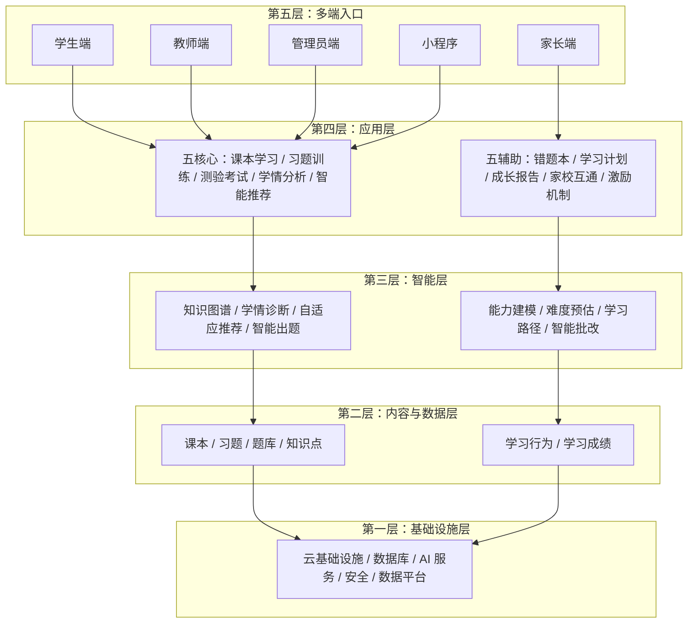
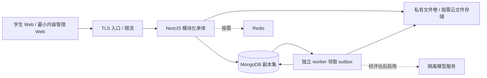

# 知阶 KnowLadder 技术架构方案

> 状态：待评审的目标设计，不代表已实现或已确定采购。品牌理念：知阶而上，智达未来。  
> 关联文档：[文档导航](README.md) · [项目方案](项目方案.md) · [UI/UX 设计方案](UIUX设计方案.md) · [交互原型方案](交互原型方案.md)

> 开发交接入口：[开发计划](开发计划.md)。当前阶段、完成清单、下一步稳定任务编号及文档同步要求统一维护于该文件；更新本方案时必须同步计划。历史阶段记录不覆盖最新状态。

## 1. 背景、目标与边界

### 1.1 当前实现与问题分析

当前仓库包含独立 `prototype/` 演示、`server/` NestJS API、`web/` 真实前端和 `ops/` 本地数据库/备份工具。阶段一账号、会话、CSRF、组织权限和 MongoDB 持久化已实现并验证；阶段二教材题库与私有文件续作已获授权，本地实施及本轮必要验证已完成，最终 WSL2 全套72项通过，见第18.1.1节。Windows 宿主隔离 EICAR 的历史失败与平台限制仍保留，不据此承诺全部跨平台场景。练测评分、学情推荐仍待实施，尚无生产部署。原型示例不作为真实业务数据或学习效果证据。

用户目标是覆盖小学至大学的多端学习系统，形成“课本学习 → 习题训练 / 测验考试 → 学情分析 → 智能推荐 → 后续学习”的闭环。五个核心应用为课本学习（Textbook）、习题训练（Practice）、测验考试（Quiz）、学情分析（Analyze）、智能推荐（AI Rec）；五个辅助应用为错题本、学习计划、成长报告、家校互通、激励机制。

### 1.2 设计目标与非目标

- [INFERENCE] 首期建议聚焦初中数学、学生 Web 与最小内容管理 Web，验证经审核教材与题库、客观题确定性批改、可解释掌握度和规则推荐的闭环。
- [INFERENCE] V1 再开放家长、教师业务端及对应协作流程；V2 逐步验证知识图谱、高级模型与更多终端。首期即保留身份和数据边界，不等于首期建设全部业务界面。
- 保证每次成绩可还原到题目版本、作答、评分规则及批改修订；每次推荐能够说明依据和数据新鲜度。
- 阶段一、二已完成本地实施及已记录的必要验证；阶段三第18.2.1节设计已确认执行，主体能力已分项验收，剩余边界与环境阻塞见开发计划。阶段四、五尚未实施，生产部署及云采购未获授权；不保证全学段覆盖，不把原型评分视为真实后端，也不承诺AI监考或自动主观题评分。
- 第17节阶段一执行与验证结果见第19节；阶段二历史记录见第18.1.1节，阶段三既定契约见第18.2.1节，当前验收与风险统一见开发计划。生产容量、预算、法规及采购仍需确认，暂无现网SLA或真实学习收益数据。

2026-09-19 选型调整：**API 使用 NestJS，主数据库使用 MongoDB**，这是用户已明确的技术约束；文件存储及是否引入图数据库仍按本文建议评审。该选型调整不代表部署拓扑或云产品已获采购授权；随后获授权实现的 Vue 原型不包含上述生产服务。

## 2. 技术选型及权衡

| 范围 | [INFERENCE] 建议 | 理由、代价与替代边界 |
| --- | --- | --- |
| Web | Vue 3 + TypeScript + Vite | 学生端与管理端共享基础组件但分开路由与权限；先做响应式 Web，不因此承诺小程序直接复用 DOM 组件 |
| API | **NestJS + TypeScript 模块化单体（已确定）** | 以 Module / Controller / Provider 划分业务；API 处理鉴权与编排，批量评分交独立 worker；不因后续 Python 模型生态而采用第二套业务 API |
| 持久化 | **MongoDB（已确定）**，通过 `@nestjs/mongoose` 接入 | 文档承载题型与快照；复合唯一索引、条件更新及多文档事务保障提交一致性；无外键，引用和租户一致性由领域服务负责；部署必须支持事务 |
| 文件 | [INFERENCE] 私有持久文件卷起步，按部署条件改用共享文件系统或 OSS/COS 原生接口 | 教材、图片、导出与数据库元数据分离；不强制 S3 协议；具体方案及取舍见 2.2 |
| 异步 | [INFERENCE] 独立 NestJS worker + MongoDB outbox | 业务与事件同事务写入；条件更新领取租约，量大后可接消息系统，outbox 仍保留 |
| 缓存 | Redis 按需引入 | 仅在限流、热点或队列吞吐有证据时使用；数据库仍是成绩和提交的权威来源 |
| 算法 | 规则推荐 + 可解释掌握度 | 数据少时可追踪；BKT/DKT、协同过滤、强化学习按离线与受控验证结果决定，不预设全部有效 |
| AI / RAG | 独立适配接口，按需模型服务 | 不绑定供应商；先评估授权、质量、成本和未成年人数据出境风险，再决定是否启用 |

这些是目标依赖而非仓库现有依赖。版本应在实施时锁定受支持版本并核查许可证、漏洞和运行环境；不虚构当前 lockfile 或云平台配置。

### 2.1 NestJS 落地约定

- [INFERENCE] 采用受支持的 Node.js LTS 与 NestJS 版本；首期使用默认 Express 适配器，除非性能验证证明有必要，不为选型额外切换 HTTP 适配器。
- Controller 只负责 HTTP 契约；Provider 实现领域规则；Repository 封装带组织范围的 MongoDB 访问。模块只导出业务服务，不允许其他模块绕过服务直接写集合。
- 使用 `@nestjs/mongoose` 定义集合 schema 与索引，但 Mongoose 校验不能代替数据库 validator、唯一索引和领域约束。生产索引由发布任务显式创建，不依赖启动时自动建索引。
- 全局 `ValidationPipe` 拒绝未声明字段，DTO 对嵌套题型做显式验证，不将客户端 JSON 当 MongoDB 过滤器或更新表达式。统一异常过滤器把参数错误映射为本文约定的 `422`，业务冲突为 `409`，不沿用框架默认错误形状。
- Guard 建立身份与组织上下文，领域服务再次执行资源关系授权；Interceptor 统一 `request_id` 和响应封装。以 `@nestjs/swagger` 生成并校验 OpenAPI；请求、学生响应和评分内部 DTO 分离。
- 会话使用持久化共享存储（首期 MongoDB），不使用进程内默认 session store；TTL 仅用于清理，认证时仍检查有效期和撤销状态。Redis 引入前不能假定跨实例内存会话有效。
- worker 以 NestJS application context 独立运行，不开放业务 HTTP 端口；CPU 密集评分不得阻塞 API 事件循环。后续 Python 仅用于隔离的模型训练/推理服务，通过版本化接口接入，不接管业务事务。

### 2.2 文件存储替代方案

[INFERENCE] 首期建议教材附件、图片和报告导出使用私有持久文件卷，MongoDB 仅保存独立文件元数据文档（资源 ID、`org_id`、内容版本、服务端存储键、大小、MIME、校验和、状态及留存期限），不把文件二进制或无限增长的文件数组塞入业务文档。NestJS API 与独立 worker 在单机部署时共享挂载持久卷，不能使用容器临时盘；磁盘与宿主机仍是单点故障，需异机备份。出现多机部署、容量/吞吐瓶颈或更高可用性要求时，改为各实例均可访问的共享文件系统或云对象存储，不能假设单机卷天然跨主机共享。

| [INFERENCE] 方案 | 适用边界与代价 |
| --- | --- |
| 本地持久卷 / NAS 共享文件系统 | 单机低运维成本起步；多机可选具备访问控制的 NAS，但需验证并发、原子发布语义、备份和高可用性，NAS 本身不等于无单点 |
| OSS / COS 原生 SDK | 容量、带宽、可用性或托管运维需求上升时的云替代；私有桶、地域、费用、版本与生命周期能力需确认，不要求 S3 协议兼容 |
| MongoDB GridFS | 仅在明确需要数据库统一管理文件且容量/恢复成本可接受时评估；分块可突破普通 BSON 文档大小限制，但增加数据库 I/O、复制及备份负担，不是首期默认，也不提供文件与业务元数据的原子事务保证 |

[INFERENCE] 文件采用 `pending → quarantined → ready → deleting` 生命周期：先登记上传意图，在不可下载的隔离区临时写入，限制大小并校验内容类型、校验和与恶意内容；通过后以服务端生成的不可变键发布，再以条件更新转为 `ready`。文件系统发布使用同一文件系统内的原子重命名，并确认所选文件系统的持久化语义；云存储由适配器在完整上传确认后发布，不假定拥有 POSIX 重命名能力。文件写入与 MongoDB 更新不在同一事务内，失败通过幂等重试、补偿删除和周期对账修复孤儿文件、缺失文件及滞留状态；缺失或未就绪文件拒绝下载。删除先标记 `deleting` 停止访问，再删除实际文件并保留最小删除记录，重试不得误删其他版本。

[INFERENCE] 客户端只提交资源 ID，不指定服务端路径或存储键；服务端限定存储根目录并拒绝路径穿越、符号链接逃逸。教材、图片与报告均经资源级鉴权下载；敏感报告每次下载及 Range 请求实时检查当前权限，以 API 流式传输或内部受控文件服务交付，不暴露绕过鉴权的静态目录或裸签名 URL。已发送的数据无法追回；其他允许短期签名分发的资源也不能承诺链接即时撤销。

## 3. 五层系统架构

下图展示完整产品愿景的逻辑分层，不表示每层都独立部署，也不表示首期全部启用。



智能层依赖的是受授权的数据访问接口，不应让模型直接连接生产数据库。应用编排可直接调用内容服务，不必为普通教材读取强制经过模型。

### 3.1 首期部署及演进



[INFERENCE] 首期 API 与 NestJS worker 使用同一代码库、同一领域模型但不同进程；worker 可单独扩容，数据库 schema/索引变更由一次性发布任务执行。模块通过公开服务接口协作，不相互直接改集合。MongoDB 开发与集成环境也使用副本集以验证事务；生产采用跨故障域的副本集或提供同等能力的托管服务，单节点开发配置不代表生产高可用。未来根据实际瓶颈先拆分模型推理或异步计算，再考虑内容检索等独立服务；拆分前保留事件 schema、幂等和所有权，不按架构图机械拆成微服务。

## 4. 模块所有权、依赖与端到端数据流

| 模块 | 拥有的数据与职责 | 允许依赖 |
| --- | --- | --- |
| 身份与授权 | 用户、组织、角色、班级成员、监护关系、同意记录 | 不依赖学习业务；提供上下文与授权判定 |
| 内容中心 | 学段学科、教材版本、章节、知识点、先修边、题目版本、内容授权 | 身份与授权 |
| 学习与测评 | 训练策略、测验、试卷、会话、作答、提交 | 授权、内容只读接口；冻结题目和规则 |
| 评分 | 批改结果、评分修订、人工复核 | 测评冻结快照、受保护答案；发布评分事件 |
| 学情 | 掌握度证据、学习画像、报告投影、错题视图 | 评分事件、合法行为；不得反写分数 |
| 推荐与计划 | 推荐批次、解释、计划进度 | 学情快照、先修图、可用内容；不得修改成绩 |
| 协作与激励 | 家校消息、受众关系、激励记录 | 授权及已发布学习事件；不得把积分当能力证据 |
| 平台运维 | outbox、消费记录、审计、导出与删除作业 | 通用接口；运维权限不自动获得学生明细 |

### 4.1 完整学习闭环

1. 学生选择学段、学科、教材版本，服务器检查组织、内容授权期限及资源可见性，返回已发布章节，不返回受保护题目答案。
2. 课本阅读产生最小行为事件；阅读完成只能作为进度，不直接证明掌握。
3. 训练根据知识点提供已发布题目；考试从冻结试卷生成会话。两者共用题库，使用不同的服务端模式策略。
4. 会话保存答案，终结提交后生成不可变提交记录及 outbox；评分读取会话快照而不是题目的最新版本。
5. 客观题确定性批改；主观题进入人工复核。只有有效且符合发布策略的评分结果驱动学情证据。
6. worker 更新掌握度及报告投影，推荐读取标有证据版本的学情快照和内容授权，给出下一知识点、题组或课本章节及理由。
7. 学生继续学习，推荐接受/跳过形成行为事件；这些行为用于评估推荐，不等同答对证据。

### 4.2 训练与考试规则隔离

| 规则 | 习题训练 `practice` | 测验考试 `quiz` |
| --- | --- | --- |
| 题目来源 | 经授权的已发布题目 | 发布前冻结的试卷修订 |
| 提示与解析 | 可按训练策略展示，记录提示使用 | 考试期间不返回答案、解析或正确性信号 |
| 重试 | 可开启新会话重练；区分独立作答与看答案后重练 | 按测验允许次数和开放区间，服务端原子计数 |
| 时间 | 可不设截止时间 | 服务端保存 `deadline_at`，由测验关闭时间与时长取较早值 |
| 成绩发布 | 确定性评分完成后可即时展示 | 遵循 `release_at` 和人工复核完成状态；不保证交卷即出分 |
| 学情影响 | 提示、重复题权重受规则控制 | 仅有效考试及最终评分版本；无效或撤销结果不累计 |

浏览器切屏等信号只能作为风险提示，不自动判定作弊或扣分。身份核验、随机题序、开放窗口、人工复核等是可选控制；无法保证远程考试不作弊。

## 5. 前后端接口契约

### 5.1 通用约定

[INFERENCE] API 前缀为 `/api/v1`，JSON 字段采用 `snake_case`，ID 使用 UUID 字符串，时间采用 UTC ISO 8601，显示时再转换时区。金额不在首期范围；分数为十进制定点语义，接口用字符串如 `"4.00"` 避免浮点歧义。列表使用受限 `limit` 与不透明 `cursor`，不接受无限导出。

- [INFERENCE] 首期同源 Web 使用服务端会话、`HttpOnly` / `Secure` / 合理 `SameSite` Cookie；写操作验证 CSRF token，并校验 Origin。未来小程序通过独立认证适配引入短期令牌，不复用浏览器 Cookie 假设。
- 客户端可发送组织选择头 `X-Org-Id`，服务端必须从已认证用户的有效成员关系验证；头部、资源 ID 或前端路由都不是授权证据。
- 所有写操作执行资源级授权；登录成功不等于可访问班级或学生。响应携带 `request_id`，日志不记答案正文或令牌。
- 会话答案修改要求 `expected_revision`；不匹配返回 `409 REVISION_CONFLICT`，客户端拉取新状态并让用户处理，不盲目覆盖。
- 创建会话、终结提交、重批等操作使用 `Idempotency-Key`；相同用户、组织、操作、资源、key 与规范化请求哈希匹配时返回原结果，不匹配时 `409 IDEMPOTENCY_CONFLICT`。终结提交唯一约束长期防重，不能只依赖短期缓存。
- 成功返回 `data` 与 `request_id`，错误返回 `error.code`、安全的 `message`、可选字段错误及 `request_id`。客户端按错误码决策，不解析中文提示。
- 版本化 OpenAPI 作为实施后的前后端契约；内容写入、学生展示及评分内部 DTO 分开，避免通过“去掉部分字段”方式意外泄露答案。

前端页面与状态反馈见 UI/UX 设计方案；交互原型方案第 7 节登记登录、目录、会话恢复和内容送审等尚未细化的接口需求。原型仅以明确标识的演示服务体验流程，不将候选行为视为已定义或已实现的 API；正式联调前必须补齐并评审 OpenAPI。演示模式不得进入生产构建，服务故障不能回退示例数据。

### 5.2 核心 API 清单

| 方法及路径（省略 `/api/v1`） | 用途与主要权限 |
| --- | --- |
| `GET /me` | 当前身份、可选组织及能力集合 |
| `GET /textbook-editions`、`GET /chapters/{id}` | 查询有授权的教材版本与章节 |
| `GET /knowledge-points/{id}` | 可见知识点与先修关系 |
| `POST /practice-sessions` | 学生创建训练，传教材版本与知识点范围；服务端选题 |
| `GET /quizzes/{id}` | 获取所属班级或显式受众可见的考试元信息 |
| `POST /quizzes/{id}/sessions` | 在次数、时间与受众限制内创建考试会话 |
| `GET /sessions/{id}` | 本人会话与题目展示 DTO；无答案及私有评分规则 |
| `PUT /sessions/{id}/answers/{session_item_id}` | 本人提交前保存单题答案与预期修订 |
| `POST /sessions/{id}/submissions` | 原子保存最终答案并终结提交 |
| `GET /submissions/{id}` | 查询批改进度；成绩和解析遵循发布策略 |
| `GET /me/mastery`、`GET /me/reports` | 本人学情与报告，返回数据水位及生成状态 |
| `GET /me/recommendations` | 解释、依据版本、候选内容及失效时间 |
| `POST /behavior-events` | 允许列表内的最小行为事件，事件 ID 去重、限流 |
| `GET /me/mistakes`、`GET /me/learning-plan` | 按有效评分及本人推荐构建辅助视图 |
| `POST /admin/question-versions` | 有内容编辑权限者创建草稿，不直接发布 |
| `POST /admin/question-versions/{id}/publish` | 经审核及版权检查后发布；编辑与审核职责分离 |
| `POST /admin/knowledge-edges` | 携带图范围及预期修订；同图修订文档 CAS 与有界防环校验，超限转完整快照离线拓扑校验后 CAS 发布（见 8.1） |
| `POST /quizzes`、`POST /quizzes/{id}/publish` | 有受众班级授课权限者编排并冻结试卷；首期可限授权内容管理员 |
| `POST /submissions/{id}/regrades` | 受授权审核者发起有原因的评分修订，不覆写旧成绩 |
| `POST /guardian-links`、`POST /guardian-links/{id}/confirm` | V1 绑定申请与独立确认，申请不立即赋予访问权 |
| `GET /students/{id}/reports` | V1 教师按当前班级及学科、家长按有效绑定访问 |
| `POST /privacy/deletion-requests` | 提交撤回/删除申请，鉴权后异步处理并反馈状态 |

### 5.3 终结提交示例

下列 ID 和内容仅为示例。`session_item_id` 指会话冻结题项，不是全局题目 ID；客户端不传分数、用户 ID、模式或题目答案标准。

```http
POST /api/v1/sessions/11111111-1111-4111-8111-111111111111/submissions
Content-Type: application/json
Idempotency-Key: 02c8b983-3ec3-4d79-bef4-9bb6fa270052
X-CSRF-Token: <csrf-token>
```

```json
{
  "expected_revision": 7,
  "answers": [
    {
      "session_item_id": "22222222-2222-4222-8222-222222222222",
      "answer": { "selected_option_ids": ["B"] }
    }
  ]
}
```

`answers` 是需要在终结事务内覆盖的最终答案集合，未列出的题项沿用已保存答案，从未保存的题项视为未作答；重复题项或不属于该会话的题项直接拒绝。前端提交前展示未答提示，不静默清空已保存作答。

```http
HTTP/1.1 202 Accepted
```

```json
{
  "data": {
    "submission_id": "33333333-3333-4333-8333-333333333333",
    "session_id": "11111111-1111-4111-8111-111111111111",
    "session_status": "submitted",
    "revision": 8,
    "submitted_at": "2026-09-18T10:00:00Z",
    "grading_status": "pending",
    "report_status": "pending"
  },
  "request_id": "req_example_001"
}
```

`202` 只表示提交已持久化，不代表成绩或报告已生成。相同幂等请求重试返回原受理结果；查询接口返回最新状态。考试成绩未到发布时间时只返回 `grading_status` / `release_status`，不得通过总分、逐题结果、报告或推荐解释旁路泄露考试答案。

## 6. MongoDB 文档与集合模型

### 6.1 公共约束

[INFERENCE] 下表为待实施的逻辑模型，非已创建的数据库。通过 `@nestjs/mongoose` 定义 Schema；业务文档默认使用 UUID 字符串 `_id`（API `id` 映射该字段）、BSON Date 类型的 `created_at/updated_at`，历史记录追加写而不覆盖。组织数据必须含非空 UUID 字符串 `org_id`；查询、更新、聚合入口和关联读取均显式带组织范围。全局用户、基础目录与平台公共内容使用显式类型和授权路径，不能通过缺失租户的通配查询开放。个人学习使用独立个人空间组织。

- 下表 `*_id` 均为引用 ID，不存在数据库外键或级联删除。NestJS 领域服务按允许的引用类型验证存在性、同组织或显式跨组织授权、状态和版本，不能相信客户端 ID。需与授权撤销严格互斥的写操作和撤销操作共同条件更新授权修订文档，不能仅依赖快照读取；删除策略须保留历史证据所需引用。
- 使用集合级 schema validators（`$jsonSchema`，必要时结合 `$expr`）验证必填、BSON 类型、状态枚举、模式条件、同文档范围和时间关系；Mongoose 校验不能替代数据库校验。跨文档约束由受控服务入口和事务保障。所有未确认的集合及索引细节均为 [INFERENCE] 建议。
- `_id` 默认唯一；下表 `U(...)` 为复合唯一索引、`I(...)` 为查询索引，组织业务键包含 `org_id`。有效关系采用 `partialFilterExpression: {status: "active"}` 的部分唯一索引；有效期在服务端判定，到期任务结束 active 状态，不依赖索引随时间变化。可选唯一字段采用只匹配合法类型的部分索引，不能假定缺失值自动绕开唯一约束。索引由迁移显式建立，不依赖生产启动自动建索引；其余索引按访问路径和执行计划确定。
- 分数、满分、正确度及精确权重存为 `Decimal128`，API 使用十进制字符串，服务端使用十进制库计算，禁止经 JavaScript `number` 往返；同文档数值范围由 validator 校验，跨文档满分与权重和由评分/发布服务验证。
- 有界且同生命周期的小结构可嵌入；成员、题项、答案、边、证据、事件及大报告明细使用独立集合，不无限嵌套。每份 BSON 文档必须小于 16 MiB，并设置更小的题干、答案、快照数组和报告限额；需要完整分页结果时使用独立明细及版本清单，不能静默截断。文件正文不存业务文档，元数据与引用按第 2.2 节处理。
- 多集合不变量使用 MongoDB 副本集事务，开发验证环境也需启用副本集；单节点副本集不提供生产高可用。使用同一 `ClientSession` 并显式传入全部 Mongoose 查询、聚合和写入，采用 `readConcern: snapshot`、提交 `writeConcern: majority`、主节点读取。事务内顺序执行数据库操作，不并行使用同一 session，不调用外部模型或文件服务。快照隔离不自动防止跨文档写偏差，必须通过共享修订文档的条件写制造冲突，见第 7 节与第 8.1 节。

### 6.2 身份、组织与授权

| 集合 | 关键字段、引用与约束 |
| --- | --- |
| `users` | `_id`、最小登录标识、显示名、`status(active/disabled/deleting/deleted)`；登录标识规范化后唯一，可选登录方式采用类型限定部分唯一索引；不默认采集真实姓名、生日和定位 |
| `organizations` | `_id`、`kind(school/personal/platform)`、名称、`status` |
| `roles` | `_id`、`code`，`U(code)`；学生、教师、家长、内容编辑、审核、组织管理、平台运维分开 |
| `organization_members` | `user_id`、`org_id`、`status`；`U(org_id,user_id)`；引用有效用户和组织 |
| `member_roles` | `member_id`、`role_id`；`U(org_id,member_id,role_id)`；验证成员同组织、角色在允许目录内 |
| `classes` | `org_id`、名称、学年、`status`；教师身份本身不赋予全校班级访问权 |
| `class_members` | `class_id`、`member_id`、`kind(student/teacher)`、`status`、有效区间；active 部分 `U(org_id,class_id,member_id,kind)`；`I(org_id,member_id,status)`；班级及成员同组织 |
| `teaching_assignments` | `class_id`、教师 `member_id`、`subject_id`、有效区间；验证同组织班级、教师角色及学科；限定教师可见班级及学科 |
| `guardian_links` | `guardian_user_id`、学生 `member_id`、`status(pending/active/revoked/rejected)`、独立确认者、确认依据与时间；active 部分 `U(org_id,guardian_user_id,member_id)`；`I(org_id,guardian_user_id,status)`；验证学生成员及监护用户 |
| `consent_records` | 用户/监护人、组织、用途、政策版本、取得依据、`granted_at/withdrawn_at`；审计撤回不覆盖原同意；依法确定是否需要及由谁同意 |
| `content_grants` | 资源所有者组织、资源类型及资源 ID、受授权组织、允许用途、地域/期限、`status`、授权修订；资源类型采用枚举及资源解析器注册表，服务验证资源存在、所有权及受授权组织，不接受任意集合名；`I(grantee_org_id,status,expires_at)` |

### 6.3 内容与知识体系

| 集合 | 关键字段、引用与约束 |
| --- | --- |
| `education_stages` | `code`、名称，`U(code)`；小学、初中、高中、大学是目录能力，不代表已有内容 |
| `subjects` | `code`、名称，`U(code)` |
| `textbooks` | 所有者组织、`stage_id`、`subject_id`、出版社/来源与版权依据；验证学段及学科目录 |
| `textbook_editions` | `textbook_id`、版本标识、`status(draft/review/published/retired)`、授权元数据；`U(org_id,textbook_id,edition_code)`；已发布版本不可原地替换正文 |
| `chapters` | `textbook_edition_id`、`parent_id`、顺序、内容引用；父章节必须同组织、同教材版本且不形成层级环；根节点统一 `parent_id: null`；`U(org_id,textbook_edition_id,parent_id,position)`；结构更新共写教材版本修订文档并验证层级 |
| `knowledge_points` | 所有者组织、学段、学科、`code`、名称、`status`；`U(org_id,subject_id,code)`；`org_id` 即所有者组织 |
| `chapter_knowledge_points` | `chapter_id`、`knowledge_point_id`；`U(org_id,chapter_id,knowledge_point_id)`；记录教材章节与通用知识点映射，跨所有者引用须验证内容授权 |
| `knowledge_graphs` | 所有者组织、`subject_id`、`scope_code`、`write_revision`、`published_revision`；`U(org_id,subject_id,scope_code)`；同图写入共同条件更新此文档以制造写冲突，发布指针仅指向完整验证的不可变修订 |
| `knowledge_edges` | `graph_id`、`graph_revision`、`prerequisite_id`、`successor_id`；`U(org_id,graph_id,graph_revision,prerequisite_id,successor_id)`；validator 拒绝自环；分别以 `org_id,graph_id,graph_revision` 加起点/终点建双向遍历索引；端点范围及防环按第 8.1 节验证 |
| `questions` | 所有者组织、学科、稳定业务 `_id`、`status`；代表题目身份，不直接承载可变评分标准 |
| `question_versions` | `question_id`、`version_no`、题型、展示正文/选项、受保护答案与评分规则引用、难度及估计来源、`status(draft/review/published/retired)`、审核者；`U(org_id,question_id,version_no)` |
| `question_knowledge_points` | `question_version_id`、`knowledge_point_id`、Decimal128 权重；`U(org_id,question_version_id,knowledge_point_id)`；validator 校验权重范围，发布服务在固定版本上校验权重和及知识范围 |

发布题目版本不可修改题干、答案或映射；勘误创建新版本，旧会话仍保留原始快照。授权过期阻止新使用，历史证据能否继续保存和展示由授权合同及隐私政策决定，不默认无限保留教材全文。

### 6.4 测评、评分与学情

| 集合 | 关键字段、引用与约束 |
| --- | --- |
| `quizzes` | `org_id`、学科、受众策略、`opens_at/closes_at/release_at`、`duration_seconds`、`max_attempts`、`status(draft/published/closed/archived)`；validator 校验时间先后、正整数时长及次数 |
| `quiz_audiences` | `quiz_id`、`class_id`；`U(org_id,quiz_id,class_id)`；引用均同组织 |
| `papers` | `quiz_id`、`revision`、`status(draft/frozen)`；`U(org_id,quiz_id,revision)`；发布测验引用固定试卷修订 |
| `paper_items` | `paper_id`、`position`、`question_version_id`、Decimal128 `max_score`；`U(org_id,paper_id,position)`；分数非负，引用已发布且有权使用的题目版本 |
| `attempt_counters` | `quiz_id`、学生 `member_id`、已分配次数；`U(org_id,quiz_id,member_id)`；创建考试会话时同事务条件递增（已分配次数小于考试上限）并创建会话；初始化唯一键冲突重试，不先读后无条件写 |
| `sessions` | 学生 `member_id`、`mode(practice/quiz)`、可空 `paper_id`、`status(in_progress/submitted/expired/cancelled)`、`started_at/deadline_at`、`revision`、规则版本；validator 保证 quiz 必有 paper、practice 的 paper 为空；`I(org_id,member_id,created_at)`；答案写入和终结均条件更新会话修订 |
| `session_items` | `session_id`、顺序、`question_version_id`、展示快照、受保护评分快照、题知识点与 Decimal128 权重快照、Decimal128 `max_score`；`U(org_id,session_id,position)`；引用同组织会话，冻结后不可改，快照数组有数量上限 |
| `answers` | `session_id`、`session_item_id`、有大小限制的答案 JSON、保存时间；`U(org_id,session_id,session_item_id)`；服务验证题项属于该会话，写入与会话 revision 条件递增同事务；终结后冻结 |
| `submissions` | `session_id`、原因 `manual/deadline`、服务器受理时间、最终答案摘要、`grading_status(pending/running/needs_review/completed/failed)`、当前有效评分修订、`revision`；`U(org_id,session_id)`；提交主体与会话学生一致 |
| `grading_runs` | `submission_id`、`revision`、评分规则/代码/模型版本、原因、`status`、创建/确认者；`U(org_id,submission_id,revision)`；在提交修订条件更新事务内分配评分修订，旧修订保留 |
| `grading_results` | `grading_run_id`、`session_item_id`、Decimal128 得分、判定、人工复核状态；`U(org_id,grading_run_id,session_item_id)`；服务验证题项与提交同会话，得分不超过冻结满分 |
| `mastery_evidence` | 学生、知识点、`submission_id`、`grading_revision`、会话题项、Decimal128 正确度、提示/重复标记、Decimal128 权重、证据时间；`U(org_id,member_id,submission_id,grading_revision,session_item_id,knowledge_point_id)` |
| `student_projection_states` | 学生 `member_id`、`projection_revision`、目标/已应用输入水位、重算状态；`U(org_id,member_id)`；评分生效和投影更新均条件递增此共享文档；各提交输入有效版本存独立明细，不嵌入无限数组 |
| `mastery_snapshots` | 学生、知识点、算法版本、值（可空）、有效证据数、证据水位、生成时间；`U(org_id,member_id,knowledge_point_id,algorithm_version)`；无证据时值为空而非零分 |
| `report_snapshots` | 学生、报告周期、输入水位/依赖版本、计算版本、`status`、有界报告摘要及独立明细引用、生成时间；保留新鲜度与“更新中”状态 |
| `recommendations` | 学生、规则/模型版本、学情快照版本、图修订、教材版本、有界候选内容、解释、`expires_at/status`；`I(org_id,member_id,created_at)`；展示时再次校验授权 |
| `behavior_events` | `event_id`、组织及用户、允许列表内事件类型、目标资源、服务端接收时间、可选客户端时间；`U(org_id,event_id)`；按留存策略分批删除或对获准删除记录设置 TTL，TTL 不是准时执行器；客户端时间不作考试截止依据 |
| `outbox_events` | UUID `_id` 作为 `event_id`、`aggregate_type/id/version`、`event_type/schema_version`、最小载荷、`status`、`lease_owner/lease_token/lease_until`、重试次数、`available_at/processed_at`；`U(org_id,aggregate_type,aggregate_id,aggregate_version,event_type)`；pending 部分索引覆盖到期查询，running 部分索引覆盖过期租约查询 |
| `consumer_receipts` | `org_id`、`consumer_name/event_id`；`U(org_id,consumer_name,event_id)`，与消费业务写入同事务；实现至少一次投递下的去重 |
| `idempotency_records` | 用户、组织、操作、资源、key、请求哈希、响应引用/状态；`U(org_id,user_id,operation,resource_id,key)`；敏感响应不长期明文存放，保留期覆盖重试窗口及待决任务 |
| `audit_events` | 操作者、组织、动作、资源、原因、时间、request_id；追加写、受控留存，不复制完整答案和教材 |

`mastery_evidence` 保留不同评分修订供追溯，但当前计算只读取每个提交的当前有效修订。错题本由有效逐题结果投影，不维护另一套独立正确性真相。学习计划、家校消息、激励等 V1 详细集合结构另行评审，不以本清单暗示已实现。

## 7. 提交、批改与最终一致性

### 7.1 终结提交事务

[INFERENCE] 以下为 NestJS 领域服务及 MongoDB 事务的候选实施契约，不是已运行代码。

1. 验证登录、组织、会话所有权、CSRF、题型结构及请求大小，计算规范化请求哈希；开启短事务，全部数据库操作显式传同一个 `ClientSession`，按完整作用域读取幂等记录。同 key 换正文返回冲突，重试仍重新鉴权。
2. 同 key 已成功则结束只读事务并返回原受理结果；已有提交而 key 不同则返回已有提交引用且不再评分；否则在当前事务继续以下步骤。
3. 对 `sessions` 执行 `findOneAndUpdate`，条件包含 `_id/org_id/member_id/status=in_progress/revision=expected_revision`，并在数据库端以 `$expr` 和 `$$NOW` 判断 `deadline_at > $$NOW`（无截止的 practice 走明确分支）；更新状态、递增修订并用更新管道记录 `accepted_at: $$NOW`。成功受理点是最终成功提交的事务中该条件更新执行时刻，不是客户端点击时刻或事务返回时刻；所有服务节点不得自行替换成客户端时间。
4. 校验最终答案题项属于同一冻结会话，保存答案、创建唯一 `submissions`、`SubmissionAccepted` outbox 和幂等结果，与第 3 步同事务提交。只有确认提交成功才返回 `202`。会话字段、答案、提交和事件要么全部生效，要么全部回滚。
5. CAS 未命中时终止该事务并重新读取，按终结、截止、修订冲突分类，不盲目覆盖新修订。截止返回 `409 SESSION_DEADLINE_PASSED`，不接收补交答案；截止 worker 使用同一 CAS，数据库端判断 `deadline_at <= $$NOW`，仅以截止前保存答案创建 `reason=deadline` 提交并置 `expired`。唯一提交索引阻止重复终结。已存在提交时沿用第 2 步结果恢复语义。

自动保存也必须在事务中以会话 `status/revision/deadline_at` 条件更新并递增 revision，然后写答案；手动和截止终结写同一会话文档，形成写冲突及 CAS 顺序，而非“最后请求覆盖”。网络丢失响应通过原幂等键恢复；整个事务重试必须重新判断截止时间，不能复用前次未提交的受理时刻。

### 7.2 outbox、worker 与评分修订

- [INFERENCE] 独立 NestJS worker 用原子的 `findOneAndUpdate` 领取 `available_at` 已到的 pending 任务或 `lease_until` 已过的 running 任务，写 `lease_owner`、新的随机 UUID `lease_token` 和租约截止时间；领取、续租、过期判定均使用数据库端时间。续租必须匹配当前 token 且租约未过期；不持有长事务进行计算。
- 完成时开启短事务，先条件更新同一 outbox 文档，匹配 `status=running`、owner、token 及未过期租约，再写业务结果、消费记录和后续 outbox，并原子标记完成；未匹配则整个事务回滚。任务被重新领取后旧 token 不可能提交，即使旧 worker 计算晚返回也不能覆盖新结果。租约 token 防旧 worker，业务唯一索引及 `consumer_receipts` 防重复落结果，两者不能互相替代。
- 对象/数值/选择题使用发布时冻结的确定性规则。公式等复杂题型必须先定义规范化、误差范围和等价性规则；无法可靠判定即进入复核，不能静默判错。
- 主观题与模型辅助评分只产生建议及依据，教师/审核者确认后才形成有效最终修订。模型失败不得生成虚构分数。
- `grading_runs.revision` 单调递增；最终确认以 `submissions.revision` 和当前有效评分修订作 CAS，校验整次评分完整且已获必要复核，再在同事务切换有效修订、递增学生投影状态并写 `GradeFinalized`。旧任务不能覆盖更高有效修订；其历史结果仅在有效租约及对应评分修订内追加。
- 重批必须记录原因、发起者、规则版本以及复核；读取原提交快照，若是题目勘误，显式记录修正评分依据。不得把最新题干偷换到历史会话。
- 学情消费者在事务内首先条件递增同学生 `student_projection_states`，评分生效入口也写该文档，由写冲突串行化相同学生的有效输入和投影；随后读取提交当前有效修订、写证据和快照、推进水位及写 `consumer_receipts`。重复消费遇到唯一键冲突应回滚并确认原消费结果；旧版本事件只恢复当前有效输入，不回退水位。
- 重批不是“再加一次正确题数”：替换该提交的有效证据并从有效证据重算受影响知识点。规则模型可按确定顺序重算；BKT/DKT 对历史顺序敏感，须按证据时间与稳定 ID 排序重放，不能简单加减概率。
- 报告与推荐是最终一致投影。返回 `source_watermark`、`generated_at`、`status`；落后时显示“更新中”，旧报告明确标注时间，不伪装为已涵盖最新考试。
- 跨多个会话的水位由学生投影修订及各输入有效版本构成，不直接拿不同提交的评分修订号比较大小。检查点推进与投影写入同事务。
- 大量历史重算不占用长事务：在固定不可变输入清单/水位上离线构建独立版本，最终以学生目标水位及修订 CAS 发布；输入变化则重算或保持“更新中”，不能发布已过期计算。分块写入使用版本/分块唯一键，只有完整检查点才能切换对外指针。

### 7.3 重试、恢复与对账

[INFERENCE] 使用 MongoDB 驱动的事务重试机制并设总时限及退避预算：`TransientTransactionError` 重跑整个事务、重新读状态和检查截止；`UnknownTransactionCommitResult` 优先对同一 session/事务重试 `commitTransaction`，不能直接重做业务。预算耗尽而提交结果仍未知时，不声称失败或成功、不另建提交；通过原幂等键查询并持续对账，向客户端提供可重试的待确认结果。普通业务校验失败和 CAS 失配按业务冲突处理；重复键冲突回滚后按对应唯一键读取结果，不能一律无限重试。事务回调可能执行多次，禁止外部副作用，文件/模型/通知通过提交后的 outbox 处理。

任务可重试错误使用有上限的指数退避和抖动，超预算进入失败队列/人工处理；仅持有当前有效租约 token 的 worker 能更新重试状态。永久校验错误直接终止并给出可操作状态。周期对账核查“有提交无评分任务”“有效评分与学情水位不符”“租约过期任务”，通过原聚合事件键补发。消费记录保留期覆盖事件重放窗口，业务唯一约束长期保留；不承诺外部副作用恰好一次。模型调用采用超时、熔断及并发上限，失败只回退推荐，不虚构批改结果。

## 8. 智能能力与内容治理

### 8.1 规则推荐与可解释掌握度

[INFERENCE] 首期掌握度采用可解释的加权正确率：对当前有效、独立作答证据按知识点映射权重汇总，展示有效证据数和最近时间。提示后作答、答案曝光后重练需降权或排除，规则经教研确认并版本化。证据不足返回“待诊断”，不把没有作答当作不会；缺少覆盖时推荐短诊断而非声称已定位薄弱点。

推荐按“当前教材与授权范围 → 先修条件 → 有足够证据的薄弱点或待诊断点 → 适宜难度 → 去重与负荷限制”筛选。解释例如“最近独立作答中分式运算证据不足，建议先完成诊断”，必须引用真实证据，不能给出不存在的次数或分数。没有合格候选时明确返回空集合及原因。

[INFERENCE] 首期在 MongoDB 保存先修 DAG，图边不需独立数据库。图范围固定为 `(org_id, subject_id, graph_id)`；每次校验和读取都绑定 `graph_revision`，端点需属于登记的知识范围及允许学段，跨所有者引用须先授权。已发布修订不可修改，推荐记录实际使用的图修订；其他内容关系不能混入先修边。

- 小图编辑：同一短事务先以预期 `write_revision` 条件递增 `knowledge_graphs`，全部边和节点成员修改入口必须共写该文档；基于固定基线构造有明确大小上限的完整候选修订，从新边终点查到起点的可达性并拒绝成环，再保存不可变修订、切换发布指针并写 outbox。并发事务在同一图文档发生写冲突，重试时必须重读图并重验，不能假定 snapshot 隔离会自动防止两条边分别通过却共同成环的写偏差。一次含多条变更时在全部候选边上校验，不能分别对旧图验每一条边。
- 遍历始终限定组织、图和修订，可用索引驱动的服务端迭代或受限 `$graphLookup`；限定访问节点数、深度、时间和结果大小。必须遍历完待搜索可达集合才能判定无环；触达任何上限或无法确认完整性就拒绝在线发布并转离线校验，绝不将截断结果视为无环。
- 大图/批量发布：从固定完整修订创建独立不可变候选快照，分批写入并以清单、计数/校验摘要确认节点与边齐全，冻结后做全量拓扑校验及跨学段、孤立点检查；不能分页读取持续变化的工作图冒充完整快照。最后在短事务按基线 `write_revision/published_revision` 做 CAS，核验候选完整且通过校验后切换发布指针并写 outbox；期间任何图变更导致 CAS 失败，须基于新版本重新构建及验证，不能强行发布。大图不在事务中复制全量边，不要求一次聚合把图装入单个 BSON 文档。

### 8.2 模型逐步验证路线

| 能力 | 前提数据 | 验证要求与启用门槛 |
| --- | --- | --- |
| BKT | 稳定知识点映射、按时间排序的独立作答序列 | 与规则基线比较 log loss、Brier、校准及分群误差；参数可解释性与冷启动检查 |
| DKT | 足量、去泄漏的长期序列 | 按学生与时间隔离训练/验证/测试，报告 AUC 之外的校准、学习效果和资源开销；跨教材漂移评估 |
| 协同过滤 | 合规的学习交互与曝光记录 | 评估覆盖率、冷启动、流行度偏差；不能把“被推荐更多”误认为“教学价值更高” |
| 强化学习 | 稳定行为策略、可定义长期收益、安全动作空间 | 先离线评估、限制探索、人工审查与停用开关；未成年人场景不直接在线无约束试错 |
| 难度估计/路径 | 稳定题版本、群体样本与先修图 | 与教研难度对照、分群校准、路径可达性；数据不足保留专家标注及来源 |

启用前定义最低样本和指标阈值，由教研、隐私与技术共同评审；不在无数据时杜撰达标数字。训练集只含目的授权范围内数据，保存数据集版本、代码版本、特征定义和模型版本；排除未来成绩、答案泄露、同题版本跨集合污染。线上受控实验以真实学习提升、合理负担和公平性为主，不只追求点击率。推理超时、输入缺失、模型异常或质量回退时使用同版本确定性规则；没有学情数据时只做待诊断推荐。

### 8.3 智能出题与 RAG

- 模型生成题目、解析或课本摘要先进入草稿，经过答案正确性、难度、学段适配、版权及安全审核，再形成已发布版本；不可直接作为正式考试评分标准。
- RAG 仅检索有合法授权且教材版本受控的内容，索引保存资源版本、授权范围与状态；查询前过滤并在读取原文/返回引用前再授权。授权撤销时下线索引及缓存。
- 学生讲解检索库与答案、评分规则存储分隔。考试会话内禁用可能泄露当前试卷答案的检索和解释路径；仅隐藏前端按钮不构成防护。
- 教材、用户输入和检索文本都视为不可信数据；提示词不能授予权限，模型不能调用任意数据库查询或更新、网络或管理工具。工具允许列表、参数校验和最小权限在模型外执行。
- 输出保留出处及版本，缺少依据就说明无法回答；数学结论要有可验证步骤。外部模型默认不接收可识别学生数据，供应商留存、训练使用和地域条款未核实前不得发送真实数据。

### 8.4 图数据库评估与可选演进

[INFERENCE] 不把 Neo4j 作为首期依赖。首期知识点、先修边、教材映射及版本都由 MongoDB 管理；有界多跳查询、索引和按修订缓存先满足规则推荐。仅在真实图规模和查询压测证明复杂多跳、路径搜索成为瓶颈，且收益覆盖额外运维、同步与授权成本后，再评估 Neo4j 作为只读派生查询投影；无实测数据时不预设切换规模阈值。

- MongoDB 始终是唯一业务事实源和发布入口。图发布事务写 outbox，消费者按组织/图/修订幂等投影节点、边及删除；避免应用请求同步双写两库。Neo4j 版本不可变或先构建独立候选，完整校验后才推进投影发布指针；记录源修订、投影修订、水位和完成状态，忽略迟到旧事件，缺口则补放或从 MongoDB 完整快照重建。
- 两库之间没有原子事务：在 Neo4j 中提交投影及事件处理标记后才确认源事件；若确认前崩溃，重放依据 Neo4j 的处理标记/修订幂等去重。MongoDB `consumer_receipts` 不能单独证明另一数据库已写成功。投影可整体删除重建，不承载唯一的成绩、证据、权限或图编辑结果。
- 查询要求与请求图修订一致且完成的投影；同步滞后、查询超时或 Neo4j 故障时回退到同修订 MongoDB 有界规则查询。若完整查询仍无法在限制内完成，明确返回暂不可用/待更新或无图依赖的已验证规则候选，不混用不同修订、不把未知先修条件当作满足。结果返回源修订和新鲜度，权限仍由 NestJS 基于 MongoDB 授权数据校验；无须因此增加 Redis 或其他必选依赖。

## 9. 权限、安全、隐私与版权

### 9.1 资源级权限边界

[INFERENCE] 使用角色能力 + 资源关系 + 组织范围组合授权，默认拒绝。每次 API、后台任务、导出和缓存命中都执行对应边界。

- 学生只能访问本人会话、成绩和授权内容；用户 ID 从认证上下文派生，不能由请求正文冒名。
- 教师必须是资源所在组织的有效成员，并在目标班级及学科有有效授课关系；跨校任教需分别授权，不能因拥有 `teacher` 角色查询全平台学生。
- 家长绑定从 `pending` 开始，需有可信独立确认流程及学生/监护人身份依据；不能输入学生手机号或 ID 就获取报告。防枚举、一次性短期验证码、尝试限额与异常告警；关系争议支持冻结和人工处理。
- 绑定撤销、退班、离校和授权到期应使后续查询及导出下载失效；会话和缓存需短时失效或按授权版本校验。家长不自动看到班级其他学生或教师内部备注。
- 内容编辑不自动获得学生隐私；评分审核按职责限定。平台运维用脱敏指标排障，访问明细需临时授权、原因和完整审计。
- 题库答案仅评分服务和授权审核接口可读，不进入学生 DTO、客户端包、源映射、行为日志或开放 CDN。答案展示需按题项与会话发布策略控制。

### 9.2 未成年人数据治理

- 以实际运营地域和适用法规确认未成年人年龄规则、监护人同意及合法处理基础，必要时法律评审；不宣称本方案自动满足所有法规。
- 最小采集，默认不启用人脸、麦克风、摄像头、精确位置和通讯录。不为训练模型默认复用学习记录；用途变更需要另行评估及授权。
- 明示数据用途、保存周期、第三方及撤回路径；同意撤回后停止对应可选处理，学习必需处理与依法必须留存部分分别说明。
- 删除作业覆盖数据库、对象、检索索引、缓存、导出、特征与未来训练数据集，并保留不包含被删除明细的完成证明；已训练模型的处理按可行性和合规要求评估，不能承诺一次数据库删除即可完成模型遗忘。
- [INFERENCE] 建议行为明细 90 天、可选导出 7 天、备份 30 天作为待确认留存起点；成绩、审计和版权证据的期限另行按合同与法规确定，不无限保存。上线前将所有类别补齐到留存矩阵。
- 删除墓碑防止恢复备份后数据复活；备份按期限自然过期且严格限制访问，恢复后先重放删除清单再开放服务。法律保全时隔离保存并向用户说明例外。

### 9.3 平台防护与版权

TLS 传输加密，数据库、私有文件卷及云对象存储静态加密，密钥置专用秘密管理设施并定期轮换，不入 Git 和镜像。实施查询字段/操作符白名单与类型校验，拒绝把客户端对象直接作为 MongoDB 查询条件；配合 XSS 输出编码、上传类型与大小限制、隔离扫描、路径穿越防护、登录及昂贵接口限流、依赖扫描与审计告警。文件交付遵循 2.2 的实时权限检查，不以签名链接尚未到期替代当前授权。

教材和题库入库前核验复制、展示、改编、生成、模型训练及跨地域传播权利，记录来源、合同及期限；项目根目录的代码 `LICENSE` 不等于取得教材或题目授权。授权撤回时停止新增分发，追踪缓存、RAG、导出及衍生内容，历史成绩保留范围遵循合同与法律。

## 10. 非功能目标、性能与运行保障

### 10.1 待确认的验收/压测目标

下列均为 [INFERENCE] 候选目标，不是实测容量或 SLA；最终需按部署规格、成本、题型与真实并发确认。

| 指标 | 建议目标及测量边界 |
| --- | --- |
| 首期压测规模 | 100 个同时活跃学生、10 分钟窗口内 1,000 次交卷；指定题量/请求体/连接池后再测 |
| 普通查询 | 热点授权读取服务端 p95 ≤ 300ms，不含公网与大文件传输 |
| 提交受理 | p95 ≤ 500ms，仅至数据库提交，不含异步评分 |
| 客观题评分与报告 | 目标 95% 在受理后 10 秒内完成，前提是限定题量且无人工复核；排队积压明确可见 |
| 可用性 | 候选月度 99.5%，上线前定义维护窗口、统计口径和降级能力 |
| 恢复 | 候选 RPO ≤ 15 分钟、RTO ≤ 4 小时，需要备份配置和恢复演练证明 |

### 10.2 性能与缓存

教材中确认可公开分发的静态资源可经 CDN；私有资源通过鉴权交付，敏感报告不使用裸签名 URL 或公共缓存，并返回禁止缓存的响应策略。Range 请求同样逐次鉴权，流式读取配合范围、并发与带宽限制，避免大文件完整载入 API 内存。教材/题目缓存键包含内容版本及可见范围，学情和推荐键包含用户、组织、授权版本与输入水位。授权撤销走主动失效并设置短 TTL；不能仅等长缓存到期，也不能依靠缓存失效追回已下载数据。

按学生与组织分页读取；批量查询避免 N+1。答案保存合并/节流但提交必须等待最终事务确认。限制最大题数、单题答案尺寸和批量操作范围；重批及报告重算使用后台任务并限并发。未达到数据库瓶颈不提前分片；行为量大后再评估按留存窗口归档、TTL 与分片策略。缓存失败回源需有并发保护，不能改变授权或成绩语义。

### 10.3 CI/CD、监控与恢复

[INFERENCE] 建议容器化部署，开发、预发布、生产隔离 MongoDB 数据库、私有文件卷及可选云对象桶；生产数据不直接复制到开发环境。API 与 worker 按职责挂载持久卷并授予最小读写权限，多机部署前必须准备共享文件系统或云存储，不能依赖容器临时盘或某台主机的本地路径。CI 包含依赖/秘密扫描、类型与契约检查、适用测试及迁移检查；通过后生成不可变镜像，预发布验证再灰度发布。数据库帐号按 API、worker、迁移与运维职责最小授权。

观测覆盖请求时延/错误率、提交冲突率、outbox 最老积压、worker 重试/失败、评分耗时、人工待审量、报告水位延迟、模型回退率、授权拒绝、数据库连接饱和，以及文件容量、I/O 延迟、下载带宽、扫描积压与文件/元数据对账异常。结构化日志用 `request_id/event_id` 关联，不记录答案与敏感原文。告警附处理手册：先确认持久化状态再重放任务，禁止通过手工伪造完成状态“消警”。

执行 MongoDB 元数据与实际文件的加密备份、可用时的时间点恢复和定期恢复演练；副本集提供冗余与故障切换，不等于备份。记录数据库恢复点与文件快照/对象版本清单，按校验和、内容版本和生命周期状态核验可恢复性，不假设两类备份天然原子一致。恢复后先重放删除墓碑，再对账文件缺失/孤儿、提交/评分/投影并重放 outbox；对账和授权检查完成前不开放下载。RPO/RTO 同时覆盖文件与数据库，备份成功日志不等于恢复可用证明。

## 11. 异常分类与用户体验

| 类别 | HTTP / 状态 | 处理策略 |
| --- | --- | --- |
| 未认证/无权限 | `401` / `403`；敏感资源可统一 `404` | 重新认证或明确拒绝，不暴露其他学生存在性 |
| 参数/题型不合法 | `422 VALIDATION_ERROR` | 指明可修正字段，禁止原文回显敏感输入 |
| 幂等正文冲突 | `409 IDEMPOTENCY_CONFLICT` | 更正客户端请求流程，不新建重复成绩 |
| 答案修订冲突 | `409 REVISION_CONFLICT` | 获取最新修订并提示多设备冲突 |
| 截止/次数耗尽 | `409 SESSION_DEADLINE_PASSED` / `ATTEMPT_LIMIT_REACHED` | 不接受新答案，查询服务器最终状态 |
| 资源下线/授权到期 | `404` 或 `403 CONTENT_UNAVAILABLE` | 停止分发，推荐换题须显式创建新会话而非修改历史 |
| 限流 | `429` + `Retry-After` | 有界退避；考试自动保存需可见失败提示 |
| 临时数据库故障 | `503` | 不宣称已受理；同 key 重试，数据库确认后才显示成功 |
| 批改不可自动确定 | `needs_review` | 显示待复核，保留作答，不产生虚假最终分数 |
| worker 失败 | `failed` 或可重试 `pending` | 后台退避与人工告警，学生可查询，不要求重新交卷 |
| 报告落后 | `report_status=pending` | 显示水位及更新时间，不用旧报告冒充最新结论 |
| 模型/检索不可用 | 推荐降级或空结果 | 确定规则回退；无证据则待诊断，解释不可用原因 |

## 12. 兼容、迁移、灰度与回滚

目前无旧应用数据需要迁移，但首次实施仍需可重复初始化、迁移版本及授权内容导入校验。禁止把示例学生或模拟分数当生产初始数据。

[INFERENCE] 后续遵循 expand → migrate → contract：先增加兼容字段/集合，支持新旧读取，分批回填校验，再切换写入并清理旧路径。MongoDB 文档记录 `schema_version`；收紧 validator 或创建唯一索引前先扫描并修复不合规记录，不假定文档数据库无需迁移。API 破坏性变更升主版本；事件 `schema_version` 与业务 `aggregate_version` 分开，消费者在升级窗口内兼容事件 schema，不忽略未知结构。题型与答案 JSON 也需 schema 版本。

灰度按组织或显式试点名单启用，不随机把同一场考试的学生放入不同评分规则。新推荐模型可影子运行并与规则基线比较，正式启用可立即切回规则；所有分数计算规则变更需明确版本，不能像推荐一样无记录切换。

回滚优先回应用和特性开关，不做不可逆数据库降级；已写入新结构时保证旧版可读或停止回滚并前向修复。内容撤回只停止新使用，不删正在评分所需快照；模型回滚保留历史版本。迁移、回滚和恢复都要在脱敏预发布数据上演练。

## 13. 后续测试策略与关键验收场景

以下为正式实施阶段的测试计划，尚未针对真实后端执行；本轮Vue原型的浏览器、类型与构建验证另见交互原型方案第12节，不能替代本节数据库、权限或故障恢复验证。

| 层次 | 必须保护的可观察契约 |
| --- | --- |
| 单元 | 题型规范化、评分边界、状态机、权限策略、规则推荐、无证据不下诊断、DAG 防环 |
| 集成 | MongoDB 真实副本集上的复合唯一/部分索引、validator、租户引用校验、事务回滚与重试、outbox 租约和去重；文件发布补偿与授权；图并发变更 |
| API 契约 | NestJS ValidationPipe/异常过滤器与 OpenAPI 的请求响应 schema、`422` 错误映射、成绩未发布字段不可见、分页上限、幂等语义；UUID 字符串与 Decimal128 分数字符串序列化 |
| 端到端 | 授权教材 → 训练/考试 → 保存与提交 → 批改 → 学情 → 推荐 → 再学习；教师复核与家长撤销 |
| 边界/故障 | 双击提交、不同 key 并发、自动保存竞态、截止条件更新竞争、受理后断网、事务提交结果未知、副本集主节点切换、过期租约 worker 迟到写入、重复/乱序事件、重批重算 |
| 安全 | 跨组织 IDOR、教师跨班/跨学科、家长未确认/已撤销、答案通过响应/缓存/RAG 泄露、CSRF、NoSQL 操作符注入、上传路径穿越、提示词注入 |
| 性能/恢复 | 同时交卷、慢评分积压、缓存雪崩、数据库恢复、文件及元数据恢复对账、删除墓碑重放与水位收敛；多实例共享存储；文档大小与图遍历上限 |
| 模型 | 时间/学生隔离、泄漏检查、校准与分群表现、冷启动、规则回退、模型失败不编造分数 |

关键验收：同一会话的十个并发终结请求最终只能有一个提交；旧评分事件不能覆盖重批；重放任意事件不会重复增加掌握度；过期家长绑定不能通过旧链接下载新报告；考试未发布时训练接口与推荐解释均不能泄露该考试答案；教材升级后历史评分仍可追溯原版本。这些是未来验收条件而非已经验证的结果。

## 14. 分期落地与评审门槛

| 阶段 | [INFERENCE] 建议工程范围 | 进入下一阶段的验收门槛 |
| --- | --- | --- |
| 方案评审 | 确认首期学科教材、版权、角色、留存、评分规则和目标预算 | 用户确认设计可执行；不是文档生成后自动开发 |
| 首期闭环 | 初中数学、学生/最小内容管理 Web、发布内容、训练考试隔离、客观题、outbox、规则掌握度与推荐 | 端到端闭环、重试不重计、越权拒绝、无答案泄露、备份恢复可演练 |
| V1 协作 | 教师与家长端、监护确认、学习计划/错题/成长报告深化、家校互通、激励 | 班级/学科权限与绑定撤销验证，人工评分流程完整，隐私申请可完成 |
| V2 智能扩展 | 知识图谱应用深化、多端扩展、经评估的 BKT/DKT/协同过滤/强化学习、受控生成与 RAG | 逐项优于已定义基线或有明确教学收益，通过安全与数据评审，可停用回退 |

用户原方案中的时间阶段是规划表达，不是本文对人力、日期或全部功能同时上线的承诺；执行排期应在内容供给、团队能力与评审后另定。先修关系的基础无环约束可在首期准备，但不等于首期已有完整知识图谱智能应用。

五阶段工程实施是“首期闭环”的内部交付顺序，不替代产品 MVP/V1/V2 路线图。具体设计见第17—18节；每阶段均包含对应真实前端联调与测试，不能全部推迟至最后阶段。

## 15. 风险与开放问题

| 风险/待确认项 | 影响与建议处理 |
| --- | --- |
| 首期教材版本与授权来源 | 未确认前不能真实上架；明确出版社、区域、期限及 AI 使用范围 |
| 教研标签与评分标准质量 | 直接影响掌握度可信性；双人审核、勘误与有记录重批 |
| 学生归属、多校任教及个人空间关系 | 确认跨空间历史是否迁移、谁可见；默认不跨组织合并画像 |
| 监护关系确认与争议处理 | 明确合适证明、确认主体及审核职责，不默认学生一次点击足够 |
| 主观题范围与成绩发布政策 | 决定人工工作量和报告时延；首期只保证已定义客观题自动化 |
| 内容授权过期与历史快照冲突 | 合同明确历史证据保留和可见范围，避免为审计无限复制教材 |
| 模型样本、偏差与供应商条款 | 未有数据不承诺算法收益；确定训练合法性、推理地域及退出方案 |
| 隐私留存、删除、备份和监管适用范围 | 上线前形成获确认的留存矩阵与用户权利流程 |
| 并发、可用性和预算 | 目前无容量证据；以约定场景压测和恢复演练调整目标 |
| MongoDB 事务与运维 | 副本集/托管服务、备份、连接池和事务重试需纳入预算；不能以 standalone 配置上线依赖事务的提交链路 |
| 文件存储部署 | 确认单机起步或多实例共享、容量、带宽、地域与备份；本地文件卷并非天然高可用，云产品选择另行评审 |
| 独立图数据库 | 首期非必需；复杂路径场景、压测收益和运维成本明确后再评估 Neo4j，不将知识图谱能力等同于必须部署图数据库 |
| 激励与推荐对学生负担的影响 | 避免公开排名或过量训练默认开启，教研确认健康使用规则 |

## 16. 本次文件影响与交付边界

本轮新增 `server/`、`web/`、`ops/`阶段一源码、依赖锁文件、真实副本集集成测试及配置示例，同步现有文档；`prototype/`源码保持不变。`server/dist/`、`web/dist/`只通过构建生成，不手工编辑。真实秘密和MongoDB数据位于仓库外或受忽略的本地配置，不提供默认账号。

阶段一执行不代表完整学习系统或生产部署已完成；后续业务和上线按第18节分阶段推进。未commit或push，两者仍需明确授权。

## 17. 五阶段实施计划与阶段一详细设计

### 17.1 授权状态、目标及范围

本节保留阶段一的历史设计与授权：用户当时已确认整体设计并授权执行阶段一，其实现与运行证据见第19节。阶段二随后另获授权并完成本地实施及必要验证，见第18.1.1节；阶段三亦已按第18.2.1节获准执行，不能再解释为尚未授权，但整阶段仍未验收。阶段四、五尚未开始，生产开放未获准；当前进度与接续任务以[开发计划](开发计划.md)为入口。

当前缺口：原型的身份切换、内存保存、示例评分无法承担真实用户和学习记录；第5节尚未完整定义登录、凭据恢复、内容审核及会话恢复接口。目标是在不推翻既有品牌、页面和领域规则的前提下建立真实闭环。首期仍限学生及最小内容管理端、单选/多选/数值填空；不开发家长/教师完整端，不引入支付、主观题自动评分、Neo4j、Redis、RAG或高级学习模型作为前提。

| 工程阶段 | 输入依赖 | 本阶段可使用的真实能力 | 完成后的验证门槛 |
| --- | --- | --- | --- |
| 一：基础与权限 | 本节获确认、本地事务副本集可用 | NestJS、账号、Cookie会话、组织授权、真实Web登录与账号页 | 重启后账号和有效会话可用；退出/禁用立即拒绝后续请求；跨组织拒绝 |
| 二：内容与文件 | 阶段一身份/组织上下文 | 教材题库版本、审核发布、私有文件、学生阅读 | 已授权ready内容可读取；未发布/隔离资源不可分发 |
| 三：练测与评分 | 已发布版本及内容授权 | 作答保存、权威计时、幂等终结、评分worker | 并发只产生一次提交；故障可恢复、历史评分可追溯 |
| 四：学情与推荐 | 有效评分事件及发布策略 | 错题、规则学情、可解释下一步 | 证据水位收敛；重批不重复计数；无证据不编造结论 |
| 五：联调与上线保障 | 前四阶段分别通过真实链路验证 | 全闭环回归、发布流程、监控及恢复演练 | 授权/隐私/内容准入和运维验收通过后，才申请生产上线 |

不承诺未经评估的工期。阶段一可以用原创内容与隔离测试账号验证，但真实未成年人试点必须先满足第9节治理要求。阶段二至五先固定接口与不变量，不提前创建无人使用的队列、空模块或模型适配器。

### 17.2 代码边界、模块与运行拓扑

[INFERENCE] 采用独立目录 `server/`（NestJS业务API，后续同仓worker）、`web/`（真实Vue应用）、`ops/`（副本集开发环境及后续部署）。保留 `prototype/` 独立演示，不将其整体搬迁或删除；它的模拟身份、答案和故障开关不得被 `web/` 导入。暂不引入根级monorepo编排工具，仅按需共享经过审查的纯展示组件；正式应用以OpenAPI生成类型，不复制演示服务的业务真相。

- `ConfigModule`：启动验证配置，缺密钥、非法Origin、不可用数据库直接失败；不静默切内存库。
- `DatabaseModule`：MongoDB连接与事务入口，显式传ClientSession；数据库schema/索引由一次性迁移命令创建。
- `AuthModule`：凭据、预认证/认证会话、CSRF、登录与撤销；不存完整角色快照作为永久授权依据。
- `IdentityModule`：用户、组织、成员、角色查询；与第6.2节同一数据模型，不再造第二套用户集合。
- `AuthorizationModule`：认证Guard建立用户身份，组织Guard校验X-Org-Id，领域服务执行能力和资源关系授权；默认拒绝。
- `AuditModule`：追加关键账号/授权操作记录，不复制密码、Cookie、答案及CSRF token。
- `HealthModule`：只返回最小存活/就绪状态；不暴露连接串、拓扑和内部错误栈。

流向：浏览器 → 同源 `/api/v1` → DTO校验/认证/CSRF/组织上下文 → 领域服务 → MongoDB。阶段一不开worker空进程；阶段二出现扫描任务时、阶段三出现评分任务时再启用相应worker。API和worker不得通过模块边界直接改他人集合。

建议新服务使用实施时仍受支持的Node.js LTS（优先评估Node.js 24 LTS），锁定与之兼容的NestJS/Mongoose版本；现有原型曾在Node20.10验证，不等于新后端默认沿用该版本。版本与许可证核查、干净安装及运行验证是阶段一任务，本轮不声明已兼容。

本地MongoDB必须为副本集；单节点仅用于开发，集成故障切换测试需多节点。预发布/生产使用具备事务能力的多节点或托管部署。真实Web通过开发代理访问同源API，生产由TLS入口统一域名；不启用任意来源的带凭据CORS。数据库故障返回503，不能返回演示内容。

### 17.3 账号准入、凭据与初始化

[INFERENCE] 首期采用**受控分配的用户名 + 密码**，不开放公开自注册，不强制收集手机号、邮箱、真实姓名或生日。这样先验证业务闭环，不依赖短信/邮件采购；之后如增加自注册或SSO，需要单独评审验证与未成年人准入流程。

- 登录名限定ASCII字母、数字、下划线、短横线，3—64字符；trim后小写形成 `login_key` 并建立唯一索引。显示名与登录标识分开。
- 密码12—128字符，不做trim或隐式Unicode归一化；限制UTF-8字节长度和HTTP正文大小，允许粘贴、密码管理器。使用Argon2id、独立随机盐及参数编码，不保存可逆密码；候选起点19 MiB内存、2次迭代、并行度1，必须在目标规格上校准成本并限制并发，不能把该起点当压测结论。
- 初始化由受控运维CLI交互执行：创建组织、首次组织管理员，再为首期学生/编辑/审核员分配账号与成员关系。CLI不接受命令行明文密码、不写仓库、不输出到日志；短期高权限数据库凭据与应用账号分离，操作留审计。初始化无默认管理员密码、无开放bootstrap HTTP端点，多次执行不能产生重复账号或静默提权。
- 运维创建/重置账号发放一次性临时密码（高熵随机、短有效期、通过独立可信渠道交付），标记 `must_change_password`；首次登录只能改密、查看本人基本身份或退出，不能访问学习/管理资源。CLI重置需记录操作者及原因，撤销现有会话；公网自助找回/邮件验证码不在阶段一范围。
- 改密需旧密码+CSRF；成功后递增 `credential_version` 并撤销全部现有会话，清Cookie，要求重新登录，避免产生新旧Cookie竞争。忘记密码走上述受控恢复，不提供安全问题等弱验证。
- 账号禁用、成员停用、角色调整、个人空间建立/关联同样走受审计CLI；初期不实现通用在线管理权限控制台。CLI必须校验角色白名单及同组织关系，禁止按任意输入写Mongo表达式。真实使用前确认账号发放、身份核验及隐私依据。

### 17.4 认证会话、CSRF与撤销一致性

1. `GET /auth/csrf` 建立或读取短期预认证会话，返回随机同步CSRF token，响应 `Cache-Control: no-store`；它只能供本站脚本读取，不返回用户是否存在的信息。预认证会话不能访问任何业务资源。
2. 登录必须携带预认证Cookie、`X-CSRF-Token`，并验证Origin为配置的同源Origin。成功时用至少32随机字节生成新会话secret，废除预认证会话，轮换CSRF token；客户端随后重新获取token。不得将预认证ID升级复用，避免会话固定。
3. secret只在Cookie中传输，数据库保存其SHA-256摘要；Cookie生产使用 `__Host-kl_session`、HttpOnly、Secure、SameSite=Lax、Path=/、不设Domain。本机HTTP可单独使用 `kl_dev_session`，仅显式开发配置允许，生产启动不得接受降级设置。
4. [INFERENCE] 候选预认证有效期10分钟；认证会话闲置30分钟、绝对8小时，均可配置。每次请求按数据库时间检查到期、撤销、用户状态和 `credential_version`；TTL仅清理，不承担鉴权。活动续期用条件更新且不得越过绝对到期或撤销状态；在一分钟内合并touch降低写放大，实际闲置判定以最近持久化touch为准并在策略中说明。GET读取也不能恢复已撤销会话。
5. `POST /auth/refresh` 只延长有效会话的闲置窗口，不改变secret、不突破绝对到期，也不签发JWT；需CSRF。所有写接口包括登录、退出、改密均验证CSRF及Origin；缺失Origin的浏览器写请求拒绝，运维CLI不是绕过鉴权的HTTP客户端。
6. 退出在数据库条件写 `revoked_at`，确认写入后清Cookie；不存在/已退出可返回幂等204，但有有效会话的退出仍须CSRF。数据库不可确认时返回503，不能声称服务端已退出，前端清敏感视图并提示待确认。
7. 密码验证耗时在事务外执行；登录落会话时必须在短事务条件写用户的身份修订，确认密码版本/启用状态仍与验证时一致，再写会话与审计。并发改密/禁用也写同一修订，冲突后重新校验，不能让旧密码的迟到登录绕过撤销。
8. 后续请求逐次验证当前用户、成员、组织及角色，不以进程内缓存赋权。需要与权限撤销严格互斥的业务写入，必须在业务事务中条件更新同一成员/用户授权修订文档，撤销入口亦更新它；认证Guard检查不能替代这个提交时约束。已开始且已获权的响应无法追回应明确说明。

多标签页在登录、退出、改密后重新查询身份/CSRF；收到401清除本地敏感视图，不无限刷新登录。组织选择存前端上下文，每次请求发送X-Org-Id；服务端会话不维护全局“当前组织”，避免一个标签页切换影响另一个。切换组织取消在途请求并丢弃旧上下文响应，清空组织缓存。

### 17.5 阶段一MongoDB模型及索引

沿用第6节UUID、BSON Date、validator、非空org_id与不可变审计约定。下表为新增/细化，不重命名学习用 `sessions`；认证集合使用 **`auth_sessions`**。

| 集合 | 字段与约束 |
| --- | --- |
| `users`补充 | `login_key`唯一；`password_hash`、`credential_version`、`identity_revision`、`must_change_password`、`temporary_password_expires_at`、`password_changed_at`；只经服务写，绝不进入/me响应 |
| `auth_sessions`新增 | `_id`、`token_hash`唯一、`kind(preauth/authenticated)`、可空user_id、登录时credential_version、`csrf_token`（只供服务端校验）、`created_at/last_seen_at/idle_expires_at/absolute_expires_at`、可空revoked_at、`expires_at`；token为随机值不含业务信息；索引 `(user_id,revoked_at)` 及单字段expires_at TTL |
| `organization_members`补充 | `authorization_revision`；既有 `U(org_id,user_id)` 保留。成员/角色变更事务递增修订，使后续领域写可以与撤销互斥 |
| `auth_rate_limits`新增 | `_id`为服务端生成的限流窗口键（IP或登录名的密钥HMAC摘要），`count/window_start/expires_at`；唯一键+原子递增、TTL清理；不明文记录尝试登录名 |
| `schema_migrations`新增 | 迁移版本唯一、校验摘要、状态、租约token、时间；并行发布只允许一个迁移执行者，失败不写完成 |
| `audit_events`沿用 | 成功登录/退出、失败登录安全摘要、改密、账号/角色管理；拒绝事件有界写入，不记录凭据、Cookie或CSRF值 |

预认证文档不含用户引用，authenticated必须含user_id及credential_version；validator校验枚举、字段组合和时间顺序。应用数据库账号无绕过validator、建索引或任意集合管理权限。可选字段的唯一语义采用明确部分索引，不能依赖missing自动放行。

会话及鉴权敏感读走primary，关键凭据/撤销/会话创建以majority确认。无副本集、未完成迁移、唯一索引缺失时readiness不通过，API不得降级运行。不存在真实旧库需迁移；禁止将prototype示例用户、示例分数作为生产初始化数据。

### 17.6 阶段一API与错误契约

路径均省略 `/api/v1`，沿用第5节统一响应、snake_case、UUID、UTC。204无响应正文，仍带 `X-Request-Id`；JSON响应含request_id。以下是拟实现OpenAPI，不是已可调用接口。

| 方法/路径 | 请求与前置条件 | 成功响应及失败 |
| --- | --- | --- |
| `GET /auth/csrf` | 同源；可匿名，受IP限流 | 200 `{csrf_token,expires_at}`；建立预认证Cookie或返回当前会话token；503时不伪造可用会话 |
| `POST /auth/login` | `{login_name,password}` + Cookie/CSRF/Origin | 200 `{user_id,must_change_password,session_expires_at}`及新Cookie；未知用户、错密码、禁用、临时凭据过期统一401 `INVALID_CREDENTIALS`；限流429 |
| `POST /auth/refresh` | 已认证 + CSRF；空正文 | 200 `{session_expires_at}`；到期/撤销401 `SESSION_EXPIRED`，不自动重登 |
| `POST /auth/logout` | 有效Cookie时需CSRF/Origin；已退出可幂等 | 204，服务端撤销且清Cookie；数据库未知503 `AUTH_STATE_UNCONFIRMED` |
| `POST /auth/change-password` | `{current_password,new_password}` + 认证/CSRF | 204，撤销会话后重新登录；422结构错误、401旧密码不匹配、429限流 |
| `GET /me` | 已认证；无X-Org-Id返回身份及可选组织，有头则验证有效成员 | 200安全用户信息、组织列表、选中组织能力、must_change_password；不返密码/会话secret；未知或无权组织统一403 |
| `GET /health/live` | 不依赖数据库 | 200最小进程存活状态；不是业务可用证明 |
| `GET /health/ready` | 内部探针优先，输出无敏感诊断 | 数据库/副本集/迁移状态通过200，否则503；不得每次探针执行高成本索引扫描 |

用户身份信息示意：`data.user={id,display_name}`；`data.organizations=[{id,name,kind}]`；指定且获权时 `data.context={org_id,capabilities}`，未指定时context为空。临时密码会话的 `/me` 仅返回本人最小信息与必须改密标志，组织/能力为空；其他业务返回403 `PASSWORD_CHANGE_REQUIRED`。

- 候选限流：登录IP 5分钟30次、规范登录名5分钟10次；预认证IP 5分钟60次；改密每用户5分钟5次。返回Retry-After，参数待目标环境压测校准；不做永久锁号，避免匿名攻击使账号长期不可用。
- 共享限流存MongoDB，原子窗口写与每请求过期检查；未知用户名仍使用固定合法hash执行等成本密码验证，避免明显的账号存在性时间差。不承诺完全消除时间侧信道。代理IP只信任明确反向代理跳数，不能直接信任任意X-Forwarded-For。
- DTO采用字段白名单，拒绝未知字段及对象型登录名；参数422、认证401、授权/CSRF403、并发revision409、限流429、依赖不可用503。错误不带栈、hash或数据库细节。
- 登录与改密不能由通用客户端自动重放；响应未知先查询/me或明确重新认证，避免盲目重发凭据和Cookie竞争。读请求可有界重试，写操作按各自幂等契约处理。

### 17.7 授权矩阵与真实Web首阶段

| 身份/能力 | 阶段一 | 后续资源约束 |
| --- | --- | --- |
| student | 本人/me、改密、退出、合法组织选择 | 只能操作本人会话/作答及已授权内容，不能传user_id冒名 |
| content_editor | 同上，身份能力可查看 | 所在组织内容草稿编辑/送审，不因角色可看学生成绩 |
| content_reviewer | 同上 | 审核组织内指定版本；即使同时有编辑能力也不能审核本人创建的版本 |
| org_admin | 组织身份，账号/角色本期由受控CLI管理 | 不默认拥有答案、审核或学生明细能力 |
| platform_ops | 运维权限与业务身份分离 | 不授予跨组织内容/学习读取的隐式超级权限 |

正式web阶段一只交付登录、强制改密、账号信息、退出和组织选择；展示真实API状态及错误。没有内容接口前不提供可点击的伪学习页，也不导入演示数据装满首页。匿名访问业务路由引导登录；重启后通过/me恢复身份，Cookie不由JS读取，密码/CSRF不写localStorage。

临时密码登录只能进入改密页；成功后回登录页说明会话已撤销。组织列表仅来自/me，选中组织不存在或被撤销时清上下文并提示重新选择。业务授权仍在后端，路由守卫只是用户体验。

### 17.8 阶段一文件计划、配置与交付顺序

| 待新增路径 | 用途/执行边界 |
| --- | --- |
| `server/package.json`、lockfile、TypeScript/Nest配置 | 独立可安装构建的服务，版本实施时锁定 |
| `server/src/{config,database,auth,identity,authorization,audit,health}/` | 上述模块；不预建无功能内容/评分模块 |
| `server/src/main.ts`、应用模块、通用DTO/错误处理 | 受限正文、Cookie、安全头、OpenAPI及请求关联 |
| `server/migrations/`、受控账号CLI | validators/索引/角色目录初始化，审计账号创建、重置、禁用及角色分配 |
| `server/test/` | 单元、真实MongoDB副本集集成、HTTP授权与会话测试 |
| `web/` | 真实Vue入口、HTTP客户端、登录/改密/账号/组织页及独立依赖；不包含场景开关 |
| `ops/compose.dev.yml`、配置示例 | 本地副本集初始化与健康检查，数据库只绑定本机；示例配置无真实密钥 |

建议配置项：`NODE_ENV`、`PORT`、`MONGODB_URI`、`APP_ORIGIN`、`TRUST_PROXY`、会话/限流时限、`AUTH_RATE_LIMIT_KEY`。秘密从安全环境注入，禁止提交真实.env；生产禁用自动建索引、开放Swagger调试及默认凭据，开发与测试库分开。

实施顺序：运行时与副本集 → 迁移与集合约束 → 凭据/会话/CSRF → 组织与权限 → 受控CLI → 真实Web → 集成回归及重启演练。每段实现后验证，不将所有测试留到阶段五。迁移失败readiness阻断，修复后可重试，不能标记成功掩盖错误。

### 17.9 阶段一验收、安全与性能证明

下表为持续验收契约；本轮已执行阶段一真实集成与浏览器验证，具体覆盖、结果与限制见第19节，不代表生产认证/性能审计已经完成。

| 编号 | 场景 | 必须观察到的结果 |
| --- | --- | --- |
| F01 | 干净安装、启动副本集、执行迁移两次 | 版本/索引/角色无重复；未迁移或standalone服务不就绪；无内存回退 |
| F02 | CLI创建学生/编辑/审核及两个组织 | 不存在默认密码；重复登录名拒绝；无跨组织成员串联 |
| F03 | 获取CSRF、登录、首次改密、重新登录 | 登录轮换session；旧临时密码失效；改密前业务拒绝；新会话能读取本人身份 |
| F04 | 重启API及数据库后访问/me | 在有效期内账号/会话可恢复；失效Cookie不恢复；绝不重新生成示例账号 |
| F05 | 退出、禁用、重置密码、撤销组织角色 | 后续请求立即按新状态拒绝；并发旧密码登录不能复活身份；已发出的响应不承诺追回 |
| F06 | 跨站登录/写请求、缺CSRF、伪Origin、伪组织头 | 403或安全拒绝；允许的同源请求成功，不因前端隐藏按钮判定通过 |
| F07 | 未知账号/错密、注入对象、超长输入、突发尝试 | 统一认证错误，无敏感回显；429及Retry-After正确；Mongo共享限流多实例一致 |
| F08 | TTL延迟删除、绝对到期、refresh/退出并发 | 到期记录虽仍在库也不可用；续期不能越过绝对时间或复活已撤销会话 |
| F09 | 两标签页切不同组织、响应乱序 | 请求各自携带组织；旧上下文响应不渲染；数据不混入另一个组织 |
| F10 | 日志、构建产物、退出及故障检查 | 无密码/Cookie/token泄露；web包不含演示服务与预置答案；503不展示假成功 |

单元覆盖登录名规范化、权限矩阵、到期边界及DTO；集成必须使用真实副本集验证事务/唯一约束/撤销竞态，不能用内存Mongo替代；浏览器覆盖登录、改密、401/403/503、跨组织切换及离页。使用注入时钟或短测试时限验证过期，避免不确定的长时间sleep。

性能测量至少记录密码hash耗时/内存、登录限流前后行为、/me时延、数据库连接池及session-touch写量；结果带环境与并发，按第10节候选目标评审，不因本地一次成功宣称SLA达标。正式开放前审查CSP/安全头、TLS、依赖漏洞、账号恢复运营与隐私授权，生产密钥不能复用开发配置。

### 17.10 兼容、回滚及待确认决策

- 兼容：prototype独立不受影响；正式API按/api/v1和schema_version演进。无旧生产数据要导入，不把演示成绩迁移为真实记录。
- 回滚：只回滚兼容应用版本，保留凭据、撤销和审计数据；不降低validator/删唯一索引以让旧版本运行。认证安全缺陷应暂停登录/撤销受影响会话并前向修复，不退回演示认证。
- 数据备份：阶段一即验证加密备份和恢复账号/索引/审计；恢复环境默认关闭登录及业务访问，先失效所有备份认证会话，再核对独立受控安全变更记录，重放备份后的凭据重置、账号禁用、组织/角色/内容授权撤销。不能完整证明安全状态时，相关账号保持禁止登录及无业务授权，经逐账号身份/授权核验并重新设置凭据后才启用；不将RPO窗口内旧密码或撤销权限复活视为可接受回退。安全变更记录只存最小标识、版本和动作，不备份明文密码；未知凭据内容通过强制重置恢复。RPO/RTO在阶段五连同文件与业务证据统一演练。
- 已采用的阶段一选择：受控用户名密码、临时密码强制改密、生产业务与演示独立目录、Cookie会话及Mongo共享限流、运维CLI管理账号恢复与授权。生产前仍需根据部署规格校准时限、hash成本和限流参数。
- 生产前外部条件：目标地区/未成年人政策、真实组织及首批账号核验人、部署域名/TLS、MongoDB托管或自管预算、运维秘密及恢复责任人。这些缺失不阻止隔离环境开发，但阻止未经授权的真实学生试点。

阶段一已交付可运行真实Web及API，并以F01—F10记录验证；不是只生成目录。第二至五阶段仍按第18节逐段验收，生产上线和范围扩展另行确认。

## 18. 阶段二至五的实施边界与验收

本节是整体设计的分阶段实施拆分；第18.1.1节已获本轮执行授权并完成本地实施及必要验证，实际覆盖范围和历史限制以该节记录为准，不代表全部跨平台场景或生产获批。其余尚未确认的新增接口、字段、规则和操作流程仍为 [INFERENCE] 建议。已有契约以第 2.2、5、6、7、8 节为准，下面只补足实施缺口；路径统一省略 `/api/v1`，所有业务接口继承认证、组织作用域、CSRF、UUID、分页、错误封装与资源授权约束。新增写操作使用 `expected_revision` 控制已有资源并发；创建及状态转换使用 `Idempotency-Key`，同 key 不允许变更正文。教材与题目使用分别校验的 DTO，不建设可接受任意集合名的通用内容写接口。

[INFERENCE] 每阶段均包含自己的真实 API、MongoDB 副本集集成、真实 `web/` 浏览器联调和安全/失败路径验收；阶段五不是替前四阶段补测试。`prototype/` 继续独立演示，正式 `web/` 按阶段替换界面与数据来源，尚未实现的入口隐藏或明确不可用，任何阶段的服务异常都不得回退演示身份、题目、分数或学情。

### 18.1 阶段二：教材、题库与私有文件

**依赖、目标与非目标**

- [INFERENCE] 依赖阶段一真实身份、组织成员关系、内容编辑/审核能力与审计入口；实施前确认首批教材版权及来源、三题型教研规范、编辑与审核人员。目录/知识点基础数据由受审计初始化或导入提供，不为本阶段增加完整教研平台。
- [INFERENCE] 目标是管理端真实创建、保存、送审、退回和发布教材/题目，学生读取合法已发布章节；教材章树与文件生命周期可追溯。非目标是批量 OCR、AI 出题、完整图编辑器、教材市场与对象存储采购。测评入口到阶段三才启用。

**最小待实现接口**

| [INFERENCE] 接口：沿用或新增 | 权限与必要请求/响应字段 |
| --- | --- |
| 沿用 `GET /textbook-editions`、`GET /chapters/{id}`、`GET /knowledge-points/{id}` | 有当前内容授权的成员；章节返回 `textbook_edition_id`、`title`、正文/资源引用、知识关联及内容修订，不返回题库答案 |
| 新增 `GET /textbook-editions/{id}/chapters` | 有该已发布教材阅读权者；按固定教材版本分页返回 `id/parent_id/position/title`、`edition_revision` 与 `next_cursor`，前端完整组装章树；未读完不能将缺失节点当作完整目录 |
| 新增 `GET /admin/textbook-editions`、`GET /admin/textbook-editions/{id}` | 同组织内容编辑或审核能力且可访问该资源；筛选 `status/textbook_id`，详情提供管理 DTO、`revision`、作者与审核记录引用 |
| 新增 `POST /admin/textbook-editions`、`PATCH /admin/textbook-editions/{id}` | 内容编辑；已有教材传 `textbook_id/edition_code`，新教材可传受限 `textbook={title,stage_id,subject_id,source}` 由服务同事务创建教材身份与首版，两种方式互斥；均含来源/授权，可传 `source_edition_id` 派生新版本；修改仅草稿、含expected_revision，不允许改所有者 |
| 新增 `PUT /admin/textbook-editions/{id}/chapters` | 对该草稿有编辑权；`expected_revision` 与有上限的完整 `chapters` 列表，每项含稳定 `id/parent_id/position/title`、正文或 `resource_ids`、`knowledge_point_ids`；事务内整体校验并替换章树，返回新修订；超限拒绝而非截断保存 |
| 沿用 `POST /admin/question-versions`；新增 `GET /admin/question-versions`、`GET /admin/question-versions/{id}`、`PATCH /admin/question-versions/{id}` | 同组织编辑/审核者按资源权限读取，编辑者写草稿；含 `question_id`（新题可由服务创建）、题型、题干/选项、受保护答案及确定评分规则、知识点权重、难度依据、来源与资源 ID；更新含 `expected_revision`，管理答案 DTO 不复用学生 DTO |
| 新增 `POST /admin/textbook-editions/{id}/submit-review`、`POST /admin/question-versions/{id}/submit-review` | 该草稿编辑者；`expected_revision`，校验完整性后由 `draft` 转 `review`，冻结内容；返回状态及修订 |
| 新增 `POST /admin/textbook-editions/{id}/return`、`POST /admin/question-versions/{id}/return` | 独立审核者；`expected_revision/reason` 必填，将 `review` 退回 `draft` 并追加审核记录 |
| 新增 `POST /admin/textbook-editions/{id}/publish`；沿用 `POST /admin/question-versions/{id}/publish` | 独立审核者；`expected_revision` 与审核意见，重新检查版权、章树/题型规则、资源 `ready` 后由 `review` 发布；同一动作原子记录批准与发布，不增加可绕过审核的第二路径 |
| 新增 `GET /admin/audit-events` | 有审计读取能力者；必须限定允许的 `resource_type/resource_id`，返回分页动作、操作者、原因、时间与修订，不暴露其他组织记录或原文答案 |
| 新增 `POST /admin/files`、`PUT /admin/files/{id}/content`、`GET /admin/files/{id}` | 有目标草稿编辑权者登记/上传，有该草稿管理读取权者查状态；登记含 `owner_type/owner_version_id`、声明大小/MIME/校验和；上传为受限二进制流，服务端复算大小、类型及校验和；状态响应含 `status/scan_status` 与安全失败原因，不返回存储路径 |
| 新增 `GET /files/{id}/content` | 当前资源阅读权者；仅交付 `ready` 且归属版本当前可见的文件，支持受限 Range；管理草稿预览另核管理权限，同样不得下载隔离文件；响应为鉴权流而非 JSON 包装，不暴露静态目录 |

**模型补充与正常/失败数据流**

1. [INFERENCE] 在第 6.3 节版本文档补充 `revision/created_by/submitted_by/submitted_at/published_by/published_at`；`created_by` 不随转交编辑或退回而改变。审核入口拒绝原作者和本次送审前参与实质编辑者自审，即使其拥有审核角色；编辑者集合有明确上限或使用独立版本贡献记录，不无限嵌入。退回原因追加 `audit_events`；不增加与既有 `draft/review/published/retired` 冲突的状态。
2. [INFERENCE] 教材草稿先建版本再保存章树；章树更新共写教材版本修订，验证同版本父节点、根节点、顺序唯一、无环、完整知识关联与同组织/显式授权引用。送审后禁止正文、章树、答案、文件绑定等实质修改；退回才可编辑，修改后须重新送审。发布时重验当前授权且与授权撤销共写授权修订，已发布版只允许派生新草稿，不覆写历史内容。
3. [INFERENCE] 将第 2.2 节独立文件元数据落为 `file_resources`：`org_id/owner_type/owner_version_id/created_by/storage_key/size/mime/checksum/status/scan_status/scan_attempt/retention_until`。`status` 仍沿用 `pending/quarantined/ready/deleting`；扫描中、拒绝、运行失败由 `scan_status` 区分，恶意或扫描失败文件保持隔离，绝不因超时自动转 `ready`。按组织和归属版本查询，存储键唯一且由服务生成；用户文件名只是经过净化的展示值。
4. [INFERENCE] 上传意图登记 → API 限流式写隔离区 → worker 隔离扫描 → 同文件系统原子发布 → 条件更新 `ready`。扫描工具不可用、文件伪装/超限/校验和不符、磁盘满均拒绝交付；暂时扫描失败有界重试，恶意内容不盲目重试。中途断流清理临时文件，重复上传不得覆写已完成文件；内容变更新建资源 ID。文件成功而元数据失败通过对账恢复或清理，不能假装两者同事务。
5. [INFERENCE] 审核固定资源类型、版本和修订；原作者自审、版本冲突、授权到期、任一资源未 `ready` 都拒绝发布并保留可修正原因。扫描引擎和签名更新方式尚待评估，不承诺采购服务；未具备实际隔离扫描能力不得开放真实上传。

**真实 Web、验收与退出**

- [INFERENCE] 在 `web/` 接通 A01–A04 内容工作台、教材/题目草稿表单、章树、审核和实际上传状态；S02–S03 接通合法目录/阅读。阶段二阅读只表示内容可读，不将停留时间作为学习证据；阅读进度持久化待阶段四。失权时清空敏感页面，服务端返回什么状态就显示什么状态。
- [INFERENCE] 本阶段单元检查章树和题型发布校验、状态转换；真实副本集集成检查并发章树 CAS、防自审、跨组织引用、授权撤销与发布竞争；文件故障检查断流、扫描拒绝/不可用、孤儿文件及 Range 越权。浏览器以两个不同真实账号完成“保存→送审→退回→修改→再送审→发布→学生可读”，核对未发布和未就绪内容不可读；教材与题目分别验收，不能只通过一类证明另一类。
- [INFERENCE] 退出条件是上述证据与版权记录可追溯，刷新/重启仍保持内容和状态。失败时关闭新增上传/发布入口、保留草稿与审计，对已发布错误内容停止新使用；按兼容版本回滚 API/Web，不删除历史版本，不开启假上传或演示目录。
- [INFERENCE] 阶段进入前待确认：版权允许的地区/期限/历史保留、扫描引擎、文件类型和大小、章树上限、审核职责和内容发布撤回操作主体。

### 18.1.1 阶段二续作详细设计与实施记录（2026-09-21，本地实施及必要验证完成）

**状态与授权边界**：用户先确认“先补齐现有设计”，随后已授权继续实施本节续作；本轮本地实施及必要验证已完成，最终 WSL2 实际运行72项全部通过，包括真实落盘 EICAR 经 ClamAV 识别和隔离。Windows 宿主抢先隔离样本的失败仍作为该环境限制保留，不将 Linux 通过改写为 Windows 感染识别通过。第18.1节仍为整体契约；本节保留设计和历史基线，最新事实见“十四、本轮实施与运行记录”。没有获得 commit、push、生产部署、真实第三方材料使用或生产数据清理授权；具备受控清理能力不等于允许清理真实数据。

#### 一、背景、目标与非目标

已有代码能表达版本草稿、送审、独立审核、学生阅读、隔离上传与扫描，但不能据此宣布阶段二完成。续作目标是补全第18.1节明确契约、文件异常恢复及发布后的停止使用机制，并用真实服务和浏览器证明教材、题目两条工作流。

非目标保持不变：不实现练测会话或评分执行、学情、OCR、AI出题、教材市场、跨组织内容销售、云采购或生产上线。不导入未经授权教材；验证内容使用明确标注的原创测试材料。目录初始化沿用受审计 CLI，不扩建目录管理平台。

#### 二、续作开始时的实现与验证基线（历史记录）

| 源码位置 | 已观察到的实现与缺口 |
| --- | --- |
| `server/src/content/content.service.ts`、`content.controller.ts`、`access.ts` | 创建/保存/章树替换/三种审核动作、组织隔离、CAS、幂等；尚无已发布内容撤回入口，章节发布完整性及查询响应与18.1节不完全一致 |
| `server/src/content/contracts.ts`、`dto.ts` | 版本、章节、三题型、嵌入授权字段；缺知识点权重、显式评分规则、难度依据及访问撤销元数据 |
| `server/src/files/` | 私有目录、类型/大小/校验和检查、ClamAV worker、Range鉴权及孤儿对账；有元数据文件的留存清理与上传恢复未闭环 |
| `server/src/migrations/content-schema.ts`、`schema.ts` | 内容schema v2、校验器及索引；续作使用新迁移，不重写已完成迁移的checksum |
| `web/src/content/ContentWorkspace.vue`、`FileUpload.vue`、`web/src/session.ts` | 真实内容工作台与上传；上传响应丢失/刷新恢复、审计续页及后续新接口需要接通 |
| `server/test/content.integration.test.cjs` | C01—C08现有集成用例；不等于已覆盖18.1节全部失败路径 |

2026-09-21续作基线的实测证据：使用 Node.js 24.14.1，后端 `tsc -p tsconfig.json` 与前端 `vue-tsc --noEmit` 均通过。启动真实本地三节点 MongoDB 副本集，使用隔离 `kl_test_*` 数据库运行内容测试；7个子用例通过，C07在文件上传请求等待期间触发30秒超时，尚未走到扫描、感染隔离及Range断言。node:test 汇总为9项、7通过、2失败（失败包含父用例），没有跳过。真实 ClamAV 1.4.6及main/daily/bytecode库文件存在，但这不证明本次扫描流程成功。未在本次执行浏览器验收、全套认证回归或生产验证。

以下为实施前保留的任务与判断：实施第一步须复现C07并定位请求流、落盘、授权事务及目录安全检查的阻塞位置；当时根因未知。不得用假扫描、放宽目录权限或单纯延长测试超时替代修复。本轮结果见第十四小节，不能将上述历史失败当作当前结果。

#### 三、架构与数据所有权

继续使用现有 NestJS 内容服务、文件服务、MongoDB事务和独立worker，不引入消息中间件或新存储服务。文件二进制只进入仓库外私有持久目录；文件元数据、版本、状态转换及审计留在MongoDB。文件系统与数据库不是同一事务，保留隔离、租约、幂等对账与恢复设计。

当前目录CLI导入的学段、学科和知识点按受控平台公共目录处理；组织不能经内容写接口修改目录。不把无 `org_id` 自动解释为任意组织内容可见。教材、题目、文件必须显式同组织同归属版本；跨组织授权导入不在本轮开放。若需组织自有知识点，另行设计所有权迁移，不隐式改变现有目录含义。

#### 四、模型补充与不变量

1. **版本访问控制元数据**：教材/题目版本补充 `access_revision`（非负整数）、`access_revoked_at/by/reason`、`retired_at/by/reason`。新增版本均未撤销；撤销只改变访问元数据，不覆写已发布正文、答案、来源或版权期限。内容 `revision` 供编辑CAS，访问 `access_revision` 供授权fence；两个修订含义分离。
2. **授权谓词**：学生目录、章节、知识点关联及学生附件/Range下载必须同时满足同组织可读能力、版本 `published`、授权来源非空、`license.granted=true`、期限未到、访问未撤销。管理附件/Range预览单独检查同组织目标版本管理读取权，允许 `draft/review/published/retired`，不要求先发布；同样必须授权有效、访问未撤销且文件 `ready + clean`。学生下载也必须 `ready + clean`。管理者可以读取同组织版本元数据及审计，但不得下载已撤销授权的附件；这不是永久保留原文的法律授权。被撤销的正文和答案管理读取亦关闭，仅返回安全元数据、状态及审计入口。
3. **题目契约**：保留三题型 `single/multiple/numeric`，增加 `scoring_rule`、`knowledge_weights`、`difficulty_basis`。权重使用整数基点 `weight_bps`，知识点集合须与 `knowledge_point_ids` 完全相等、无重复、每项大于0且总和10000。难度依据为有界非空文本，不伪造教研结论。
4. **规则边界**：`scoring_rule` 含 `version=1`、`strategy`、正十进制字符串 `max_score`（至多2位小数，最大100）。策略分别为 `single_exact`、`multiple_exact_set`、`numeric_exact_decimal`；本阶段不做部分分、容差或公式等价。数值答案接受有界十进制文本，精确规范化比较的执行留给阶段三；禁止以JS浮点转换后相等作为评分定义。输入最大100字符、指数绝对值不超过100，拒绝NaN/Infinity。答案仍只在管理DTO或未来内部评分DTO出现。
5. **文件留存**：`file_resources` 增加 `retention_until: Date|null`、`legal_hold:boolean`、`deletion_requested_at/by/reason`、`deleted_at:Date|null`及删除租约字段。`retention_until=null`表示未获删除安排，不代表无限合法保存。保留 `pending/quarantined/ready/deleting` 枚举；物理删除完成后保留不可下载的 `deleting + deleted_at` 墓碑，不复用ID。扫描与删除租约分开，避免一个worker持有过期扫描租约将文件复活。
6. **审计**：新增事件统一写 `resource_type/resource_id`、归属版本类型/ID、操作前后内容修订和访问修订、操作者、原因、时间、request_id。文件事件归属可追溯，响应不包含原文答案、绝对存储路径、令牌或原始扫描输出。旧事件缺修订显示“历史未记录”，不能伪造。

#### 五、发布、授权撤销与撤回

草稿可保存不完整内容；送审和发布共用完整性校验，发布时再次读取并验证全部关联。教材须有1—100个章节，ID及同父顺序唯一、同版本父节点、无环；每章至少一个有效且同学科知识点，且正文非空或至少一个归属正确且ready的附件。版本和章级全部引用附件均须通过扫描。题目须通过三题型、答案、权重、评分规则、难度依据、知识点及资源校验。原作者和参与实质编辑者禁止自审，退回理由必填。

推荐职责：新增 `content:retire`、`content:revoke`，仅受控运维可分配，现有角色不自动获得。撤回是安全停止使用，不替代独立审核发布：有相应能力者可停止自己参与编辑的内容，但必须给出原因并留痕，不能借此发布。

| 新接口（前缀 `/api/v1`） | 请求及语义 |
| --- | --- |
| `POST /admin/textbook-editions/{id}/retire`、`POST /admin/question-versions/{id}/retire` | `expected_revision/reason`及Idempotency-Key；仅 `published → retired`，同时推进内容/访问修订；拒绝普通编辑/审核能力越权 |
| `POST /admin/textbook-editions/{id}/revoke-access`、`POST /admin/question-versions/{id}/revoke-access` | `expected_access_revision/reason`及Idempotency-Key；可对draft/review/published/retired撤销，重复同key返回原结果；禁止撤销后送审、发布及原文/文件读取 |

上述状态和审计同事务提交。发布、文件绑定/登记/上传最终确认、清理领取与撤销必须在事务中条件更新同一版本的访问fence；发布必须重新检查未撤销及当时授权期限。不得只在事务开始读授权后就认定没有竞争。失败的事务不留下发布状态、引用或审核成功事件。撤回也使用同一fence，与发布、下载授权建立可解释的先后顺序。

读取在取得字节流之前实时判权；撤销提交后新发起的完整或Range请求失败。已获准且已发送字节无法追回，不承诺撤销中断已在途数据。过期或撤销均不自动重新开放；不新增复活接口。需要重新授权时创建新版本、录入独立授权并重新审核，禁止从被撤销原文直接复制。

#### 六、查询、派生与学生DTO

管理教材列表补齐 `textbook_id` 筛选；游标绑定组织、用户、资源类型及全部筛选，不允许跨范围复用。章树接口按 `(parent_id,position,id)` 固定排序，返回 `items/edition_revision/next_cursor`，默认20、上限50；后续页带冻结 `edition_revision`，不一致返回409。前端拉完所有页才展示完整目录，授权失败立即丢弃已拉取部分。

`GET /chapters/{id}` 返回 `textbook_edition_id/edition_revision` 与章节白名单DTO。新旧前端响应在同次发布切换，删除现有 `edition_id` 别名和旧全量章树读取路径，不保留两套契约。学生DTO独立定义，不对管理文档做少数字段删除后返回。

教材创建允许 `textbook` 与 `textbook_id` 二选一；已有身份验证同组织，未提供源版本可建空草稿。题目已有身份同理。提供 `source_edition_id/source_version_id` 时才复制，来源必须当前合法已发布；教材章ID重新生成、父子关系重映射、所有附件清空并提示重新上传。新题版本号由同事务根文档计数器分配；教材版本唯一索引保持不变。派生不继承审批结果或编造缺失的难度依据。

#### 七、上传恢复、扫描与文件交付

保留现有大小上限10MiB、PDF/PNG/JPEG/UTF-8文本白名单、服务端魔数与checksum验证；文档类型不意味着无恶意内容。使用真实ClamAV扫描，扫描不可用、签名库失效或超时均禁止ready。配置路径、私有ACL和祖先路径校验不得削弱。签名更新由运维管理，记录可核验的引擎/库版本及更新时间；上线前确定病毒库新鲜度门槛，缺该配置则关闭真实上传，不影响无附件内容读取。

登记和上传使用分别固定的幂等键，前端请求失败不得静默更换。同key不同声明或内容返回409；登记已提交但响应丢失时以原key原正文恢复。登记授权检查仍先于幂等回放，失权不能取回敏感结果。

补充 `GET /admin/files?owner_type=&owner_version_id=&cursor=&limit=`，只列有管理读取权版本的安全元数据。详情页刷新从此接口恢复未绑定附件及扫描状态，不依赖localStorage保存敏感内容。未送达服务端的本地文件需重新选择，核对名称/大小/checksum后才能继续，浏览器不能自动重新读取本地磁盘。

上传无分片续传：失败的传输清理临时文件并允许以原资源ID从头重传；同资源同一时刻仅一个上传租约，已完成的资源不可覆盖。上传完成响应丢失时先查状态，若服务端已queued/scanning/ready则不重新传输。准备上传时核对最新owner revision；CAS冲突保留本地草稿，要求重新读取，不能自动覆盖。

worker仅在仍持有有效扫描租约、归属版本允许该动作、文件未deleting的条件下提交ready。rename成功但数据库提交失败通过对账恢复并重新扫描，不从所在目录推断clean。管理员和学生均不得下载未ready、感染、失败或删除中的文件。下载统一attachment、nosniff、sandbox、private/no-store；单Range逐次鉴权，多Range拒绝416，流异常关闭句柄并记录脱敏关联信息。

#### 八、留存与安全清理

不默认设定教材版权历史保留期限，也不以“过期”自动删除可追溯记录。建议本阶段仅开放显式、受控的文件清理申请：新增 `file:delete` 能力，通过 `POST /admin/files/{id}/schedule-deletion` 提交 `expected_owner_revision/retention_until/reason`及幂等键。默认不授予此能力，普通编辑不能删除文件。

仅允许未被版本/章节引用且没有legal_hold的文件安排删除；已发布或retired版本引用资源不得在本阶段物理删除。被撤销版权材料的强制删除可能涉及合法保全，需要单独获批流程，不利用此接口绕过引用限制。未来练测快照引用必须接入同一个清理阻断检查后才能开放阶段三。

到期worker以事务CAS同时检查无引用、hold、租约与归属版本fence，标记deleting后再删临时/隔离/ready文件；状态先禁止新绑定、上传、扫描和下载。文件不存在视为可重试删除成功，其他I/O失败保留墓碑及安全错误，稍后重试。只有所有路径成功清理才写deleted_at；元数据及审计不随物理文件删除。hold变更与删除领取使用同一fence；进入物理删除后不能承诺撤销申请恢复文件。

无元数据孤儿保留现有至少24小时缓冲，但删除前须确认没有有效上传/扫描租约及正在进行的登记；不得只凭mtime删除活跃临时文件。拒绝/失败但仍有元数据的文件不被当作孤儿；可由受控申请清理。该选择牺牲部分磁盘空间换取不擅自删除，需提供数量/字节使用的运维查询，磁盘阈值不足时停止新上传并明确失败。

#### 九、Web交互与错误恢复

内容工作台分别展示教材/题目审核、修订、版权状态、完整资源引用和分页审计；文件事件通过归属版本范围展示。审核前固定版本与revision，409要求重载，不在旧预览上重试批准。题目表单补齐规则/权重/难度依据，保存草稿与送审校验分开。撤回、撤销、清理只对相应能力显示，操作前说明影响、必填原因、二次确认；未配置能力不展示伪可用按钮。

上传显示“登记/传输/扫描/可绑定/已绑定”，不将ready说成正文已保存。刷新能发现已上传未绑定资源；绑定必须保存成功才显示完成。未知结果保持可恢复提示，不承诺失败已回滚。401或组织切换清空敏感内容和旧异步响应，403/404不得透露其他组织资源存在，422定位字段，429遵守Retry-After；学习入口仍不开放尚未实现的练测。

#### 十、文件影响与接口生成

| 文件 | 预计变更 |
| --- | --- |
| `server/src/content/{contracts,dto,access,content.service,content.controller}.ts` | 新字段/严格校验/授权fence、分页白名单DTO、派生及两种停止使用操作、审计 |
| `server/src/files/{files.service,files.controller,stream,config,scanner,worker}.ts` | 修复上传超时根因，上传租约与恢复、文件列表/清理、签名健康检查及对账竞争 |
| `server/src/migrations/`、`server/src/database/` | 新版本迁移、validator/index、访问与清理能力目录；保持旧迁移校验和稳定 |
| `server/src/app.ts`、`server/.env.example`、`server/package.json` | OpenAPI请求/响应、受控配置说明、明确worker启动脚本 |
| `web/src/content/`、`web/src/session.ts`、`web/src/api/schema.d.ts` | 新交互、请求恢复/失权清理；schema仅由真实OpenAPI重新生成，不手改 |
| `server/test/content.integration.test.cjs`及已有测试辅助 | 新行为与失败路径验证，沿用真实隔离副本集，不扩大清理范围 |
| `docs/技术架构方案.md`、`docs/README.md`、既有产品/UI/原型文档 | 实施验收后同步实际状态、运行配置和证据；不新建重复设计文件 |

只改实际需要的文件；实施时先检查导出符号引用。不得手工修改 `dist/`，不得顺手重构阶段一或原型。修改前记录现有未提交内容并保留，不能将当前目录整体视为可重建脚手架。

#### 十一、迁移、性能、发布与回滚

新增schema v3，幂等迁移访问元数据和文件安全默认值；旧v1/v2标记及checksum保持稳定。旧题目缺规则/权重/依据不得伪造为已教研批准：标注待补充，阻断新送审/发布及未来练测使用；已发布题正文不原地补写，派生新草稿补齐重审。旧事件保留。迁移前提供只读受影响统计，发现异常类型/引用则停止，不删除marker重跑掩盖问题。

索引按组织/归属版本/状态/分页键及清理到期领取建立；范围查询均有页上限。章树上限100允许事务内整体验证；资源与知识点批量读取，避免逐条重复查询和重复完整哈希。扫描与上传流式处理、有界并发；浏览器最多一次持有10MiB计算校验和，接口不接受无限JSON或文件流。安全目录优化只能复用已验证的安全上下文，不缓存会掩盖路径替换的结论。

本地验证先迁移副本，再发布匹配的API/worker/Web。生产仍需独立批准和包含内容/文件的一致性备份恢复演练；现有auth-backup只覆盖账号集合，不能用作本阶段回滚保障。回滚不得启用不识别撤销、deleting或新规则的旧二进制；应停写/停上传并使用认识新schema的兼容修复版，保留版本、审计、隔离文件和墓碑，禁止破坏性降级。

#### 十二、测试与可观察验收

1. **基线修复**：C07真实上传超时复现→定位→修复→原测试通过；clean与EICAR都必须实际经ClamAV扫描，不mock成功。
2. **内容完整性**：缺知识点送审失败；合法附件且空正文可送审；编辑者在draft、独立审核者在review均可预览真实ready附件，学生在这两种状态下载仍被拒绝，授权撤销后管理预览也被拒绝；发布重验章树/知识点/授权/附件；非法输入失败不推进revision或留下半更新。三题型、精确数值边界、权重和规则版本分别验证。
3. **状态与竞争**：作者/贡献者自审拒绝、退回再编辑、CAS并发、同key同正文重放/异正文冲突；发布与撤销竞争、清理与绑定竞争、旧扫描租约不得ready；只允许符合事务先后关系的结果。
4. **权限与泄露**：跨组织对象和游标拒绝、能力撤销实时生效；学生在撤回/过期/授权撤销后目录、章节、关联知识点及完整/Range下载不可用；管理预览在过期或授权撤销后不可用，单纯retired且授权有效、文件ready+clean仍可预览。学生DTO不得出现答案、规则、版权证据原文或路径。
5. **分页与派生**：多页完整章树、游标筛选绑定、revision不一致明确冲突；已有身份无来源新建、合法来源复制重建章ID/清空附件；审计和附件列表能续页。
6. **文件故障**：断流、声明大小/类型/checksum不符、扫描器不可用/超时/感染、磁盘写失败、rename后数据库失败、租约过期、孤儿对账、缺失/损坏ready文件；所有异常均不得交付未确认clean的字节。可注入真实I/O失败，不能以假成功扫描代替clean/EICAR基线。
7. **清理**：缺权限、未到期、仍引用、hold、重复请求、unlink失败及进程中断分别验证；删除成功后墓碑仍可审计、不复用资源ID；临时活跃文件不被孤儿清理误删。
8. **浏览器**：两个不同真实管理账号分别完成教材和题目的“保存→送审→退回→修改→再送审→发布”，另以真实学生账号验证阅读。实际上传、刷新恢复未绑定附件、幂等恢复、完整审计、撤回/撤销及失权清空均走真实Web，不只调用测试HTTP助手。
9. **持久化与回归**：重启API/worker/Mongo后状态、资源、审计可恢复；重新生成OpenAPI类型，后端构建、前端构建及现有认证/内容集成通过。记录命令、结果和未覆盖项，不以单一类型通过替代教材/题目分别验收。

#### 十三、风险与执行前确认

确认本设计可执行即采纳以下本地实施选择：沿用ClamAV和10MiB四类白名单、100章上限；新增独立撤回/撤销/清理能力且不自动授权；授权撤销不可原地恢复；不自动删除有元数据文件，仅实现无引用/无hold的显式到期清理；公共目录不扩成组织知识图谱。

仍须由有权主体提供、不能由技术测试代替的输入：首批真实材料版权来源、地域/期限/历史保留限制，受控操作人名单，生产病毒库更新与新鲜度门槛，文件/数据库一致性备份及运维责任。缺这些信息时只使用原创验收内容和隔离环境；不得宣布真实教材或生产服务获准开放。

**退出门槛**：用户确认设计可执行；上述必要实现、代码审查、真实测试与浏览器验收完成；运行文档反映实际结果；未解决Critical/High为零。本轮本地实施及必要验证已完成，真实落盘 EICAR 验收已在 WSL2 隔离环境闭环；此结论不表示生产准入、全部跨平台场景或真实第三方材料授权已完成。

#### 十四、本轮实施与运行记录（2026-09-21）

**实现范围与边界**

- 已实施 schema v3、受控撤回/授权撤销/文件清理能力、版本访问 fence、题目规则/知识点权重/难度依据、完整性校验、章树和审计分页、合法来源派生、学生白名单 DTO。三题型内容契约不等于已实现阶段三评分执行。
- 文件链路已补上传租约和幂等恢复、版本附件列表、扫描租约、异常对账、到期删除及墓碑；Web 已接通内容编辑审核、上传恢复、审计、受控操作和失权清空。会话续期失权清空、审计跨导航状态以及恢复成功后旧错误残留也已修复。
- 仅使用原创验收材料、隔离账号和本地环境；没有生产开放或真实第三方材料授权。`ops/auth-backup.cjs` 仍只覆盖认证集合，不覆盖教材、题目、审计及文件二进制的一致性备份，不能作为阶段二生产回滚方案。

**运行方法（不是生产部署批准）**

沿用第19节 Node.js 24、真实 MongoDB 副本集、账号发放及 API/Web 启动方法。先配置 `server/.env`，以下命令均在仓库根目录执行；预检与迁移必须指向经批准的隔离数据库或备份副本：

```sh
npm --prefix server run build
npm --prefix server run migrate -- --inspect
npm --prefix server run migrate
npm --prefix server run start
```

`--inspect` 是只读迁移影响统计；检查异常类型、引用及待补充旧题目后再执行迁移。异常不得通过删除迁移 marker、改写旧 checksum 或自动伪造版权/教研字段绕过；v3 不重写既有 v1/v2 历史标记。匹配 API 已启动后，从真实 OpenAPI 生成前端契约，禁止手改生成类型：

```sh
npm --prefix web run generate:api
npm --prefix web run build
npm --prefix web run dev
```

生成脚本默认读取 `http://127.0.0.1:3000/api/openapi.json`，其他隔离端口使用 `OPENAPI_URL`。扫描与运维命令如下；运行前须完成迁移并配置同一数据库和私有存储：

| 命令 | 当前行为与限制 |
| --- | --- |
| `npm --prefix server run files:worker` | 独立持续 worker，真实扫描、周期对账，并处理已显式安排且到期的删除；不是只扫描，绝不默认删除所有隔离文件 |
| `npm --prefix server run files:scan` | 单轮对账、到期删除领取与扫描处理；不是对所有文件强制重扫 |
| `npm --prefix server run files:reconcile` | 执行恢复/孤儿对账，可能修改状态及按安全缓冲规则清理孤儿，不是只读预检 |
| `npm --prefix server run files:cleanup` | 处理受控申请且满足到期、无引用、无 hold、租约与 fence 条件的文件；物理删除后保留元数据墓碑与审计 |
| `npm --prefix server run files:usage` | 输出磁盘总量/可用字节、各存储区数量/字节和按元数据状态汇总；不执行文件删除 |

独立能力默认不授予任何角色。受审计 CLI 的 `capability-set` 要求操作者、原因和成员修订，例如：

```sh
npm --prefix server run admin -- capability-set --member-id MEMBER_UUID --org-id ORG_UUID --capability content:retire --granted true --expected-revision CURRENT_REVISION --actor APPROVED_OPERATOR --reason APPROVED_REASON
```

`content:revoke`、`file:delete` 分别独立审批授予；占位参数不得直接用于真实操作。`membership-set` 与恢复锁定会清除独立能力，须重新审批分配。清理申请还须经文件接口提供归属修订、留存期限、原因和幂等键；能力赋予不替代版权保全或数据删除授权。

**扫描配置与私有目录要求**

- `FILE_STORAGE_ROOT`、`CLAMSCAN_PATH`、`CLAMAV_DATABASE` 使用仓库及 Web 根之外的绝对路径。病毒库由 freshclam/运维维护，服务不代为下载；缺少扫描配置或新鲜度政策时关闭上传，不伪造扫描成功，无附件内容不因此禁用。
- `SCAN_DATABASE_MAX_AGE_HOURS` 必须显式配置；本次隔离验收使用 `168`，**仅为该次测试值，不是生产政策或批准**。`SCAN_TIMEOUT_MS` 示例为60000，`FILE_MIN_FREE_BYTES` 示例为104857600；生产需独立确认容量及病毒库更新责任。保留10MiB、PDF/PNG/JPEG/UTF-8文本白名单及大小、魔数、checksum验证。
- 用户目录解包 ClamAV 1.5+ 时，还需安装该版本发行的官方 CVD 信任根，并用 `CVD_CERTS_DIR` 指向只含可信 CA 的证书目录；本次 Linux 工具使用 [ClamAV 1.5.4 官方根证书](https://github.com/Cisco-Talos/clamav/blob/clamav-1.5.4/certs/clamav.crt)。保留 `--official-db-only=yes`，不关闭验签，不删除 `.sign` 来触发旧验证路径。系统完整安装的默认目录与用户目录解包配置不能混为一谈。
- Windows 私有根要求受保护的私有 DACL；根及实际使用的子目录仅允许可信主体访问，子目录可以继承安全根的 ACL。祖先必须阻止非可信主体替换路径，拒绝 junction/reparse point；不能只检查根目录后信任已有子目录。
- POSIX 要求安全父目录链：祖先由 root/当前用户所有，任何一层均不得 group/other 可写；即使有 sticky bit 的 `/tmp` 也不接受。`TEST_FILE_STORAGE_PARENT` 同样必须放在满足该边界的父目录，不能为通过测试放宽权限。POSIX 安全目录及负例已在 Ubuntu 22.04 WSL2 实测通过；这不扩大为所有 Linux 发行版、文件系统或跨平台场景保证。

**已观察证据、历史限制与最终结果**

- Node.js 24.14.1 下后端 `tsc` 成功，真实 OpenAPI 生成前端 schema，`vue-tsc` 与 Vite 构建成功；本地 MongoDB 8.0.17 三个真实节点。早先 Windows 扫描环境为 ClamAV 1.4.6，病毒库版本28129、更新时间2026-09-20；版本存在不替代感染识别成功证据，最终 Linux 环境和成功结果另列如下。
- Windows 最新全套在 `server/` 下使用 Node.js 24 执行 `node --test --test-concurrency=1 test/*.test.cjs`，实际结果为72项、68通过、4失败、0跳过；原 C07 clean 文件真实上传、ClamAV 扫描、草稿管理预览、学生未发布拒绝、单 Range、多 Range 拒绝、损坏 ready 文件拒绝及派生路径已通过，认证、内容、v3迁移及 worker 删除租约/墓碑等其余回归通过。
- Windows 全套未通过项是 C16 EICAR 上传返回503、scanner 落盘 EICAR 返回 `failed` 而非应有的 `infected`，以及这两个子用例对应的两个父用例。Windows Defender `Get-MpThreatDetection` 明确记录 `ActionSuccess=True`，并列出对应上传临时文件与扫描隔离文件；宿主已隔离测试样本，不能将此解释为 ClamAV 感染识别验收通过。没有停用防护、mock 扫描成功或放宽断言。
- scanner 拆分后的早先独立运行结果为7项、5通过、2失败：健康 clean、缺失文件、过期库、缺配置、伪造库检查真实通过，严格落盘 EICAR 及父用例失败；后续又增加不存在引擎路径的确定性失败关闭用例，已纳入上述72项实跑结果。不跨次合并推算全套计数。
- Windows EICAR stdin 诊断亦返回退出码2，不构成感染识别通过证据；最终验收采用下述 WSL2 真实落盘路径，不以 stdin 尝试替代落盘感染识别验收。
- 另在 Windows 实际设置 `SCAN_TIMEOUT_MS=1000` 调用真实引擎健康检查，1053ms 后拒绝并报告无法真实加载签名库；这是该机故障实验，不把依赖机器性能的耗时断言写入永久测试。
- 真实浏览器已由两个不同管理账号分别完成教材、数值题的“创建保存→送审→退回→修改→再送审→发布”；真实 student 读取正文，附件返回200及 `private, no-store`。通过 CDP 丢弃真实教材章树保存 PUT 响应后重试，只观察到1次 PUT、无 PATCH；刷新恢复未绑定 ready 附件成功。数值题浏览器证据不替代其他题型浏览器验收。
- 实际停止 API/worker、重启三个 MongoDB 节点，再启动 API/worker 后，原学生浏览器 session 存续，重新选择组织可读原教材正文及下载同一附件（200），证明该路径 MongoDB/API 持久化恢复。随后独立管理浏览器从已发布题目派生新草稿并上传原创附件，重启后的 worker 实际将该新文件扫描为 ready，另行证明其处理新任务，而非仅确认进程启动。
- 独立管理浏览器对教材执行 retire 后，原学生附件下载404且页面正文被清空；retired 状态管理附件预览仍为200。再执行 revoke 后管理正文消失。仅记录该教材路径，不据此推断全部题型或全部失权组合的浏览器覆盖。
- 上述题目原创附件登记 POST 已提交后，通过 CDP 丢弃响应并恢复，两次 POST 使用完全相同的 `Idempotency-Key`，成功进入 queued 且旧错误提示清空。真实22次题目草稿编辑后审计由首屏20条续页到26条；延迟旧版本审计续页响应后跳转教材，新教材首审计页正常加载，不受旧响应污染。
- 在真实题目答案页，通过受审计操作把隔离编辑账号降为 student，点击“续期会话”后题干、答案、规则与旧解析视图被清空；验收后恢复该隔离账号原能力。浏览器对本次新建、未绑定附件提交到期清理申请，重启后的真实 worker 完成删除，界面显示“已清理（审计墓碑保留）”；没有操作既有业务材料。
- 截图已保存，但 vision 不可用，**不声明截图视觉审查通过**。Review 曾发现 Windows 子目录 ACL 与 POSIX 祖先权限两项 High，已修复并复审，复审无剩余已知 Critical/High；最终 WSL2 实测包括 POSIX 安全负例。代码审查和本地验收均不代表生产安全审计通过。未 commit、未 push。
- **最终 WSL2 全套实跑：72项、72通过、0失败、0跳过。** C07 clean 上传、扫描与 Range，C16 真实落盘 EICAR 上传后 ClamAV `infected/quarantined`、管理预览与学生下载拒绝均通过；scanner 8项全部通过，POSIX 目录安全负例通过。没有停用 Windows 防护、伪造扫描结果或放宽断言；这些是另一真实环境的实跑结果，不是将 Windows 失败项从统计中删除或跨次拼接计数。
- 最终环境为 Ubuntu 22.04 WSL2、官方 Node.js 24.14.1 tar 包（SHA256 与官方校验一致）、MongoDB 8.0.17 独立三节点（27517—27519）及用于拒绝非副本集验证的 standalone（27617）；ClamAV 1.5.4 的 Ubuntu 22 包在用户目录解包，官方库28129，官方1.5.4 `certs/clamav.crt` 通过 `CVD_CERTS_DIR` 配置。运行副本的 `src/`、`test/` 与原工作目录通过 `tar --diff` 核对完全一致，不是为通过验收另改测试或源码；未安装系统服务。

**WSL2 可重现环境设置与目录边界**

本次以普通用户 `hc`（uid 1000）运行，验收根目录为 `/home/hc/knowladder-stage2-verify-20260921`。下例 `ROOT` 仅表达本次隔离布局，不是生产默认；在其他机器应选当前用户的安全 HOME 子目录。`$ROOT/repo` 是源码运行副本，`$ROOT/tools` 是用户级工具，`$ROOT/files`、`$ROOT/database`、`$ROOT/certs`、`$ROOT/mongo`、`$ROOT/mongo-standalone` 均在源码/Web根之外；私有文件父目录及祖先仍须满足上述权限要求，不使用共享 `/tmp` 或绕过校验的目录。

先准备与当前源码一致的副本及依赖、构建产物，再使用官方 Node.js 24.14.1 linux-x64 tar 包（校验官方 SHA256）。ClamAV 使用 Ubuntu HTTPS archive 的 `clamav`、`libclamav12`、`clamav-base` 版本 `1.5.4+dfsg-0ubuntu0.22.04.1` 和 `libmspack0` 版本 `0.10.1-2build2`，仅以 `dpkg-deb -x` 解包到 `$ROOT/tools/clamav-root`，不安装系统包、不执行维护脚本、不安装系统服务。官方病毒库复制到 `$ROOT/database`，官方1.5.4 CA 放入 `$ROOT/certs`。完整安装的默认 `/etc/clamav/certs` 不适用于这种用户目录解包方式。

以下为本次测试环境设置；端口、库名和168小时仅用于隔离验收。运行前确认端口无冲突，工具及目录已按上述要求准备：

```sh
export ROOT=/home/hc/knowladder-stage2-verify-20260921
export PATH="$ROOT/tools/node-v24.14.1-linux-x64/bin:/usr/bin:/bin"
export LD_LIBRARY_PATH="$ROOT/tools/clamav-root/usr/lib/x86_64-linux-gnu"
export CVD_CERTS_DIR="$ROOT/certs"
export TEST_MONGODB_URI='mongodb://127.0.0.1:27517,127.0.0.1:27518,127.0.0.1:27519/kl_test_stage2_linux?replicaSet=kl-local'
export TEST_STANDALONE_MONGODB_URI='mongodb://127.0.0.1:27617/kl_test_stage2_standalone'
export TEST_FILE_STORAGE_PARENT="$ROOT/files"
export CLAMSCAN_PATH="$ROOT/tools/clamav-root/usr/bin/clamscan"
export TEST_CLAMSCAN_PATH="$CLAMSCAN_PATH"
export CLAMAV_DATABASE="$ROOT/database"
export TEST_CLAMAV_DATABASE="$CLAMAV_DATABASE"
export SCAN_DATABASE_MAX_AGE_HOURS=168
export MONGOMS_DOWNLOAD_DIR="$ROOT/tools/mongo-binaries"
```

使用原有 `ops/mongo-local.cjs`，从 `$ROOT/repo` 在两个独立受监督终端启动真实 WiredTiger 进程：

```sh
env KL_MONGO_DATA="$ROOT/mongo" KL_MONGO_PORT=27517 node ops/mongo-local.cjs
env KL_MONGO_DATA="$ROOT/mongo-standalone" KL_MONGO_PORT=27617 KL_MONGO_STANDALONE=true node ops/mongo-local.cjs
```

前一命令启动三节点副本集，后一命令只用于验证 standalone 被拒绝，不是服务部署建议。待实际就绪后，从 `$ROOT/repo/server` 使用上述环境执行本次完整测试命令：

```sh
node --test --test-concurrency=1 test/auth.integration.test.cjs test/content-contracts.test.cjs test/content.integration.test.cjs test/files-worker.integration.test.cjs test/files.config.test.cjs test/files.scanner.test.cjs test/files.stream.test.cjs test/migration-v3.integration.test.cjs
```

初次 Linux 全套曾为72项、66通过、6失败，真实 CLI 排查指出用户目录解包缺少默认 CVD 证书目录；配置官方 CA 的 `CVD_CERTS_DIR` 后，在未修改源码或绕过验签的情况下重跑，最终72项全部通过（约269.829秒）。本次保留 `--official-db-only=yes`，真实引擎拒绝伪造 CVD。源副本使用包含 `server/src`、`server/test`、`server/package.json`、lockfile、tsconfig及 `ops/mongo-local.cjs` 的归档与原工作目录 `tar --diff` 比对，退出码0。

验收后 Linux 临时服务经 CTRL_C 优雅退出（exit 0），Windows 验收服务亦已停止。测试 fixture 数据库由原有受 `kl_test_` 前缀保护的 teardown 清理；本次原创浏览器 fixture、工具和数据目录保留在仓库外，未删除既有业务材料。后续复现须重新启动服务，不将保留的路径、账号或测试库作为生产配置。

### 18.2 阶段三：练习、测验与确定性评分

**依赖、目标与非目标**

- [INFERENCE] 依赖阶段二已审核且可使用的三题型内容、真实副本集事务、worker/outbox 基础设施与阶段一账号权限。目标是创建/恢复练测、保存、终结、确定评分和按策略查结果；非目标是主观题、公式等价判断、AI 评分、教师完整工作台与反作弊监控。

**实施前衔接检查（历史背景，开发计划 S3-01/S3-02）**：阶段二交付时只有文件扫描/清理worker，评分outbox及消费者尚不存在。阶段三已按第18.2.1节统一有界指数/精确分数及中途授权语义，并实现评分worker、试卷/会话引用与文件双端fence；源码存在不替代验收，当前分项结果见开发计划。下文保留早期候选设计，与第18.2.1节冲突时以后者为准。

**最小待实现接口**

| [INFERENCE] 接口：沿用或新增 | 权限与必要请求/响应字段 |
| --- | --- |
| 新增 `GET /practice-options` | 学生在当前组织；查询 `textbook_edition_id/chapter_id`，返回可选知识点、难度、题型、允许题量及可用状态；只给授权范围，不给答案，不承诺查询后一定有题 |
| 新增 `GET /quizzes` | 当前学生，仅当前受众可见考试；分页返回 `id/title/opens_at/closes_at/duration_seconds/release_at`、服务器计算的可参加状态及剩余次数 |
| 新增 `GET /me/sessions` | 本人；按 `mode/status` 分页返回 `session_id/quiz_id/status/revision/deadline_at/submission_id` 和 `server_time`，提供恢复入口，不创建新会话或占用次数 |
| 沿用 `POST /practice-sessions`、`GET /quizzes/{id}`、`POST /quizzes/{id}/sessions` | 学生；练习请求包含明确范围/难度/题型/题量，服务端重新验证并选题，无题不偷偷扩范围；考试创建从固定试卷取题；创建操作带幂等键，返回会话 ID、规则摘要、`server_time/deadline_at/revision` |
| 沿用 `GET /sessions/{id}`、`PUT /sessions/{id}/answers/{session_item_id}` | 本人；读含展示题项、已保存答案、`revision/server_time/deadline_at/status/submission_id`；写为题型答案及 `expected_revision`，返回新修订和服务器保存时间，不接收分数 |
| 沿用 `POST /sessions/{id}/submissions`、`GET /submissions/{id}` | 本人；提交完整沿用 5.3 与第 7 节；查询含 `grading_status/release_status/report_status`，只有发布策略允许才返回分数/逐题结果/解析 |
| 新增 `GET /me/idempotency-requests` | 本人及当前组织；查询 `operation/resource_id/key`，operation 为创建练习、创建考试会话、终结提交的允许枚举，返回 `resolution_status(pending/resolved/unknown)` 与授权后的 `session_id/submission_id` 引用；不返回敏感请求正文，`unknown` 包括尚未观测到记录 |
| 沿用 `POST /quizzes`、`POST /quizzes/{id}/publish` | 首期限定具备受众授权的内容管理员；创建提交标题、学科、允许班级/受众、开放/关闭/发布时刻、时长、次数及有界题目版本/满分清单；发布含 `expected_revision` 并冻结试卷，审计记录受众与规则版本 |
| 沿用 `POST /submissions/{id}/regrades` | 对该测评有授权的独立审核者；`expected_revision/reason`、明确的评分规则修订/勘误依据与幂等键；服务端基于原快照创建修订，不能由客户端直接传最终分数 |

**模型补充、评分与失败数据流**

1. [INFERENCE] 复用 6.4 全部会话、答案、提交、评分与幂等集合，不另建前端成绩真相。补足题型 `answer_schema_version/scoring_rule_version`、提交确认所需幂等记录状态与请求摘要；查询未命中只表明暂未观测到，不构成“原事务不会再生效”的证明。`server_time` 由后端提供用于界面校准，真正截止判定仍使用第 7 节数据库时间。
2. [INFERENCE] 三题型首期建议：单选匹配一个有效选项 ID；多选按无重复 ID 集合完全相等计满分，否则零分，不设未确认的部分分；数值填空仅支持明确十进制字符串，空白和符号规范化、允许精度由冻结规则定义，使用十进制运算精确匹配，默认不接收表达式/单位/分数或科学计数法。未作答零分；非法结构在保存/提交时给字段错误，不将解析异常判为错误答案。若需容差、单位转换或部分分，须先经教研确认并形成新规则版本；未知规则导致 `needs_review` 或失败，不生成虚假最终成绩。
3. [INFERENCE] 创建时检查受众、窗口、次数与版权，冻结题面/评分/知识映射并事务分配次数；恢复只读取原会话。考试截止取时长结束与关闭时间较早者；标签页恢复、重新登录或设备切换重新同步服务器时钟，不重置计时。自动保存与手动/截止提交采用第 7 节同一 CAS；交卷前冻结请求、等待在途保存结果并解决修订冲突。
4. [INFERENCE] 受理后 worker 以租约 token 处理评分，完整评分结果与当前有效修订原子生效；只在成绩发布策略允许时返回答案。首期练习采用终结后展示解析，不提供逐题即时评分；考试未发布时报告/推荐入口也不得透露本次证据。重批保留原评分与原因，原会话快照不变。
5. [INFERENCE] 丢失响应或事务提交未知时，Web 保持“正在确认”，保存原 key 和不可变正文，在当前身份/组织内查询恢复或重放同一请求。`unknown`、一次 `in_progress`、查询 404 或短期查不到幂等记录，均不能允许换 key/变正文。只有服务端确认旧请求已终止且不可能迟到生效才允许新操作；首期若无这种可靠终止证明，则持续同 key 恢复或人工对账，不实现推测性“重新交卷”。重新登录可按本人会话列表恢复；不把含答案的请求持久化到不受控浏览器存储。

**真实 Web、验收与退出**

- [INFERENCE] S01 的继续入口及 S04–S08 接真实练测列表、服务端规则、会话/草稿恢复、提交确认和结果查询。结果界面仅据 `release_status` 展示服务端允许字段；尚未接入的学情不以示例图填空。管理端仅补足最小编排/发布考试和有原因的重批操作，不提前扩充教师端。
- [INFERENCE] 本阶段评分单元覆盖三题型边界、未作答、非法数值及定点分数；副本集集成覆盖次数争抢、十个并发终结只产生一个提交、保存/截止竞争、提交结果未知、主节点切换、重复/迟到 worker 与重批 CAS。API 契约检查未发布分数/答案全路径不可见。真实浏览器跑创建→保存→刷新恢复→交卷→评分→等待发布→结果，另跑丢响应、断网、双设备冲突、客户端改时钟和 worker 停止恢复，不能把状态模拟按钮当故障证据。
- [INFERENCE] 退出条件是重启后会话/成绩不丢、次数不重复扣、未知受理不重复提交、原始评分可追溯。异常时暂停新建考试/练习并保留查询及安全恢复；已受理任务排队或通过兼容 worker 恢复，不能要求学生重新交卷；错误成绩须以审计重批修正，回滚应用不覆写评分历史。
- [INFERENCE] 阶段进入前待确认：三题型评分细则、练习范围和题量、考试次数/窗口、受众维护来源、出分/解析政策、授权中途撤销对进行中考试的处理及重批审批主体。

### 18.2.1 阶段三详细设计（2026-09-22确认执行，已按调整范围本地完成）

**授权与状态**：用户已确认本节执行。阶段三S3-01至S3-08已完成（本地，按用户调整后的验收范围）：修订11明确暂缓两项EICAR感染验收及WSL恢复，其余17文件单次串行181项通过、0失败。暂缓项不计入通过，不关闭或放宽扫描安全机制，不宣称原全套通过。完整阶段Review及浏览器等历史证据保留原轮次边界；不包含生产开放、第三方材料使用、既有业务数据删除、commit或push授权。命令和证据以开发计划为准。

本节的首期行为、参数上限与政策已随本次设计确认成为执行约定；不代表代码已经实现或生产政策获批。“当前事实”与历史验证另列，第18.2节的早期候选建议与本节不一致时按本节明确取舍执行。

#### 一、背景、目标与非目标

目标是把阶段二的合法已发布教材/题目用于真实练习和考试，完成“创建/恢复→保存→终结→确定性评分→按政策展示→受审计重批”。重点保护次数、截止、答案不泄漏、评分可追溯及故障恢复，不用前端评分或原型数据补空缺。

非目标：主观题、公式等价/容差、部分分、AI批改、随机化作弊结论、班级/教师完整业务、学情与推荐执行器、OCR、云采购和生产部署。阶段四接口不在此时提供空实现；`report_status` 在阶段三明确为 `not_available`，不沿用第5.3节示例中的 `pending` 暗示已有报告任务。

#### 二、真实实现基线与差距

| 已核对位置 | 当前事实 | 阶段三衔接 |
| --- | --- | --- |
| `content/contracts.ts`、`dto.ts` | 答案存字符串；规则版本1；三策略；满分为正十进制文本；知识权重为整数基点；数值答案允许受限指数 | 新评分器承接此契约；缺规则/权重/依据的历史已发布题仍不得使用 |
| `content/access.ts`、`content.service.ts` | 管理DTO含答案；`fenceOwner`要求管理能力；学生现有投影只有教材/章节 | 不给学生内容管理能力；新增内部取题/引用fence与学生题项白名单 |
| `auth.service.ts`、`database/`、`cli/` | 有真实用户/组织成员、实时能力与授权fence；无班级/考试受众；独立能力目前只有撤回/撤销/文件清理 | 复用认证原语，新增受控考试能力和显式成员受众，不虚构现成班级接口 |
| `migrations/` | 当前schema v3；实际幂等集合是`content_idempotency`，不是规划中的`idempotency_records`；旧checksum包含角色/schema定义 | 新增v4和评估领域幂等集合；不得往旧严格validator任意塞字段或改历史角色种子 |
| `files/` | 只有扫描、删除、对账worker；引用检查覆盖教材/题目/章节 | 评分outbox尚不存在；快照引用必须接入清理申请和worker领取两侧 |
| `app.ts`、`web/src/session.ts` | 普通JSON上限64KiB；生成OpenAPI需真实API；业务请求有身份generation/abort但`ApiError`不保留业务code | 新请求保持64KiB限制，独立题项/结果DTO；最小扩展错误code及练测状态机 |
| `server/test/`、`ops/` | 有真实副本集fixture、认证/内容/文件测试；未有评分故障平台；认证备份不覆盖内容/文件/评分 | 新增行为测试和隔离故障注入；不能把已有72项当阶段三通过 |

本轮是源码/文档核对，**未重跑业务测试**。阶段二WSL72/72与Windows68/72继续作为历史基线；不会因本设计存在而提高完成阶段。

#### 三、待确认的首期业务选择

| 决策 | 推荐方案 | 代价/明确边界 |
| --- | --- | --- |
| 练习范围 | 一个已发布教材版本、可选其中一个章节，知识点必须来自所选合法范围；同组织、同学科、已发布且规则完整的题目；难度沿用基础/提升/挑战 | 不跨组织取题，不暗中扩大知识范围；题目不足返回明确错误 |
| 练习题量/时间 | 默认5题，可选1—20题；同一次不重复题目身份；不设截止，不提供逐题即时正确性/答案反馈 | 终结后评分再展示；不新增提示或复杂组卷策略 |
| 考试最小编排 | 1—50题，显式有序题目版本；时长60—7200秒，次数默认1、上限3；必须指定`opens_at < closes_at <= release_at` | 都是可校验的本地实施上限，不是产品/SLA或生产容量承诺 |
| 受众 | `quiz_audiences`首期记录同组织显式`member_id`，每份考试1—200名有效学习成员；发布后冻结 | 修订第6.4节尚未实现的`class_id`建议；班级管理后续另行设计，不创建假班级 |
| 出分 | 练习完成评分后可见；考试仅到`release_at`且完整有效评分存在时可见，发布时点不得早于关场 | 重批期间不显示被质疑的旧分数；未出分不返回总分/判定/解析 |
| 计次 | 首次成功创建考试会话即占用一次；重试/恢复不重复扣次；截止、离线、授权变化不自动退次 | 单一考试同一学生同时最多一份`in_progress`会话；用已确认政策调整后续考试，不手改计数补偿 |
| 管理能力 | 新增`assessment:manage`与`assessment:review`独立受控能力，默认不授予现有角色 | manage负责自己的考试编排与受众；review负责独立发布/重批及该组织评估审计，不由内容编辑角色自动获得学生成绩 |
| 中途授权 | 单纯`retired`停止新使用，已冻结且许可有效的会话可继续；过期/撤销阻止原文/附件、新答案及手动交卷 | 已受理提交保留，不自动重新交卷；后文给出截止保全与暂停评分语义 |

有内容编辑/审核、评估管理/审核能力的账号不得作为本阶段正式考试学生；发布/开始还排除该考试及卷内题目已记录的作者、贡献者和审核人，即使其之后更换了角色。审核者不得发布自己创建或实质编辑的考试。这里只阻断系统已知职责冲突，不宣称能识别外部背题、相似题、未记录的历史知情或所有作弊；受众仍须由获准管理者核实。

#### 四、三题型、精确分数与权重

1. 统一题型为`single/multiple/numeric`，使用已发布`scoring_rule.version=1`及对应`single_exact/multiple_exact_set/numeric_exact_decimal`。未知版本、策略不匹配或旧题缺规则/权重/难度依据拒绝入卷，不生成默认规则。
2. 学生答案JSON：单选/多选为`{selected_option_ids:string[]}`，数值为`{value:string}`；`answer:null`表示清空/未作答。数组无重复、选项必须在冻结题项中；单选最多1项，多选可选任意合法子集；空数组/空白数值视为未作答。结构错误422并整体回滚，不把非法格式判为答错。
3. 标准答案仍使用阶段二字符串：单选一个ID，多选逗号拆分为集合。单选/多选均全对给满分，否则0，不给部分分；多选比较集合而非提交顺序。
4. 数值标准答案与学生输入使用同一有界十进制语法：trim后最多100字符，允许符号、小数和科学计数法，指数绝对值不超过100；不接受NaN/Infinity、单位、分数或表达式。**本决策明确替代第18.2节早期“不接收科学计数法”的建议**，保持阶段二合法内容可评分。
5. 规范化为符号、十进制整数系数字符串和十进制指数：去无意义前导/尾随零，零统一正零；用字符串或有界BigInt精确比较，不经`Number`或浮点运算。`1`、`1.00`、`1e0`相等，`0.10000000000000001`与`0.1`不同；验证输入界限后再解析，不展开无界指数。
6. 金额式分值统一精确到百分之一分。规则满分与试卷题项满分都满足`0 < max_score <= 100`、最多两位小数；内部计算用整数百分之一分，持久化得分/满分采用`Decimal128`，API固定两位小数字符串。练习用题目规则满分；考试可在草稿显式设置题项满分，未设置时取题目满分，发布后冻结且优先于题目规则默认满分。合计由服务端计算，不接受客户端总分。
7. 题项快照保留`knowledge_weights[{knowledge_point_id,weight_bps}]`，各项正整数、合计10000；阶段三不另造Decimal128知识权重集合或转浮点。第6.4节概念性权重快照以此已实现的基点表示细化，阶段四再据此精确分配证据。

#### 五、架构、模块与数据所有权

新增`server/src/assessment/`中的Controller、Service、Access、DTO/OpenAPI、确定性`scoring.ts`与独立`worker.ts`。沿用现有Nest注册方式、Mongo原生driver的事务和AuthService，不重构项目为新框架或引入Redis/消息中间件。

- HTTP入口复用`AuthService.identify/authorize`、组织头、CSRF和现有user/member/organization授权fence；控制器不从正文接受学生身份。后台任务使用受控内部上下文，只操作事件绑定的组织/提交，不伪造HTTP用户或把任务ID当授权。
- 内容模块提供**新增的内部职责**：在调用者同一session内读取可使用题目、校验发布完整性、条件更新源版本`access_revision`、生成内部快照。不调用管理HTTP详情，不把`ContentAccess.fenceOwner`的管理能力要求绕过，也不嵌套独立事务。任何内部能力都必须由评估入口先验证相应学生/管理/worker操作；新增评估事务中的许可到期判定使用数据库`$$NOW`，源日期转换失败即拒绝，不把现有应用时间`licensed()`直接当作考试授权裁决，也不为此无关重写阶段二全部入口。
- 评估模块只拥有练测集合；文件模块拥有二进制/元数据，内容模块拥有版本。通过内部服务建立快照引用和下载授权，不能由评估Controller直接拼路径或改文件状态。
- 新建`idempotency_records`仅承担评估操作，保留`content_idempotency`及阶段二调用不变；不是两套同业务别名。可复用规范化哈希等纯算法，但不复制第二套认证规则。
- 评分worker只领取评分目标事件，并处理数据库时间驱动的考试截止和幂等对账；文件worker仍独立。两者使用各自集合/租约，不把文件扫描任务改名为评分任务。

#### 六、schema v4与不变量

所有集合沿用UUID、非空`org_id`、UTC BSON Date、严格validator、组织范围及有界查询；下列均为**拟新增或扩展**。`U`表示唯一索引；除纯公共目录外不因缺org_id而视为共享。

| 集合/变更 | 关键字段与约束 |
| --- | --- |
| `quizzes` | 学科、创建者/有界贡献者、`status(draft/published/closed/archived)`、`revision`、三个时间、时长、次数、`published_paper_id`、审核原因/操作者；`closed`由数据库时间关场推进，不覆盖已冻结配置 |
| `quiz_audiences` | `quiz_id/member_id`，U(org,quiz,member)；最多200条，同组织有效学习成员；随发布冻结，不从任意班级ID推导资格 |
| `papers/paper_items` | 卷修订与有序题目版本、有效满分、展示/评分/知识快照及附件引用；U(org,quiz,revision)、U(org,paper,position)；发布原子置frozen；题干/答案/规则快照不可原地改 |
| `attempt_counters` | U(org,quiz,member)，`allocated`和revision；创建会话同事务条件递增，不因重试/取消/重启回退 |
| `sessions` | 本人member、mode、quiz/paper或practice教材/知识范围、`status(in_progress/submitted/expired/cancelled)`、`revision`、started/deadline、提交引用；考试单份活动会话部分唯一索引；deadline/status索引支持分批终结；cancelled为既有枚举保留，本轮不新增退次取消接口 |
| `session_items/answers` | U(org,session,position)、U(org,session,item)；每项引用唯一题目身份及不可变展示/评分快照；答案有schema版本、规范化值、saved_at；答案变更共写session revision |
| `submissions` | U(org,session)，受理时间/原因、答案摘要、`grading_status`、`revision`、`effective_grading_revision`、`requested_grading_revision`、安全失败码；最终答案与提交一起冻结 |
| `grading_runs/grading_results` | U(org,submission,revision)、U(org,run,item)；规则/代码版本、原或修正评分依据、发起人/原因、状态；每题得分不超冻结满分，全部题项齐全才能生效 |
| `outbox_events/consumer_receipts` | 沿第6.4/7节聚合事件唯一键和U(org,consumer,event)；增加明确`target_consumer`，状态pending/running/processed/failed；数据库时间领取、token和lease；不含完整答案/题干 |
| `idempotency_records` | U(org,user,operation,resource,key)，规范化请求hash、稳定响应码和安全引用结果、created_at；业务成功同事务插入，**无占坑即成功、无随意TTL**；查询未命中只能unknown |
| `assessment_resource_references` | U(org,reference_type,reference_id,file_id)，reference_type为paper_item/session_item；记录源owner/version；文件ID反查索引；已冻结引用不因到期/撤销/提交完成自动删除 |
| `assessment_question_states` | U(org,question_version)，`revision`、当前`embargo_quiz_id`、单调`answer_disclosed`；考试发布、练习取题及答案展示共同更新，防从练习/历史结果旁路获考试答案 |
| `student_projection_states`最小写入侧 | U(org,member)，单调`projection_revision`；仅在有效评分/可见性输入变化时推进并写事件，不生成掌握度/报告，不开启阶段四消费者 |
| 扩展现有validator | `audit_events`允许quiz/session/submission/grading_run评估资源，保持旧事件字段/语义；独立能力目录加入assessment:manage/review，旧角色能力种子不变 |

索引同时覆盖本人会话分页、考试受众/状态、待评分/到期/过期租约及资源引用反查；分页默认20、最大50，游标绑定用户、组织、资源及全部筛选。试卷/快照单次最多50题，总序列化快照预算4MiB，单个题项快照不超过128KiB；超限在提交前拒绝，不截断题干/资源。结果按题项分页，答案/分数不放列表摘要。

#### 七、精简API与DTO契约

均使用`/api/v1`、现有统一响应/错误封装；所有写操作验证Origin/CSRF，业务变更带`Idempotency-Key`，编辑带`expected_revision`。API总请求体维持64KiB；题数/答案大小和JSON实际字节双重校验，超限413，未知字段422。以下补足第18.2节而非列出已存在接口。

| 接口 | 请求/响应及权限 |
| --- | --- |
| `GET /practice-options` | learning:self；教材/可选章节过滤，返回合法知识点/难度和可选题量，不返回题目答案或精确保密题单 |
| `POST /practice-sessions` | 教材版本、可选章节、知识点ID、难度和count；重新判权与选题，返回session_id/revision/server_time；不足拒绝而非缩题量 |
| `GET /quizzes`、`GET /quizzes/{id}` | 本人在冻结受众内且仍有学习资格；只返回标题、规则、窗口、剩余次数及本人活动会话引用，不提前返回试卷题目 |
| `GET /me/sessions` | 本人/组织/mode/status分页，返回可恢复会话安全元数据及submission_id；访问阻断不返回题干 |
| `POST /quizzes/{id}/sessions` | 只传允许的启动信息，不传学生ID/题单/成绩；服务端在窗口内分配次数，已有活动会话409并给本人原会话引用 |
| `GET /sessions/{id}`、`GET /sessions/{id}/items` | 本人；前者返回状态/时间/修订/规则摘要，后者冻结修订分页返回学生题项和本人已保存答案；白名单无标准答案、解析、内部规则与知识权重 |
| `PUT /sessions/{id}/answers/{session_item_id}` | `{expected_revision,answer}`；返回新revision/saved_at；错误不推进revision；客户端不能指定得分或正确性 |
| `POST /sessions/{id}/submissions` | 沿第5.3节`expected_revision/answers`最终补丁；未列出题项沿用保存值；成功202只表示受理，稳定返回submission_id/session_status/submitted_at/grading_status和report_status=not_available |
| `GET /submissions/{id}`、`GET /submissions/{id}/items` | 本人；前者返回当前批改/发布状态，允许发布后才有总分；后者只有允许发布且内容许可有效时才返回判定、标准答案/解析和本人作答；按结果修订分页，修订变化409 |
| `GET /me/idempotency-requests` | 仅允许本人的practice.create/quiz.start/answer.save/session.submit操作与对应resource/key；命中返回resolved和稳定安全引用，未命中unknown；不泄漏请求正文/答案hash；当前授权先于回放 |
| `GET /admin/quizzes`、`GET /admin/quizzes/{id}`、`POST /quizzes`、`PATCH /quizzes/{id}` | 管理列表/详情与学生读路径区分；manage仅创建/编辑自己草稿，review可读取待审核卷；完整有界题单/满分/成员名单同事务替换 |
| `POST /quizzes/{id}/publish` | assessment:review且非作者/贡献者；expected_revision/reason，重验全部规则、源授权、附件、受众与保密状态，原子冻结试卷和受众 |
| `GET /admin/assessment-members` | assessment:manage；仅当前组织可参试成员的ID/显示名分页，用于明确选择受众，不返回凭据或其他组织人员 |
| `GET /admin/assessment-questions`、`GET /admin/assessment-questions/{version_id}` | assessment:manage或review；同组织/学科、当前许可有效的候选题分页与独立评估管理DTO，用于编排及选择已发布勘误版本；可按question_id筛选。列表只给安全元数据，详情显式列出题面/标准答案/规则/依据等被授予职责所需字段，不复用内容管理DTO、不返回版权证据原文；不授予content:*能力 |
| `GET /admin/assessment-questions/{version_id}/files/{file_id}/content` | 上述独立评估能力、同组织且文件确为该版本引用，版本须published或retired且当前许可有效、文件ready+clean；管理候选/审核/历史预览复用鉴权下载管线，撤销或过期禁止，不能读取任意草稿/任意file_id |
| `GET /admin/submissions`、`GET /admin/submissions/{id}` | assessment:review；限定同组织quiz或submission范围，按职责展示评分证据，未获该独立能力的内容编辑者不得查询学生成绩 |
| `POST /submissions/{id}/regrades` | assessment:review；expected_revision/reason、可选correction_source_version_id；返回新run引用202，不能直接传最终分数 |
| `GET /sessions/{id}/items/{item_id}/files/{file_id}/content` | 本人且文件属于该冻结题项；当前许可及ready+clean检查后复用文件交付管线，Range逐次授权；不得把会话权限当通用file_id下载权限 |
| `GET /admin/audit-events`扩展评估资源 | 独立manage仅自己考试的编排记录，review可读授权评估记录；仍限定资源类型/ID、组织和分页，不记录答案正文 |

澄清：`GET /quizzes`始终是学生列表，管理列表只使用`/admin/quizzes`；管理读取与学生投影不通过同一个DTO做“删字段”切换。最小考试UI提供新建、草稿列表/编辑、独立审核发布和结果复核入口，不能只做创建POST而没有可操作的管理端。

#### 八、创建、保存、交卷与截止状态机

1. **建立引用**：在同一事务中完成实时身份/组织资格、源内容准入、考试受众/窗口及保密检查；通过内容内部接口共写各源版本access fence，检查文件无删除申请、未deleting、ready+clean，再写不可变快照及资源引用。按稳定ID顺序处理多个fence，任何失败全部回滚。
2. **考试启动**：对quiz与attempt_counter做条件更新，使用数据库`$$NOW`验证`opens_at <= now < closes_at`及allocated<max_attempts；新会话通过更新管道写started_at，deadline取started_at+duration与closes_at较早值。计数、会话、题项与幂等receipt同事务；同key回放不重新计次，唯一冲突回滚后按对应作用域恢复，不统一映射为内容重复。
3. **练习选题**：按合法知识范围、学科和难度选已发布完整题；排除考试保密题；同一question_id只选一个合法版本。只在服务端随机选题，最终题单一次冻结；查询超时/容量上限明确失败，不截断后声称供给不足。练习没有deadline但仍受保存revision和当前授权约束。
4. **保存**：在事务内条件更新本人session的in_progress/revision及考试`deadline_at > $$NOW`，递增revision并记录数据库时间，然后upsert该题答案和幂等结果。多标签页只有一个相同revision写入成功，失败409要求拉取并由用户处理，不做后到请求覆盖。
5. **手动交卷**：鉴权→规范化/哈希→查同keyreceipt→查唯一submission→当前源授权/保密检查→CAS会话→校验/覆盖最终答案补丁→冻结最终答案摘要→插入唯一submission、首个grading_run、SubmissionAccepted事件及幂等结果，一次提交。只有确认commit成功才返回202，不等待评分。
6. **截止终结**：worker分批查询到期in_progress考试；同一事务以`deadline_at <= $$NOW`和revision终结为expired，只读取截止前已成功保存的答案，建立reason=deadline唯一提交与评分事件。与手动/保存共写同session；迟到补丁不接收。没有持有学生登录凭据，也不以worker本地时间作裁决。
7. **状态含义**：submitted是手动受理，expired是按时限自动受理；两者都可能待评分，不等于失败或零分。失败事务不留下答案、计数、提交或事件半成品。既有submission使其他终结请求恢复原引用而不是生成第二份成绩；权限无效时仍拒绝对外返回。
8. **受理时点**：按第7.1节，以最终成功事务中数据库CAS时刻裁决，不以浏览器点击或网络返回时刻。事务重试重新判截止和授权；deadline相等即不可再保存/手动补交。系统时间改变不重置deadline。

#### 九、幂等、未知结果与Web恢复

幂等key为8—128字符，作用域含组织、用户、操作及资源；规范化必须与题型语义一致，多选先检查重复再按ID排序。仅存request_hash及安全引用结果，不把答案正文/原文写入receipt或日志；不用幂等回放绕过失权。不同正文同key为409，同正文同key返回原受理元数据，最新进度另查资源。

数据库驱动的TransientTransactionError可重跑整事务；UnknownTransactionCommitResult优先对原事务确认commit。请求/重试须有总时限；时限耗尽而结果未明返回503 `COMMIT_OUTCOME_UNKNOWN`及request_id，不返回假失败/假成功，不把待定事务当已回滚。并发同key的receipt唯一索引与业务唯一键保证最多一次；有界重试后仍无法判定则保持原key查询/重试，不能改body另起一次。

Web复用`businessRequest`的组织头/CSRF/AbortController/generation；扩展`ApiError.code`保存服务端稳定错误码，不解析中文文案。组件另有session/item请求序列，切题与旧响应不能覆盖当前答案。

- 自动保存串行化；用户的新输入保留本地dirty，只有已确认响应才更新saved基线。409展示服务端修订与本地草稿供选择，不静默合并；422定位字段，429遵守Retry-After。
- Web交卷先冻结编辑并确认所有必要自动保存，再发送`answers:[]`与最后确认revision。这仍符合第5.3节补丁语义，并使跨刷新恢复不必存答案正文。
- 标签页`sessionStorage`只保留本人/组织/operation/resource/key/expected_revision等恢复元数据，不保存密码、Cookie、题目、答案或评分规则。刷新后按原key查询，必要时重放相同的空补丁终结请求；切身份/退出清理本地恢复元数据。其他设备通过本人会话列表找到已受理提交。
- 未被服务端确认、又因刷新丢失的作答不能声称已恢复；读取服务端保存值并明确提示。外部客户端若用了非空最终补丁且丢失原正文，不允许凭查询unknown重建新正文/换key，需持续查询原结果或受控对账。
- 未确认创建请求刷新后若无法重建原正文，只能查原key；未知不允许自动再次扣次。无receipt表示unknown，不代表旧请求以后不可能到达。
- 401/身份组织变化清空敏感视图并拒收旧异步结果；本人资源被撤销时仅保留安全状态提示。评分worker不可用显示排队/失败状态，不要求学生重新交卷；阶段四尚未实现，不显示模拟学情。

#### 十、考试答案隔离与当前授权

仅“考试接口不返回答案”不够：同一题目可能从练习结果、历史成绩或附件旁路暴露。新增`assessment_question_states`用于必要的源版本保密fence，而非作弊监控：

1. 发布考试在每个题目状态文档CAS占用`embargo_quiz_id`，从发布到该考试release_at禁止学生通过练习选题、练习答案、其他考试历史结果获得该版本标准答案/解析及任何可推导正确性的反馈。存在其他未到release_at的占用时拒绝发布；已发生学生答案相关反馈展示（answer_disclosed=true）的版本不得再用于新考试。
2. 任一学生标准答案、解析、逐题判定/分数、正确数量或聚合总分输出前，在同一判权事务中检查所有相关题目版本的保密占用及数据库时间，条件更新状态并单调置answer_disclosed=true。总分也必须检查整份答卷的全部版本，不因没有展开题项就跳过；发布与展示写同一状态，保证先展示则后发布失败、先发布则展示受限。勘误同时检查原/修正版本。回放receipt、导出和未来学情入口不能绕过；仅返回处理状态或学生本人未判定作答不置此标志。
3. 新练习排除被占用版本；已经建立的练习含被占用题时，阻止该练习的题目/答案/结果交付及新的保存/手动交卷，返回安全保密状态，保留会话与已确认答案，release后可恢复；不替换原题。考试自身只向符合受众且已合法启动的本人会话交付题面，仍不交付标准答案。题目相似性/线下已知答案不在本次检测范围。
4. 学生题项DTO不返回标准答案、解析、scoring_rule、knowledge_weights或内部存储路径；结果仅在所有发布/授权/保密条件满足时返回。冻结revision分页与no-store避免旧缓存混页；未到release_at只返回处理/发布状态，不包含总分、正确数量或逐题对错。
5. 内容`retired`阻止新增试卷/会话引用；已冻结引用在许可仍有效时可以继续。会话附件逐次确认本人/题项精确文件关联、当前源许可、所属练习/考试的保密状态及ready+clean，复用安全打开、单Range/416、attachment、nosniff、sandbox、private/no-store。**当前普通`GET /files/{id}/content`还可交付published题目附件，v4必须收紧为仅教材学生交付；question owner不再从此路径交付给学生，统一走新的session-scoped路由。** 同步移除学生调用方的旧题目下载路径，不保留可绕过embargo的别名；现有教材路由继续要求published。管理预览使用独立管理能力和相应上下文，不能借学生参数提升权限。
6. 内容过期或revoke立即阻止后续原文、附件、保存及手动补丁交卷；已有提交的评分若仍需读取受限内容，置needs_review/安全原因并暂停，不把权限问题算错题或0分。已到截止的会话仍可仅保全此前确认答案生成expired提交，但标needs_review、不展开受限题面评分。既有成绩/快照原记录保留，对外结果整体withheld_access且不显示分数/原文；没有自动“恢复授权”接口。
7. 用户/成员禁用只阻止对外请求，不抹除已受理提交；后台在内容许可仍有效的前提下可以完成已受理任务，结果继续受当前身份控制。保留期、强制删除及恢复展示必须由有权主体确认，不因为存在快照推定永久版权许可。撤销提交后新请求不得成功；已获准并已发出的字节不可追回。

#### 十一、评分worker、发布和重批

事件最低包含org、event_id、aggregate类型/ID/revision、event_type/schema_version、target_consumer及安全run引用。SubmissionAccepted和RegradeRequested由评分消费者处理；GradeFinalized与AssessmentVisibilityChanged为后续投影保留，不由评分worker伪装消费。阶段四未启用前无报告消费者，无假成功消费记录。

1. Mongo原子领取pending到期或running租约过期事件，使用`$$NOW`写lease_owner/token/until与attempt；租约建议30秒，10秒内续租，所有比较数据库时间。解析/评分在事务外进行，计算输入仅来自冻结快照与最终答案，不读最新可变题干。
2. 最终短事务先校验当前未过期lease token、目标run及requested_grading_revision，重新验证必要内容授权；写全部题项结果、总分、run完成、submission有效评分指针、学生projection_revision及GradeFinalized，插入consumer_receipt并标事件processed。任何条件失配全部回滚，旧worker不能把文件式计算结果直接覆盖新run。
3. 数值/选项按第四节确定性算法；未答0分，非法/未知冻结规则为needs_review，不能当学生答错。永久不支持数据停止重试；基础设施异常有界退避（建议最多5次，1秒起、上限60秒并抖动），耗尽标failed并保留原因/事件。失败不是可见成绩。
   错误终态也需持有效lease token，并匹配submission.requested_grading_revision、目标run及读到的submission revision，同事务落库：未知规则/内容许可阻断使当前run和submission为needs_review，事件为failed并保留安全原因；基础设施重试未耗尽时事件回pending，耗尽时当前run/submission/event均为failed。过期目标即使仍持合法租约，也只能结束自身run/event并记安全原因，不能覆盖新目标的submission状态、有效成绩或可见性。以上均不切有效成绩指针、不写GradeFinalized或成功consumer_receipt、不留下半份grading_results；旧结果是否可见仍按复核隐藏规则。后续由受控重批创建新run/事件，不盲目把失败事件改成功，也不通过对账反复重排永久错误。
4. 阶段三只创建学生投影输入修订和事件，不创建空学情快照。成绩release_at到期时幂等推进可见性修订并发事件；读取始终用数据库当前时间/规则兜底，任务延迟不能提前出分。没有已完成有效评分时不能把“到发布时间”当成绩已生成。
5. 重批由assessment:review、非该答卷学生发起；要求expected_revision、原因及已终结提交。当前目标run（含首次评分）仍pending/running时拒绝再次发起，保证每份提交同时最多一个待执行目标run；重复key恢复同run。新run单调分配修订、隐藏正被复核的旧对外结果，保留旧历史但不相加；success与error回写均受当前目标修订fence约束。
6. 代码修复型重批沿原标准；题目勘误必须引用同question身份、同类型、已独立审核发布的correction_source_version_id，展示题干/选项/附件及知识映射摘要须与原题一致，只允许可追溯的答案/解析或同策略规则修正；原卷满分不随新版本变化。题面或选项变了不能套用新答案改历史分数。发起者不得是修正版本作者/贡献者，仍记录原/修正依据与评分代码版本。
   显式勘误其他题目时，以当前已终结目标批次的勘误集合为基线，保留其他题项的冻结修正依据；同一题再次勘误仅替换该题依据。继承依据也重新核验当前许可及发起者职责分离，不静默退回已纠正题目的原错误标准。未传`correction_source_version_id`的代码修复型重批仍沿原卷标准重算，不隐式继承勘误；历史批次和结果不覆写。
   重批读取修正依据也通过内容内部授权与access fence；结果访问检查原版本与修正版本各自当前许可。展示摘要按规范化题干、选项、知识映射及有序附件的checksum/MIME/大小计算，不用资源UUID判等。修正版本仍须按阶段二规则重新上传并扫描合法附件；内容完全相同可匹配摘要，不复用其他版本文件ID。重批仅引用修正答案/解析等冻结依据，历史会话仍使用原附件及其保留引用。
7. 有效结果替换通过submission revision/CAS与run目标检查完成；消费去重与租约fence各自存在，不能互相替代。重批完成后下游读取当前有效修订，而不是重新加一份证据。
8. 定期对账到期未终结会话、已有提交但缺事件、过期租约和结果完整性；按原聚合键补发/恢复，不新建提交，不重扣次数。建议新增`assessment:worker`、`assessment:once`和默认只读`assessment:reconcile`命令；执行修复须显式`--apply --actor --reason`并审计，不提供公网worker控制入口。

#### 十二、快照引用与文件清理并发

新增引用与文件清理必须共享源版本access fence：建立paper/session引用的事务先验当前内容许可、归属和ready+clean，且`deletion_requested_at=null`、非deleting、无deleted_at，再共写源owner并写`assessment_resource_references`。同一纸卷/会话重复引用由唯一键去重。

`FilesService.scheduleDeletion`和worker领取前的`referenced`均加入评估引用查询；整理为双方一致调用的内部引用检查职责，不能只在HTTP申请端拦截。worker对异常跨组织引用继续保守阻断，不因源版本retired/过期/revoked而忽略保留引用。删文件事务共写同owner，绑定先提交则清理失败；清理先提交则新引用失败，不会把deleting资源复活。

本阶段不自动移除冻结引用、不给考试结束附送物理删除，也不实现法律保全解除接口。未来隐私/保留删除先完成有授权的快照处置及共同fence，再可释放引用；仅数据库TTL或仅维护一张引用表都不能作为销毁历史证据的依据。

#### 十三、错误、限额、安全与性能

- 沿用401/403/404及request_id；跨组织/非本人对象不可枚举。本人已知会话的安全业务错误可用409 `REVISION_CONFLICT/SESSION_DEADLINE_PASSED/ATTEMPT_LIMIT_REACHED/CONTENT_UNAVAILABLE/QUESTION_EMBARGOED`；同key异正文为`IDEMPOTENCY_CONFLICT`；非法输入422、体积413、共享限流429、基础设施/未知提交503。OpenAPI逐项固定code，不靠文案分流。
- 分数总计由服务器冻结题项计算；拒绝客户端student_id/score/correct/remaining_attempts/deadline等权威字段。学习成员身份、考试受众、当前能力在请求事务内重验；管理能力与学习权限不得互相冒充。
- 以组织/成员/操作的持久限流和请求上限限制创建、发布及轮询，不扩成新缓存系统；批量取题/附件/知识点，避免逐题重复完整哈希和N+1。50题/4MiB总快照及64KiB答案请求在实际副本集事务时长验收前不得宣称可扩大。
- 不将题目、答案、评分依据输出到日志、幂等查询、错误细节或前端包；审计只记资源、动作、前后修订、原因、操作者和request_id。数据库/文件访问均通过固定集合、DTO白名单及服务边界。
- Worker有界并发、短事务、数据库时间与关闭信号处理；外部副作用不放事务重试回调。请求停止等待不等于事务已取消，客户端超时不能触发第二次提交。

#### 十四、文件影响、兼容迁移与发布顺序

| 拟变更位置 | 目的 |
| --- | --- |
| `server/src/assessment/` | 新练测模型/服务/控制器、学生/管理/内部DTO、精确评分、outbox与截止worker、OpenAPI描述 |
| `server/src/migrations/assessment-v4.ts`与`schema.ts` | 新集合/索引/validator及只读影响检查，升级审计/能力validator，按已完成迁移选择有效schema |
| `server/src/content/`、`files/` | 必需的内部题目fence/快照读取、评估文件引用检查和受限交付入口，不重写已有内容业务 |
| `database/contracts.ts`、`auth.service.ts`、`cli/`、`app.ts`、`server/package.json` | 独立评估能力、注册及审计、显式评分worker命令；保持历史ROLE_CAPABILITIES不变 |
| `web/src/assessment/`、`App.vue`、`session.ts` | 练测/管理/结果UI、独立dirty/未知结果导航状态、ApiError.code；生成`api/schema.d.ts`只走真实OpenAPI |
| `server/test/`及必要隔离验证工具 | 评分、v4迁移、并发/截止/outbox/泄漏/文件引用、真实故障和浏览器验收 |
| 现有技术/UI文档与开发计划 | 逐项同步实际实现与证据，不另建重复进度表，不把设计勾成已完成 |

v4必须保留v1/v2/v3 schema/default/role种子及checksum原值。现有各版本assert与effective-schema选择存在v3硬编码，须一并设计升级中/升级后兼容检查：已完成旧迁移不得重新collMod回退新validator；DDL分步续租、可中断恢复，最终marker在租约fence后完成。当前v3从运行CONTROLLED_CAPABILITIES构造validator，扩展运行目录前必须冻结v3历史能力字面值，不能令新能力连带改变旧checksum；v1角色种子也保持不变，不自动给旧角色授权。

迁移前`--inspect`只读统计已有标记/索引、旧题缺项、非法引用及预计新增集合；旧已发布不完整题列为不可准入而不自动补答案/规则，不修改原题正文。发现异常结构/引用先停止处理，不能删除marker重跑掩盖问题。新增评估集合空建，无演示题目/学生/成绩种子。

本地顺序：确认设计→构建→停止旧API及旧文件worker→隔离副本预检/迁移→启动匹配API与worker→真实OpenAPI生成→Web构建/联调。旧二进制不认识新快照引用与题目附件保密约束，**v4业务启用前必须完成API/文件worker共同切换，不能混跑旧题目下载或旧清理入口**；回滚不得重新启用忽略评估引用/embargo的旧程序。数据库升级不做破坏性降级；出问题先停新建/新发布，保留受理记录与安全查询，以兼容修复版恢复。

现有auth-backup仍不覆盖练测/评分/文件，不据此声明生产可恢复；生产一致性备份、删除重放和RPO/RTO仍属阶段五独立门槛。

#### 十五、实施顺序与可观察验收

| 顺序 / 计划任务 | 必须交付的行为证据 |
| --- | --- |
| S3-01 设计确认 | 本节政策/范围由用户确认；方案矛盾有明确取舍，不能仅因文档生成便开始写代码 |
| S3-02 模型与引用 | v1—v4升级/中断恢复/重复迁移；旧checksum不漂移；旧题不伪造；新快照引用同时阻断申请和worker删除；两种并发顺序只出现合法结果 |
| S3-03 创建与冻结 | 跨组织/非受众/作者贡献者/双职责账号拒绝；同key原结果、异正文冲突；并发计次和活动会话唯一；题目不足/授权撤销/文件不可用回滚；发布与答案展示竞争不泄漏 |
| S3-04 保存与时间 | 三题型合法/非法/清空；不变式与revision整体回滚；两个设备CAS；数据库边界前/等于/后；客户端改时钟与API重启不改截止 |
| S3-05 终结与恢复 | 十并发手动/截止只一submission和一次计次；最终补丁语义；真实丢响应后同key恢复；UnknownTransactionCommitResult与主节点切换不重复受理；刷新后空补丁恢复无答案落入浏览器持久存储 |
| S3-06 评分与重批 | 三策略精确边界、指数/负零/大系数、满分覆盖/合计、未答与非法规则区别；重复/迟到/过期worker、领取后终止进程、重启恢复、完整结果原子生效及审计重批；未发布成绩不经历史/练习/附件旁路泄漏 |
| S3-07 真实Web | 学生创建→保存→刷新恢复→交卷→评分→等待发布→结果；两个管理账号编排/独立发布及重批；429/422/409、断网、unknown和身份变化有可恢复且真实的界面 |
| S3-08 回归与Review | 认证/内容/文件既有测试重新运行；真实Mongo副本集/真实ClamAV引用场景；浏览器上述链路；所有Critical/High修复后复审；计划逐项记录命令、环境与未覆盖范围 |

测试沿用`server/test/helpers.cjs`的独立`kl_test_`副本集fixture和串行环境还原；新增评分测试必须使用正式v4 validator/index，不用手工空集合绕过迁移。Mongo failpoint/stepDown或连接故障仅对新建隔离服务开放，不能对用户开发库/生产启用；如需test-only启动开关，默认关闭且与应用运行配置隔离。未知提交测试要观察真实commit歧义和最终库状态，不以单纯fetch超时替代全部数据库语义。UI故障可丢弃真实已提交响应，不返回伪成功服务数据。

**本设计表不是业务测试通过声明。** 既有72项是阶段二基线；阶段三实施期间的迁移、附件、真实HTTP及浏览器结果按轮次记录在开发计划第5节，不把历史结果冒充本轮重跑。

2026-09-22设计轮实际验证限于文档：源码契约核对、23个本地链接/锚点、16个设计小节及S3-01至S3-08映射检查通过。设计审查发现并修正旧题目附件旁路、总分反馈保密遗漏、独立评估账号选题入口缺失及错误回写目标修订fence；修订后流程与安全两项设计复审通过，无剩余已知阻断项。此历史结论不是业务实现验收；后续实施与验证以开发计划按轮次记录为准。

#### 十六、风险与需要用户确认的决定

主要风险：多题fence与鉴权共写可能造成冲突/事务重试；大快照必须受界限；考试保密会暂时影响含同题版本的旧练习结果；授权中断可能使学生已保存但不能继续提交；显式成员受众不是完整班级系统；重批与未来学情水位必须用有效修订而非累加；旧文件worker回滚可能误删新快照资源。

确认执行本节，即确认本地首期使用上述精确三题型（含有界指数）、满分优先级、练习/考试上限、显式成员受众、默认计次和出分政策、独立管理/审核能力、保密fence、中途授权处理及快照保全策略。不同选择（如按班级管理、即时反馈/部分分、授权失效后继续考试、自动退次、生产留存周期）须先调整设计，而不是实现中临时决定。

仍不能由模型代为提供的输入：真实教材/题目使用与保存授权、真实学生隐私依据、生产试点/运维责任及全业务恢复准入。缺这些输入时只用原创材料与隔离账号完成开发验收，不代表允许真实业务上线。

**当前交接点（2026-09-24）**：阶段三按用户调整范围完成本地收尾。修订11后端/前端构建通过，17文件单次串行181项通过、0失败；两项EICAR感染用例经用户批准过滤未执行，暂缓感染验收与WSL恢复，不再作为本地业务推进的前置。历史完整Review/浏览器证据保留，不冒充本轮重跑；不将暂缓记为通过、关闭扫描防线或推定生产准入获批。下一项S4-01需先确认阶段四详细设计与首期业务政策，当前没有阶段四实现完成声明。详细记录维护在开发计划。

#### 十七、阶段三附件验收环境排障（2026-09-23）

本轮接续开发计划S3-02的真实附件验证。Windows TEMP的8.3短路径与异步realpath不一致；规范路径后又发现TEMP祖先允许非可信主体替换路径。两者均被现有存储安全检查拒绝，不能通过放宽ACL白名单解决。管理员用户目录的快速权限探针虽通过，但完整链路仍有间歇性权限失败；因此继续选择不经过用户目录、通过可信祖先探针的独立随机私有目录。不修改既有目录ACL，不把单例通过等同环境已稳定。

Windows PowerShell 5.1子进程需使用其系统模块路径，避免继承PowerShell 7模块目录导致Set-Acl加载失败。本次仅测试进程配置PSModulePath为系统WindowsPowerShell/v1.0/Modules。TEST_FILE_STORAGE_PARENT必须指向探针验证的安全父目录；测试自身生成随机子目录、设置私密DACL并在结束时清理。server/test/assessment-files.integration.test.cjs先规范父目录，再在建立数据库fixture和启动ClamAV前调用正式assertWindowsPrivateDirectory，目录不安全时立即失败。

实际工具为Windows Node.js 24.14.0、MongoDB 8.0.17独立三节点27717—27719、ClamAV 1.4.6及官方库28129。测试库限定kl_test_，与业务库隔离；本轮不注入数据库故障，不与其他故障测试并行。SCAN_DATABASE_MAX_AGE_HOURS=168只用于隔离验收，不代表生产政策。

单例诊断证明四次实际引擎加载/扫描各约8—9秒，单个session_item引用保护用例共48.76秒；长耗时主要来自真实扫描。最终实跑结果与任务状态统一记录在开发计划；排障中的全文件失败、单例成功和新环境重跑分别保留，不跨次拼接全套通过。

复现时先设置上述模块路径、安全父目录，以及TEST_MONGODB_URI、TEST_CLAMSCAN_PATH、TEST_CLAMAV_DATABASE。在server目录显式用Node24执行：

```powershell
& 'C:/Program Files/nodejs/node.exe' --test --test-reporter=tap --test-concurrency=1 test/assessment-files.integration.test.cjs
```

### 18.3 阶段四：有效学情、错题与规则推荐

**本地状态**：S4-01至S4-05已按既定感染暂缓范围验收完成，证据见开发计划修订17。下方第18.3节早期候选接口/字段保留为规划背景；实际契约、上限、无DAG政策及v6运行方式以第18.3.1节、源码和真实OpenAPI为准，不把历史候选字段当现行API。

**依赖、目标与非目标**

- [INFERENCE] 依赖阶段三当前有效评分及发布策略、知识映射快照、受控内容与可靠 outbox。目标是可解释掌握度、报告、错题及合法下一步推荐；非目标是 BKT/DKT、强化学习、RAG、Neo4j、Redis 必选依赖、家长/教师报告端与复杂学习计划。

**最小待实现接口与模型补充**

| [INFERENCE] 接口：沿用或新增 | 权限与必要请求/响应字段 |
| --- | --- |
| 沿用 `GET /me/mastery`、`GET /me/reports` | 本人、当前组织；按允许的教材/知识点或报告周期筛选，返回 `status/source_watermark/generated_at`、规则版本、有效证据数及最近证据时间；无证据值为 `null`，不暴露未发布考试输入 |
| 沿用 `GET /me/mistakes` | 本人；按有效且可见评分分页返回错题引用、原提交/评分修订、可见题面与授权状态；失权内容不返回原文，重练创建新会话，不覆写旧作答 |
| 沿用 `GET /me/recommendations` | 本人；返回规则版本、学情水位、教材/图修订、`expires_at`、真实依据、候选 `target_type/target_id` 及无候选原因；跳转仍实时鉴权 |
| 沿用 `POST /behavior-events` | 当前成员；仅允许阅读进度等已批准事件类型，含 `event_id/event_type/resource_id` 和有界载荷；阅读进度不进入掌握度正确率，重复事件不重复累计 |
| 新增 `GET /me/reading-progress` | 本人；必需 `textbook_edition_id`，分页返回 `chapter_id/last_position/completed/updated_at`；版本变化不默认复用定位，未产生事件返回空进度而非示例值 |

- [INFERENCE] 沿用 `mastery_evidence/student_projection_states/mastery_snapshots/report_snapshots/recommendations`；补充独立输入版本明细，保存 `submission_id/effective_grading_revision/visibility_policy_revision` 与纳入状态，分别追踪内部目标和本人可见投影水位，不对外泄露不可见输入明细。可见性策略、成绩发布和撤销都构成投影输入变更，而不只是评分变更。
- [INFERENCE] 阅读进度为独立 `reading_progress` 派生集合，唯一键 `U(org_id,member_id,chapter_id)`，保存定位、完成标记与服务端更新时间；行为事件去重后按服务端处理顺序更新。它不是学情证据，学生声明“完成阅读”也不等于已掌握。事件保留与进度保留分别按隐私矩阵控制。

**正常与失败数据流**

1. [INFERENCE] 有效评分产生事件 → 投影消费者依据第 7.2 节共写学生投影修订 → 选择当前有效且按该学生发布策略可见的输入 → 生成知识点证据/掌握度与错题 → 报告与推荐基于一致水位生成。证据真实来源、独立/重复作答标记与规则版本可追溯；阅读、过期评分、未确认复核和未发布考试不能混入对外结果。
2. [INFERENCE] 成绩到达发布时间后，发布任务幂等推进可见性修订并产生重算事件；每次读取仍检查当前发布策略，任务延迟只允许显示更新中，不提前展示。策略撤回或访问权变化须立即抑制受影响旧结果，不能以“旧快照”继续暴露。无受影响隐私风险的旧报告可明确标注旧时间和更新中，不能伪装包含最新评分。
3. [INFERENCE] 重批生效替换该提交的有效证据并重算，不追加一份正确题数；乱序事件重新读取当前有效修订，不能回退水位。离线重算按固定输入清单生成完整新版本，最终按目标水位 CAS 发布；输入期间变化则重算，失败保留更新状态及可操作原因，不发布半份报告。
4. [INFERENCE] 无足够证据时显示“待诊断”，不以零分或假样本宣称薄弱；推荐只可给合法短诊断或已授权章节。按第 8.1 节做教材授权、先修、难度、重复与负荷过滤，无候选明确空集合和原因；内容到期或目标失效时解释并重新取推荐，不偷偷更换已存在会话题目。先修查询无法完整确认时返回不可用或使用明确不依赖该图的已验证规则，不把未知当满足。

**真实 Web、验收与退出**

- [INFERENCE] S01 学情摘要、S03 阅读恢复、S09 学情/推荐和 S10 错题改用真实接口，展示证据不足、更新时间、报告更新中及推荐失效。不新增复杂计划入口；`GET /me/learning-plan` 仍属于后续深化，不拿静态计划冒充本阶段实现。
- [INFERENCE] 本阶段单元验证有效证据筛选、无证据、重复曝光降权/排除、推荐候选与解释；真实副本集集成验证重复/乱序事件、重批替换、可见性发布/撤回、水位 CAS 与失败重算。浏览器跑“真实作答→有效评分→学情更新→合法推荐→新练习”，另以未出分考试确认所有学情/错题/解释均不泄漏，修改有效评分后核对证据数不翻倍；无作答账号必须真实返回待诊断。
- [INFERENCE] 退出条件是证据与显示值可复算、水位可追踪、未发布信息不旁路暴露。异常时关闭推荐或显示更新中，保留 MongoDB 原始提交/评分并重建投影；算法回滚生成受版本控制的新投影，不回滚成绩、不改写历史事实、不展示示例诊断。
- [INFERENCE] 阶段进入前待确认：最低证据量、时间窗口、重复/提示后作答权重、推荐负荷、报告周期、阅读事件与进度留存，以及成绩撤回后的学情可见政策。

### 18.3.1 阶段四详细设计（2026-09-24，已确认执行、本地验收完成）

**授权边界**：设计已获用户本地执行确认，S4-01至S4-05已完成（本地，沿用两项感染验收暂缓范围），包括后端投影/九条API、v6、真实Web及最终分批回归/Review。证据见开发计划修订17；30测试文件均有最终通过记录，不宣称单次长全套、原感染全套、全部容量形状或生产准入通过。视觉图片审查限制保留，阶段五未启动，无commit/push授权。

#### 一、背景、目标与非目标

- 将真实、当前有效且允许该学生查看的评分转换为可解释的知识点掌握度、错题、学习报告及规则推荐，并持久化阅读位置。原始提交/评分仍是事实源，派生数据可重算，不形成第二套成绩真相。
- 完成“真实作答→评分发布→学情/错题→合法推荐或重练→新会话”的学生闭环，以及跨刷新/设备阅读恢复。无证据返回待诊断，不能展示模拟分数或原型学情。
- 不引入AI出题、BKT/DKT、模型服务、Neo4j、Redis、教师/家长端、完整学习计划、排行榜、附件/PDF阅读定位或生产学生准入。本阶段也不以恢复WSL或感染样本验收为前置。

#### 二、设计时源码事实与待补边界（历史基线，非当前实现状态）

| 定位 | 已有事实 | 阶段四必须新增或明确的部分 |
| --- | --- | --- |
| `server/src/assessment/contracts.ts` | 冻结`QuestionSnapshot`含题身份/版本、subject、知识点及整数基点权重；`GradingResult`含score/max_score/verdict | 无持久化correctness；须连接有效run和原题项，不能从事件payload直接算学情 |
| `assessment/submission.ts`、`worker.ts` | 评分完成、重批及可见性状态变化推进成员`projection_revision`；保留`GradeFinalized/AssessmentVisibilityChanged`给`learning_projection_v1` | 消费者尚未实现；grading revision、visibility revision、成员输入revision是三条不同序列 |
| `assessment/assessment.service.ts`、`content/assessment-sources.ts` | 学生成绩实时检查本人、发布、原/修正来源及保密；反馈会设置全局题版本`answer_disclosed` | 没有个人曝光历史；不能拿管理结果接口或全局披露位充当学生可见性/独立作答证明 |
| `assessment/contracts.ts:AssessmentSession` | practice可有关联教材；quiz会话的教材可为null，题快照有subject | 学情主分区选`org/member/subject`，不能要求所有考试成绩都有textbook_edition_id |
| `web/src/content/ContentWorkspace.vue`、`content/dto.ts` | 阅读为单个纯文本正文；章无独立revision，返回父`edition_revision`；派生教材重建章节UUID | 增加与原始正文UTF-16字符位置绑定的进度，不把章树position、access_revision或屏幕scrollY当正文版本/位置 |
| `migrations/assessment-v4.ts`、`app.ts` | v4严格validator/index及评估服务已注册，学生投影状态只有输入revision | 尚无学情、错题、推荐、阅读进度模块/集合/API；字段和能力变更需要新迁移，不改v1—v4历史checksum |

现有practice仅要求`learning:self`，不等于所有练习都已排除兼任管理者；现有考试另排除四类冲突能力。内容管理者可阅读预览，但预览不应产生学生学情或阅读进度。以下规则是新阶段明确的取舍，不倒写为已有能力。

#### 三、首期执行政策（已随本节确认）

| 决策 | 推荐执行值/规则 | 代价与边界 |
| --- | --- | --- |
| 学情范围 | 本人当前组织，按subject；教材过滤只限定当前可读版本中的知识点集合 | 同知识点的合法已发布考试证据可贡献，不把考试强绑某教材 |
| 证据窗口 | 最近90天，按数据库时间及原`submitted_at`；区间`(as_of-90天, as_of]` | 重批不刷新证据时间；90天是计算窗口，不是原始成绩删除期限 |
| 最低证据 | 每知识点至少5个不同question_id的合格首次作答 | 不足时`mastery=null/status=insufficient_evidence`，保留真实有效题数，不判薄弱 |
| 掌握指标 | 知识点映射加权正确率；每题等地位，不再乘试卷满分 | 这是可解释的练习指标，不宣称心理测量概率；显示分母与规则版本 |
| 分类阈值 | 有足够证据后：低于60%为薄弱；60%至不足80%为巩固中；80%及以上为已掌握 | 按精确分数比较边界，展示四舍五入不能改变分类 |
| 重复/提示/曝光 | 跨练习、考试及题版本按question_id识别；仅首次可追踪作答有权重，重复或提交前已披露答案者为0；首期不做0.5等任意降权 | 重练可更新错题状态，但不能靠背同题提高掌握度；未实现提示功能，不伪造提示记录 |
| 未作答 | 当前有效评分`unanswered`在合格首次作答中计0，并纳入错题 | 因无效规则/许可而needs_review、failed不计错也不计0 |
| 错题生命周期 | 最近90天当前可见的错误/未答题；同question_id以最新可见有效作答决定active/resolved，支持筛选 | 重批替换原作答；重练答对只解决该错题，不新增独立掌握证据 |
| 报告 | 固定滚动7天或30天活动摘要，掌握度区明确仍用90天窗口 | 不生成没有历史快照支持的趋势曲线，不冒充考试成绩单 |
| 推荐 | 每次最多3张卡；短练习默认5题，冷启动基础题；同类**练习卡成功创建会话后**24小时不重复推荐；阅读卡仅合法章节导航 | 不是每日作答硬限制；阅读卡不记接受/曝光统计，也不承诺24小时去重，不改变自主练习上限/考试次数 |
| 先修依赖 | 本阶段明确选**无先修图依赖的基础诊断/薄弱知识巩固/关联章节阅读规则**，响应`prerequisite_policy=not_used_v1`、`graph_revision=null` | 替代第8.1节首期必须使用DAG的候选顺序，不声称已满足先修或生成最优学习路径；先修图另行设计 |
| 失权/重批/延迟 | 受影响的旧学情值不再交付；等待安全重算后显示剔除失效输入的结果；无关且可核实未变的投影可继续显示 | 不仅隐藏题干，也禁止旧分数、错误数或推荐解释泄漏 |
| 数据准入与留存 | 本地仅原创材料/合成账号；原始阅读事件90天，阅读位置180天未更新后清空；见第十四节的去重/墓碑规则 | 不据此批准真实未成年人数据、无限留存或生产清理策略 |

#### 四、证据、首次作答与精确计算

1. 学情输入依次定位同组织本人submission→当前`effective_grading_revision`对应已completed run→完整`grading_results`→session_items。要求`effective=requested`、当前学生发布状态released、原/修正题及practice教材许可有效、保密门控通过；整卷任一依赖受阻即整次提交不作为可见输入，沿用现有成绩展示边界。
2. 题身份/知识映射取原冻结快照；当前run的corrections只替换已获准的评分依据，保持原题面映射与题项满分。校验结果条数、唯一session_item_id、score/max_score及verdict一致，不静默忽略孤儿或缺行。错误数据使该投影保持不可用并留安全诊断，不能生成假零分。
3. 首次作答按个人题身份账本`learning_question_states`控制，唯一键`(org_id,user_id,question_id)`，避免成员退出重建后刷首次。创建冻结题项时同事务预占first_session_item_id；重复出现仍可按阶段三规则练习，但标记repeated。预占不因取消、未答、窗口过期而释放，同题新版本或勘误不重新获得首次资格。
4. 新建题项在snapshot之外保存`learning_context`：规则/启用epoch、first/repeated/unknown资格及服务器原因。终结提交时共写个人账本、检查first引用及提交前feedback标记，冻结最终资格；以事务串行顺序而非相等毫秒猜测先后。题项、账本与提交同事务；回滚不占首次，原key恢复不重复登记。提交后反馈不追溯取消已经封存的首次资格。
5. **全部曝光入口接入**：学生提交详情/总分、逐题解析、错题详情和报告/掌握度中能推断答案的反馈，以及同账号管理题目答案读取/预览/复制、创建和审核，均按相关question_id共写账本。总分页也属于反馈，不能只覆盖逐题解析。来源及保密检查全部成功后才登记/交付；真实HTTP与异步重试共用锁顺序。背景投影仅计算不登记“学生已看过”。全局题版本`answer_disclosed`仍按既有考试保密语义维护，个人账本不取代它。
6. 历史输入不伪造曝光日志：v5切换前题项统一unknown；现有合法成绩仍可供错题/报告活动摘要，但不直接算独立掌握证据。对cutover前已存在的账号与题身份组合，曝光无法证明完整时保持unknown；cutover后新账号或新题身份、且账本入口完整可追踪时才可获得首次资格。账本还检查已知作者/贡献者/审核历史；身份变更不清除历史。这会使老账号需要新的可追踪题目积累指标，应在UI明确说明，不用旧正确率冒充新口径。
7. 对知识点k，每个合格首次题i的整数权重为`w_ik=weight_bps`，正确为`c_i=1`，错误/未答为0。`N_k=distinct(question_id)`；`S_k=Σ(w_ik*c_i)`，`W_k=Σw_ik`；`N_k>=5 && W_k>0`时掌握率为`S_k/W_k`。使用有界BigInt整数累加，分子分母存十进制整数文本，API百分数字符串保留2位小数、half-up；阈值用交叉相乘，不能经浮点舍入判级。例：5题各权重10000且4题正确，为80.00%；只有4题全对仍待诊断。
8. 教材知识点过滤不重新归一化每题权重；跨知识点的报告总指标同样记录分子分母，不把知识点百分比简单平均。无分母返回null，不出现NaN/Infinity。错题与报告活动统计可包含重复题，但字段明确区分`attempt_count`与`independent_question_count`。

#### 五、统一可见性与权限契约

- 提取单一内部`StudentAssessmentEvidence`职责，输入事务ctx、submission引用和用途`projection_check/feedback_delivery`；验证org/user/member归属、有效run完整性、release_at、原/修正题、practice教材与embargo，返回内部安全状态/证据引用。当前API和评分worker的两处visibility实现全部迁移到同一领域判定，不保留旧旁路；管理审核读取仍为独立能力路径，不能给学情调用。
- 学情/阅读写入要求本人active member、active user、`learning:self`，不接收客户端member_id/user_id/org归属正文。学情、错题及推荐额外排除`content:edit/content:review/assessment:manage/assessment:review`四类冲突能力；管理预览不记学生进度。不额外把所有组织管理能力都等同这四项，也不无声禁止已有自主practice接口。
- 后台使用独立内部`system:learning`及精确`learning:projection-worker`能力组合，只允许经本人归属的证据门控访问；扩展受控内部授权，不冒充`system:assessment`或把worker能力授给HTTP角色。成员失效阻止对外读取；后台不以学生cookie运行。新增内部能力须同步validator/迁移及HTTP拒绝检查，不改变历史角色默认能力。
- `projection_check`调用现有`guard('visibility')`不披露；**向学生交付掌握率、报告正确数、错题或解释属于feedback_delivery**，须对实际贡献题和全部修正版本原子执行`guard('feedback')`及个人账本登记，防统计旁路泄漏保密题。仅返回空状态不披露。请求失败/后项保密不能留下前项“已反馈”的半提交。
- `source_watermark`只返回可见投影的随机generation标识与rule_version，不暴露成员内部`projection_revision`、未发布考试版本/数量/时间/差分。隐藏评分事件到达而可见输入未变时，不改变外部generation、generated_at或状态。报告/推荐解释也不输出被排除输入的IDs、次数或原因。

#### 六、并发fence、水位与时间变化

1. 保留`student_projection_states.projection_revision`为内部输入修订，新增独立`publication_fence`及成员投影租约字段；消费者共写publication_fence与评分生产者对同文档的写产生冲突，**不通过递增输入revision使自己永久落后**。这是第7.2节候选“消费者共写学生状态”的具体实现。
2. 新增`learning_scope_states`唯一`(org_id,subject_id)`，区分实际内容/保密变更的`eligibility_revision/catalog_revision`与纯并发`access_fence`。所有会影响候选/可见性的题/教材许可变更、revoke/retire、章节知识映射、题发布及考试embargo建立/解除入口在原事务中更新该scope；跨subject禁止或同时锁定旧/新scope。不能把日常读取会递增的owner.access_revision当内容摘要版本。
3. 学情读取和最终发布先共写学生状态与subject scope，再按稳定题/教材ID执行现有来源/保密fence；个人账本按question_id排序、最后写派生头/回执。新增入口统一此锁序；碰到现有写序冲突应调整必要调用方或整事务重试，不 catch 后继续提交部分数据。不能仅依赖eventual的processVisibility通知隐藏旧结果。
4. worker在固定水位下读取候选manifest；其结构明确包含每个可见submission的effective/requested修订、原始submitted_at、当前run/结果、冻结题映射、个人资格、当前授权/保密的**语义摘要**和规则版本，并记录每个输入是否落在7d/30d报告窗口内。不同聚合的revision各自保存，不比较其大小或取max；语义摘要含报告窗口成员关系，不只包含90天提交集合。单纯as_of向前而所有窗口成员及可见输出未变可复用旧generation，仍展示真实生成时间。
5. license.expires_at、quiz.release_at及7d/30d/90天窗口到期没有写事件。内部`next_check_at/valid_until`取需重验的最近边界，涵盖可见submitted_at+7/30/90天；读取/发布仍用数据库`$$NOW`检查许可、发布和每个窗口。7d/30d成员变化即使90天集合未变，也必须安全重算并发布新generation。内部边界不把隐藏考试将来release时间暴露给学生；事务重试重新取时，不延长有效期以凑成功。
6. 对外读取在事务内重新核实当前可见manifest与已发布generation的语义摘要。仅内部水位变化但可见清单未变，可继续交付；可见清单变化、授权撤回、重批或窗口过期则不返回旧数值，返回安全`updating`并登记去重重建请求。可见清单为空且已核实完整时可直接返回`insufficient_evidence`；不能以尚未扫描或worker故障当“没有作答”。
7. 整卷撤回导致失效输入从当前投影排除；安全重算后其他合法输入可恢复展示。旧generation只用于受控追溯，不经列表、计数、游标、详情、推荐或浏览器缓存继续泄漏。读请求提交的fence时点为放行边界，已经合法发送的字节不可追回。

#### 七、数据模型与索引（v5后端与后续接口集合）

沿用org_id/_id/created_at/updated_at、严格additionalProperties及正式迁移。下表`U`为唯一索引；租约日期与业务日期均为BSON Date，分数沿用Decimal128，权重和修订为有界整数。任何数组/文档均有小于16MiB的应用上限。

| 集合/变更 | 核心字段与约束 |
| --- | --- |
| `student_projection_states`扩展 | 保留U(org,member)与projection_revision；新增publication_fence、lease_owner/token/until；不保存无界subjects数组 |
| `learning_scope_states` | U(org,subject)，eligibility_revision、catalog_revision、access_fence；不可从客户端写 |
| `learning_question_states` | U(org,user,question_id)，epoch、first_session_item_id、first_seen_at、feedback_seen、sealed_submission_id、revision及legacy_unknown；无题面/答案副本 |
| `session_items.learning_context`、提交资格明细 | 独立于不可变snapshot，记录首见资格；终结时按题项唯一冻结到独立`learning_attempt_contexts`，U(org,submission,session_item)；旧行unknown，不覆写旧快照 |
| `learning_projection_heads` | U(org,member,subject,rule_version)，active_generation、内部已应用输入revision/摘要、next_check_at、rebuild_requested及安全错误；空指针不代表已完成 |
| `learning_projection_builds` | generation、subject、rule_version、as_of、目标水位、manifest_digest、expected/actual各类行数、status=building/complete/abandoned；完整后不可改，索引支持过期构建清理 |
| `learning_projection_inputs` | U(org,generation,submission)，当前输入各版本和可见性依赖的内部清单；受限诊断不进入学生DTO |
| `mastery_evidence` | U(org,generation,session_item)，question_id、submission/run修订、submitted_at、qualification、verdict、知识点权重；仅必要引用/标量，不复制正文答案 |
| `mastery_snapshots` | U(org,generation,knowledge_point)，N/S/W、classification、last_evidence_at；无证据null，不存伪造0 |
| `mistake_entries` | U(org,generation,question_id)，latest_visible_item/submission/run、active/resolved、last_attempt_at；历史从原始评分追溯，不累加多份错题 |
| `report_snapshots` | U(org,generation,period)，period仅7d/30d，活动数量与独立证据口径分栏；所有数据来自同generation |
| `recommendations` | U(org,member,request_key,rank)，每行一张卡、每批≤3行；generation、教材/目录修订、rule_version、expires_at、reason_code/安全参数；练习卡另存signature、accepted_at、created_session_id。索引(org,member,signature,accepted_at)支持24小时去重；无答案 |
| `behavior_events`及既有`idempotency_records` | 事件U(org,member,event_id)，仅reading_progress_set；request_hash、chapter/edition/revision、位置/完成值、server_received_at和结果revision。另复用幂等记录保存最小hash/结果回执，清理事件正文不清理该回执；不是任意载荷日志 |
| `reading_progress` | U(org,member,chapter_id)，edition_id/edition_revision、position、completed、独立revision、updated_at、cleared_at；清空后保留最小revision墓碑防旧写复活 |

每个新集合均有按org/member/subject或chapter的读取索引；build子表以generation分页。原始评分不TTL；consumer_receipts沿用U(org,consumer,event_id)，不因换generation重复记一份成绩。实现时以真实explain与边界数据确认索引命中，不另写无用冗余索引。

实施顺序说明（修订13）：v5实际建立本轮S4-02账本、scope、投影及`learning_projection_retirements`集合，新增`learning_tracking_config`用于原子启用epoch；不提前建立尚无API行为的recommendations/behavior_events/reading_progress空壳。后三类集合在S4-03实现时通过**后续新迁移**落地，保持已完成v5 checksum不变；上表仍为阶段四完整目标模型，不表示所有集合本轮已存在。head增加持久failure_attempts及失败输入/scope/时间边界签名，event与due共享同水位最多5次预算，新事实/真实时间边界或受审计reconcile才可恢复，防定时调度绕过事件重试上限。

#### 八、投影worker、完整发布与重建

1. 新独立`learning:worker/learning:once/learning:reconcile`；正式领取只接受`target_consumer=learning_projection_v1`的已定义两种事件/schema。事件路由和payload归属先验证，不把任意submission交给别人成员。评分worker继续只消费grading_v1，不改成同一混合循环。
2. 事件租约及成员租约均使用数据库时间、随机token、30秒租期、10秒内续租；同成员只允许一个有效投影任务，其他事件保持可重试，不提前processed。有限重试5次、指数退避上限60秒；旧租约无权更新失败状态、指针或回执。调度/对账也使用同一成员租约与发布协议，不另设无fence捷径。
3. 固定输入阶段在短事务共写学生/scope，读取当前完整有界manifest及当前数据库as_of；分块构建在事务外按固定引用读取不可变评分/题项，写generation下证据/掌握/错题/报告及计数摘要。任何失效引用、数量不符或不完整分页都失败，不靠截断凑结果。
4. 最终短事务验证事件与成员租约token/未到期、学生输入revision、scope语义revision、规则版本、时间有效边界，以及全部当前可见输入版本；数据完整才把build置complete并切换head。与consumer_receipt和事件processed同事务完成。若只是内部隐藏输入导致目标变化，重读确认可见manifest相同后可确认事件而不重发外部generation；不能因payload旧版本直接丢弃当前变化。
5. 重批、乱序和重复事件总是恢复**当前**有效输入；新run替换同一次提交的证据，不增加作答次数。失败保留原事实与未发布构建，读端安全门控决定旧投影能否返回。只有当前可见语义摘要（包括7d/30d窗口成员和90天输入）完全相同，才只更新内部检查点/回执而不改外部generated_at；窗口成员改变须新generation，不能永久沿用过期报告。
6. 一次事件可触发该submission subject重算；scope变更由reconcile分页找相关heads，按(next_check_at,head_id)处理到期/落后请求，不向每个学生同步大扇出写事务。每次读取也能登记单头重建请求，worker离线返回明确updating/unavailable，不在GET中假装完成后台任务。
7. 首期建议单subject/member最多500个90天内提交、5000题项、500个来源版本、500个知识点；在5000题级验收内确认事务和内存上限。超限返回安全`unavailable/INPUT_LIMIT_EXCEEDED`并记录诊断，不取最新N条冒充完整窗口、不偷偷缩短窗口；增大上限必须实测，不通过增加无限数组实现。
8. reconcile默认只读列出缺失事件/水位、过期租约、完整性错误；`--apply --actor --reason`受审计补发既有安全引用/请求，不改写评分结果或把永久失败事件直接改成功。清理仅删除无active head引用、无有效租约的abandoned/过期旧generation，不释放阶段三文件快照引用。

#### 九、学生API与幂等/分页契约

下列九条接口已由S4-03实现；真实HTTP、迁移及Review证据统一记录于开发计划修订15，不等于S4-04页面或完整阶段四已交付。统一使用已有认证、`X-Org-Id`、CSRF、businessRequest、DTO白名单、request_id及Mongo事务/限流模式，不另建认证客户端。只读响应no-store；页大小默认20/最大50，游标签名绑定org/member/subject、筛选、generation及规则，输入变化返回409 `PROJECTION_CHANGED`要求从首页重读。

| 路由 | 请求与响应/语义 |
| --- | --- |
| `GET /me/mastery` | 必须subject_id；可选合法textbook_edition_id/knowledge_point_id，返回status、可见source_watermark、rule_version、generated_at、items中的真实证据数/分子分母/可空百分比；未知或跨组织资源404 |
| `GET /me/reports` | subject_id、period=7d或30d，固定期摘要及90天掌握区分栏，same-generation；不允许任意回看已失权旧generation |
| `GET /me/mistakes` | subject_id、status=active/resolved/all、游标；仅当前可见条目、安全题目摘要和结果引用；总数只计算可见集合 |
| `GET /me/mistakes/{id}` | generation绑定的条目引用；重新判本人、当前run和feedback权限后才返回原题面、作答、当前纠错后的答案/解析；generation失效409，不按旧URL读取旧内容 |
| `POST /me/mistakes/{id}/practice-sessions` | 原Idempotency-Key，空正文；选择同question身份的当前合法published版本、排除embargo，建立1题新practice；不能复用retired旧快照绕过新引用准入；无候选409 `PRACTICE_SOURCE_UNAVAILABLE` |
| `GET /me/recommendations` | 必须textbook_edition_id，subject由教材确定；返回≤3项、rule_version、source_watermark、catalog revision、expires_at、reason_code及真实理由；不返回候选题ID清单/标准答案 |
| `POST /me/recommendations/{id}/practice-sessions` | 原Idempotency-Key、空正文；按记录的合法知识范围、题量和当前可用候选再次验证，调用同一内部practice创建事务；过期/失权/候选不足明确409，不换题数凑成功 |
| `GET /me/reading-progress` | 必须textbook_edition_id、可选chapter_id；分页返回edition_revision、position、completed、progress_revision、updated_at；从未记录为null/未开始，不返回示例位置 |
| `POST /behavior-events` | 单条reading_progress_set，event_id/expected_revision/textbook_edition_id/chapter_id/edition_revision/position/completed；身份由ctx派生。成功返回event_id、progress_revision、server_received_at；同id同正文重放原结果，异正文409，所有写入同事务 |

所有学习反馈必须走第五节门控。没有可见证据的已认证学生仍可收到真实待诊断及合法基础练习推荐；不能用管理角色获取别人的学习接口。新practice入口复用阶段三冻结/来源/文件fence、次数与幂等契约，不能复制一份简化创建服务。幂等重放仍重新判当前访问权；原创建已经成功时恢复原会话，推荐过期本身不能重复建会话或否认原key受理。

#### 十、错题与报告的可观察语义

- 错题分组按question_id，不按版本拆成多个计数。排序使用原submitted_at及稳定submission/session_item ID；同一提交重批不改变排序。最新可见记录incorrect/unanswered为active，correct为resolved；没有历史错误的纯正确题不进入错题列表。过期或失权的最新记录被安全排除后，从剩余可见历史重新计算，而不是猜测已解决。
- 返回的错误题面仍取该次原冻结快照；标准答案/解析与得分取该次**当前有效run**和修正依据。旧修订仅管理审计可按现有能力读取，学生不能传run_id切回已撤回旧成绩。附件继续走本人session-item鉴权下载，不新增公开文件URL或解除引用保护。
- 推荐重练与错题重练都创建新session。当前合法新版题若题面已改变，UI标明“使用当前版本练习”，不改历史错误题；若无当前合法版本则禁用重练并说明不可用，不继续使用退役/撤销内容。
- 报告的作答次数/正确错误/未答数都基于窗口内可见有效提交，可包含重复；独立证据列单独排除重复/unknown。7d/30d由同generation的as_of定义，边界`(as_of-period,as_of]`；定时失效与读取门控共同保证不显示已滑出窗口的假最新汇总。首期无排名、趋势折线或“进步百分比”。

#### 十一、推荐候选、理由与过期

1. 先核验当前published教材、章树/知识点完整性和许可，建立绑定教材revision的知识集合；题目候选按既有合法新建practice来源筛选，排除当前考试保密、题作者/贡献者/审核历史冲突及个人已见题。学情的首次资格代理不等于具备生产教研效度，理由用“首次记录作答”等准确措辞。
2. 冷启动/证据不足优先基础难度5题诊断；证据足够时按精确掌握率升序选薄弱知识点，等分按knowledge_point_id稳定排序，再用当前合法章关联给阅读卡。没有薄弱点时允许巩固中知识点的基础/提升短练习，但不默认挑战题或宣称先修满足。
3. 候选不足5个不同题身份，不发该练习卡；可退为确有当前关联章的阅读卡，或返回空集合`NO_ELIGIBLE_CONTENT`。过滤embargo后的数量只用于内部决策，不披露保密考试题存在/数量；理由不列被排除题目。no-evidence不是基础设施错误，查询失败不能伪装无候选。
4. 每批生成键request_key由服务端以org/member/教材/可见generation/catalog revision/rule_version及15分钟数据库时间桶计算，不接收客户端任意键；同批rank稳定，唯一键解决并发GET重复建卡。缓存至时间桶结束且不得超过贡献内容许可期限，每次读取/接受重验；generation或catalog变化就过期。**24小时去重仅适用于成功创建新会话的练习卡**：签名为教材+知识点集合+难度，受理事务共写成员状态以串行化同签名检查，CAS写accepted_at/created_session_id并与新session及原key回执一起提交。原key重放先恢复已受理会话，即使卡已过期/清理也不重建；不同key重复接受返回409 `RECOMMENDATION_ALREADY_ACCEPTED`。已接受记录至少保留24小时，GET过滤已接受/冷却期卡；阅读卡直接导航现有合法章节，不记录接受或承诺24小时去重，不统计未经实现的曝光点击率。
5. 建议响应理由采用固定模板+真实数值，例如“该知识点有3道合格首次题，尚不足5道；建议基础诊断”；用户未知的考试不得成为模板参数。提供rule_version、graph_revision=null和prerequisite_policy，不调用模型编造讲解。

#### 十二、阅读位置、事件与跨设备冲突

- position为`{kind:'text_offset',offset_utf16:n}`，基于原始chapter.body的UTF-16 code unit；0≤n≤body.length，不允许落在代理对中间。绑定chapter_id、edition_id和edition_revision，不保存正文摘录、DOM选择器或滚动像素。派生教材章节ID已重建，绝不按标题/序号自动迁移旧进度。
- Web用正文Text节点/Range确定视口首个可见字符，防抖2秒且最多5秒合并一次；恢复时定位同版本文字，缩放/移动布局不依赖旧像素。无法取得合法字符位置时只保留本次已确认位置或章节起点并提示，不伪造精确定位。首期附件阅读不登记正文进度。
- completed必须由“标记已读/取消已读”的明确操作提交，不从滚动到底推断，不进入掌握度或correctness。允许位置向后移动，不能简单取max(offset)；跨设备用独立progress_revision CAS，首次expected_revision=0，唯一插入冲突转409。
- 同事务重新检查本人learning权限、当前published教材/许可、edition_revision、章节归属，并与内容撤销共写owner fence；写behavior_event、reading_progress及独立最小幂等回执整体提交。event_id为UUID，复用idempotency_records，operation=learning.reading_progress_set、resource_id=member_id、key=event_id，规范正文hash包含chapter/edition/expected_revision/位置/完成值；结果仅保存原progress_revision和server_received_at，不复制位置正文。只允许一种event_type、单次≤2KiB，不接受客户端权威时间。
- 409后停止自动保存，保留内存本页位置并拉取服务器进度，由用户选择采用服务器位置或明确覆盖；不可自动拿新revision重放旧位置。响应丢失以相同event_id和不可变正文重放确认，期间队列不并发发新event。刷新后从服务端恢复最后确认位置，明确未确认本地位置可能丢失，不持久化题目/阅读内容到浏览器。
- 重放先当前鉴权与来源检查，再查最小幂等回执：同id同正文返回原revision，异正文409，不因behavior_events已清理而重新应用或重建事件；另GET确认最新进度。若原操作从未成功、无回执，仍按当前head/墓碑revision CAS，旧expected_revision必须冲突。清理进度也递增revision并保留墓碑，不复位为0；成员/组织最终隐私删除的epoch失效按第十四节处理。

#### 十三、真实Web交互与失权清理

- 在现有`App.vue`身份/组织/formEpoch隔离和`businessRequest`基础上新增LearningWorkspace的“学情、错题、推荐”视图；报告作为学情内切换，教材选择复用真实目录，不挂演示数据或无后端学习计划入口。当前能力冲突时隐藏新学习入口，服务端同样拒绝。
- mastery卡明确90天窗口、有效首次题数、最后证据时间；不足5题显示待诊断而非0%。updating/unavailable显示无敏感旧值的状态及手动重试；source_watermark变化使分页重新开始，不合并不同generation的数据。
- 错题详情提供真实原作答/有效解析，重练成功转现有AssessmentSession；重复练习影响错题解决状态但不刷掌握度的说明应可见。推荐接受过程中按钮禁用、原key确认，429按Retry-After，409按稳定错误码刷新候选；失败不显示假完成。
- 阅读页面串行队列负责位置/已读标记，章节切换先有界等待在途确认，无法确认则提示，不在卸载后把旧位置写入新上下文。401/403/404、退出、切组织或formEpoch变化时清空学情/错题/推荐/阅读本地状态、取消请求和定时器；迟到响应不能回填。管理预览不启用进度事件。
- 浏览器验收需桌面/窄屏真实字符定位、双标签revision冲突、刷新/断网/丢响应和失权清空；无障碍采用有名称按钮、状态提示和键盘操作，不把截图或原型点击等同真实接口成功。

#### 十四、留存、隐私与安全上限

1. 本节推荐值只用于原创/合成数据本地验收：原始behavior_events在server_received_at后90天可由受控清理删除，但包含event_id/hash/原结果revision的最小幂等回执不随之删除；reading_progress连续180天未更新清空位置/完成标记并递增revision，保留无正文的最小墓碑。不能直接TTL删head再允许expected_revision=0。
2. 个人首见/反馈账本、提交资格、阅读最小幂等回执及revision墓碑必须覆盖所有允许重放的生命周期；首期本地保留至整个隔离数据集受控销毁，不自动TTL，不因此批准生产无限留存。新成员ID不删除同org/user/question账本；删除/重建用户或组织必须使旧身份/事件epoch不可再访问，生产删除与备份墓碑由阶段五确认。
3. 非active旧generation完整保留7天后可受控清理，abandoned构建24小时后清理；当前head及仍被有效worker引用的数据不能删。consumer_receipts覆盖outbox全部可重放期，首期本地不单独TTL回执。recommendations过期不可首次接受；已接受练习卡的签名/时间至少保留24小时，原key成功回执按原会话生命周期保留，卡清理不妨碍按本人会话恢复。
4. 这些期限不删除原始session/submission/grading结果、版权证据、审计或文件保留引用，不将90天学情窗口理解为销毁原始成绩。源撤销先立即隐藏，物理删除须已有明确安排/保全检查；不为学情新复制教材正文、答案或附件。
5. 学情读取初始建议按成员每分钟60次、阅读事件每分钟60次并复用Mongo持久限流；worker并发默认1、每批≤50行、请求/游标/知识筛选有界。错误及日志只含安全原因/ID/request_id，不含答案正文、Cookie、绝对私有路径或完整输入清单。
6. 本阶段不接入真实学生或外部分析/模型供应商；生产前需确认法律依据、真实留存期限、退出/删除、同意撤回与备份恢复。此门槛不阻塞本地设计和原创合成数据实现，也不因用户暂缓感染验收而取消。

#### 十五、错误、失败恢复与兼容性

- 保留401/403/404、422/413/429及503语义。新增409 `PROJECTION_CHANGED/READING_REVISION_CONFLICT/READING_CONTENT_CHANGED/RECOMMENDATION_EXPIRED/PRACTICE_SOURCE_UNAVAILABLE/IDEMPOTENCY_CONFLICT`。投影`status=ready/insufficient_evidence/updating/unavailable`独立于HTTP错误；基础设施不可读、完整性失败不能返回ready空集合。
- 未知事务提交继续使用`COMMIT_OUTCOME_UNKNOWN`与原key/event_id重试，不能因为页面停止等待而换key；内部只有确认原事务结果后才确认消费。所有来源/个人账本/指针/回执写入具有同事务回滚及真实数据库故障验收。
- 有效运行中保留旧的不可变generation不等于允许显示旧数据；每次读取经过当前门控。重建失败不回滚评分，不返回模型模拟结果；修正规则需新的rule_version及新generation，不能覆写历史来伪造一致。
- v5采用一次明确切换：API/worker必须识别新schema再启动，不提供“v4照常写、v5再猜曝光”的兼容窗口。外部既有练测API保持原字段/语义；必要新字段由正式OpenAPI重新生成，类型和dist不得手工改。

#### 十六、文件范围与架构落点

| 文件/范围（新增者为拟议路径） | 工作 |
| --- | --- |
| `server/src/learning/` | contracts/dto/service/controller、投影计算、独立worker及规则推荐；模块只消费已授权评估证据 |
| `server/src/assessment/` | 统一学生证据可见性职责、首见/终结资格/反馈账本接入、复用practice创建领域方法及报告入口状态；保留评分事实和独立管理审核边界 |
| `server/src/content/`、必要`files/`入口 | subject scope/来源fence、管理曝光入口、阅读进度合法性；不重写内容工作台，不改文件扫描策略 |
| `server/src/migrations/learning-v5.ts`、`schema.ts`、`database/` | 新集合、严格validator/index、内部能力及迁移/预检；旧marker/checksum不变 |
| `server/src/app.ts`、CLI、`server/package.json` | 注册新真实路由、worker/once/reconcile及受控清理入口；不暴露公网worker控制接口 |
| `web/src/learning/`、`App.vue`、`content/ContentWorkspace.vue` | 新学习视图、真实错题/推荐跳转和阅读字符定位/队列；复用session.ts认证和现有练测组件 |
| 现有OpenAPI生成流程、`server/test/`与浏览器验证 | schema/API/数据库竞争及真实交互验收；不新增独立假数据服务 |
| 本技术架构、`docs/README.md`、开发计划 | 技术细节留本节，任务/证据留计划，导航只链接，不复制第二份进度真相 |

#### 十七、迁移、启用与回滚次序

1. 先取得本节执行确认及第三节政策确认。迁移前使用正式只读inspect统计现有投影事件、提交归属/知识映射异常、历史账号/题规模和索引冲突；异常只报告，不自动修复成绩或编造旧曝光。
2. 隔离本地环境中暂停相关写入口与评分/可见性worker，确认不存在仍可提交的v4写事务后迁移v5：新集合/index/validator、旧投影状态安全默认、启用epoch和历史unknown/首见保护记录。中断恢复沿用受控租约和DDL幂等；不更改v1—v4源码/checksum或默认角色。
3. 全部新API及worker装载v5后再开放写入；每个首次/反馈入口与账本均已覆盖，才设置tracking_ready。旧已开始会话一律unknown，不用开始前不存在的记录推断独立性；迁移不改其时间、次数、答案或评分。历史评分回填错题/报告，独立掌握证据按第四节严格排除unknown。
4. 启动learning worker，对历史pending的learning_projection_v1事件按最新事实消费，对无事件但有可见成绩的scope由受审计reconcile申请重建。先确认接口/旧评分回归，再真实OpenAPI生成/前端构建并浏览器验收，不把迁移成功当学习闭环完成。
5. 回滚先关闭新学习/进度入口、停新worker并保留全部原始成绩与诊断；只允许回到理解v5且保留账本/fence写入的兼容业务版本。不得恢复不会记录曝光的旧v4写进程，也不靠回退schema删除新数据。规则回滚生成新rule_version投影，依旧重新授权。

#### 十八、S4-01至S4-05实施与验收

| 任务 | 实现及可观察完成标准 |
| --- | --- |
| S4-01 | 本节设计完成、独立Review及修复复审，用户明确确认第三节政策与本节可执行；只有设计不标功能完成 |
| S4-02 | v5迁移及旧checksum/中断恢复；真实租约/重复乱序/重批/完整发布/崩溃恢复；旧事件不能回退水位或翻倍计数；只读预检不写业务数据 |
| S4-03 | mastery/reports/mistakes/recommendations/reading API真实权限与数据；已发布且合格5题边界、精确60/80阈值、90天相等边界、未答/无证据/unknown、无未来成绩旁路；阅读CAS/原event恢复 |
| S4-04 | 真实Web学情/错题/推荐与阅读恢复；合成账号真实作答→发布→学习结果→接受推荐/错题重练；新题身份和重复题的掌握指标差异，桌面/窄屏字符位置及双设备冲突 |
| S4-05 | 全部业务回归、完整阶段Review/修复复审及计划同步；感染样本仍按用户既定暂缓口径单列，不重新把其当本地推进前置；生产准入独立 |

必须验证的竞争与负例：

- worker领取后终止/过期、两个消费者、分块中断、最终事务故障、受理未知及真实切主；无半份generation或虚假receipt，重建可从原事实恢复。
- 未发布考试评分增减/完成/重批，学情内容/数量/watermark/generated_at不透露其变化；release相等时才纳入。无任何新事件而提交分别滑出7d、30d及90d边界时，报告/掌握指标均须重算，语义变化发布新generation，不返回旧值；许可过期同样即时门控。
- 内容revoke/retire、practice教材撤销、纠错版本失权、考试新embargo与投影构建/GET/报告/错题/推荐接受并发；只有合法串行结果，旧游标/缓存无旁路。
- 首次预占/取消/重复版本、同题并发两会话、反馈与终结竞争、总分或管理员预览曝光、成员退出重建、legacy unknown；最多一份合格首次证据，重复题不能刷指标。
- 权重分子/分母精确可复算，4/5题边界、全部未答、同提交重批前后题数不变、错题active/resolved重算、历史题无合法新版时不创建会话。
- 阅读断网/丢响应/双标签409、合法回读、代理对边界、正文版本冲突/派生章ID、事件正文清理后同id原正文仍恢复原回执/异正文仍409、head清空后旧event不得复活、退出失权后旧定时器不得写新身份。
- 限额超界明确失败，无静默缩题/截断输入；空推荐是真实过滤结果而非吞异常，合法题不足不伪造候选，拒绝跨组织/本人越权及客户端权威字段。
- 推荐并发GET稳定去重；同签名练习卡并发接受最多创建一个会话并记录一次24小时冷却，原key在卡过期/清理后仍恢复原会话；阅读卡仅真实鉴权导航，不测试不存在的阅读接受/点击统计。

#### 十九、已确认政策与执行边界

本地首期执行约定：90天窗口/每知识点5道首次题/60%与80%阈值；重复和曝光题0权重、历史unknown不填补独立证据；7d/30d报告；最多3张推荐、5题短练习、无DAG依赖规则；阅读字符定位+显式已读+CAS；本地留存/墓碑与新schema切换规则。

取舍重点：首次资格严格会让旧账号短期显示待诊断，换来不把重复/未知曝光当可靠证据；无DAG推荐能推进核心闭环，但不宣称先修路径；全量可见输入门控与scope fence增加读写成本，必须实测上限，不能为速度放宽授权。生产真实数据与更复杂算法仍另行确认。

上述政策已随本节确认；后续调整先修订设计再实施。设计轮仅文档交付的历史证据见计划修订12；实施、真实验证及剩余任务以开发计划最新修订为准，不把历史181项当作阶段四测试通过。

#### 二十、S4-02后端运行与验证入口

- 当前代码入口：`server/src/migrations/learning-v5.ts`、`learning/tracking.ts`、`learning/projection.ts`、`learning/worker.ts`、`assessment/student-evidence.ts`。正式学生结果与评分可见性共用证据门控；题目内容管理和两类管理附件预览均登记个人曝光。附件先做ready/安全打开/hash/Range预检，再在授权事务内记曝光，commit后持同一文件描述符交付，416不误记反馈。
- schema迁移沿用受控`migrate -- --inspect`预检后显式执行，须先暂停旧版本写入口/worker；旧v4 API/worker不能与启用后的v5并行写。`tracking_ready`和v5 completed marker同事务发布，历史无学习上下文的题项保持unknown；不得手改旧migration或填补历史曝光。
- 构建后运行独立`npm --prefix server run learning:worker`；单轮为`learning:once`。`learning:reconcile`默认只读，修复必须显式`-- --apply --actor <运维标识> --reason <原因>`并产生安全审计；沿用现有受控本地CLI授权边界，不是公网管理API。`learning:cleanup`只按保留期限清理非active且无有效租约的旧generation，不删除原始评分或解除文件引用。
- 新验证入口包括`migration-v5.integration.test.cjs`、`learning-tracking.integration.test.cjs`、`student-evidence.integration.test.cjs`、`learning-projection.test.cjs`、`learning-projection-worker.test.cjs`、`learning-process.integration.test.cjs`。进程用例真实终止worker并等数据库自然租约到期后执行CLI恢复，不把代理抛错当进程终止证明。
- 容量实验`learning-capacity.integration.test.cjs`要求显式`TEST_LEARNING_CAPACITY=true`；从真实HTTP/评分模板构造合法合成负载，500提交/5000题完整投影及501提交/5001题安全拒绝已实跑。该结果是投影容量，不是500并发HTTP或生产容量承诺；未开启时的skip不得计为通过。具体用时、初跑失败、恢复回归与环境限制统一维护在开发计划修订13。
- S4-02历史交付不含`/me/mastery`等学生学习API、推荐接受或阅读持久接口。后续S4-03入口见下节；S4-04接真实Web，S4-05执行完整阶段验收，不能直接公开后台集合或以生成类型代替页面。

#### 二十一、S4-03 API与v6运行入口

- 实现入口：`learning/access.ts`、`view.ts`与`manifest.ts`共享读取门控；`learning.service.ts`提供掌握度/报告/错题，`recommendations.service.ts`提供规则推荐与受理，`reading.service.ts`提供进度与事件。新推荐/错题重练复用`AssessmentService`的冻结创建和原key恢复，不另建简化会话路径。以上路径均相对`server/src/`。
- 当前API要求schema **v6**：先停旧API/worker写入，通过正式`migrate -- --inspect`只读预检，再在明确授权数据库执行迁移和启动。`migrations/learning-api-v6.ts`只新增`recommendations/behavior_events/reading_progress`集合及严格约束/索引，不重写v1—v5定义、默认角色或学习epoch；v5阶段运行说明保留为历史切换边界，不代表最新API可停在v5。
- `POST /behavior-events`以`event_id`作为防重放键，不额外要求`Idempotency-Key`；仍要求会话、组织、Origin/CSRF和不超过2KiB的白名单正文。阅读不会产生掌握证据。原事件确认后通过GET读取最新head，不把原回执revision当最新位置；90/180天清理保留最小回执及递增revision墓碑。
- 本地留存入口`npm --prefix server run reading:cleanup`默认只读；显式`-- --apply`只允许`kl_test_`隔离库，production拒绝运行，每批最多500条。该限制不是生产留存授权。学习投影仍需独立`learning:worker`。
- 运行中API通过`/api/openapi.json`提供九条真实契约；使用`OPENAPI_URL`指定该地址后执行Web的`generate:api`，不得手工修改`web/src/api/schema.d.ts`。S4-03生成类型已包括新API；后续S4-04已复用该契约接入真实Web，入口见下节。
- 精确验证入口：`migration-v6.integration.test.cjs`、`learning-api.integration.test.cjs`、`learning-recommendations.integration.test.cjs`、`reading-progress.integration.test.cjs`、`learning-openapi.integration.test.cjs`（均相对`server/test/`）。读取/反馈回滚、同签名接受、CAS/留存、权限/保密及真实HTTP契约结果见开发计划；受控fixture时间/故障注入不冒充自然等待90天或真实网络断连。

#### 二十二、S4-04真实Web与阅读运行入口

- `web/src/learning/LearningWorkspace.vue`提供学情/7d与30d报告、错题、推荐三视图；`types.ts`只引用生成OpenAPI类型。按真实教材practice-options及可见考试选择学科；当前API缺完整历史学科枚举，支持已知真实编号，不猜测名称。掌握度明确90天、5道首次门槛及分子分母，报告活动次数可含重复，不把错题重练等同新增首次证据。
- 推荐接受/错题重练复用真实POST及`AssessmentSession`。`learning-recovery:USER:ORG`只存operation/resource/key，无答案或题目；网络未知与跨刷新原key空正文恢复，不因未查到响应而新建。首次确定来源失效才释放恢复锁并刷新候选；未知后的重放仍保留原键。身份/组织切换及退出沿用App原安全清理策略，formEpoch隔离实例。
- `web/src/content/ReadingProgress.vue`只在学生阅读且有`learning:self`时挂载；正文Text/Range以UTF-16定位，2秒防抖、最大5秒合并，resize按字符恢复。显式已读不由滚动推断；未确认位置/正文不存浏览器。单在途冻结事件恢复后GET最新head；409停止自动保存，明确采用服务器或覆盖，正文版本改变则要求重新加载。
- `ContentWorkspace.vue`真实分页查找外部推荐教材，再重验目录revision/章节归属；管理预览不启用进度。App及章/教材切换经`beforeLeave`最多等待5秒，未确认必须提示后明确离开；unmount取消请求/定时器，401/403/404清空敏感状态，迟到响应不回填新身份。
- 本轮无需新增后端迁移或生成契约。运行前准备v6数据库、API与两个正式评分/学习worker，再启动现有Web5174；数据必须来自真实服务。浏览器验收、构建命令、修复Review、工具/视觉限制与资源清理统一记录在开发计划修订16，不用原型或旧后端测试代替页面证据。

#### 二十三、S4-05最终修复与验收入口

- 推荐作者历史排除在`learning/recommendations.service.ts`以数据库按question_id聚合去重并设置5秒查询上限；保留所有历史状态、作者/贡献者/审核/送审参与字段，不截断历史行以凑候选。返回规模受已检查候选题身份数约束。
- `learning/manifest.ts`对当前released且qualification=first的证据按原冻结knowledge_weights去重检查500知识点上限，和计算器同口径；501点即时安全unavailable，不等worker耗尽预算后长期updating。隐藏、重复、unknown或exposed记录不占首次点数；恢复相同合法manifest可复用原完整generation，不因历史错误永久锁死。
- 阅读`CONTENT_UNAVAILABLE`与普通CAS冲突分离：`ReadingProgress.vue`终止请求/队列/计时器、清位置状态并通知`ContentWorkspace.vue`清正文；只有`READING_REVISION_CONFLICT`提供明确人工合并，正文版本变化要求重新加载。结果页不再显示旧阶段三“无报告”说明。
- 新`server/test/learning-faults.integration.test.cjs`对最终投影发布运行真实数据库update错误、commit未知确认和主节点stepDown；`learning-tracking.integration.test.cjs`新增真实曝光/终结两种commit顺序；`learning-capacity.integration.test.cjs`新增合法500/501知识点读取/反馈边界。真实故障只用于受显式guard保护的隔离三节点，不对业务库执行。
- `server/test/http-listen.cjs`统一测试HTTP监听：动态私有端口49152—65535，仅地址占用最多20次重选，避免系统port0分配Fetch禁止端口；所有业务HTTP异常照常失败，不引入通用网络重试。生产固定端口与权限机制不变。
- 最终全部30测试文件的分批命令、环境、初跑失败/复现/复测、两项感染过滤、浏览器证据与清理统一记录于开发计划修订17。后续S5-01先确认版权与隐私/地域/留存/试点边界，生产与一致性备份恢复不由本地通过自动授权。


### 18.4 阶段五：全链路联调、隐私准入与受控上线

**依赖、目标与非目标**

- [INFERENCE] 依赖前四阶段各自验收通过、业务政策获得确认、合法内容和真实数据处理基础明确。目标是跨阶段回归、发布/恢复演练与受控试点准入，不在此阶段首次补认证/评分/权限，也不增加新 AI、家校协作或采购承诺。

**最小接口与运行模型补充**

| [INFERENCE] 接口：沿用或新增 | 权限与必要字段 |
| --- | --- |
| 沿用 `POST /privacy/deletion-requests` | 本人；含 `scope/reason`、确认信息与幂等键，作用域只能为允许目录，返回申请 ID、状态和服务端受理时间；不代表立即物理删除所有审计/备份 |
| 新增 `GET /privacy/deletion-requests/{id}` | 仅申请人或经显式授权的隐私处理人员；返回 `status/submitted_at/updated_at`、可公开的处理说明、保留例外及完成范围，不显示内部敏感调查信息 |
| 沿用阶段一 `GET /health/live`、`GET /health/ready` | 继承第17.6节最小状态及无敏感诊断规则，部署入口限制为内部探针；阶段五扩展ready检查实际依赖，不新增同名接口；worker用进程状态、心跳与积压观测，不新增业务HTTP服务 |

- [INFERENCE] 隐私申请补充 `privacy_requests`：`org_id/requester_id/scope/status/submitted_at/updated_at`、处理依据与最小审计引用；状态转换及处理由授权运维流程驱动，不提供未经设计的管理删除通用 API。删除任务、保留例外与不可逆动作需审计；拒绝/延迟须给依据，不能让申请无限显示处理中。
- [INFERENCE] 恢复使用独立最小删除墓碑/删除清单，记录必须继续生效的匿名化或删除范围及完成时间；不得因恢复旧备份而复活已删除账号、文件或授权。备份版本、数据库恢复点、文件清单与校验和、部署镜像/迁移版本构成恢复证据，保存在受控运维位置，不复制学生答案到日志。

**部署、恢复与失败数据流**

1. [INFERENCE] `ops/` 沿用阶段一本地副本集配置，补充隔离生产配置、API/worker最小权限和私有持久卷挂载、反向代理/TLS、备份恢复入口；`server/` 与 `web/` 独立构建发布，不重构根workspace。单节点副本集只用于本地开发验证，预发布故障演练及生产采用多节点或具备同等事务/冗余能力的托管拓扑，不以单节点配置宣称高可用；地域、容量与预算在部署前确认。
2. [INFERENCE] 在脱敏或明确授权的预发布数据上以不可变构建部署，检查迁移和事件 schema 兼容后按组织试点启用。版本升级期间保留已受理提交的 worker 消费能力；数据库/扫描不可用则对应入口拒绝或等待，不绕过授权和扫描。监控/告警覆盖第 10.3 节指标，并用真实故障验证负责人能定位、确认持久化状态与恢复，而非只配置仪表盘。
3. [INFERENCE] 备份加密且与工作卷故障域隔离；隔离恢复环境同时恢复MongoDB和文件，记录故障时刻、可恢复点及全链路可用时刻。先按17.10失效备份会话、核验凭据/禁用/授权撤销并重放删除墓碑，再校验文件版本/校验和/权限，随后对账提交、评分、outbox与投影；未确认的账号或资源继续拒绝访问，最后才开放已核验范围的登录、下载和写入。
4. [INFERENCE] RPO 按数据库与文件中较差的可恢复点计，RTO 计入部署、数据恢复、删除重放、对账和可用验证全过程；对照第 10.1 节候选 RPO ≤ 15 分钟、RTO ≤ 4 小时给出实测记录。仅有备份日志不算通过，若实际部署达不到则调整方案或由用户重新确认目标，不能在文档中宣称达标。
5. [INFERENCE] 上线前形成经确认的隐私准入清单：最小采集与用途、未成年人及监护同意/其他合法基础、政策版本与取得依据、数据地域、各集合/文件/日志/备份留存、访问与删除申请负责人和处理时限、法定保留例外、第三方处理边界。缺必要同意或合法基础时阻止真实学生准入；不因为登录成功就默认获得学习画像或模型训练许可。

**真实 Web、验收与退出**

- [INFERENCE] 完成账号设置中的隐私说明、申请与处理状态入口，验证生产 `web/` 没有演示身份、场景控制和假结果兜底；`prototype/` 仍是独立带标识的演示，不作为真实流量应急入口。错误、维护、账号失效和恢复路径均保留真实状态。
- [INFERENCE] 本阶段全链路浏览器回归覆盖真实账号→授权教材→练测→成绩发布→学情/推荐→再学习，以及作者/审核者职责分离；运行第 13 节适用安全、并发、故障与性能场景。测试资料记录环境规格、题量/文件量、请求与样本范围、结果及缺陷，不用原型截图代替后端证据。前阶段已有结果随版本回归，不延后其首次验证。
- [INFERENCE] 上线退出条件：隐私/版权准入确认，关键安全与数据一致性问题清零，候选容量和恢复指标获得实测证明或经用户明确重新确认，恢复后已删除数据不复活，应用回滚/前向修复和事件重放可执行，负责人及告警处置流程明确。未满足则停在预发布，不以试点名义绕过门槛。
- [INFERENCE] 故障时先关闭受影响写入/新会话，保留受理记录、查询和可安全运行的 worker；按第 12 节回滚兼容镜像/配置，数据不可兼容则停止回滚并前向修复。全量恢复仅按已演练流程及授权执行，不能用旧备份覆盖已确认的新提交来伪装恢复，也不能向真实用户切回演示数据。
- [INFERENCE] 上线前最终待确认：部署地域/拓扑及成本、域名与运维责任、容量/SLA 与实测接受标准、RPO/RTO、法定处理依据及留存矩阵、隐私工单处理时限、首批组织名单与停用条件。上述待确认项是执行门槛，不表示本轮设计已完成业务审批或任何生产验证。

### 18.4.1 阶段五详细设计（2026-09-25，已确认本地执行，本地实施与验收完成）

**授权与状态**：用户已确认本节作为阶段五本地隔离实施依据，全程使用原创材料与合成账号。本地实施与验收已完成（见本节二十及开发计划修订19/20），不构成真实数据准入、生产部署或commit/push授权。前四阶段本地验收不授予真实学生、第三方教材或生产删除权限。

#### 一、背景、目标与非目标

- 补齐真实隐私申请/处置、恢复防复活、MongoDB与私有文件的一致性备份恢复，以及本地部署安全检查；继续使用NestJS、MongoDB副本集、Vue和本地私有文件，不新增队列、云服务、模型或另一业务事实库。
- 本轮设计之后的本地实施只允许明确登记的合成环境。生产版数据地域、保留依据、处置责任人、RPO/RTO、拓扑与预算仍需有权主体另行决定；不将当地文件路径、时区或中文界面当作法律地域。
- 不提供公开自注册、真实监护认证、教师/家长端、生产在线不停机备份、跨云自动灾备或任意数据删除接口。开发目标是完整可执行的本地演练，不把模拟归档/空恢复当备份成功。

#### 二、当前源码事实与差距

| 定位 | 已有能力 | 阶段五缺口 |
| --- | --- | --- |
| `server/src/auth.service.ts`、`cli/admin-operations.ts` | 身份/成员fence、撤销会话、受审计状态/授权/改密、恢复锁定 | 用户仅active/disabled；disabled可重新启用，不是不可逆删除；没有隐私申请或执行状态机 |
| `assessment/`、`learning/`、`content/`、`files/` | 当前来源/证据/保密、首见、幂等、租约及文件引用保护 | 主体遍布多组织与快照；单删用户或投影会悬空引用或被worker重建 |
| `ops/auth-backup.cjs` | 六个认证相关集合的snapshot、32MiB内存上限、AES-256-GCM、隔离锁定恢复 | 不含全业务/文件/例外授权；旧审计校验只接受早期字段，不能据备份输出成功推断当前业务库可恢复 |
| `files.service.ts/worker.ts`与私有目录校验 | tmp/quarantine/ready、真实扫描、I/O后事务、no-junction/ACL | rename/unlink与Mongo事务不原子；只备份ready或只做Mongo snapshot不构成一致备份 |
| `ops/compose.dev.yml/mongo-local.cjs`、`config.ts/main.ts` | 回环本地副本集、Secure cookie/Origin、schema就绪检查 | 现有Mongo无生产auth/TLS；HTTPS配置字符串不是TLS终止；ready不证明文件/worker/恢复门槛 |

上表路径除显式前缀外相对`server/src/`。阶段五使用新迁移，绝不修改v1—v6定义或假写completed marker。

#### 三、首期建议执行范围与准入清单

| 决策 | 本地建议（待本节执行确认） | 不能自动扩大为 |
| --- | --- | --- |
| 数据范围 | 仅登记的原创教材/题目、合成账号，库名`kl_test_`；恢复目标`kl_restore_`且新空库 | 真实未成年人、第三方资料或现有业务库 |
| 隐私申请范围 | 全局本人账号及个人学习资料，跨所有所属组织；不是“退出当前组织” | 由org_admin代删其他组织或其他人 |
| 删除交付口径 | 销毁可登录身份与可删除画像；逐项列出必要最小墓碑及受保全证据，存在保留项只能标“部分删除/保留证据” | 完全匿名、模型遗忘或满足真实法定删除义务 |
| 备份策略 | 短暂停写维护窗口、数据库snapshot逻辑导出与冻结文件集合，流式加密 | 不停机在线文件快照或复制运行中的WiredTiger目录 |
| 本地上限 | 数据库逻辑明文≤256MiB、文件≤1GiB/1000个、单文件沿用10MiB；数据库snapshot阶段≤45秒、维护窗口≤30分钟 | 生产容量/SLA，超限必须失败而非截断 |
| 本地留存 | 原阅读90天/位置180天规则不变；合成隐私证据与墓碑保留至整个登记数据集受控销毁；备份不自动TTL | 生产无限保留或默认30天备份政策 |
| 运行与验证 | 同机隔离副本集及回环HTTP可演练功能；TLS/数据库认证单列可选隔离环境验证 | 同机三进程等于高可用、外网安全或生产TLS已验收 |

真实准入清单必须逐项记录`未满足/待核验/已批准`、证据位置、批准主体与适用版本：参与场景/年龄范围、教材权利范围/地域/期限、处理用途与依据、监护规则、主存/备份地域、分类留存/保全、隐私与内容/运维责任人、首批组织/规模及停用条件。当前全部真实准入项保留未满足，不填写推测的负责人、合同或期限。

#### 四、架构及责任边界

- 新增`server/src/privacy/`负责本人申请、只读状态与受控处置领域逻辑；HTTP不执行破坏性批处理。独立本地CLI负责inspect、批准、执行、重试和证明，沿用actor/reason审计，不默认授予任何HTTP角色跨主体删除权。
- 新增`ops/system-backup.cjs`负责全业务格式与恢复流程，复用现有私有目录与密码学原则，不复用认证包为全业务包。`auth-backup.cjs`保持显式旧格式入口；新旧包魔数不同、交叉拒绝，旧认证工具在新删除模型启用后必须拒绝绕过删除/恢复门槛。
- 增加环境运行登记/维护与恢复闸门；由本地运维控制器管理全部写进程。删除/撤销的权威抑制记录与普通业务备份分离，不能从待恢复的旧包推导“当前没有删除”。不引入对外新服务或云控制面。

#### 五、隐私API及Web契约

| 拟新增路由 | 权限与请求 | 响应/边界 |
| --- | --- | --- |
| `POST /api/v1/privacy/deletion-requests` | 当前已认证本人、Origin/CSRF、Idempotency-Key；`scope=account`、`policy_revision`、`current_password`，无客户端user/org_id | 202表示申请已登记而非删除成功；返回id/status/revision/created_at/公开保留政策摘要 |
| `GET /api/v1/privacy/deletion-requests` | 本人、签名游标，默认20/最多50 | 仅本人申请；不返回其他组织名称、执行路径、审核人敏感信息 |
| `GET /api/v1/privacy/deletion-requests/{id}` | 本人；跨本人统一404 | 公开状态、已处置/保留类别与安全原因码，不含原始资料或内部日志 |

这是全局账号动作，不要求选择当前组织，不复用只能代表单组织的`AssessmentAccess`授权；复用AuthService identify/fenceUser及统一错误封装。首次提交再次验证当前密码并独立持久限流；密码只用于验证，不进入request_hash、幂等回执、审计或日志。规范hash只含scope/policy_revision；同key不同规范请求409，已登记同key返回原安全回执，重试仍须当前身份验证。未知字段422、正文上限2KiB、no-store；不接受任意自由文本或删除表名。

Web账号设置展示本地合成环境标识、全局跨组织范围、不可逆阶段与保留说明；请求中禁用按钮，未知结果保留原key，不显示“已删除”。申请执行冻结身份后旧会话立即退出；没有为了查进度保留可登录后门，也不新增匿名回执查询token。最终证明由本地CLI交给有权操作者；未来真实用户完成通知渠道须另行设计，不在本轮接入邮箱或个人联系方式。

#### 六、隐私状态机与审批

`requested → reviewing → rejected | approved → blocking → erasing → completed | completed_with_retention`；执行异常保留`failed`及最后安全检查点，可由原请求重试，不回退身份。审核拒绝必须有枚举原因；用户HTTP无批准/执行权限。

批准CLI必须显式request_id、expected_revision、已核对policy_revision、actor/reason，并确认inspect输出的处置清单hash；来源、保全或关联修订变化使计划失效，409后重新inspect，不盲用旧hash。执行前再次检查登记的合成环境及隔离URI；默认inspect不写。进入blocking后不得取消或重新启用；应用不以机器时间猜测执行完成。

处置结果必须记录`deleted_categories/retained_categories/retention_basis/remaining_actions`及计数摘要。只要保留可关联证据或保全项，就使用`completed_with_retention`并明确“部分删除”；不能因禁止登录就宣称数据已全部删除。保留项缺明确本地依据时申请保持待审核/失败，不暗设法律保全。

#### 七、主体屏障与跨模块处置矩阵

- 新增用户`privacy_state=active|erasing|erased`与不可复活主体墓碑，默认历史账号active。按第十一节先登记外部pending安全意图，再由blocking事务共写原fence，递增credential/identity及全部成员authorization修订、禁用全部成员、撤销全部会话、移除角色/例外授权并关联原operation_id；用户/成员规模超出单事务安全上限时先冻结用户，后分页成员清理，任何路径均不得漏过用户屏障。
- login/identify/refresh、管理CLI启用/改密/授权、内容/评分/投影/reconcile、阅读事件与幂等重放均检查主体屏障。服务不得把erased改回disabled并重新开通；相同登录名新账号是不同UUID，不继承旧成员、题首见或墓碑，不能复用旧UUID。

| 数据类别 | 本地处置 | 必须保持的不变量 |
| --- | --- | --- |
| 登录标识/显示名/密码/会话 | 删除或替换为不可登录的每主体独立墓碑标识；凭据失效，无可用默认密码 | 旧cookie、密码重置、恢复CLI不能复活；稳定UUID仍属假名化不是匿名 |
| 阅读raw/head、推荐、个人投影各generation | 有界清除正文位置和画像；保留必要最小防重放/主体删除证明 | 旧event/key、outbox与reconcile不能重建；不把revision重置0 |
| 会话/作答/提交/评分事实与attempt context | 全关系链inspect；无保全者作为完整主体数据集清除，有明确本地证据保全者隔离并列入retained | 不只删除提交头留下answers/results；不把不同主体并成同一匿名作者 |
| 内容作者/审核、历史快照来源与审计 | 最小不可登录主体引用保留以维护职责分离，审计reason等自由文本需单独核对/处置 | 不改题面/评分事实伪造历史；不得把UUID保留宣称彻底去标识 |
| 上传及快照附件 | 按owner/所有引用/hold/retention决定，不按created_by粗暴级联 | 复用双端引用fence与删除租约，未获准不unlink，不能先删owner致无法取得fence |
| 备份 | 不原地改写既有认证密文；权威删除/撤销账本使恢复先抑制，留存期限另列 | 缺最新账本禁止恢复开放；不能从旧包清空墓碑 |

erasing按稳定_id游标每批最多100个关联根、Mongo短事务和持久步骤回执推进；不能用skip分页导致漏删。文件删除走既有幂等worker并在确认墓碑后记完成，失败不写假成功。未完成评估事件先终止其继续生成数据的资格，再按正式validator允许的终态/回执处理，不直接全部改processed。具体每集合映射在实现前按schema登记，发现未知个人集合则inspect失败，不静默忽略。

#### 八、schema v7与索引草案

本地实施拟新增v7（若确认实施前已有更新版本，则使用下一未占用版本），保留v1—v6源定义/checksum。所有新文档严格validator、UUID、BSON Date、有限枚举及有界文本，无任意payload。

| 模型 | 最小字段/索引 |
| --- | --- |
| `privacy_requests` | user_id、scope、policy_revision、status、revision、plan_hash、公开结果摘要、时间；本人分页索引与单主体进行中请求部分唯一索引 |
| `privacy_operation_receipts` | 主体/operation/key唯一，request_hash与安全结果引用；不保存密码/原资料 |
| `privacy_subject_tombstones` | user_id唯一、删除epoch、request_id、state、ledger_sequence；无TTL |
| `privacy_execution_steps` | request_id/step/批次唯一、游标、计数摘要、state/租约token/until；恢复只接续未完成步骤 |
| `operational_state`及写进程登记 | 环境UUID、mode、revision、受控owner/租约与restore_id；不能复用schema marker或learning epoch |
| `backup_restore_runs` | backup_id/restore_id、源环境UUID、清单摘要、状态/修订/验证结果/冻结时间及引用；无密钥/URI |

独立运维控制库保存环境身份、单调安全账本高水位及已签清单索引，不计入普通业务恢复覆盖范围；只由本地受控CLI访问，不暴露HTTP。隔离工具只接受显式登记的源/目标库和控制库，不以字符串前缀作为唯一授权。每类索引须在inspect/迁移就绪及恢复校验中核实。

#### 九、维护窗口与写进程冻结

不尝试边运行边复制文件。所有支持的API、files run/once/reconcile/cleanup、assessment run/once/reconcile、learning run/once/reconcile/cleanup、reading cleanup、admin/catalogue/migrate以及新隐私执行CLI，在启动时向同一登记控制器取得运行许可；登记与进入maintenance的CAS互斥。未登记或旧版写进程存在时拒绝开始，不以“只挡POST”代替停止认证GET的touch/限流写。

本地控制器只管理本轮启动且以随机启动token标识的进程树，不能按端口/PID猜测并杀用户服务。进入draining后拒绝新写进程许可，停API接入、等待在途事务/上传，发送正常停机并确认所有writer与扫描子进程真正退出；超时取消本次备份，不带着活writer继续。控制器崩溃后闸门保持关闭，不靠租约自然过期自动重新开放。原始数据库凭据持有人绕过工具写入不在此本地信任边界内，生产须以专属身份/网络/审计限制，不能宣称能抵抗DB管理员。

Mongo自身TTL可能继续清理认证会话/限流集合，明确不恢复这两类瞬态集合；其他业务集合在同一snapshot中读取。文件冻结持续到整个备份批完整校验发布，不能DB导出完就重启文件worker。若发现未登记文件变化、未知集合、源路径替换或清单不一致，整批失败，不发布可恢复标记。

#### 十、全业务备份格式与一致性

- 新魔数/format_version，不接受认证包冒充；包清单包含backup_id、源环境UUID、schema/checksum摘要、snapshot时间、应用构建标识、集合registry版本、每集合计数/摘要、三文件区每路径/大小/SHA256、安全账本引用高水位及排除项。
- 由当前正式schema的显式集合registry枚举全业务集合，包括学习账本/回执/墓碑/任务、审计与内容/评估引用；roles及授权事实也备份，但恢复不得自动重新授权。`auth_sessions/auth_rate_limits`明确排除并在证明中标记；未知集合必须先纳入设计/registry或拒绝，不做隐式忽略。
- writer停稳后开始单一Mongo snapshot事务，流式读取BSON保真数据并加密输出，累计≤256MiB且≤45秒；不能为绕开事务上限分成多个不一致时间点。超界失败，后续若要扩容须设计并验证新策略，不手调上限凑通过。文件清单来自该snapshot中的全部资源/上传键，同时只读清点tmp/quarantine/ready实际平铺UUID文件；缺失/多余字节均要分类，不跳过未clean隔离资料。
- DB snapshot结束后，保持所有文件writer停止，逐文件安全打开同一descriptor、验证可信路径/常规单链接/大小/hash，再加密复制；记录与元数据不符时拒绝发布或明确归为不可交付异常证据，绝不能把目录ready解释为clean。未登记孤儿保留在独立异常清单，不自动清理。
- 建议分帧AES-256-GCM流式包，每帧最多4MiB，独立随机nonce、AAD绑定format/backup_id/帧序号/类型；结尾经认证的总manifest绑定帧数/顺序/hash，防截断/重排/拼包。独立32字节备份密钥、key_id不含密钥本身，不入仓库/日志/包；读取后清理环境副本。采用现有受信目录校验、随机wx临时密文、fsync与不覆盖发布，禁止在磁盘写未加密正文。
- 一致性证明定位到维护期间snapshot时间，不声称覆盖之后新事务。备份完成必须再次核实gate仍关闭及文件未变，输出已认证清单才算成功；任何中断只留下不可用临时密文，不能注册completed。

#### 十一、删除/撤销安全账本与防复活

普通旧备份无法知道之后的删除或保全，故使用独立控制库的单调sequence、不可回退安全事件及外部加密签名日志/检查点；其密钥和存放位置与业务包分离，至少保留另一受控副本。事件只含source_environment_id、主体/资源UUID、删除epoch/访问修订或保全修订、动作、sequence及必要时间/摘要，不含原文/密码。账本覆盖主体删除、不可逆访问撤销、文件删除墓碑，以及新增hold/延长retention等禁止破坏性操作的事实；不能仅同步删除而漏掉旧包之后新增的保全。

跨存储操作必须**先在独立控制库预留持久sequence并写fail-closed pending安全意图**，完成外部副本fsync/认证检查后，才允许源库进入不可取消blocking或提交不可逆撤销/破坏性动作；不能先改源库再寄望之后补账本。源事务与外部pending不是原子提交，故恢复将pending与committed同样视为访问抑制/禁止物理删除的安全约束，未对账pending阻止解封。源提交后再以原operation_id确认账本，崩溃重试不分配第二份逻辑动作；源结果不可证明时保持隔离，不取消pending。只有证实源未执行且不存在旧在途写者时，受审计对账才能将纯预留置aborted，已进入blocking/已撤销主体绝不回退。现有revoke-access、hold/retention写入口及文件删除完成证明均纳入此协议，不能只给新隐私CLI记账；普通retire/用户禁用仍要求恢复后逐项人工复核而非自动active。

restore须从包之外取得与源环境匹配的权威最新sequence及经认证连续账本，至少不低于包内检查点；账本缺失、断链、低于权威高水位、key错误或源环境不符，一律保持quarantined。若控制库及其独立检查点都丢失/可能回滚，工具不能证明最新性，禁止解封，等待有权主体恢复可信证据；不能由操作者输入任意序号或“忽略缺口”跳过。生产外部账本高可用、留存与删除规则另行准入，本地演练必须实际覆盖旧包+更新账本。

#### 十二、隔离恢复状态机与认证闸门

`created → verifying → importing → suppressing → validating → quarantined → released_local`，失败记检查点但绝不自动released。首期只接受同schema版本/受支持registry的包，未知或未来版本拒绝；目标库必须新空`kl_restore_`、新空仓库外私有文件根，确认源目标不同，禁止覆盖现有库/目录。

先完整验证所有GCM帧与最终manifest、数量/大小/路径/版本上限，再开始导入；采用两遍读取同一只读descriptor，第二遍逐帧再验签，不在验证前把明文灌入可访问库。解密数据只进入有界内存或隔离数据库，不生成明文导出文件；中途失败目标保持不可运行，首期重试使用新的空目标，旧失败目标由显式清理命令处置。

恢复schema由正式版本化初始化路径建立validator/index后导入，不先运行会生成新业务epoch/marker的普通migrate再覆盖；精确导入并校验原marker，未完成迁移状态拒绝恢复。禁止手工修改历史validator迁就数据。导入时认证会话/限流不恢复，所有用户和成员锁定，凭据/身份/授权修订递增、强制改密、角色与例外授权不重新授予；erasing/erased主体保持更强状态，不被旧`lock-restored-auth`降级。

依次应用外部最新主体/内容抑制及保全账本（含pending）→核实保全/引用→继续允许的未完成处置→文件内容/ACL/扫描策略核验→任务租约转换→全关系/索引/只读账本校验。任何补删必须在最新hold/retention叠加之后；恢复取保守更强约束，新增hold/延长期限生效，不能从旧包或尚未核准的hold-release缩短保全。各步有独立可重入回执，保留已processed及consumer/idempotency回执，不盲目把所有outbox改pending。恢复完成仍无HTTP/worker自动启动；`release-local`需actor/reason、验证清单hash、权威最新账本sequence、无未对账pending、环境UUID CAS及显式逐主体重新授权，已删除主体不可解封。

#### 十三、文件/任务恢复及未完成状态

| 对象 | 恢复规则（必须符合正式validator） |
| --- | --- |
| ready+clean文件 | 复核真实字节/hash/大小/ACL及扫描政策；不符保持不可交付，不能改checksum凑通过 |
| tmp/quarantine、未完成上传/扫描 | 原事实及不完整字节保留为隔离资料；旧租约失效，显式受控reconcile重新扫描后才能ready |
| 删除申请、hold、retention、deleted_at | 原样保留且先叠加外部最新保全/删除事实；hold真值及更长保留期优先，未对账pending禁止unlink；原文件已物理删除时后来的hold不能虚构字节已保全，必须报告缺失并保持隔离 |
| pending/running评分或投影事件 | 抑制主体事件不得重建；其他任务在恢复闸门内用正式状态迁移撤销旧租约，再由独立worker重放 |
| building投影/成员租约 | 未完成generation不得成为active；保留token/诊断到合法abandoned状态，再重建；不能把必填UUID任意置null |
| 已处理事件、有效评分、首见账本 | 保留唯一回执、已封存资格、有效修订及源引用，不重置为“首次”，不重复评分/计次 |

只读verify与写入reconcile分开；恢复校验前不调用当前具有孤儿清理副作用的files reconcile。所有状态转换要新增受恢复闸门保护的领域方法/测试，不在ops脚本中散写无校验update。

#### 十四、本地部署加固与观测

- 本地默认回环地址、`TRUST_PROXY=0`，仅合成环境可显式允许HTTP；不把`APP_ORIGIN=https`当TLS已经终止。若后续确认进行TLS演练，必须配置真实受信证书及受控反代，验证Secure Cookie/Origin/CSRF、伪造Forwarded头及绕过反代直连拒绝；自签名演练不等于生产证书审批。
- 数据库/私有根/备份根/账本根不得公开映射或放仓库内，分别最小权限、可信祖先与Windows ACL/POSIX验证；密钥分离、无默认可用凭据。生产Mongo认证/TLS/keyFile及外部秘密管理未在现有工具完成，不直接把compose.dev公开部署。
- readiness增加明确maintenance/restore-quarantined拒绝；liveness不依赖业务队列，不能故障时假死重启导致反复删除。单独报告存储/扫描健康、worker存活与积压/最老年龄、备份最近成功及恢复状态；只含安全标量与request_id，不记录个人答案/正文/路径/URI/密钥。
- 演练记录恢复点对应的数据时间与实际RTO；候选RPO≤15分钟/RTO≤4小时仅作测量对照，本地手动停写备份不提供RPO承诺，未达标如实记录，不以本地完成倒推生产SLA。

#### 十五、错误、限额与失败恢复

沿用401/403/404、422、413、429/Retry-After、503；新增稳定错误码拟为`PRIVACY_REVISION_CONFLICT/PRIVACY_PLAN_CHANGED/SUBJECT_ERASURE_BLOCKED/MAINTENANCE_ACTIVE/RESTORE_QUARANTINED/BACKUP_LIMIT_EXCEEDED/BACKUP_INTEGRITY_FAILED/SUPPRESSION_LEDGER_REQUIRED`，对应状态在OpenAPI中固定。错误不得回显密码、用户清单、文件路径或加密材料。

申请未知提交用原key恢复；CLI计划/批次/恢复run重试必须使用持久原id，不以随机新id重复处置。DB/文件/账本三者无法单事务时以封闭访问→持久意图→可重入步骤推进，未证实副作用完成就不发成功证明。查不到数据与依赖失败必须区分，任何超限不得截断“成功”。

#### 十六、文件范围、迁移与兼容回滚

| 预计修改/新增 | 目的 |
| --- | --- |
| `server/src/privacy/`、`app.ts`、OpenAPI | 真实申请/本人状态、领域处置与隐私DTO，无公网执行接口 |
| `database/contracts.ts`、新v7迁移、`schema.ts` | 删除屏障、申请/步骤、运行/恢复闸门与索引；只读inspect和就绪 |
| `auth.service.ts`、`cli/`、content/files/assessment/learning必要入口 | 统一不可复活与停写准入，当前恢复CLI不得覆盖更强状态 |
| `ops/system-backup.cjs`及必要共享模块 | 新全业务包、维护窗口、外部账本和隔离verify/restore/release；不改旧格式冒充全业务 |
| `ops/auth-backup.cjs` | 明确历史包兼容边界，新删除模型启用后不得提供绕过闸门恢复；保留原包可受控读取而不伪造升级 |
| `web/src/App.vue`及隐私视图、生成API类型 | 申请/范围/状态/保留说明与失权退出；只从真实OpenAPI生成 |
| `server/test/`、ops验证入口、现有三份项目文档 | 并发、故障、恢复、浏览器和运行说明，计划仍为唯一进度入口 |

实施顺序为先只读盘点及旧marker基线→实现/验证新迁移与所有屏障→登记隔离环境并停旧writer→启用新版本→本地真实演练。迁移inspect统计主体关联、未知集合、孤儿引用、活动任务、旧审计结构及文件不一致，只报告不补造事实。失败保持维护/恢复隔离。回滚仅允许理解删除屏障/新schema的兼容版本；不能退回可启用erased账号的旧CLI/API，不能删除墓碑或还原旧授权来“回滚成功”。

#### 十七、验证与可观察验收

1. **申请与主体**：真实本人/跨本人、无组织、多组织、错密码/限流、CSRF/白名单、同key异正文及未知确认；申请202不删除，执行前审批hash改变拒绝。冻结后旧会话/改密/授权/原event/旧worker与并发写均不能复活，两个执行者至多一个有效租约。
2. **处置与保全**：有界批次中断/重启幂等，个人画像无重新生成；有/无保全的整套评估引用闭环；删除上传者不删共享教材/题目/附件；无依据不能写completed，保留UUID/证据明确显示部分删除。日志/回执不含原始敏感信息。
3. **备份完整性**：真实Mongo+真实clean文件，维护前有上传/扫描/删除在途时不开始复制；等待退出后完整包恢复字节一致。覆盖tmp/quarantine/ready、缺失/孤儿/hold/引用、TTL瞬态排除、未知集合/超限/磁盘满/超时；任何异常无completed包。
4. **密码学与路径**：错误密钥、单帧篡改、截断、重排/拼包、schema不支持、路径穿越/junction/硬链接、目标非空/源目标相同均在开放前拒绝；不写明文临时文件，不覆盖备份或现有目标。
5. **恢复防复活**：先备份→在源上删除主体及撤销内容→用旧包加最新独立账本恢复；旧账号、学习画像和来源访问均不可复活，旧角色/会话不可用。逐点注入“外部pending已落盘而源未提交”“源blocking/撤销已提交而外部尚未confirm”“外部副本写失败”崩溃：恢复必须看到pending并抑制/禁止解封，不能因日志连续就遗漏源动作。另测备份后新增hold/延长retention，恢复不得补删该文件；无字节不可假称保全成功。缺/旧/错环境/断链账本必须quarantined；注入导入/抑制/租约重建/解封中断，重跑不跳门槛。
6. **恢复后完整业务**：受控重新启用允许的合成主体，经真实API/worker/浏览器验证内容文件、练测评分、学情/推荐、阅读及隐私状态；授权保留与撤销分别验收，记录RPO/RTO和数据规模，不合计重复用例假装全套。
7. **部署与回归**：所有运行入口登记/维护竞争、旧写进程拒绝、readiness、密钥/日志边界；如执行TLS演练则实际握手/代理绕过负例。前四阶段回归、阶段五完整Review及修复复审。感染样本仍按已定本地范围单列；生产准入前另完成真实感染与视觉/容量等缺项。

#### 十八、稳定任务映射与退出条件

| 任务 | 本节落点 | 本地完成条件与真实准入边界 |
| --- | --- | --- |
| S5-01 | 三、六、十一、十四、十九 | 有已确认本地执行政策及真实准入缺口清单；真实审批无证据则保持未满足，不能标真实准入完成 |
| S5-02 | 五—八、十一、十五—十七 | 申请/处置/屏障/保留说明真实运行，旧事件及恢复不能复活；不是仅建空集合 |
| S5-03 | 四、九、十二—十四 | 登记停启、维护与恢复闸门、私有存储/秘密/观测真实演练；TLS/认证环境未运行不得算通过 |
| S5-04 | 十—十三、十七 | 同一批DB+文件完整包真实恢复，旧包+最新抑制账本拒绝复活，RPO/RTO有实际记录 |
| S5-05 | 十七及开发计划 | 全链路与故障回归/完整Review/清理完成；只验收本地范围，真实试点及上线另行授权 |

实现可按S5-02屏障与schema→S5-03维护控制→S5-04备份恢复→S5-02最终删除恢复闭环→S5-05验收推进；表中任务编号不强迫忽略实际依赖。真实S5-01审批未满足时只允许确认过的本地合成演练，不接入真实材料或人员。

#### 十九、执行前需用户确认的取舍

1. 本轮只有设计授权；是否接受本节作为下一轮**本地隔离实施**依据，仍不允许真实学生/第三方教材/生产或commit/push？
2. 是否接受全局本人账号申请、受审计CLI批准执行、无公开管理员删除，以及存在证据保留时明确“部分删除”而非假称完全匿名/全部删除？真实留存与责任主体仍待审批。
3. 是否接受首期停写维护窗口及256MiB DB/1GiB文件/45秒snapshot上限，超限失败；不承诺不停机或生产RPO/RTO？
4. 是否接受恢复默认全身份锁定、独立最新删除/撤销账本为必需、缺证据绝不解封；仅恢复到新空隔离库/文件根？
5. 是否先沿用本机回环环境完成上述功能演练，将真实TLS/数据库认证、视觉、感染和生产容量留作单列准入门槛，或另明确可用的隔离TLS设施后纳入下一轮？不请求密码、密钥或真实学生名单。

在这些取舍获确认前，不新增业务路由/集合/删除工具，不修改运行数据。后续生产准入材料须由有权主体提供，本方案和本地测试都不能替代法律/版权审批。


#### 二十、本地实施与验收记录（2026-09-27/28）

**实现入口**：schema v7 见 `server/src/migrations/`；主体屏障贯穿 auth/assessment/learning/files；隐私 API 见 `server/src/privacy/`（HTTP 申请/查询 + 受控 CLI 批准/执行）；维护/恢复闸门与观测见 `server/src/operations/`；独立安全账本（加密文件双写 + 控制库头）见 `server/src/operations/ledger.ts`；全业务流式加密备份/隔离恢复见 `ops/system-backup.cjs` 与 `ops/system-backup-archive.cjs`；旧认证备份工具 `ops/auth-backup.cjs` 仅补只读 inspect/verify 与 CLI guard，原快照未改。Web 隐私页 `web/src/privacy/PrivacyWorkspace.vue`。

**运行环境**：Windows，显式 Node.js 24.14.0，MongoDB 8.0.17。源副本集 `kl-test-faults`（29017—29019，enableTestCommands=1，数据根 `C:/kl_test_s5_29017_20260925`），独立账本/恢复目标副本集 `kl-local`（29117—29119，`C:/kl_test_s5_target_29117_20260925`），standalone 29220（`C:/kl_test_s5_standalone_29220_20260925`），ClamAV 1.4.6/官方库28132/168小时本地新鲜度。测试库均为 `kl_test_`/`kl_restore_` 随机派生，不迁移业务库。

**验收证据**（分批口径，禁止合计冒充单次全套；完整记录见开发计划修订19/20）：v7迁移/隐私HTTP/运维控制/隐私执行/安全账本/全业务备份组合本轮56/56；认证与迁移v3—v7 94/94（含真实standalone拒绝）；练测HTTP/边界/worker/来源安全40/40与冻结附件5/5（真实ClamAV clean/Range/引用阻断）；真实故障（commit未知/断连/切主/worker终止/租约）13/13；学习API/推荐/进程恢复20/20；学情追踪/证据门控9/9；同一最终构建上另有内容/文件/投影/契约62+扫描7/7、容量5/5、截止17/17的分批记录。两项EICAR感染用例按修订11既定范围继续过滤未执行。

**浏览器验收**：真实API+Vite下隐私申请202、列表/详情、确定性409释放恢复记录、网络中断保留原key均实测；数据库实读唯一申请/回执。截图视觉审查因vision不可用未宣称通过。

**已知边界**：本轮两次mongod内存耗尽中断（修订19一次、批次C前一次），改为批间重启隔离实例后通过；Windows附件fixture需独立干净ACL父目录（`TEST_FILE_STORAGE_PARENT`），Temp及临时根的不可信修改ACE会导致私密目录核验失败关闭。TLS/生产认证、真实感染、生产容量/地域/留存与视觉审查仍未覆盖；S5-01真实准入未满足。

<a id="production-deployment-design"></a>
### 18.5 生产部署与上线验收设计（方向已确认，实施受准入/授权约束）

#### 一、背景、授权、目标与非目标

本节设计方向已在交付后获用户回复“继续”确认；该回复不提供S5-01审批、生产变更或真实数据使用授权。S5-01真实版权、未成年人隐私、地域、留存、责任主体及试点边界均无已批准证据；不得使用真实学生、第三方教材或现有业务库作演练数据。目标是在上述准入成立之后，给出可实施、可拒绝上线的部署/恢复方案；本轮不创建生产资源、不更改业务代码、不部署或迁移。非目标：公开自注册、监护身份系统、教师/家长端、跨云灾备、在线不停写备份和以本地合成结果承诺SLA。

#### 二、源码现状与必须消除的生产差距

| 入口 | 已有能力 | 生产差距与禁止的捷径 |
| --- | --- | --- |
| `server/src/config.ts`、`main.ts`、`web/vite.config.ts` | HTTPS Origin校验、Secure Cookie选择；开发代理及本地监听 | `main.ts`生产监听`0.0.0.0`，Vite代理只供开发；没有实际TLS入口、受信代理边界和生产静态资源发布。不能只设`APP_ORIGIN=https`便认为TLS成立 |
| `ops/compose.dev.yml`、`server/.env.example` | 本地单节点副本集、显式开发HTTP、可选合成环境 | 无生产Mongo认证/TLS、独立故障域和秘密分发；不得把开发compose公开映射或复用开发密钥 |
| `server/src/operations/contracts.ts`、`control.ts`、`ledger.ts` | v7 writer/drain、独立账本、维护/恢复隔离和多点失败关闭 | `assertLocalEnvironment`拒绝`NODE_ENV=production`、非`kl_test_`/`kl_restore_`及非回环；账本来源集合validator也限定`kl_test_`。不能通过改环境变量、改库名、跳过登记或关校验让生产“跑起来” |
| `server/src/privacy/privacy.service.ts`、`execution.ts`及`ops/system-backup.cjs` | 本地隐私申请/受控处置、停写流式密文全业务包与恢复防复活 | HTTP/执行/CLI/备份URI、包manifest及恢复库名均限制本地；256MiB数据库、1GiB文件、45秒snapshot/30分钟维护窗口是本地上限，不是生产备份计划 |
| `server/src/operations/health.ts`及各worker | 隔离环境就绪、账本/备份摘要、队列观测 | 缺目标环境的探针访问控制、报警路由/值班人、真实容量和跨故障域恢复证据 |

#### 三、先决条件与部署架构

1. S5-01准入表逐项记录`未满足/待核验/已批准`、证据位置、批准主体与版本：参与年龄/场景、教材权利与期限/地域、处理用途/合法依据与监护规则、主存/备份/日志地域、逐类留存/保全、隐私及安全/运维责任人、首批组织/规模和停用条件。仅有证据且适用当前版本才可将对应项标为已批准；生产实施授权还须单独确认。
2. [INFERENCE] 拓扑候选：受信TLS反代统一Web/API同源；API仅可由反代访问，扫描、评分、学习及阅读worker不暴露HTTP；具事务能力的多节点MongoDB、副本集专用认证/TLS与独立运维身份；私有文件存储须由所有必要worker一致访问且满足现有安全目录/路径语义；独立控制数据库、双账本存储和加密备份放不同故障域。目标地域、供应商、持久卷/对象存储能力、预算和故障域须确认后选型，不能假定本机私有目录直接可跨节点共享。
3. [INFERENCE] 发布链使用Node.js 24兼容性核对、锁文件、依赖/秘密扫描、后端及Web构建与真实OpenAPI生成；不可变构建产物从隔离预发布晋级。迁移采用只读inspect→停止旧写进程并核对writer退出→授权迁移→核对schema/索引及独立账本→启动匹配版本；不混跑不认识v7屏障的旧版本，不修改v1—v7迁移checksum或伪造marker。

#### 四、生产信任边界和接口/数据契约

1. 先定义独立于`NODE_ENV`、库名和回环判定的**显式环境登记与信任策略**：环境ID绑定数据库身份（含副本集身份）、文件根、独立控制库和账本根；登记需受审计运维主体、双人审批或等效既定制度及可验证目标；拒绝未知环境、普通未登记库和复制来的旧环境ID。保留本地`kl_test_`/`kl_restore_`限制原样有效。现有`assertOperationalAccess`对unregistered放行一般业务，生产模式必须在所有API和worker入口改为未登记即拒绝，避免绕过保护以普通业务继续写入；URI可连通不代表获得隐私删除/备份/恢复权限。失去独立账本/控制库、身份不匹配或待决pending时锁定破坏性动作及解封。
2. 生产隐私处置保持“本人申请→受控批准→独立安全账本pending先于源效果→处置/保留说明→提交证明”的顺序，恢复时先核对可信最新账本与保全约束，再补删并验证不可复活；不能仅放宽`assertLocalEnvironment`。普通公开HTTP API仍限本人申请/查询，无通用管理员删除端点；运维能力从外部受控身份与审计授权，而非CLI中的`--actor`字符串本身取得。生产准入政策未确认时拒绝新申请/处置的“已合规”承诺。
3. 新增生产信任策略/存储适配契约须明确schema validator、控制库来源身份和备份包的格式版本及读取兼容矩阵；如更改持久schema应新增迁移版本，不回写v7。包保留数据库/文件同批次清单、完整认证、环境/来源绑定、删除账本序列及上限；旧本地包不得因新模式自动解封到生产。生产恢复目标先隔离且默认所有旧会话/权限锁定，逐项重授权后才启用；拒绝缺包、错key、跨环境/重放或有未对账安全意图的释放。
4. [INFERENCE] TLS入口应验证证书链、严格同源Origin/CSRF、`__Host-` Secure Cookie、反代清洗并重建Forwarded头、API直连不可达、私有文件不经Web静态目录；MongoDB/控制库分别用认证+TLS及最小权限主体。秘密由专用设施注入而非`.env`提交/镜像构建参数；独立轮换演练含旧密文包解密留存、撤销与恢复权交接。

#### 五、备份、一致性、容量与失败处理

1. 现有停写逻辑快照仅证明本地小数据集一致性。依据实测数据量、写入峰值、文件一致性原语和允许停写窗口选择生产方案；若候选RPO≤15分钟与现有30分钟维护窗口/45秒snapshot或目标容量冲突，先证明可达的短周期一致备份/版本化文件快照方案，**否则不批准上线**，由用户明确重定目标后再设计。不得把副本集冗余、单纯Mongo时间点恢复或扫描通过计作全业务备份。
2. 备份频率、加密与钥匙托管、异地/异故障域保留、访问审计、法定保全和到期销毁与S5-01留存矩阵一并审批。完成证明必须包含数据库时间、文件清单hash/状态、账本序列、受控维护状态及实际可恢复点；登记失败不宣告成功，恢复目标要阻断旧登录/下载并逐项验证安全账本、文件字节及引用、提交/评分/投影outbox。
3. [INFERENCE] 限额按已批准目标环境配置并在超限时失败关闭；CPU/内存、Mongo事务窗口、扫描资源、文件量和并发压测以组织规模/题量/文件量记录。Windows本地多次Mongo内存退出与扫描瞬态503为历史事实，不能推定生产吞吐或稳定性；若所选部署无法达标，缩小经批准试点范围或调整设计，而非放宽一致性门槛。
4. 故障分级：入口/TLS、数据库或账本不可用时拒绝相关读写或进入隔离维护状态；扫描不确定时文件不可ready；恢复包/文件/删除证明不一致时隔离且不解封。记录request_id与安全标量，不输出答案、密码、URI、文件原文或key。重试只能凭幂等键、事务状态和权威回执，不靠手工改完成标记消除告警。

#### 六、实施影响范围、顺序与兼容/回滚

**候选修改**（须设计获执行确认后再确定增删）：`server/src/config.ts`、`main.ts`、`operations/{contracts,control,ledger,health}.ts`、`privacy/{privacy.service,execution,cli}.ts`、`files/`受管路径、`ops/system-backup*.cjs`、`server/.env.example`及目标环境专用部署/运维配置、相关集成测试与运行文档；`web/src/`仅在TLS入口或隐私准入文案真实契约变化时修改。不得手改`dist/`或生成OpenAPI类型；是否需要新迁移取决于经确认的持久格式差异，尚不预设迁移文件。

顺序为：(a) 审批S5-01及目标拓扑/恢复目标；(b) 在合成预发布环境实现生产信任策略和TLS/认证，保留本地模式负例；(c) 证明全业务备份、跨故障域账本与隔离恢复满足指标；(d) 安全/容量/感染/视觉等缺项验收及独立Review；(e) 获真实试点和生产变更授权后再灰度发布。未通过任一步即不推进下一步。代码回滚只允许与当前schema/账本协议兼容的构建；不删除最新安全意图、降validator或把生产恢复包导回本地旁路。数据不兼容则隔离并前向修复。

#### 七、测试矩阵、退出标准与待决问题

| 证据 | 必须观察到的结果 |
| --- | --- |
| 入口/权限 | 可信TLS/证书及Cookie/Origin/CSRF成功；伪造Forwarded、直连API、匿名/未授权运维、生产unregistered普通读写、错环境ID/控制库和本地包生产恢复均拒绝；本地模式继续失败关闭 |
| 数据一致性 | 未登记/缺账本不准执行删除或解封；备份前后删除、hold/retention及独立账本故障/真实切主交错仍无复活；跨故障域恢复后文件字节、权限、成绩及投影可核对 |
| 容量与可用性 | 以目标规模、配置、负载、失败率和恢复演练时间记录实测p95/积压、RPO及包含重新授权的RTO；候选指标不达标则不写“达标” |
| 运行与回归 | 真实扫描感染隔离在获准受控环境完成（不得关闭宿主防护），浏览器视觉/可访问性按目标环境核验；全部受影响测试、迁移/回滚预检、安全审查、依赖扫描及告警演练留记录 |

上线门槛：S5-01准入项全部获适用版本批准；生产部署/密钥/操作人及目标指标有明确授权；无未解决Critical/High；备份、删除防复活和全链路可恢复性在目标环境实测；隐私处理时限、告警值班及停用条件已确认。任一缺失即维持隔离/预发布，不能借“试点”绕过。

**待用户/有权主体决定**：实际地域和教材授权范围；未成年人合法处理/监护/留存与删除例外；生产拓扑、共享私有存储及故障域预算；域名/证书与秘密设施；操作者及审批机制；首批组织/并发容量与候选SLA、RPO/RTO是否接受；扫描库更新策略与受控感染验收环境。设计方向确认不替代这些输入或生产操作许可；实施启动先满足S5-01及目标环境前提，实施完成也不自动获得真实试点、生产发布、commit或push授权。
## 19. 第一阶段实现运行与验证记录

### 19.1 已实现范围及代码位置

本轮交付是真实账号系统，不再以演示状态代替认证。`server/`使用NestJS 12、Mongoose 8和MongoDB 6驱动，`web/`使用Vue 3与Vite 7；精确依赖以两份lockfile为准。已验证Node.js 24.14.1、MongoDB 8.0.17、Windows 10和Chrome 150。原型原有Node20运行记录不作为新服务兼容承诺。

| 路径 | 实际职责 |
| --- | --- |
| `server/src/app.ts`、`controller.ts`、`auth.service.ts` | Nest根模块与认证/组织授权API；阶段一集中在可测试Provider，未为未来业务堆空模块 |
| `server/src/config.ts`、`dto.ts`、`errors.ts`、`security/password.ts` | 配置、严格请求校验、脱敏错误、Argon2id及有界并发 |
| `server/src/database/` | 集合类型、角色能力、Mongoose连接及snapshot/majority事务入口 |
| `server/src/migrations/` | 集合validator、唯一/TTL索引、角色初始化、迁移租约及checksum |
| `server/src/cli/` | 组织/账号/成员管理、临时密码重置、禁用及隔离恢复锁定，业务写入与审计同事务 |
| `server/test/` | node:test真实副本集HTTP/CLI契约验证，拒绝向非测试命名库执行清理 |
| `web/src/session.ts`、`App.vue` | 真实登录、强制/主动改密、账号、组织选择、退出与错误恢复；无假学习页 |
| `web/scripts/generate-api.mjs`、`web/src/api/schema.d.ts` | 从真实OpenAPI生成响应类型；Identity/CSRF类型不另手写维护，不能手工编辑生成类型 |
| `ops/compose.dev.yml`、`ops/mongo-local.cjs` | 两种本地Mongo副本集启动方式；后者下载并运行真实WiredTiger进程，数据在仓库外 |
| `ops/auth-backup.cjs` | 认证集合有界加密备份与隔离恢复，非全业务生产备份平台 |

基础角色目录的 `_id`使用固定角色code（student等），业务用户/组织/成员/session为UUID。第17节的模块是职责边界，当前实现不要求一职责一独立空NestModule。所有身份与数据均来自真实数据库，`prototype/`继续独立保存演示，不导入web。

### 19.2 本地启动

下列命令从仓库根目录运行，先切换到Node.js 24 LTS。代码不提供默认账号或可工作的默认秘密。

```sh
npm --prefix server ci
npm --prefix web ci
npm --prefix server run build
```

准备 `server/.env`：复制 `.env.example`，填写自己的 `AUTH_RATE_LIMIT_KEY`（至少32字节随机秘密）、Mongo URI及APP_ORIGIN。配置文件受.gitignore忽略，但仍应限制本机读取权限；不要提交或在工单中粘贴密钥。`npm --prefix server run migrate/start/admin`通过Node的 `--env-file-if-exists=.env`读取server目录配置，真实环境变量优先；缺少必需配置时拒绝启动。

MongoDB二选一：

**A. Docker本地单节点开发副本集**（本机无Docker，本轮未执行此配置）：

```sh
docker compose -f ops/compose.dev.yml up -d
docker compose -f ops/compose.dev.yml logs initialize
docker compose -f ops/compose.dev.yml exec mongo mongosh --quiet --eval "db.hello().isWritablePrimary"
```

初始化成功且主节点输出true后继续；URI为 `mongodb://127.0.0.1:27017/knowladder?replicaSet=kl-dev&directConnection=true`，Node应用在宿主机运行。本配置无生产数据库认证，仅绑定本机，禁止原样用于公网部署。

**B. 无Docker真实三节点开发验证**（本轮已执行）：

Windows PowerShell示例，先选择仓库外的绝对数据目录：

```powershell
$env:KL_MONGO_DATA = "$HOME\KnowLadderMongo"
node ops/mongo-local.cjs
```

终端出现 `MongoDB READY` 才代表三个真实进程及副本集已就绪；默认端口27117—27119，副本集 `kl-local`，本地URI示例：

```text
mongodb://127.0.0.1:27117,127.0.0.1:27118,127.0.0.1:27119/knowladder?replicaSet=kl-local
```

首次需能下载MongoDB官方二进制，`mongodb-memory-server-core`在此只负责取得真实mongod路径，**没有内存数据库替身**；数据库文件使用持久WiredTiger目录，重启保留。可用 `KL_MONGO_PORT`改起始端口、`KL_MONGO_VERSION`选择兼容版本。工具用于本地验证，不是生产服务管理器，所有Mongo成员绑定127.0.0.1。

完成数据库与.env后，在独立终端执行：

```sh
npm --prefix server run migrate
npm --prefix server start
npm --prefix web run dev
```

- 真实Web：`http://127.0.0.1:5174/`；API：`http://127.0.0.1:3000/api/v1`。Web的 `/api`同源代理到API，`APP_ORIGIN`应精确匹配Web Origin，不混用localhost与127.0.0.1。
- 非生产OpenAPI：`http://127.0.0.1:3000/api/openapi.json`，交互文档 `/api/docs`。生产不开放这些调试入口；本轮未部署TLS入口。
- 类型更新：API运行后执行 `npm --prefix web run generate:api`，可用OPENAPI_URL指定契约地址，再执行 `npm --prefix web run build`。生成类型不需要生产用户数据。
- 构建预览：`npm --prefix web run preview -- --host 127.0.0.1 --port 5174 --strictPort`；先停止占用5174的开发服务，保持同一Origin，避免为了预览放宽CSRF。

应用启动检查schema及副本集；缺迁移、缺关键索引、checksum不一致时拒绝，不自动修复人为损坏的已完成schema。应通过明确版本迁移或审计修复处理，不能删marker掩盖漂移。Mongo DDL不能与租约CAS原子绑定：极端长暂停可能重复相同幂等DDL，但旧租约token不能提交角色初始化或完成标记。

### 19.3 受控账号开通与恢复

所有变更须 `--actor`、`--reason`；这是运维操作者记录，不是互联网身份认证，运行者须已获得受控数据库管理权限。应用连接账号与运维凭据应分离；本地无认证Mongo只为隔离开发。生产数据库最小权限凭据、TLS及运维秘密管理需要在部署前配置，本轮不宣称已完成生产加固。

```sh
npm --prefix server run admin -- --help
npm --prefix server run admin -- organization-create --name "学校名称" --kind school --actor "运维标识" --reason "获批初始化"
npm --prefix server run admin -- user-create --login-name student_01 --display-name "显示名" --actor "运维标识" --reason "获批开通"
npm --prefix server run admin -- membership-set --user-id USER_UUID --org-id ORG_UUID --roles student --actor "运维标识" --reason "获批分配"
```

上述UUID取前序命令输出，不能照抄占位符。交互终端创建/重置需确认 `RECEIVE` 后才一次显示临时密码，不在stdout或数据库审计记录秘密；禁止录屏/共享日志。非交互必须增加 `--secret-file 仓库外绝对路径`，既有文件拒绝覆盖，秘密输出准备失败发生在账号写入前。

- POSIX：父目录预先存在、当前用户所有且0700。
- Windows：父目录必须预先有protected DACL，仅当前用户、SYSTEM、Administrators受信任；祖先也不得允许非可信主体替换路径，拒绝junction/reparse。不能先在不安全公共目录建文件再收紧ACL。可由管理员在可信HOME下创建专用目录并配置ACL；CLI核验失败必须换安全位置，不应关闭检查。
- 首次登录强制改密；改密成功撤销所有会话后重新登录。无公开自助注册/短信邮件找回。
- 修改现有成员必须传 `--expected-revision`，取当前数据库中该成员最新 `authorization_revision`；后端授权fence也可能推进修订，旧版本冲突应重新核对而非盲目加一。

```sh
npm --prefix server run admin -- password-reset --user-id USER_UUID --actor "运维标识" --reason "已核验本人恢复请求"
npm --prefix server run admin -- user-status --user-id USER_UUID --status disabled --actor "运维标识" --reason "获批禁用"
npm --prefix server run admin -- membership-set --user-id USER_UUID --org-id ORG_UUID --roles none --status disabled --expected-revision CURRENT_REVISION --actor "运维标识" --reason "撤销成员关系"
```

角色允许student/content_editor/content_reviewer/org_admin/platform_ops，组织状态可用 `organization-status`管理。所有写入与audit同事务，账号重置/禁用撤销会话；普通角色不因此获得跨组织权限。

### 19.4 认证数据加密备份和隔离恢复

先停止对恢复目标的所有应用及运维写入。设置MONGODB_URI显式指定源库、AUTH_BACKUP_KEY为独立保存的64位十六进制随机密钥；密码库和加密密钥不能存放在同一公开位置。命令从仓库根运行，需已构建server；不会自动读取server/.env，须显式注入受控环境（或Node `--env-file`指定安全配置）。

```sh
node ops/auth-backup.cjs backup --file ABSOLUTE_ENCRYPTED_FILE
node ops/auth-backup.cjs restore --file ABSOLUTE_ENCRYPTED_FILE --confirm-isolated-restore
```

restore前必须将MONGODB_URI改为**新的空 `kl_restore_`前缀数据库**。工具拒绝其他库名、已有集合、错误密钥、损坏密文、非白名单结构或角色权限；文件必须仓库外、父目录预先存在且受保护。文件系统需支持硬链接原子发布，不覆盖已有备份。

备份使用snapshot读、majority提交、EJSON、AES-256-GCM随机nonce及认证标签；最多32MiB明文（只在有界内存），超限失败而非截断，无明文磁盘文件。备份包括用户、组织、成员、静态角色、成员角色及审计，不包含认证会话/限流/迁移运行状态，不能冒充包含未来学习/文件数据的全系统备份。

恢复执行当前schema迁移后，只写禁用用户/成员，强制临时密码过期并推进修订；丢弃旧成员角色，所有会话为空。先核验身份、重置临时密码、启用用户，再显式重授组织角色。直接enable一个仍持旧恢复凭据的账号会被拒绝。备份失败目标继续隔离，重试使用另一空库，不删除旧目标掩盖错误。

已有隔离恢复库也可执行 `admin -- lock-restored-auth --confirm LOCK_RESTORED_AUTH --actor ... --reason ...` 统一撤销/禁用/清角色；**执行前必须停API及其他写入**，不能靠事务快照覆盖同时新建的账号。正式上线仍需第17.10和18.4的撤销记录核验、数据保留及完整恢复流程。

### 19.5 验证记录与已知限制

本轮使用真实MongoDB 8.0.17三个持久进程（27117—27119），另启standalone验证拒绝；不是mock数据库。Node24.14.1、NestJS12.0.3、Mongoose8.24.4、Vue3.5.43、Vite7.3.6；精确复现应使用lockfile。Windows权限路径和Chrome150浏览器已验证，其他OS/浏览器不据此宣称通过。

**自动化结果：21个顺序子用例全部通过（node:test汇总含父测试为22/22，0失败、0跳过）。** 包括迁移并发、活跃/过期租约、checksum拒绝、严格validator、账号唯一、真实HTTP首次改密/会话轮换、API重启、组织授权撤销、CSRF/Origin/DTO、跨实例限流、禁用重置竞态、TTL延迟过期、refresh/logout竞争、真实数据库连接故障503和standalone拒绝。

PowerShell测试示例（**专用测试库**，测试会创建及清理随机 `kl_test_`库，不对开发/生产库运行）：

```powershell
$env:TEST_MONGODB_URI = 'mongodb://127.0.0.1:27117,127.0.0.1:27118,127.0.0.1:27119/kl_test_stage1?replicaSet=kl-local'
npm --prefix server run test:integration
```

可选 `TEST_STANDALONE_MONGODB_URI` 指向独立standalone专用测试库；本轮提供该环境并执行，没有跳过。测试不放宽生产validator：过期用例构造完整合法历史时间序列，限流跨两个实际API实例验证。

| 验收 | 额外实际运行证据 |
| --- | --- |
| F01–F03 | CLI创建两个真实组织、临时账号并分配不同角色；私密HOME目录成功写一次秘密文件，不安全Temp祖先及既有文件被拒绝；首次登录只有改密/退出，完成改密后真实登录 |
| F04 | 停止并重新启动三个MongoDB进程和API，浏览器原Cookie仍恢复有效账号与组织；数据库文件未删除 |
| F05–F08 | 真实主节点由27118切到27119；切换窗口Web显示待确认并隐藏身份，新主就绪后只读查询恢复，无假成功；其余撤销/限流/过期竞态见自动化用例 |
| F09 | 两个真实标签分别选择学校甲student和学校乙content_editor；延迟组织读取与另一标签退出交错，旧响应未回填；广播发生在退出POST等待期间，完成后两标签同步匿名且未重放POST |
| F10 | 真实断网退出不宣称服务端已撤销，恢复后GET确认会话仍有效；错旧密码改密后只读重查保留正确身份；浏览器storage为空、JS不可读取HttpOnly Cookie；API日志只见启动信息，无测试凭据输出 |
| 备份恢复 | 加密导出1用户/2组织/2成员，恢复后用户及成员全部disabled、0成员角色、0会话；原有效密码经恢复API实际登录返回401，未重置直接enable拒绝；错误key目标0集合 |
| 界面与构建 | 真实登录可全键盘操作；1440/768/390/320宽无整页横滚，按钮/选择框44px；最终构建产物在5174代理真实API读取账号及续期；未捕获pageerror |

构建/typecheck通过；server与web的npm audit最终均0项已知漏洞。审计初次发现NestJS11依赖链中的multer高危项，已升级NestJS12兼容依赖并重跑全部集成，不通过忽略漏洞交付。OpenAPI类型从实际运行接口生成，web不导入prototype或模拟服务。

安全/代码审查及修复后复审通过：修复Argon2哈希在Mongo更新管道中的字面量问题、Windows秘密目录ACL检查、跨标签在途写等待、错误旧密码的身份误判、备份majority及路径段边界、OpenAPI必需头声明。无未解决Critical/High/Medium。

本机串行基线：5次Argon2id生成约23.28—26.51ms、校验22.78—25.00ms，进程RSS约57.61MiB；20次浏览器/me请求中位约10ms、p95约11ms。它们是本机小样本，不是容量/生产SLA证明。session-touch、一致性与连接池并发在生产规格下仍需压测校准。

**未宣称完成：** Docker配置实际运行（本机无Docker）、生产Mongo认证/TLS/多故障域部署、短信/邮件/公开注册、真实教材文件/评分/学情、生产容量/RPO/RTO、跨浏览器/屏幕阅读器和真实学生试点。当前备份只覆盖认证集合，不能用本轮演练代替阶段五全业务恢复。临时验证账号不是内置示例账号，不作为用户默认凭据发布。未commit、未push。