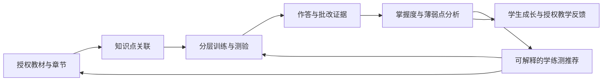
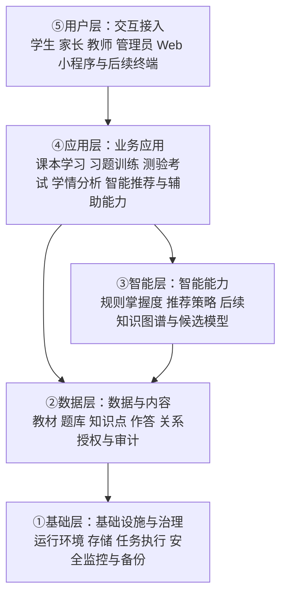

# 知阶 KnowLadder 项目方案

> 文档性质：品牌、全龄终身学习产品愿景与准入边界；功能规划不等于已交付或已获生产批准。
> 2026-10-14修订257：用户明确产品覆盖从小到大终身各类学习的全要素，现行定位与版图见[第18节](#lifelong-product-257)。第14节为历史教学培训实施切片，第17节对标方案按本次定位校正；历史试点顺序不限定产品人群。
> 配套文档：[技术架构方案](技术架构方案.md) · [交互与 UI/UX 设计](UIUX设计方案.md) · [开发计划与文档地图](开发计划.md#document-map)
> 2026-10-14修订256：[五产品对标与综合改进方案](#reference-product-proposal-256)，为候选产品方案；既有功能状态和生产准入不变。

## 1. 背景与方案状态

知阶 KnowLadder 定位为**AI支持的全龄终身学习平台**，覆盖儿童启蒙、基础教育、高等教育、职业发展、兴趣与生活学习、老年学习，连接资源、学习活动、教师与导师、家庭与机构支持、评价反馈和持续成长记录。正式教育、非学历培训、个人自学与日常实践均属于产品版图；成人职业培训是其中一个场景。具体内容与交互按年龄阶段、学习目标和使用情境适配，现行产品范围见第18节，实施与开放状态见开发计划。

当前仓库有 `prototype/` 独立内存演示，以及 `server/`、`web/`、`ops/` 真实系统；已具备本地阶段一至五能力、教师最小端和组织人员/权限专业后台，覆盖账号、教材题库、私有文件、练测、学情/错题/推荐、隐私与业务安全治理。此处只标示交付层次，任务状态、ObjectId v10初始化、治理账号首次改密及待办统一见[开发计划](开发计划.md)，不重复进度表。**本地完成不等于真实学生试点、第三方材料准入、生产批准或学习收益已证实。** 项目 LICENSE 不自动赋予第三方教材、题库、字体或资源使用权。

本文区分以下状态：

- **用户原始方案**：品牌表达、远期能力版图与阶段设想，整理保留，不视为已上线能力。
- **[INFERENCE] 建议**：为形成可执行边界而提出的产品、技术或治理建议，需评审后才能作为实施依据。
- **当前事实**：以仓库真实源码及开发计划记录为准；原型、真实Web、本地隔离验收、生产准入四者分开标示，历史验证不当作本轮重跑。
- **待确认**：预算、真实内容授权、试点学科范围、指标门槛等尚未确定事项；不以虚构数字填补。

产品范围覆盖全生命周期、各类学习与多角色，不以学校学段或机构报名作为学习者的唯一入口；已有真实能力的范围并不止于首期历史建议。全龄适配、完整家长/导师端、多领域评价和学习收益证据仍不能由当前本地交付推定。原型运行和历史浏览器证据见[交互原型章节](UIUX设计方案.md#interactive-prototype)。

## 2. 目标与非目标

### 2.1 产品目标

现行目标是把全龄、多领域的资源、学习活动与成长支持连接起来，包括课程/班级/任务/作业闭环、个人自学与实践、嵌入工作流的AI辅助及公开学习入口；下列既有学习目标继续适用于教育场景，全要素边界以第18节为准。

1. 建立「课本 → 训练／测验 → 分析 → 推荐 → 再学习」闭环，将章节、知识点、题目与学习记录联系起来。
2. 为学生提供循序渐进、可解释的下一步学习选择，而不是只展示分数。
3. 为教师提供有数据依据的教学辅助，为家长提供可理解且不过度推断的成长反馈。
4. 覆盖儿童至老年的终身各类学习，以阶段、目标和场景适配内容、活动、评价及多端体验。
5. 建立统一品牌，让视觉、语言、功能与「一步步向上」的学习体验一致。

### 2.2 规划与交付的非目标边界

- 本文不替代开发计划或上线许可，不因已有真实教材/练测/学情能力就宣称完成全学段、完整教师/家长端、模型训练、内容授权谈判或真实学生试点。
- [INFERENCE] “首期不同时交付所有学段、学科与业务端”是历史实施顺序建议，不删除远期愿景，也不将现有交付缩减为账号或演示阶段。
- 不承诺提分幅度、录取结果、升学或就业结果；不将掌握度估计等同于学生真实能力的完整描述。
- 不以 AI 替代教师判断、家长责任或专业升学咨询，不把模型生成内容未经审核作为标准答案。
- 不将全自动主观题评分、侵入式监考、强化学习推荐和开放内容生态作为首期默认前提。

## 3. 品牌体系

### 3.1 名称、定位与品牌内核

- 中文名称：**知阶**；英文名称：**KnowLadder**。
- 核心意象：知识构成阶梯，成长来自每一步被看见与支持。
- 使命：**让每个学生都拥有因材施教的智能学习阶梯。**
- 愿景：**成为从小学到大学最值得信赖的智能学习系统。**
- 价值观：**循序渐进、因材施教、数据驱动、陪伴成长。**
- 品牌人格：**老师 + 学伴 + 分析师**。老师提供方向，学伴给予支持，分析师解释证据；不居高临下，不用数据给学生贴固定标签。

### 3.2 Logo 概念与延展

统一概念为「**阶梯 + 知识树 + 上升箭头**」三合一：阶梯表达循序渐进，知识树表达知识联结，上升箭头表达成长方向。三者形成共同视觉语言，不要求在所有小尺寸图标中机械堆叠全部细节。

| 方向 | 原始设计要素 | 定位与使用 |
| --- | --- | --- |
| A：阶梯之光 | 三级渐宽阶梯，顶端一个发光点；整体呈「上」字变形，寓意从小学到大学不断向上 | 主 Logo；优先用于产品入口、启动页与正式品牌识别 |
| B：知阶树 | 阶梯构成树干，书本与知识点构成树冠 | 品牌延展；适用于成长报告、课程内容与学习空间插画 |
| C：智阶箭头 | 向上箭头内含阶梯纹理，尖端融入 AI 芯片 | 科技版本；适用于智能能力介绍、技术展示等场景 |

[INFERENCE] 建议以 A 为主标识，以 B、C 为同一品牌的延展，而非三个独立产品。正式设计需补充单色版、深浅底版、最小可识别尺寸、安全留白与应用图标，并验证小尺寸和无发光效果时仍可识别。本文件只规定概念，不声称已有矢量素材。

### 3.3 色彩与字体

| 类别 | 规范 | 使用建议 |
| --- | --- | --- |
| 主色 | `#1E6FFF` | 品牌识别、主要操作、当前学习路径 |
| 辅助色 | `#2ECC8F` | 成长、完成、正向反馈 |
| 强调色 | `#FF8A3D` | 重点提示、适量强调与行动引导 |
| 背景色 | `#F5F7FA` | 页面底色与信息分区背景 |
| 中文字体 | 思源黑体 Bold | 中文品牌字与重点标题 |
| 英文字体 | Montserrat / Inter | 英文品牌及界面排版候选 |

字体授权、具体分发来源、商用与嵌入条件均需核实，不能因字体名称常见就默认可随意打包分发。[INFERENCE] 建议正文使用清晰易读的常规字重与系统回退字体；色彩落地前检查文字和交互控件对比度，不能只靠红绿或颜色深浅传达正确、错误与进步。

### 3.4 口号体系

| 类型 | 文案 |
| --- | --- |
| 主口号 | **知阶而上，智达未来** |
| 英文口号 | **Climb with Knowledge, Reach the Future** |
| 学生 | 每一步，都算数 |
| 家长 | 看得见的进步，算得清的成长 |
| 教师 | 因材施教，AI 有据 |
| 功能 | 从小学到大学，一个系统全搞定 |
| 情感 | 你的学习阶梯，我们帮你搭 |

「从小学到大学，一个系统全搞定」保留为远期功能定位表达；[INFERENCE] 在未覆盖对应学段前，对外使用时应同步标明当前支持范围，不能让用户误以为全学段已经可用。「AI 有据」需要对应真实证据与能力范围；规则推荐阶段不得包装成已验证的先进模型效果。

### 3.5 关键场景使用规则

| 场景 | 品牌与内容规则 |
| --- | --- |
| 启动页 | 使用 A 主 Logo、知阶 KnowLadder 与主口号；英文口号按版面选用；不堆叠三种 Logo 或未经证明的效果数字 |
| 学生首页 | 使用「每一步，都算数」，突出当前章节、今天可完成的下一步与个人进步；情感口号用于引导或支持场景，不以排名制造焦虑 |
| 家长报告 | 使用「看得见的进步，算得清的成长」；同时显示统计周期、样本量、更新时间与缺失数据说明，先讲孩子自身变化，再讲可采取的支持行动 |
| 教师后台 | 使用「因材施教，AI 有据」；建议旁提供涉及知识点、作答证据和适用范围，允许教师修正或不采纳；科技版 C 可作延展，不取代关键操作信息 |

### 3.6 品牌故事

一位老师问：从小学到大学，究竟要走过多少级台阶？

有人想到十二年、四千多天，有人想到无数本课本、习题与试卷。但真正重要的答案不是一个整齐的数字，而是：**每一步，都需要被看见。** 十二年、四千多天是一段基础教育成长历程的叙事意象，不是对小学至大学总学制的精确计算。

有的台阶走得轻松，有的需要停下来再试一次。课本帮助学生认识新的知识，习题让理解变得具体，测验让已掌握与尚待巩固的地方显现。如果这些经历彼此孤立，学生看到的可能只有一次成绩；如果把它们连接起来，就能形成一条可以测量、分析、推荐与调整的学习路径。

知阶希望让 AI 帮助寻找适合学生的下一级台阶：不是替学生走路，不是把所有人推向同一个速度，而是让每一次练习有来由，每一份反馈可理解，每一步向上都有陪伴。

这就是知阶：知阶而上，智达未来。

### 3.7 语言风格示例

以下三类文案**仅为语气示意，不是实际用户反馈、模型输出、效果数据或已经实现的功能证明**。上线文案中的判断必须由真实记录支持。

| 人格 | 示例 | 边界 |
| --- | --- | --- |
| 老师 | 「先回顾这一节的例题，再试一道同类题；我们一步一步来。」 | 给出具体方法，不贬低、不承诺一次掌握 |
| 学伴 | 「这一步暂时有点难也没关系，我们一起看看哪里卡住了。」 | 支持情绪但不冒充真人、不制造依赖 |
| 分析师 | 「这组记录里，同一知识点仍有错误。建议先复习相关章节，再做一次短测。」 | 有记录才做判断；数据不足时明确说明，不虚构百分比或原因 |

原案面向三类用户的语言示例如下，**均仅为示意，不是已发生的效果；12 秒与 8% 不代表实测数据或效果承诺**。上线使用必须有真实数据支持，并说明比较口径与适用范围。

| 对象 | 原案示例 | 使用前提 |
| --- | --- | --- |
| 学生 | 「这道题你进步了12秒」 | 必须有可比的有效作答记录，不能把用时缩短直接等同于掌握提升 |
| 家长 | 「本周掌握度提升8%」 | 必须有真实掌握度记录，明确基准、统计周期及相对百分比与百分点的区别；数据不足时不得展示 |
| 教师 | 「班级薄弱点集中在函数单调性」 | 必须有该班级相关知识点的足够有效样本，并提供分析证据，不能由其他班级或单个学生情况推断 |

## 4. 用户角色与多端版图

| 角色／入口 | 主要任务 | 数据与责任边界 |
| --- | --- | --- |
| 学生 | 阅读教材、练习、测验、回顾错题、查看计划与成长、选择推荐任务 | 主要访问自己的学习数据；允许查看推荐理由与纠错，不把建议当强制结论 |
| 个人学习者 | 全龄自学、兴趣探索、生活实践、制定目标与回顾作品 | 不以加入学校/公司作为产品层面的必要条件；个人学习空间是待设计能力，不由现有零组织账号自动获得全部业务权 |
| 导师／学习伙伴 | 专题指导、实践反馈、共同学习 | 关系/内容可见性/互动范围须明确授权，不新增隐式查看私人档案能力 |
| 家长 | 查看经授权的孩子周月报、轨迹与支持建议，参与家校沟通 | 需验证监护或授权关系；不能自行搜索任意学生，不默认查看成年大学生数据 |
| 教师 | 布置练测、查看所授班级分析、提供反馈、调整教学安排 | 限定学校／班级／授课关系；跨班跨校访问必须有明确授权 |
| 管理员／内容运营 | 维护教材题库与知识点、审核发布、管理账号角色与内容授权 | 区分内容管理与敏感数据权限；关键操作留痕，不默认可随意浏览所有学生记录 |
| 小程序及其他终端 | 提供适合移动场景的学习、提醒、报告入口 | 是接入形态而非新增权限角色；跨端保持身份、授权与数据口径一致 |

[INFERENCE] 建议首期采用学生 Web 与最小内容管理 Web；家长、教师完整业务端在 V1 推进，小程序及其他终端结合真实需求安排。此建议不改变远期多角色、多端目标。

角色页面、布局与交互状态见[交互与 UI/UX 设计](UIUX设计方案.md)；真实Web现有工作区和专业后台见其[真实Web路由与工作区](UIUX设计方案.md#real-web-workspaces)。教师最小端已存在，但不等于完整家校业务端；原型身份切换不是服务端授权，当前角色交付状态以开发计划为准。

账号按实际人员开通，岗位职责通过基础角色与独立授权组合表达。兼容职责可由同一人员承担，例如教师兼考试编排；内容/考试不得自审，敏感审批由不同实际人员执行。初始化岗位账号用于职责覆盖验收，不要求每个机构固定配置12个工作人员；闲置账号经核对后正式停用并保留审计。范围与期限见[账号精简原则](技术架构方案.md#account-simplification)。

## 5. 核心学习闭环

闭环需要能回答：学生学了什么、做了哪些题、批改依据是什么、分析基于哪段数据、为什么推荐下一步，以及下一次学习后发生了什么变化。

[INFERENCE] 建议将题目、教材、答案和分析规则的版本与学习记录关联。无作答证据时显示「待诊断／数据不足」，不默认掌握度为零；分析或推荐尚未生成时展示处理状态，不把旧结果伪装成最新结论。推荐须遵守授权内容与学段范围，无法生成时提供明确的章节学习入口，而不是返回不相干资源。

## 6. 五大核心功能

### 6.1 课本学习（电子课本）

- 按学段、年级、学科、教材版本、章节组织内容，支持章节阅读与定位。
- 支持学生标注、笔记与回看，并明确私人笔记和共享批注的边界。
- 章节关联微课、知识点、训练题与测验，允许从错题或推荐反向回到教材。
- [INFERENCE] 首期聚焦已获授权的初中数学章节与题测关联；微课、复杂批注和多教材版本按资源就绪情况分批开放。无授权的教材不得因技术可上传而默认可使用。

### 6.2 习题训练（智能训练）

- 提供基础、提升、挑战分层，按知识点、难度、题型进行选题与组卷。
- 自适应训练依据作答与掌握证据调整后续题目，不将「答错一次」等同于能力低下。
- 允许学生看解析、回到章节、重做或换同类题；区分初次作答与重做记录，避免反复刷同一道题造成虚假进步。
- [INFERENCE] 首期采用可审查的分层规则与推荐理由；后续以真实学习收益评估自适应策略，而不是只优化完成时长或点击次数。

### 6.3 测验考试（智能测验）

- 覆盖单元、期中、期末、模拟与随堂测场景，支持题目编排、提交、批改、成绩与能力雷达展示。
- 自动批改与人工复核明确分工；[INFERENCE] 首期只对规则明确的客观题自动批改，主观题未来引入教师复核与申诉机制。
- 防作弊能力属于降低风险而非保证杜绝作弊；[INFERENCE] 建议按场景采用抽题、题序随机、计时、重复提交保护与异常提示。异常记录不能直接判定学生作弊，摄像头等侵入式监控不作为默认方案。
- 雷达维度需有学科依据与足够样本，不将不可比较的不同试卷成绩直接绘制成「进步」结论。

### 6.4 学情分析（学习分析）

| 视角 | 能力规划 | 解释与隐私要求 |
| --- | --- | --- |
| 个人 | 知识点掌握度、学习曲线、能力雷达、阶段薄弱点 | 显示周期、样本、更新时间与估计性质；掌握度不等于考试分数 |
| 班级 | 知识点热图、排名与成绩分布、共性问题、教学建议 | 限授权教师；排名不公开羞辱学生，缺考与小样本单独解释 |
| 家长 | 周报、月报、学习轨迹、阶段对比与陪伴建议 | 基于有效关系授权；优先个人历史对比，群体对比应聚合且防止识别其他学生 |

[INFERENCE] 建议以可解释的规则掌握度作为基线；有效作答不足时保持未知。报告应区分观察事实、推断与行动建议，不把学习时长等同于努力程度，不根据单次成绩推断人格或心理状态。

### 6.5 智能推荐（个性化推荐）

推荐覆盖「学什么、练什么、测什么」：章节与微课、针对性习题、阶段诊断与复测。每次推荐应有来源、理由与适用范围，允许用户跳过或教师调整。

[INFERENCE] 建议演进顺序：先以规则推荐与可解释掌握度验证闭环，再逐步评估知识图谱、BKT、DKT、协同过滤和强化学习等方法。它们是候选路径而不是必选清单；是否采用取决于数据规模、内容标注质量、隐私条件、可解释性和评估收益。冷启动、稀疏记录和跨学段迁移需单独验证，未经验证不宣称算法能「精准提分」。

## 7. 五项辅助能力

| 能力 | 使用角色与价值 | 范围与边界 |
| --- | --- | --- |
| 错题本 | 学生整理错题、查看解析、重练与归因；教师查看授权范围内的共性错误 | 自动收集与手动整理结合；系统推断错因需标识，不替代学生反思；删除展示项不应悄悄改写历史测验成绩 |
| 学习计划 | 学生制定任务与节奏，教师安排学习任务，家长提供支持 | 支持调整与休息；提醒适量；不默认无限加练，不将逾期变为惩罚性标签 |
| 成长报告 | 学生理解进步，家长观察轨迹，教师回顾教学反馈 | 与核心分析共用口径而非重复计算；提供周期、证据和不足说明；分享或导出时控制隐私 |
| 家校互通 | 家长与教师围绕授权学生沟通任务、反馈与支持策略 | 限定关系与消息可见性，设置通知边界；不作为紧急求助通道，不泄露其他学生情况 |
| 激励机制 | 学生通过适当的徽章、阶段目标和正向反馈建立学习习惯 | 鼓励过程与个人进步，避免公开羞辱、强制连续打卡、成瘾式刺激及付费竞争 |

[INFERENCE] 首期可围绕错题回看与简单下一步任务支撑闭环；完整计划、周期报告、家校互通与激励体系随角色和内容能力逐步推进。

## 8. 分学段与人生阶段适配策略

| 学段 | 学习重点 | 交互与能力规划 | 需守住的边界 |
| --- | --- | --- | --- |
| 学前／儿童启蒙 | 语言、认知、科学观察、艺术与日常习惯 | 绘本、故事、游戏、亲子共学与线下体验 | 适龄/监护与短时使用，作品/描述性反馈，不套成人计时考试 |
| 小学 | 兴趣、基础知识与学习习惯 | 适龄游戏化、语音、动画、基础诊断、短任务与正向反馈 | 关注阅读和操作负担；避免过量屏幕时间；不以竞争排名替代兴趣培养 |
| 初中 | 体系化学习、应试基础与分层巩固 | 基础／提升／挑战、错题知识图谱、中考相关训练与复习路径 | 教材与地区考试要求需匹配；首期建议初中数学，并非已确认全部年级或教材版本 |
| 高中 | 提分目标、冲刺复习与能力结构 | 真题、模拟、限时训练、能力诊断与志愿建议 | 真题授权与时效需要核实；志愿建议仅辅助参考，不作为确定决策或录取保证 |
| 大学 | 专业深化、课程拓展与职业探索 | 专业课程、论文学习支持、考证、专业知识图谱与职业路径 | 尊重学术诚信，不代写论文；职业路径不是就业保证；成年学生数据不默认向家长开放 |
| 成年／职业与生活 | 岗位发展、继续教育、家庭与社会生活、兴趣探索 | 自学/培训/实操/项目、灵活路径、导师反馈与作品 | 不把学习绑定就业或证书；实践、参与与知识测评分别评价 |
| 老年 | 数字生活、文化艺术、健康素养、社会参与 | 易读内容、分步示范、重复学习、社区/同伴活动 | 按本人能力与偏好支持，不按年龄推定低能力；协助访问须本人授权 |

全学段适配不仅是扩充题库，还包括课程标准、题型、能力维度、内容审核、交互、数据解释与权限关系的变化。不得将初中数学分析规则不加验证地复制到其他学段。

## 9. 五层系统概览

以下为 **[INFERENCE] 建议架构**，用于表达产品能力分工，并非现有部署事实。

API 使用 **NestJS + TypeScript**、主数据库使用 **MongoDB**，为用户已明确的选型；真实Web使用 Vue 3 + TypeScript + Vite，业务由 NestJS 模块化服务及独立 worker 承载。上图是产品职责分层，不是部署清单或采购承诺。数据库拓扑、私有文件、业务事实源、知识关联、任务一致性、安全与授权的唯一详细规范见[技术架构方案](技术架构方案.md)，本文不重复技术选型表；本地 standalone 非原子模式不能冒充副本集事务保证。

## 10. 分阶段路线图

本节保留原学习系统V0/V1/V2路线作为历史背景；2026-10-02新增教学培训优先顺序见第14节，实施状态统一见开发计划，不从旧“首期”推定当前授权。

以下时间窗口来自用户原始规划，用于讨论优先级，**不是已经确认的工期或交付承诺**。起算点、团队配置、内容授权与预算均待确定；各阶段应以验收和资源评估推进，不能为了日期强行宣称完成全学段。
本表只保留原始产品扩展顺序；已执行的技术阶段和当前交付应阅读[开发计划](开发计划.md)。`MVP/V1/V2/V3` 不与实施阶段一至五逐项对应，不能将历史“首期建议”当作当前唯一已实现范围。

| 阶段 | 原始时间设想 | 阶段目标 | [INFERENCE] 建议进入下一阶段的条件 |
| --- | --- | --- | --- |
| MVP | 0—3 月 | 初中数学核心闭环 | 已授权内容可使用；学生与最小内容管理 Web 跑通章节、客观题练测、分析与规则推荐；关键权限与结果一致性通过验收 |
| V1 | 3—6 月 | 多学科、家长与教师业务端 | 新学科标注与分析口径完成审核；班级、监护关系与报表权限可验证；形成有效使用反馈 |
| V2 | 6—12 月 | 向全学段扩展，验证 AI 与知识图谱 | 分学段具备内容、交互和评估能力；候选模型相对基线有可核实收益，无明显安全与公平性退化；可按学段分批开放 |
| V3 | 12 月以后 | 开放内容生态与硬件拓展 | 内容准入、授权、质量审核与治理机制成熟；接口、合作设备安全和运营责任明确 |

V2 的「全学段」是方向目标，不要求在第 12 个月前不计条件一次性上线全部学段。BKT、DKT、协同过滤、强化学习可以分别验证、延期或不采用，不以模型数量作为阶段完成标准。

## 11. 可观察验收与指标口径

### 11.1 文档验收

- 品牌名称、三种 Logo 概念、色彩字体、口号、故事、使命愿景价值观与场景语言完整可查。
- 五大核心、五项辅助、四个学段、角色权限与多端愿景均有明确描述。
- 已知事实、原始愿景、建议和待确认事项可区分；未将规划描述为已实现能力。
- 项目方案与技术方案使用一致的首期边界、算法演进原则和路线图定位；可通过相对链接查阅。

### 11.2 [INFERENCE] 建议首期产品验收场景

| 场景 | 可观察的通过条件 |
| --- | --- |
| 内容发布与学习入口 | 内容管理员可发布一组具备授权信息的章节与题目；学生只能看到已发布且有权访问的内容；章节能进入对应练习 |
| 训练与客观题批改 | 学生完成基础／提升／挑战范围内的可用训练；提交后获得与审核答案、评分规则一致的结果与解析；同次提交不产生重复计分 |
| 测验完成与成绩追溯 | 在首期支持的测验场景完成开始、作答、提交和结果查看；能够关联题目与评分规则版本；异常或未完成状态不会展示成有效成绩 |
| 分析证据 | 能从掌握度展示追溯到适用知识点、作答样本、规则版本与更新时间；新学生显示数据不足而不是虚构结论 |
| 推荐闭环 | 学生获得当前支持范围内的学／练／测建议，能查看理由并进入对应任务；再次作答后分析按约定更新，处理延迟有状态提示 |
| 错题回看 | 错题与原始作答、解析、对应章节保持关联；重做记录与原测验成绩分开，避免覆盖原始证据 |
| 权限隔离 | 学生不能读取他人记录；内容管理员不能借内容权限获取无关学生信息；无权限访问被拒绝并保留适当审计记录 |
| 内容与服务异常 | 无题、未授权内容、重复提交、网络中断及后台任务失败均有明确状态，不静默丢失已确认提交，也不返回伪造分析 |

完整家长、教师与多端扩展仍应各自验收授权绑定／解除、班级关系变更、报告统计口径、跨端数据一致性和失效权限处理，不能以当前学生闭环或教师最小端的本地验收代替。

### 11.3 指标定义与使用原则

以下是 **[INFERENCE] 建议指标**，用于建立可量化评估方式；当前没有实测基线或目标值。发布前应由产品、教研和技术共同确认统计窗口、门槛与样本要求。

| 指标 | 建议定义 | 解读限制 |
| --- | --- | --- |
| 内容关联覆盖率 | 目标范围内已审核且关联章节和知识点的可用题目数 ÷ 目标范围内可用题目总数 | 分母为零时标记不适用；同时报告分母，不能以少量内容冒充高覆盖 |
| 学习闭环完成率 | 窗口内完成学习入口、有效作答、查看分析并进入下一推荐任务的学生数 ÷ 同窗口进入该学习入口的学生数 | 固定去重口径与完成时间窗；排除测试账号，不等同于学习效果 |
| 客观题评分一致率 | 基准作答集中自动批改与审核标准一致的作答数 ÷ 基准作答总数 | 基准集需覆盖题型和边界；不能只用正常输入证明可靠性 |
| 分析更新时延 | 从有效提交被确认到其分析结果可读取的耗时，报告分位数及失败比例 | 不只统计成功任务，不掩盖积压或重试 |
| 推荐有效进入率 | 被用户进入的有效推荐项数 ÷ 展示给用户的有效推荐项数 | 去重与曝光口径需固定；点击不是掌握或提分证据 |
| 知识掌握变化 | 对同知识点、可比题目集合，比较前测与后测的有效作答表现并报告样本与间隔 | 控制重复题记忆、难度和样本偏差；仅凭前后变化不能确认因果 |
| 授权隔离通过情况 | 约定权限用例中被正确允许／拒绝的数量及失败项 | 报告具体未通过场景；关键越权为上线阻断项，不能用平均通过率掩盖 |
| 用户反馈问题率 | 固定窗口中被确认的内容、批改或推荐问题数 ÷ 对应有效使用量 | 分类型统计；投诉少不自动证明质量高，需保留反馈入口 |

若做模型效果或学习收益试验，应预先定义对照基线、分组、最小样本条件、退出与保护机制、评价周期及隐私边界。不能用留存、刷题量或使用时长替代学习质量。

## 12. 风险与治理

| 风险 | 影响 | [INFERENCE] 建议措施 |
| --- | --- | --- |
| 教材、真题、微课与字体授权不足 | 内容下架、侵权与产品无法交付 | 建立授权来源、范围、期限与撤回机制；发布前审核，不把仓库 LICENSE 当成第三方内容授权 |
| 未成年人隐私与关系越权 | 学习记录外泄、不当画像 | 最小收集、明确告知、按适用法律处理监护授权；区分学生、监护人与授课关系；记录与撤销授权 |
| 数据稀疏与误判 | 不准确的掌握度、错误推荐 | 冷启动显示未知，保留规则基线和人工反馈；展示样本与解释，不强行量化 |
| 内容质量与批改错误 | 误导学习、失去信任 | 教研审核、版本留痕、问题反馈与更正机制；主观题和模型内容谨慎引入 |
| 算法偏差与推荐单一 | 弱化挑战机会，固化学生标签 | 分群与分学段评估，保留探索与用户选择；不能持续将学生锁定在低难度内容 |
| 防作弊误报与过度监控 | 不公平处罚、隐私侵害 | 风险提示与人工复核；遵循必要性，不将行为异常直接作为作弊结论 |
| 排名、激励与报告造成焦虑 | 伤害学习体验 | 优先个人成长，不公开羞辱；避免惩罚式打卡，保持可理解和非诊断式表述 |
| 全学段与多端范围膨胀 | 内容、教研与开发资源失配 | 阶段评审与分批开放，不以日期或算法堆叠代替交付质量 |
| 服务或异步任务失败 | 记录丢失、分析滞后与重复结果 | 明确提交与处理状态、故障恢复和备份；具体实现与验收见技术文档 |
| 升学、职业与论文辅助越界 | 不当决策依赖、学术诚信问题 | 明示参考性质和适用范围；提供来源与时效，不代写、不保证录取或就业 |

### 12.1 真实准入与上线阻断边界

S5-01 的**试点场景、教材与题目版权、隐私处理、数据地域、留存与例外、运营责任**六域仍须有权主体批准；本地政策确认、合成账号、原创材料演练或技术验收不能代填“已批准”。每域仅登记批准主体、适用版本/范围、批准时间、证据位置四类非敏感索引；不写合同全文、学生/监护人个人信息、密码、Cookie 或密钥。完整填写模型、生产环境输入及技术待完成项见[开发计划准入证据](开发计划.md#admission-evidence)。

六域未齐备、生产目标环境未确定且未获单独实施授权前，不启动技术架构生产部署顺序 (b) 及之后步骤。生产 TLS/认证与信任策略、容量与扫描新鲜度、跨故障域备份恢复须另行证明；两项 EICAR 感染样本按用户决定暂缓，不关闭 Windows Defender 绕过限制。视觉/辅助技术未覆盖项不当作 WCAG 认证；commit 与 push 也分别需要用户明确授权。

## 13. 待确认事项与后续评审

| 事项 | 需要确认的结果 | 影响 |
| --- | --- | --- |
| 首期产品边界 | 是否接受初中数学、学生与最小内容管理 Web 的建议；具体年级、教材版本及章节范围 | 内容、工期、验收与试点用户 |
| 目标用户与试点 | 面向个人家庭、学校或培训场景；目标地区与试点组织方式 | 角色关系、合规、测验形式与商业路径 |
| 内容资源 | 教材、题库、微课、真题来源及授权预算，教研审核责任人 | 可上线范围与质量保障 |
| 品牌落地 | Logo A/B/C 的正式设计、字体授权、名称与商标可用性 | 视觉资产与对外发布 |
| 统计与学习模型 | 知识点体系、掌握度定义、报告维度、规则与后续模型评估方法 | 结果可解释性与跨学科可比性 |
| 隐私与使用关系 | 适用地区、未成年人及成年学生授权规则、保留期限、导出与删除流程 | 数据模型、权限与运营流程 |
| 测验边界 | 首期支持哪些测验类型、是否计时、复核流程、防作弊强度 | 批改与状态流转复杂度 |
| 资源与排期 | 人员、预算、内容准备程度、阶段起算点与阶段评审人 | 路线图能否转化为可执行计划 |
| 指标与发布门槛 | 各指标窗口、基线获取方式、性能目标、试点评估和阻断条件 | 是否具备正式上线与扩展依据 |
| 商业与生态 | 收费方式、内容合作、硬件接入需求及支持责任 | V3 的开放边界与治理要求 |

建议评审顺序：确认品牌和产品愿景 → 确认首期边界与内容授权 → 评审技术架构及安全要求 → 明确指标和资源 → 用户确认实施范围后进入开发。任何未确认事项都不应在文档转实施时被悄悄视作已批准决定。

## 14. AI教学培训平台产品扩展（2026-10-02，文档规划）

本节依据用户“教学培训系统，重要是融合AI，并增加官网首页/功能页”的目标补充现行产品方向。用户已授权更新四核心文档；此授权不等于新业务开发、模型采购、数据迁移或生产开放。第3—8节的学生学习、品牌故事和学段策略继续作为教育场景规范；第4节旧首期及第10节V0/V1/V2属于原学习系统路线，不再代表本次培训扩展的优先顺序。新增实施状态只见[开发计划任务入口](开发计划.md#ai-training-roadmap)，技术和页面分别见[技术扩展](技术架构方案.md#ai-training-architecture)、[交互扩展](UIUX设计方案.md#ai-training-ui)。

### 14.1 定位与首个完整版本

本节记录2026-10-02教学培训扩展的历史范围。修订257用户已明确现行定位为**AI支持的全龄终身学习平台**，详见第18节；“融合AI的教学培训平台”和“让教学更高效，让学习更有方向”保留为教学培训场景描述。品牌“知阶 KnowLadder”和“知阶而上，智达未来”保持，全龄范围不代表所有场景已实现或已开放。

采用统一学习与教学内核，按场景配置术语、菜单、流程和权限。此前培训机构与成人职业培训的首批建议只说明当时实施切片，不能用于限定现行产品定位，或自动把儿童/学校/兴趣/老年学习列为低优先级。后续试点与实施顺序按全龄需求、真实内容和可验收闭环重新确认，历史实现与验证保留。

| 场景 | 主要业务 | 差异化配置 |
| --- | --- | --- |
| 教学/培训机构 | 开课、编班、授课、任务、作业、测评、反馈 | 校区、课表、考勤、课时；未成年人场景另配置监护关系 |
| 成人/职业培训 | 学习路径、实践训练、考试、结业 | 技能标签、认证、情景陪练；不默认存在家长角色 |
| 企业内部培训 | 岗位培训、指派学习、考核、认证 | 部门、岗位、新员工与周期培训；不默认开放招生收费 |

共用课程、资源、题库、任务、作业、测评、学情和AI服务。业务场景不产生隐式权限：教师仅访问有效授课范围，教务不默认查看全部敏感成绩，机构管理员不自动获得平台治理权限。新增教务、运营、财务角色需独立定义能力，不能只靠改菜单落地。

### 14.2 参考产品与借鉴范围

以下为2026-10-01参考调研记录，本轮文档修订未重新验证网站。官方介绍属于功能宣传或规划依据，不证明当前仓库实现；第三方商用版本不视为开源版本。

| 来源 | 借鉴范围 | 使用边界 |
| --- | --- | --- |
| [PlayEdu功能清单](https://www.playeduos.com/function.html) | 课程资源、培训任务、考试、证书、统计 | 按其版本区分理解；用于流程分析 |
| [PlayEdu官网](https://www.playeduos.com/) | 功能分类、场景说明和演示入口 | 官网使用知阶原创文案、图稿和真实能力说明 |
| [cloud-TA项目说明](https://github.com/zhenshukeji/cloud-TA) | 校区、班级、排课、师生与机构运营 | 以README说明为依据，未完成源码/全功能验收；复用代码前单独核查许可及依赖 |
| [宏之博演示系统](https://erp2.hzb-it.com/#/) | 业务分组导航、课表日历、概览与公告 | 已观察首页和教务菜单，未验证全部操作；不记录演示凭据、不复制演示人员数据 |

借鉴信息架构与流程，不直接搬用品牌、截图、素材或未核许可源码。案例、客户Logo和收益数据必须真实且有展示授权。

### 14.3 领域边界与教学闭环

| 对象 | 产品含义 | 不可混淆的对象 |
| --- | --- | --- |
| 教材/资源 | 版本化教学资料、题目、课件及附件 | 上传资料不等于已发布课程 |
| 课程 | 可复用教学内容与章节/课时结构 | 班级、具体授课时间和收费合同 |
| 班级/培训班 | 师生组织与教学范围 | 课程正文版本 |
| 课次 | 一次具体授课安排 | 自学内容课时；考勤也不证明掌握 |
| 学习任务 | 对指定对象的课程/作业/测验要求与期限 | 当前教师assignments是授课关系，不能直接当作作业任务 |
| 作业 | 学员提交、教师反馈及评分修订 | 正式计时测验与自动评分会话 |
| 考试 | 资格、题目快照、计时、作答、评分和结果发布 | 课程阅读完成率 |
| 结业/证书 | 依据明确规则确认培训完成 | 无条件由AI推断资格 |

首个完整闭环：**创建并审核课程 → 建班及配置师生 → 指派学习/作业/测验 → 学员学习与AI答疑 → 提交与教师反馈 → 查看有效学情 → 安排后续学习**。上线前必须用真实授权课程与师生关系跑通，不以独立演示或孤立页面代替。

### 14.4 功能版图与先后顺序

| 模块 | 首个完整版本范围 | 后续范围 |
| --- | --- | --- |
| 官网 | 首页、功能页、AI专题、解决方案、帮助、咨询及登录入口 | 经授权案例、部署/版本说明 |
| 课程与资源 | 课程/章节、图文/文档、受控音视频课时、版本发布、学习条件；复用教材资源 | 视频转写、字幕、摘要和时间点定位 |
| 教学组织 | 复用组织/班级/授课关系，补齐培训班和课程关联、学员学习资格 | 多校区深度运营、部门岗位培训 |
| 任务与作业 | 指派、期限、提交、反馈、批改修订、任务进度与受控提醒 | 周期任务、复杂协作与实践项目 |
| 练习考试 | 复用三题型、组卷、权威计时、评分、结果、错题与复核 | 主观题辅助批改、更多题型 |
| AI教学 | 课程答疑、教师备课、出题草稿、学情解读 | 情景陪练、语音与学习路径辅助 |
| 报表 | 本人/班级/课程/任务进度、考试分析，统一证据口径 | 聚合机构/企业报表 |
| 教务与认证 | 首期定义接口边界与规则 | 排课冲突、考勤、请假、补课、课时记录、结业及证书 |
| 机构运营 | 首期咨询线索及人工跟进；不开放收费承诺 | 报名、合同、收费/退款、续费、课时账户 |
| 平台管理 | 复用权限、独立审核、审计；扩展站点内容及AI配额/用量 | 企业集成、小程序与多端 |

课程包/套餐、财务账与教学课次分别建模。自动扣课时、退款和续费规则必须先确认；支付能力不属于当前文档更新的实施授权。

### 14.5 AI核心能力与质量边界

| 能力 | 输入与结果 | 用户确认/教学边界 |
| --- | --- | --- |
| 课程AI助教 | 当前有权访问的课程内容与问题；输出解释、例子、分层提示和原文引用 | 检索不到依据明确说明；不读取考试答案；提示/答案曝光影响独立证据口径 |
| 教师AI备课 | 学员对象、课程范围、目标、课时；生成教案、活动与练习建议 | 保存为草稿，教师编辑确认；不自动发布或指派 |
| AI出题 | 授权材料、知识点、题型、难度；生成题干、答案及解析候选 | 规则校验和教研审核后才可发布；沿用独立审核职责 |
| AI学情解读 | 已发布有效成绩、统计周期、样本和规则报告 | 数值由业务系统计算，AI仅解释；事实、推断、建议分开，教师可修正 |

后续主观作业批改使用版本化评分量表，模型给建议分，教师确认最终结果；情景陪练按职业任务和量表给反馈；学习计划可调整，不据此自动做录取/就业/认证决定。模型失败不阻塞已具备的阅读、作答与确定性评分，也不使用演示数据伪造回答。

质量评估覆盖引用正确性、答案正确性、无依据拒答、越权/泄题、教师采纳情况、延迟及单次成本。固定评估材料、版本、阈值和人工复核方案在启用前确认；不得杜撰准确率或提效百分比。

### 14.6 官网与角色入口

公开官网用于说明产品、场景和实际能力；登录后工作区用于完成业务任务。官网与学员/教师/管理首页分别设计，已有登录介绍区不能当作官网已交付。

官网页面为首页、功能介绍、AI教学、解决方案、帮助中心、关于知阶与咨询入口。功能标注“已支持/试点中/规划中”，以开发计划及实际准入为依据；未上线模块不可提供假成功按钮。咨询表单仅收最少联系信息，说明用途并有真实受理、跟进、留存及删除策略；不自动创建业务账号或发送外部消息。

### 14.7 扩展路线与产品验收

扩展采用“范围与设计 → 完整教学+AI版本 → 教务认证 → 运营多端”的顺序，不重编号原五阶段。下一项为TRN-01范围/详细设计确认；计划只列索引与状态，不重复本节功能真相。

首个版本验收需覆盖课程发布/撤回、师生关系、跨班拒绝、任务指派、提交恢复、教师反馈、考试答案隔离、学情证据、AI引用及权限撤销、官网真实受理与角色落点。学习时长、阅读完成、作业完成、考试分数和掌握度分开计算；进步只比较可比证据。首期不承诺全学段、全自动主观评分、侵入式监考、高级学习模型、支付、直播基础设施或所有终端同时交付。

### 14.8 实施前待确认

1. 首个试点属于机构、职业培训还是企业；学员年龄、学科/技能和课程内容来源。
2. 首期媒体格式、容量、学习完成规则、任务期限与迟交/重交政策。
3. 模型供应商、部署地域、数据使用条款、预算、配额和质量门槛。
4. 角色能力、课程发布审核、作业评分复核与授权管理责任人。
5. 官网咨询处理人、实际可对外展示的能力、案例及部署方式。
6. R-08修复范围、真实运行拓扑和试点/生产准入。详细设计确认与实施授权仍独立判断。

### 14.9 TRN-01首期范围与业务政策评审稿（2026-10-02）

“继续下一步”授权本轮细化TRN-01。以下默认设计可供确认，未确定的外部条件不虚构；不把设计稿写成已实现能力。建议先在本地隔离环境以原创成人职业培训资料验证单机构/单班级/单课程教学闭环；真实机构、人员、内容授权及上线另确认。企业与未成年人模式保留扩展边界，不作为本次默认真实试点。

| 范围 | 本地首期建议 | 验收边界 |
| --- | --- | --- |
| 场景 | 成人职业培训，一机构可建多个培训班；首轮验收一班一课 | 现有school组织暂作底层组织，不自动改kind枚举；通过独立training_profile表达场景 |
| 教学内容 | 图文、受控PDF和已ready的MP4/H.264/AAC、MP3课时 | 新附件仍需启用现有扫描且通过；不开发直播、转码、OCR、视频转写 |
| 学习组织 | 班级关联课程版本，每班每学科沿用有效教师授课关系 | 学员需有效成员/learning:self及班级关系；角色名称不改变权限 |
| 任务 | 单目标课程、作业或现有测验；指派到一个班级的发布时有效学员快照 | 不自动加入后入班学员；补指派另操作，不扩大原考试资格 |
| 作业 | 富文本/纯文本与受控附件、教师评分/反馈 | 不开发自动主观评分；结果经教师显式发布后学员可见 |
| AI | 四项核心能力；首期答疑仅索引图文及授权教材正文 | PDF/音视频可学习但不自动进入检索；无文字依据给拒答，不拿标题猜内容 |
| 官网 | 全部公开介绍页及最小真实咨询受理/站点后台 | 无外部自动通知、付费、自注册、假案例；咨询处理人未配置时关闭表单 |

**课程完成**：首期各必修课时由学员显式确认完成，保存服务端时间与规则版本；完成率=已确认必修课时/该课程版本必修课时，无必修课时不可发布。媒体位置只用作恢复，不用“观看到末尾”证明掌握或强制防拖拽。课程可以自由阅读；任务是否完成按其冻结规则计算。

**任务期限**：发布时间不晚于截止时间，存UTC、按界面时区显示。数据库权威时间严格小于due_at才接受提交/重交；恰等于截止拒绝新写。阅读仍可继续但截止后新完成不回填按时完成。首期不接受迟交；老师需另建补交任务，不静默延长已发布任务。测验目标的时间/次数继续服从既有测验合同，任务不另造会话。

**作业重交**：截止前允许修改草稿及重复提交新修订；新提交成为当前有效版本，旧版只读可追溯。教师反馈绑定具体提交修订，重交后旧反馈标“历史版本”，新提交待批改；发布反馈前再次确认目标仍为当前提交。首期分数为0—100整数，量表维度整数权重合计100，由系统按确认规则计算，不由模型打分。反馈发布是独立动作；修改形成新反馈修订，不覆写已发布记录。作业分数不直接进入原三题型掌握度投影。

**成员变化**：指派后新入班不自动获得任务；退班/禁用/失权立刻停止读取和提交，历史记录按留存规则保存且不向原授课教师继续公开敏感详情。授权恢复也不自动延长期限。暂停课程及素材撤回区别于任务取消；历史任务显示不可继续并保留原因，不伪造完成。

**通知**：首期只在站内任务列表显示待办与状态；邮件、短信、微信等需后续明确授权/渠道，不作为首期提醒验收前提。

**AI启用**：本地模型适配与合成资料开发可独立验证；实际模型调用前须确定供应商、地域、预算与资料用途。四项能力可分别停用，默认无模型配置时禁用；不默认购买套餐或发送真实资料。外部模型条件未就绪不阻止其他教学模块实现，但TRN-05—08和TRN-10不得标完整验收通过。

### 14.10 AI质量与运营准入评审建议

建议固定不少于60个原创/授权案例（课程答疑20、备课10、出题20、报告解读10），另设越权/撤回/提示注入/考试泄题/取消及预算的系统安全用例；规模与阈值是建议验收基线，未经实跑不写成结果。普通案例与对抗案例分别报告，按四项能力分别达标，不能用总平均掩盖单项失败。

- 引用版本/位置与权限核验、报告数字一致、受保护答案隔离、越权拒绝与人工确认边界：固定验收集不允许失败。
- 三题型生成候选必须全部通过结构/确定性答案校验后才能保存为可送审草稿；数学/专业内容人工复核，发现无效题不得静默补成正确标准答案。
- 答疑正确性和备课可用性由至少两名评审按量表复核，建议各自达到90%可用率且无严重错误；评审人及分歧处理未确认前不能启用。
- 超时建议答疑60秒、备课/出题/报告120秒；并发、每日额度、单次/每日费用上限由试点预算确认，无预算配置拒绝付费调用。超时预算与质量阈值通过试点校准，不承诺生产SLA。
- 咨询仅要求联系方式（电话或邮箱择一）、咨询类型与用途同意，称呼/机构可选；建议90天未转化线索清理，留存与处理责任人确认前不开公开表单。公开返回不含完整联系方式。

设计确认可采用上述默认政策或逐项修改。仍需用户给定：真实试点与内容责任人、模型供应商/地域/预算、AI评审人、咨询处理人/留存，以及本地实现范围；未给定不阻塞本轮文档设计完成。

### 14.11 本地实现的产品边界（2026-10-02，修订73）

用户已明确授权首期整体本地实现，无需逐步确认。实际交付包含公开首页/功能/AI教学/方案/帮助/关于/咨询页，以及连接真实服务的课程、任务、作业、教师反馈和AI工作区。组织仍使用现行school，不改角色默认权限；课程编辑/审核/分配、任务管理、作业评分、AI和站点能力均需显式授权及当前授课关系。

课程冻结发布版本，可编辑有界文本/PDF/MP4/MP3课节；教材附件必须已发布、授权有效、私有文件ready且clean。学员显式确认课节完成，播放位置仅用于恢复。课程阅读和作业反馈不冒充知识掌握；作业结果未接入原三题型掌握度。当前实践作业支持纯文本草稿、截止前重交、不可变提交版本及教师量表反馈；尚未提供学员作业附件上传和富文本编辑，不把现有教材附件上传说成该能力。

AI适配支持课程助教、备课、题目建议、任务汇总建议四种任务，当前只检索已授权课程文本；报告输入为服务端确定性任务人数/提交数，不发送学员身份、答案或未发布成绩。教师可修订并采纳课程草稿，题目建议可人工填入真实题库草稿；缺少来源授权/知识点/评分规则的题目不能送审或发布。任务事实变化使旧汇总建议不可采纳。现行实现使用一个组织AI总开关及按UTC日计算的调用次数预算；逐能力开关、供应商费用结算和完整掌握度/有效成绩解读仍待补齐。

公开咨询只有指定网站组织、有效处理成员、site:lead-read授权及1至90天留存全部就绪时才开放。只收联系方式、咨询类型、可选称呼和用途同意；匿名回执仅显示处理状态。后台可标记已联系/关闭，TTL按配置到期删除；不自动创建账号、发送外部消息或收费。站点补充内容采用纯文本草稿、独立发布，不导入第三方产品源码/素材/品牌。

真实供应商、地域/条款/资料用途、费用预算、两位AI评审人及60案例质量验收尚未具备；本轮合成资料与受控传输夹具只证明本地机制，不证明模型正确性、教学收益或生产准入。完整验收及剩余事项只在开发计划登记，精确技术实现和证据见[技术24.11](技术架构方案.md#training-local-implementation)。

### 14.12 本地AI管理恢复边界（2026-10-02，修订74）

组织内明确授予AI管理能力的人员可查看最小状态恢复队列，处理课程来源退役或人员失权后个人入口无法处理的任务。尚未调用模型的排队任务可人工取消并释放预留次数；超时调用只能标记结果未知，仍占预算且不重新调用。管理入口不提供其他用户的问题、生成正文或考试内容。该闭环已本地验证，次数限制仍不代表金额预算或供应商账单对账，真实模型质量与上线准入仍未完成。

### 14.13 任务状态与附件扩展边界（修订76）

现有文本作业进一步显示未提交、草稿、待批阅和当前已发布反馈；取消任务需明确确认，历史提交保留，截止后只读。页面状态来自真实记录，不将作业完成或教师分数冒充知识掌握。

作业附件独立设计待确认：建议最多5个、沿用当前10MiB/MIME与真实扫描规则，正文仍必填，仅本人和当前授权批改教师访问；退班/撤权拒绝，冻结提交引用受清理/隐私/备份保护。不复用教材归属、不授予学生内容编辑权限，不加入AI检索；当前尚未实现，确认后按技术24.15与UI16.13开发和实际验收。

### 14.14 作业附件本地候选能力（修订77）

按已列方案继续本地开发，已接入独立作业文件、最多5个已扫描附件的提交引用、本人及当前批改教师授权下载、退班拒绝和历史版本冻结。正文仍必填，不接入AI检索。修订76“尚未实现/待确认”是历史起点；当前附件开关默认关闭，真实扫描与物理擦除/保留/完整恢复尚待验收，TRN-04继续进行中，不作为已开放产品能力。扫描关闭时页面明确禁用新上传，个人擦除遇到未物理删除附件时阻断完成。下一步先补齐文件生命周期再完整验收。

### 14.15 附件保留策略接续（修订78）

已补齐受控本地运维的作业附件保留锁及延期保留，保留日期只能延长，重复操作不重复推进作业修订；擦除中的主体拒绝变更。该能力不授予学员或普通教师，不新增页面入口。附件仍默认关闭，个人文件物理擦除和完整恢复未完成，不改变修订77的候选能力边界；具体命令、安全账本及证据见技术24.17和开发计划。

### 14.16 本地附件擦除及 AI 金额策略（修订79）

作业附件候选能力已补真实上传、clean扫描、鉴权下载和个人物理擦除/旧备份抑制恢复。文件需要保全时保留作业事实和字节；发生异常则保持身份冻结，不显示假成功。保全解除后的到期重新处置、感染/竞争验收仍有缺口，默认关闭边界继续保留。

组织 AI 现在有独立默认关闭的逐能力及金额策略开关。开启策略后管理员选择允许的答疑、备课、题目建议和报告能力，设置币种、每日次数/金额及单次上限；并发按单次上限预留，取消未调用任务释放，未知结果保留预算。页面金额是预算占用上界，实际供应商账单另行核对。本轮使用隔离合成资料和受控传输，没有真实供应商外发；模型质量、有效掌握度报告编辑发布及生产准入仍未完成。二期 TRN-11/12 需先确认设计，不因本轮继续开发自动视为已确认。

### 14.17 报告发布与附件再处置的本地边界（修订80）

首期报告新增真实草稿、服务端有效学情事实、人工正文、独立审核发布和撤回。培训完成与知识掌握分别呈现，未发布成绩不计入事实，来源变化必须刷新后重审；作者或贡献者不能自审。发布报告仅供绑定班级当前授权人员访问，无匿名分享。正文冻结为独立版本，个人擦除与旧备份恢复同时处理报告派生数据。当前没有将新的班级有效学情聚合发送给模型，既有任务AI汇总仍是独立建议；真实模型质量与完整AI报告解读不能视为完成。

作业附件新增本地受控普通清理及已擦除主体的保全解除再处置：维护停写、明确操作人/理由/依据、独立账本和真实物理删除，不重启用用户、不向学员开放清理权限。留存未到期拒绝，异常保留冻结待办，旧备份不能复活已擦除资料。实际CLI/中断恢复/完整旧包验证见技术24.20；hold双顺序竞争、感染与浏览器剩余验收保留。报告和附件仍默认关闭，首期任务继续进行中；二期及生产准入未授权。

### 14.18 二期范围与业务规则评审稿（2026-10-03，修订81，用户已确认）

用户明确要求继续首期及二期功能，本节将二期泛化范围收敛为可实施方案，用户已确认上述范围与规则，授权连续本地实施；设计不代表功能已实现。沿用成人职业培训、组织隔离与显式权限。

| 切片 | 建议首版范围与规则 | 实施边界 |
| --- | --- | --- |
| TRN-11A 排课 | 一个班级、一个当前课程版本、一个有效教师、一个机构内场地；开始/结束UTC，界面Asia/Shanghai；同教师/班级/场地的半开时间区间冲突拒绝。单次课草稿→发布→取消/结束；改已发布课形成修订，历史考勤不转移 | 无自动周期展开、自动扣费或外部日历。AI可建议时间，不自动发布或绕冲突 |
| TRN-11B 考勤/请假 | 发布课有效名册快照；本人申请请假，授课教师审批；教师登记到场/迟到/缺席/已批准请假，保存后独立确认。更正必须理由和修订；补课关联原课并独立排课，不重复计学时 | 禁止人脸识别/定位签到。取消课不计时，迟到计到场，批准请假首版不计到场课时；可修改设计后再确认 |
| TRN-11C 学习路径/结业 | 组织内版本化路径，绑定课程版本、必修课节及可选已发布作业/测验要求；指派冻结规则/名单。建议结业须必修完成100%、到场课分钟占已结束必修排课分钟至少80%，可选测验按明确阈值及有效已发布结果判断；0排课或证据不足拒绝自动资格判定 | 规则字段由负责人明确选定，不把80%当实测或行业标准；AI只解释缺项，不授予资格 |
| TRN-11D 证书 | 系统冻结资格证据与规则版本，未参与路径编辑的审核人确认后签发；组织内唯一编号、撤销及原因可追溯；验证令牌不可猜，仅返回有效/撤销状态、机构/课程/签发日期，姓名默认不公开 | 不宣称职业认证资质，无外部背书；成绩更正/退役标待复核并暂停验证，人工确认撤销或重新签发 |
| TRN-12A 站内通知 | 任务/调课/请假/反馈/证书事件同事务outbox；收件人组织内有效授权、幂等消费、已读；当前身份撤销后隐藏，正文最小化、不含作业/成绩/联系方式 | 不发邮件/短信/微信，不采购渠道，不额外外发资料 |
| TRN-12B 组织运营 | 每组织独立课程/班级/学习路径与聚合概览，切换组织重新鉴权并清视图；少于5名有效学员仅展示证据不足，不跨组织合并个人记录 | 多组织身份复用既有IAM，收费/退款、企业SSO/API集成、家长/小程序另设计，本轮不假建占位入口 |

AI二期首版仅使用确定性排课冲突和结业缺项的页面解释，不增加真实模型调用；有供应商/用途/预算/质量条件后再开放模型建议。上述80%考勤和证书复核规则必须在实施前确认，发布后不能静默改规则。

#### 14.18.1 已确认范围的本地实现交付（2026-10-03，修订83）

单次排课、场地、冲突检测、请假审批、原课关联补课、考勤草稿及独立确认、学习路径草稿编辑与独立发布、冻结指派、独立证书签发/撤销、匿名核验、站内通知与组织聚合概览已接入真实服务。必修课时必须完成100%，到场按已结束课次的确认分钟计算且至少80%；补课与原课同链按最大有效到场分钟计入，不能重复累加。零有效课次或缺证据不能签发。可选作业采用当前已发布反馈，测验采用当前有效已发布评分；重批待完成时停止认定有效。AI继续仅提供建议，不判断资格或签发证书。

发布路径冻结规则与学员指派，修改需新建路径；证书由非路径贡献者签发，匿名核验不含姓名，撤销或证据变化显示对应状态。验证链接凭据仅在首次受理回执提供，签发人应妥善保存。个人擦除保守清理受影响班级派生事实及冻结回执，旧加密备份恢复使用最新独立擦除账本抑制复活。外部渠道、收费、SSO及小程序仍在范围外。扩展开关默认关闭，实际试点、模型质量与生产准入没有获批。

### 有效学情AI闭环补充范围（修订90，待确认）

继续开发目标为有效已发布学情的最小聚合解释→教师确认报告草稿→独立审核发布。建议至少5人、小分类抑制且不泄露可反推个人信息；AI只解释和建议，不计算/覆盖学情数字。授权/事实变化后旧结果不能采纳。真实模型仅发送原创合成资料，供应商、预算和人工评审另确认；技术方案见[补充设计](技术架构方案.md#learning-ai-closure-design)。

### AI有效学情本地能力（2026-10-04，修订94）

教师可在报告草稿中准备并显式生成解读，只有匿名有效聚合达到门槛后发送；隐藏小分类与可推算补集。模型解释/建议和系统事实分开，教师确认替换正文后仍须独立审核发布。来源变化/有效窗口过期时旧建议不可采纳，证据不足拒绝生成。旧任务人数汇总继续独立，不视为知识掌握度。

本地受控链路已验证、默认关闭。用户仅授权本轮原创合成材料且最多5美元；真实模型调用0次，60原创案例及两名人工评审未完成，应用预算声明不等于供应商账单。生产/真实学员数据/供应商条款准入不由合成材料授权代替。进度与证据统一见开发计划修订94。

### 原创AI评测准备补记（2026-10-04，修订95）

60条原创合成普通案例已按四能力分组准备，并含来源不足及匿名学情未知完成率边界。两位人工评审记录预留来源一致性、教学实用性、边界意识、决定与说明，均为空值；结构合规不能直接标教学质量通过。真实模型未运行，实际计费上界及人工质量仍待，系统安全对抗案例不计入这60条。任务与证据见开发计划TRN-08-AI03及P01。

### AI评测结果与质量边界补记（2026-10-04，修订96）

已具备离线结果汇总：四能力分别展示未执行/未知/结构通过与失败、双人待评/批准/拒绝/分歧，不显示由整体平均掩盖的单项失败。两位评审使用非敏感代号并绑定具体输出；改稿后须重新评审，身份独立性须实际核验。模型费用未知时保留预留记录，账单声明不能代替供应商费用验证。当前60案例未实际调用、未人工评分，AI03仍阻塞；不改变14.10建议阈值或生产准入范围。进度统一见开发计划修订96。

### 真实模型本地验证与本轮计费例外（2026-10-04，修订97）

用户明确暂忽略计费规则及限制，本轮原创合成验证已运行指定网关gpt-5.5：60条四能力案例结构全通过，另正式HTTP匿名学情生成/草稿采纳1项通过。实际费用未知，不再写本轮0美元；计费例外不等于生产永久取消金额策略或真实学员材料发送准入。

两名人工教学评审仍未指定/执行，候选题结构/标准答案确定性、可用率和严重错误尚未验收，不能将结构成功当教学质量全部通过。真实输出及空评审记录已保存，任务P03完成本地验证、P04待确认，统一见开发计划修订97。

### 人工评审材料与缺口补记（2026-10-05，修订98）

用户明确两名评审暂未安排，教学质量保持待评。已提供60真实案例离线评审页/120空席位，来源、输出与核对要点可逐例查看并导出，不由助手代填成绩。自动筛查learning-report-07有疑似来源分类矛盾，需人工复核；这不改写修订97结构检查通过记录。

现有20出题案例没有数值题，三题型及确定性标准答案验收未覆盖完整；该缺口先登记P05，不擅自改冻结语料或宣称数值题通过。当前不启用生产AI或发送真实学员资料，本轮无新模型调用，进度与证据见开发计划修订98。

### 数值题候选补充验证（2026-10-05，修订99）

新增独立5条原创数值题真实模型候选已通过正式结构与预置正确答案检查，且在隔离库通过正式HTTP保存为草稿，未送审/发布。原60案例保持冻结，不能把5条简单精确运算推广为全部数学题正确性或教学效果证明；题干/解析/难度仍需人工，单选/多选结构化模型候选与AI作业采纳整链另待补。人工仍暂未安排，累计真实请求66、费用未知；任务见开发计划P05-N01/P05-C01。

### 选择题补充验证边界（修订100）

新增2单选/2多选原创简单整数题，真实模型4/4通过结构和本地标准答案校验；保存产物经正式AI作业与题库草稿接口回放验证，采纳不授予素材许可、不送审或发布。覆盖简单标准答案不等于任意学科命题能力；教学解析价值仍待两位人工评审。真实调用累计70次、实际费用未知，正式系统直接网关整链及数值AI采纳仍待。

### AI系列本地可用范围（修订101）

教师可以载入合法结构的单选、多选、数值候选，核对题干/完整选项/答案/解析后保存题库草稿；选择题不再限两个固定选项。格式检查不等于标准答案或教学质量通过，内容许可、知识点、难度依据与独立审核仍须补齐。三题型直接真实系统生成/采纳、备课生成及保存输出采纳补验、学生助教直接调用已有本地证据；学情直接链路沿用修订97，不冒充本轮重跑。双人教学评审未安排，learning-report-07待复核；累计75真实调用，费用未知，生产准入仍未满足。

### 收尾范围（修订102设计）

证书公开核验改共享Mongo计数，保持每IP每分钟20次及最小公开信息；公开站点渲染/站点地图只读取已发布七页，不公开登录态内容、咨询回执或个人证书。两项新增设计见技术架构training-local-hardening-design，待确认后实施，不涉及生产部署、外部供应商或新业务收费。其他现有二期/文件/无障碍验收继续。

修订102执行补充：用户确认本地收尾设计；共享证书限流及可选公开文本SSR/已发布站点地图已实现并完成定向测试。SSR是可选公开阅读入口，原Vue咨询工作流保留。生产接入、完整媒体、双人教学评审及既定暂缓专项仍按各自准入执行。

修订103：附件实际领取交错/另一主体引用防误删、独立证书签发未知受理恢复已补本地验收。原创完整MP4仅作为隔离验收材料，可播放及接收不等于扫描或课程交付；生产接入/完整媒体与两位人工教学评审仍待具备前提，迁移和感染暂缓不变。

修订132产品补充：报告中的测验任务完成以当前有效任务受众的真实已受理提交按成员去重统计，人工与截止自动提交均纳入，评分排队/失败不要求重复交卷。它只说明已提交，与知识掌握、成绩发布及结业资格独立；结业仍沿已确认有效评分门槛。AI对外匿名材料继续不包含这组完成事实。来源或成员不可用时不计，不把未知读取当零。

#### 授权知识库首版范围（2026-10-06，修订136）

已确认TRN-13：以当前可访问且已发布教材章节和课程纯文本课时组成检索范围，关键词检索最多5条原文引用；无证据明确提示不足，不自动调用模型。不得检索考试答案、作业、成绩和个人资料。多来源AI仍须用户明确生成，作为教学辅助。当前仅分片及授权原文基础编码，索引、API、AI接入和页面未交付；向量、OCR及商业扩展另行设计。状态统一见开发计划修订136。

#### 授权知识库首版已开发（修订137）

已接入已发布教材章节/课程文本的关键词检索及最多5条原文证据，按当前来源读权访问；无证据不创建AI任务。学习者assist答疑、教师prepare备课，各沿既有能力、班级/授课范围及有权课程上下文，不自动获得全校权限。AI建议不自动评分、指派或发布，许可到期/撤销或来源变化停止结果交付。排除题目答案、作业、成绩、个人资料；无向量、OCR/转写或跨组织搜索。

页面已编码，真实原创双来源gpt-5.5一次调用成功、费用未知；人工质量、页面实测和生产仍待。正式本地未迁移启用，不把隔离测试称为现用系统上线。剩余专项以开发计划TRN-13为准，商业扩展另设计。

#### 修订140：素材导入首版产品设计（待确认）

内容编辑者先选择教材草稿，上传原创或已有合法授权的带文本PDF/DOCX，经扫描后本地提取；预览、修订分章并填写许可来源，确认替换草稿章节。沿既有独立审核发布，发布且许可有效后进入知识库，学生仍按原教材范围读取。首版不支持旧DOC、扫描件OCR、音视频转写，不自动把上传资料发送给模型或自动审核/发布。教师课程导入另补设计。

后续递进路线：TRN-15主观题AI评分建议/教师确认→TRN-16语义检索及引用校验→TRN-17企业岗位培训→TRN-18外部集成按具体业务独立评审。这里只是规划，不是能力交付或采购/生产授权。第一项详细契约见技术knowledge-import-design-140，状态见开发计划。

修订141：用户已确认素材导入首版，PDF/DOCX格式/本地純文本提取基础已编码；文件提取不自动取得版权许可。完整教材导入任务、许可/预览应用及独立发布链尚未交付；不能把底层提取成功当教师/学员已可用。

修订142：素材导入任务、解析、预览读取及应用API基本闭环已在隔离副本集验证；应用结果保存为草稿，并保持独立审核发布。文件扫描状态使用明确受控夹具，未等同真实扫描和版权许可批准。预览编辑/差异确认页面、隐私与旧备份专项及实际启用仍待，不能列为教师端完整功能交付；下一任务见开发计划TRN-14-03。

修订143：教材素材导入预览编辑、结构化许可登记、差异替换确认与原编号查询页面已编码；仍仅草稿编辑并需独立审核发布。正文不存浏览器恢复记录，不自动AI外发。构建及回执HTTP验证通过，浏览器、实际扫描及隐私/旧备份等专项待验，尚不宣称完整可用或生产准入。状态见开发计划TRN-14-03/04。

修订144：素材导入预览到期清理、个人任务擦除及真实旧加密包最新账本抑制已在隔离环境验证；其他用户旧预览恢复时清空并要求重新导入。已采纳共享内容的许可证明保留策略、进程终止及完整页面仍待，整体未标完成或生产可用。

修订145待确认：导入材料已采纳后，来源许可证明独立于个人导入任务保留，归属组织教材共享记录；不保留导入人身份或预览原文，个人擦除不误删共享证明。证明只供当前内容管理/独立审核核查，不提供学员。旧记录无法回填时明确待补证，不虚构版权授权。v19具体设计见技术import-provenance-design-145，尚未实现。

修订146：用户确认v19设计后，教材共享来源证明已独立于个人导入任务实现；文件/应用版本/章节和许可记录同草稿应用事务写入，个人擦除及删除前加密包恢复不误删共享证明。旧合法已应用任务严格回填，缺证失败不虚构补齐。内容编辑和独立审核可核查，学习者/仅附件清理角色不可读；声明仍不等于版权批准或自动PII审查。完整浏览器/解析硬超时/跨schema旧包/生产待验，状态见计划146。

### 修订147：对标产品后的统一扩展路线

参考[PlayEdu功能矩阵](https://www.playeduos.com/function.html)、[TalentLMS功能](https://www.talentlms.com/features)、[岗位技能](https://www.talentlms.com/skills)和[Moodle功能](https://docs.moodle.org/503/en/Features)。供应商能力只作为需求参考，不等于本项目已实现；不复制商业素材或承诺其性能。现有课程、客观题考试、排课考勤、路径、证书、站内通知、报告及官网已有实现，具体未验部分沿开发计划保留。

| 优先级/稳定编号 | 新增或增强范围 | 产品边界 |
| --- | --- | --- |
| P1 / TRN-19 | 课程反馈问卷与教学改进 | 首批实名课程反馈、汇总；后续满意度趋势/改进跟进；不承诺匿名 |
| P1 / TRN-20 | 入职、周期复训自动任务 | 按入职日期/完成/到期触发，去重、暂停、失败追踪；不修改现有结业规则 |
| P1 / TRN-21 | 成员/报名/任务批量管理 | 预检查、明确影响范围、逐项结果、失败重试与审计；避免一次导入覆盖 |
| P1 / TRN-22 | 学员工作台与日历 | 待办、进度、考试/课表/证书到期；后续笔记、收藏、讨论与答疑 |
| P1 / TRN-15、TRN-23 | 主观题AI建议与AI质量管理 | rubric依据、教师最终确认、版本与质量评测；不自动改成绩/结业 |
| P2 / TRN-24 | 考试、考勤、证书与激励增强 | 组卷策略/重考、二维码签到、模板/续证、积分徽章；分别设计，不把防切屏视为绝对防作弊 |
| P2 / TRN-17、TRN-25 | 岗位技能、讲师管理与报告 | 岗位-技能-路径、差距与培养计划；讲师档案/授权、报表筛选与定时生成 |
| P2 / TRN-16、TRN-26 | AI内容能力扩展 | 语义检索、资料生成课程草稿、个性复习、OCR/转写、场景练习；引用与人工确认保留 |
| P2 / TRN-18 | 企业集成和移动体验 | SSO/目录、开放API、外部消息与H5优化分项评审 |
| P3 / TRN-27 | 标准、商业化与部署品牌 | 按试点需要引入SCORM/xAPI/cmi5/LTI、收费、品牌/多语言、小程序/离线；未成年人家长端须独立立项 |
| P1 / TRN-09-E01 | 官网增强 | 已实现/待开放状态、真实AI案例、解决方案、版本/部署对比、演示申请、帮助/更新；案例须授权 |

建议顺序：已授权TRN-14收尾保留→TRN-19反馈→TRN-21批量/TRN-22工作台→TRN-15及TRN-20/23→岗位/语义/内容→按试点集成与商业化。没有资源与试点依据不承诺日期。新增范围是路线规划，具体实现逐批确认；首批设计见[技术](技术架构方案.md#survey-design-147)。

首批TRN-19仅课程范围实名问卷：单选、1–5评分和可选短文本；授课管理者可创建草稿、发布/关闭并查看汇总，当前报名学员可在有效窗口提交一次并读取自己的回执。发布后题目冻结，不承担考试或结业效果。提交页明确老师可看到答案，提示勿填敏感信息。AI总结、匿名/全员调查、附件、公开链接、导出与自动通知不在首批，以免形成未经设计的数据外发或匿名承诺。

#### 修订148：课程反馈进入实现

用户授权开始编码，TRN-19实名课程反馈首批已接入真实后端与课程页面：草稿三题型、发布冻结、关闭、当前报名学员一次提交、本人回执及教师汇总。共享题目无作者个人字段，操作人沿既有审计；反馈不影响成绩/结业，不发AI。个人回答删除与加密删除前旧包抑制已在隔离库验证，其他人回答和共享题目保留。默认关闭、实际页面点击及全竞争尚未完成，不宣称生产可用。其他扩展保持统一路线和未开发状态，详见计划148。

### 修订149：批量管理与学员工作台首批范围（待确认）

TRN-21先解决一个已发布课程分配到多个班级：最多20班预检查，明确已分配/不可分配/可分配，用户确认后逐项执行并展示部分成功和失败，保留原编号核对。当前已结束分配不自动恢复，权限变化停止剩余。成员导入/角色批量变更/任务批量发布另设计。TRN-22先展示本人课程进度、待办/课表日历、通知、证书和课程反馈入口，真实来源与当前报名可见；数据不全明确截断，关闭模块显示未开放，不将学习完成等同掌握或结业。推荐、互动、笔记和移动外部日历后续再做。具体范围见[技术](技术架构方案.md#batch-workbench-design-149)，尚未编码。

#### 修订150：批量分配与本人工作台首版已编码

已按用户确认实现最多20班课程预检查、逐项执行/部分结果及原编号恢复；现有有效分配不重复审计，已结束关联明确拒绝自动恢复。本人工作台展示真实课程必修进度、发布任务、31天课表、个人证书、已生成通知和开放课程反馈，不显示他人数据或反馈答案；任务作业/测验完成需进入来源核查。无必修课节不自动判定完成，数据截断/不可用不伪造学习结论。

兼任教务的学员按本人报名读取；既有内容/评估等管理与学生业务的冲突隔离保持，不因工作台而放开。课程卡片以显式学员模式进入当前来源。初版编码/隔离HTTP已验证，浏览器/生产及原未验项保持；成员导入/角色批量变更、互动/笔记/推荐和后续扩展尚未实现，不把本次两个首批当全部路线完成。

### 修订156：standalone适配方向（待确认）

按用户选择保留远程单例，拟分批适配已开发培训能力。单例不具备多文档事务，需持久步骤恢复/资源交付门控，异常显示待恢复或需人工处理，不能虚构已成功。原角色、独立审核、成绩结业规则不变；未适配功能继续关闭，production仍要求副本集。扫描/私有存储前提不跳过，方案不代表已开放，具体设计见技术training-standalone-design-156及计划156。

### 修订165：单例异常恢复策略修正待确认

为防止失租旧进程继续业务写，拟单受管writer统一准入；写入开始后超时暂停相关交付，确认原writer停止后恢复，不再自动接管已开始写命令。异常期间显示处理中/待恢复，未覆盖模块不开放；权限/成绩/结业规则不变，详见技术165和计划165。

### 修订167：单例首批接通与未开放能力

课程分配和本人学员工作台已接入受管真实服务，并完成本地隔离 HTTP/强制退出恢复验证。分配结果确认后才显示成功；未完成或恢复失权时冻结交付。原角色、独立审核、结业和成绩规则保持。

受管单例模式当前仅开放已验证的鉴权、只读及课程分配操作。课程编辑审核、学习进度提交、二期、反馈、知识/导入、AI等业务写入恢复尚未实现，不应标为“所有功能单例兼容完成”。跨模块拒绝写入是保护措施，不是功能完成。实际远程库仍未迁移或启用，备份、旧 writer 退出确认及独立擦除账本等核心条件待满足；文件扫描/私有存储继续是相关文件功能的必要条件。具体状态及证据见开发计划167、技术架构修订167。

### 修订181设计/182实施：数据胶囊S3附件范围

按用户要求，服务附件已实现中国科技云数据胶囊S3协议接入层（真实桶联通待验），统一承接教材/题目/课程媒体、作业附件和知识导入来源。保持角色/组织隔离、真实扫描、撤权、留存与隐私规则；终端用户沿现有上传下载，密钥仅服务端持有，不新增公开下载。持久字节保存于独占桶前缀，本机仍有安全短期扫描/解析缓存。

既有文件承接、删除、健康和两类备份纳入同批设计；云端持久性不等于独立备份/生产准入。供应商兼容、版本保全与联通须真实证据，缺凭据保持待验。修订182已按用户确认完成存储/文件业务、隐私/运维及备份承接编码和隔离验证；保留现用配置，真实数据胶囊兼容/启用及完整页面未验，不据此批准生产。见[技术20.7实施](技术架构方案.md#s3-storage-revision-182)和[计划182](开发计划.md#s3-storage-revision-182)。

## 15. 大众认证与机构邀请产品边界（2026-10-12，已确认统一设计并分批实施）

用户已确认全部18项统一设计可执行，选择邮箱及成人自助/未成年人受控；技术契约见[技术25](技术架构方案.md#auth-experience-email-design)，实际进度/验收仅见[开发计划](开发计划.md)。本节规定批准的产品边界，不代表注册/邀请/找回全部交付，不等于真实发信、政策或生产开放。

- 原用户名、机构受控开户、权限/职责与独立审批继续有效；既有用户不被强制回填邮箱、年龄或同意。邮箱验证成功不等于加入机构，注册不自授教师/管理员，也不创建虚构个人学校。
- 新自助个人注册及邀请新账号激活只受理声明成年的用户；未成年/未声明用户导向机构受控开户，现有机构账号不受影响。不宣称成年勾选、邮箱或机构名称能自动证明真实年龄/监护关系。
- 个人无组织账号可管理本人账号安全、隐私、接受邀请并浏览获准公开的介绍；私有课程、考试、AI及学习数据仍需真实成员/授权。没有真实加入申请能力不提供假提交入口。
- 机构邀请支持已有账号接受；角色、组织、期限由授权管理者绑定，接受时重新核验。敏感权限或受保护目标（包括pending敏感授权）都保持治理独立审批；普通邀请等待中目标变受保护时不得直接接受。尚未固定的邮箱主体不能直接获得敏感授权。
- 首次邮件激活可直接设置密码并获得服务端签发的全新会话；普通改密保持撤销全部旧会话后重登，找回成功也要求登录。受保护治理/审核账号不能绕过既有审批重置。
- 公开介绍无需先确认身份；登录后优先恢复当前有权原目标，其次有效工作区偏好和默认首页。换账号、组织失权、未保存或结果未知均不能为跳转便利绕过保护。
- 真实邮件使用SMTP/TLS；受理不等于送达，缺配置不能宣称验证码可用。公开注册与可信验证、反滥用、最小收集及隐私/恢复同批开放，HTTPS、发信身份、真实政策和运营责任属于开放门槛。
- SMTP投递或新注册停用时，已有已验证邮箱及用户名密码登录保持可用；新用户在激活与本人账号安全页可获得其真实备用用户名。邮件操作遇到当前登录账号不匹配必须明确切换并保护未保存/未知结果，不静默替换账号。

既有第14节“无自注册”保留为原首期边界，本节为已确认分批开发的扩展，不倒改历史验收。按P1→P2→P3→P4→P5实施，代码/真实验证具备后才登记能力，不commit/push；外部配置和生产操作仍需独立授权。

### 15.1 本地实现与正式开放边界（2026-10-13）

本地源码已贯通邮箱个人注册、最终adult/政策确认、首次设密新会话、本人绑/换绑/解绑、找回重登、机构邀请及已有账号本人接受，并同步反滥用、隐私删除和旧包恢复；进度和精确证据见计划241。普通机构邀请的本人接受不等同旧单方成员关联，同机构已有成员不得通过邀请覆写角色/授权；敏感/受保护目标仍独立治理审批。

用户市场入口不再周期闪屏或一律回首页，公开介绍无需身份确认，登录后恢复当前有权目标和有效偏好，零组织个人到本人账号。源码仅本地验证，不新增假申请/假学习记录，不扩现有未成年人业务准入；年度授权/生产数据责任仍需有权主体批准。

邮箱发起及公开注册开关默认关闭；启用必须显式安装v22（新服务版本无条件结构要求）、具副本集、真实SMTP/TLS/密钥和真实公开政策。外部供应商送达、正式HTTPS/目标Nginx部署和生产准入未完成，未更改现用.env或自动开放；源码/测试通过不等于上线或commit/push授权。

## 16. 官网内容与认证入口改版范围（2026-10-14，修订253扩展实现）

用户提出补充图片/视频、提升页面专业度、简化登录并评估弹窗、预留三方登录及完善退出。建议以真实产品画面和培训场景说明产品，首页串联课程、实践、反馈及AI辅助，不用虚构客户、收益数字或AI绘制界面代替真实能力。媒体可采用既有授权资源、原创生成图与脱敏真实录屏；资源未交付时页面保留可用静态内容。视觉与提示详见[UI23](UIUX设计方案.md#site-auth-refresh-design)。

登录前不选择角色/组织，首屏只呈现标识、密码及当前可用的恢复/注册入口；受保护账号审批、成年声明、邮件验证在对应操作时明确说明，不挤入所有用户的普通登录表单。桌面公开页可用弹窗，手机、直接/login与私有深链保持独立页面；工作区导航沿现有真实权限和安全目标恢复。退出有未保存/未知写保护，服务端撤销确认与本地隐藏分别呈现，不以视觉简化取消保护。

三方入口本轮建议只预留统一结构，无配置不展示；具体微信/飞书/Google/OIDC或机构SSO需按目标市场、主体绑定和供应商配置另评审。此前第15节“不增加SSO”仍适用于已完成邮箱认证批次，此处是已确认前端预留范围，不宣称已有三方能力，也不自动授权提供商接入、生产开放或新增账号/成员权限。技术见[技术26](技术架构方案.md#site-auth-refresh-architecture)，实施状态以开发计划253为准。

2026-10-14修订252用户确认按建议实施。首批真实Web已接入官网布局、三幅实际示例界面、三幅场景照片（两幅新增）、简洁共享登录/桌面弹窗/手机独立页、账号菜单及退出状态。邮件、邀请、改密和安全目标仍沿既有流程；三方仅空配置适配，无OAuth/SSO可用按钮。视频只交付录屏脚本/生成提示，待实际素材。现用5174登录unknown仍待诊断，隔离真实认证不等同现用恢复或生产上线；来源/定向验证见UI23.6、技术26.5及计划252，未commit/push/部署。

2026-10-14修订253按用户“继续剩下调整”补齐30秒真实示例界面剪辑、海报、中文说明和文字稿；它介绍学员/教师/班级界面，不伪称完整操作录屏或实际AI生成。功能、AI教学、解决方案、帮助与关于页追加图文及行动入口，手机视频按明确点击才加载，失败可继续阅读/登录。三方真实接入和生产开放边界不变。现用登录预认证及健康/CMS实测上游502，服务恢复仍需目标证据，不能把隔离成功当已恢复；实现/资源/验收见UI23.7、技术26.6及[计划253](开发计划.md#site-tour-revision-253)，未部署、commit或push。

2026-10-14修订254按用户截图修正登录弹窗的空间与连接过程：连接期间显示禁用表单，连接可用后原位置启用；失败有重试与回首页，避免加载结束后弹窗大幅变高。品牌/标题横排、字段与主按钮收紧，桌面弹窗和手机独立页仍共享真实认证入口；不增加角色选择、外部登录能力或开放注册。具体交互见UI23.8、技术26.7及[计划254](开发计划.md#login-modal-revision-254)，目标迁移/部署仍独立验收。

2026-10-14修订255按用户要求体验12个真实账号，仅形成[UI23.9候选优化](UIUX设计方案.md#role-experience-design-255)：登录后的任务入口应与当前有效能力相符，显示姓名/基础角色不等于已有业务授权；当前三个管理岗位无业务入口需核对配置。已有个人学习工作台可优先呈现继续学习与任务，学情规则、底层编号、未开放模块和专业恢复说明按需展开。连接/学情异常先定位，不能用原型、旧证据或假成功兜底；未授权发布、审批、考试提交、AI生成或补权。账号结果/未覆盖范围见[计划255](开发计划.md#role-experience-revision-255)，候选设计未实施，生产准入边界保持。

## 17. 五产品对标与综合改进方案（2026-10-14，修订256，候选）

用户要求参考粉笔、国家中小学智慧教育平台、My Mooc、爱课程和国家开放大学终身教育平台，全面提出改进与补充。本轮完成公开页面调研、当前源码核对及方案Review；未登录竞品、验证竞品学习闭环或重新登录KnowLadder。下述建议不是新增开发、内容采购、真实报名或生产开放授权。进度唯一入口为[计划256](开发计划.md#reference-proposal-revision-256)，页面规格见[UI24](UIUX设计方案.md#reference-ui-proposal-256)，实现约束见[技术27](技术架构方案.md#reference-architecture-proposal-256)。

### 17.1 参考证据与取舍

| 参考与本轮公开证据 | 借鉴价值 | 对KnowLadder的适配建议 |
| --- | --- | --- |
| [粉笔课程页](https://www.fenbi.com/spa/pwa/tourist?original=fenbiweb)：观察到购买/我的课程、考试品类、地区及课程卡片；[官方首页](https://www.fenbi.com/page/home)另有题库、课程、资讯入口 | 学习目标明确，发现课程与已获课程分开，课程信息帮助决策 | 按技能/培训目标进入课程与练测；继承现有练习、考试和错题能力，不将公考招生、折扣/销量或直播商业模式设为默认 |
| [国家中小学智慧教育平台](https://basic.smartedu.cn/)：公开首页有课程教学、教师研修、教材、家庭教育等分组及搜索/无障碍入口 | 同一资源体系按教学活动和使用人组织，服务教师与学习者 | 将学校教育、教材体系和家庭支持纳入核心产品版图；按学段/学科/版本适配，与其他终身学习场景共用底层能力 |
| [My Mooc分类总入口](https://www.my-mooc.com/zh/categorie)本轮未取得可用页面；改读[人工智能分类](https://www.my-mooc.com/zh/categorie/ren-gong-zhi-neng)，观察到分类层级、学习路径、短时资源分组、资源类型，以及时长/语言/机构/评分/开放状态 | 帮助用户比较资源、按时间和目标选学 | 采用分类、时长、难度和适用对象；公开评分需真实评价机制，外部课程是目录引用而非本站课程或已获授权素材 |
| [爱课程](https://www.icourses.cn/)：网页读取工具遇到动态校验，正常浏览器可见探索课程、专业、数智教材、学校/教师信息、搜索和推荐 | 课程、专业与教材形成体系，教师及内容来源可识别 | 用技能专题/课程路径关联教材、课程、练测和实践；按证据呈现讲师与来源，不复制高校背书或认定标识 |
| [国开终身教育平台](https://le.ouchn.cn/home)：观察到生活/职场/老年/学历/兴趣/技能/读书、专题、搜索和关怀模式；[技能页](https://le.ouchn.cn/skillCourseList)可检索课程来源 | 按真实需求组织内容，兼顾不同年龄与碎片学习 | 生活、兴趣、老年与职场共同进入终身学习内容版图，按供给分批开放，支持易读与不同学习节奏 |

以上为2026-10-14公开页面观察或官方索引内容；不证明竞品算法、付费后体验、登录后数据同步、完成率或收益。初始空壳/加载状态没有被当作无课程结论；My Mooc总入口失败保留，不声称五站所有页面均已完整验收。只借鉴组织方式与决策信息，竞品课程、题目、图片、视频和Logo不进入本项目素材库。

### 17.2 定位与当前差距

修订257按用户明确要求校正定位为：**AI支持的全龄终身学习平台，覆盖从儿童到老年的各类学习，连接内容、学习活动与成长支持。** 候选对外文案为“从启蒙到终身成长，让每一步学习都有支持”。学校教育、职业发展、兴趣生活与老年学习属于同一核心产品版图，不因历史成人培训切片分成主市场与远期附属；详细全要素矩阵见第18节。文案与愿景不作为已测收益或已实现声明。

用户应得到三种清晰体验：公开访问能理解产品与可公开的内容；登录后能继续自己的学习或处理当前教学任务；管理者能核对教学运行和需要处理的问题。课程丰富度是供给结果，首页不以无内容的分类、虚构热度或大量未开放菜单营造规模。

| 当前依据（本轮源码核对，历史验收沿计划255） | 改进性质 |
| --- | --- |
| 已有公开官网/功能/AI/解决方案/帮助、共享登录、邮箱流程与能力分流；邮箱和注册仍受配置及准入控制 | 官网叙事、真实入口和帮助增强，不重新开发认证 |
| 已有课程、教材、作业、练测、错题/规则推荐、本人工作台及二期路径/课表/证书/通知等源码 | 提升入口与串联体验；有源码不等于当前组织全部开放，不能列为新建模块 |
| 本人工作台在培训子入口；TrainingWorkspace仍串行读目录/课程/任务/AI并共用busy；学习页首先呈现诊断规则和筛选 | 首页任务优先、分模块状态、专业信息渐进展开 |
| router中的/courses转到私有/training；课程schema是组织内课程，未提供本提案所需公开目录元数据与独立公开检索契约 | 发现中心、公开课程详情、课程比较及公共分类属于新增候选，不能直接公开现有接口 |
| 255记录学生连接未知/学情未生成、三个岗位无业务入口，243有解析/投影与静态部署未完成记录 | 先复核环境和完整闭环；本轮未重跑，不能用竞品调研关闭这些问题 |

### 17.3 内容体系与资源发现

建立“目标/专题 → 课程或路径 → 学习单元 → 资源/练习/实践”的组织方式。专题用于发现，课程用于可复用教学内容，路径用于顺序/先修与完成规则，班级用于教学关系，外部目录用于指向第三方；不能互相替代。复用现有课程、教材、题库、路径和来源治理，增加它们之间的可解释入口。

分类建议采用主分类+可选标签：领域/技能为主树；学习目标、程度、预计投入、资源形式、语言、机构及可访问状态作为筛选。成人培训默认不出现年级；学校模式再选择学段、年级、学科、教材版本和册次。没有真实资源的分类暂不显示，不要求所有标签填满，不以“AI推荐”命名普通人工精选。

发现中心首版建议先做**当前组织允许的已发布课程/教材**的标题、技能和简介查询；公开发现另有发布授权与展示许可。结果提供资源类型、来源、适用对象、预计时长、难度、访问条件和更新信息，支持明确排序、筛选清除、空结果建议与返回保留。相关性排序先用可解释规则，只有取得真实使用数据与质量评估后才考虑个性推荐、语义搜索和商业排序。公开与私有结果、数量和联想词分别授权。

每门课程的内容标准建议包括：学习目标、适用人群、先修要求、目录、预计投入依据、讲师/供给方、来源/许可、更新时间、考核及结业条件、答疑支持、访问条件。列表不展示全部字段；详细页先帮助判断“适不适合、学什么、能否开始”。缺元数据写未提供，不能推算不存在的星级、认证、价格或学习人数。

### 17.4 教学内容供给与首批样板

轻量学习单元建议5–15分钟或一个可完成的问题，复杂实践可更长；时长是课程编辑标注的预计投入，不是强制拆碎所有课程。一个完整单元应具备目标、讲解/材料、练习或实践、反馈与下一步；题目必须对应目标并有答案/量表及来源依据。

| 候选内容线 | 建议样板与学习产出 | 与当前内容的关系 |
| --- | --- | --- |
| 成人数字技能 | “用电子表格清理一份业务数据”：基础讲解、练习、清理实践、量表反馈 | 新的原创课程样板；文件格式、附件和扫描按现有能力限制，不默认已有xlsx导入/AI分析能力 |
| 儿童启蒙与家庭共学 | “观察一株植物”：故事/观察指引、亲子活动、作品和描述性反馈 | 新样板，依赖适龄内容与受控监护流程，不套成人计时测验 |
| 高等教育与专业探索 | “完成一次小型研究”：阅读、证据辨析、实践报告、导师反馈 | 新样板，区分学术支持与代做，不将AI文本直接作为成果证据 |
| 兴趣与老年学习 | “记录一次生活摄影”：操作示范、线下拍摄、作品回顾 | 新样板，优先易读/慢节奏/实际操作，评价作品与参与而非刷题掌握度 |
| AI基础与应用 | “核验一份AI回答的来源”：案例阅读、真假依据辨别、人工复核清单 | 新样板，教使用方法与边界；不以真实客户信息作示例，不承诺新增模型/工具执行 |
| 职场通用能力 | “写清一份工作交接”：示例、改写实践、教师反馈与复盘 | 新样板，适配既有作业/量表，AI仅辅助建议 |
| 现有数学演示 | 一元方程教材3章、课程3课节、5题，保留学生完整读练评路径 | 既有示例沿232/242/243/255证据，本轮未发布新版本或证明学情恢复；与新成人课程分开标注 |

样板应在全龄版图中选择，不能全部固定为成人培训；可先复用学校学习样板并增加一条兴趣/生活或家庭共学样板，最终组合按真实对象、内容来源和准入确定。每个试点建立可验收路径和少量高质量内容，数量尚无实施承诺。课程编辑、独立审核、授课、反馈处理按有效能力分配；来源登记→内容草稿→教学与答案检查→独立发布→反馈改进→新版本，沿已有机制，不新增平行审核事实源。

外部资源首批只考虑经核准的标题/来源/链接/更新时间及用途说明，点击明确离开本站；可免费浏览不代表可以下载、转播、训练或建立本地知识索引。接入内容、AI引用、缩略图、转写或转载分别确认权利与合作条件。不伪造自动同步或把第三方完成记录算为本站结业。

### 17.5 学员体验与练测复习

学习首页默认顺序为继续学习、最近到期任务、待复习内容、本周安排与有依据的下一步。初次使用只询问必要目标和可投入时间，可跳过；这是偏好，不自动报名、改角色或取得课程访问权。已有深链和有效账号/组织偏好先保留，默认入口只在没有二者时按当前能力选择。

复用本人工作台并提供明确课节入口；“继续学习”需要可恢复位置，当前只有完成标记的课程不能承诺精准断点续播。教材阅读位置、媒体位置与必修完成分开；教材/课程/练习/考试/作业在界面统一呈现学习任务，但保持各自业务对象和状态。

练习侧补目标/章节/知识点选择、预计题量与难度依据、练后逐题回顾、错因笔记和复习入口；考试侧保留计时与答案隔离。错题已有基础，优先让用户从结果进入有效解析和对应章节，再做自定义错因、收藏、复习日期/计划与变式题。新增日期规划是学习建议，不改变原错题解决状态；间隔复习暂从可调整规则起步，不宣称已拥有高级自适应算法。

首次独立证据、重复练习、提示/答案曝光继续分开；阅读完成不等于掌握，重复重练不抬高原首次证据。样本不足明确“待诊断”，不显示0分。练后行动可为回看章节、再练或等待批阅/结果发布，由真实有效状态决定。AI辅导优先采用提示→思路→经允许的解析；考试期间服务端继续阻断相关助教。

学习记录、笔记和收藏建议按本人及来源版本保存，跨设备同步必须有后端记录；资源撤回后不可继续显示正文或答案。首批避免公开讨论/弹幕，后续问答先采用班级内教师答疑，明确可见范围、举报与处理责任。

### 17.6 教师、审核和机构工作台

教师首页围绕本周课次、待批阅、待跟进学员和课程维护；采用课程包/任务模板减少重复配置，但复制必须生成草稿并重新核对来源、受众和有效版本。备课可选择教材/课程引用，指派前展示班级、人数与影响，执行后逐项回执。名称选择替代必须人工输入的ID，作用域保持当前有效权限。

审核员首页展示真实待审教材/课程/考试/报告队列；列表说明对象、提交者、时间与变化，详情采用阅读模式和版本差异，不展示大段禁用编辑器。已有作者与独立审核隔离、发布冻结、失权保护继续保留。

机构首页建议先展示有口径的课程运行、任务到期、批阅积压、内容待审和服务异常，点击进入有权详情；不默认允许机构管理员看个人敏感成绩。岗位无业务入口先核对真实授权，不按账号名称补权。企业后续增强岗位技能路径、入职与复训规则，沿TRN-17/20/25设计，不重做已有基础路径和报告。

### 17.7 AI的产品落点

| 场景 | 优先增强 | 结果边界 |
| --- | --- | --- |
| 学习中 | 就当前章节提问，显示来源位置；解释术语、分步提示、提示依据不足 | 来源必须当前可读，支持回原文；不跨考试隔离或把生成正文视为教材事实 |
| 练后与复习 | 解释真实错题/反馈，建议下一项；显示依据与可调整选择 | 确定性分数/证据由服务端提供，不由模型重算；复习计划先候选后用户接受 |
| 教师备课 | 依据授权资料生成目标、教案、题目或作业草稿 | 教师编辑采纳、独立审核发布；主观评分是建议，沿TRN-15 |
| 教学改进 | 汇总真实课程反馈与班级报告，列需跟进事项 | 展示样本和周期，人工复核；未开放AI总结不以固定文案伪装生成 |

AI入口放在阅读、备课、练后等具体情境，AI专区用于管理任务与历史；不让全站悬浮聊天遮挡学习。质量运营沿TRN-23，记录引用有效性、无依据拒答、错误/泄题、教师采纳与修改、响应耗时和费用；本轮没有新的模型质量或提效实测。语音陪练、OCR/视频转写、语义检索与自动课程草稿沿TRN-16/26后续确认，不作为首批依赖。

### 17.8 视觉、品牌与内容呈现

保留清爽教育风和现有蓝色品牌、原创学习路径图与已登记素材。公开页突出目标与真实课程样板，学习页突出内容和行动，教学/管理页突出队列、批次和状态；三者共享设计系统而调整信息密度。官网不继续叠加长功能清单；有实际供给后再增加搜索/课程精选/技能专题，当前阶段主行动仍是登录已有工作区或查看产品/联系咨询。

推荐课程封面采用统一比例、标题安全区、技能/课程等级色条和原创图形；人物照片用于讲师介绍且有来源，不充当客户或教学成果背书。状态除颜色外配文字；正文默认16px及足够行距，手机优先单列与44px点击区。关怀体验先做易读字号、键盘导航、字幕/文字稿和减少动效；读屏、200%与弱网需真实验收，当前不能标已完成。

### 17.9 运营、增长与数据口径

首批建立精选专题、课程更新、角色化帮助、内容纠错、课程反馈及处理状态；通知只发送真实到期/反馈/发布事件，可配置频次且不把外部推送视为已接入。课程反馈沿TRN-19实名边界，不改称匿名，不直接公开学员原文。公开星级/评论另设计评价资格、样本数、审核及更正；样本少或无数据时不呈现默认高分。

官网增长围绕公开且获授权的专题与课程目标、真实样板、讲师简介、可用功能和更新记录；复用已有站点元数据/文本SSR/站点地图，按实际公开页面扩展，私有课程及账号页不索引。分享不外泄班级、成绩、身份或临时访问链接。帮助按学员/教师/审核/机构任务编写，给操作入口与真实失败恢复方法。

| 指标 | 建议定义与使用 |
| --- | --- |
| 发现到有效开始 | 在同一统计窗口内，访问允许的资源详情后形成真实学习开始记录的唯一用户数/有权详情访问唯一用户数；未建立开始事件前标未采集，不用点击代替 |
| 学习任务完成 | 某期已生效指派对象中按冻结规则完成的数量/应完成数量；取消、退班和截止政策先定义，分课程/作业/考试统计 |
| 教学反馈效率 | 合法作业受理到已发布教师反馈的时间分布及积压年龄；不以草稿批改或AI生成算已反馈 |
| 内容质量 | 抽检错误、有效纠错处理、真实评价样本和教师返工；浏览量不是教学质量 |
| 学习改善 | 同一目标/可比难度和独立证据下的前后变化，显示周期与样本；不以重复刷题、看完视频或选中课程推算效果 |
| 服务与AI | 登录/读取成功率、身份确认耗时、投影延迟、检索/生成失败率及费用状态；先建立环境基线再定目标 |

先收集最少事件和聚合统计，明确用途、权限、留存与删除；不为推荐建设全量个人画像。指标是候选定义，尚无本轮数值基线、承诺转化率或生产SLO。

### 17.10 后续扩展与建议顺序

支付/退款/优惠券、招生合同、直播、公开社群、App/小程序、离线、SSO/外部消息、学习标准和跨机构学分互认均按真实试点需求分项评审。现有内部证书不等于国家学历、职业资格或合作平台学分；没有合作与规则不宣传互认。未成年人、家长与老年服务需明确各自内容和运营责任，不仅改首页分类。

建议批次：**A可靠性与真实岗位能力复核 → B任务首页/名称选择/阅读审核/独立模块加载 → C授权内容发现、课程详情与原创样板 → D练后复习、笔记收藏与教学改进 → E有证据的AI增强和试点所需集成。** B复用255候选、C先走组织内目录，再按发布许可做公开目录；每批有具体设计、实现Review与验收后才开放。估算人力、工期和商业模式需试点对象/团队容量确认后形成，不凭竞品页面承诺日期。

方案选择的验收应能观察到：学员登录后找到自己有权的下一项，发现后判断课程是否适合，完成一个学习/练习/反馈循环，再进入真实有效的复习；教师能发布并指派合法内容、处理反馈；审核与管理人员看到与能力相符的任务。功能齐全但走不完这些路径，不能视为本方案完成。

## 18. 全龄终身学习与全要素产品版图（2026-10-14，修订257）

用户明确：“KnowLadder 不光聚焦成人，应该包含从小到大终身各类学习的全要素内容。”本节确立现行产品定位，校正256将成人职业培训作为主线的建议；全龄定位已由用户明确，具体新功能/内容/交互仍需细化和确认。配套见[UI25](UIUX设计方案.md#lifelong-ui-257)、[技术28](技术架构方案.md#lifelong-architecture-257)、[计划257](开发计划.md#lifelong-revision-257)。历史培训实现、真实准入和未验范围保留，不把定位调整写成业务已完成。

### 18.1 产品承诺与六个范围维度

**KnowLadder 是AI支持的全龄终身学习平台，帮助每个人在不同人生阶段发现内容、开展学习与实践、获得反馈和支持，持续积累自己的成长。** 候选品牌表达：“从启蒙到终身成长，让每一步学习都有支持。”沿用“知阶而上，智达未来”与“每一步，都算数”；场景文案可分别面向家庭、学校、职场或生活，官网总叙事覆盖全龄。

“全要素”落实为全龄人群、多领域内容、多形态资源、多种学习活动、多角色支持、多元评价与成长记录六个维度。它是需要持续供给和适配的产品体系，不是首页列满学科、把所有学习换算成考试分数，或一次性上线全部能力。

### 18.2 人生阶段与学习场景

| 阶段／场景 | 主要学习内容 | 活动与支持 | 合适的成果证据 |
| --- | --- | --- | --- |
| 学前与儿童启蒙 | 语言、认知、自然观察、艺术、生活习惯 | 故事/绘本、游戏、亲子共学、线下观察 | 作品、表达与描述性反馈；不默认排名 |
| 小学 | 学科基础、阅读、科学、艺术、体育、习惯 | 教材、练习、探索任务、家庭/教师支持 | 分领域学习记录、作品及适当测评 |
| 初高中与同阶段职业教育 | 学科体系、考试准备、技能探索、生涯认识 | 章节学习、练测、实验/实训、项目、指导 | 知识证据、实践成果与反馈；评价规则适配体系 |
| 高等教育 | 专业知识、通识、研究方法、跨学科与职业探索 | MOOC/资料研读、实验、项目、导师指导 | 经核实作品/报告、课程结果与能力证据 |
| 职业与继续教育 | 岗位技能、考证、转岗、新技术与专业更新 | 自学、培训、实操、情境练习、复训 | 实践、量表、有效考试与相应认证 |
| 全龄兴趣与生活 | 读书、语言、艺术、体育、数字生活、家庭与社会素养 | 自主选学、同伴共学、日常实践和主题活动 | 参与、作品、目标进展和个人反思 |
| 老年与社区学习 | 数字融入、文化艺术、健康素养、社区参与 | 易读示范、重复练习、同伴/社区与本人授权协助 | 本人目标、实际操作、作品和参与 |

兴趣与生活学习贯穿所有阶段，不是成年后才开放的分类。阶段用于选择合适内容与支持，不推定能力或固定年龄模板；同一人可以同时是学生、职场学习者、家长及兴趣学习者。学习记录也不限定在学校/企业组织内，个人、家庭、学校、机构、企业和社区是不同使用情境。

### 18.3 内容领域与资源形态

内容域包括：语言与阅读、数学与科学、人文与社会、艺术与审美、体育与运动、信息技术与AI、职业与专业技能、研究与创新、生活与家庭、健康与安全素养、个人发展与社会参与。领域树、学科/技能、人生阶段、难度、目标和场景是可组合维度；教材版本、地区/体系等只在相关内容出现，不能给所有资源强制填写年级。

资源形态包括教材与电子书、文章/案例、图文与绘本、音频/故事、视频/微课、课程与专题、题目与测验、实验/实训指引、项目任务、活动及作品。互动模拟、游戏、语音、直播、线下活动记录等为候选新增形态，按真实技术与内容供给开放。课程只是组织资源与活动的一种载体，零散阅读或线下实践也可以有有效学习产出。

内容标准需按形态定义目标、适用条件、来源/许可、内容版本、活动步骤、反馈方式与更新责任；教材/标准答案独立审核，项目/艺术作品允许多种有效结果，生活学习不凭模型生成确定性结论。合作目录、原创内容、机构私有材料和个人记录分别标注来源与可用范围，版权/展示与学习访问条件不混同。

### 18.4 学习活动与成长闭环

通用闭环为：**发现与选学 → 设定或理解目标 → 学习/体验 → 练习与实践 → 交流与反馈 → 回顾与调整 → 持续成长**。支持自主学习、教师授课、亲子共学、导师指导、同伴共学、项目/实训和社区活动；不是每条路径都必须有考试、AI、班级或证书。

全要素能力包括搜索/分类/比较、计划与路径、阅读/听看、练测、笔记/收藏、项目与作品、实验/实操、答疑/讨论、反馈/辅导、复习、学习记录/作品档案、提醒与适用认证。已有能力优先复用；社交/活动/作品与家庭功能分别建立业务规则。内容发现兼顾“我想学什么”和“我现在适合怎么学”，不强制把兴趣转化为职业目标。

评价分为知识测评、技能操作、作品量表、参与完成、反思与成长描述；这些证据并列保留，不合成为跨年龄、跨领域的统一掌握分。现有数学近90天/首次独立题口径保留于其适用规则，不移植到启蒙、艺术、生活或老年学习。成长档案标明来源/时期/领域、正式或个人记录及是否核实，AI文字不自动成为有效证据；证书按真实颁发者与规则解释。

### 18.5 人与服务支持

核心使用者包括全龄学习者，以及家长/监护人、教师/讲师、导师、学习伙伴、学校/培训机构、企业/社区、内容供给者与平台运营。产品角色描述不直接新增数据库角色或授予查看权限；一人多身份按明确当前使用情境切换。

学习者拥有个人学习入口，机构内任务与自主目标可以并列但标注来源。家长侧关注共学、支持和经授权的反馈，监护关系必须验证；成年后的家庭共享由本人明确选择，不能默认延续监护查看。老年辅助模式由本人选择，不因年龄自动让家属读取记录。跨阶段/转学/离职时个人档案与机构记录的归属、保留和分享分别设计，不把离开组织等同于失去全部个人学习历史。

服务支撑包括内容编辑与审核、师资/导师、组织教学、咨询/帮助、反馈纠错、无障碍、内容来源与更新、数据与AI质量管理。学习共同体、活动与线下支持需真实运营责任和可见范围；机构运营/招生/收费是适用场景服务，不应成为所有个人学习者的必经路径。

### 18.6 AI、入口和差异化体验

AI按适龄内容、资料与任务提供讲解、提示、答疑、备课、学习方法和反馈辅助；不同阶段采用合适词汇、长度和交互，儿童/监护及考试边界在服务端执行。推荐同时考虑本人目标、当前水平、时间、方式偏好和无障碍需要，不单凭年龄推断兴趣或能力；无有效证据时允许探索与自主选择。新语音/互动形态、心理或健康相关内容等按专项范围设计，AI不冒充教师/专业人员或生成虚构学习结论。

官网与发现导航建议表达启蒙成长、学校学习、大学与专业、职业发展、兴趣生活、银龄学习，并提供跨场景搜索。人生阶段是可选筛选/偏好，不是注册时强制且永不变的身份；家庭/教师/机构服务在支持入口展示。个人首页按目标和任务个性化，专业组织工作台保留职责入口；全龄愿景不以空栏目假装供给已完成。

### 18.7 实施与验收原则

先补全龄信息架构、分类/对象模型和多元评价合同，再按真实内容及可验收场景切片。样板组合应覆盖不同活动和支持方式，如现有学校读练评、个人兴趣/生活实践、家庭共学或社区易读；试点组合需确认对象和准入，不能以本次定位自动开放未成年人或创建真实关系。成人样板继续可用，但不再固定为全部样板的优先方向。

验收至少分别回答：个人无机构报名能否开展被允许的自学；学校任务如何与自选学习并存；家庭/导师/伙伴能看到什么；作品与知识测评如何分别反馈；不同阶段能否清楚找到内容并继续学习；跨阶段/组织如何保护和管理记录。全龄定位确认不等于这些能力已实现，稳定任务与未验状态统一见计划257。

## 19. 既有角色体验的实施范围（2026-10-14，修订258）

用户确认第1项无问题并要求解决其余建议，故本轮落实UI23.9第2–6项。学生默认进入已有本人学习工作台，教师/编辑/内容审核/考试岗位按实时可用能力获得任务入口；原安全目标和本人有效组织偏好优先。名称选择采用已有授课目录/合法题目/可参加人员与最小授权名称，不按账号名授予权限。

审核员以正文阅读、来源和版本差异完成判断，保留合法审核原因及独立审核，不再把锁住的编辑表单当审核主界面。考试编排按基本设置、选题、人员和预览四步，时长以分钟输入、本地时区明确；保存仍为草稿，发布仍由独立账号完成。班级快捷出卷按真实班级名册受众，不混入手工成员受众。模块加载、读取错误、空数据与未开放分别显示；账号说明按需展开，关闭邮件申请不取消已有合法解绑/未知恢复。

范围及本地证据见[计划258](开发计划.md#role-improvement-revision-258)、[UI26](UIUX设计方案.md#role-improvement-ui-258)、[技术29](技术架构方案.md#role-improvement-architecture-258)。本轮没有改变学习/成绩证据、创建新的全龄支持关系/个人空间/公开课程或修改真实岗位授权；产品18全龄定位完整保留，其新能力仍待具体设计。本地完成不等同生产开放，原第1项历史定位及生产待项保留。

## 20. 全龄探索与授权资源发现实施（2026-10-14，修订259）

用户授权按计划顺序自动更新业务代码，承接18全龄定位和19角色改进。LIFE-257-03拆为03A全龄探索/现有授权资源发现、03B个人/家庭真实空间与分情境学习；本轮实现03A，03B依赖04的主体和关系合同。既有组织授权不被“为自己学习”文案或年龄选择替代。

官网与学习场景页采用启蒙成长、学校学习、大学与专业、职业发展、兴趣生活、银龄学习六方向，提供跨阶段领域及个人/家庭/组织支持入口。阶段仅筛选方向介绍，不等于适龄审核、资源数量或已开放全部场景。家庭入口说明现行能力及建设状态，不建立监护或代读关系；不要求出生日期。

真实学习工作区新增发现资源：仅本人当前组织的已发布且通过班级、内容许可/媒体检查的课程，按实际名称/学科、文本/PDF/视频/音频过滤，可打开原课程学习。名称和形态来自真实授权资源，没有虚构阶段标签、难度、学习时长、推荐人数或完成率。读取沿用200候选上限，界面明确筛选是本次列表，不承诺全站目录或所有资源总数。教材/练测仍走已有学习入口。

个人空间归属、家庭验证与成年转段、社区活动和多元作品档案属于04后续正式模型，不在本轮对零组织账号开放业务。05真实试点和06新场景准入仍待；本地代码/测试不等于生产开放。验证见[计划259](开发计划.md#lifelong-delivery-revision-259)。

修订260入口修复：官网首页和探索页点击“发现我的可学资源”或“进入授权工作区”，未登录时复用现行官网登录交互，登录后恢复合法目标并重新判权；已确认登录直接进入目标。取消登录留在原公开页。此修复不开放匿名课程读取，手机与直接深链接保留既有独立登录页规则。证据见[计划260](开发计划.md#explore-entry-revision-260)。

## 21. 个人终身学习与有边界的家庭支持（2026-10-15，修订263）

用户“继续剩下所有”并进一步授权自主创建用户、数据与授权，确认承接20的下一轮本地业务实施及隔离试点。LIFE-257-04与03B共用真实个人空间：无组织账号也可建立目标、阅读原创活动、记录阅读/课程学习/练习/探究/创作/线下实践/反思，并保留目标关联、过程、投入时间与回顾；个人记录不随退出组织删除，不复制组织教材、题目、成绩或私有文件。

本人自述、支持者反馈和既有机构正式评分分列，不合成统一掌握度或自动证书。可分页读取、修订、移除与导出本人目标/活动/反馈；账号删除及旧备份恢复均需覆盖新数据图。原创学习提示覆盖启蒙、学校、大学、职业、兴趣生活与银龄六个场景；属于原创活动资源，不宣称已认证课程或真实参与者效果。

成年本人已完成现有成年准入后，可邀请另一个成年准入账号，只分享明确选定的最多20个目标和20条活动，可另选活动反馈，最长90天；新记录不自动加入，代码最多24小时且只能接受一次。任一当事人可撤回。旧组织角色与自报学习方向均不构成监护证明。

监护支持需同一学校组织管理员登记凭证索引、政策版本及经核实的成年转段时间，另一名非当事人管理员独立复核。未通过/核验到期/机构停用/任一方退出核验学校/成年转段/已完成成年准入时不能读取；学习者仍需明确选择分享的记录。业务接口不自动代建儿童账号、不开放代管密码或代交正式作答，不在页面收集证件原件。隔离试点可自主创建模拟学习者、监护人和双审核人员；模拟凭证必须明确标注，不作为现实法律身份或监护事实。

开放受 KL_LIFELONG_ENABLED 与事务数据库/v23迁移门禁控制，默认关闭。本地完整流程通过与真实参与者、政策、运营和生产开放分别验收。

本轮已完成上述本地实现及原创六场景的合成账号试点。真实 HTTP、隐私删除/加密备份/旧包恢复和页面交互证据、Windows ACL 环境失败历史及未覆盖项统一见[计划263](开发计划.md#revision-263)。实际参与者效果、运营和生产准入仍未执行。

## 22. 原创课程的个人自主学习闭环（2026-10-15，修订264）

用户已确认继续“内容中心→课程详情→加入学习→完成单元→继续学习”。本批承接产品17.3–17.5、18与21，优先交付实际学习业务；运营/部署准入作为独立待项保留，不替代业务路线。

内容中心提供标题/主题/目标关键词、六个学习方向与八个领域筛选；无资源的组合明确为空，不制造课程。首批六门原创阅读与实践微课程分别覆盖启蒙故事、学校观察、高等证据比较、职场交接、兴趣创作和银龄数字生活，每门三个单元。它们是本次新编的可学习内容，区别于263的短活动提示；不宣称覆盖全部学科、真实授课效果或认证资质。

详情说明适用对象、先修、目标、材料、目录、编辑预计投入、来源/版本/更新时间与完成规则。用户主动加入后建立个人课程目标；阅读、理解练习、实践记录、回顾逐单元完成，再继续下一个单元。已完成可重读，错误练习可查看提示再尝试。首页继续学习展示真实加入与单元进度，不按预计时间累计实际用时。完成表示这条课程流程已完成，不等同于掌握、考试成绩或认证。

方向可跨阶段选择；儿童可以与可信赖成人共读、口述代录，监护授权沿21，不由年龄标签推断。机构私有课程沿现有发现与授权服务，不复制到个人目录。课程实践仅存文字；文件作品、独立周计划/自适应复习、AI增强不属于本批。删除课程目标会退出该轮学习；原活动保留为个人记录，再加入从新一轮开始。课程完成标记与可编辑的个人实践笔记分别保存，修改笔记不追改完成事实。

本批本地实现与定向验收已完成：六门18单元、完整选学/完成/续学与导出均有实际服务/页面证据，见[计划264](开发计划.md#revision-264)。内容仍为原创入门微课程，持续课程供给和真实学习效果需后续运营检验；下一业务候选为笔记收藏与复习，不以生产准入事项替代业务开发路线。

## 23. 私人笔记、收藏与原创单元复习（2026-10-15，修订265）

用户确认按建议推进，首批实施“私人笔记/收藏 → 日期安排 → 今日待复习 → 回看原单元/再练 → 记录回顾及下次日期”。复用个人空间，不要求机构报名；可写独立笔记，或从六门原创课程的当前单元创建笔记，保存课程版本和单元定位。支持标题/笔记/上次回顾的文字查找、收藏筛选、编辑与移除，默认仅本人可见，不加入已有家庭/伙伴分享。

复习日期由本人选择，首页按设备本地日期展示到期与逾期安排；列表有分页，不把本页数量当全部待办总数。原创单元复习可回看来源并再次作答，答案由服务端核对，答错保留草稿并展示提示；保存必须填写本次回顾，可结束安排或选择晚于本次日期的下一次复习。仅保存最近一次回顾和累计回顾次数，不宣称完整复习历史、测得记忆效果、自适应算法或首次独立答题。复习不改变原课程完成、成绩、掌握度或证书。

原课程版本不再可用时，显示来源不可用，不回看或再练旧版本；个人笔记仍可维护，可解除关联。导出包含笔记/收藏/日期/最近回顾；账号擦除与删除前旧备份恢复覆盖新数据。单条“移除”为当前存储中的删除标记并清空正文，不承诺清除历史备份。首批不关联机构私有教材、题目、正式错题或考试答案，不加入AI、外部提醒或公开讨论。

实现/验证状态统一见[开发计划265](开发计划.md#revision-265)；后续按个人周计划、持续供课、作品评价与教师答疑共学顺序推进，具体范围分别设计。

## 24. 周安排、周回顾与复习历史（2026-10-15，修订267）

用户要求完成剩余业务，沿修订266整批执行。个人学习空间增加周计划：跨课程单元、自主目标、私人笔记复习及独立阅读/实践/项目安排；日期、预计投入、说明由本人选择。支持调整日期/来源、暂停/恢复、取消、完成时填写日期与收获。安排完成为本人自述，独立于课程完成、正式测评、到场或掌握度；不会自动改课程/错题/成绩。课程来源可在尚未加入时选作计划，开始学习仍沿既有加入规则。

一周以周一为起点，显示该周安排数量、完成/暂停/取消/逾期及预计分钟，预计投入不是实际学习时间；只在本周统计，旧周逾期通过切周查看。每周最多200项；安排可分页，统计截断需明确。周回顾包含收获、困难和下周调整，支持修订并导出，仅本人可见，不自动纳入已有支持关系。

周回顾可明确移除当前正文，并可在同周重新建立；不会宣称清除历史备份。结束的安排不可改写完成事实，可另建安排或移除当前记录。首页今天预览只覆盖当前已加载安排，进入周计划可分页读取全部；这不等同于已开发新事件通知中心。

内容中心同步增加原创目录排序和最多三门课程比较，比较适用对象、目标、先修、预计投入、材料/支持、来源与版本；排序只使用已有元数据，不虚构热度或推荐排名。当前目录只有六门原创课程，机构课程元数据、全量分页发现与可视化供给继续登记为剩余业务。

复习历史从本次升级后的真实复习开始逐次保存日期、回顾、下次安排及序号；不从旧的最近回顾伪造历史。可选间隔建议依累计次数按1/3/7/14/30日规则显示，由本人明确采用或改日期，不声称记忆效果或自适应AI。移除笔记同时清除当前存储中的历史正文；历史备份政策沿原个人擦除账本。机构私有错题关联及其余266待项继续按真实完成证据记录，不因本批实现宣称全部完成。状态见[计划267](开发计划.md#revision-267)。

本批本地实现、Review和定向验收已完成，覆盖安排/完成/周回顾/复习历史/导出与真实加密恢复；尚未完成的机构来源、内容供给、作品反馈、共学等仍以266总清单跟踪，不以本批通过代替全部剩余功能或生产准入。

## 25. 机构可学目录的连续发现与比较（2026-10-15，修订268）

承接用户继续剩余业务与B03，机构发现从最近200候选窗口改为可连续翻页的本人目录。名称/学科关键词、指定学科与内容形态由服务端筛选，按课程创建顺序正/倒序；每批最多50条，默认20条，不返回全组织总量。点击查找应用条件，继续查找沿同一条件；刷新和身份变化重新开始。只有本人有效班级分配、已发布且当前许可/媒体有效的课程才交付，正文入口再次鉴权。

卡片提供当前名称/学科、形式、课节与必修数量、前5课节目录；可选择最多三课比较结构、版本与更新时间，再进入原课程学习。未维护目标、难度、先修或预计时长时明确未提供，不从数量推算。B03的编辑型元数据与B04内容供给等仍是独立待项；本批不新增公开展示、报名或机构资料复制到个人空间。状态见[计划268](开发计划.md#revision-268)。

本批机构课程发现链路已完成本地实现、Review与定向验收：真实隔离目录续查、关键词、比较、原课节学习确认及下架后的访问清除均已验证。四种内容形式使用同一当前许可/媒体可用性规则；不据合成样本承诺生产目录规模、教学效果或公开展示许可，B03其他增量继续保留。

## 26. 本人已指派路径的发现与继续学习（2026-10-16，修订269）

复用既有机构路径草稿/独立发布及本人指派快照，发现页增加学习路径：本人目录按标题查找、创建顺序和游标分批读取；详情按指派快照顺序列出当前有权课程与已确认必修课节，进入原课程学习。任务与到场阈值仅显示原规则，导向既有任务/教务入口；课节确认数量不代表掌握、结业或证书。当前路径撤回、退班、来源课程/分配/媒体失效时详情停止交付。

不增加报名、公开路径、跨机构携带、路径重新编排、自动签发或私人资料复制。B03编辑型课程元数据及B04供给等仍按总表保留；本批是已授权发现链路的延伸，复用现有模型，不开启新持久数据阶段。最终验收见[计划271](开发计划.md#revision-271)。

本批本地实现/Review与定向验收完成。列表是有效本人指派的介绍，详情另核全部课程来源；存在介绍不表示所有来源可读或已具结业资格。真实隔离23条续查、课程确认后返回路径1/1与撤回清空已验，没有据此增加真实课程供给或宣布B03全部完成。

## 27. 从学习来源到作品、答疑与共学（2026-10-16，修订272）

承接用户“补齐剩下及作品实践、教师答疑和共学活动”的授权，将本批业务接入现有机构课程、当前班级和授课关系。KnowLadder继续覆盖全龄终身学习；机构切片不替代无需组织的个人空间，也不把参与次数、课节确认或作品分数当作整体成长评价。

课程供给：编辑者维护目标、适合人群、先修要求、难度、预计分钟、授课者和语言。课程详情与三课比较显示已维护内容，预计投入由编辑者填写。已发布版本保持不可直接编辑；复制全部课节和说明建立新版本草稿，预览文本后重新提交独立审核。当前补齐的是机构课程供给，六门个人原创课仍为代码维护；全龄多领域扩充和持续运营仍待。

学习来源：本人可从当前可读课节、授权教材章节或本人有效已发布错题建立私人笔记，记录自己的理解、复习收获与下次日期。只保存来源定位与修订，不复制教材正文、题目答案或解析。来源修订变化提示回看；失去来源权限后不交付笔记正文，仍可通过原编号删除本人的记录。逐次复习仅保留最近100条，累计次数单列，不宣称无限完整历史。

作品实践：教师设计学习目标、步骤、交付要求和三维可编辑权重，先存草稿再发布。学员沿现有作业链路记录过程与反思、保存草稿、提交及修订，文件继续受原扫描与授权控制。学习拓展开启时可在截止前撤回当前正式作品；移出教师队列、停止其附件和旧反馈交付，保留本人历史与必要审计，再次提交产生新版本。教师量规分数和描述性建议对应当前正式提交；本人的反思与教师评价分开呈现。

教师答疑：学员按本班学科发起私有问题，当前有批阅能力的授课教师答复，学员追问，双方可解决或重新打开。状态为待答复、已答复、已解决，每条问题最多100条回复，明确标记教师/学习者。接口可绑定当前课程；本批页面按班级学科发问，尚未提供作品内定位提问、认领指派或纠错升级。AI建议不冒充教师回复，退班或授课撤销停止交付。

共学活动：当前授课教师组织班级活动，填写安排、地点、时间与1–200名容量，草稿经明确发布后可报名。截止前本人取消释放名额；教师在开始后确认参加/未参加，结束后保留本人参与回顾。学习者看不到他人名单；参与确认是教师记录，不等同定位验证或线下真实性证明。独立家庭/亲子组、社区运营、公开社群、直播与跨机构携带仍按总清单另行推进。

本批默认关闭，由KL_LEARNING_STUDIO_ENABLED控制。实际业务、验证和剩余项统一见[计划272](开发计划.md#revision-272)；本地合成用户和原创内容不构成真实参与者、版权、监护或生产准入。

## 28. 成长档案、作品关联答疑与通知（修订276，2026-10-17）

用户确认按建议推进本批。机构内成长档案按记录创建时期、学科及课程课节/当前正式作品/教师确认参与三类分页回看，分别标明本人确认、正式提交、已发布教师反馈和教师参加记录，不计算跨年龄统一分。档案实时核对来源，作品撤回/新版本、来源取消或退班后停止交付；私人终身空间仍保留独立档案，不默认复制机构内容。

作品可以从档案关联具体正式提交版本向本班教师提问；正文与附件仍走原授权入口。当前作品撤回或重交后，旧关联会话不继续交付，新的版本另行发问。认领指派/纠错升级与独立私人导师不在本批范围。

分享采用本人明确选中的1–20件当前作品、当前有批阅权限的指定授课教师和最长30天期限；所有作品须均符合该教师的当前授课范围。只向指定账号展示正文及当前已发布反馈，文件仍需原入口核验，不生成公开链接。本人可撤回，过期或任一作品/成员/授课关系失效立即停止整体分享。此为机构内学习支持，跨机构携带、离开机构后的归属和公开作品发布继续保留待项。

档案JSON导出为本人主动执行，只包含重新读取的当前筛选范围，标明来源、核实状态及导出时间；不含他人、附件字节、教材正文或未发布评价，超过2000条拒绝导出并提示缩小范围。导出后的本地副本无法远程撤回。

答疑动态、当前正式作品的新发布反馈、本人报名/参加及已报名活动取消/结束同事务建立最小站内通知，按用户和来源事件去重。通知不含问题/作品/评价正文，打开来源时重新鉴权；按三类设置偏好、未读筛选及标记已读。无定时到期调度、邮件/短信等外部发送。本批本地验证与边界见[计划276](开发计划.md#revision-276)，不扩大为全龄场景或生产准入已完成。
