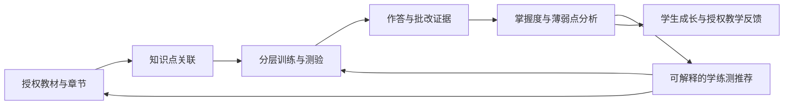
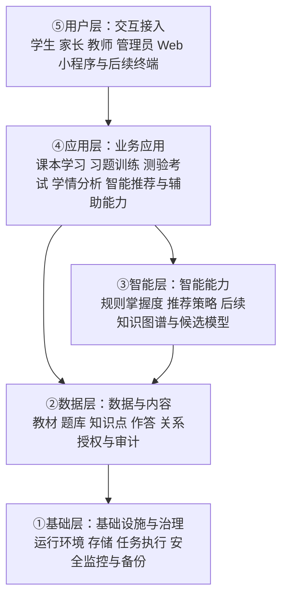

# 知阶 KnowLadder 项目方案

> 文档性质：品牌与产品规划评审稿，不代表已经实现的系统或已承诺的交付计划。  
> 配套文档：[技术架构方案](技术架构方案.md) · [UI/UX 设计方案](UIUX设计方案.md) · [交互原型方案](交互原型方案.md) · [文档导航](README.md)

## 1. 背景与方案状态

知阶 KnowLadder 希望连接课本、习题、测验与学习反馈，让学习不再只是完成一份份任务，而是形成可以回顾、分析和调整的成长路径。远期服务范围覆盖小学至大学，服务学生、家长、教师与平台管理者，并支持多端接入。

当前已有 `prototype/`独立演示及 `server/`、`web/`、`ops/`真实系统：NestJS与MongoDB支撑身份、会话和组织权限；阶段二教材、题库与私有文件续作已获授权，本地实施及必要验证已完成，最终 WSL2 全套72项通过，实际记录及Windows历史限制见技术架构方案第18.1.1节。测评、学情仍待后续实施，尚无生产部署或真实学习收益证据。项目LICENSE不自动赋予第三方教材、题库、字体或资源使用权。

本文区分以下状态：

- **用户原始方案**：品牌表达、远期能力版图与阶段设想，整理保留，不视为已上线能力。
- **[INFERENCE] 建议**：为形成可执行边界而提出的产品、技术或治理建议，需评审后才能作为实施依据。
- **待确认**：预算、内容授权、学科范围、指标门槛等尚未确定事项；不以虚构数字填补。

产品规划配套交互原型及真实账号系统第一阶段已按用户确认范围实现；未生成正式Logo、接入真实学习模型或采购云资源。运行与验证分别见交互原型方案及技术架构方案第19节，不将演示学习闭环视为正式学习业务已完成。

## 2. 目标与非目标

### 2.1 产品目标

1. 建立「课本 → 训练／测验 → 分析 → 推荐 → 再学习」闭环，将章节、知识点、题目与学习记录联系起来。
2. 为学生提供循序渐进、可解释的下一步学习选择，而不是只展示分数。
3. 为教师提供有数据依据的教学辅助，为家长提供可理解且不过度推断的成长反馈。
4. 保留小学至大学与多端扩展愿景，以学段适配而不是同一套界面、指标和内容覆盖所有人。
5. 建立统一品牌，让视觉、语言、功能与「一步步向上」的学习体验一致。

### 2.2 本次与首期非目标

- 当前已交付浏览器原型及真实账号系统第一阶段，未完成教材/测评/学情真实后端、内容授权谈判、模型训练或真实学生试点。
- [INFERENCE] 首期不同时交付所有学段、学科与业务端；这只是实施顺序建议，不删除远期愿景。
- 不承诺提分幅度、录取结果、升学或就业结果；不将掌握度估计等同于学生真实能力的完整描述。
- 不以 AI 替代教师判断、家长责任或专业升学咨询，不把模型生成内容未经审核作为标准答案。
- 不将全自动主观题评分、侵入式监考、强化学习推荐和开放内容生态作为首期默认前提。

## 3. 品牌体系

### 3.1 名称、定位与品牌内核

- 中文名称：**知阶**；英文名称：**KnowLadder**。
- 核心意象：知识构成阶梯，成长来自每一步被看见与支持。
- 使命：**让每个学生都拥有因材施教的智能学习阶梯。**
- 愿景：**成为从小学到大学最值得信赖的智能学习系统。**
- 价值观：**循序渐进、因材施教、数据驱动、陪伴成长。**
- 品牌人格：**老师 + 学伴 + 分析师**。老师提供方向，学伴给予支持，分析师解释证据；不居高临下，不用数据给学生贴固定标签。

### 3.2 Logo 概念与延展

统一概念为「**阶梯 + 知识树 + 上升箭头**」三合一：阶梯表达循序渐进，知识树表达知识联结，上升箭头表达成长方向。三者形成共同视觉语言，不要求在所有小尺寸图标中机械堆叠全部细节。

| 方向 | 原始设计要素 | 定位与使用 |
| --- | --- | --- |
| A：阶梯之光 | 三级渐宽阶梯，顶端一个发光点；整体呈「上」字变形，寓意从小学到大学不断向上 | 主 Logo；优先用于产品入口、启动页与正式品牌识别 |
| B：知阶树 | 阶梯构成树干，书本与知识点构成树冠 | 品牌延展；适用于成长报告、课程内容与学习空间插画 |
| C：智阶箭头 | 向上箭头内含阶梯纹理，尖端融入 AI 芯片 | 科技版本；适用于智能能力介绍、技术展示等场景 |

[INFERENCE] 建议以 A 为主标识，以 B、C 为同一品牌的延展，而非三个独立产品。正式设计需补充单色版、深浅底版、最小可识别尺寸、安全留白与应用图标，并验证小尺寸和无发光效果时仍可识别。本文件只规定概念，不声称已有矢量素材。

### 3.3 色彩与字体

| 类别 | 规范 | 使用建议 |
| --- | --- | --- |
| 主色 | `#1E6FFF` | 品牌识别、主要操作、当前学习路径 |
| 辅助色 | `#2ECC8F` | 成长、完成、正向反馈 |
| 强调色 | `#FF8A3D` | 重点提示、适量强调与行动引导 |
| 背景色 | `#F5F7FA` | 页面底色与信息分区背景 |
| 中文字体 | 思源黑体 Bold | 中文品牌字与重点标题 |
| 英文字体 | Montserrat / Inter | 英文品牌及界面排版候选 |

字体授权、具体分发来源、商用与嵌入条件均需核实，不能因字体名称常见就默认可随意打包分发。[INFERENCE] 建议正文使用清晰易读的常规字重与系统回退字体；色彩落地前检查文字和交互控件对比度，不能只靠红绿或颜色深浅传达正确、错误与进步。

### 3.4 口号体系

| 类型 | 文案 |
| --- | --- |
| 主口号 | **知阶而上，智达未来** |
| 英文口号 | **Climb with Knowledge, Reach the Future** |
| 学生 | 每一步，都算数 |
| 家长 | 看得见的进步，算得清的成长 |
| 教师 | 因材施教，AI 有据 |
| 功能 | 从小学到大学，一个系统全搞定 |
| 情感 | 你的学习阶梯，我们帮你搭 |

「从小学到大学，一个系统全搞定」保留为远期功能定位表达；[INFERENCE] 在未覆盖对应学段前，对外使用时应同步标明当前支持范围，不能让用户误以为全学段已经可用。「AI 有据」需要对应真实证据与能力范围；规则推荐阶段不得包装成已验证的先进模型效果。

### 3.5 关键场景使用规则

| 场景 | 品牌与内容规则 |
| --- | --- |
| 启动页 | 使用 A 主 Logo、知阶 KnowLadder 与主口号；英文口号按版面选用；不堆叠三种 Logo 或未经证明的效果数字 |
| 学生首页 | 使用「每一步，都算数」，突出当前章节、今天可完成的下一步与个人进步；情感口号用于引导或支持场景，不以排名制造焦虑 |
| 家长报告 | 使用「看得见的进步，算得清的成长」；同时显示统计周期、样本量、更新时间与缺失数据说明，先讲孩子自身变化，再讲可采取的支持行动 |
| 教师后台 | 使用「因材施教，AI 有据」；建议旁提供涉及知识点、作答证据和适用范围，允许教师修正或不采纳；科技版 C 可作延展，不取代关键操作信息 |

### 3.6 品牌故事

一位老师问：从小学到大学，究竟要走过多少级台阶？

有人想到十二年、四千多天，有人想到无数本课本、习题与试卷。但真正重要的答案不是一个整齐的数字，而是：**每一步，都需要被看见。** 十二年、四千多天是一段基础教育成长历程的叙事意象，不是对小学至大学总学制的精确计算。

有的台阶走得轻松，有的需要停下来再试一次。课本帮助学生认识新的知识，习题让理解变得具体，测验让已掌握与尚待巩固的地方显现。如果这些经历彼此孤立，学生看到的可能只有一次成绩；如果把它们连接起来，就能形成一条可以测量、分析、推荐与调整的学习路径。

知阶希望让 AI 帮助寻找适合学生的下一级台阶：不是替学生走路，不是把所有人推向同一个速度，而是让每一次练习有来由，每一份反馈可理解，每一步向上都有陪伴。

这就是知阶：知阶而上，智达未来。

### 3.7 语言风格示例

以下三类文案**仅为语气示意，不是实际用户反馈、模型输出、效果数据或已经实现的功能证明**。上线文案中的判断必须由真实记录支持。

| 人格 | 示例 | 边界 |
| --- | --- | --- |
| 老师 | 「先回顾这一节的例题，再试一道同类题；我们一步一步来。」 | 给出具体方法，不贬低、不承诺一次掌握 |
| 学伴 | 「这一步暂时有点难也没关系，我们一起看看哪里卡住了。」 | 支持情绪但不冒充真人、不制造依赖 |
| 分析师 | 「这组记录里，同一知识点仍有错误。建议先复习相关章节，再做一次短测。」 | 有记录才做判断；数据不足时明确说明，不虚构百分比或原因 |

原案面向三类用户的语言示例如下，**均仅为示意，不是已发生的效果；12 秒与 8% 不代表实测数据或效果承诺**。上线使用必须有真实数据支持，并说明比较口径与适用范围。

| 对象 | 原案示例 | 使用前提 |
| --- | --- | --- |
| 学生 | 「这道题你进步了12秒」 | 必须有可比的有效作答记录，不能把用时缩短直接等同于掌握提升 |
| 家长 | 「本周掌握度提升8%」 | 必须有真实掌握度记录，明确基准、统计周期及相对百分比与百分点的区别；数据不足时不得展示 |
| 教师 | 「班级薄弱点集中在函数单调性」 | 必须有该班级相关知识点的足够有效样本，并提供分析证据，不能由其他班级或单个学生情况推断 |

## 4. 用户角色与多端版图

| 角色／入口 | 主要任务 | 数据与责任边界 |
| --- | --- | --- |
| 学生 | 阅读教材、练习、测验、回顾错题、查看计划与成长、选择推荐任务 | 主要访问自己的学习数据；允许查看推荐理由与纠错，不把建议当强制结论 |
| 家长 | 查看经授权的孩子周月报、轨迹与支持建议，参与家校沟通 | 需验证监护或授权关系；不能自行搜索任意学生，不默认查看成年大学生数据 |
| 教师 | 布置练测、查看所授班级分析、提供反馈、调整教学安排 | 限定学校／班级／授课关系；跨班跨校访问必须有明确授权 |
| 管理员／内容运营 | 维护教材题库与知识点、审核发布、管理账号角色与内容授权 | 区分内容管理与敏感数据权限；关键操作留痕，不默认可随意浏览所有学生记录 |
| 小程序及其他终端 | 提供适合移动场景的学习、提醒、报告入口 | 是接入形态而非新增权限角色；跨端保持身份、授权与数据口径一致 |

[INFERENCE] 建议首期采用学生 Web 与最小内容管理 Web；家长、教师完整业务端在 V1 推进，小程序及其他终端结合真实需求安排。此建议不改变远期多角色、多端目标。

2026-09-19 进度：首期学生 Web 与最小内容管理 Web 的页面结构、布局和交互状态见 [UI/UX 设计方案](UIUX设计方案.md)；Vue 原型已实现，场景、接口缺口、运行方法与浏览器验证见 [交互原型方案](交互原型方案.md)。演示不表示真实后端已实现，家长与教师完整业务端仍按 V1 规划。

## 5. 核心学习闭环

闭环需要能回答：学生学了什么、做了哪些题、批改依据是什么、分析基于哪段数据、为什么推荐下一步，以及下一次学习后发生了什么变化。

[INFERENCE] 建议将题目、教材、答案和分析规则的版本与学习记录关联。无作答证据时显示「待诊断／数据不足」，不默认掌握度为零；分析或推荐尚未生成时展示处理状态，不把旧结果伪装成最新结论。推荐须遵守授权内容与学段范围，无法生成时提供明确的章节学习入口，而不是返回不相干资源。

## 6. 五大核心功能

### 6.1 课本学习（电子课本）

- 按学段、年级、学科、教材版本、章节组织内容，支持章节阅读与定位。
- 支持学生标注、笔记与回看，并明确私人笔记和共享批注的边界。
- 章节关联微课、知识点、训练题与测验，允许从错题或推荐反向回到教材。
- [INFERENCE] 首期聚焦已获授权的初中数学章节与题测关联；微课、复杂批注和多教材版本按资源就绪情况分批开放。无授权的教材不得因技术可上传而默认可使用。

### 6.2 习题训练（智能训练）

- 提供基础、提升、挑战分层，按知识点、难度、题型进行选题与组卷。
- 自适应训练依据作答与掌握证据调整后续题目，不将「答错一次」等同于能力低下。
- 允许学生看解析、回到章节、重做或换同类题；区分初次作答与重做记录，避免反复刷同一道题造成虚假进步。
- [INFERENCE] 首期采用可审查的分层规则与推荐理由；后续以真实学习收益评估自适应策略，而不是只优化完成时长或点击次数。

### 6.3 测验考试（智能测验）

- 覆盖单元、期中、期末、模拟与随堂测场景，支持题目编排、提交、批改、成绩与能力雷达展示。
- 自动批改与人工复核明确分工；[INFERENCE] 首期只对规则明确的客观题自动批改，主观题未来引入教师复核与申诉机制。
- 防作弊能力属于降低风险而非保证杜绝作弊；[INFERENCE] 建议按场景采用抽题、题序随机、计时、重复提交保护与异常提示。异常记录不能直接判定学生作弊，摄像头等侵入式监控不作为默认方案。
- 雷达维度需有学科依据与足够样本，不将不可比较的不同试卷成绩直接绘制成「进步」结论。

### 6.4 学情分析（学习分析）

| 视角 | 能力规划 | 解释与隐私要求 |
| --- | --- | --- |
| 个人 | 知识点掌握度、学习曲线、能力雷达、阶段薄弱点 | 显示周期、样本、更新时间与估计性质；掌握度不等于考试分数 |
| 班级 | 知识点热图、排名与成绩分布、共性问题、教学建议 | 限授权教师；排名不公开羞辱学生，缺考与小样本单独解释 |
| 家长 | 周报、月报、学习轨迹、阶段对比与陪伴建议 | 基于有效关系授权；优先个人历史对比，群体对比应聚合且防止识别其他学生 |

[INFERENCE] 建议以可解释的规则掌握度作为基线；有效作答不足时保持未知。报告应区分观察事实、推断与行动建议，不把学习时长等同于努力程度，不根据单次成绩推断人格或心理状态。

### 6.5 智能推荐（个性化推荐）

推荐覆盖「学什么、练什么、测什么」：章节与微课、针对性习题、阶段诊断与复测。每次推荐应有来源、理由与适用范围，允许用户跳过或教师调整。

[INFERENCE] 建议演进顺序：先以规则推荐与可解释掌握度验证闭环，再逐步评估知识图谱、BKT、DKT、协同过滤和强化学习等方法。它们是候选路径而不是必选清单；是否采用取决于数据规模、内容标注质量、隐私条件、可解释性和评估收益。冷启动、稀疏记录和跨学段迁移需单独验证，未经验证不宣称算法能「精准提分」。

## 7. 五项辅助能力

| 能力 | 使用角色与价值 | 范围与边界 |
| --- | --- | --- |
| 错题本 | 学生整理错题、查看解析、重练与归因；教师查看授权范围内的共性错误 | 自动收集与手动整理结合；系统推断错因需标识，不替代学生反思；删除展示项不应悄悄改写历史测验成绩 |
| 学习计划 | 学生制定任务与节奏，教师安排学习任务，家长提供支持 | 支持调整与休息；提醒适量；不默认无限加练，不将逾期变为惩罚性标签 |
| 成长报告 | 学生理解进步，家长观察轨迹，教师回顾教学反馈 | 与核心分析共用口径而非重复计算；提供周期、证据和不足说明；分享或导出时控制隐私 |
| 家校互通 | 家长与教师围绕授权学生沟通任务、反馈与支持策略 | 限定关系与消息可见性，设置通知边界；不作为紧急求助通道，不泄露其他学生情况 |
| 激励机制 | 学生通过适当的徽章、阶段目标和正向反馈建立学习习惯 | 鼓励过程与个人进步，避免公开羞辱、强制连续打卡、成瘾式刺激及付费竞争 |

[INFERENCE] 首期可围绕错题回看与简单下一步任务支撑闭环；完整计划、周期报告、家校互通与激励体系随角色和内容能力逐步推进。

## 8. 分学段适配策略

| 学段 | 学习重点 | 交互与能力规划 | 需守住的边界 |
| --- | --- | --- | --- |
| 小学 | 兴趣、基础知识与学习习惯 | 适龄游戏化、语音、动画、基础诊断、短任务与正向反馈 | 关注阅读和操作负担；避免过量屏幕时间；不以竞争排名替代兴趣培养 |
| 初中 | 体系化学习、应试基础与分层巩固 | 基础／提升／挑战、错题知识图谱、中考相关训练与复习路径 | 教材与地区考试要求需匹配；首期建议初中数学，并非已确认全部年级或教材版本 |
| 高中 | 提分目标、冲刺复习与能力结构 | 真题、模拟、限时训练、能力诊断与志愿建议 | 真题授权与时效需要核实；志愿建议仅辅助参考，不作为确定决策或录取保证 |
| 大学 | 专业深化、课程拓展与职业探索 | 专业课程、论文学习支持、考证、专业知识图谱与职业路径 | 尊重学术诚信，不代写论文；职业路径不是就业保证；成年学生数据不默认向家长开放 |

全学段适配不仅是扩充题库，还包括课程标准、题型、能力维度、内容审核、交互、数据解释与权限关系的变化。不得将初中数学分析规则不加验证地复制到其他学段。

## 9. 五层系统概览

以下为 **[INFERENCE] 建议架构**，用于表达产品能力分工，并非现有部署事实。

API 使用 **NestJS + TypeScript**、主数据库使用 **MongoDB**，为用户已明确的选型。[INFERENCE] 建议以 Vue 3 + TypeScript + Vite 构建首期 Web，以 NestJS 模块化单体和独立 worker 承载业务与异步任务，MongoDB 副本集支持提交与 outbox 事务，Redis 按需要引入。教材、图片与导出建议使用私有持久文件卷，多机部署改用共享文件系统，或使用 OSS/COS 原生接口，不强制依赖 S3；文件元数据存入 MongoDB。知识点与先修边首期存 MongoDB，只有复杂多跳查询经验证有必要时才引入 Neo4j 作为可重建查询投影。后续扩展多端与独立模型服务，不改变业务数据库的唯一事实源。分层是职责划分，不意味着首期必须拆成五个服务。详细选型、模块、数据与权限方案见[技术架构方案](技术架构方案.md)。

## 10. 分阶段路线图

以下时间窗口来自用户原始规划，用于讨论优先级，**不是已经确认的工期或交付承诺**。起算点、团队配置、内容授权与预算均待确定；各阶段应以验收和资源评估推进，不能为了日期强行宣称完成全学段。

| 阶段 | 原始时间设想 | 阶段目标 | [INFERENCE] 建议进入下一阶段的条件 |
| --- | --- | --- | --- |
| MVP | 0—3 月 | 初中数学核心闭环 | 已授权内容可使用；学生与最小内容管理 Web 跑通章节、客观题练测、分析与规则推荐；关键权限与结果一致性通过验收 |
| V1 | 3—6 月 | 多学科、家长与教师业务端 | 新学科标注与分析口径完成审核；班级、监护关系与报表权限可验证；形成有效使用反馈 |
| V2 | 6—12 月 | 向全学段扩展，验证 AI 与知识图谱 | 分学段具备内容、交互和评估能力；候选模型相对基线有可核实收益，无明显安全与公平性退化；可按学段分批开放 |
| V3 | 12 月以后 | 开放内容生态与硬件拓展 | 内容准入、授权、质量审核与治理机制成熟；接口、合作设备安全和运营责任明确 |

V2 的「全学段」是方向目标，不要求在第 12 个月前不计条件一次性上线全部学段。BKT、DKT、协同过滤、强化学习可以分别验证、延期或不采用，不以模型数量作为阶段完成标准。

## 11. 可观察验收与指标口径

### 11.1 文档验收

- 品牌名称、三种 Logo 概念、色彩字体、口号、故事、使命愿景价值观与场景语言完整可查。
- 五大核心、五项辅助、四个学段、角色权限与多端愿景均有明确描述。
- 已知事实、原始愿景、建议和待确认事项可区分；未将规划描述为已实现能力。
- 项目方案与技术方案使用一致的首期边界、算法演进原则和路线图定位；可通过相对链接查阅。

### 11.2 [INFERENCE] 建议首期产品验收场景

| 场景 | 可观察的通过条件 |
| --- | --- |
| 内容发布与学习入口 | 内容管理员可发布一组具备授权信息的章节与题目；学生只能看到已发布且有权访问的内容；章节能进入对应练习 |
| 训练与客观题批改 | 学生完成基础／提升／挑战范围内的可用训练；提交后获得与审核答案、评分规则一致的结果与解析；同次提交不产生重复计分 |
| 测验完成与成绩追溯 | 在首期支持的测验场景完成开始、作答、提交和结果查看；能够关联题目与评分规则版本；异常或未完成状态不会展示成有效成绩 |
| 分析证据 | 能从掌握度展示追溯到适用知识点、作答样本、规则版本与更新时间；新学生显示数据不足而不是虚构结论 |
| 推荐闭环 | 学生获得当前支持范围内的学／练／测建议，能查看理由并进入对应任务；再次作答后分析按约定更新，处理延迟有状态提示 |
| 错题回看 | 错题与原始作答、解析、对应章节保持关联；重做记录与原测验成绩分开，避免覆盖原始证据 |
| 权限隔离 | 学生不能读取他人记录；内容管理员不能借内容权限获取无关学生信息；无权限访问被拒绝并保留适当审计记录 |
| 内容与服务异常 | 无题、未授权内容、重复提交、网络中断及后台任务失败均有明确状态，不静默丢失已确认提交，也不返回伪造分析 |

未来家长、教师与多端能力应各自验收授权绑定／解除、班级关系变更、报告统计口径、跨端数据一致性和失效权限处理，不能以首期闭环验收代替。

### 11.3 指标定义与使用原则

以下是 **[INFERENCE] 建议指标**，用于建立可量化评估方式；当前没有实测基线或目标值。发布前应由产品、教研和技术共同确认统计窗口、门槛与样本要求。

| 指标 | 建议定义 | 解读限制 |
| --- | --- | --- |
| 内容关联覆盖率 | 目标范围内已审核且关联章节和知识点的可用题目数 ÷ 目标范围内可用题目总数 | 分母为零时标记不适用；同时报告分母，不能以少量内容冒充高覆盖 |
| 学习闭环完成率 | 窗口内完成学习入口、有效作答、查看分析并进入下一推荐任务的学生数 ÷ 同窗口进入该学习入口的学生数 | 固定去重口径与完成时间窗；排除测试账号，不等同于学习效果 |
| 客观题评分一致率 | 基准作答集中自动批改与审核标准一致的作答数 ÷ 基准作答总数 | 基准集需覆盖题型和边界；不能只用正常输入证明可靠性 |
| 分析更新时延 | 从有效提交被确认到其分析结果可读取的耗时，报告分位数及失败比例 | 不只统计成功任务，不掩盖积压或重试 |
| 推荐有效进入率 | 被用户进入的有效推荐项数 ÷ 展示给用户的有效推荐项数 | 去重与曝光口径需固定；点击不是掌握或提分证据 |
| 知识掌握变化 | 对同知识点、可比题目集合，比较前测与后测的有效作答表现并报告样本与间隔 | 控制重复题记忆、难度和样本偏差；仅凭前后变化不能确认因果 |
| 授权隔离通过情况 | 约定权限用例中被正确允许／拒绝的数量及失败项 | 报告具体未通过场景；关键越权为上线阻断项，不能用平均通过率掩盖 |
| 用户反馈问题率 | 固定窗口中被确认的内容、批改或推荐问题数 ÷ 对应有效使用量 | 分类型统计；投诉少不自动证明质量高，需保留反馈入口 |

若做模型效果或学习收益试验，应预先定义对照基线、分组、最小样本条件、退出与保护机制、评价周期及隐私边界。不能用留存、刷题量或使用时长替代学习质量。

## 12. 风险与治理

| 风险 | 影响 | [INFERENCE] 建议措施 |
| --- | --- | --- |
| 教材、真题、微课与字体授权不足 | 内容下架、侵权与产品无法交付 | 建立授权来源、范围、期限与撤回机制；发布前审核，不把仓库 LICENSE 当成第三方内容授权 |
| 未成年人隐私与关系越权 | 学习记录外泄、不当画像 | 最小收集、明确告知、按适用法律处理监护授权；区分学生、监护人与授课关系；记录与撤销授权 |
| 数据稀疏与误判 | 不准确的掌握度、错误推荐 | 冷启动显示未知，保留规则基线和人工反馈；展示样本与解释，不强行量化 |
| 内容质量与批改错误 | 误导学习、失去信任 | 教研审核、版本留痕、问题反馈与更正机制；主观题和模型内容谨慎引入 |
| 算法偏差与推荐单一 | 弱化挑战机会，固化学生标签 | 分群与分学段评估，保留探索与用户选择；不能持续将学生锁定在低难度内容 |
| 防作弊误报与过度监控 | 不公平处罚、隐私侵害 | 风险提示与人工复核；遵循必要性，不将行为异常直接作为作弊结论 |
| 排名、激励与报告造成焦虑 | 伤害学习体验 | 优先个人成长，不公开羞辱；避免惩罚式打卡，保持可理解和非诊断式表述 |
| 全学段与多端范围膨胀 | 内容、教研与开发资源失配 | 阶段评审与分批开放，不以日期或算法堆叠代替交付质量 |
| 服务或异步任务失败 | 记录丢失、分析滞后与重复结果 | 明确提交与处理状态、故障恢复和备份；具体实现与验收见技术文档 |
| 升学、职业与论文辅助越界 | 不当决策依赖、学术诚信问题 | 明示参考性质和适用范围；提供来源与时效，不代写、不保证录取或就业 |

## 13. 待确认事项与后续评审

| 事项 | 需要确认的结果 | 影响 |
| --- | --- | --- |
| 首期产品边界 | 是否接受初中数学、学生与最小内容管理 Web 的建议；具体年级、教材版本及章节范围 | 内容、工期、验收与试点用户 |
| 目标用户与试点 | 面向个人家庭、学校或培训场景；目标地区与试点组织方式 | 角色关系、合规、测验形式与商业路径 |
| 内容资源 | 教材、题库、微课、真题来源及授权预算，教研审核责任人 | 可上线范围与质量保障 |
| 品牌落地 | Logo A/B/C 的正式设计、字体授权、名称与商标可用性 | 视觉资产与对外发布 |
| 统计与学习模型 | 知识点体系、掌握度定义、报告维度、规则与后续模型评估方法 | 结果可解释性与跨学科可比性 |
| 隐私与使用关系 | 适用地区、未成年人及成年学生授权规则、保留期限、导出与删除流程 | 数据模型、权限与运营流程 |
| 测验边界 | 首期支持哪些测验类型、是否计时、复核流程、防作弊强度 | 批改与状态流转复杂度 |
| 资源与排期 | 人员、预算、内容准备程度、阶段起算点与阶段评审人 | 路线图能否转化为可执行计划 |
| 指标与发布门槛 | 各指标窗口、基线获取方式、性能目标、试点评估和阻断条件 | 是否具备正式上线与扩展依据 |
| 商业与生态 | 收费方式、内容合作、硬件接入需求及支持责任 | V3 的开放边界与治理要求 |

建议评审顺序：确认品牌和产品愿景 → 确认首期边界与内容授权 → 评审技术架构及安全要求 → 明确指标和资源 → 用户确认实施范围后进入开发。任何未确认事项都不应在文档转实施时被悄悄视作已批准决定。
